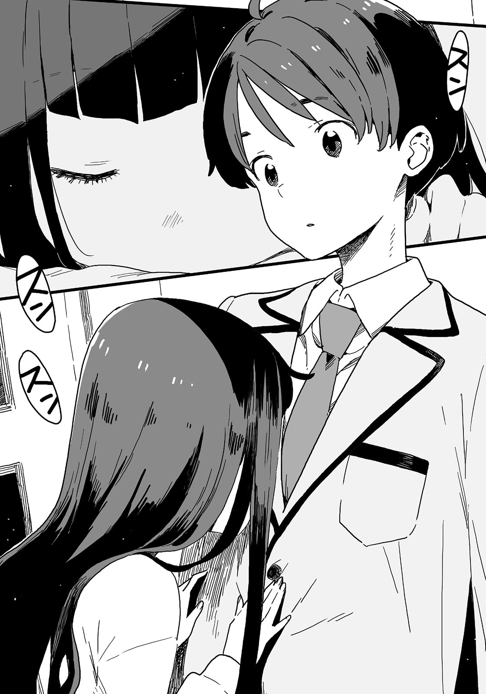

# Ch.4 — เล่ม4 บทที่ 1-3

Ch.4 — เล่ม4 บทที่ 1-3

By Monica

Published: 2024-11-21T03:56:17Z

Source: https://www.nekopost.net/novel/14560/4

เล่ม4 บทที่1-3

ผมเหนื่อยมาก

พอกลับถึงบ้าน ก็แทบไม่มีแรงจะขึ้นไปชั้นสอง เลยทิ้งตัวลงนอนบนโซฟาในห้องนั่งเล่น

แผนของผมคือการใช้เวลาช่วงวันหยุดฤดูหนาวอย่างสงบสุข ไม่คิดเลยว่าจะถูกลากเข้ามาในเรื่องสุดวุ่นวายนี้

ผมมาถึงจุดนี้ได้ยังไงกันนะ? ผมคิดถึงเรื่องนั้นอยู่ แล้วก็เห็นแบนเนอร์ที่เขียนด้วยลายมือแปะอยู่บนผนัง

<วันเกิดของนุคุมิซึ คาซึฮิโกะอีก 8 วัน>

ตัวเลขสามารถแกะออกได้ เป็นดีไซน์แบบนับถอยหลัง

...ฮะฮะ นี่คงเป็นผลงานของคาจูสินะ? ปีนี้เธอพัฒนาขึ้นเรื่อย ๆ จริง ๆ

ผมรู้สึกอบอุ่นในใจที่ได้เห็นการเติบโตของน้องสาว ระหว่างนั้นประตูห้องนั่งเล่นก็เปิดออก

[ ท่านพี่คะ หนูกลับมาแล้ว! ]

คาจูเดินเข้ามาในห้องนั่งเล่น มือเต็มไปด้วยของทำอาหาร

[ กลับมาแล้วเหรอ? วันนี้มาช้านิดหน่อยนะ ]

ผมลุกขึ้นไปช่วยถือของทำอาหารจากมือเธอ

[ ขอบคุณค่ะ แหะ ๆ เราเหมือนคู่บ่าวสาวเลยเนอะ ]

ผมเมินมุขของคาจู แล้วนำของไปเก็บในตู้เย็น

[ นี่เยอะมากนะ คาจูจะทำของหวานเหรอ? ]

[ ใช่ค่ะ ท่านพี่ วันก่อนวันเกิด ก่อนวันก่อนวันเกิด ก่อนวันก่อนวันก่อนวันเกิด... เออ หนูคิดว่าจะทำเค้กทุกวันตั้งแต่วันนี้เลยค่ะ ]

[ เอาเถอะ ทำแค่ในวันเกิดพี่ก็พอ ยานามิซังไม่ได้อยู่ที่นี่ด้วย ถ้าทำทุกวันพี่กินคนเดียวไม่หมดหรอกนะ ]

[ อืม งั้นสุดสัปดาห์นี้เชิญเธอมากินด้วยดีมั้ยคะ? ให้คาจูไปทักทายเธอดีมั้ย? ]

การไปเจอยานามิสุดสัปดาห์จะเป็นภาระมาก ถ้าแค่เอาไว้ที่ประตูแล้วให้เธอมาหยิบไปเองตอนเที่ยงคืน...

[ เหมือนว่า ยานามิซังกำลังอยู่ในช่วงลดน้ำหนัก…ขอให้เป็นแบบนั้นเถอะ พ่อกับแม่คงกลับดึก เดี๋ยวพี่จะทำอาหารเย็นเอง ]

[ แน่ใจเหรอคะ? งั้นคาจูขอสั่งแกงกะหรี่แห้งของท่านพี่ค่ะ ]

[ ได้เลย มีเนื้อสับในตู้เย็นอยู่ใช่มั้ย? ]

แล้วรอยยิ้มของคาจูก็จางหายไปทันที

[ เป็นอะไรเหรอ คาจู? ]

[ ท่านพี่ วันนี้ไปไหนมาคะ? ]

[ อ๋อ วันนี้มีเรื่องนิดหน่อย ก็เลยไปที่คาเฟ่- ]

ฟุดฟิด ฟุดฟิด คาจูซุกหน้าเข้ากับอกของผมแล้วเริ่มดม

[ กลิ่นกาแฟกับชีสเค้ก แล้วก็... กลิ่นน้ำหอมผู้หญิงด้วยค่ะ ]

[ เอ๋? ผู้หญิงเหรอ? ]

คาจูกลับมายิ้มอีกครั้ง เธอเงยหน้าขึ้นมามองผม

[ ใช่ค่ะ มีแป้งเครื่องสำอางติดอยู่ตรงปกเสื้อของท่านพี่ด้วย ยานามิซังไม่ใช้แป้งนี้ตอนอยู่ที่โรงเรียนใช่มั้ยคะ ? งั้นแสดงว่าไปเจอผู้หญิงคนอื่น? ]

ถึงจะไม่รู้เรื่องเครื่องสำอางของยานามิ แต่ก็คงเป็นของรุ่นพี่ชิกิยะแหละ ? บางทีอาจติดมาจากตอนที่ผมประคองเธอไว้ที่ห้องโถง

[ เอ่อ ก็แค่ไปคุยกับคนรู้จักเท่านั้นเอง ]

[ แล้วแป้งมาจากไหนล่ะคะ? ท่านพี่ คุยกับเธอแบบไหนกันแน่? ]

รอยยิ้มของคาจูดูไม่สบายใจเลยตอนที่เธอถามแบบนั้น แรงกดดันนี่มันอะไรกัน?

[ แค่ประคองเธอเพราะสุขภาพเธอไม่ดีเฉยๆ ยานามิซังก็อยู่ด้วยตอนที่พวกเราไปคาเฟ่ ]

[ อ๊ะ ยานามิซังก็อยู่ด้วยเหรอ! ขอโทษค่ะ คาจูคงได้ยินอะไรที่คาดไม่ถึงแล้วค่ะ ]

ผมว่าคงจะมีอะไรที่เธอคาดไม่ถึงจริง ๆ

[ งั้น เรารีบซักเครื่องสำอางที่ติดเสื้อออกเลยดีกว่า เอาล่ะ ถอดออกมาเถอะค่ะ ]

จู่ ๆ คาจูก็ดูอารมณ์ดีอย่างบอกไม่ถูก เธอจัดการถอดเสื้อแจ็คเก็ตของผมออกอย่างรวดเร็วและจ้องมองมัน

[ มันเลอะขนาดนั้นเลยเหรอ? ]

[ ...ไม่ต้องห่วงค่ะ คาจูจะจัดการเอาออกให้เรียบร้อยเอง ]

คาจูกอดเสื้อแจ็คเก็ตของผมไว้ ใบหน้าเธอเปี่ยมไปด้วยรอยยิ้ม

◇

วันต่อมา ผมแอบมองห้องสภานักเรียนจากมุมทางเดินหลังเลิกเรียน

ตามข้อมูลที่ได้จากชิกิยะซัง ห้องสภานักเรียนกำลังจะไม่มีคนอยู่

...แน่นอน นี่ไม่ใช่เรื่องบังเอิญ ชิกิยะซังจัดการเรื่องนี้ล่วงหน้าให้เราแล้ว เราต่างก็เข้าใจตรงกันว่าไม่ควรติดต่อกันโดยตรง

ยานามิโผล่หน้าออกมาจากใต้แขนของผมเล็กน้อย

[ นี่ เราต้องรออีกนานแค่ไหนล่ะ? ]

[ ช่วยเงียบหน่อย ยานามิซัง อีกเดี๋ยวสองคนนั้นก็จะออกมาแล้ว- ]

แกร๊ก ประตูห้องสภานักเรียนเปิดออก รองประธาน เทียร่า บาโซริ เดินออกมา

จากนั้น ชิกิยะซังก็เดินตามออกมา เธอเหลือบมองมาที่พวกเราก่อนจะตามเธอออกไป

...ดีล่ะ ห้องสภานักเรียนว่างแล้ว ผมกับยานามิมองหน้ากัน

พวกเราแอบเข้าไปในห้องสภานักเรียน โดยไม่ให้ใครเห็น

หลังจากปิดประตู ผมมองไปรอบๆ ห้อง

โต๊ะประธานอยู่ด้านหลังของห้อง ถัดจากโต๊ะยาว เป็นโต๊ะไม้เก่าและเก้าอี้ตัวใหญ่ ชั้นวางของและล็อกเกอร์ตั้งอยู่ข้างกำแพง

ยานามิเดินไปกลางห้องอย่างตื่นเต้น

[ มันเหมือนกับเรากำลังทำเรื่องไม่ดีเลยนะ รู้สึกตื่นเต้นดี ]

[ ก็เรากำลังทำเรื่องไม่ดีจริงๆน่ะสิ ]

— นี่คือแผนของพวกเรา

ชิกิยะซังจะพาเทียร่าออกไปในช่วงเวลาที่เหมาะสม แล้วเราก็จะแอบเข้าไปในห้องสภานักเรียน จากนั้นพวกเราจะตรวจสอบล็อกเกอร์ของเทียร่า

ถ้าดีที่สุด เราจะเจอโดจินชิอยู่ข้างใน ถ้าไม่เจอ อย่างน้อยก็จะรู้ถึงความชอบและความลับของเทียร่า นี่คือจุดเริ่มต้นของการโจมตีครั้งต่อไป

[ ชั้นบนสุดลำดับที่สองจากขวา...งั้น อันนี้สินะ? ]

ผมพึมพำกับตัวเองเพื่อกลบความรู้สึกผิดขณะเอื้อมมือไปที่ล็อกเกอร์

[ นุคุมิซึคุง เราไม่จำเป็นต้องอุตส่าห์พาคนออกไปข้างนอกเลย ทำไมเราไม่มาหารุ่นพี่ชิกิยะตอนอยู่คนเดียวล่ะ? ]

[ มีข่าวลือว่า บาโซริซังจะล็อกล็อกเกอร์ก่อนกลับบ้าน ตามที่รุ่นพี่ชิกิยะบอก เธออาจซ่อนอะไรบางอย่างไว้ข้างในก็ได้ ]

ถึงจะรู้สึกสับสน แต่ต้องรีบตรวจสอบให้เสร็จก่อนสองคนนั้นจะกลับมา

ดูเหมือนว่านอกจากประธานแล้วยังมีเหรัญญิกในสภานักเรียนด้วย เหรัญญิกดูเหมือนจะออกไปตรวจสอบชมรมกีฬาตอนนี้ ถือเป็นโอกาสที่หายากจริง ๆ ผมจะพลาดไม่ได้เลย

ไม่ใช่ว่าผมอยากแอบดูในล็อกเกอร์ของผู้หญิงแน่นอน เชื่อผมเถอะ

ผมเปิดล็อกเกอร์เงียบๆ ข้างในมีหนังสือและเอกสารจัดเก็บไว้อย่างเรียบร้อย

นิตยสาร กระเป๋าเครื่องสำอางของผู้หญิง ฯลฯ ไม่มีของที่เชื่อมโยงกับ “ความบันเทิง” เลย

ยานามิที่อยู่ข้างๆผมมองเข้าไปในล็อกเกอร์

[ อืม ล็อกเกอร์นี้เต็มไปด้วยความมีวินัย บางทีบาโซริซังอาจจะเหมือนฉันอย่างไม่คาดคิดก็ได้นะ ]

[ ยังไงล่ะ? ]

[ นายไม่เข้าใจหรอก นุคุมิซึคุง ถ้าเก็บขนมไว้ในล็อกเกอร์ ฉันคงกินจนหมดแล้ว นั่นเป็นเหตุผลที่ฉันไม่เก็บไว้ ]

ไม่มีอย่างอื่นที่ผู้หญิงคนนี้จะใส่ในล็อกเกอร์นอกจากขนมงั้นเหรอ?

[ เอาล่ะ เข้าใจแล้ว ช่วยมองหน่อยสิ ผมแตะของของผู้หญิงไม่ได้ ]

[ ไม่เป็นไรหรอก ล็อกเกอร์นี้เหมือนล็อกเกอร์ของครูมากกว่าของผู้หญิงอีก นุคุมิซึคุง ดูนั่นสิ ถุงกระดาษตรงนั้นคืออะไรน่ะ ? ]

มีถุงกระดาษจากร้านหนังสือวางอยู่ระหว่างหนังสือและเอกสาร ดูเหมือนว่ามีอะไรสำคัญอยู่ข้างใน

ผมลังเล แต่ก็หยิบมาดู ข้างในมีข้อสอบ

[ นี่มัน...ข้อสอบและคะแนนทั้งหมดตั้งแต่เดือนเมษา...? ]

นี่มันละเมิดความเป็นส่วนตัวเกินไปแล้ว ผมจึงรีบเก็บถุงกระดาษกลับที่เดิม

พวกเราตรวจดูอีกครั้ง แต่สิ่งที่เหลืออยู่ดูเหมือนจะเป็นเอกสารของสภานักเรียนทั้งนั้น

อย่างน้อยพวกเราก็รู้แล้วว่าเทียร่าซังเป็นคนจริงจัง ไม่มีเบาะแสอื่นอีกแล้ว

ผมถอนหายใจอย่างโล่งใจและปิดล็อกเกอร์

[ นุคุมิซึคุง มีอะไรหล่นลงมา ]

ยานามิก้มลงเก็บกระดาษแผ่นเล็กขึ้นมา

นี่อะไรอีก? กระดาษใบนี้ดูคุ้นๆ-

ในตอนนั้นเอง ประตูห้องสภานักเรียนก็เปิดออกทันที มีนักเรียนเข้ามาก่อนที่พวกเราจะทันเตรียมตัว

ยานามิยัดกระดาษลงในกระเป๋าผมแล้วหันกลับไปอย่างรวดเร็ว

[ ...เอ๋ พวกเธอมาทำอะไรที่นี่? ]

คนที่เข้ามาปัดผมของเขาออกและยิ้มอย่างสงบ

ดูจากเนคไทและเครื่องแบบ เขาน่าจะเป็นผู้ชาย...ใช่มั้ย ?

ไม่แปลกใจที่ผมรู้สึกงงในตอนแรก เขามีหน้าตาที่ดูนุ่มนวลและตัวเล็ก พร้อมกับท่าทางที่อ่อนโยน จะว่าไปแล้ว เขาดูเหมือนผู้หญิงมากกว่ายานามิซะอีก

[ เอ่อ ก็... ]

ผมพูดติดอ่าง ยานามิก็ดันผมออกและก้าวไปข้างหน้า

[ รุ่นพี่ชิกิยะบอกให้พวกเรามาที่นี่ เราก็เลยรอเธออยู่ ]

ยานามิตอบด้วยรอยยิ้ม

[ งั้นเหรอ นี่ ฮิบะเน่ รู้มั้ยว่ายูเมโกะซังอยู่ที่ไหน? ]

[ ไม่รู้สิ ชิกิยะเธอค่อนข้างเป็นคนรักอิสระ สองคนนั้นนั่งรอเธอหน่อยดีมั้ย? ]

หลังจากนั้น มีเด็กสาวร่างสูงอีกคนเดินเข้ามาในห้อง

เธอคือประธานสภานักเรียนโฮโคบารุ ฮิบาริ ตรงข้ามกับรูปลักษณ์ที่แข็งแกร่งของเธอ เธอเป็นนักเรียนปีสองที่แปลกประหลาดอยู่ไม่น้อย

ถ้าพวกเราออกไปทันทีคงน่าสงสัย พวกเราจึงนั่งลงตามคำแนะนำของเธอ

เด็กหนุ่มยิ้มพร้อมกับหยิบถ้วยชาออกมาจากชั้นวาง

[ เด๊่ยวผมจะไปชงชาให้ รอสักครู่นะ  ]

[ ไม่เป็นไร ไม่ต้องทำให้ยุ่งยากหรอก เอ่อ- ]

...เขาเป็นใครเนี่ย? ผมไม่ได้เห็นเขาในที่ประชุมประธานสภาครั้งนั้น

เขาสังเกตเห็นว่าผมมองอยู่ แล้วยิ้มอย่างขวยเขิน

[ ผมเป็นเหรัญญิก ฮิโรโตะ ซากุไร ไม่ได้เข้าประชุมเพราะไม่ชอบที่คนเยอะ ยินดีที่ได้รู้จัก ]

[ อ๋อ สวัสดีครับ ...นุคุมิซึ จากชมรมวรรณกรรม ]

คนนี้ดูเหมือนจะเป็น “หนุ่มน้อยซากุไร” ที่ชิกิยะซังเคยพูดถึง

ดูเหมือนเขาจะเต็มไปด้วยความเหนื่อยล้า ทำให้เขาดู…..ลามกนิดหน่อย

...แน่นอน ผมไม่ได้หมายถึงในทางนั้น ผมแค่บอกความจริง

ประธานยื่นมือมาข้างๆ ซากุราไรคุงขณะที่เขากำลังเตรียมชา

[ เอาล่ะ คราวนี้ให้ฉันชงบ้างนะ ฮิโรโตะ ]

[ ฮิบะเน่ ถ้าพลิกถุงใบชาขึ้นจากด้านล่าง- ]

อา ประธานเพิ่งทำถุงใบชาหกลงไปทุกที่เลย

หลังจากนั้น ซากุไรคุงก็ต้องทนปวดท้องตลอดจากเหตุการณ์เล็กๆ ที่เกิดขึ้น

[ เดี๋ยวค่อยทำความสะอาดทีหลัง ทำชาให้เสร็จก่อนเถอะ ]

[ ฮิโรโตะ ฉันยังไม่ได้ทำอะไรเลย แต่ด้ามจับกาน้ำชาก็หักซะแล้ว ]

[ ...นี่มันแย่จริงๆ ให้ผมจัดการเองเถอะ ช้าๆหน่อยสิ ฮิบะเน่ ]

[ ถ้วยชาก็แตกด้วย ทั้งที่ฉันไม่ได้ทำอะไรเลยนะ ]

เราล่ำลาและออกจากห้องสภานักเรียนเมื่อถ้วยชาใบที่สามแตก

◇

หลังจากนั้น เราก็กลับมาที่ห้องชมรม ผมวางศอกบนโต๊ะและไขว้นิ้วมือไว้ข้างหน้าตัวเอง

[ นั่นอันตรายมากนะ ถ้าเราโดนจับได้ตอนเปิดล็อกเกอร์ของบาโซริซัง คงไม่มีข้อแก้ตัวเลย ]

ยานามิพยักหน้า เธอนั่งไขว่ห้างบนเก้าอี้

[ จริงด้วยนะ ถึงเราจะแอบเข้าไปในห้องสภานักเรียนได้เพราะฉัน แต่เรื่องนี้ก็ถือว่าเป็นปัญหาใหญ่จริง ๆ ]

...เอาล่ะ นั่นคือทั้งหมดจากตอนที่แล้ว ยานามิกับผมมองไปที่มุมห้องชมรม

โคมารินั่งอยู่บนเก้าอี้ข้างหน้าเราสองคน เธอมองสลับไปมาระหว่างใบหน้าของยานามิกับผมด้วยท่าทางกังวล

[ อ-อะไร? ท-ทำไมพวกเธอสองคนถึงเหมือนกำลังอธิบายอะไรให้ฉันฟังล่ะ...? ]

[ ก็แน่นอน เราจะดึงเธอเข้ามาด้วยไง ]

[ มานี่สิ โคมาริจัง ]

[ เอ๋... ฉ-ฉันไม่อยากนะ ]

โคมาริกลัวจนไม่สามารถขยับตัวได้ ยานามิกับผมเลยขยับเก้าอี้เข้าไปใกล้เธอ

[ เอาล่ะ เราไม่ได้อะไรมากจากการสืบสวนครั้งนี้เลย ]

[ ใช่เลย ถึงเวลาแล้วที่เราจะต้องคิดขั้นตอนต่อไปแล้ว ]

ผมพยักหน้าให้กับคำพูดของยานามิ

[ แน่นอน แล้วโคมาริคิดว่าไงบ้าง? ]

[ ค-คิดอะไรล่ะ!? พ-พวกเธอสองคนจะทำอะไรกันอยู่ล่ะ!? ]

พวกเราคิดว่าอาจจะบังคับเธอให้เข้าร่วมได้ แต่ดูเหมือนจะไม่สำเร็จ

ผมเปลี่ยนเป็นน้ำเสียงจริงจังและอธิบายอีกครั้ง

[ เมื่อวานที่หน้าโรงเรียน มีการตรวจค้นสิ่งของใช่มั้ย? ไม่ใช่แค่เรา แม้แต่หนังสือของรุ่นพี่ซึกิโนะคิก็ถูกยึดไปด้วย ...มันเป็นโดจินชิแนว BL แต่งจากชีวิตจริง ]

[ ว้า!? ]

โคมาริดูตกใจเกินไปมาก

ผมจ้องมอง โคมาริรีบหลบหน้าไปซ่อนหลังหนังสืออย่างรวดเร็ว

[ ว่าแต่ ทำไมรุ่นพี่ถึงเอาของแบบนั้นมาโรงเรียนกัน? ]

[ ค-ใครจะไปรู้ล่ะ...? ]

[ รุ่นพี่บอกว่าโดจินชินั้นไว้สำหรับคนที่มีรสนิยมคล้ายกันเท่านั้น พูดอีกนัยหนึ่งก็คือ- ]

ผมหยุดพูด โคมาริโผล่หัวออกมาจากหนังสือด้วยท่าทางสั่นๆ เราสบตากัน

[ ที่โรงเรียนนี้คงมีคนที่มีรสนิยมคล้ายๆกันแอบซ่อนอยู่สินะ? ]

โคมาริส่ายหัวอย่างรุนแรง

[ พ-พวกเราไม่ใช่พวกเดียวกันนะ! นุคุมิซึเป็นท็อปนี่มันผิ-ผิดไปแล้ว! ]

ผมไม่อยากรู้ความชอบของเธอหรอกนะ

[ ใช่เลย รุ่นพี่คงเอามาให้โคมาริใช่มั้ย? งั้นก็ยิ่งเลี่ยงไม่ได้เลย ]

ยานามิกอดอกและพยักหน้า

[ จริงๆ แล้ว นี่เป็นการสมรู้ร่วมคิดของคนในกลุ่มเดียวกัน ไม่มีทางหนีหรอกนะ โคมาริจัง เธอต้องชดใช้ความผิดของตัวเองด้วย ]

[ อึ่ก... ง-งั้นฉันควรทำอะไรล่ะ...? ]

[ สรุปก็คือ ตอนนี้โคมาริก็มีส่วนร่วมในเรื่องนี้แล้ว นั่นแหละ ]

แกร๊ก... เสียงดังมาจากประตูห้องชมรม

ที่อีกฝั่งของประตู มีดวงตาสีขาวคู่หนึ่งเปล่งแสงเลือนรางในความมืด

โคมาริกอดเข่าบนเก้าอี้และสั่นเหมือนกับหนูแฮมสเตอร์

เอาล่ะ ได้เวลาวางแผนสำหรับวันนี้กันแล้ว

---
