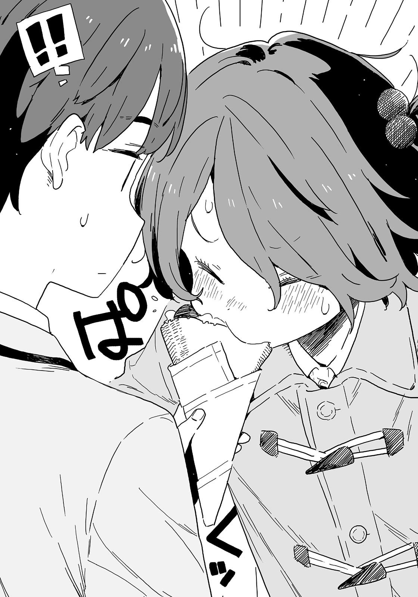

# Ch.6 — เล่ม 4 บทที่ 1-5

Ch.6 — เล่ม 4 บทที่ 1-5

By Monica

Published: 2024-11-21T04:33:54Z

Source: https://www.nekopost.net/novel/14560/6

เล่ม4 บทที่1-5

วันถัดมา หลังเลิกเรียน

ผมอยู่ที่ร้านหนังสือเซบุงคัง สาขาหลัก หน้าสถานี- ไม่สิ ร้านฟาสต์ฟู้ดข้างๆ ต่างหาก

ผมมองไปรอบๆ ที่นั่งบนชั้นสองพร้อมกับจานไก่ทอดและโคล่า คู่รักสึวะบุกิกำลังนั่งอยู่ที่เก้าอี้ข้างหน้าต่าง

พวกเขาคืออายาโนะ มิทสึกิ และ อาซากุโมะ จิฮายะ

แม้ว่าจะมีเรื่องราวมากมายระหว่างพวกเขากับยากิชิโอะ แต่ตอนนี้พวกเขาก็กลายเป็นคู่ที่สนิทสนมกันแล้ว

อายาโนะสังเกตเห็นผมและเงยหน้าขึ้น ผมตอบด้วยท่าทางเดียวกันแล้วนั่งลงตรงหน้าพวกเขา

[ ขอโทษที่เรียกพวกเธอมาที่นี่ เรื่องโรงเรียนกวดวิชาเป็นไงบ้าง? ]

[ ไม่ต้องห่วงหรอก โอกาสที่นุคุมิซึจะขอความช่วยเหลือจากพวกเราก็ไม่ค่อยมีอยู่แล้ว ]

อันดับ 6 ในการสอบไฟนอล อายาโนะยิ้มอย่างสดใส

[ เกิดอะไรขึ้นเหรอ? นายบอกว่ามีคนรู้จักต้องการคำแนะนำ ]

อาซากุโมะซังที่นั่งข้างๆเขา ตาเธอกรอกไปมาเหมือนกระรอก

เธอกำลังถือพายแอปเปิ้ลด้วยสองมือและเคี้ยวมัน ด้วยรูปลักษณ์แบบนี้ ยากที่จะจินตนาการว่าเธอคือคนที่ได้ที่ 1 ในการสอบไฟนอล ทั้งสองคนเป็นนักเรียนยอดเยี่ยม

ผมจิบโคล่าและพูดขึ้นอย่างจริงจัง

[ ใช่ คนรู้จักของผมมีปัญหาเรื่องการเรียนน่ะ เธอน่าจะมาถึงเร็วๆ นี้ ผมบอกพวกเธอสองคนไปแล้ว ว่าเธออยากจะเจอ- ]

ผมหยุดพูด

รู้สึกได้ว่าไม่ควรโกหกหรือปิดบังอะไรจากสองคนนี้

[ นุคุมิซึ? หยุดพุดทำไม ? ]

อายาโนะส่งเฟรนช์ฟรายส์มาให้ผมชิ้นหนึ่งพร้อมกับท่าทางสงสัย อาซากุโมะซังก็กินมันในคำเดียว

แล้วจะมาจีบกันตอนนี้ทำไมอะ ?

[ เอ่อ เรื่องมันยาวนะ ช่วยฟังหน่อยได้มั้ย? ]

พอพวกเขาพยักหน้า ผมก็อธิบายเรื่องราวที่เกิดขึ้นตั้งแต่ที่ผมโดนตรวจสัมภาระ ถึงจะไม่ได้พูดถึงอันดับของเทียร่าซัง แต่ผมก็คิดว่านี่เพียงพอแล้วที่จะไม่ปิดบังอะไร

หน้าผากของอาซากุโมะซังเป็นประกายหลังจากฟังเรื่องราวนั้น

[ เข้าใจแล้วค่ะ นุคุมิซึซังพยายามจะหาจุดอ่อนของบาโซริซังเพื่อเอาโดจินชิกลับมา …เข้าใจแล้วค่ะ ถึงเวลาที่ฉันต้องลงมือแล้ว! ]

ใช่ แต่ไม่ใช่แบบนนั้นนะ

[ ไม่ปฏิเสธว่ามต้องการโดจินชิคืน ยังไงก็เถอะวันนี้พวกนายคุยเรื่องการเรียนกับบาโซริซังแทนผมได้มั้ย ? ]

[ แน่ใจนะ? ถ้านายเอาคืนไม่ได้มันจะแย่เอานะ ]

ผมหันหน้าไปทางอายาโนะ

[ ผมไม่ได้พยายามหาจุดอ่อนของเธอ แต่หวังว่าเธอจะเชื่อใจเรา ถ้าเธอเข้าใจชมรมวรรณกรรมมากกว่านี้นิดนึงคงจะง่านขึ้นล่ะนะ เอาเถอะ นี่เป็นสถานการณ์ที่ดีที่สุดแล้ว ]

โดจินBL เล่มนั้นถือว่าเป็นงานเขียนเชิงสร้างสรรค์ของรุ่นพี่สึกิโนะคิ

แม้ว่าการที่บางสิ่งที่ควรจะเป็นของกลุ่มเล็ก ๆ ถูกนำมาเปิดเผยในที่สาธารณะจะเป็นปัญหา แต่ก็ไม่น่าจะมีปัญหากับการตรวจสอบสัมภาระถ้าเทียร่าซังไม่ได้ใส่ใจชมรมรวรรณกรรมมากขนาดนั้น

...คิดๆดูแล้ว ทำไมเธอถึงเกลียดชมรมวรรณกรรมกับรุ่นพี่ซึกิโนะคิขนาดนั้นนะ?

ผมนั่งคิดไปเรื่อย ๆ แล้วจู่ ๆ อายาโนะก็ส่งมันฝรั่งทอดมาให้ผม ผมกินไปโดยอัตโนมัติ อายาโนะยิ้มอย่างสดชื่น

[ แน่นอน ฉันจะช่วยนายเอง ]

[ ค่ะ ฉันก็เหมือนกับมิทสึกิซัง ไม่มีข้อคัดค้าน ]

อาซากุโมะซังก็พูดขึ้นมา เธอเงยหน้ามองอายาโนะด้วยสายตาไว้ใจ

[ ผิวเผินเราคุยกันแค่สามคน แต่จริง ๆแล้วพวกเธอเป็นแค่คู่ที่มาคุยไว้อ้างอิงมากกว่า ดูเหมือนเธอจะไม่ค่อยอยากให้คนอื่นรู้ผลการเรียนด้วย ]

ผมเช็คเวลาจากนาฬิกา ตอนนี้ถึงเวลาที่เรานัดกันไว้แล้ว เทียร่าซังปรากฏตัวขึ้นมาจากบันไดพร้อมจานในมือ เธอเดินตรงมายังโต๊ะของเราและโค้งคำนับ

[ ยินดีที่ได้รู้จักค่ะ ฉันบาโซริจากห้องB ยินดีที่ได้รู้จักทุกคนในวันนี้ค่ะ ]

เอ๊ะ ปกติเธอไม่สุภาพขนาดนี้นี่นา ปกติผมเห็นเธอเป็นคนซุ่มซ่ามซะมากกว่า

[ ยินดีที่ได้รู้จักเช่นกัน ฉันอายาโนะจากห้องD ส่วนนี่คือ- ]

[ ฉันอาซากุโมะจากห้องFค่ะ เชิญนั่งคะ บาโซริซัง ]

เทียร่าซังนั่งลงข้าง ๆ ผม

หลังจากสนทนากันเล็กน้อย ผมก็เปิดประเด็นตามสายตาที่เทียร่าซังส่งมา

[ ขอโทษที่ถามกะทันหันนะ แต่พวกเธอเรียนกันยังไงบ้าง? ]

[ ไม่มีวิธีพิเศษอะไรเลย ฉันก็ไม่รู้ว่ามันจะมีประโยชน์หรือเปล่า ]

อาซากุโมะซังพูดก่อนจะกระแอมเบาๆอย่างน่ารัก

ที่จริงแล้ว ผมก็อยากรู้วิธีเรียนของอาซากุโมะซังอยู่เหมือนกัน ถึงสมองจะไม่เหมือนกัน แต่บางทีอาจจะมีเทคนิคที่ควรเรียนรู้อยู่

[ เอาล่ะ อย่างแรกคือ ท่องจำตำราเรียนและหนังสือเสริมทั้งหมด ]

เริ่มต้นด้วยการเผชิญหน้ากับบอสสุดท้ายเลยสินะ?

[ ทุกวิชาเลยเหรอ? ทุกหน้าเลย? ]

ผมอดสงสัยไม่ได้ อาซากุโมะซังยิ้มและพยักหน้า

[ ใช่ค่ะ จำทั้งหมดให้ได้ หลังจากนั้นก็เหมือนคนทั่วไปแหละค่ะ อย่าละเลยคำพูดของครูในห้องเรียนและทบทวนหลังเลิกเรียน ]

ดูเหมือนว่าผมจะไม่ใช่ส่วนหนึ่งของ “คนทั่วไป” แล้ว

เทียร่าซังก็ไม่ใช่ส่วนหนึ่งของ “คนทั่วไป” เหมือนกัน เธออ้าปากค้างด้วยความงุนงง

[ แล้วพอจะมีประโยชน์กับบาโซริซังบ้างหรือเปล่า? ]

[ ............ ]

เทียร่าซังจ้องผมเงียบ ๆ อย่างไร้ความปรานี

[ ละ-แล้วอายาโนะเรียนยังไงบ้างล่ะ? ]

น่ากลัวจริง ๆ เปลี่ยนเรื่องดีกว่า

[ ฉันก็ไม่ได้ทำอะไรพิเศษหรอก เพราะฉันมีโรงเรียนกวดวิชา วิชาในโรงเรียนก็เหมือนกับการทบทวนเพิ่มเติมไปในตัว อย่างวิชาภาษาอังกฤษวันนี้ ]

อายาโนะหยิบบันทึกของเขาออกมา

[ ฉันทำบันทึกสำหรับการทบทวนเพื่อไม่ให้เสียเวลาลอกจากกระดานมากเกินไป ฉันเขียนคำอธิบายของครูลงไป ด้วย ]

[ ไม่ลอกจากกระดานเหรอ? ]

[ แค่จดประเด็นสำคัญก็พอ ถ้ายังมีข้อที่สงสัย ฉันยังถามเพื่อน ๆ ได้ ]

เข้าใจแล้ว เขามีเพื่อนที่ให้เขาถามได้ง่ายๆ อืม เข้าใจละ

ผมจิบน้ำอัดลม เทียร่าซังเงยหน้าขึ้นหลังจากจดโน้ตอย่างตั้งใจ

[ นี่มีประโยชน์มากเลยค่ะ งั้นที่โรงเรียนกวดวิชาอายาโนะซังเรียนอะไรบ้างหรอคะ? ]

[ ที่โรงเรียนกวดวิชา- ]

อาซากุโมะซังเอามือเล็ก ๆ ของเธอมาปิดปากอายาโนะขณะที่เขากำลังจะพูด

[ มิทสึกิซังเน้นเรียนภาษาอังกฤษกับภาษาญี่ปุ่นเป็นหลัก เขามีระบบการเรียนที่สมดุลระหว่างพื้นฐานกับการประยุกต์ใช้ ถ้าต้องการ ฉันบอกตารางเวลาเรียนของเขาได้ตั้งแต่เดือนที่แล้วค่ะ ]

ทำไมอาซากุโมะซังถึงมาอธิบายแทน?

อายาโนะยิ้มขมขื่น ขณะที่เธอกุมมือเขาอยู่

[ ทำไมจิฮายะถึงตอบแทนล่ะ? ]

[ ก็เพราะว่าฉันเข้าใจมิทสึกิซังดีที่สุดไงคะ ]

[ ยิ่งกว่าฉันเองอีกเหรอ? ]

[ แน่นอนค่ะ มิทสึกิซัง ตั้งรหัสผ่านเว็บไซต์แล้วก็ลืมบ่อย ๆ ฉันเป็นคนบอกให้จำเองตลอดเลย ]

[ อ่าก็ใช่ แต่ทำไมจิฮายะถึงรู้รหัสผ่านของฉันล่ะ? ]

อาซากุโมะซังยิ้มเงียบ ๆ อายาโนะก็ยิ้มตาม

...หรือว่าอาซากุโมะซังทำอะไรแย่ ๆ อีกแล้ว? แล้วก็...ถึงเวลาที่เธอทั้งสองควรปล่อยมือกันแล้วได้แล้วนะ

ทั้งคู่กำลังจีบกันอยู่ เทียร่าซังหันมามองผมด้วยสายตาที่น่ากลัวอีกครั้ง

น่ากลัวจริง ๆ ได้โปรดหยุดเถอะ ผมเข้าใจความรู้สึกเธอแล้ว

◇

หลังจากบอกลาอายาโนะกับอาซากุโมะซัง ผมก็ยืนอยู่หน้าประตูทางเข้าถนนโทคิวะโดริ ซึ่งอยู่ติดกับร้านหนังสือเซย์บุงคัน

ไปซื้อเมล็ดกาแฟที่ร้านข้างหน้านั่นดีกว่า คาจูขอให้ผมทำด้วย

การสนทนาของเรากับอายาโนะและอาซากุโมะซังใช้เวลาไม่ถึง 20 นาที จริงๆ แล้ว ผมก็สนใจเรื่องการเรียนของนักเรียนระดับหัวกะทิอยู่บ้าง แต่ก็รู้สึกว่าครึ่งหนึ่งของเวลานั้น ผมแค่ดูพวกเขาจีบกัน

เทียร่าซังอยู่ข้างๆ ผม เธอมองไปที่สมุดโน้ตของเธอแล้วพึมพำ

[ สองคนนั้นใช้เวลาเรียนพอๆ กับฉันเลย บางทีฉันควรไปเรียนกวดวิชาด้วยนะ... ]

[ อืม อาจจะใช่ โรงเรียนกวดวิชาอยู่ใกล้ๆซึวะบุกินะ ]

ผมเตรียมจะออกเดินทางหลังจากให้คำตอบแบบส่งๆ ไป แต่เทียร่าซังก็เดินไปข้างหน้าพร้อมๆกัน

…? คนๆนี้กำลังตามผมอยู่หรือเปล่า?

ผมพยายามคิดหาวิธีจะสลัดเธอทิ้ง ทันใดนั้น...ท้องของใครบางคนก็ร้องขึ้นมา

แน่นอนว่าไม่ใช่ของผม ข้างๆผม เทียร่าซังหน้าแดงและก้มหัวลง

[ เอ่อ เธอโอเคมั้ย? ]

[ ฉันสบายดี...เป็นเพราะฉันไม่ได้กินอะไรเลยตั้งแต่เช้า.. ขอโทษนะ ]

[ ถ้าเธอหิวขนาดนี้แล้วทำไมไม่กินอะไรก่อนล่ะ? ]

[ ลองดูบทที่ 3 ของกฎระเบียบโรงเรียนของเรานะ วรรค 3 ของมาตรา 4 ระบุว่านักเรียนไม่ควรไปที่คาเฟ่หรือสถานบันเทิงหลังเลิกเรียน มันระบุไว้อย่างชัดเจนเลยนะ ]

อ่าา เข้าใจแล้ว

ผมรู้สึกเทียร่าซังก็ถอนหายใจอย่างเหนื่อยหน่าย

[ ได้ยินว่าวันนี้ เราจะเจอกันที่ร้านฟาสต์ฟู้ดฉันเลยไม่กินข้าวกลางวันมาแถมควบคุมปริมาณน้ำด้วย แต่เดิมทีแล้วการแวะสถานที่อื่นก็ห้ามไว้ด้วย- ]

เทียร่าซังหยิบสมุดคู่มือนักเรียนออกมา เธอเปิดมันและแสดงให้ผมดู

[ ส่วนในภาคผนวก 3 ที่เพิ่มในปีเรวะที่ 1 อนุญาตให้ดื่มน้ำได้ตามสมควร ตอนนั้นฉันเกือบจะหิวน้ำจนตาย พูดอีกอย่างก็คือ มันนับเป็นการบริโภคในกรณีฉุกเฉิน นั่นจึงเป็นเหตุผลว่าทำไมการดื่มน้ำในตอนนั้นถึงไม่นับเป็นการแวะสถานที่อื่น ]

[ เอ่อ... ]

ผมไม่รู้เลยว่าเธอกำลังพูดเรื่องอะไร มีข้อบังคับแบบนี้ด้วยเหรอ? แล้วก็ยังมีคนที่ปฏิบัติตามด้วยสินะ?

[ บาโซริซัง เธอมีเพื่อนบ้างมั้ย? โอเคหรือเปล่า? ]

[ มีแน่นอนสิ! อยู่ดีๆมาถามแบบนี้ทำไม!? ]

[ ก็เพราะเธอไม่แวะที่ไหนกับเพื่อนๆใช่มั้ย? แบบนั้นจะไม่ดูแปลกๆเหรอ? ]

[ แปลกตรงไหน!? ฉันจะกลับบ้านไปเปลี่ยนเสื้อผ้า แล้วค่อยเจอพวกเขา! ]

นั่นแหละที่ทำให้เธอดูแปลก

เทียร่าซังเอามือเท้าเอวและจ้องมาที่ผม

[ แล้ว นุคุมิซึซัง ตามฉันอยู่ใช่มั้ย? ฉันกำลังจะกลับบ้าน ]

เอ๋? ผมตามเธอตั้งแต่เมื่อไหร่ ?

[ มีคาเฟ่ชื่อวอลท์อยู่ข้างหน้า ฉันจะไปซื้อเมล็ดกาแฟที่นั่น ]

[ ............]

เทียร่าซังก้มหัวลงอีกครั้ง เธอนิ่งเงียบ

จริงๆ แล้ว ความเข้าใจผิดแบบนี้มันน่าอึดอัดนะ

[ อืม ถ้าเธอไม่ว่าอะไร ไปกับฉันมั้ย บาโซริซัง? คิดว่าเธอน่าจะกินอะไรบ้าง ]

ถึงแม้ว่ามันจะเกิดขึ้นแค่ครั้งเดียว แต่เธอก็เป็นเหมือนน้องสาวในจินตนาการของผม เพราะงั้นผมจึงได้ไตร่ตรองคำพูดอย่างรอบคอบแล้ว แต่เธอก็ยังคงส่ายหัว

[ ม-ไม่เป็นไร! ขอบคุณสำหรับวันนี้มากๆนะคะ! ]

เทียร่าซังก้มหัวลงและพยายามวิ่งหนีไป- บึ้ม! เธอชนหัวกับเสาของประตูทางเข้า

[ บาโซริซัง!? โอเคมั้ย? ]

เทียร่าซังก้มตัวลงขณะกุมหัวของเธอ

เธอยังคงอยู่ในท่านั้นสักพัก จากนั้นเธอก็ค่อยๆ ลุกขึ้นแล้วครางเบาๆ

[ ฉ-ฉันขอโทษ ตื่นเต้นนิดหน่อย...ตอนนี้โอเคแล้ว ]

แต่การเห็นเธอกลับไปแบบนี้ทำให้ผมเป็นห่วงมาก เอาล่ะ ไม่ใช่ว่าเธออยากให้ผมไปส่งถึงบ้านอยู่แล้วหรอก

[ บาโซริซัง ขอเวลาสักเดี๋ยวได้มั้ย? ]

ผมพาเทียร่าซังไปร้านเครปที่ผมมักจะไปบ่อยๆ

[ ถ้าท้องว่างล่ะก็ กินอะไรหน่อยมั้ย? ]

[ แต่กฎโรงเรียนบอกไว้ว่า- ]

[ เธอไม่ได้กินอะไรตั้งแต่เช้าใช่มั้ย ? กฎระบุว่าอนุญาตให้ดื่มน้ำในกรณีฉุกเฉิน อาหารก็น่าจะเหมือนกันนิ? ]

[ ...มีเหตุผล ]

เธอยอมรับง่ายๆ ผู้หญิงคนนี้นี่ง่ายจริงๆ

ผมสั่งเครปสตรอว์เบอร์รี่สด ส่วนเทียร่าซังลังเลอยู่พักหนึ่งและสั่งเครปกล้วยช็อกโกแลตคัสตาร์ด

ผมกัดคำนึง ความหวานของครีมกระจายไปทั่วปลายลิ้น เป็นการผสมผสานที่ลงตัวกับความเปรี้ยวสดชื่นของสตรอว์เบอร์รี่

จริงๆ แล้วเครปร้านนี้อร่อยที่สุด ขนมปังกรอบๆก็ยอดเยี่ยมเช่นกัน

[ หืม? บาโซริซัง ไม่กินเหรอ? ]

เทียร่าซังถือเครปไว้ในมือทั้งสองข้าง เธอมองมาที่ผมด้วยเหตุผลบางอย่าง

[ ...นายดูชินมากเลยนะ ]

[ อะไรนะ? ]

[ นี่เป็นวิธีที่นายชวนผู้หญิงออกไปเที่ยวใช่มั้ย ? ]

[ ผมพูดกับผู้หญิงยังไม่ถูกเลยด้วยซ้ำ อย่าว่าแต่ชวนพวกเธอเที่ยวเลย ]

[ รู้สึกว่า คำพูดของนายไม่ค่อยน่าฟังเท่าไหร่นะ ]

เทียร่าซังกัดเครปของเธอ เธอดูมีความสุขขึ้นทันที

[ เป็นยังไงบ้าง? เครปร้านนี้อร่อยมั้ย ? ]

[ นี่แค่เสริมสารอาหารให้ฉันเท่านั้นแหละ- แต่ก็อร่อยดี เป็นครั้งแรกเลยที่ฉันได้กินเครป ]

เทียร่าซังพูดขณะกัดเครปอีกคำ

[ อย่างงั้นเหรอ คิดว่าผู้หญิงน่าจะชอบกินเครปกันทุกคนสะอีก ]

[ นายคิดว่าผู้หญิงคืออะไรกัน? ]

เพราะในนิยายไลท์โนเวลหรืออนิเมะพวกเธอก็เป็นแบบนั้นแหละ ได้โปรดอย่าทำลายจินตนาการของผมเลย

ร้านเครปเริ่มมีคิวต่อแถวที่ยาวขึ้นจนล้นไปยังถนนฝั่งตรงข้ามอย่างคาดไม่ถึง มีทั้งผู้ใหญ่และผู้ชายหลายคนที่มาต่อคิวด้วย

คาจูพาผมมาที่นี่บ่อยๆ แต่ครั้งนี้เป็นครั้งแรกที่มากินกับคนอื่นที่ไม่ใช่ครอบครัว รู้สึกตื่นเต้นเล็กน้อย...

ผมแอบมองเธอ เทียร่าซังกับผมสบตากัน

[ ขอบคุณสำหรับวันนี้มาก ได้ฟังเรื่องสำคัญต่างๆจากพวกเขาเลย.… ]

[ ไม่เป็นไร ผมไม่รู้หรอกว่ามันจะมีประโยชน์กับเธอมั้ย ]

[ อืม บางทีมันอาจจะไม่ช่วยอะไร พวกเรามันแตกต่างกันเกินไป ]

บาโซริซังจ้องเครปที่กินไปครึ่งหนึ่งของเธอ และพูดต่ออย่างใจเย็น

[ .. ตอนมัธยมต้นฉันเคยเป็นนักเรียนที่เก่งมาก ฉันคิดว่าจะได้แข่งขันกับคนที่มีความสามารถใกล้เคียงกันหลังจากเข้าโรงเรียนซึวะบุกิ ]

เธอพูดต่อด้วยน้ำเสียงที่เหมือนกับการเย้ยหยันตัวเอง

[ แต่ฉันคิดผิด การสอบเข้าเดียวที่กันไม่ได้หมายความว่าเรายืนอยู่บนเส้นเริ่มต้นเดียวกัน ความสามารถของพวกเรามันแตกต่างกันตั้งแต่ต้น การพยายามเท่าเดิมเหมือนที่ผ่านมา ยิ่งทำให้ฉันตามหลังมากขึ้นเรื่อยๆ ]

เทียร่าซังมองออกไปไกล ร่างกายของเธอสะท้านขึ้นมาอย่างกะทันหัน

[ ขอโทษนะ ที่พูดอะไรแปลกๆ ไป ปกติฉันจะไม่พูดอะไรแบบนี้ ]

[ อ่า.. ไม่เป็นไร เข้าใจความรู้สึกเธอเหมือนกัน ]

โรงเรียนมัธยมปลายซึวะบุกิเป็นหนึ่งในโรงเรียนที่ดีที่สุดในภูมิภาคมิคาวะ

พวกที่เป็นหัวกะทิในระดับมัธยมต้นจะถูกแยกออกเป็นห้องๆ ถ้าถูกนำมารวมกัน

มันง่ายที่จะเข้าใจว่าผลการสอบไม่ใช่ทุกอย่าง แต่เมื่อเผชิญกับอนาคตหลังจบการศึกษา การหาตัวชี้วัดใหม่เพื่อวัดตัวเองนั้นยากมาก

ผมคิดเกี่ยวกับเรื่องนี้จนลืมเครปของตัวเองไป ในขณะนั้น ผมสังเกตเห็นว่าดวงตาของเทียร่าซังจ้องมาที่ผม

[ ...มีอะไรหรือเปล่า? ]

[ ลองคิดๆดูแล้ว สอบเมื่อไม่กี่วันก่อน นายทำได้ยังไงบ้าง? ]

[ เอ๋ ทำไมถึงถามล่ะ? ]

[ ฉันรู้แค่ลำดับของฉันคนเดียวมันไม่ยุติธรรมน่ะสิ นายคงไม่แย่กว่าฉันใช่มั้ย? ]

เทียร่าซังหัวเราะอย่างขี้เล่น ผมไม่เคยเห็นเธอยิ้มมาก่อนเลย

[ คิดว่า...อยู่ลำดับที่ 47 ]

[ ...อ่า นั่นดีแล้ว ]

รอยยิ้มของเทียร่าซังหายไปอย่างรวดเร็ว

[ เอ่อ มันแย่กว่าภาคเรียนแรกอีก ถ้าเทียบกับอายาโนะ- ]

[ ไม่มีนักเรียนสึวะบุกิคนไหนที่ไปเทียบเคียงพวกเขาได้แล้วนิ ? ]

เทียร่าซังกินเครปคำสุดท้ายและเช็ดปากด้วยผ้าเช็ดหน้า

[ เอาล่ะ ฉันจะไปแล้ว ขอบคุณสำหรับวันนี้นะ ]

[ เอ๋ แน่นอน ผมก็เหมือนกัน ]

เทียร่าซังหันหลังเดินออกไปหลังจากทิ้งห่อเครปลงในถังขยะ

แม้ว่าผมจะไม่รู้สึกว่าเราเข้าใกล้กันมากขึ้น แต่สรุปแล้วผมก็ไม่ได้รู้สึกผิดอีกต่อไป

เรายังต้องหาวิธีใหม่ในการเอาโดจินกลับมา กินเครปเสร็จแล้วค่อย-

จากนั้น เทียร่าซังก็กลับมาอย่างรวดเร็ว

[ ลืมอะไรหรือเปล่า? ]

[ นี่ นายไม่ได้โกหกเรื่องลำดับใช่มั้ย? ]

[ ใช่ มันอยู่บนบอร์ดประกาศน่ะ ]

[ ฉันไม่ได้สงสัยนายหรอก แค่คิดว่านายน่าจะอยู่ในระดับที่พอดีกับฉันเลย ]

ผมไม่แน่ใจเท่าไหร่ แต่เธอกำลังเหน็บแนมผมอยู่ใช่มั้ย ?

สีหน้าของเทียร่าซังดูเหมือนจะอยู่ระหว่างยิ้มกับข่มขู่

[ พูดง่ายๆ ก็คือ ฉันจะขอคำปรึกษาอีกครั้ง แต่ครั้งนี้จะปรึกษากับเธอ ]

[ ผมเหรอ? ทำไมล่ะ?]

[ ความลับที่น่าอับอายของฉันมันไม่ใช่เรื่องที่ถูกๆ หรอกนะ? ]

เทียร่าซังก็ไปจริงๆ หลังจากพูดแบบนั้น

ผมถอนหายใจลึกๆ ขณะที่เธอหายไป

พูดตามตรง นี่มันน่ารำคาญ แต่ก็ไม่สามารถตัดความสัมพันธ์ของเราได้ง่ายๆ...

ผมคิดเกี่ยวกับพัฒนาการในอนาคตขณะที่มองไปรอบๆ อย่างเหม่อลอย

ถัดจากร้านเครปคือทางเข้าด้านตะวันตกของร้านหนังสือเซย์บุนคัง มีนักเรียนซึวะบุกิตัวเล็กคนหนึ่งยืนอยู่หลังประตูกระจกเหมือนยาม อา นั่นโคมาริ

โคมาริใส่เสื้อแจ็คเก็ตตัวหนา เธอกำลังมองผมด้วยสายตาเย็นชาผ่านกระจก

...เธอกำลังทำอะไรอยู่?

[ เป็นอะไรไป? เธอตัวแข็งหลังจากชนกระจกเหรอ? ]

โคมาริก้าวออกมาด้วยสีหน้าระแวดระวังหลังจากที่ผมเปิดประตู

[ ฉ-ฉันมาซื้อของ น-นุคุมิซึ หยุดเล่นแล้วไปเขียนฉบับร่างของนายซะ ]

[ มีไอเดียแล้ว จะเขียนทีหลัง ]

[ ย-หยุดพูดเหมือนที่ยานามิพูดเมื่อสองสามวันก่อนเถอะ... ]

เอาล่ะ ผมพูดเหมือนที่ยานามิพูดเมื่อสองสามวันก่อนไม่ผิดเลย

[ โคมาริยังไม่เสร็จฉบับร่างใช่มั้ย ? เราวางแผนจะอัปโหลดก่อนสิ้นปีนี้ จะทันมั้ย ? ]

[ ฉ-ฉันเสร็จแล้ว จ-จะส่งให้ทีหลัง ]

...มาคิดดูแล้ว เขียนเร็วมากนะเนี่ย

[ เข้าใจแล้ว เอาล่ะ ผมควรกลับไปทำฉบับร่างของตัวเองต่อเหมือนกัน ]

สถานการณ์เริ่มไม่ดีสำหรับผม ผมตั้งใจจะกลับ โคมาริกลับจับเสื้อของผมไว้

[ ธ-เธออยู่กับรองประธานสภานักเรียนใช่มั้ย? พ-พวกเธอคบกันหรือเปล่า? ]

[ ไม่อะ ทั้งหมดนี้เป็นเพราะโดจินนั่น ช่วยฉันหน่อยสิ โคมาริ ]

[ พ-พวกเธอกินเครปด้วยกัน ทั้งๆ ที่ไม่ได้คบกันเหรอ ]

ก็ใช่ เครปมันทำให้จินตนาการของผมโลดแล่นเลยนะ

[ กินเครปมันปกตินะ โคมาริก็กินได้เหมือนกัน ]

[...ฉ-ฉันกินได้จริงๆ เหรอ? ]

[ ก็ใช่? ใครห้ามเธอล่ะ ? ]

ทำไมต้องขออนุญาติก่อนกินเครปด้วย?

ผมงุนงง แล้วจู่ๆ โคมาริก็เดินเข้ามาใกล้ๆ - แล้วกัดเครปของผม

[ อ-อืม กรอบนิดหน่อย ]

ดวงตาของโคมาริเบิกกว้าง แก้มของเธอเต็มไปด้วยเครป เธอเคี้ยวอย่างมีความสุข

[ ...อ๊ะ นี่ฉันพูดเหมือนว่าให้เธอกินของฉันเหรอ? ]

ผมเผลอพูดออกไปโดยไม่รู้ตัว

[ !? ]

หน้าโคมาริแดงก่ำ เธอรีบถอยห่างออกไป

[ อึก!? อะ...พ-พลาดแล้ว...! ]

แย่แล้ว อารมณ์ของโคมาริกำลังปั่นป่วน

ไม่อยากให้เธอตกใจไปมากกว่านี้ ผมยิ้มและค่อยๆ ยื่นเครปของผมให้

[ ไม่เป็นไร ผมไม่ว่าอะไรหรอก เครปมันอร่อยใช่มั้ย? สตรอว์เบอร์รีมันหวานดีนะ ]

[ ส-สตรอว์เบอร์รี? ...สีแดงนั่น...? ]

[ ก็ใช่น่ะสิ สตรอว์เบอร์รีสีแดงน่ะว่าไ ง อยากลองอีกคำมั้ย ? ]

โคมาริส่ายหัวแรงๆ

[ อ-อืม ฉ-ฉัน จะกลับบ้านแล้ว! ]

โคมาริคลุมตัวเองเตรียมจะหนีไป กระเป๋ากระดาษขนาดเท่าฝ่ามือหล่นออกมาจากกระเป๋าของเธอ

[ โคมาริ เธอทำของหล่นนะ ]

ผมเก็บมันขึ้นมา มีสติ๊กเกอร์ริบบิ้นสีแดงติดอยู่บนบรรจุภัณฑ์สีเขียว

[ น-นั่น! ข-ของฉัน! ]

โคมาริแตกตื่น เธอรีบคว้ามันไปจากมือผม

[ ใจเย็นๆ ผมไม่ได้จะขโมยนะ ]

[ อ-เอ่อ... น-นุคุมิซึ ได้ยินมาว่าวันเกิดของนายคือวันคริสต์มาส ใช่มั้ย? ]

เป็นคำถามที่กะทันหันมาก

[ อ่า ใช่ ทำไมล่ะ? ]

[ เอ่อ ก็...นี่... ]

สุดท้ายเธอก็เงียบไป โคมาริถือถุงกระดาษไว้ที่หน้าอกและนิ่งงันไป

เธอเป็นอะไรไปน่ะ...?

[ เธอโอเคมั้ย? ถ้ายังหิวอยู่ก็ยังมีเครปเหลืออยู่นะ ]

โคมาริหันมาจ้องเขม็งใส่ผม

[ อ-อย่าได้ใจไปนักนะ! ]

เธอพูดแล้ววิ่งหนีไปทันที

เอ๋...ทำไมผมถึงโดนดุอีกแล้วล่ะ?

ผมมองเครปในมืออย่างงุนงง มีรอยกัดเล็กๆ อยู่ที่ขอบ

ผมลังเลอยู่พักหนึ่ง - แต่สุดท้ายก็หลับตาและยัดเครปทั้งหมดเข้าปาก

---

น่าจะวันละ 3-4 ตอน นั่งเคาะบรรทัด 🫠
