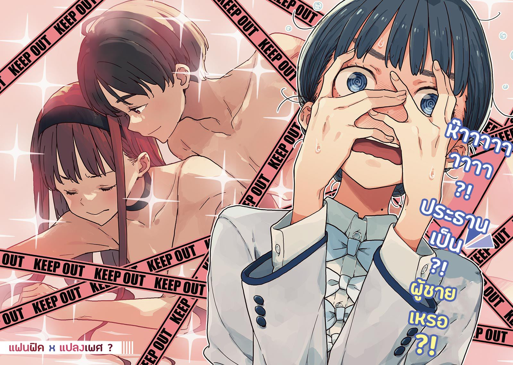

# Ch.9 — เล่ม 4 บทที่ 1-7

Ch.9 — เล่ม 4 บทที่ 1-7

By Monica

Published: 2024-11-22T11:08:27Z

Source: https://www.nekopost.net/novel/14560/9

เล่ม4 บทที่1-7

ห้องสภานักเรียนโรงเรียนสึวะบุกิ ผมสูดลมหายใจลึกๆ ขณะจัดเน็คไทของตัวเองให้เรียบร้อย

…อย่างแรก ต้องขอโทษที่แอบสืบข้อมูลก่อน จากนั้น ต้องขอให้เธอคืนโดจินชิให้พวกเรา

จริงๆ แล้ว ควรจะเปิดฉากพูดตรงๆ ตั้งแต่แรก จากความรู้สึกหลังพูดคุยกับเธอเมื่อวานนี้ เธอดูไม่ใช่คนที่ไร้เหตุผลขนาดนั้น...คิดว่านะ

ผมเคาะประตูห้องสภานักเรียน

หลังจากรออยู่สักพัก ผมเปิดประตูเข้าไป เทียร่าซังเงยหน้ามองมาที่ผม เธอเหมือนกำลังอ่านอะไรบางอย่างอยู่

[ อาระ ขอบคุณสำหรับเมื่อวานนะ วันนี้มีอะไรให้ฉันช่วยหรือเปล่า? ]

[ มีเรื่องบางอย่างอยากจะพูดน่ะ เธอพอจะมีเวลามั้ย? ]

[ ได้สิ ไม่มีปัญหา ]

ตอนนี้เทียร่าซังเป็นคนเดียวในห้องสภานักเรียน นี่เป็นโอกาสเดียวที่จะได้คุยกับเธอ

เทียร่าซังยังคงเพิกเฉยและทำงานต่อ ผมก้าวเข้าไปใกล้เธอ

[ จริงๆ แล้ว มีทั้งคำขอโทษและคำขอ... ]

[ เกี่ยวกับหนังสือที่ยึดมาจากรุ่นพี่สึกิโนะคิไม่กี่วันก่อนใช่มั้ย ? ]

[ เอ๊ะ? ]

เทียร่าซังพูดอย่างใจเย็นขณะอ่านหนังสืออยู่

[ ช่วงนี้ ชิกิยะซังดูแลชมรมวรรณกรรมอย่างดี ฉันรู้เรื่องนั้นแล้ว ที่ชนกับฉันตรงทางเดินเมื่อไม่กี่วันก่อนก็คงเป็นโอกาสให้ได้คุยกับฉันโดยตรงใช่มั้ย? ]

[ อ่า ไม่ใช่... ]

เธอไม่ได้พูดถูก แต่ก็ใกล้เคียง การเจอกันที่ทางเดินเป็นเรื่องบังเอิญ แต่ที่หยิบแผ่นคะแนนของเธอไม่ใช่

ผมพูดตะกุกตะกัก เทียร่าซังจับหน้าผากของเธอแล้วถอนหายใจ

[ มันเป็นความผิดของฉันเองที่ทำแผ่นคะแนนหล่นให้นายหยิบไปได้ นายเลยได้รู้จุดอ่อนของฉันจากเหตุการณ์นั้น ]

[ เอ๊ะ? ]

ยังเชื่อว่าผมบังเอิญหยิบแผ่นคะแนนของเธออยู่เหรอ...?

เทียร่าซังเงยหน้ามองผมด้วยสีหน้าสงสัย

[ นายแปลกใจอะไร ? คะแนนนั้นมีความสำคัญกับฉันมากกว่าที่นายคิดนะ อย่าบอกใครก็แล้วกัน ]

[ อ่า แน่นอน งั้นเรื่องโดจินชิล่ะ… ]

เทียร่าซังหยุดเขียนในสมุดของเธอ

[ ...หนังสืออนาจารที่ใช้ประธานเป็นต้นแบบน่ะ ]

เสียงดังแกร็ก— เธอยืนขึ้นและเกือบจะเตะเก้าอี้จนล้ม

[ เธอทำอะไรแบบนั้นแล้วกล้าเอามันมาโรงเรียนอีก ถึงจะเป็นรุ่นพี่ของฉันก็สมควรได้รับคำตำหนิและการลงโทษที่เหมาะสม นายว่าอย่างนั้นมั้ย? ]

ถูกต้อง เห็นด้วยกับเธอเลย…

ผมรวบรวมความกล้าแล้วพยักหน้าอย่างหนักแน่น

[ คิดว่าที่บาโซริซังพูดก็ถูก แต่เธอคนนั้นก็ได้เรียนรู้บทเรียนแล้ว อีกอย่าง ถึงประธานจะรู้เรื่องนี้ เธอจะรู้สึกโกรธจริงๆมั้ย ? ]

สีหน้าของเทียร่าซังผ่อนคลายลงเหมือนถูกน้ำเย็นสาดใส่

[ ประธานใจดีมาก... ใช่ เธอต้องให้อภัยแน่ๆ ]

ดี บรรยากาศกำลังเหมาะ

[ ใช่เลย ประธานกับรุ่นพี่สึกิโนคิก็สนิทกันดีใช่มั้ยล่ะ? มาลองแก้ปัญหานี้อย่างสันติ ให้เธอเขียนจดหมายแสดงความสำนึกผิดหรือ- ]

…ผมรีบพูดเกินไป

สีหน้าของเทียร่าซังเปลี่ยนไปทันทีที่ผมพูดคำว่า “สนิทกัน”

[ สึกิโนคิ โคโตะ เคยเป็นรองประธานสภานักเรียนปีที่แล้ว ]

รุ่นพี่สึกิโนคิเคยเป็นรองประธานเหรอ?

แปลกๆแหะ ตอนนี้เทียร่าซังยืนอยู่ตรงหน้าผมในตำแหน่งรองประธาน

[ เธอคนนั้นเคยมีเรื่องบาดหมางกับชิกิยะซังตอนเทอมสองของปีที่สองแล้วก็ลาออกจากสภานักเรียน ]

[ บาดหมาง….เกิดอะไรขึ้นเหรอ? ]

[ ฉันไม่รู้และไม่อยากรู้รายละเอียด แต่เธอคนนั้นทิ้งหน้าที่ในสภาและหนีไป นั่นก็เพียงพอที่จะถูกมองว่าด้อยกว่าแล้ว ]

[ แต่ประธานไม่ได้ดูโกรธเลย จริงๆแล้ว รุ่นพี่ชิกิยะเองก็ดูค่อนข้างเป็นห่วงเธอ… ]

เทียร่าซังเงียบไปแล้วจู่ๆ เธอก็เข้ามาใกล้ผมมากๆ

ผมเงียบไปเพราะรู้สึกกดดัน เทียร่าซังเหมือนกำลังจะพูดอะไรบางอย่าง แต่จู่ๆ เธอก็คลายไหล่ลงอย่างไม่มีพลัง

[ ...นายพูดถูก รุ่นพี่ทั้งสองคนนั้นอยู่ข้างสึกิโนะคิ โคโตะ ตลอด ไม่ว่าเธอจะสร้างปัญหามากี่ครั้งก็ตาม พวกเขาจะช่วยเหลือเธออยู่เสมอ กลายเป็นว่าฉันเหมือนเป็นเด็กดื้อทุกครั้งที่พยายามจะต่อว่าเธอ ]

เทียร่าซังหันหลังเดินออกไปช้าๆ

[ ชิกิยะซังเชิญฉันเข้าสภานักเรียน เธออุตส่าห์แนะนำให้ฉันเป็นรองประธาน ทั้งๆ ที่เธอน่าจะเป็นคนทำเอง ]

เข้าใจแล้ว ผมเคยคิดว่าเธอเข้าร่วมสภานักเรียนเพราะชื่นชมประธาน

[ ตั้งแต่ซากุไรคุงเป็นคนดูแลประธาน ฉันก็ได้ใช้เวลากับชิกิยะซังมากขึ้น เธอเอาใจใส่ฉันมาก ทุกอย่างดูไปได้สวยในช่วงแรกๆ ]

...เธอเริ่มพูดอะไรบางอย่าง

ผมรีบมองนาฬิกาทันทีเพื่อแสร้งทำเป็นไม่มีเวลา

[ เอ่อ เย็นขนาดนี้แล้ว ผมต้อง… ]

ผมกำลังจะหนี แต่เทียร่าซังหันกลับมาและเข้ามาใกล้ทันที

[ รู้มั้ยว่าชิกิยะซังทำอะไรกับฉันตอนฉันสลบไป!? ]

[ เอ๊ะ ไม่รู้ ทำอะไร? ]

[ ไม่อยากเชื่อจะเลยเธอบอกว่ามันเข้ากับฉัน แล้วเธอก็ผูกผมหางม้าสองข้างให้อีก! แถมฉันยังได้ใส่แว่นตาด้วยนะ! ]

หางม้ากับแว่นตา...? นั่นคือชุด-

[ ไม่ใช่ มันเหมือนรุ่นพี่สึกิโนะคิเลยหรอ… ]

[ แน่นอน มันเหมือนน่ะสิ! ทำไมต้องแต่งตัวให้ฉันเหมือนเธอคนนั้นด้วย!? ]

ถึงเธอจะถามผม ก็ทำอะไรไม่ได้หรอก

[ นอกจากนี้ ชิกิยะซังก็จับฉันอยู่เรื่อยๆเลย นายเชื่อมั้ย? เธอปลดตะขอบราให้ฉันผ่านเสื้อผ้าได้นะ! ]

[ เอ่อ ถึงเธอจะเล่าการแสดงอะไรนั่นให้ฟัง แต่ผมก็ไม่… ]

[ ใครพูดเรื่องการแสดงกับนายล่ะ ! ]

ผมว่าตอนนี้เรากำลังพูดเรื่องแบบนั้นพอดีเลยนะ

เทียร่าซังหน้าแดงและตัวสั่น เธอกระแอมเพื่อปกปิดความอาย

[ อ-เอาเป็นว่า ฉันหวังว่าชิกิยะซังกับประธานจะเข้าใจปัญหาของเธอคนนั้นสักที! ]

ผมว่า ประธานน่าจะเข้าใจปัญหาของเธอดีอยู่แล้วนะ?

[ เข้าใจว่าเธอรู้สึกยังไง สรุปคือ เธออยากให้คนอื่นๆ เห็นข้อผิดพลาดของรุ่นพี่สึกิโนะคิใช่มั้ย? ]

[ ใช่...นั่นแหละ ]

ผมเข้าใจทั้งหมดจนมาถึงจุดนี้ แต่ยังมีอีกเรื่องที่ผมสงสัย

[ แต่นิยายเรื่องนั้นมีประธานเป็นตัวเอกใช่มั้ย ? แน่ใจแล้วหรือว่าจะเผยแพร่มัน? ]

[ แน่นอน ฉันวางแผนไว้ว่าจะลบส่วนที่ไม่เหมาะสมออก ]

แล้วมันจะมีประโยชน์อะไรถ้าทำอย่างนั้น?

เทียร่าซังเดินไปที่ชั้นวางหนังสือ เธอเขย่งเท้าและหยิบหนังสือบาง ๆ ออกจากชั้นวาง

[ นั่นมัน... ]

เธอขมวดคิ้วและพยักหน้า โดจิน BL นั่นมาอยู่ในที่แบบนี้ได้ไงเนี่ย ?

เธอคีบหนังสือด้วยปลายนิ้วเหมือนมันเป็นของสกปรก

[ สุดท้ายแล้ว ในฐานะผู้หญิงคนหนึ่ง ฉันก็ไม่เข้าใจหนังสือที่แสวงหาผลประโยชน์ทางเพศจากผู้หญิงเลย นักเรียนมัธยมควรจะทำตัวให้เหมาะสมกว่านี้— ]

...หืม? นี่เธอเพิ่งพูดอะไรแปลก ๆ ออกมานะ

[ เทียร่าซัง ขอถามอะไรหน่อยได้มั้ย? ]

[ อย่าเรียกด้วยชื่อต้นนะ ! แล้วจะถามอะไร? ฉันไม่คืนหนังสือให้หรอกนะ ]

[ ไม่ใช่เรื่องนั้น คือนิยายเล่มนั้นมันไม่มีผู้หญิงเลยนะ ? ]

[ ...พูดอะไรของนาย? ก็ประธานนักเรียน โฮโคบารุ ฮิบาริ เป็นตัวเอกในเรื่องไม่ใช่เหรอ— ]

[ อ่า อืม มันเป็นโดจินที่อิงจากชีวิตจริงน่ะ ]

[ ชีวิตจริง? ]

อ่า จะอธิบายจากตรงไหนก่อนดีล่ะเนี่ย?

[ ขอถามหน่อยนะ ถ้ารู้ว่าประธานนักเรียนอยู่ในนั้น หมายความว่าเคยอ่านแล้วใช่มั้ย ? ]

เทียร่าซังสะดุ้ง

[ ฉันแค่เปิดดูเนื้อหานิดหน่อยเอง ! ส่วนภาพวาดลามกอะไรพวกนั้น ฉันก็แค่มองผ่านๆ เอ— โอ้ยยยย นายให้ฉันพูดอะไรออกมาเนี่ย!? ]

[ อ่า ไม่ใช่นะ ผมแค่จะบอกว่านิยายเล่มนั้นมีแต่ผู้ชายน่ะ คิดว่า— ]

[ ไม่มีผู้หญิง...? ประธานอยู่ในนั้นไม่ใช่เหรอ? ]

[ อ่า มันแนวแปลงเพศน่ะ... ยังไงก็เถอะ ประธานในนิยายเป็นผู้ชาย ]

[ แปลงเพศ...? ขอโทษนะ แต่จุดประสงค์มันคือ ? ]

อืม เป็นคำถามที่ดี ผมเองก็ไม่รู้เหมือนกัน

[ พูดง่าย ๆ ก็คือ นิยายเล่มนั้นเป็น BL น่ะ ประธานนักเรียนกลายเป็นผู้ชายและมีความสัมพันธ์กับผู้ชายอีกคน เนื้อหาหลักเป็นเรื่องของความรักชาย x ชาย... ]

[ ห๊า ? ?... ]

สายตาของเทียร่าซังแข็งค้างอยู่สักพักหนึ่ง แล้วจู่ ๆ เธอก็เหมือนนึกอะไรออก

[ ห-ห๊าาาาา !? ประธานเป็น !? ผู้ชายเหรอ!? ]

ฟึบ เธอเปิดหนังสือทันที

[ อ๊ะ งั้นภาพนี้...เอ๊ะ? ]

เทียร่าซังพึมพำพลางจ้องหนังสือในมือ

[ นี่ บาโซริซัง ]

[ แล้วตรงนี้ก็...อ๊ะ….แบบนี้หรอ… ]

เธอซังพลิกหน้าหนังสือไปมาอย่างลุกลี้ลุกลน

[ อุวะ...หวาาาาาา — ]

[ นี่ ขอโทษนะครับ ไหวมั้ย ? ]

[ เอ๊ะ ไม่อยากเชื่อเลยว่าที่แบบนี้มี— ]

...เอ่อ ผมกลับเลยได้มั้ยเนี่ย?

เทียร่าซังถอนหายใจและปิดหนังสือ

[ นี่...เป็นอะไรที่….แย่จริง ๆ ]

เข้าใจล่ะ แต่เธอดูพอใจมากเลยนะ

[ บาโซริซัง ตอนนี้เข้าใจแล้วใช่มั้ย? หนังสือแบบนี้เผยแพร่ไม่ได้หรอก มาจบเรื่องกันดีเถอะ ๆ เพื่อรักษาชื่อเสียงของประธานเองด้วย ขอเถอะนะ ]

เข้าใจหรือเปล่านะ? แก้มของเทียร่าซังขึ้นสีแดงจาง ๆ เธอมองมาที่ผมด้วยสายตาอ่อนแรง

[ ประธานชมรมวรรณกรรม นายชื่ออะไรนะ? ]

เอ่อ...นี่เธอคุยกับผมตั้งนานโดยไม่รู้ชื่อผมเนี่ยนะ

[ ผมนุคุมิซึครับ… ]

[ นุคุ-มิซึ!? ]

ฟึบ เทียร่าซังเปิดหนังสืออีกครั้ง

[ งั้น นุคุมิซึก็....คนที่พิชิตโรงเรียนเวทมนตร์ในหนังสือเล่มนี้ก็คือ...? ]

ซวยแล้ว ตัวละครนั่นคือผมเหรอ? แถมเป็นนิยายต่างโลกด้วย

[ อ่า ไม่ใช่หรอก ผมแค่เป็นหนึ่งในตัวละครในนั้น จะเรียกว่าผู้เคราะห์ร้ายก็ได้ ]

[ เอ๋ ถ้างั้นฉากนี้นายก็...? เอ๋ อุหวาาา...นี่มันเกินไปแล้วนะ... ]

เทียร่าซังมองสลับระหว่างผมกับหนังสือ พลางพึมพำว่า “อุหวา” อยู่เรื่อย ๆ

ลองจินตนาการดูสิว่า มีผู้หญิงคนหนึ่งใช้สมอง 100% เพื่ออ่านแฟนฟิค BL ของคุณต่อหน้าคุณ มันก็เป็นประสบการณ์ที่ดีนะ แต่ใจผมรับไม่ไหวแล้ว

ผมเดินเข้าไปหาเทียร่าซังอีกครั้ง เธอยังคงสนใจอยู่กับนิยายอย่างเต็มที่

[ เอาล่ะ ถ้าเข้าใจแล้ว คืนหนังสือให้ผมได้มั้ย? ]

[ ...หา!? ]

เพิ่งรู้ตัวเหรอว่าผมอยู่ตรงนี้? เทียร่าซังกอดหนังสือไว้กับอกแล้วกระโดดถอยหลัง

[ นะ-น-นะ-นายทำอะไรเนี่ย !? จะทำอะไรกับฉัน !? ]

[ เอ๊ะ? ม-ไม่ใช่นะ! อย่าส่งเสียงดังสิ คนจะเข้าใจผิดกันหมด ]

ถ้ามีคนมาเห็น ชีวิตมัธยมของผมคงจบเห่แน่ๆ

ผมยื่นมือออกไปด้วยความระมัดระวัง เทียร่าซังก็ถอยหลังจนติดกำแพง

[ นี่ ผมไม่ได้จะ— ]

[ ร-รอเดี๋ยว ! ฉันเป็นผู้หญิงนะ! ]

เธอกำลังจะบอกอะไรน่ะ ?

[ ผมบอกแล้วไงว่าจะไม่ทำอะไร ผมไม่เหมือนนุคุมิซึในหนังสือนั่นนะ? ]

เทียร่าซังจ้องผมอย่างระหวาดระแวง สุดท้ายเธอก็เข้าใจแล้วสินะ? เธอทรุดตัวลงอย่างอ่อนแรง

[..อ-อ่าา ฉันตกใจเกินไปหน่อย… แต่นายเองก็ผิดเหมือนกันนะ ]

เอ๋ ไม่มีทาง ผมผิดด้วยเหรอ?

เทียร่าซังค่อย ๆ ลุกขึ้น เธอจ้องปกหนังสืออย่างตั้งใจ

[ จริง ๆ แล้วนิยายเล่มนี้ซับซ้อนมากนะ มันไม่ใช่แค่ลามกเฉยๆหรอก... ]

[ ใช่มั้ย? งั้นเราก็แค่— ]

เทียร่าซังส่ายหน้าแล้วมองตาผม

[ ฉันเปลี่ยนใจแล้วค่ะ นุคุมิซึซัง มาทำแลกข้อเปลี่ยนกันเถอะ ]

แลกเปลี่ยน เธอจะให้ผมทำอะไรสักอย่างเพื่อแลกกับการคืนหนังสือสินะ?

ผมกลัวว่าพล็อตเรื่องจะไปในทางเดียวกับนิยาย BL ...แล้วเทียร่าซังพูดขึ้นอย่างจริงจัง

[ มาอยู่ฝ่ายเดียวกับฉัน แล้วจะคืนหนังสือให้ ]

...เอ๋? นั่นหมายความว่า—

[ เธอเองก็มีศัตรูเหรอ? ]

[ ในแง่หนึ่ง ทุกคนเป็นศัตรูสำหรับฉัน ฉันแค่ทำหน้าที่ในฐานะคณะกรรมการสภานักเรียนเท่านั้น แต่นายกลับมองฉันเป็นคนไม่ดีใช่มั้ยล่ะ? ]

เอ่อ ปฏิเสธไม่ได้เลยแหะ

เทียร่าซังเหลือบไปมองโต๊ะของประธาน

[ ประธานใจดีและให้อภัยทุกอย่าง ส่วนรุ่นพี่ชิกิยะก็ทำเป็นไม่สนใจทุกอย่างที่ฉันพูด เธอชอบแตะคอฉันตลอดตเมื่อมีโอกาส—]

[ เอ่อ ไปคุยเนื้อหาการแสดงล่วงหน้ากับเธอเถอะนะครับ ]

[ บอกว่าไม่ใช่การแสดงไง! ]

อารมณ์ของเธอขึ้นลงเหมือนบันไดเลื่อนเลย เธอต้องเหนื่อยแน่ ๆ เทียร่าซังยกมือขึ้นแตะหน้าผากแล้วนั่งลง

...เอาล่ะ สถานการณ์แย่ลงไปอีกขั้นแล้ว ผมพูดกับเทียร่าซังที่ดูเหนื่อยใจ

[ โอเคๆ จะอยู่ฝ่ายเธอก็ได้ แต่ช่วยบอกเงื่อนไขกับวันหมดสัญญาให้ชัดเจนได้มั้ย ? ถ้าต้องฟังคำสั่งจากเธอเพียงเพราะแค่หนังสือเล่มเดียวมันไม่ยุติธรรมนะ ]

[ เข้าใจแล้ว ]

เทียร่าซังคิดอยู่พักหนึ่งก่อนจะตบมือ

[ รุ่นพี่ชิกิยะ กับ สึกิโนะคิ โคโตะ ช่วยแก้ปัญหาของพวกเธอก่อนพิธีจบการศึกษาได้มั้ยคะ? ]

[ เอ๋? ทำไมผมต้องทำด้วยล่ะ ]

[ ฉันเบื่อกับเรื่องของสองคนนั้นเต็มทีแล้ว สภานักเรียน มีแค่ประธานโฮโคบารุกับลูกน้องเธออีกสามคน ให้พวกนั้นมูฟออนจากอดีตทีเถอะ ]

[ แล้วถ้าผม...ทำไม่สำเร็จล่ะ? ]

เทียร่าซังกอดโดจิน BL แนบอกไว้อย่างทะนุถนอม

[ งั้นฉันจะอ่านทุกอริยาบทในนิยายเล่มนี้— แล้วส่งมันเข้าที่ประชุมคุณครูในวันพิธีจบการศึกษาค่ะ ]

เหลือเวลาอีก 8 วันจนถึงพิธีจบการศึกษา

ในฐานะคนที่แค่ตามน้ำไปเรื่อย ผมเพิ่งจะรู้ว่ากำลังโดนคลื่นน้ำอันขุ่นมัวกลืนกินแล้ว

◇◇◇

---
