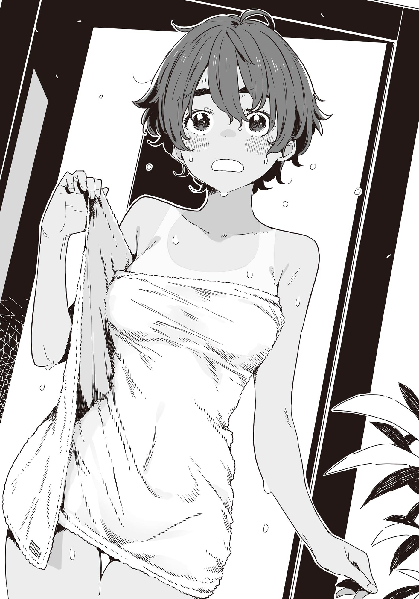

# Ch.100 — เล่ม 8 บทที่ 1-3

Ch.100 — เล่ม 8 บทที่ 1-3

By Monica

Published: 2025-05-20T14:23:09Z

Source: https://www.nekopost.net/novel/14560/100

เล่ม 8 บทที่ 1-3

ผมชินกับการขี่จักรยานไปโรงเรียนแล้ว

ขี่จักรยานคันโปรดฝ่าผ่านเมืองยามเย็น พลางมองเห็นสถานีรถรางฮิงาชิฮัตสึโจที่เคยนั่งลงขึ้นในสมัยมัธยมต้นทางหางตา

เมื่อพระอาทิตย์เริ่มลับขอบฟ้า สายลมที่เคยหนาวเย็นกลับรู้สึกสบายดีเสียมากกว่า

ผมที่ช่วยซากุไรคุงเสร็จแล้ว กำลังมุ่งหน้ากลับบ้านตรงๆ เพื่อไม่ให้เจอกับเทียร่า

ช่วงนี้เทียร่ามักจะปรากฏตัวในเงามืดของอาคารฝั่งตะวันตก เลยตั้งใจว่าจะไม่เข้าใกล้แถวนั้น

[ กลับมาแล้วー ]

ผมที่เปิดประตูหน้าบ้านก็สังเกตเห็นรองเท้าคู่หนึ่งที่ไม่คุ้นเคยซึ่งถูกจัดเรียงไว้อย่างเรียบร้อย

...เอาล่ะ จะเป็นแบบไหนกันนะ รองเท้าแบบหนังสีดำแวววาวเป็นของผู้หญิง แต่ไม่ใช่ของสาวๆ ชมรมวรรณกรรม อาจจะเป็นเพื่อนของคาจู หรือไม่ก็ครูมาเยี่ยมบ้าน

ผมไม่คิดมากแล้วเปิดประตูห้องนั่งเล่นออกไป สิ่งที่เห็นคือ——เทียร่าซึ่งสวมผ้ากันเปื้อน ยืนอยู่ในครัวข้างๆ คาจู

[ หา?! ทำไมเทียร่าซังอยู่ที่นี่ล่ะ? ]

เมื่อผมถามด้วยความสงสัยอย่างไม่แปลกใจ คาจูก็มองมาด้วยสายตาเหมือนจะดุหน่อยๆ

[ ท่านพี่ เทียร่าซังเป็นแขกของคาจูน่ะค่ะ พวกเรานัดกันไว้ว่าจะทำอาหารด้วยกัน ]

[ ขอโทษที่รบกวนนะคะนุคุมิซึซัง แล้วก็ ช่วยอย่าเรียกชื่อฉันแบบนั้นทีค่ะ]

เทียร่าซังทำอาหารกับคาจูงั้นเหรอ…? ในจังหวะนี้เนี่ยนะ?

ผมแกล้งทำเป็นปกติ วางกระเป๋าไว้บนโซฟา พลางแอบมองสองคนอย่างระแวดระวัง

คาจูถือปลาโอแห้งกับสาหร่ายคอมบุในมือทั้งสองข้าง อธิบายอย่างกระตือรือร้น ส่วนเทียร่าก็พยักหน้ารัวๆ พร้อมกับจดโน้ตลงสมุด

ดูเหมือนจะคุยกันเรื่องทำอาหารจริงๆ แต่ประมาทไม่ได้เด็ดขาด

ขณะที่ผมจับตาดูทั้งคู่ด้วยความระวัง กริ่งประตูก็ดังขึ้น

คาจูเช็ดมือกับผ้ากันเปื้อนแล้วเดินไปที่ประตู

[ คาจูจะออกไปรับเองค่ะ ท่านพี่ ช่วยดูแลเทียร่าซังหน่อยนะคะ ]

ดูแล? ตอนนี้ก็อยู่ม.ปลาย ปี2 แล้ว ปล่อยไว้ก็ไม่น่าจะเป็นไรหรอก...แต่ถ้าละเลยก็ดูจะไม่ดี

ผมเลยมายืนข้างเทียร่า แล้วชะโงกหน้าดูหม้อที่กำลังเดือด

[…มิโซะเหรอ? ]

[ ค่ะ ฉันไม่อยากให้ใครมองว่าผู้หญิงอย่างฉันทำซุปมิโซะยังไม่ได้ ]

พูดจบ เทียร่าก็จ้องหม้อที่ใส่สาหร่ายอยู่นิ่งๆ

เธอยังคาใจเรื่องตอนเข้าค่ายที่บ้านประธานในเดือนมีนาคม ที่ลืมใส่ดาชิอยู่สินะ…

[ ซุปมิโซะครั้งนั้นก็อร่อยดีนะ รสชาติของมิโซะแดงมันชัดเจนดี หรือจะเรียกว่ามิโซะแดงสุดๆ เลยก็ได้ ]

[ นั่นไม่ใช่คำชมใช่มั้ยคะ? เอาเถอะ ช่วยชิมหน่อยค่ะ ]

เทียร่าทำหน้านิ่งแล้วยื่นจานเล็กมาให้ผม

ผมรับไว้ด้วยความรู้สึกกดดัน แล้วลองชิมดู รสชาติที่คุ้นเคยก็แผ่ซ่านทั่วลิ้น

[ อืม อร่อยดีนะ ใช้สาหร่ายคอมบุแบบเดิม เลยได้รสเดียวกับของคาจูเลย ]

[ ——ท่านพี่ แค่ใช้วัตถุดิบเหมือนกันก็ไม่ได้หมายความว่ารสจะเหมือนกันนะคะ ]

คาจูที่กลับมาพูดพลางเดินเข้ามา

[ แค่การจัดการกับวัตถุดิบก็ต่างกันแล้วค่ะ นั่นแหละคือรสชาติของบ้านเรา ]

[ เหรอ ทั้งที่คล้ายกับรสเดิมขนาดนี้แท้ๆ ]

คาจูเดินเร็วๆ ไปที่ตู้เย็น แล้วหยิบชาข้าวบาร์เลย์ออกมา

[ เพราะว่าคาจูเป็นคนสอนโดยตรงค่ะ ถ้าหัดทำหลายๆ ครั้ง เทียร่าซังก็จะทำรสชาติแบบบ้านนุคุมิซึได้ด้วยตัวเองแน่นอน รออยู่เสมอเลยนะคะ ]

[ ห๊าา?! ]

เทียร่าที่ถือทัพพีอยู่ สะดุ้งเฮือกทันที

[ ม-ไม่ใช่นะคะ! ฉันไม่ได้คิดจะเรียนเพื่อแบบนั้นแน่นอน! ก็แค่…สนใจรสชาติที่นุคุมิซึซังมักจะกินอยู่เป็นประจำก็เท่านั้น──เอ๊ะ ฉันต้องแต่งงานเข้าบ้านนี้เหรอคะ?! ]

เอ่อ ไม่มีใครพูดแบบนั้นซะหน่อย ยัยนี่ยังคงอารมณ์ขึ้นๆ ลงๆ เหมือนเดิมเลยแฮะ…

[ เอ่อ ไม่ใช่แบบนั้นสินะ หายห่วงเลย── ]

[ อ๊ะ ยากิชิโอะนี่นา ทำไมเธออยู่ที่นี่ล่ะ? ]

เสียงที่ดังขึ้นอย่างกะทันหันคือยากิชิโอะ

เธอใส่เสื้อกล้ามกับกางเกงสั้น มีผ้าเช็ดตัวคล้องคอ เดินเข้ามาในห้องนั่งเล่น

[ วันนี้หนูจะทำอาหารกับเทียร่าแค่สองคนเอง เชิญเลยนะคะ ยากิชิโอะซัง ]

[ ขอบใจนะจ๊ะ คาจูจัง ]

ยากิชิโอะรับแก้วชาข้าวบาร์เลย์แล้วดื่มรวดเดียวจนหมด พลางถอนหายใจอย่างพึงพอใจ

[ อ่า~ ชื่นใจจัง งั้นขอยืมห้องอาบน้ำนะ ]

[ ค่ะ ฉันวางผ้าเช็ดตัวไว้ให้แล้ว ]

ยากิชิโอะโบกมือพลางเดินออกไป

ตั้งแต่บ้านผมกลายเป็นห้องชมรมชั่วคราว ยากิชิโอะก็มักจะมาอาบน้ำที่นี่บ่อยจริงๆ นะ…

[ เทียร่าซัง หม้อเดือดปุดๆ แล้วนะคะ ไม่เป็นไรเหรอ? ]

[ เอ๊ะ อะ อะนั้น ทำไมยากิชิโอะซังถึงอาบน้ำที่บ้านนี้ได้ล่ะคะ?! ]

นั่นสิ ไม่รู้เหมือนกัน ผมเองก็ยังไม่เข้าใจเลย

[ อื ม…เพราะว่าบ้านผมอยู่แถวนี้ล่ะมั้ง ]

[ ถึงยังงั้นก็เถอะ! ปกติแล้วไม่มีใครไปอาบน้ำที่บ้านผู้ชายกันหรอกใช่มั้ยคะ?! หรือว่าทั้งสองคนมีความสัมพันธ์แบบนั้นเหรอคะ?! ]

[ เป็นแบบนั้นเหรอคะ ท่านพี่! ]

ทำไมคาจูถึงตื่นเต้นตามไปด้วยล่ะเนี่ย

[ คนที่แนะนำให้อาบน้ำตอนแรกก็คือคาจูเองไม่ใช่เหรอ เอ้า รีบปิดเตาไฟก่อนเถอะ ]

ผมปิดสวิตช์เตาแก๊ส แล้วเมินสองคนไปชิมน้ำซุป

เทียบกับของคาจูแล้ว ยังมีรสขมเล็กน้อยติดลิ้น──แต่ก็ไม่เลวเหมือนกันนะ…

◇

ในที่สุดก็หนีออกมาจากครัวได้ และขณะกำลังมุ่งหน้าไปที่บันได สายตาก็เหลือบไปมองประตูห้องเปลี่ยนเสื้อผ้าแวบหนึ่ง

ไม่ได้ยินเสียงน้ำจากฝักบัว

ผมรีบเร่งฝีเท้าผ่านหน้าประตูไป แต่แล้ว...

[ นี่—นุกคุง ]

เสียงของยากิชิโอะดังลอดประตูออกมา

[ อ-อะไรเหรอ?! ]

ผมเผลอตกใจตอบกลับไปแบบลุกลี้ลุกลน ยากิชิโอะยังคงพูดด้วยน้ำเสียงตามปกติ

[ งานกีฬาสีใกล้จะเริ่มซ้อมแล้วใช่มั้ย นุกคุงจะลงแข่งอะไรเหรอ? ]

...งานกีฬาสี? มาถามเรื่องนี้ตอนนี้เนี่ยนะ?

[ น่าจะ...แข่งวิ่งวิบากมั้ง ]

ผมตอบไปแบบไม่คิดอะไร แต่ว่าเสียงถูตัวด้วยผ้าขนหนูนั่น—มันฟังดูชวนให้รู้สึกแปลกๆ อย่างบอกไม่ถูก

อีกแค่ประตูกั้นไว้แผ่นเดียว เด็กสาวเพื่อนร่วมชั้นที่เพิ่งอาบน้ำเสร็จก็อยู่ตรงนั้นแล้ว ถึงผมจะดูแบบนี้ แต่ก็เป็นเด็กผู้ชายสุขภาพดีคนหนึ่งนะ

[ เอ่อ...เรื่องนั้นไว้คุยทีหลัง— ]

[ นี่ ฟังหน่อยสิ อยากรู้มั้ยว่าฉันจะลงแข่งอะไรบ้าง? ]

...คำพูดแบบนี้มันอะไร เหมือนแฟนสาวที่กำลังงอนเลยแฮะ

[ งั้น...ยากิชิโอะจะลงอะไรล่ะ? ]

[ วิ่งผลัดของแต่ละห้อง กับวิ่ง 200 เมตร แล้วก็ศึกเชียร์ด้วยมั้ง? นุกคุงไม่ลงศึกเชียร์เหรอ? ]

ศึกเชียร์งั้นเหรอ พวกกลุ่มคนคึกคักในห้องจะออกมาเต้นๆ ร้องๆ กันใช่มั้ยล่ะ?

[ ไม่ลงน่ะ จะให้เชียร์ตัวเองในงานเชียร์ตัวเองมันก็แปลกๆ มั้ยล่ะ ]

[ คิดมากเกินไปแล้วล่ะ~ ]

ยากิชิโอะหัวเราะคิกคัก

พอผมหัวเราะตาม เสียงที่ตามมากลับเป็นเสียงของยากิชิโอะที่แฝงความจริงจังไว้เล็กน้อย

[ —ฉันได้ยินมาจากโคมาริจังแล้วนะ ]

ได้ยินอะไร? ผมยังไม่ทันถามกลับ ยากิชิโอะก็พูดต่อทันที

[ ได้ยินมาว่านุกคุงจะทิ้งชมรมวรรณกรรมอีกแล้ว ]

[ ...เธอนี่นะ พูดแบบนั้นออกมาเองเลยเหรอ? ]

[ แหม เรื่องนั้นมันคนละประเด็นกันแล้วนี่นา ]

เหรอ งั้นก็คนละเรื่องกันจริงๆ แหละ ถ้ายากิชิโอะว่าแบบนั้นก็ช่วยไม่ได้

[ คือว่า...บาโซริซังมาขอให้ผมช่วยเป็นผู้สนับสนุนในการเลือกตั้งประธานนักเรียนไง แล้วมันก็ปฏิเสธยากนิดหน่อย ]

[ แค่ผู้สนับสนุนเหรอ? มีแค่นั้นแน่นะ?]

[ แล้วก็...ถ้าเธอชนะเลือกตั้ง อยากให้ผมเป็นรองประธานด้วย— ]

[ นุกคุง จะเข้าร่วมสภานักเรียนเหรอ?! ]

แกร๊ก! ประตูห้องน้ำเปิดออกเสียงดัง ผมรีบเบือนหน้าหนี

[ เฮ้ย!? อย่าเปิดออกมาสิ! ]

[ ฉันใส่เสื้อผ้าแล้วนะ เห็นมั้ย ก็พันผ้าเช็ดตัวไว้อยู่นี่ไง]

ผ้าเช็ดตัวไม่ใช่เสื้อผ้านะ ไม่ใช่เลยสักนิด

แต่ก็...ถ้าเจ้าตัวบอกว่าไม่เป็นไร งั้นดูนิดหน่อยคงไม่เป็นไร...รึเปล่านะ?

ระหว่างที่ผมต่อสู้กับความรู้สึกในใจ ยากิชิโอะก็เดินเข้ามาใกล้ๆ ด้วยเท้าเปล่า แปะๆ

[ ฮืม ตอนฉันชวนเข้าชมรมกลับบ้าน ดันรีบปฏิเสธ แต่พอบาโซริจังมาชวนเข้าสภานักเรียน กลับลังเลซะงั้น ฮืม~ ]

[ บอกแล้วไงว่าปฏิเสธไปแล้ว แค่เธอไม่ยอมตัดใจเองต่างหาก ]

[ ปฏิเสธไปแล้วแต่ยังมาทำกับข้าวให้ถึงบ้านเลยเหรอ~ ]

แม้มองไม่เห็น แต่ผมก็รู้สึกได้ว่ายากิชิโอะค่อยๆ ขยับเข้ามาใกล้

กลิ่นแชมพูหลังอาบน้ำ กับกลิ่นตัวของยากิชิโอะ ที่คลอเคลียอยู่ตรงต้นคอ...

[ ยากิชิโอะซัง...กำลังโกรธอยู่รึเปล่า? ]

[ ไม่ได้โกรธซะหน่อย ]

อา แบบนี้แหละคือกำลังโกรธ ผมมีน้องสาวนะ เรื่องแบบนี้ผมดูออก

ผมยังหันหลังให้อยู่ แล้วก็โค้งศีรษะเล็กน้อย

[ เอ่อ...ขอโทษนะ จะระวังไม่ให้ทำให้โคมาริกังวลอีก ]

[ อืม~ งั้นวันนี้จะยกโทษให้ก็แล้วกัน ]

รอดแล้ว... ผมถอนหายใจโล่งอก ก่อนที่ยากิชิโอะจะโผล่มาตรงหน้าทันที

[ อ๊าก?! เดี๋ยวสิ เดี๋ยวไม่สบายเอานะ รีบใส่เสื้อผ้าเถอะ! ]

[ ก็บอกว่าใส่อยู่แล้วไงล่ะ~ ทำเป็นเขินแบบนี้ฉันก็เขินเหมือนกันนะ ]

เธอก็เขินซะบ้างเถอะ ! แค่ผ้าขนหนูพันตัวแบบนี้ มันเกือบเกินไปแล้วนะ !

[ นุกคุง ฝากดูแลโคมาริจังด้วยนะ ]

[ เข้าใจแล้วน่า! รีบกลับไปเปลี่ยนเสื้อผ้าเลย! ]

พอเห็นว่ายากิชิโอะกลับเข้าไปในห้องเปลี่ยนเสื้อผ้าแล้ว ผมก็ถอนหายใจอีกครั้ง

กลิ่นแชมพูที่ไม่คุ้นเคย ยังลอยอบอวลอยู่ในอากาศ

...

................เอ๊ะ

[ ว่าแต่...ยากิชิโอะเอาแชมพูของตัวเองมาด้วยเหรอ? ]

[ อื้ม ใช้ของที่ชิฮะจังให้มาน่ะ นุกคุงจะใช้ด้วยก็ได้นะ ]

งั้นพ่อแม่ผมก็ต้องรู้แน่เลยว่ากลิ่นแชมพูเปลี่ยนไป...

...ไม่คิดดีกว่า

ผมสลัดความคิดในหัว แล้ววิ่งขึ้นบันไดไปทีเดียวรวด
