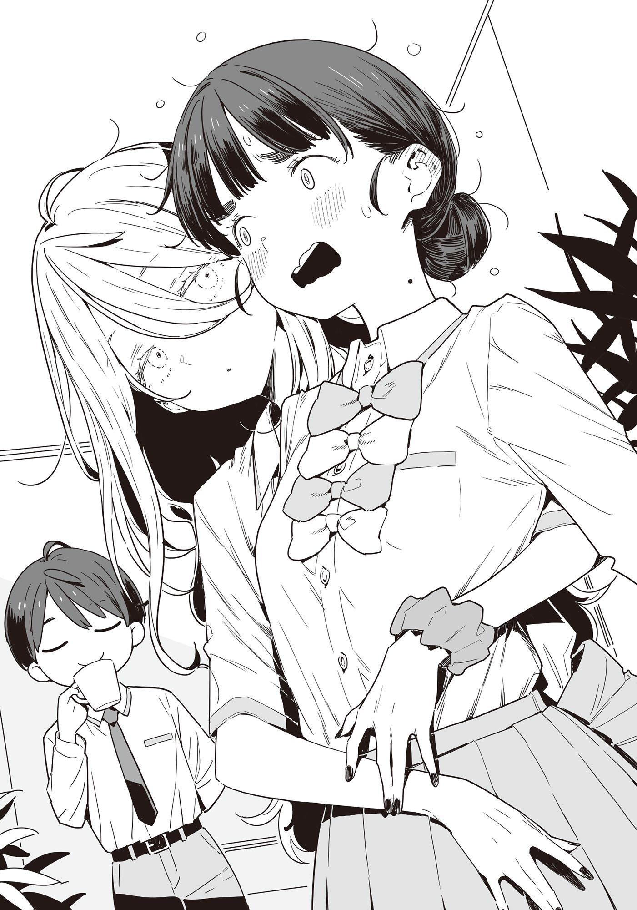

# Ch.101 — เล่ม 8 บทที่ 1-4

Ch.101 — เล่ม 8 บทที่ 1-4

By monica

Published: 2025-05-21T17:35:16Z

Source: https://www.nekopost.net/novel/14560/101

เล่ม 8 บทที่ 1-4

ช่วงพักเที่ยงของวันถัดมา ผมเดินไปที่บันไดหนีไฟของอาคารเรียนเก่าโดยมีขนมปังแกงกะหรี่กับนมอยู่ในมือ

อากาศวันนี้แจ่มใส อุณหภูมิก็กำลังดี ถ้าเธอไม่ได้อยู่ในห้องเรียน ก็น่าจะอยู่ที่นี่แหละ──

[ อ๊ะ ว่าแล้วเชียว ]

ที่บริเวณชานพักบันไดชั้นสาม โคมาริกำลังพิงราวเหล็กกินขนมปังเนย

พอเห็นผม เธอก็รีบกลืนขนมปังลงไปเหมือนตกใจ

[ นุ... นุคุมิซึก็มาด้วยเหรอ ]

[ อา คิดว่าโคมาริน่าจะอยู่ที่นี่น่ะ]

[ อุว๊ะ..? ]

แม้โคมาริจะดูงุนงง ผมก็ไม่สนใจ เดินมายืนข้างๆ ทันที

ในเมื่อยากิชิโอะที่อยู่แค่ในผ้าเช็ดตัวขอให้ผมช่วยดูแลโคะมาริ ผมก็ต้องทำหน้าที่นี้ให้ได้ นี่มันยื่นหมูยื่นแมวชัดๆ

ผมยื่นกล่องนมให้พลางพูดประโยคที่เตรียมมา

[ เอ่อ... พอดีเผลอซื้อนมมาสองกล่อง โคมาริจะเอาซักกล่องมั้ย? ]

[ มะ... ไม่มีใครเผลอซื้อมาสองกล่องหรอก ]

ถึงจะพูดแบบนั้น แต่เธอก็รับนมไปอยู่ดี

[ พอคิดดูแล้วก็จริงแฮะ งั้นขอคิดบทพูดต่อไปก่อนนะ? ]

[ ขอให้คิดทันก่อนพักเที่ยงจะหมดแล้วกัน... ]

ระหว่างที่มองโคมาริดูดนมจากหลอด ผมก็เปิดถุงขนมปังแกงกะหรี่

แล้ว….จะเริ่มไงดี

[ โคมาริ เมื่อวันก่อนบาโซริซังก็มาที่ห้องชมรมใช่มั้ย? ]

[ ปะ...ไปตายซะ ]

ไวชะมัด

แต่ก็นะ ช่วยไม่ได้ที่โคมาริจะหงุดหงิด

หลังจากเรื่องที่ยากิชิโอะพักกิจกรรมชมรม ก็ต้องมารับมือกับเด็กใหม่จอมปัญหา จนต้องพักชมรมชั่วคราวเป็นเวลาสองสัปดาห์

โคมาริในฐานะรองหัวหน้าชมรมต้องเหนื่อยมากแน่นอน ส่วนผมก็ลำบากใช่ย่อยเหมือนกัน

[ ไม่ต้องห่วงขนาดนั้นก็ได้ ผมยังเป็นหัวหน้าชมรมอยู่นะ ]

[ ยะ..อย่ามัวแต่หลงตำแหน่งตัวเองสิ ]

[ อ่า โอเค จะระวังไว้ ]

หืม แบบนี้ก็ไม่ได้ผลเหมือนกันแฮะ

ผมดูดนมกล่องไปพลางคิดว่าควรทำไงดี โคมาริก็เหลือบขึ้นมามองผมเหมือนพยายามจับผิด

[ ยะ... ยากิชิโอะพูดอะไรกับนายมารึเปล่า ]

[ ก็... นิดหน่อยน่ะ ]

ผมพูดติดอ่างก่อนจะกัดขนมปังไปคำหนึ่ง โคมาริก็ถอนหายใจเบาๆ

[ ฉะ... ฉันก็รู้ว่านายเป็นพวกใจดีน่ะนะ จะแอบไปทำอะไรก็เรื่องของนายเลย ]

[ ไม่ได้คิดจะยุ่งกับการเลือกตั้งนักเรียนเลยนะ ถึงเมื่อวานบาโซริซังจะมาบ้านก็เถอะ]

[ ยะ... ยัยนั่นถึงกับมาบ้านนายเลยเหรอ ]

เอ๋? ยากิชิโอะไม่ได้เล่าให้ฟังเหรอ ? แย่ล่ะสิ แบบนี้เท่ากับว่าขุดหลุมฝังตัวเองเลย….

[ เอ่อ... เหมือนเธอจะมีธุระกับน้องสาวน่ะ ก็รู้จักกันเพราะเรื่องสภานักเรียน แล้วตอนนั้นยากิชิโอะก็อยู่ที่บ้านผมด้วยนะ?]

[ ยะ... ยากิชิโอะก็อยู่ด้วยเหรอ ]

สายตาของโคะมาริเริ่มเหมือนมองเศษขยะเข้าไปทุกที หลุมที่ผมขุดไว้ดูจะลึกขึ้นเรื่อยๆ

[ เอ่อ สรุปก็คือ แค่อยากจะบอกว่าไม่ต้องเป็นห่วงหรอก]

[ ระ... ไร้ยางอายจริงๆ ]

พอพูดจบ เธอก็ก้มหน้ากินขนมปังเนยต่ออย่างไม่พูดอะไร

บรรยากาศเริ่มอึดอัด ผมเลยกัดขนมปังเงียบๆ ไปด้วย แล้วเธอก็พึมพำออกมาเบาๆ

[ นาย... ก็เป็นแบบนี้ทุกที สุดท้ายก็ปฏิเสธไม่ได้อยู่ดีใช่มั้ยล่ะ ]

[ ไม่ใช่แบบนั้นซะหน่อย── ]

[ นะ….แน่ใจเหรอว่าไม่ใช่? พูดได้เต็มปากเหรอ? ]

...ก็ไม่หรอก ผมงียบไปพลางกินขนมปังจนหมด ก่อนจะตัดสินใจเอ่ยปากออกมาอย่างลังเล

[ สมมตินะ สมมติว่าผมไปเป็นผู้สนับสนุนของบาโซริซังจริงๆ โคมาริจะไม่ว่าอะไรเหรอ? ]

โคมาริเล่นกับกล่องนมเปล่าในมือพลางตอบด้วยน้ำเสียงเหมือนยอมแพ้

[ จะ... จะไปเป็นสภานักเรียนหรืออะไร ก็แล้วแต่นายเลย ]

[ ก็บอกแล้วไง….ไม่ได้คิดจะเป็นสภานักเรียนซะหน่อย ]

[ กะ...ก็เลยบอกไง ว่าจะทำอะไรก็เรื่องของนายเลย ]

...เอาเถอะ ไม่มีใครเชื่อก็ช่วยไม่ได้ ผมมันเคยทำเรื่องแย่ๆ มาเยอะนี่นา

ผมวางศอกพิงราวเหล็กตรงชานพักบันได พลางเหม่อมองไปยังที่ไกลๆ

เลยตัวเมืองออกไป มีแนวเขาเตี้ยๆ ที่คุ้นตาเรียงรายอยู่

แค่แป๊บเดียว สีเขียวของภูเขาก็ดูเข้มขึ้นแล้ว วันจันทร์หน้าก็จะเข้าสู่เดือนมิถุนายน ฤดูกาลเปลี่ยนเครื่องแต่งกายกำลังจะมา

หน้าร้อนของปีนี้...กำลังจะเริ่มขึ้นแล้วสินะ

◇

หลังเลิกเรียนวันนั้นผมอยู่ที่คาเฟ่บอร์ดเกม “DEJANA” ซึ่งอยู่ไม่ไกลจากโรงเรียน

ที่โต๊ะชั้นสอง ตรงข้ามกับผมคือ...เลขานุการสภานักเรียน ชิกิยะ ยูเมโกะ

เธอเอียงคอเบา ๆ ขณะมองมาด้วยดวงตาสีขาวที่ไม่อาจบอกได้ว่าเธอกำลังมองอะไรอยู่

[ ตาของ...นุคุมิซึคุงแล้วนะ...? ]

[ อ๊ะ ครับ ]

ผมรีบถอนลูกเต๋าโดยไม่ให้เธอรู้ว่าผมเผลอมองเธออยู่

ผมขยับหมากตัวหมีสีน้ำตาลของตัวเองพลางสำรวจสถานการณ์บนกระดาน

ตอนนี้เรากำลังเล่นเกมที่คล้ายเกมงูกับบันไดแต่เล่นกันสองคน

ถึงจะเป็นเกมที่หน้าตาน่ารักสดใส มีหมีน้ำตาลกับหมีขาวเป็นตัวละครหลักแต่การวางชิปและการใช้กติกาบนกระดานกลับมีผลต่อผลแพ้ชนะอย่างมาก เป็นเกมที่ใช้ความคิดเกินคาดเลยทีเดียว

ขอเสริมว่า...ตอนนี้ผมแพ้ติดกันสามตาแล้ว

[ ขอรับชิปอันนี้ไปนะ กลับไปที่จุดเริ่มต้นได้เลย ]

[ แบบนี้...จะดีเหรอ...? ]

จากนั้นชิกิยะซังก็ทอยลูกเต๋าออกมาได้ 6 แต้ม

[ เอ๊ะ อย่าบอกนะว่าชิป 20 แต้มโดนเก็บไปแล้ว? ]

[ แอสซิสต์...เยี่ยมเลย... ]

ชิกิยะซังที่อารมณ์ดี หยิบชิปด้วยปลายนิ้วที่ตกแต่งอย่างสวยงาม

แน่นอนว่าเราสองคนไม่ได้มานั่งสวีทกันหลังเลิกเรียนหรอก

พอติดต่อไปว่า “อยากคุยอะไรนิดหน่อย” เธอก็เลือกสถานที่นัดมาเป็นที่นี่เท่านั้นเอง...เรื่องจริงนะ

ผมรอจังหวะเหมาะ ๆ แล้วทำทีเหมือนไม่ได้คิดอะไรก่อนจะเปิดปากพูด

[ เอ่อ...ช่วงนี้บาโซริซังเป็นยังไงบ้างครับ? ]

[ ยังไง...เหรอ...? ]

มือของชิกิยะซังที่กำลังจะขยับตัวหมากหมีขาวชะงักไป

[ หมายถึง...ในสภานักเรียนช่วงนี้บรรยากาศเป็นยังไงบ้างน่ะครับ ]

[ นาย...ไม่ได้อยากคุยกับฉันเหรอ...? ]

ชิกิยะซังพูดพลางแกว่งตัวเบา ๆ ราวกับล่องลอย

ผมเผลอรู้สึกเกร็งและพยักหน้าแรง ๆ ไปสองสามครั้ง

[ อ่ะ ครับ คือ...อยากปรึกษาเรื่องบาโซริซังกับรุ่นพี่น่ะครับ ก็เลยคิดว่าจะคุยกันได้มั้ย...]

บรรยากาศชวนอึดอัดแปลก ๆ ยังไงชอบกล...

ในขณะที่กำลังประหม่า ชิกิยะซังก็เอียงคอไปอีกครั้ง

[ เรื่องเลือกตั้งประธานสภา...เหรอ..? ]

[ ครับ ได้ยินมาว่ารุ่นพี่ถูกปฏิเสธไม่ให้เป็นผู้สนับสนุน ]

[ อืม...เทียร่าจัง...ปัดตกฉัน...]

เธอเอียงตัวอย่างเศร้าสร้อย

[ ขอถามได้มั้ยครับว่าทำไมรุ่นพี่ถึงอยากเป็นผู้สนับสนุนให้เธอ?]

[ เพราะ...เทียร่าจัง...ไม่ยอมรับคนที่คุณครูแนะนำให้... ]

เธอพูดไปพลางเล่นหมากหมีขาวด้วยนิ้วเรียวยาวอย่างเบา ๆ

[ ถ้าไม่มีใครช่วย...ก็อาจจะสอบตก... ]

หลังจากแกว่งตัวไปมาอยู่พักหนึ่ง ชิกิยะซังก็มองผมด้วยดวงตาสีขาวของเธอ

[ เทียร่าจัง...มาขอร้องนายเหรอ...? ]

[ ครับ เหมือนว่าเธออยากให้ผมเป็นผู้สนับสนุน แต่ผมก็ปฏิเสธไปหลายครั้งแล้วนะครับ เธอก็ยังไม่ยอมเลิกขอซะที ]

การแกว่งตัวของชิกิยะซังค่อย ๆ หยุดลงอย่างไม่รู้ตัว

[ อย่างงั้น...เหรอ... ]

ความเงียบเข้าปกคลุม

ผมรู้สึกอึดอัดจึงเอานิ้วจิ้มหมากตัวหมีเล่น

[ เทียร่าจัง...ชอบนาย...น่ะ ]

[ มะ...ไม่ใช่แบบนั้นหรอกครับ น่าจะเป็น...แนว BL หรืออะไรประมาณนั้นมากกว่า... ]

[ ก็...ปฏิเสธไม่ได้... ]

ชิกิยะซังวางหมากเบา ๆ แล้วเริ่มเกมต่อ

ผมถอยลูกเต๋าไปพลาง แต่ใจไม่อยู่กับเกมเลย

[ ผมขึ้นเวทีช่วยพูดสนับสนุนอะไรแบบนั้นไป มีหวังเธอแพ้แน่ ถ้าคุณครูหาใครที่เหมาะสมมากกว่านี้ได้ ก็น่าจะดีกว่าอยู่แล้ว ]

[ ไม่อยาก...ช่วยงั้นเหรอ...? ]

ดวงตาสีขาวของชิกิยะซังจับจ้องมา

ผมส่ายหน้าช้า ๆ

[ เธอเป็นคนขยัน ตั้งใจจริง ถ้าได้เป็นประธานก็คงดี ]

ผมเว้นเล็กน้อย ก่อนจะพูดต่อ

[ แต่ถ้าไม่มีความสนใจในกิจกรรมของสภา แล้วแค่เพราะรู้จักกันถึงไปเป็นผู้สนับสนุนให้ ก็ไม่รู้ว่ามันเหมาะสมมั้ย แล้วก็พูดต่อหน้าผู้คน...เอ่อ... ]

[ นาย...บอกเทียร่าจัง….แบบนั้นแล้วเหรอ...?]

[ ยังเลยครับ ถ้าอย่างนั้น...ให้ผมไปขอให้รุ่นพี่กลับมาเป็นผู้สนับสนุนให้ดีมั้ย ? ]

[ น่าจะ...ยาก... ]

ชิกิยะซังหยุดเล่นเกมอีกครั้ง แล้วจ้องมองลูกเต๋า

ขนตายาวสวยของเธอสั่นไหวทั้งที่ไม่มีลม

[ ฉัน...ใส่ใจเธอมากเกินไป...เลยโดนเกลียด...]

[ เอ่อ...ไม่ใช่แบบนั้นหรอกครับ ]

ในขณะที่ผมยังหาคำพูดตอบไม่ได้ ชิกิยะซังก็ลุกขึ้นอย่างกะทันหัน

[ นุคุมิซึคุง...มานี่...]

[ เอ๊ะ เดี๋ยวสิครับ รุ่นพี่ ]

พูดยังไม่ทันขาดคำ มือของผมก็ถูกคว้าไว้ และเธอก็ลากผมไปที่มุมหนึ่งของห้อง

[ รุ่นพี่ นี่มันอะไรกันครับ— ]

[ นั่งลง... ]

[ อ่ะ ครับ ]

ผมย่อตัวลงไปใต้โต๊ะที่ไม่มีใครนั่งตามที่ถูกบอก

…ว่าแต่ มือเรายังจับกันอยู่เลยแฮะ

ผิวของชิกิยะซังนุ่มเนียนราวกับกระจกขัดมัน

ความเย็นที่แผ่ซึมมาช้า ๆ จากฝ่ามือนั้น ค่อย ๆ กลืนกินความรู้สึกของมือผมไป

[ เป็นอะไรเหรอ……？ ]

[ เอ่อ──เปล่าครับ ไม่มีอะไร ]

วันนี้ค่อนข้างร้อนอยู่แล้ว มือเย็น ๆ แบบนี้ก็ดีเหมือนกันแฮะ ก็โรคลมแดดน่ากลัวนี่นา

…ผมแอบชำเลืองมองชิกิยะซังที่ย่อตัวนั่งอยู่ข้าง ๆ อย่างเงียบ ๆ

เธอยังคงมีสีหน้าเรียบเฉยตามปกติ โผล่หน้าออกมาเหนือโต๊ะเพียงเล็กน้อย

ขนตาที่หนาเป็นพิเศษ ปกป้องดวงตาสีขาวที่ดูเหมือนจะลืมกระพริบไปแล้ว

กลิ่นหอมหวานแบบผู้ใหญ่ที่ลอยอวลรอบตัว น่าจะเป็นน้ำหอมที่เธอชอบใช้ช่วงนี้

ขณะที่ผมมองดูอย่างเหม่อลอย ชิกิยะซังก็เหลือบมองนาฬิกาข้อมือแวบหนึ่ง

[ ห้าโมงเย็น……พอดีเป๊ะ……]

[ นัดกับใครไว้เหรอ── ]

[ เงียบหน่อย……ก้มหน้าลง……]

ผมก้มหน้าลงตามคำบอกพร้อมกับมองตามสายตาของชิกิยะซัง เห็นนักเรียนหญิงของโรงเรียนสึวะบุกิคนหนึ่งกำลังเดินขึ้นบันไดมา

คนที่ปรากฏตัวคือ บาโซริ เทียร่า เธอเหลียวมองไปรอบ ๆ ชั้นด้วยท่าทางกระสับกระส่าย แล้วจึงนั่งลงที่โต๊ะใกล้บันไดที่สุด

หลังตรง มองบันไดด้วยแววตารอคอย…ดูท่าคงนัดใครไว้แน่

[ ทำไมบาโซริซังถึงมาอยู่ที่นี่ได้ล่ะครับ ]

ผมถามเสียงเบา ชิกิยะซังตอบอย่างภูมิใจเล็กน้อย

[ ฉันเป็นคน……เรียกมาเอง……]

[ ถ้าจะคุยกันสามคน ทำไมไม่ไปห้องสภานักเรียนล่ะครับ ]

[ ไม่อยาก……เล่นกับฉัน……เหรอ……？ ]

[ ไม่ใช่……ไม่อยากครับ ]

รู้สึกเขิน ๆ เลยเบนสายตากลับไปทางเทียร่าซัง

แล้วเธอก็หยิบอะไรบางอย่างจากกระเป๋าออกมา

เป็นกล่องกลมเล็ก ๆ คล้ายแป้งพัฟแต่งหน้า

เธอเปิดฝา แล้วตบแป้งใส่หน้าทีละนิด

…ดูยังไงก็เหมือนคุณป้าสมัยโชวะเลยแฮะ

[ เราแอบดูเธอแบบนี้ไปทำไมกันครับเนี่ย？]

[ เทียร่า……ยอมมาหา……ดีใจจัง…… ]

ชิกิยะซังตัวสั่นระริกเล็ก ๆ อย่างร่าเริง

ว่าไปแล้ว สองคนนี้เคยได้ยินว่ามีความสัมพันธ์แบบ “สบาย ๆ ถึงขั้นไม่ใส่บราก็เจอกันได้” ใช่มั้ยนะ

ยังไม่เข้าใจนักหรอก แต่ดูเหมือนจะเป็นส่วนหนึ่งของเกมล่ะมั้ง …… ปล่อยให้เขาเล่นกันตามสบายแล้วกัน

ขณะที่ผมตื่นเต้นกับโลกของผู้ใหญ่ เทียร่าก็จ้องมาทางนี้แบบไม่รู้ตัวเลย

[ เทียร่าซัง……กำลังมองทางนี้อยู่นะครับ？ ท่าทางเคืองมากเลย ]

[ จังหวะแบบนี้……ชอบที่สุด…… ]

อ้อ โลกของผู้ใหญ่นี่เอง

ผมกำลังประทับใจกับคำพูดนั้นอยู่ดี ๆ เทียร่าก็เดินเร็วพุ่งมาทางเรา

[ อยู่ด้วยกันทั้งสองคนเลยเหรอคะ?! ทำไมไม่ทักกันล่ะคะ？ ]

[ กลัว……จะรบกวน……ตอนแต่งหน้า…… ]

ชิกิยะซังลุกขึ้นยืนอย่างแผ่วเบา แล้วสอดแขนไปโอบรอบตัวเทียร่า เอาหน้าเข้าไปใกล้จนจมูกแทบชนกัน

[ แต่งหน้าไม่เก่ง……น่ารักเกินไป……ผิดกฎโรงเรียน…… ]

[ โรงเรียนไม่มีข้อห้ามแบบนั้น──เดี๋ยวนะ ฉันแต่งหน้าไม่เก่งเหรอคะ?! ]

[ ตรงนั้นแหละ……น่ารัก…… ]

[ อย่าเอาหน้ามาถูนะคะ！ ]

เฮ้อ……อยู่ท่ามกลางสองคนนี้รู้สึกจะเสียมารยาทเปล่า ๆ

ผมเลยกลับไปนั่งที่เดิม แล้วจิบกาแฟที่เย็นชืดไปแล้ว

รสขมและรสเปรี้ยวผสมผสานกันในปากอย่างกลมกล่อม

[ นี่ ! ทำไมเอาแต่ยืนดูล่ะคะ นุคุมิซึซัง ! มาช่วย──เดี๋ยว! อย่าแตะตรงนั้นนะคะ ！]

ผมมองสองคนที่พันกันยุ่งเหยิง แล้วจิบกาแฟอีกอึก

กาแฟเย็น──เข้ากับบรรยากาศดอกลิลลี่ผลิบานแบบนี้ได้ดีเหลือเกิน

