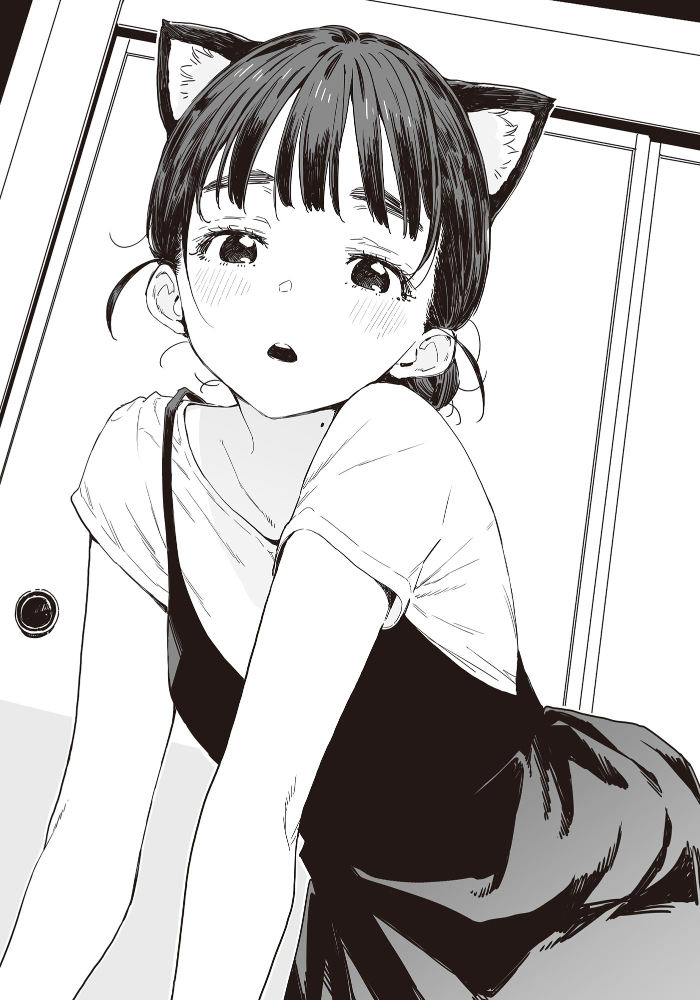

# Ch.103 — เล่ม 8 บทที่ 1-6

Ch.103 — เล่ม 8 บทที่ 1-6

By Monica

Published: 2025-05-23T12:17:02Z

Source: https://www.nekopost.net/novel/14560/103

เล่ม 8 บทที่ 1-6

นับตั้งแต่ที่เรามารวมกลุ่มกันเทียร่าซัง ก็ไม่พูดอะไรเลย แถมยังเดินเร็วผิดปกติด้วย

เราเดินออกจากประตูแก้วข้างมุมแมกกาซีนเข้าสู่ถนนโทคิวะ เดินลึกเข้าไปในอาเขตโดยเหลือบมองแถวคนรอซื้อเครปไปด้วย พอผมไล่ตามทันก็เดินไปข้างๆ เทียร่าซัง

[ เอ่อ... โกรธอยู่เหรอ...? ]

[ ไม่ได้โกรธหรอกค่ะ แค่ตกใจนิดหน่อยที่เชิญสองคนนั้นมาติวด้วยเท่านั้นเอง ]

[ ไม่ได้บอกใครเลยนะ คนนั้นแค่เข้ามายุ่งเฉยๆ ]

เทียร่าซังพยักหน้าเงียบๆ แล้วเลี้ยวตรงมุมอาเขต โดยมีร้านช็อกโกแลตอยู่ข้างหลัง

หลังจากเดินไปได้สักพัก เธอก็ยกมือแตะหน้าอกแล้วถอนหายใจราวกับโล่งอก

[ ฟู่ว์... แค่มาถึงตรงนี้ก็น่าจะปลอดภัยแล้วล่ะ ]

[ หืม ปลอดภัยจากอะไรเหรอ? ]

[ ตรงนั้น คนพลุกพล่านนี่คะ ช่วงนี้คนรอบๆตัวดูจะจุ้นจ้านนิดหน่อย ]

เธอเหลียวมองไปรอบๆ แล้วขยับเข้ามาใกล้ผมอีกก้าว

[ ...นุคุมิซึซัง รู้จักชมรมส่องนกมั้ยคะ? ]

[ ที่โดนยุบไปเพราะขายภาพแอบถ่ายน่ะเหรอ? ]

[ ที่จริง คือ 'ยุบชั่วคราวไม่มีกำหนด' ค่ะ แต่เพราะท่านประธานยื่นมือช่วยไว้ ถึงได้อนุญาตให้ดำเนินกิจกรรมในนามชมรมหนังสือพิมพ์ต่อได้ ]

[ โรงเรียนเรามีชมรมหนังสือพิมพ์ด้วยเหรอ? ]

[ ไม่มีค่ะ เพราะงั้นท่านประธานถึงให้พวกเขาทำผลงานในฐานะชมรมหนังสือพิมพ์เพื่อจะได้นำไปสู่การฟื้นฟูชมรมส่องนก ท่านประธานเมตตาจริงๆ… ]

...แต่ชมรมส่องนกนี่ มันถึงกับต้องรักษาไว้ขนาดนั้นเลยเหรอ

[ แล้วชมรมหนังสือพิมพ์นั่นทำไมเหรอ? ]

[ พวกเขาทำตัวเลียนแบบแมกกาซีนซุบซิบ แล้วก็สะกดรอยคนที่เกี่ยวข้องกับการเลือกตั้งน่ะค่ะ พอเป็นชมรมแบบนี้ สภานักเรียนเลยเข้าไปยุ่งไม่ได้ด้วยสิ ]

เทียร่าซังยกมือกุมหน้าผากแล้วถอนหายใจ

ในฐานะคนชอบนกเหมือนกันก็อยากขอโทษแทน แต่ดูยังไงพวกนั้นก็ไม่ได้ชอบนกเลยสักนิด

ระหว่างที่เดินเคียงข้างเธอ ผมก็สังเกตไปรอบๆ ด้วย

พอพ้นจากถนนฮิโรโกจิทางเหนือของอาเขต ผู้คนก็เริ่มบางตาลงอย่างเห็นได้ชัด

แต่ก็ไม่ได้ถึงกับเงียบเหงา สองข้างทางที่น่าจะเคยเป็นร้านค้าและสำนักงานมาก่อน ยังหลงเหลือกลิ่นอายของอดีตไว้ ขณะเดียวกันก็กลายเป็นย่านที่อยู่อาศัยไปแล้ว

มีอาคารที่ยังคงรูปลักษณ์ร้านค้าไว้บ้าง บางแห่งก็ยังคงเปิดกิจการต่อไป

ร้านอาหารใหม่ๆ ผุดขึ้นแทรกอยู่เป็นระยะ สะท้อนภาพเมืองที่ยังคงหายใจเบาๆ พร้อมกับค่อยๆ เปลี่ยนแปลงไป

เทียร่าซังดูไม่มีทีท่าว่าจะหลงทางเลย ดูเหมือนจะคุ้นเคยกับย่านนี้ดีทีเดียว

[ บาโซริซัง เราจะติวกันที่ไหนเหรอ? ]

[ อ๊ะ ขอโทษค่ะ ลืมบอกไป บ้านฉันอยู่แถวนี้ เรากำลังจะไปที่นั่นล่ะ ]

บ้านเทียร่าซังเหรอ แถวนี้เลย... แล้วจะติวกันที่บ้านเทียร่าซังงั้นเหรอ...

[ หา?! จะไปบ้านเธอเหรอ?! ตอนนี้เลยเหรอ?! ]

[ พ่อแม่ไม่อยู่บ้านค่ะ ไม่ต้องเกรงใจ──อ๊า ไม่ได้หมายความแบบนั้นนะคะ?! ฉันมีน้องชายอยู่ด้วย อย่าคิดอะไรแปลกๆ ล่ะ! แล้วก็── ]

เทียร่าซังรีบเสริมหน้าแดงก่ำ

[ น้องชายฉัน...มีแฟนแล้วนะคะ!]

แล้วจะบอกทำไมเนี่ย

ถึงจะมีคนในบ้านก็เถอะ การจะเข้าไปในบ้านของเพศตรงข้ามแบบนี้...มันจะดีเหรอ?

ถ้าเป็นในโลกของการ์ตูนรักล่ะก็ รับรองได้เลยว่าอีเวนต์ต้องเกิดแน่ๆ ถ้าเป็นเกมผู้ใหญ่ล่ะก็ ได้ภาพแยกมาเก็บเป็นคอลเล็กชันเลยแหงๆ

[ แต่ถ้าจะคอมพลีตภาพทั้งหมดล่ะก็... ]

[ นุคุมิซึซัง เมื่อกี้พูดอะไรพึมพำๆ อยู่นะคะ? ]

โอ๊ะ เผลอหลุดเข้าไปในโลกของผู้ใหญ่ซะแล้ว

ผมหันมองไปรอบๆเพื่อเรียกสติคืน แล้วก็รู้สึกว่าที่นี่คุ้นตา...

พื้นหินปูแบบนี้...

[ ที่นี่มันแถวฮานาโซโนะนี่นา?]

[ค่ะ รู้จักด้วยเหรอคะ?]

[ พอดีชอบแวะมาซื้อของที่ซูเปอร์ข้างหน้า เลยผ่านตรงนี้บ่อย ]

แถวนี้เคยเป็นย่านการค้าเก่า

ถึงจะเรียกว่าย่านการค้า แต่ก็แทบจะปิดร้านกันหมดแล้ว แต่ละปีก็ยิ่งมีร้านที่ยังเปิดอยู่น้อยลงเรื่อยๆ

ในนั้นเอง ผมก็เห็นอาคารใหม่เอี่ยมขนาดใหญ่สะดุดตาขึ้นมา

[ มีแมนชันอยู่ตรงนี้ด้วยเหรอ? ]

เทียร่าซังที่กำลังจะเดินผ่าน หยุดแล้วเงยหน้ามองอาคารนั้น

[ เพิ่งสร้างไม่นานนี้ค่ะ คนที่เคยอยู่ที่นี่ก็ย้ายกันไปหมดแล้ว ]

[ อย่างนั้นสินะ ]

[ เมื่อตอนรุ่นปู่รุ่นย่าของฉันยังอยู่ ย่านนี้คึกคักมากเลยล่ะค่ะ... แต่ก็ช่วยไม่ได้เนอะ ]

เธอพูดด้วยน้ำเสียงเรียบๆ ก่อนจะเดินต่อแล้วเลี้ยวตรงหัวมุม

[ บ้านฉันอยู่ตรงนั้น── ]

[ อ๊ะ เทียร่าจังไม่ใช่เหรอ! ]

เสียงผู้หญิงสูงวัยอวบอั๋นคนหนึ่งดังขึ้นกลบเสียงของเทียร่าซัง

เธอชะงักไปชั่วครู่ก่อนจะโค้งคำนับเบาๆ

[ สวัสดีค่ะ คุณป้าชิเงะ ]

[ โถ่เอ๊ย วันนี้ดูเป็นทางการจังเลย ปกติเรียกว่าป้าเองนี่นา ]

[ เอ่อ คือว่า... ]

[ ป้าเศร้านะ เทียร่าจังกลายเป็นผู้ใหญ่ไปซะแล้ว...ว่าแต่...? ]

คุณป้าชิเงะที่ชื่อเต็มๆ คือ “มิจิชิเงะ” เห็นผมเข้าแล้วก็ตาโตขึ้นมา

[ อืม～ อาระ อาระ เทียร่าจัง? ]

[ มะ ไม่ใช่แบบนั้นค่ะ! ]

[ อื้ออื้อ เข้าใจๆ ป้าก็เคยเป็นแบบนั้นมาก่อนนะ ตอนนั้นแฟนก็ไม่ใช่พ่อของลูกด้วยล่ะ นี่เป็นความลับนะ ]

[ กะ ก็เลยบอกแล้วไงคะว่าไม่ใช่แบบนั้น!! ]

[ รู้ๆ ป้ารู้หมดแหละ ขอโทษที่รบกวนนะจ๊ะ ]

ป้าชิเงะพยักหน้าแรงๆ ราวกับจะบอกว่า “ไม่ต้องพูดอะไรแล้ว” แล้วเดินผ่านไปพร้อมรอยยิ้ม

ก่อนจากไปยังยกนิ้วโป้งให้ผมด้วย

[ อาระ อาระ… เทียร่าจังโตเป็นสาวเต็มตัวแล้ว หรือว่าจะเป็นจากนี้ไปกันนะ ]

พลังทำลายของคุณป้าเพื่อนบ้านนี่ไม่ธรรมดาจริงๆ เทียร่าซังถึงกับยกมือปิดหน้าสั่นระริกเลยทีเดียว

… ในอานาคตยานามิจะเป็นแบบนั้นมั้ยนะ

◇

บ้านของตระกูลบาโซริอยู่ไม่ไกลจากจุดที่คุณป้ามิจิชิเงะถูกรับตัวไป เป็นอาคารสามชั้นหันหน้าเข้าถนน

ชั้นล่างเคยเป็นร้านค้ามาก่อนแน่ ๆ เพราะด้านที่ติดถนนเป็นกระจกทั้งหมด

เทียร่าเปิดบานเลื่อนกระจกแล้วกวักมือเรียกให้ผมเข้าไปข้างในก่อน

เมื่อเข้ามาในร้าน แสงภายในค่อนข้างสลัว ชั้นวางรอบห้องเต็มไปด้วยกล่องเสื้อผ้าและกล่องกระดาษที่ซ้อนทับกันเป็นภูเขา

[ ขอโทษที่รกแบบนี้นะคะ… ]

เธอพูดอย่างเขินอาย พลางเดินลึกเข้าไปในห้อง

[ ไม่หรอก ที่นี่เคยเป็นร้านอะไรเหรอ? ]

[ พวกเราขายเครื่องหมายจนถึงรุ่นของคุณปู่ค่ะ]

[ เครื่องหมาย? ]

[ ก็แบบ… เข็มกลัด, ถ้วยรางวัล, ป้ายแขวน ── ประมาณนั้นน่ะค่ะ แต่เพราะไม่มีลูกค้า เลยต้องปิดร้านลง ]

ธุรกิจแบบนี้ก็มีด้วยสินะ

[ อ้อ เพราะอย่างงั้นเทียร่าซังถึงติดป้ายชื่อไว้ที่เครื่องแบบสินะ ]

[ ไม่ใช่หรอกค่ะ นั่นเป็นกฎของโรงเรียน แล้วก็… อย่าเรียกชื่อจริงสิคะ ]

เทียร่าเอ่ยพลางเดินไปเปิดประตูด้านในอย่างเป็นธรรมชาติ

หลังประตูมีพื้นที่สำหรับถอดรองเท้า และเมื่อก้าวขึ้นไปอีกขั้นก็เป็นส่วนของบ้านพักอาศัย

พอขึ้นมา ทางขวามือคือบันไดไปชั้นสอง ส่วนด้านหน้าคือห้องนั่งเล่น

[ ห้องของฉันอยู่ชั้นสามค่ะ ถอดรองเท้าตรงนี้เลยนะคะ ]

[ อ-อืม ขอบคุณครับ]

…รู้สึกตัวอีกทีก็หลุดพูดด้วยภาษาสุภาพไปซะแล้ว

บ้านของผู้หญิงที่เต็มไปด้วยกลิ่นอายการใช้ชีวิตจริง ๆ แถมเจ้าของบ้านก็ยังไม่ใช่คนสนิทอีกต่างหาก มันยิ่งทำให้บรรยากาศดูพิเศษมากขึ้นไปอีก

พอขึ้นบันไดที่ค่อนข้างชันไปถึงชั้นสาม ก็มีประตูอยู่สองบานเรียงตามทางเดิน

[ ทาคาชิ ! เก็บกระเป๋าให้เรียบร้อยด้วยนะ ! ]

เทียร่าเอ่ยเตือนขณะเดินผ่านประตูบานแรกไป

ดูเหมือนเธอจะเป็นพี่สาวที่บ้าน และน้องชายก็ดูจะเป็นคนธรรมดาดี

[ ห้องไม่มีอะไรเลย แต่ก็เชิญตามสบายค่ะ ]

เทียร่าชวนผมเข้าไปในห้องที่ปูด้วยเสื่อทาทามิขนาดหกเสื่อ

เฟอร์นิเจอร์ที่เด่น ๆ ก็มีแค่เตียง โต๊ะหนังสือ ชั้นวางหนังสือ และโต๊ะเตี้ย เรียบง่ายสไตล์ญี่ปุ่นดั้งเดิม

ถึงจะไม่มีของตกแต่งแบบห้องเด็กผู้หญิงทั่วไป แต่พรมใต้โต๊ะกับผ้าม่านสีชมพูอ่อนก็ให้ความรู้สึกนุ่มนวล

ความเป็นผู้หญิงที่แอบแฝงอยู่ท่ามกลางความเรียบง่ายนั้น ดูแล้วน่ารักดี

[ เชิญนั่งบนเบาะตรงนั้นได้เลยค่ะ ]

[ อ-อืม ขอบคุณครับ ]

ผมนั่งคุกเข่าบนเบาะอย่างเก้ ๆ กัง ๆ

ช่วยไม่ได้ที่จะรู้สึกประหม่าขนาดนี้ นี่เป็นครั้งแรกที่ได้เข้าห้องของผู้หญิง

ห้องของโคมาริไม่นับ เพราะอยู่กับน้องชายและน้องสาว แถมยังเป็นสถานการณ์ฉุกเฉินอีก

เทียร่าซังก็นั่งลงตัวเล็กๆอยู่ฝั่งตรงข้ามแล้วเริ่มจับผมหน้าม้าของตัวเองอย่างกระวนกระวาย

[ ง-งั้น… มาเริ่มกันเลยดีมั้ยคะ ]

[ อ-อา… ดีเลย ]

ทั้งที่แค่จะเรียนด้วยกัน ทำไมบรรยากาศมันถึงตึงเครียดขนาดนี้นะ

เราทั้งคู่หยิบหนังสือเรียนออกมาจากกระเป๋าเงียบ ๆ

[ คือว่า… วันนี้ก็ช่วยสอนคณิตให้ฉันอีกวันได้มั้ยคะ ฉันไม่ค่อยถนัดเรื่องจํานวนนับ…]

[ ดีเลย เพราะผมก็ไม่ถนัดเหมือนกัน ]

ผมตอบส่ง ๆ ไป เทียร่าก็หัวเราะคิกคัก

[ ไม่เห็นจะดีตรงไหนเลยค่ะ งั้นมาเรียนไปด้วยกันนะคะ ]

ดูเหมือนเธอจะชอบมุกนี้แฮะ ผมลอบถอนหายใจด้วยความโล่งอก แล้วเปิดหนังสือเรียน

[ ว่าแต่… คะแนนสอบคราวก่อนเป็นยังไงบ้างล่ะ? ]

[ ถ้าจะพูดก็… เริ่มเห็นความพยายามที่จะแก้ไขอยู่บ้างค่ะ อย่างน้อยก็ดีกว่าแค่ตัวเลขอย่างเดียว ]

เทียร่ากำหมัดแน่นด้วยความมุ่งมั่น อืม มองโลกในแง่ดีไว้ก็ดีแล้วล่ะ

──ประมาณสามสิบนาทีผ่านไปหลังจากเริ่มเรียน

พอผมเงยหน้าขึ้นจากการตรวจคำตอบ เทียร่าก็กำลังตั้งใจทำแบบฝึกหัดด้วยสีหน้าจริงจัง

ผมที่ถูกรวบไว้เผยให้เห็นคิ้วหนาๆไฝตรงคอที่ตัดกับผิวขาวชัดเจน

ใบหน้าเล็กจนน่าประหลาดใจ แม้จะดูเหมือนไม่แต่งหน้า แต่ก็คงมีแอบแต่งบ้างในวันหยุด

[ …มีอะไรติดหน้าฉันเหรอคะ? ]

เทียร่าก็เงยหน้าขึ้นมาถามอย่างสงสัยตั้งแต่เมื่อไหร่ไม่รู้

[ อ่า เปล่าๆ แค่สงสัยนิดหน่อย… ]

ผมอ้อมแอ้มปฏิเสธ เทียร่าก็โน้มตัวมาข้างหน้าอย่างสนุกสนาน

[ อะไรเหรอคะ? ยิ่งพูดแบบนั้นฉันยิ่งอยากรู้เลยนะคะ ]

[ เอ่อ คือ… แค่คิดว่าไม่ใช่การชวนเข้าสภาจริง ๆ สินะ ]

รอยยิ้มของเทียร่าหายไปอย่างรวดเร็ว

…แย่ล่ะ พูดอะไรแย่ ๆ ออกไปอีกแล้ว

[ ในบางกรณีก็มีความตั้งใจแบบนั้นค่ะ ก็ถ้าพาเข้าบ้านได้แล้ว ก็ถือว่าเป็นฝ่ายชนะแล้วล่ะค่ะ ]

น้ำเสียงของเธอฟังดูไม่รู้ว่าเป็นล้อเล่นหรือจริงจัง

ว่าแต่ว่า… “ในบางกรณี” งั้นเหรอ?

[ หมายความว่าตอนนี้ไม่มีความตั้งใจแบบนั้นแล้ว? ]

[ จริง ๆ แล้วเมื่อวานเป็นวันสุดท้ายของการรับสมัครเลือกตั้งประธานนักเรียนค่ะ แล้วจนถึงเย็นก็ยังมีแค่ฉันคนเดียวที่ลงสมัคร ]

รอยยิ้มแบบยอมรับผิดแวบผ่านบนใบหน้าเธอ

[ หมายความว่าจะไม่มีการเลือกตั้งแล้ว? ]

[ ค่ะ เหลือแค่แถลงจุดยืนกับโหวตไว้วางใจเท่านั้น ไม่มีสุนทรพจน์สนับสนุนอะไรแล้ว ]

งั้นสิ่งที่วุ่นวายมาตลอดก่อนหน้านี้คืออะไรกันแน่…

ว่าแต่เมื่อวานเรายังเจอกันที่ร้านบอร์ดเกมอยู่เลยนี่นะ?

[ แล้วทำไมเมื่อวานไม่บอกกันล่ะ? ]

[ ขอโทษค่ะ ตอนนั้นยังไม่ถึงเที่ยงคืน ยังไม่ถือว่าเป็นทางการ ฉันเลยไม่กล้าพูด ]

งั้นเหรอ… ไม่ได้รู้สึกโกรธเลย กลับรู้สึกโล่งใจจนเผลอยิ้มออกมา

[ …อ๊ะ หรือว่า เริ่มจะยอมรับแล้วเหรอคะ? ]

[ อา ก็นิดหน่อย คิดว่าช่วยเลือกตั้งก็น่าจะพอไหวอยู่ ]

[ ฟุฟุ… ถึงตอนนี้จะพูดยังไงก็ได้นะคะ ]

[ ก็พูดไว้เฉย ๆ นี่แหละ ]

เทียร่าหัวเราะอย่างสนุกสนานกับคำพูดเล่นของผม …ไม่อยากเชื่อเลยว่าเธอจะหัวเราะแบบนี้ได้ด้วย

หลังจากหัวเราะด้วยกันอยู่พักหนึ่ง เธอก็เช็ดน้ำตาที่หางตาแล้วพูดขึ้น

[จริง ๆ แล้วฉันมีหมัดเด็ดเตรียมไว้สำหรับโน้มน้างนุคุมิซึซังด้วยล่ะค่ะ แต่ว่าดูเหมือนไม่ต้องใช้แล้ว ]

[ หมัดเด็ดแบบไหนเหรอ? ]

[ เอ่อ ไม่ใช่อะไรที่น่าสนใจขนาดนั้นหรอกค่ะ ]

เทียร่าหัวเราะกลบเกลื่อน

…ว่าแต่ เดี๋ยวนะ ผมถูกเรียกมาด้วยข้ออ้างว่าเป็นของแถมจิกะเปียวไม่ใช่เหรอ

งั้นถ้า “หมัดเด็ด” ที่ว่า ก็คือ──

[ ขอดูหน่อยได้มั้ย? ]

[ เอ๊ะ แต่ว่า… ]

พอผมโน้มตัวเข้าไป เทียร่าก็เผลอถอยหลังอย่างตกใจ

จากปฏิกิริยาแบบนี้ มันต้องเป็นของหายากมากแน่ ๆ

[ หมัดเด็ดของเทียร่าน่ะ ผมอยากเห็นจริง ๆ นะ ]

[ คือ… แต่ว่า มันไม่ใช่อะไรที่น่าตื่นเต้นขนาดนั้นหรอกค่ะ… ]

[ ไม่เป็นไรหรอก ถือเป็นความลับระหว่างเราสองคนก็พอ ผมจะไม่บอกใครเลย ]

[ ค-ความลับ…!? ]

ดูเหมือนความมุ่งมั่นของผมจะเข้าถึงแล้ว เทียร่ากลืนน้ำลายเบา ๆ แล้วพยักหน้าเบา ๆ ด้วยสายตาอ้อน ๆ

[ อืม… ไม่รู้จะถูกใจมั้ยนะคะ ]

เธอเปิดลิ้นชักโต๊ะเรียน หยิบอะไรบางอย่างออกมาแล้วแอบไว้ข้างหลัง ก่อนจะกลับมานั่งใหม่

ของชิ้นนั้นดูไม่ใหญ่มาก น่าจะเป็นพวกอะคริลิคสแตนด์หรืออะไรทำนองนั้น

ในขณะที่ผมกลั้นหายใจมองดู──

[ งั้น… ขอจัดเต็มเลยนะคะ! ]

เทียร่าสวมสิ่งนั้นลงบนศีรษะ

จากนั้นเธอก็ยกมือสองข้างทำท่าคล้ายแมว แล้วพูดด้วยน้ำเสียงน่ารักว่า

[ ช่วยเชียร์ฉันด้วยนะคะ เหมียว~ ]

…………

………………เกิดอะไรขึ้นกับเทียร่ากันเนี่ย!?

ที่เธอสวมอยู่บนหัวตอนนี้ก็คือ──คาดผมหูแมวนั่นเอง

ทันใดนั้น ในขณะที่ผมยังค้างอยู่กับการเร่งสปีดเต็มพิกัดแบบไม่มีปี่มีขลุ่ย เทียร่าซังก็หน้าแดงไปถึงคอ

[ เอ๋……? ม-ไม่ใช่อย่างนั้นนะคะ! แบบว่า! ฉันแค่คิดว่านุคุมิซึซังอาจจะชอบอะไรแบบนี้เฉย ๆ เท่านั้นเอง! ฉันไม่ได้มีรสนิยมแบบนั้นนะคะ! ]

[ เอ๊ะ ก็…ก็ไม่ได้ผมไม่ชอบหรอกนะ──]

[ ชอบจริง ๆ เหรอคะ⁈ ]

ทันใดนั้นเอง ขณะที่เทียร่าซังกำลังแตกตื่นสุดขีด...

ปัง!

ประตูห้องก็ถูกเปิดออกอย่างกะทันหัน

[ พี่ครับ ผมขอออกไปข้าง── ]

[ ทาคาชิ⁈ ]

คนที่ปรากฏตัวออกมา คือเด็กหนุ่มหน้าตาดีในชุดวอร์มสุดชิค ดูอายุราว ๆ เดียวกับคาจู

เขาชะงักไปเล็กน้อยเมื่อเห็นพี่สาวของตัวเองในสภาพนั้น ก่อนจะดูเหมือนตัดสินใจที่จะ...ไม่ใส่ใจ

แล้วก้มหัวให้ผมเล็กน้อย

[ อ่า... ยินดีต้อนรับครับ ผมน้องชายเธอเอง ]

[ อ๋อ ขะ ขอโทษที่รบกวนนะ ผมชื่อนุคุมิซึครับ ]

บรรยากาศอึดอัดปกคลุมห้องอีกครั้ง

น้องชายของบาโซริซังมองพี่สาวด้วยสีหน้าซับซ้อน ก่อนจะก้มหัวอีกครั้ง

[ เอ่อ... เดี๋ยวผมจะไปกินข้าวเย็นข้างนอกนะครับ เชิญตามสบายเลย ]

แกร๊ก ประตูปิดลง ตามด้วยเสียงฝีเท้ารีบเร่งลงบันได

เทียร่าซังที่เหมือนจะกลายเป็นรูปปั้นหันหน้ามาช้า ๆ พร้อมกับเสียงกึกกก

[ นุคุมิซึซัง... เราจะทำยังไงดีคะ ]

...ไม่รู้เหมือนกันว่าจะทำยังไง

ใบหน้าที่แดงจัดเมื่อครู่ของเทียร่าซัง ตอนนี้กลับซีดเผือดราวกับวิญญาณจะหลุดออกจากร่าง

ผมพยายามตั้งสติ สูดลมหายใจลึก ๆ แล้วพูดขึ้น

[ เอ่อ... น้องชายเธอสายตาดีมั้ย? ]

[ ก็... เขาบอกว่าช่วงนี้สายตาเริ่มแย่ลงนิดหน่อยค่ะ ]

นั่นแหละ! ผมพยักหน้าแรง ๆ อย่างมั่นใจ

[ บางทีเขาอาจจะไม่เห็นหูกแมวของเธอก็ได้นะ ]

[ หา? จะเป็นไปได้เหรอคะ? ]

[ ลองคิดดูดี ๆ สิ ถ้าอยู่ ๆ พี่สาวใส่หูกแมวแล้วเล่น เหมียว~ กับผู้ชายแปลกหน้าเนี่ยนะ?]

[ อึก! ]

เทียร่าซังถึงกับยกมือกุมอกแล้วครางเบา ๆ …ยังไม่พอ ต้องอดทนอีกหน่อยนะ

[ ปกติแล้ว ใครเจอเหตุการณ์แบบนั้นต้องแตกตื่นกันแน่ ๆ แต่ดูน้องเธอสิ หน้านิ่งสุด ๆ เลยนะ ]

[ ...เหรอคะ? ฉันไม่เคยเห็นหน้าน้องชายแบบนั้นมาก่อนเลย ]

[ ไม่ ไม่ นั่นแหละคือหน้าเรียบเฉยชัด ๆ เพราะงั้นในเชิงตรรกะแล้ว เขาน่าจะไม่เห็นหูกแมวจริง ๆ นั่นแหละ ]

สีหน้าซีดเผือดของเทียร่าซังเริ่มกลับมามีเลือดฝาดอีกครั้ง...ดีมาก ใกล้แล้ว

[ แล้วเสียงเหมียวล่ะ? เขาคงไม่ได้ยินด้วยใช่มั้ยคะ? ]

[ แน่นอน เสียงเปิดประตูมันคงพอดีกับจังหวะเสียง ‘เหมียว’ แล้วหักล้างกันไปหมดไง ผมเรียนฟิสิกส์มาเลยมั่นใจได้เลย ]

[ เข้าใจแล้วค่ะ... ฉันเลือกชีววิทยาเลยไม่รู้เรื่องเลยค่ะ ]

บังเอิญจัง ผมก็เลือกชีวะเหมือนกัน...

ดูเหมือนคำโกหกหน้าตายของผมจะช่วยให้เทียร่าซังสบายใจขึ้นได้ เธอถอดหูกแมวออกจากหัวอย่างโล่งใจแล้วถอนหายใจออกมาเฮือกใหญ่

[ ค่ะ รู้สึกดีขึ้นเยอะเลย ขอโทษที่ทำตัววุ่นวายนะคะ ]

[ อ้อ ถ้าเข้าใจกันได้ก็ดีแล้ว ก็ไม่มีอะไรต้องห่วง ]

แต่เทียร่าซัง…บางทีเธอก็ควรจะระวังคนให้มากกว่านี้นิดหน่อยนะ

[ ...จริงด้วยค่ะ แล้วก็ อีกเรื่อง ขอร้องว่าอย่าเรียกชื่อจริงของฉันบ่อยนักนะคะ]

เทียร่าซัง…เข้าใจผิดแล้ว—ไม่สิ เข้าใจแล้ว และทุกอย่างก็จบลงอย่างราบรื่น

ต่อไปก็แค่เรียนให้จบ แล้วคว้าของแถมนั่นมาได้ก็สำเร็จ

น้องชายก็ออกไปข้างนอกแล้ว น่าจะไม่มีความเข้าใจผิดอะไรตามมาอีก…

...เดี๋ยวนะ? พ่อแม่ไม่อยู่ตั้งแต่แรก น้องชายก็ออกไปข้างนอก นั่นหมายความว่า...

[ เราอยู่กันสองคนเหรอ...? ]

[ หาาาาาาา⁈ ]

ซวยแล้ว พูดออกไปแล้ว! เทียร่าซังกระโดดลุกขึ้นทันที

[ พูดอะไรออกมาคะเนี่ย?! ]

[ มะ-ไม่! ไม่ได้หมายถึงแบบนั้น! คือแบบว่า ผู้ชายขึ้นห้องผู้หญิงมันต้องระวังหน่อย กลัวคนเข้าใจผิดแล้วเธอจะเดือดร้อนน่ะ ]

ผมอธิบายอย่างจริงใจ เทียร่าซังแม้จะยังระแวง แต่ก็ยอมนั่งลงช้า ๆ

[ ม-หมายถึงว่า นุคุมิซึซังน่ะไม่มีทางคิดอะไรแบบนั้นแน่นอนอยู่แล้วนี่คะ ฉันก็เป็นผู้หญิงด้วย...]

ไว้ใจหน่อยสิ ถึงจะพูดอะไรแปลก ๆ ตอนท้ายก็เถอะนะ

[ คือ เอ่อ ผมไม่ได้ชอบเพศเดียวกันน่ะนะ ]

[ ค่ะ ฉันรู้อยู่แล้วล่ะ คงไม่ได้คิดว่าฉันแยกแยะระหว่างจินตนาการกับความจริงไม่ออกหรอกนะคะ? ]

...คิดอยู่แหละ

เห็นสีหน้าผมแล้ว เทียร่าซังก็ไอเบา ๆ แล้วพูดต่อ

[ ก็…เคยมีช่วงที่แยกไม่ค่อยออกบ้างนิดหน่อยน่ะค่ะ ]

[ มีจริงด้วยเหรอ ]

[ เพื่อเป็นการป้องกัน ตอนนี้ฉันเลยเขียนสิ่งที่คิดออกมาเป็นตัวหนังสือไว้ค่ะ ]

[ เหมือนเขียนไดอารี่เหรอ? ]

เธอพยักหน้า แล้วเอานิ้วแตะหว่างคิ้วทำท่าคิดหนัก

[ อย่างเช่น...ในหัวฉันเนี่ย นุคุมิซึซังคือสายรุกโหดๆ ส่วนประธานนักเรียนเป็นผู้ชายสายรับหวานๆ ไงล่ะคะ ]

แม้จะพูดอย่างมั่นใจ ผมก็ได้แต่อึ้ง...เทียร่าซังพูดต่อด้วยท่าทางจริงจัง

[ แต่พอเขียนออกมาแล้ววางไว้สักสองสามวัน กลับมาอ่านใหม่ มันจะช่วยแยกแยะได้ว่า ‘ไม่จริงนี่นา’ เหมือนเป็นการบำบัดเชิงการรับรู้ค่ะ ]

...ต้องทิ้งไว้สองสามวันถึงจะแยกออกนี่คืออาการหนักกว่าที่คิด

เทียร่าซังดูภูมิใจนิด ๆ แล้วเปิดหนังสือแบบฝึกหัด

[ เพราะงั้น ไม่ต้องกังวลนะคะ ฉันมองเห็นความจริงชัดเจนค่ะ ว่าประธานเป็นผู้หญิง และนุคุมิซึซังคือสายรุกโหดที่ชอบผู้หญิง ]

ยังเหลือจินตนาการปะปนอยู่นะ…

ขณะที่เธอเริ่มทำแบบฝึกหัดไปฮัมเพลงไป มือของเธอก็ชะงักลงกะทันหัน

[ ...ฉันพูดอะไรแปลก ๆ ไปหรือเปล่าคะ ]

[ ไม่หรอก ปกติของเธอเลย ]

[ ใช่มั้ยล่ะคะ! นุคุมิซึซังชอบผู้หญิง เป็นสายรุกโหด และไม่มีความละอาย… ]

สีหน้าของเทียร่าซังเปลี่ยนไปในทันที

[ อะ เอ่อ...ฉันก็เป็นผู้หญิงนะคะ แต่ไม่ได้หมายความว่าเป็นเป้าหมายของความหื่นหรืออะไรแบบนั้นนะคะ! ]

[ อ-อื้ม ใช่ เธอไม่ใช่แบบนั้นแน่นอน ]

[ มะ ไม่ใช่แบบนั้นใช่มั้ยคะ⁈ ]

เอ่อ...จะพูดยังไงดีนะ…

ก็จริงอยู่หรอกนะ ว่าการที่ผู้หญิงวัยกำลังโตให้ผู้ชายเข้าบ้านได้ง่าย ๆ มันก็อันตราย

แต่เพราะผมเป็นผู้ชายสุภาพน่ะดีไปแล้ว ถ้าเป็นผู้ชายเลว ๆ ล่ะก็ คงแตะขาสักข้างแน่

ผมกระแอมหนึ่งที แล้วหันหน้าไปทางเทียร่าซัง

[ คือว่า... บาโซริซัง ผู้ชายน่ะ เป็นสิ่งมีชีวิตที่ชอบเข้าใจผิดนะครับ ]

[ เข้าใจผิดหรือคะ? ]

[ ใช่ ผู้ชายเนี่ย ถ้าได้อยู่กับผู้หญิงกันสองต่อสองในบ้าน ก็จะคิดเอาเองเลยว่า—กำลังโดนชวนอยู่ ]

[ เอ๊ะ?! ]

เทียร่าซังที่ยังนั่งอยู่ ถอยหลังด้วยความตกใจ

[ ผมไม่เป็นไรหรอก แต่ถ้าเป็นผู้ชายคนอื่นล่ะก็— ]

[ เอ๋ อ-เอ่อ... ]

เธอกำมือทั้งสองไว้ที่หน้าอกแล้วสั่นเทิ้มเบา ๆ ...เอ๊ะ พูดมากเกินไปหรือเปล่าเนี่ย

ขณะที่เริ่มไม่มั่นใจ เทียร่าซังก็พูดเบา ๆ ออกมาด้วยริมฝีปากที่สั่นระริก

[ ยะ-อยาก... ทำเหรอคะ...? ]

[ หือ อะไรเหรอ? ]

เมื่อผมถามกลับ เทียร่าซังก็หน้าแดงเถือก

[ ก็...เรื่องนั้นแหละ...อะ-อะไรกัน ทำไมต้องให้ฉันพูดออกมาเองด้วยล่ะคะ?! ]

ก็เลยถามอยู่นี่ไงว่าเรื่องอะไร—พอผมกำลังจะถามกลับด้วยความงง มือถือของเธอก็ดังขึ้น

[ ทะ-โทรศัพท์ค่ะ! ขอไปรับก่อนนะคะ! ]

เทียร่าซังลุกขึ้นยืนแล้วแนบมือถือกับหู

[ ...คุณครูเหรอคะ? วันเสาร์แท้ ๆ ขอบคุณที่โทรมาค่ะ อ๋อ ค่ะ ไม่มีปัญหาค่ะ ]

เธอคุยไปเดินออกไปที่โถงทางเดินไปด้วย

เสียงคุยที่เล็ดลอดมาจากทางเดินดูจริงจังเอามาก ๆ หรือว่าโดนให้ตกซ่อมกันนะ...

...ว่าแต่ ยัยนี่ก็ยังแปลกเหมือนเดิมเลยแฮะ

ลากผมมาบ้านเพื่อชวนเข้าสภา แถมยังใส่หูแมวอีก

สุดท้ายมันก็ไม่จำเป็นเลยสักนิด เปล่าประโยชน์สิ้นดี

งั้นไม่ต้องมาติวที่บ้านเทียร่าซังเลยแต่แรกเลยไม่ดีกว่าเหรอ...?

แกร๊ก ความคิดของผมถูกขัดด้วยเสียงเปิดประตู

ใบหน้าของเทียร่าซังที่กลับเข้ามาในห้องนั้น ซีดเผือด

[ เกิดอะไรขึ้นเหรอ? ]

เธอเอามือทาบอกแล้วสูดหายใจลึก ก่อนพูดด้วยเสียงจริงจัง

[ เมื่อคืน มีคนมายื่นใบสมัครเลือกตั้งประธานนักเรียนทันเวลาพอดีค่ะ ]

...หมายความว่า—จะไม่ใช่โหวตความไว้วางใจ แต่เป็นการเลือกตั้งจริง ๆ น่ะสิ?

ผมตื่นตะลึง เทียร่าซังก็กระโดดเข้ามานั่งตรงหน้าทันที

[ นุคุมิซึซังเคยพูดใช่มั้ยคะ?! ว่าจะช่วยฉันถ้ามีการเลือกตั้ง! ]

[ เอ๋ ผมเคยพูดด้วยเหรอ— ]

เหมือนจะเคยพูดไปจริง ๆ เหงื่อผุดที่หน้าผาก

[ เดี๋ยวก่อนนะ ถึงจะพูดไปก็เถอะ แต่นั่นมันหมายถึงแบบนั้น แต่ก็ไม่ใช่หมายถึงแบบนั้นอะนะ—]

[ ขอร้องล่ะค่ะ! ฉันคนเดียวไม่มั่นใจว่าจะชนะเขาได้ ! ]

ถึงพูดแบบนั้นก็เถอะ ต่อให้ผมช่วยก็คงไม่ได้ผลหรอก

...เมื่อกี้คุณบาโซริพูดว่า “เขา” งั้นเหรอ?

[ ใครเป็นคนยื่นใบสมัครเหรอ? ผมรู้จักมั้ย? ]

เธอพยักหน้าช้า ๆ แล้วพูดออกมา

[ ──ซากุไร ฮิโรโตะค่ะ เหรัญญิกของสภานักเรียน ]

[ ?! เดี๋ยวสิ แต่ซากุไรบอกว่าไม่ได้คิดอะไรแบบนั้น... ]

ถ้าเป็นเรื่องจริงล่ะก็ ผมมองไม่เห็นอนาคตที่เทียร่าซังจะชนะเลยซักนิด แถมผมเองก็อาจจะโหวตให้ซากุไรด้วยซ้ำ

ขณะที่ผมพูดไม่ออก เทียร่า บาโซริก็หยิบบางสิ่งออกมา—คาดหูแมวนั่นเอง

เธอค่อย ๆ สวมมันลงบนหัว แล้วพูดด้วยเสียงสั่นเครือ

[ ชะ-ช่วยร่วมศึกเลือกตั้งกับฉันด้วยเถอะนะคะ...เหมียว~]

เธอทำท่ากวักมือแบบแมวกวักด้วยความสั่นเทา

เอ่อ...แล้วผมต้องทำไงต่อดีเนี่ย เหมียว...
