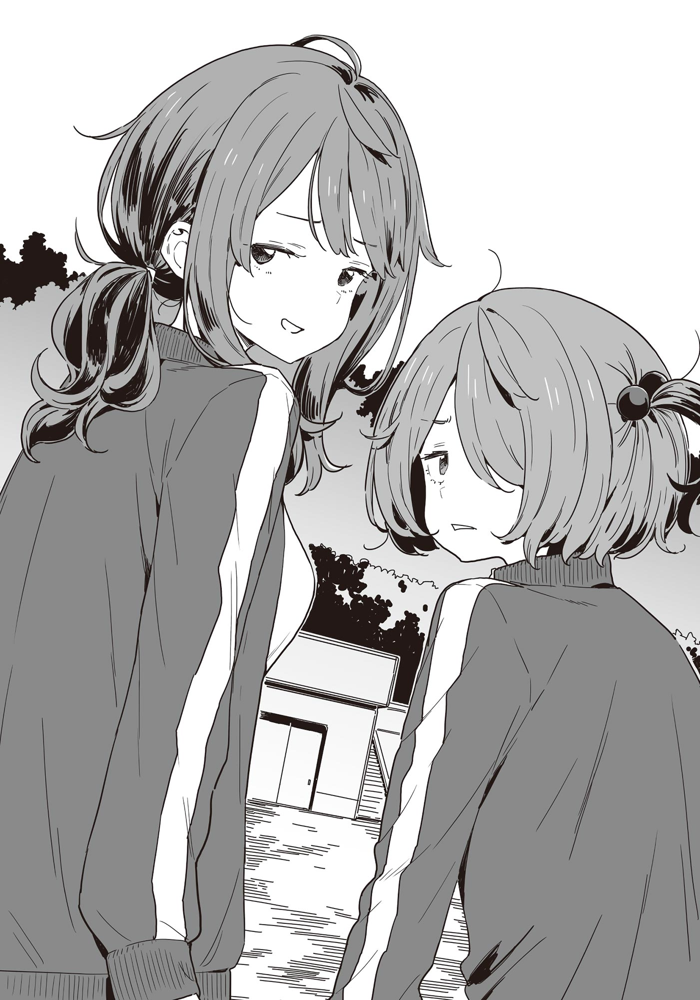

# Ch.106 — เล่ม 8 บทที่ 2-2

Ch.106 — เล่ม 8 บทที่ 2-2

By Monica

Published: 2025-05-27T16:02:46Z

Source: https://www.nekopost.net/novel/14560/106

เล่ม 8 บทที่ 2-2

วันอังคาร , เช้าวันถัดมาคาบแรกคือการซ้อมกีฬาสี

ในวันงานจริง จะมีการแข่งขันเชียร์ระหว่างห้อง ซึ่งการเข้าร่วมเป็นแบบสมัครใจ

แน่นอนว่า ผมไม่ได้สมัครก็เลยนั่งพิงต้นไม้อยู่ริมสนาม มองดูเพื่อนๆ ซ้อมกันไปเรื่อยเปื่อย

สมาชิกที่อาสาเข้าร่วมการเชียร์ ก็มีอย่าง ยานามิซัง กับ ฮิเมมิยะซัง ส่วนพวกผู้ชายก็มีซากุไรคุง

ในวันงานจริง ผู้ชายจะใส่ชุดกักคุรัน ส่วนผู้หญิงใส่ชุดเชียร์ลีดเดอร์ แต่จะให้ฮิเมมิยะซังใส่แบบนั้นจะดีเหรอ ? น่าจะต้องกระโดดโลดเต้นเยอะซะด้วย

ระหว่างที่กำลังคิดถึงกฎความเฉื่อยอยู่ การซ้อมก็ได้จบลงแล้ว

เสียงเพลงที่เปิดอยู่หยุดลง เหล่าสมาชิกชมรมเชียร์เริ่มแยกย้ายกันไปคนละทาง

ผมเหลือบตามองไป เห็นซากุไรคุงกำลังคุยกับพวกผู้หญิงในห้องอย่างสนุกสนาน

ยังอยู่ในคาบแท้ๆ ยังไปมีเวลาคุยกับสาวๆได้อีก สมแล้วที่เป็นพวกชอบเข้าสังคม เหมือนจะยื่นผ้าขนหนูให้ด้วยนะน่ะ

[ ซากุไรคุงนี่ฮ๊อตจริงๆด้วยแหะ ]

[ ก็ใช่นะ แต่ว่า นุคุมิซึเองก็ไม่แพ้กันนะ ]

เสียงพูดแทรกขึ้นมา พร้อมกับร่างของ อายาโนะ มิทสึกิ เดินมาหาผม

เขามองตามสายตาผมไป แล้วเอ่ยขึ้นอย่างสงสัย

[ มีอะไรกับซากุไรเหรอ? ตั้งแต่เมื่อวานก็ดูแปลก ๆ นะ ]

[ ก็ไม่เชิงหรอก แค่มีเรื่องที่รู้สึกติดใจนิดหน่อยน่ะ ]

[ ...งั้นเหรอ เข้าใจล่ะ ]

อายาโนะดันแว่นให้แสงสะท้อนวิบวับ — ดูยังไงก็รู้ว่าเขาไม่ได้เข้าใจเลยสักนิด

[ นุคุมิซึ... นายเนี่ย สุดท้ายก็มีคนที่ชอบขึ้นมาจนได้สินะ ]

[ เปล่าสักหน่อย ]

เห็นมั้ยล่ะว่าไม่ได้เข้าใจจริง ๆ

[ ไม่ใช่เหรอ? แต่เมื่อวานก็อยู่กับบาโซริซังตลอดเลยไม่ใช่หรือไง ]

[ ที่อยู่กับบาโซริซังมันก็แค่ตามสถานการณ์...จะเรียกว่าเป็นคู่ค้าทางธุรกิจก็ได้ มันไม่ใช่อย่างที่นายคิดหรอก ]

ว่าแต่ ผมยังไม่ได้ของจิกะเปียวเลยนี่นา...

แค่เห็นเทียร่าซังใส่หูแมว มันยังไม่พอหรอกนะ...

[ ถ้าไม่ใช่บาโซริซังล่ะก็── ]

แว่นของอายาโนะสะท้อนแสงอีกครั้งเป็นครั้งที่สอง

[ เอ่อ...อะไรอีกล่ะ? ]

[ ...นุคุมิซึ สู้เขานะ! ]

อายาโนะชูนิ้วโป้งขึ้นแบบจริงจัง ก่อนจะเดินจากไปอย่างเงียบ ๆ

หมอนี่...อะไรกันเนี่ย ผมพึมพำกับตัวเองเบา ๆ

...แต่ก็นะ อายาโนะเองก็มีมุมเพี้ยน ๆ อยู่เหมือนกัน

ขณะที่ผมกำลังพยักหน้าให้กับความคิดของตัวเองอย่างเงียบ ๆ

[ แอบอู้ไม่ได้นะ นุคุมิซึคุง ]

คราวนี้เป็นยานามิที่เดินเข้ามาหาผม ทำท่าทางยกมือทั้งสองข้างพร้อมกับยิ้มเจ้าเล่ห์

[ ว่าไง ? ชุดของฉันดูดีมั้ย? ]

[ เอ่อ...ตัวกินมดขู่ศัตรูเหรอ ?...]

[ ผิดจ้ะ! ฉันหมายถึงชุดเชียร์ลีดเดอร์ของฉันต่างหากล่ะ คิดว่าไงบ้าง? ]

[ แต่ยานามิซังใส่แค่ชุดพละนะ ]

เมื่อผมตอบอย่างตรงไปตรงมา ยานามิก็ถอนหายใจเบา ๆ แล้วไหวไหล่

[ ก็เป็นซะแบบนี้ไง นุคุมิซึคุง...พอได้ยินว่าฉันจะร่วมเชียร์กีฬาสี นายก็คงนึกภาพฉันในชุดเชียร์ลีดเดอร์แล้วล่ะสิ ? ]

[ ไม่หรอก ]

[ จะนึกก็ได้นะ? ]

...อ่า เหนื่อยจะตายอยู่แล้ว ยังต้องใช้สมองกับเรื่องไม่เป็นเรื่องอีก

ว่าแต่...ภาพยานามิในชุดเชียร์ลีดเดอร์งั้นเหรอ ถือพู่สองมือ มัดผมหางม้าอยู่ด้านหลัง

กระโปรงคงจะสั้น แถมช่วงหน้าอกก็คับ ๆ หน่อย──

[ อ๊ะ...เธอพุงยื่นนิดหน่อยนะ ระวังหน่อยก็ดี ]

[ นี่นายจินตนาการอะไรอยู่เนี่ย?! ]

[ เอ่อ..เรื่องยานามิซัง...เปล่า ไม่มีอะไรครับ ]

ยานามิโบกมืออย่างเหนื่อยใจ

[ คือว่า นุคุมิซึคุงเอาแต่หงอยตั้งแต่เช้า ฉันก็เลยพยายามเอาใจอยู่นะ？ ]

นั่นคือการเอาใจแล้วเหรอ...ใส่ใจให้มากกว่านี้หน่อยเถอะ

[ เอ่อ... ยานามิซัง จะเป็นผู้สนับสนุนของซากุไรคุงใช่มั้ย？ ]

[ หืม สนใจเรื่องนั้นด้วยเหรอ？ ]

ยานามิซังตอบสวนมาทันที จนรู้สึกเหมือนเธออ่านทะลุทุกอย่าง เลยเบือนสายตาหนี

[ ก็ยานามิซังดูจะประหม่าเวลาขึ้นเวทีน่ะ เลยคิดว่าเวลาพูดปราศรัยจะโอเคมั้ย ]

[ ตอนนี้ฉันไม่เหมือนเมื่อก่อนแล้วนะ แล้วอีกอย่าง ไม่ว่าจะฉันหรือนุคุมิซึคุงชนะ สุดท้ายชมรมวรรณกรรมก็จะมีรองประธานสภาเลยนะ คิดดูสิว่ามันจะเจ๋งแค่ไหน？ ]

[ ยานามิซังตั้งใจจะเป็นรองประธานเหรอ？ ]

ผมถามอย่างตกใจ แล้วยานามิก็พยักหน้าเหมือนเป็นเรื่องแน่นอน

[ ก็นะ รุ่นพี่สึคิโนะกิเคยอยู่ทั้งสภานักเรียนกับชมรมวรรณกรรมพร้อมกันเลยไม่ใช่เหรอ แบบนี้ฉันก็น่าจะไหวเหมือนกัน ]

[ ก็อาจจะไหวก็ได้นะ... ]

ยานามิมองไปรอบๆ อย่างระแวดระวัง ก่อนจะกระซิบเสียงเบา

[ ──พูดง่ายๆ ก็คือ ฉันเล็งอำนาจนั่นแหละ ]

อำนาจ? ผมยืนงง ยานามิก็ทำหน้าภูมิใจแล้วอธิบายต่อ

[ อย่ามัวพูดถึงแค่ตู้เย็นเลย เอาครัวแบบบิวท์อินเข้าชมรมวรรณกรรมดีกว่า แบบที่มีเคาน์เตอร์ข้างหน้าด้วยนะ ]

[ เดี๋ยว... สภานักเรียนไม่มีอำนาจขนาดนั้นหรอกนะ？ ]

ดูท่าทาง... ยานามิมีใจอยากเข้าสภานักเรียนจริงๆ แฮะ

พอผมยังเงียบอยู่ ยานามิก็สะกิดไหล่ผมเบาๆ

[ นี่ นายกับบาโซริซังมีอะไรกันเหรอ？ ]

[ ไม่มีอะไรซักหน่อย ]

[ ก่อนหน้านี้ยังทำเหมือนไม่ค่อยสนใจอยู่เลย แต่เมื่อวานกลับดูสนิทกันจัง ]

[ ไม่ได้สนิทอะไรทั้งนั้น ]

ผมยืนยันเสียงแข็ง ยานามิก็มองขึ้นมาด้วยสายตาเย็นชาครึ่งหนึ่ง

[ ไปบ้านบาโซริซังมานี่？ ]

[ ไม่ได้...ไป── ]

เดี๋ยวนะ ไปจริงนี่นา... แถมเทียร่าซังใส่ยังหูแมวด้วย ตอนที่ผมพูดติดขัด ยานามิก็เลิกคิ้วข้างหนึ่งขึ้น

[ อะไรเนี่ย? จริงเหรอ? โดนกับดักอะไรเข้าแล้วล่ะสิ？ ]

[ ไม่ใช่นะ แค่เป็นการแลกเปลี่ยนของสะสมอนิเมะเฉยๆ ]

[ ของสะสม...？ ]

ตอนที่ยานามิกำลังประมวลผลในหัว ก็มีเงาเล็กๆ เดินเข้ามาใกล้

[ ยะ ยานามิ ได้เวลาซ้อมต่อแล้ว ]

เสียงที่ดังขึ้นคือของโคมาริ เธอแบกเครื่องเล่นซีดีเก่าๆ หนักๆมาด้วยท่าทางลำบาก

[ อ๊ะ โคมาริจัง ได้ถ่านมาแล้วสินะ ]

[ ห ห้องพละ...น่ากลัวมาก... ]

โคมาริพยักหน้าแรงๆ น้ำตาคลอเบ้า ว่าแต่... ถ้าโคมาริเป็นคนถือเครื่องเล่นนั่นละก็...

[ อย่าบอกนะว่า โคมาริก็ลงชื่อเข้าร่วมทีมเชียร์แล้ว？ ]

[ ฉะ ฉันเป็นฝ่ายดูแลเรื่องดนตรีกับการถ่ายทำน่ะ ]

โคมาริตอบพร้อมทำหน้าภูมิใจอย่างกับชนะอะไรสักอย่าง

[ ถะ ถ้าเข้าร่วมทีมเชียร์ จะไม่ต้องลงแข่งในพวกการแข่งขันเดี่ยวอื่นๆ ด้วยล่ะ ]

งั้นเหรอ... อิจฉาแฮะ ผมเองยังต้องไปลงแข่งวิ่งวิบากทั้งที่ไม่อยากเลยแท้ๆ

[ งั้น ไปกันเถอะ โคมาริจัง ว่าแต่สนใจเป็นเชียร์ลีดเดอร์หน่อยมั้ย？ ]

[ มะ ไม่อยากเป็น ]

ยานามิเอื้อมไปจับหูหิ้ววิทยุ แล้วช่วยกันถือกับโคมาริมุ่งหน้าไปที่สนาม

...น่าจะรอดแล้วมั้ง

แน่นอน ไม่ใช่ว่าผมมีเรื่องที่ต้องปิดบังอะไรหรอก

ไม่มีหรอก... แต่ถ้าบอกไปว่าผมไปดูทียร่าซังใส่หูแมวในห้องของเธอหรือบอกว่าผมยอมช่วยเพราะใจอ่อน มันก็มีแต่จะถูกเข้าใจผิดเปล่าๆ

ขณะที่กำลังเถียงกับตัวเองในหัว อยู่ๆ ยานามิกับโคมาริก็หยุดเดิน แล้วหันมามองผมผ่านไหล่

[ ...มีอะไรเหรอ？ ]

ผมถามอย่างกล้าๆ กลัวๆ ทั้งสองคนก็ตอบกลับมาด้วยน้ำเสียงท้าทาย

[ มาแข่งกันอย่างยุติธรรมเถอะนะ นุคุมิซึคุง ]

[ อะ…ไอ้คนหลายใจ ]

...พูดซะเสียหายหมด

ผมแหงนมองท้องฟ้า เพื่อหลบสายตาอยากรู้อยากเห็นของเพื่อนร่วมชั้นที่เดินผ่านไปมา

