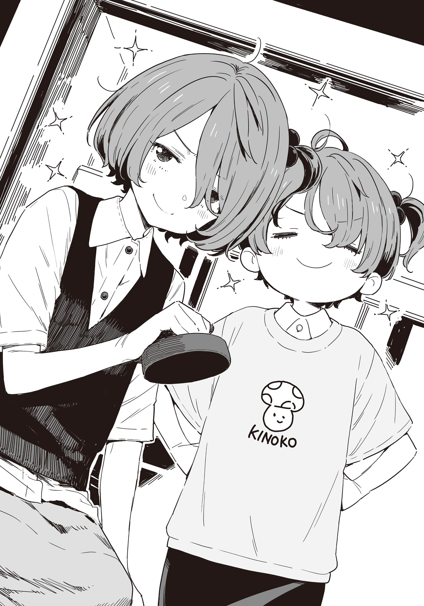

# Ch.109 — เล่ม 8 บทที่ 2-5

Ch.109 — เล่ม 8 บทที่ 2-5

By Monica

Published: 2025-05-28T10:47:54Z

Source: https://www.nekopost.net/novel/14560/109

เล่ม 8 บทที่ 2-5

หลังจากซื้อของเสร็จ พวกเราก็มารวมตัวกันที่โซนฟู้ดคอร์ท

การได้นั่งเก้าอี้เตี้ย ๆ ในโซนเด็ก แล้วกินสปาเกตตีราดซอสเหนียว ๆ นี่รู้สึกแปลกประหลาดชะมัด

ขณะที่ผมนั่งมองโคมาริที่กำลังดูแลฮินะจัง ก็โดนเธอส่งสายตาแปลก ๆ กลับมา

[ มะ...มีอะไร ไม่กินหรือไง ]

[ โคมาริ เดี๋ยวเปลี่ยนกันเองก็ได้ เธอแทบไม่ได้กินเลยนี่ ]

[ ดะ...ได้อยู่ นายช่วยดูแลซูซุมุที ]

[ ไม่เป็นไรแล้วน่าพี่ ผมกินเองได้แล้ว]

ซูซุมุพูดเสียงบูด ๆ พร้อมกับหยิบครีมโคร็อกเกะที่เป็นท็อปปิ้งโยนเข้าปากไป

สิ่งที่พวกเรากำลังกินกันอยู่นั้น ก็คือสปาเกตตีราดซอสแบบดังของร้านชื่อดังในโทโยฮาชิ ชาโอะ

แม้จะเป็นร้านในฟู้ดคอร์ท แต่ได้กินของร้านนี้ก็ถือว่าโชคดี เพราะพาสต้านี่ปริมาณเยอะมาก

โคมาริกับซูซุมุช่วยกันแชร์คนละครึ่ง ส่วนฮินะจังได้เป็นเซ็ตเด็ก

ส่วนผมนี่สิ ต้องลุยพาสต้าไซส์ผู้ใหญ่คนเดียว...จะมียานามิหรือใครสักคนโผล่มาช่วยกินบ้างมั้ยนะ...

ขณะที่กำลังคีบเส้นพาสต้าเข้าปากอย่างเงียบ ๆ ฮินะจังก็หยิบของในถุงพลาสติกออกมาแบบไม่มีปี่มีขลุ่ย

[ ชุดนอนลายเดียวกับของพี่สาวเลย ]

[ มะ...ไม่เอานะ กินให้เสร็จก่อนสิ ปากเลอะหมดแล้ว ]

โคมาริเช็ดปากให้ฮินะจัง ผมนั่งดูพลางใช้ส้อมพันพาสต้าที่เริ่มไหม้ตรงกระทะเหล็กเบา ๆ

นี่มันกิจกรรมของครอบครัวในวันหยุดสุดสัปดาห์ชัด ๆ แล้วทำไมผมถึงมาอยู่ในนี้ได้ล่ะ...?

ความรู้สึกประหลาดใจยังไม่หายไป ผมก็ก้มหน้าก้มตากินพาสต้าคำสุดท้ายเข้าไปในปาก

◇

หลังจากซื้อของและทานมื้อกลางวันเสร็จ พวกเราก็ทำธุระทุกอย่างเรียบร้อยแล้ว──จึงมายืนอยู่ในเกมเซ็นเตอร์ข้าง ๆ

ผมลูบท้องที่อิ่มเกินไปไปพลาง มองเจ้าตัวเล็กวิ่งวุ่นอยู่ท่ามกลางเกมคีบตุ๊กตา

[ พวกเด็ก ๆ พลังเหลือล้นดีจังเลยนะ ]

[ ก็...ก็เพราะวันนี้นายมาด้วยล่ะมั้ง เลยดูเรียบร้อยขึ้นนิดหน่อย ]

จริงเหรอ โคมาริ...แบบนี้เธอก็คงเหนื่อยน่าดู

พอเห็นเจ้าตัวเล็กกำลังเล่นกันอย่างสนุก โคมาริก็ยิ้มอ่อนออกมา

[ แต่...แต่เห็นพวกเขาสนุกกันแบบนี้ก็ดีแล้วล่ะ ]

[ คงจะสนุกกันแหละมั้งนะ ]

โคมาริพยักหน้าเบา ๆ

[ คะ...คือ คุณพ่อเขามีงานด่วน เลยยกเลิกนัดไปเที่ยว ฮินะก็ร้องไห้ใหญ่เลย… ]

[ เข้าใจล่ะ งั้นวันนี้ผมก็เป็นพ่อแทนแล้วกัน ]

[ อึ๊ก!? ]

หลังเผลอหลุดพูดเล่นออกไป ผมเตรียมใจโดนด่าทันที แต่โคมาริกลับแค่หน้าแดงแล้วเงียบกริบ สั่นเล็กน้อย

[ เอ่อ...ไม่ได้หมายความว่าแปลก ๆ หรอกนะ? ]

[ บะ...บ้า ]

โคมาริเบือนหน้าหนีไปทางอื่น ...โอ๊ะ เล่นผิดจังหวะเข้าแล้วสิ…

ขณะที่กำลังรู้สึกผิด เด็ก ๆ ก็วิ่งมาหาพวกเรา

[ พี่จ๋า เล่นอันนั้นกันเถอะ! พอดีมีสี่คนพอดีเลย! ]

[ เอ๋...คะ แค่รอบเดียวนะ ]

[ อันนั้น นี่หมายถึงอะไรเหรอ?]

[ ทางนี้ๆ !]

[ นุคุมิซึทางนี้ !]

พอปล่อยให้เจ้าตัวเล็กลากผมไป ก็มาถึงโต๊ะเครื่องเล่นแอร์ฮอกกี้

[ เล่นกันสี่คนเลยเหรอ? ]

[ กะ...กลัวเหรอ?]

โคมาริส่งสายตาท้าทายพลางยิ้มนิด ๆ

โอ้...งั้นถือว่าเป็นคำประกาศสงครามก็แล้วกัน ผมเริ่มยืดเส้นยืดสาย เตรียมตัวข้าง ๆ ซูซุมุที่มายืนข้างกัน

แปลว่าโคมาริจะจับคู่กับฮินะจังสินะ

[ ไม่ต้องให้แต้มต่อเหรอ? ]

[ หะ…ให้นุคุมิซึน่ะเหรอ]

เธอสวนกลับอย่างมั่นใจและหยอดเหรียญเข้าเครื่องด้วยท่าทีไม่หวั่นไหว

[...พี่สาวผมเก่งนะ! ]

ซูซุมุพูดด้วยสีหน้าจริงจัง ...พูดแบบนี้ เหมือนเคยได้ยินมาก่อน

ถึงจะว่าเก่งก็เถอะ แต่ก็แค่เล่นกับพวกเด็ก ๆ ไม่ใช่เหรอ…

ลูกพัคสีแดงค่อย ๆ เลื่อนออกจากด้านข้าง

เกมเริ่มแล้ว พัคไหลไปตรงหน้าโคมาริ...แล้วในเสี้ยววินาทีถัดมา──

ปัง !

เสียงดังฟังชัด ลูกพัคพุ่งเข้าโกล์ฝั่งผมอย่างแม่นยำ

[ !? เดี๋ยวนะ มองไม่ทันเลยนะเนี่ย!? ]

[ เห็นมั้ย !บอกแล้ว ! อีกลูกมาแล้วนะ! ]

หา? ไม่ใช่ตาฝั่งผมเหรอ?

ขณะที่ผมยังงุนงง ลูกพัคเล็ก ๆ จำนวนมากก็ถูกปล่อยลงสนามพร้อมกัน

นี่มัน...แอร์ฮอกกี้รุ่นใหม่มีโหมดแบบนี้ด้วยเหรอ?!

ในขณะที่ผมยังตั้งตัวไม่ทัน ลูกพัคก็พากันเข้าประตูฝั่งผมรัว ๆ

[ นุคุมิซึ ! ตั้งรับดี ๆ หน่อย! ]

[ จะพูดแบบนั้นก็เถอะ แต่มองไม่ทันจริง ๆ นี่นา!? ]

และผลคะแนนสุดท้าย── 870 ต่อ 120 เรียกว่าโดนถล่มฝ่ายเดียวก็ว่าได้

ขณะที่สองพี่น้องโคมาริแตะมือไฮไฟว์กันอย่างสะใจ ซูซึมุก็เดินมาตบไหล่ผมเบา ๆ

[ ไม่เป็นไรหรอก พี่นุคุมิซึ ]

โดนเด็ก ป.4 ปลอบใจแล้วแหละ ซูซุมุนี่ใจดีจริง ๆ

แล้วสีหน้าภาคภูมิของโคมาริก็ยิ่งตอกย้ำบาดแผลในใจผม

[ ...โคมาริ เครื่องแลกเหรียญอยู่ไหน? ]

ผมหยิบธนบัตรพันเยนออกมา โคมาริก็หัวเราะเบา ๆ

[ คะ แค่นั้นจะพอเหรอ? ]

[ ไม่ต้องห่วง ยังมีชิบูซาวะ เออิจิ สำรองอยู่ ]

ผลการแข่งขันหลังจากนั้น...ขอไม่เล่าจะดีกว่า ขอเขียนแค่สิ่งเดียวก็พอ──

ชิบูซาวะซังในกระเป๋าสตางค์ผม กลายเป็นอาจารย์คิตาซาโตะหลายใบไปซะแล้ว
