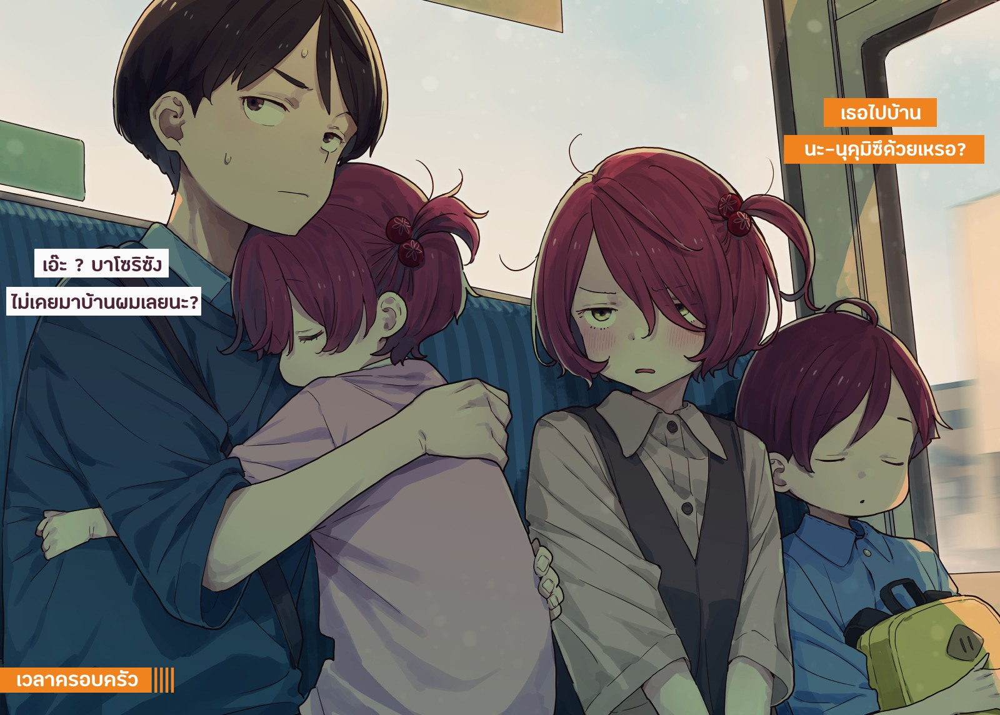

# Ch.110 — เล่ม 8 บทที่ 2-6

Ch.110 — เล่ม 8 บทที่ 2-6

By Monica

Published: 2025-05-29T10:15:32Z

Source: https://www.nekopost.net/novel/14560/110

เล่ม 8 บทที่ 2-6

มีทฤษฎีหนึ่งกล่าวว่าพลังของเด็กวัยสี่ขวบนั้นไม่มีที่สิ้นสุด

แม้ความจริงของทฤษฎีนั้นจะยังเป็นที่ถกเถียงกันอยู่ แต่สิ่งหนึ่งที่แน่นอนคือ...พวกเขามีสวิตช์

เมื่อสวิตช์นั้นปิดลง เด็กสี่ขวบก็จะเข้าสู่ห้วงนิทราในทันที──

รถบัสสายที่มุ่งหน้าไปยังย่านโอโรชิดันจิ

บนเบาะยาวด้านหลังสุด มีพวกเราสี่คนนั่งอยู่

ฮินะจังหลับสนิทอยู่บนตักของผม ส่วนซูซุมุคุงที่นั่งอยู่อีกฝั่ง โดยมีโคมาริคั่นกลาง ก็หลับตา ปล่อยตัวตามแรงสั่นของรถบัส

[ หนะ หนักมั้ย? ]

[ ไม่หรอก ปกติก็ให้คาจูนั่งบนตักตลอด ฮินะจังเบากว่าเยอะ เหมือนขนนกเลย ]

[ คะ คืนฮินะให้ฉันเลย ]

ทำไมล่ะนั่น...

ขณะที่กำลังลูบหลังของฮินะจังอย่างเบามือ โคมาริก็พูดพึมพำขึ้นมา

[ วะ วันนี้…..ขอบคุณนะ ]

[ ไม่หรอก อยากเล่นแอร์ฮอกกี้อยู่แล้วด้วย ]

[ กะ ก็อยู่ด้วยกันทั้งวันเลย... ]

อา หมายถึงเรื่องนั้นสินะ ถึงจะคิดว่าเป็นเรื่องที่ไม่ต้องขอบคุณก็ได้ แต่ก็ยินดีรับไว้แล้วกัน

ในรถบัสมีความเงียบแปลกๆ บรรยากาศสั่นไหวเบาๆ จนทำให้รู้สึกง่วงอย่างน่าประหลาด

โคมาริยื่นนิ้วไปจัดหน้าม้าของซูซุมุคุงที่หลับอยู่

[ ซะ ซูซุมุตามใจฮินะเกินไปแล้ว...ลำบากจริงๆ ]

ถึงจะพูดแบบนั้น แต่รอยยิ้มกลับอ่อนโยนเหลือเกิน

ผมเอ่ยปากพูดขึ้น ขณะรู้สึกถึงน้ำหนักของฮินะจังบนตัก

[ ซูซุมุคุงไม่เป็นไรแน่เหรอ? เมื่อกี้ยังบอกว่าจะเก็บเงินซื้อเกมอยู่เลย ของเล่นที่ซื้อให้ฮินะจังวันนี้ก็น่าจะแพงอยู่นะ ]

[ กะ ก็ทุกคนเอาแต่ตามใจฮินะนี่นา── ]

โคมาริหันมายิ้ม เหมือนจะบอกว่า ไม่ต้องเป็นห่วงหรอก

[ ยะ อย่างน้อยก็อยากเป็นฝ่ายที่ตามใจซูซุมุบ้าง ]

แม้ในโรงเรียนโคมาริจะเป็นเหมือนมาสคอต แต่ที่นี่เธอคือพี่สาวคนโต

ขณะที่มองป้ายร้านขายปูผ่านกระจกหน้าต่าง ผมก็เอ่ยขึ้นอย่างเงียบๆ

[ ...ว่าแต่ วันนี้บอกว่ามีอะไรจะคุยกับผมไม่ใช่เหรอ? ]

เมื่อวานช่วงเย็นโคมาริพูดแบบนั้นจริงๆ…ด้วยแววตาจริงจังเล็กน้อย

ตอนแรกก็มัวแต่กลัวว่าจะโดนว่า แต่สุดท้ายก็ต้องฟังเธอพูดให้ได้

โคมาริเหลือบมองใบหน้าของซูซุมุคุงที่หลับอยู่ ก่อนจะค่อยๆ เอ่ย

[ กะ ก็คิดจะเล่าอยู่แหละ...แต่ตอนนี้ไม่เป็นไรแล้ว ]

[ เรื่องเลือกตั้งสภานักเรียนสินะ ]

ผมเป็นฝ่ายเอ่ยขึ้นแทน เธอส่ายหัวเล็กน้อย

[ ถะ ถึงจะไม่ไว้ใจก็เถอะ...แต่ฉันก็เชื่ออยู่นะ ]

โคมาริยิ้มบางๆ ขณะลูบศีรษะของซูซุมุคุง พลางพึมพำว่า

[ พะ-เพราะนายบอกว่าจะอยู่ด้วยกันตลอดไปไง... ]

── ตึก

รถบัสสั่นเล็กน้อย ความเงียบปกคลุมเราอีกครั้ง

มีเสียงประกาศจากลำโพงในรถบัส แต่ดูเหมือนจะไม่มีใครลง ป้ายจึงถูกผ่านเลยไป

[ นี่ผมไว้ใจไม่ได้ขนาดนั้นเลยเหรอ ]

ผมพูดติดตลก โคมาริหันมาทำหน้ากวนประสาทตามสไตล์เดิม

[ กะ ก็...นายน่ะ เป็นพวกไหลตามง่ายๆด้วยนี่ ]

ที่ป้ายต่อไป มีผู้โดยสารลงไปหนึ่งคน เหลือแค่พวกเรากับคนขับในรถบัส

เมื่อรถเริ่มเคลื่อนอีกครั้ง ป้ายหน้าคือจุดที่เราจะลง

ทันใดนั้น โคมาริก็พูดขึ้น

[ นะ นาย…ไปบ้านบาโซริด้วยเหรอ? ]

หา? ทำไมถึง──อ๋อ วันก่อนบาโซริซังพูดออกมาในห้องเรียนสินะ

[ ก็แค่ไปรับของจิกะเปียวแค่นั้นแหละ…น้องชายเขาก็อยู่ด้วยนะ ]

ไม่ได้โกหกนะ…ถึงจะยังไม่ได้ของก็เถอะ

[ เธอไปบ้าน นะ-นุคุมิซึด้วยเหรอ ? ]

[ เอ๊ะ ? บาโซริซังไม่เคยมาบ้านผมเลยนะ ]

...อา มีจริงๆ ด้วยสิ แต่เป็นแขกของคาจูมากกว่า

ผมเบือนสายตาหนีจากดวงตากัดจิกของโคมาริ พลางพยายามหาคำอธิบาย

[ แต่ว่า คนที่ลงอ่างอาบน้ำก็มีแค่เธอเท่านั้นนะ ? ยากิชิโอะใช้แค่ฝักบัวเท่านั้นแหละ ]

[ ปะ-ไปตาซะ ]

เธอนี่นะ เจ้าตัวเล็กหลับอยู่แท้ๆ ก็ยังจะพูดอะไรไม่เกรงใจเลย

ทันใดนั้น ฮินะจังก็ขยับตัวลืมตาขึ้น

[ ...นุคุมิซึ? พี่สาวล่ะ... ]

[ อยู่นี่ไง ]

[ อยากอยู่กับพี่สาว...]

ฮินะจังที่ยังงัวเงียเอื้อมมือไปหาโคมาริ

ระหว่างที่รถติดไฟแดง ผมรีบส่งฮินะจังให้โคมาริรับตัวไป เธอก็อุ้มอย่างทุลักทุเล

[ ไหวมั้ย? ]

[ มะ ไม่เป็นไร ซูซุมุ อีกเดี๋ยวก็ต้องลงแล้วนะ ตื่นได้แล้ว ]

ซูซุมุคุงขยี้ตาเบาๆ

[ ...จริงๆ ก็ตื่นมากลางทางแล้วล่ะ ]

เมื่อรถจอดที่ป้าย ซูซุมุคุงก็ลุกขึ้นก่อนใคร

ถึงท่าทางจะห้วนๆ ไปบ้าง แต่ตลอดทั้งวัน ผมกับเขาก็สนิทกันขึ้นเยอะ

แม้อายุจะต่างกัน แต่ดูเหมือนว่าเราจะเข้าใจกันได้ในแบบผู้ชายเหมือนกัน

หลังลงจากรถ กำลังจะเริ่มเดิน…

เพี๊ยะ! ทันใดนั้น ซูซุมุคุงฟาดเข้าที่เอวของผม

[ ฮึ มีอะไรเหรอ ]

[ นุคุมิซึ บ้า ! ]

[ ?! ]

เขาตีผมอีกที แล้วรีบวิ่งหนีไปจากตรงนั้น

[ ฮะ เฮ้ย! ซูซุมุ! ]

โคมาริตะโกนดุไป แต่ซูซุมุคุงหันกลับมาแลบลิ้นให้ผม

[ นุคุมิซึ บ้า ! งี่เง่า ! ]

จากนั้นก็วิ่งกลับบ้านไป

เอ่อ…เกิดอะไรขึ้นกับเขากันแน่นะ?

ขณะที่ยืนงงอยู่ โคมาริก็ทำหน้าลำบากใจ

[ ขะ ขอโทษนะ...เดี๋ยวกลับไปดุเขาให้ ]

[ ไม่ต้องดุก็ได้หรอก…แต่เมื่อกี้ซูซุมุคุงเป็นอะไรไปน่ะ? ]

ผมเอียงคอสงสัย โคมาริก็จ้องผมด้วยสายตาเจ็บแสบ

[ นะ นุคุมิซึก็ผิดเหมือนกันนะ ]

อะไรนะ…ผมผิดตรงไหน…

[ ห้ะ ? ผมทำอะไรผิดเหรอ ? ]

[ ละ ลองคิดดูเองสิ ]

พูดจบ โคมาริก็หันหลังให้ผมทันที

◇

ต้นสัปดาห์ เย็นวันจันทร์

ผมกำลังประชุมประจำกับเทียร่าซัง อยู่ที่โต๊ะหินตรงลานกลางโรงเรียน

วันหยุดสุดสัปดาห์ที่ใช้เวลาครอบครัว , หมายถึงการออกไปเที่ยวกับตระกูลโคมารินั่นแหละ เป็นช่วงเวลาที่สงบสุขมากเลยล่ะ แต่ถึงอย่างนั้น ปฏิกิริยาของซูซุมุคุงตอนขากลับมันอะไรกันนะ

คำว่า”งี่เง่า”ที่ซูซุคุงพูดถึงคงหมายถึงคนไม่เอาไหน….หรือว่าในตระกูลโคมาริจะมีธรรมเนียมพูดจาหยาบคายตอนจากลากันนะ...?

ขณะที่กำลังจมอยู่กับความคิดนั้น เทียร่าซังก็กระแอมขึ้นมา

[ นุคุมิซึซัง ขอรบกวนเวลาสักครู่ค่ะ ]

[ อะ โทษที ว่าไงนะ ]

[ กำลังพูดถึงกำหนดการต่อไปค่ะ อีกหนึ่งสัปดาห์ข้างหน้าจะมีการแถลงนโยบายและติดโปสเตอร์เลือกตั้ง และสัปดาห์ถัดจากนั้น── ]

[ ก็ถึงวันเลือกตั้งสินะ ]

เทียร่าซังพยักหน้าเบา ๆ

[ ค่ะ จะมีทั้งสุนทรพจน์ของผู้สมัครและคำปราศรัยสนับสนุนจากผู้สนับสนุนแล้วก็เลือกตั้งทันทีหลังจากนั้นเลย การพูดดีหรือไม่ดีน่าจะส่งผลต่อผลโหวตโดยตรงแน่นอน ดังนั้นเราจำเป็นต้องปรับเนื้อหาสุนทรพจน์ให้สอดคล้องกันค่ะ ]

[ ผมก็แค่ช่วยเฉย ๆ ไม่ใช่ผู้สนับสนุนนะ ]

[ ทราบดีค่ะ ]

เทียร่าซังพยักหน้าอย่างจริงจัง

[ ได้ยินมาจากรุ่นพี่ชิกิยะว่า ถ้าดันนุคุมิซึซังไปเรื่อยๆก็อาจจะสำเร็จ เลยกะจะลองโน้มน้าวด้วยความรู้สึกดูค่ะ ]

…กะโน้มน้าวผมด้วยอารมณ์งั้นเหรอ...

[ ผมไม่ใช่คนที่จะยอมง่าย ๆ หรอกนะ? เอาเถอะ ก่อนอื่นเราต้องเตรียมเรื่องแถลงนโยบายก่อน ]

[ สำหรับเรื่องนั้น ฉันได้ร่างแบบร่างมาแล้วค่ะ ]

เทียร่าซังยื่นกระดาษหลายแผ่นมาให้ผม

กระดาษที่ได้รับมานั้นเต็มไปด้วยข้อเรียกร้องของนักเรียนที่ได้จากการสัมภาษณ์ พร้อมด้วยระเบียบของโรงเรียนและข้อบังคับของเมืองที่เกี่ยวข้อง… หนักใช้ได้เลยแฮะ

[ งานของสภานักเรียนมันถึงขนาดนี้เลยเหรอ ]

[ ถึงจะไม่มีอำนาจหรืองบประมาณขนาดนั้น แต่ก็สามารถยื่นข้อเสนอให้คุณครูได้ค่ะ การแบ่งปันความคิดเห็นของนักเรียนเป็นเรื่องสำคัญ ]

เทียร่าซังเปิดเอกสารในมือผมอย่างพลการ

[ ดูเหมือนว่าข้อความที่ฉันเขียนจะค่อนข้างแข็งและเข้าใจยาก ถ้ามีใครสักคนที่เก่งด้านการเขียนอยู่ใกล้ ๆ ก็คงดี แต่ฉันก็นึกไม่ออกเลยว่าจะให้ใครทำ ดี ]

เหรอ… แต่ข้าง ๆ เธอนี่คือสมาชิกชมรมวรรณกรรมเลยนะ

[ เอ่อ แล้วรุ่นพี่ในสภานักเรียนล่ะ? ]

เมื่อผมถามไปแบบพยายามตั้งหลักใหม่ สีหน้าของเทียร่าซังก็แข็งตึงขึ้น

[ ฉันไม่คิดจะขอความช่วยเหลือจากรุ่นพี่ค่ะ เพราะนี่คือการต่อสู้ของฉัน ]

พอรู้สึกได้ถึงความแข็งกร้าวในน้ำเสียงของตัวเอง เทียร่าซังก็ไอเบา ๆ แล้วพูดแก้ใหม่

[ …เพราะว่าซากุไรคุงเองก็ลงสมัครเหมือนกัน ฉันไม่อยากทำให้ลำบากใจ ]

ทั้งประธานและรุ่นพี่ชิกิยะก็คงเอ็นดูเทียร่าซังกับซากุไรคุงไม่ต่างกัน

ถ้าจะต้องเลือกข้างหรือปฏิเสธคำขอของอีกฝ่าย คงลำบากใจน่าดู

[ เขาได้รับความไว้วางใจมากกว่าก็จริงค่ะ แต่นั่นแหละค่ะ ฉันถึงอยากตั้งคำถามกับทุกคนว่ารูปแบบของโรงเรียนหลังจากนี้ควรเป็นยังไง── ]

[ เดี๋ยวก่อนนะ ]

เมื่อผมขัดขึ้นมา เทียร่าซังก็ยืดหลังตัวตรงฉับพลัน

[ ค่ะ นุคุมิซึซัง เชิญค่ะ ]

[ คือ…ตรงนี้น่ะ มันมองเห็นได้จากห้องเรียนอื่นหรือห้องพักครูใช่มั้ย ถ้าเป็นไปได้ เราไปคุยกันในห้องดีกว่ามั้ย ]

พอได้ยินผมเสนอแบบนั้น เทียร่าซังก็กะพริบตาปริบ ๆ อย่างคาดไม่ถึง

[ ก็เคยพูดไปแล้วไงคะ ตรงนี้อยู่ห่างจากทางเดินเชื่อมกับตัวอาคารและห้องเรียน เลยไม่มีปัญหาเรื่องคนได้ยิน คิดว่ามันเหมาะที่สุดสำหรับการวางแผนเลือกตั้งแล้ว ]

พูดถึงเรื่องนั้น ตอนรับผ้าพันคอก็ถูกเรียกมาที่กลางสระนี่นะ

ถึงจะเข้าใจเหตุผลของเทียร่าซัง แต่ก็ยังรู้สึกไม่ชินกับสายตาของนักเรียนที่เดินผ่านไปผ่านมาอยู่ดี

[ งั้นขอพูดต่อนะคะ ก่อนอื่นต้องรวบรวมคนที่จะสนับสนุนผ่านการแถลงนโยบาย แล้วก็นำความคิดเห็นมาติดไว้บนบอร์ด── ]

[ เดี๋ยวแป๊บนึง เหมือนมีข้อความเข้ามาน่ะ ]

ผมรีบหยิบมือถือออกมาอย่างกับได้ฟังเสียงจากฟ้า แล้วการเคลื่อนไหวก็หยุดชะงักลงโดยไม่รู้ตัว

ข้อความที่ปรากฏอยู่ตรงหน้าคือ ข้อความจากโคมาริ

< ── รีบมาที่ทางเดินหน้าห้องเรียนปีสองเดี๋ยวนี้ >

◇

มีฝูงคนสิบกว่าคนรวมตัวกันอยู่รอบบอร์ดหน้าทางเดิน

ปกติแล้วหลังเลิกเรียนแบบนี้รอบ ๆ ห้องเรียนแทบไม่มีคนเลย แต่นี่มันอะไรกัน

ขณะทียืนเก้ ๆ กัง ๆ อยู่ เทียร่าซังก็ฝ่าฝูงชนเข้าไปอย่างแรงกล้า

[ ขอโทษค่ะ ขอทางหน่อยนะคะ ]

ผมชื่นชมในความดุดันของเทียร่าซัง แล้วเดินตามช่องทางที่เธอเปิดไว้ให้

เอาล่ะ บนบอร์ดมีอะไรแปะไว้นะ…

[ นุ-นุคุมิซึ! ]

[ อึ๊ก!? ]

ตุบ! มีบางอย่างพุ่งเข้าใส่ท้องผมจากมุมอับ

พอกลั้นความเจ็บแล้วก้มลงไปดูก็เห็นว่าเป็นโคมารินั่นเอง

[ เกิดอะไรขึ้นเนี่ย ]

[ ม-ไม่รู้ตัวเลยว่าถูกล้อมไว้ อ-ออกมาไม่ได้แล้ว ]

โคมาริที่สั่นระริกคว้าเนกไทผมเอาไว้แน่น

ขณะที่ผมกำลังดึงเนกไทแข่งกับโคมาริ เทียร่าซังก็ดึงเสื้อผมแรง ๆ

[ นุคุมิซึซัง ดูนั่นสิคะ! ]

ปลายนิ้วของเทียร่าซังชี้ไปที่กระดาษขนาดเท่าหนังสือพิมพ์ที่แปะอยู่บนบอร์ด

[ หนังสือพิมพ์สึวะบุกิ ฉบับพิเศษเลือกตั้งสภานักเรียน...? ]

ถึงจะบอกให้ดู แต่ก็แค่บทความเลือกตั้งของสภานักเรียนนี่นา...

แต่พอส่งสายตาไปที่พาดหัวข่าว ก็ต้องเบิกตากว้างโดยไม่รู้ตัว

< การเลือกตั้งสภานักเรียน กลายเป็นศึกตัวแทนความรักงั้นเหรอ⁈ >

...นี่คือ ไม่สิ เอาจริงดิ นี่มันอะไรเนี่ย

เอ่อ… การเลือกตั้งครั้งนี้เกิดจากความขัดแย้งเรื่องชู้สาวที่เกี่ยวข้องกับสาวสวยปีสอง และหนึ่งในผู้เกี่ยวข้องก็คือศัตรูของผู้หญิง ที่ปล่อยข่าวลือไปทั่วว่าเจ้าตัวมีสัมพันธ์กับผู้หญิงหลายคน…?

อ๋อ หมายถึงซากุไรคุงสินะ หมอนั่นก็ฮ็อตดีนี่

งั้นคนที่ถูกพูดถึงว่าใช้ตำแหน่งรองประธานเป็นเหยื่อล่อผู้ชายก็คือ──

เทียร่าซังหน้าแดงก่ำถึงคอสั่นระริก

[ …ม-ไม่ใช่นะคะ! ไม่ได้เรียกนุคุซึซังมาเพราะมีเจตนาแบบนั้นเลยนะ!? ]

[ รู้สิ รู้แล้วล่ะ จริง ๆ นะ ]

[ ไม่ได้รู้อะไรเลยใช่มั้ยคะ!? ที่สำคัญ นายนั่นแหละที่ผิด! พูดอะไรทำให้นึกไปไกลตลอด แถมชอบปั่นหัวฉันอีก── ]

เอ๊ะ อยู่ดี ๆ ก็มาโจมตีผมเหรอ โคมาริก็ยังจับเนกไทผมอยู่แถมพยักหน้าแรงด้วย

[ ข-เข้าใจแล้ว! อยู่ต่อหน้าคนอื่นก็ลดเสียงลงหน่อยสิ? ]

สายตาคนรอบข้างนี่เจ็บแสบชะมัด…

ในขณะที่พยายามปลอบเทียร่าซัง ผมก็อ่านเนื้อหาหนังสือพิมพ์ต่อ

เอ่อ… และชายคนนั้น ก็แย่งนักเรียนหญิงAสาวสวยปีสองที่เป็นที่นิยมในโรงเรียน มาจากกัปตันทีมบาสเกตบอลรุ่นพี่ แล้วก็ทิ้งเธอไป

แถมยังคบซ้อนกับผู้หญิงในสภานักเรียน และในขณะเดียวกันก็พุ่งเป้าไปที่นักเรียนหญิงปีหนึ่งอีกคนด้วย

ซากุไรคุง โดนเขียนซะเสียเลยนะ...

ระหว่างที่กำลังอ่านต่อด้วยความสงสาร บทความก็ตัดจบอย่างกะทันหัน

แล้วด้านล่างก็มีตัวหนังสือสีแดงเขียนไว้ว่า──

อ่านต่อได้บนเว็บ ! สั่งซื้อได้ที่โฮมเพจของชมรมหนังสือพิมพ์ !

ผมมองตัวอักษรสีแดงแบบตัวหนา แล้วก็พูดความรู้สึกที่ซ้ำเป็นครั้งที่เท่าไรไม่รู้ในวันนี้ออกมาอีกครั้ง

[ นี่มัน...อะไรเนี่ย ]
