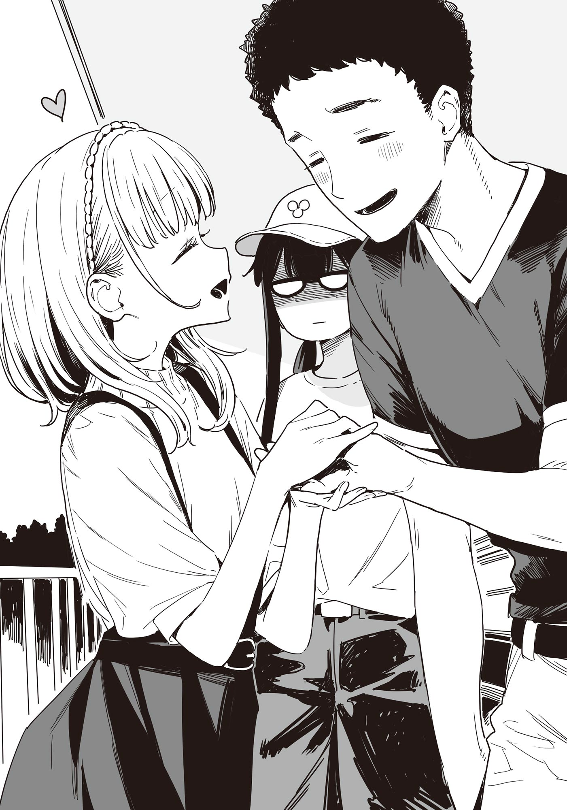

# Ch.112 — เล่ม 8 บทที่ 3-1

Ch.112 — เล่ม 8 บทที่ 3-1

By Monica

Published: 2025-06-02T09:17:27Z

Source: https://www.nekopost.net/novel/14560/112

เล่ม 8 บทที่ 3-1

บทที่ 3 บทเพลงสีชาด

ผ่านมาหนึ่งสัปดาห์ ช่วงเวลาที่แสนสงบราวกับความวุ่นวายก่อนหน้านี้เป็นแค่เรื่องโกหก

เทียร่าซังและซากุไรคุง กำลังวุ่นกับงานใหญ่สุดท้ายของสภานักเรียน — การเตรียมงานกีฬาสี

และแล้วก็มาถึงวันอาทิตย์สุดสัปดาห์ ผม ยานามิ และโคมาริ — ทั้งสามคนเดินทางด้วยรถไฟและรถใต้ดินจากสถานีโทโยฮาชิใช้เวลาหลายนาที จนมาถึงสนามกรีฑาในเมืองนาโกย่า

ที่นี่กำลังจัดการแข่งขันกรีฑาระดับมัธยมปลายภาคโทไก — หรือที่รู้จักกันว่า อินเตอร์ไฮ รอบคัดเลือกเพื่อเข้าสู่การแข่งขันระดับประเทศ

ยากิชิโอะ ผ่านรอบคัดเลือก 1500 เมตรช่วงเช้าไปได้ด้วยเวลาอันดับหนึ่ง

หากสามารถเข้าเส้นชัยในอันดับที่ 6 หรือสูงกว่าในการแข่งขันรอบชิงที่จะเริ่มในไม่กี่นาทีนี้ ก็จะได้สิทธิ์เข้าแข่งขันระดับประเทศทันที...

บนม้านั่งในอัฒจันทร์ ที่ผู้คนบางตา

โคมาริที่นั่งอยู่ระหว่างผมกับยานามิ กล่าวพึมพำออกมาด้วยท่าทีเหมือนกำลังภาวนา

[ ยะ... ยากิชิโอะจะไม่เป็นอะไรใช่มั้ย...? ]

ยานามิหันมาตอบพลางล้วงมือเข้าไปในถุงป๊อปคอร์น

[ ไม่เป็นไรหรอก เลม่อนจังน่ะวิ่งเร็วจะตาย ]

[ ตะ-แต่อย่าลืมว่า ทุกคนที่นี่ก็เร็วกันทั้งนั้นนะ! ]

โคมาริแย้งกลับด้วยเหตุผลหนักแน่น พร้อมกับลุกขึ้นยืนทันที

คนที่ปรากฏตัวอยู่บนบันไดทางเดินของอัฒจันทร์ก็คือ... ศิษย์เก่าชมรมวรรณกรรม — สึคิโนกิ โคโตะ

เมื่อเธอเห็นพวกเรา ก็โบกมือทักทายอย่างร่าเริง

[ ขอโทษที มาช้าไปหน่อย ]

เสียงที่คุ้นเคย แม้จะไม่ได้ยินมานาน แต่ก็ยังชวนให้คิดถึง

[ ร-รุ่นพี่! ]

โคมาริวิ่งพรวดไปหาด้วยความดีใจ แล้วก็คว้ามือกันไว้ แสดงความยินดีที่ได้พบกันอีกครั้ง

ผมกับยานามิก็เดินตามไป สมทบด้วยอีกคนที่เดินตามลงบันไดมานั่นก็คือ อดีตประธานชมรม — ทามากิซัง

[ ทุกคน สบายดีมั้ย ]

หลังจากทักทายกันเสร็จ พวกผู้หญิงก็ส่งเสียงด้วยความคึกคัก ทามากิซังจึงเดินมายืนข้างผม

[ ชีวิตมหาลัยเป็นยังไงบ้างครับ? ]

[ เรียกว่าพอเอาตัวรอดได้แบบหวุดหวิดน่ะ แค่ปีแรกนี้ก็แทบแย่แล้ว ไหนจะฝึกงาน ไหนจะรายงาน... ไม่คิดว่าจะยุ่งขนาดนี้ ]

[ งั้นก็ไม่มีเวลาว่างดูอนิเมะหรืออ่านไลท์โนเวลสินะ? ]

[ ก็ไม่ขนาดนั้น การอยู่คนเดียวมันคืออิสระในนามของความรับผิดชอบไงล่ะ ]

ทามากิซังหัวเราะยิ้มแบบเจ้าเล่ห์

[ ฟังนะ ถ้าอยากดูอนิเมะก็เปิดดูตอนทำรายงานไปด้วยเลย ถ้าอยากอ่านมังงะหรือไลท์โนเวล ก็แค่ไม่ต้องนอนไง! ]

เขากำหมัดทั้งสองข้างด้วยความกระตือรือร้น

[ จะเอาโปสเตอร์หรือผ้าแขวนไปแปะตรงผนังหรือเพดานก็ไม่มีใครว่า ถ้าอยากมีหมอนข้างลายอนิเมะ ก็ไม่มีใครห้าม ]

[ แล้ว...สึคิโนกิซังไม่ว่าอะไรเลยเหรอครับ? ]

[ ...เทียบกับห้องของโคโตะแล้ว ห้องฉันเหมือนห้องเด็กเล่นไปเลย ]

ทันใดนั้น สีหน้าทามากิซังก็เปลี่ยนไปเป็นเหม่อลอย

[ ห้องของเธอน่ะนะ มองไปทางไหนก็มีผู้ชายกึ่งเปลือยกำลังจ้องกันอยู่ตลอด แถมยังเปิดวอยซ์ดราม่าแนว BL คลอไปเหมือนเปิด BGM ในคาเฟ่... ]

ดูเหมือนว่ารังรักของสองคนนั้นจะกลายเป็นอะไรแบบนั้นไปแล้ว

จะเรียกว่าสวีทได้หรือเปล่าก็ไม่แน่ใจ แต่ว่า... ดูเหมือนจะรักกันดีนะ

[ เหมือนทุกอย่างราบรื่นดีเลยนี่ครับ ]

[ ก็... ประมาณนั้นแหละมั้ง แล้วนุคุมิซึล่ะ? ]

[ หมายความว่าไงครับ? ]

ผมเผลอทวนคำถามออกไป ทามากิซังก็โน้มหน้าเข้ามาใกล้

[ ไม่มีอะไรคืบหน้ากับใครเลยเหรอ? อย่าบอกนะว่า...กับรุ่นน้องคนนั้นน่ะ? ]

[ ไม่มีเลยครับ ผมโดนปฏิบัติเหมือนไม่ใช่ผู้ชายเลยด้วยซ้ำ ]

ผมหัวเราะกลบเกลื่อน แต่ก็อดถามกลับไม่ได้

[ อ๊ะ... รุ่นพี่รู้เรื่องรุ่นน้องคนนั้นด้วยเหรอ ? ]

[ ได้ยินว่าโดดเด่นมากเลยนิ วันนี้ไม่ได้มาด้วยเหรอ? ]

ที่ว่าโดดเด่นน่ะไม่ผิด แต่ในความหมายไหนดีกว่า...

พูดถึงแล้ว เธอบอกว่าจะมาทันรอบชิงนี่นา

ขณะที่กำลังมองไปรอบ ๆ ก็เห็นชิราทามะ ริโกะ เดินลงบันไดมาพอดี

พอสบตากับผม เธอก็โบกมือแล้วรีบวิ่งตรงมาหา

[ ประธาน ! ขอโทษที่มาสายค่าาา! ]

[ ยังไม่เริ่มเลย ไม่เป็นไรหรอก ]

...

………ชิราทามะซัง วิ่งช้าจังแฮะ

เธอวิ่งมาถึงข้างหน้า แล้วก็ยกมือกดหน้าอก หอบหายใจเฮือกใหญ่

[ แฮ่ะๆ นี่รีบวิ่งเพราะอยากเจอประธานไวๆเลยนะคะ! ]

ทันใดนั้นเธอก็เบิกตาโตแล้วมองไปยังทามากิซัง เหมือนเพิ่งจะสังเกตเห็น

[ หรือว่า ทามากิซังที่เป็นศิษย์เก่าของชมรมคะ ? ยินดีที่ได้รู้จักค่ะ ชิราทามะ ริโกะ ค่ะ ]

[ อ๋อ ยินดีที่ได้รู้จัก ฉันทามากิ เคยอยู่ชมรมนี้เมื่อปีที่แล้ว...ส่วนนั่น สึคิโนกิ— ]

ยังพูดไม่ทันจบ ชิราทามะซังก็จับมือของทามากิซังไว้ด้วยสองมือ

[ เอ๊ะ!? ]

[ นี่...ใช่กุญแจที่ทำหล่นหรือเปล่าคะ? นี่ค่ะ ]

[ เอ๋? อะ... อืม ขอบใจนะ ]

ทามากิซังตอบอย่างเก้ ๆ กัง ๆ ขณะที่เธอยังจับมือไว้ พร้อมรอยยิ้มอ่อนโยน

[ อันตรายมากเลยนะคะ ถ้าหนูเป็นเด็กไม่ดีล่ะก็ อาจจะย่องเข้าไปในบ้านก็ได้นะคะ? ]

[ อะ... ถ้าเป็นเด็กแบบเธอล่ะก็...ยินดีต้อนรับเลย... ]

อะไรของเขาเนี่ย... ถึงจะพยายามกกลั้นไว้สุดชีวิตแต่หน้าก็แอบยิ้มอยู่นะ…

ขณะที่กำลังอึ้งอยู่ ทันใดนั้น สึคิโนกิซังก็พุ่งเข้ามาคั่นกลางระหว่างสองคน

[ เธอคือชิราทามะซังใช่มั้ย? ยินดีที่ได้รู้จัก ฉันศิษย์เก่า— ]

[ อ้าาา หรือว่านี่สึคิโนกิซังเหรอคะ ? ได้ยินข่าวลือมานานเลยค่ะ ]

ชิราทามะซังปล่อยมือจากทามากิซัง แล้วก้มหัวให้สึคิโนกิซังอย่างนอบน้อม

[ แหม... ข่าวลือเกี่ยวกับฉันคงไม่ค่อยดีเท่าไหร่หรอกมั้ง? ]

[ ไม่ใช่เลยค่ะ สวยสมคำร่ำลือจนตกใจเลยค่ะ รุ่นพี่ชมรมวรรณกรรมแต่ละคนนี่ดูดีกันทั้งนั้นเลย หนูเกร็งไปหมดแล้วค่ะ ]

[ อะ...อืม… ]

สึคิโนกิซังถึงกับยืนอึ้งไป ราวกับโดนดูดพลังไปหมด

บรรยากาศชักจะแปลก ๆ แต่ชิราทามะซังก็เพียงเอียงคออย่างสงสัย

[ มีอะไรกันเหรอคะ ? ทุกคนมานั่งคุยเถอะค่ะ ]
