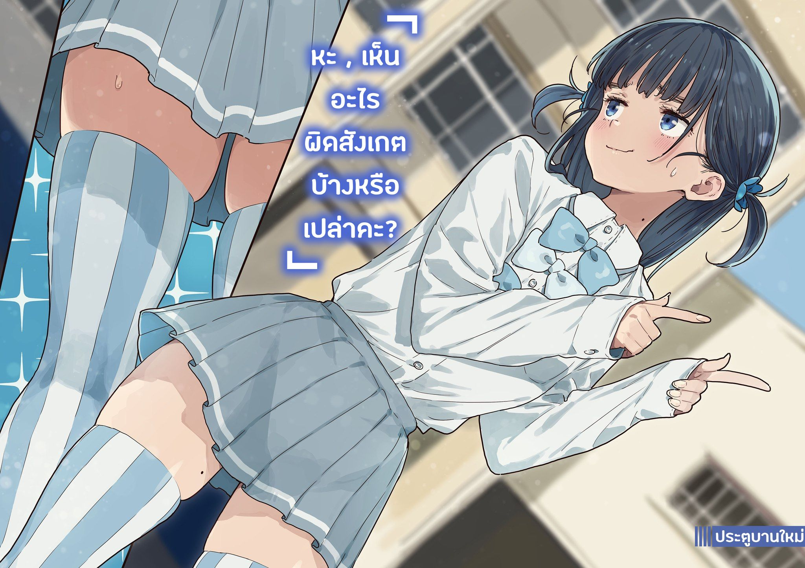

# Ch.114 — เล่ม 8 บทที่ 3-3

Ch.114 — เล่ม 8 บทที่ 3-3

By Monica

Published: 2025-06-02T09:19:42Z

Source: https://www.nekopost.net/novel/14560/114

เล่ม 8 บทที่ 3-3

ผมมาถึงกองบัญชาการเลือกตั้ง ของฝ่ายเทียร่าซัง หรือก็คือโต๊ะหินในลานกลางโรงเรียน

แต่พอมาถึง กลับไม่เห็นเทียร่าซังอยู่เลย

เธอเป็นคนเรียกผมมา แต่ให้รอเนี่ย ไม่เหมือนสไตล์ของคนชอบดักรอแบบเธอเลย…

พอมองไปรอบๆก็เห็นผู้หญิงคนหนึ่งกำลังเดินมาจากทางเดินเชื่อม

…เธอแต่งคอสเพลย์เป็น จิกะเปียว จากอนิเมะ < แก๊งสาวเส้นยาแดงผ่าแปด > ซีซัน 2

สิ่งที่ดึงดูดใจผมมากที่สุดก็คือถุงเท้ายาวลายทางของเธอ

ตอนที่ 9 < ปฏิบัติการเขตแดนศักดิ์สิทธิ์ > นั่นแหละ ตอนที่ได้ถุงเท้าฝ้าย 100%… ?

……………………

………………จิกะเปียว ?

แย่ล่ะ เห็นภาพหลอนเข้าแล้วเหรอ…

ขยี้ตาแล้วขยี้ตาอีก จิกะเปียวก็ยังอยู่ที่เดิม

เด็กสาวในชุดนักเรียนโรงเรียนสึวะบุกิ ใส่ถุงเท้ายาวลายทางกับกระโปรงสั้น สร้างเขตแดนต้องห้ามอันน่าหลงใหล

ผมเธอยาวตรง ที่ด้านบนทั้งสองข้างมัดไว้เล็กๆเป็นทรงทวินเทลต่ำ

จิกะเปียวคนนั้นเดินมาหยุดตรงหน้าผม มีคิ้วเข้มเล็กน้อย และมีไฝที่คอ…

……………………เทียร่าซัง…กำลังทำอะไรอยู่เนี่ย?

ผมยืนมองด้วยความตะลึง ขณะที่เทียร่าซังก้มหน้าด้วยความเขินอาย

[ ขะ… ขอโทษที่ให้รอค่ะ นุคุมิซึซัง ]

[ อะ… อา… เพิ่งมาถึงเหมือนกัน ]

เทียร่าซังยืนเขิน เอาปลายรองเท้าเขียนวงกลมบนพื้น

[ หะ , เห็นอะไรผิดสังเกตบ้างหรือเปล่าคะ? ]

[ เอ่อ… อะไรนะ ]

…มีจุดให้สังเกตเต็มไปหมด แต่ไม่แน่ใจว่าควรพูดดีมั้ย

[ นะー… นี่ไงคะ ]

เทียร่าซังหน้าแดงก่ำและเอามือสองข้างตบผมที่ชี้ออกมาสองข้างเบาๆ

[ นี่ไงคะー นี่ー… ]

[ ……………… ]

เกิดอะไรขึ้น…..…

ผมเลือกจะทำเป็นไม่เห็นเพราะไม่รู้จะรับมือยังไง

เทียร่าที่ปกติเคร่งครัด (?) ทำไมถึงมาแต่งตัวโชว์แบบนี้…

…ไม่มองไว้คงจะเสียมารยาทสินะ

[ อะ… เอ่อ… นุคุมิซึซัง… นี่… ]

เสียงเทียร่าซังเริ่มอ่อนลง หน้าแดงไปถึงคอ

ผมแอบดูว่าเธอจะไปได้ไกลแค่ไหน แต่เธอก็เริ่มสั่น หน้าก็ซีดลงอย่างน่ากลัว

[ เทียร่าซัง พอแค่── ]

[ นุคุมิซึซัง ! จะไม่พูดอะไรบ้างเหรอคะ!? ]

สุดท้ายเทียร่าซังก็ระเบิดอารมณ์ออกมา

[ คือ… มันตามไม่ทันจริงๆ น่ะ… ]

[ นุคุมิซึซังเคยบอกว่าชอบตัวละครนี้นี่คะ! ]

เทียร่าซังขยับเข้ามาใกล้เรื่อยๆ

ผมก็ยอมรับว่าชอบจริงๆ แต่อะไรทำให้เธอต้องแต่งแบบนี้เนี่ย…

ขณะที่กำลังสับสนอยู่ ก็มีคนเดินเข้ามาใกล้

[ ขอโทษนะคะ จากชมรมนักข่าวค่า ]

เป็นนักเรียนหญิงถือกล้อง DSLR

นักข่าวสาวใส่กระโปรงสั้นจนน่าตกใจ ยิ้มทักทาย

[ บาโซริซัง รูปโปสเตอร์ยังไม่ได้ถ่ายใช่มั้ยคะ ]

[ เอ่อ… ส่งให้คุณครูแล้วนิคะ ]

[ อันนั้นมันรูปตอนก่อตั้งสภานักเรียนปีที่แล้วใช่มั้ยคะ ต้องเป็นรูปถ่ายภายใน 3 เดือนนี้นะ ]

…โห กฎเยอะจัง

เทียร่าซังโค้งหัวให้อย่างนอบน้อม

[ ขอโทษค่ะ งั้นเดี๋ยวค่อยมาถ่ายใหม่วันหลัง ]

[ ไม่ได้ค่ะ ครูบอกให้เอามาวันนี้เลย ไปกันเถอะค่ะ ]

นักข่าวสาวยิ้มอย่างมืออาชีพ จับแขนเทียร่าซังไว้

[ หะ?! เดี๋ยวก่อนค่ะ! ฉันใส่ชุดแบบนี้อยู่นะคะ!? ]

[ ก็คุณครูรออยู่นานแล้วนี่คะ รีบไปกันเถอะค่ะ ]

[ เอ๊ะ.....ไม่… นี่… ]

…เทียร่าซังโดนลากไปแล้ว

เธอหันมามองผมเหมือนขอความช่วยเหลือ แต่ทำไงได้ กฎก็คือกฎ

ผมถูกทิ้งให้อยู่คนเดียวในลานกว้าง มองท้องฟ้าที่เริ่มมืด

…สุดท้าย ไอการคอสเพลย์ของเทียร่าซังคืออะไรกันแน่…
