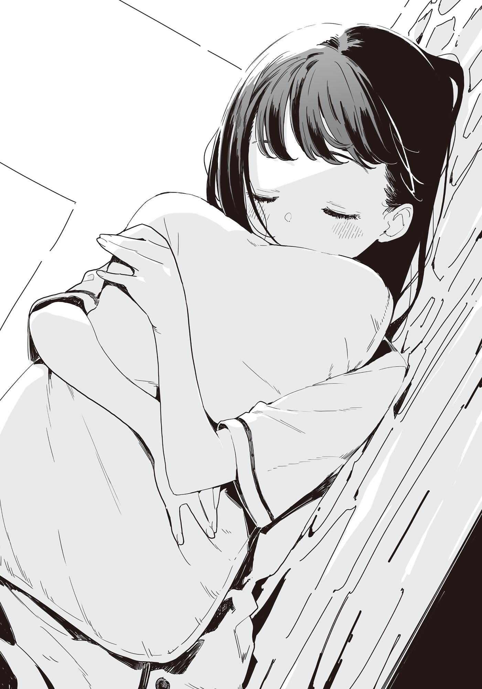

# Ch.116 — เล่ม 8 บทที่ 3-5

Ch.116 — เล่ม 8 บทที่ 3-5

By Monica

Published: 2025-06-02T09:22:43Z

Source: https://www.nekopost.net/novel/14560/116

เล่ม 8 บทที่ 3-5

ตั้งแต่ตัดสินใจว่าจะเป็นผู้สนับสนุนแล้ว เวลาก็ผ่านไปอย่างรวดเร็ว

คืนวันอาทิตย์ก่อนวันเลือกตั้ง

ผมนั่งอยู่ที่โต๊ะทำงานในห้อง เปิดลำโพงโทรศัพท์มือถือและพูดขึ้น

[ งั้นก็หมายความว่า ต้นฉบับสุนทรพจน์เสร็จแล้วสินะ ]

< ค่ะ เหนื่อนหน่อยนะคะ >

เสียงของเทียร่าซังที่ดังมาจากอีกฝั่งของมือถือท่าทางดูเรียบร้อย จากนั้นเธอก็หัวเราะคิกคักออกมา

[ มีอะไรตลกเหรอ? ]

< เปล่าหรอกค่ะ แค่คิดว่าที่ของใช้เวลานานที่สุดกลับเป็นสุนทรพจน์สนับสนุน เลยอดขำไม่ได้ >

อึก... พอพูดแบบนั้นทีทำเอาผมนึกถึงตัวตนของผมในชมรมวรรณกรรมเลย

[ ก็เพราะเราเริ่มเตรียมสุนทรพจน์ทีหลังสุดนี่ แถมยังต้องระวังไม่ให้ซ้ำกับสุนทรพจน์ของบาโซริซังด้วย ]

[ อาระ วันนี้ไม่เรียกชื่อจริงฉันเหรอคะ? ]

[ เออ…นั่น… ]

โดนแกล้งเต็มๆ เลยแฮะ

ผมตัดจบการโทรแบบส่งเดชไป แล้ววางปากกาลูกลื่นสีน้ำเงินลงบนสมุดโน้ต

[ โอเค... ต่อจากนี้ก็เหลือแค่คัดลอกต้นฉบับให้เรียบร้อย… ]

จุดแข็งของเทียร่าซังก็คือ ถึงกลุ่มเป้าหมายจะเป็นนักเรียนปีหนึ่ง แต่ก็เคยมีประสบการณ์เป็นรองประธานนักเรียนมาก่อน

ผมวางแผนไว้ว่าจะใช้สุนทรพจน์สนับสนุนของผมเน้นไปที่การอธิบายผลงานที่ผ่านมา

กลยุทธ์สุนทรพจน์ของเทียร่าซัง คือการสร้างความประทับใจในฐานะผู้สืบทอดอำนาจของรัฐบาลโฮโคบารุ

การกล่าวสุนทรพจน์จะเริ่มหลังพักกลางวันพรุ่งนี้

หลังจากนั้นจะมีการลงคะแนนทันที ดังนั้นความประทับใจจากสุนทรพจน์ก็จะเชื่อมโยงตรงไปสู่ผลลัพธ์เลย…

[ ท่านพี่... มาพักสักหน่อยเถอะค่ะ ]

ทันใดนั้น เสียงของคาจูดังขึ้นข้างหู

คาจูวางถ้วยชาที่มีควันลอยกรุ่นบนโต๊ะ ชานี้มีกลิ่นหอมของคาโมมายล์

[ เข้ามาตั้งแต่เมื่อไหร่เนี่ย? ]

[ เอ๋... ตั้งแต่เมื่อไหร่กันนะ ? ]

คาจูเลี่ยงคำตอบแบบติดตลก ก่อนจะเดินไปเปิดม่านห้อง

[ วันนี้มีเมฆเต็มไปหมด มองไม่เห็นพระจันทร์เลยนะคะ ]

[ อือ… ได้ข่าวว่าดึกๆ จะเริ่มมีฝนน่ะ ]

ผมสูดกลิ่นหอมหวานของคาโมมายล์ พลางเอนตัวพิงพนักเก้าอี้

ทั้งที่ไม่ได้ตั้งใจ แต่ก็ไหลไปตามน้ำจนรับหน้าที่เป็นผู้สนับสนุนไปซะแล้ว

ถ้าเป็นแบบนี้ สุดท้ายคงถูกดันให้เป็นรองประธานด้วยแน่เลย…

──ถึงจะไม่ไว้ใจก็เถอะ...แต่ก็เชื่ออยู่นะ

จู่ๆ คำพูดของโคมาริก็ผุดขึ้นมาในหัว

อย่างน้อยก็ต้องปฏิเสธให้ได้ เพราะถึงยังไงผมก็เป็นผู้ชายที่พูดคำว่า “ไม่” ได้เหมือนกัน

ผมวางถ้วยกลับบนจานรอง เสี้ยววินาทีให้หลัง คาจูที่ยืนอยู่ตรงหน้าต่างก็หันกลับมา

[ ท่านพี่... จะเข้าสภานักเรียนเหรอคะ? ]

[ เปล่านะ... เอ๊ะ รู้เรื่องการเลือกตั้งด้วยเหรอ? ]

[ ค่ะ ถ้าเป็นเรื่องของท่านพี่ล่ะก็ คาจูรู้ทุกอย่างค่ะ ]

เธอพูดมุกที่ไม่น่าขำเท่าไหร่แล้วก็ทิ้งตัวลงนั่งบนเตียง

คาจูรู้จักกับพวกสภานักเรียนอยู่แล้ว ข้อมูลเลยรั่วหมดสินะ…

[ ไม่ได้เข้าหรอก บาโซริซังจะลงสมัครประธาน ก็แค่ช่วยเธอเท่านั้นเอง ]

[ งั้นเหรอคะ... เสียดายนิดหน่อยนะคะ ]

คาจูนั่งแกว่งขาไปมาอยู่บนเตียง

[ ถ้าปีหน้าท่านพี่ได้มาดูแลงานปฐมนิเทศก็คงวิเศษมากเลยค่ะ ]

[ งั้นก่อนอื่น คาจูก็ต้องสอบเข้ามาให้ได้ก่อนนะ? ]

ผมพูดด้วยน้ำเสียงกวนๆ หน่อย คาจูก็ทำหน้ามุ่ยแล้วกลิ้งลงไปนอนบนเตียง

[ คาจูก็ตั้งใจอ่านหนังสืออยู่ค่ะ สอบติดแล้วจะได้ไปโรงเรียนเดียวกับท่านพี่ แล้วก็ซ้อนจักรยานด้วยกัน! ]

[ ซ้อนจักรยานมันผิดกฎนะ ]

ช่วงนี้คาจูเอาจริงกับการอ่านหนังสือ เลยไม่ค่อยโผล่มาที่โรงเรียนเลย

ผมปล่อยให้คาจูกลิ้งอยู่บนเตียง แล้วหันไปเปิดโน้ตบุ๊ก

เวลาผ่านไปประมาณยี่สิบนาที

เมื่อเขียนสุนทรพจน์สนับสนุนเสร็จ ผมก็ยืดแขนเต็มที่บนเก้าอี้

…ว่าแต่ คาจูเงียบไปนานจัง

พอหันไปมองบนเตียง คาจูก็กอดหมอนหลับปุ๋ยไปแล้ว

ผมเอาผ้าห่มมาห่มให้คาจู เดินไปปิดม่านที่เปิดแง้มไว้

──บนกระดานข่าวของเว็บไซต์หนังสือพิมพ์โรงเรียน ยังคงมีโพสต์เพิ่มขึ้นเรื่อยๆ

เรื่องคอสเพลย์ของเทียร่า ซังยังคงเป็นประเด็น ทั้งเสียงชื่นชมจากฝ่ายชาย และเสียงวิจารณ์จากฝ่ายหญิง

แม้เธอจะบอกว่าไม่ใส่ใจ แต่ในเมื่อถึงขั้นมาบอกผม ก็ต้องมีแผลใจอยู่แน่

การที่ผมพยายามให้เธอขึ้นเวทีสุนทรพจน์ในสภาพแบบนั้น… มันถูกจริงหรือเปล่านะ──

[ ยังไงก็ต้องชนะให้ได้… ]

ผมพึมพำกับตัวเอง พลางมองออกไปนอกหน้าต่าง เห็นเงาดำโซซัดโซเซอยู่หน้าบ้าน

……? นั่นมันอะไรน่ะ ? เพ่งดูดีๆ มันเหมือนกับร่างคน

คนที่กลมกลืนไปกับความมืดได้แบบนั้น… มีอยู่คนเดียวเท่านั้น

ในจังหวะนั้นเอง โทรศัพท์บนโต๊ะก็ส่งเสียงเรียกเข้าดังแหลมเหมือนกระจกแตก

──เป็นสายจากชิกิยะซัง

◇

ที่หน้าบ้านของผม ผมยื่นแบตเตอรี่สำรองให้ชิกิซัง

[ ขอบคุณ……พรุ่งนี้……จะคืนให้นะ…… ]

เหตุผลที่เธอเรียกผมออกมาอยู่หน้าบ้านนั้น จริงๆ แล้วง่ายมาก แค่แบตโทรศัพท์ใกล้หมด เธอเลยขอยืมแบตสำรองเท่านั้นเอง

พูดแล้วก็นึกถึงผู้หญิงอีกคนที่บุกเข้ามาในบ้านด้วยเหตุผลเดียวกัน…

ในแสงไฟสลัวจากหน้าจอสมาร์ทโฟน สีหน้าของชิกิยะซังปรากฏขึ้นอย่างเลือนราง

ผมมองเธอโดยไม่รู้ตัว และพลั้งปากถามออกไป

[ ทำไมถึงมาอยู่ตรงนี้ล่ะครับ？ ]

[ ช่วงนี้……ฉันกำลังซ้อมนั่งรถบัสกับรถไฟ……น่ะ？ ]

ชิกิยะซังเอียงคอ พูดด้วยท่าทีเหมือนตัวละครคุณหนูในการ์ตูน

[ จะว่าไป ปกติตอนกลับบ้านที่บ้านจะมารับใช่มั้ยครับ？]

[ อืม……พอรู้ตัวอีกที……ก็ไปอยู่ในที่ไม่รู้จัก……เลยไม่ขึ้นรถบัส ]

ชิกิยะซังพูดพร้อมกับร่างกายที่เอนเบาๆ

[ แต่…แบบนั้น…ตลอดไป……คงไม่ได้…]

ถ้อยคำของชิกิยะซังที่กระจายไปในความมืดยังติดอยู่ในใจผม

ก่อนที่ผมจะเข้าใจว่าเธอพูดถึงอะไร สายตาของชิกิยะซังก็เริ่มสั่นไหว

[ ป้ายรถราง……ไปทางไหน……？]

[ อา ตรงไปตามถนนนี้ แล้วก็ก็ออกไปถนนใหญ่ครับ ]

[ เข้าใจแล้ว……ขอโทษนะ……ที่มารบกวนดึกๆ…… ]

ชิกิยะซังก้าวเดินอย่างโซเซ แต่แล้วก็หยุดกะทันหัน เธอหันหลังให้ผมแล้วพูดเสียงเบา

[ คือว่า……นายกับ……เทียร่าจัง…… ]

[ มีอะไรกับเทียร่าซังหรือเปล่าครับ？ ]

ชิกิยะซังยังคงเงียบอยู่แบบนั้น

ผมกำลังจะถามซ้ำอีกครั้ง อยู่ๆ ผมยาวๆของชิกิยะซังก็พลิ้วไหว ทั้งที่ไม่มีลมพัด

[ อืม……ไม่มีอะไร…… ]

ชิกิยะซังก้าวต่อไปอีกครั้ง ร่างของเธอดูจะละลายหายไปในความมืด

ร่างที่เหมือนจะเลือนหายไปตลอดกาลนั้น──

ผมรู้สึกแบบนั้น เลยก้าวออกไปหนึ่งก้าว

[ ──เอ่อ เดี๋ยวผมไปส่งใกล้ๆนะครับ ]

ชิกิยะซังหยุดกึก

เธอหันคออย่างรวดเร็ว ดวงตาสีขาวของเธอหันมาสบตาผม

[ อืม……รบกวนด้วย…… ]

……แค่ไม่กี่นาทีจนถึงถนนใหญ่ เราเดินเคียงกันโดยไม่ได้พูดอะไร

ก้าวเดินของชิกิยะซัง ดูจะช้าลงกว่าปกตินิดหน่อย

เราเดินไปตามถนนในคืนวันอาทิตย์ สองคน โดยไม่รู้จะพูดอะไร

ทั้งที่อยากพูดตั้งหลายเรื่อง แต่ก็ไม่ได้พูดออกไป

เสียงรถที่วิ่งผ่านถนนใหญ่ค่อยๆ ดังใกล้เข้ามา

เดินต่อไปด้วยความรู้สึกเสียดายจนถึงถนนใหญ่

ตรงมุมสี่แยก มีโคมไฟหินใหญ่สลักคำว่า”ไฟกลางคืน” ส่องแสงอยู่

ป้ายรถรางอยู่ถัดจากนั้น ข้ามทางม้าลายไปตรงกลางถนน

ชิกิยะซังหยุดตรงหน้าโคมไฟหิน ก่อนจะพูดขึ้นมาอย่างกะทันหัน

[ คือว่านะ……ฉัน……ขี่จักรยานด้วย…… ]

[ เอ๊ะ มันไม่อันตรายเหรอครับ？ ใส่ล้อเสริมหรืออะไรแบบนั้นมั้ย？ ]

แม้คำพูดของผมจะเสียมารยาท แต่ชิกิยะซังก็ส่ายตัวอย่างสนุกสนาน

[ สิ่งที่ทำได้……ค่อยๆ เพิ่มขึ้น……มันสนุก…… ]

[ งั้นเหรอครับ ดีจังเลย ]

การที่ชิกิยะซังทำได้หลายอย่างมากขึ้น ก็เหมือนจะยิ่งเพิ่มระยะห่างระหว่างผมกับเธอออกไป

……พรุ่งนี้ จะมีการเลือกตั้งประธานนักเรียนคนใหม่ ซึ่งผู้สมัครคือเทียร่าซังกับซากุไรคุง

ถ้างานกีฬาจบลง คณะกรรมการนักเรียนปัจจุบันก็จะยุบตัว

พอถึงช่วงฤดูใบไม้ผลิ ขิกิยะซังกับประธาน ก็คงเริ่มเตรียมตัวจริงจังสำหรับอนาคตหลังจบการศึกษา

──จบการศึกษา มันรวดเร็วเหลือเกิน

คำพูดของรุ่นพี่สึคิโนกิเมื่อครั้งก่อน สัปดาห์ที่แล้วรุ่นพี่ดูเป็นผู้ใหญ่มากขึ้น

ทั้งที่ดูไม่เปลี่ยน แต่ก็ไม่ใช่คนเดิมที่เคยอยู่กับเราแล้ว

ผมรู้สึกเหมือนทุกคนทิ้งผมไว้ข้างหลังแล้วเติบโตเป็นผู้ใหญ่กันหมดเป็นความรู้สึกกระวนกระวายใจ แต่ไม่ว่าใครก็ตาม เมื่อถึงเวลานั้น พวกเขาก็คงต้องก้าวเท้าเข้าสู่โลกใบใหม่ไปโดยไม่มีทางเลือกอยู่ดี.

ต่อให้ไม่มีการเตรียมใจ ต่อให้ไม่มีความพร้อม สักวันก็ต้องเปลี่ยนไป──

ชิกิยะซังจ้องมองผมที่กำลังคิดอะไรเรื่อยเปื่อย

[ ทำไม……เหรอ……？ ]

[ รุ่นพี่ชิกิยะนี่ดูเป็นผู้ใหญ่มากเลยนะครับ ]

ถ้อยคำที่พูดไปตามตรงนั้น ทำให้ชิกิยะซังเอียงคออย่างงงๆ

[ ฉัน……ยังเป็นเด็กอยู่นะ……？ ]

ชิกิยะซะงยื่นมือมาหาฉันด้วยท่าทางลังเลนิดหน่อย

แต่ก่อนที่มือจะสัมผัสหน้า ผมก็หยุดลง

[ คือว่านะ……พรุ่งนี้……การเลือกตั้ง……เทียร่าจัง……」

ตามที่คาดไว้ ชิกิยะซังมาหาผมเรื่องการเลือกตั้งในวันพรุ่งนี้

ชิกิยะซังสนิทกับเทียร่าซัง แถมคู่แข่งยังเป็นซากุไรคุงอีก คงเป็นห่วงสินะ

ชิกิยะซังที่ปกติพูดจาฉะฉาน กลับอึกอักอย่างที่ไม่เคยเป็นมาก่อน เมื่อหันมาเผชิญหน้ากับผมที่รอฟังคำพูดต่อไป

[ รุ่นพี่ครับ？ ]

[ คือว่า…ฉัน…สุนทรพจน์… ]

เธอพูดไม่ออกอีกครั้ง

ชิกิยะซังที่ยืนโยกเยกอยู่เช่นนั้น เงยหน้าขึ้นมองด้วยแววตาเศร้าสร้อยอย่างกะทันหัน

[ สรุปว่า…ฉัน…โดนเทียร่าจัง…เลี่ยงอยู่สินะ…？ ]

[ เรื่องนั้น──]

คราวนี้เป็นผมที่พูดไม่ออก

เทียร่าซังเว้นระยะห่างจากสภานักเรียนชุดปัจจุบันมาตลอดการหาเสียงเลือกตั้งครั้งนี้

เพื่อหนีจากแสงสว่างของรุ่นพี่ แล้วเปล่งประกายด้วยตัวเอง

[ พอสภานักเรียนประชุมเสร็จ…เทียร่าจัง…ก็กลับทันที… ]

[ ไม่ใช่เพราะเลี่ยงรุ่นพี่ชิกิยะหรอกครับ ]

──ไม่ใช่แค่รุ่นพี่ชิกิยะเท่านั้นที่ถูกเลี่ยง

แต่ความจริงนั้น ไม่ได้ช่วยปลอบประโลมคนที่อยู่ตรงหน้าผมเลย

[ ……ช่วงนี้ เธอช่วยตรวจต้นฉบับสุนทรพจน์ให้ผม ก็เลยยุ่งน่ะครับ ]

รุ่นพี่ชิกิยะไม่ได้ตอบสนองต่อคำพูดของผม เพียงแต่ยืนเงียบๆ ราวกับร่างกำลังละลายหายไปในความมืด

แสงไฟหน้ารถที่วิ่งอยู่บนถนนหมายเลข 1 ส่องสว่างรุ่นพี่ชิกิยะ ราวกับจะดึงเธอกลับมาจากความมืดมิดสู่โลกแห่งความจริง

[ นาย…ช่วยให้เทียร่าจัง…ชนะทีนะ…]

เธอพูดด้วยเสียงที่แทบจะหายไป แล้วก็ถอยหลังไปอย่างช้าๆ

[ รุ่นพี่ ข้างหน้า！ ]

ขณะที่รุ่นพี่ชิกิยะที่ก้าวเท้าลงบนทางม้าลายสัญญาณไฟก็กลายเป็นสีแดง ผมจึงดึงมือเธอสุดแรง

รุ่นพี่ชิกิยะไม่ขัดขืน และล้มตัวเข้ามาซบกับอกผม

รถบรรทุกวิ่งผ่านจุดที่รุ่นพี่ชิกิยะยืนอยู่เมื่อครู่ พร้อมกับเสียงดังสนั่น

……ผมกอดรุ่นพี่ชิกิยะไว้ในอ้อมแขน พลางปรับลมหายใจ

รุ่นพี่ชิกิยะทิ้งน้ำหนักตัวมาพิงผม มองขึ้นมาด้วยดวงตาสีขาวที่ปิดบังความรู้สึก

ร่างกายของเธอเล็กกว่าที่คิด

หากออกแรงเพียงเล็กน้อย อาจจะสลายได้ง่ายๆ

[ เอ่อ รุ่นพี่── ]

[ ……เจ็บ…นิดหน่อย ]

ผมออกแรงที่แขนโดยไม่รู้ตัว

ถึงจะคลายอ้อมแขนออกแล้ว รุ่นพี่ชิกิยะก็ยังคงซบอยู่อกผมอยู่ ไม่ขยับเขยื้อนแม้แต่น้อย

กลิ่นเหงื่อจางๆ ที่ปะปนอยู่ ทำให้หัวผมหมุนไปหมด

[ บาดเจ็บตรงไหนมั้ยครับ？]

[ อืม…ไม่เป็นไร… ]

ชิกิยะซังยังคงจับชายเสื้อผมด้วยปลายนิ้ว มองขึ้นมาด้วยดวงตาคู่นั้น

ผมเบือนสายตาเล็กน้อย แล้วถอยหลังไปหนึ่งก้าว

สัญญาณไฟจราจรตรงทางม้าลายที่จะไปป้ายรถรางเปลี่ยนเป็นสีเขียวแล้ว

[ รุ่นพี่ครับ ไฟเขียวแล้วนะครับ ]

ถึงอย่างนั้นชิกิยะซังก็ยังไม่ขยับจากตรงนั้น

[ ไม่เป็นไรจริงๆนะครับ ? กลับบ้านดีๆนะครับ ]

ทันทีที่ชิกิยะซังค่อยๆขยับตัวออกไปอย่างช้าๆ

[ ……หมัด ]

ตุบ หมัดเบาๆ ถูกปล่อยออกมาที่อกผม

[ เอ่อ รุ่นพี่ครับ？ ]

ชิกิยะซังหันหลังให้ผมเงียบๆ แล้วเริ่มเดินข้ามทางม้าลายไปยังป้ายรถราง

แล้วระหว่างทาง เธอหันกลับมามองเพียงครั้งเดียว──พึมพำด้วยเสียงเล็กราวเสียงยุงที่บินผ่าน

เสียงเล็กๆ ที่คล้ายกระซิบนั้น แทบจะถูกกลบด้วยเสียงรถที่สัญจรไปมา

เสียงพึมพำนั้น ในที่สุดก็ดังมาถึงหูผมอย่างชัดเจนว่า

──ศัตรูของผู้หญิง
