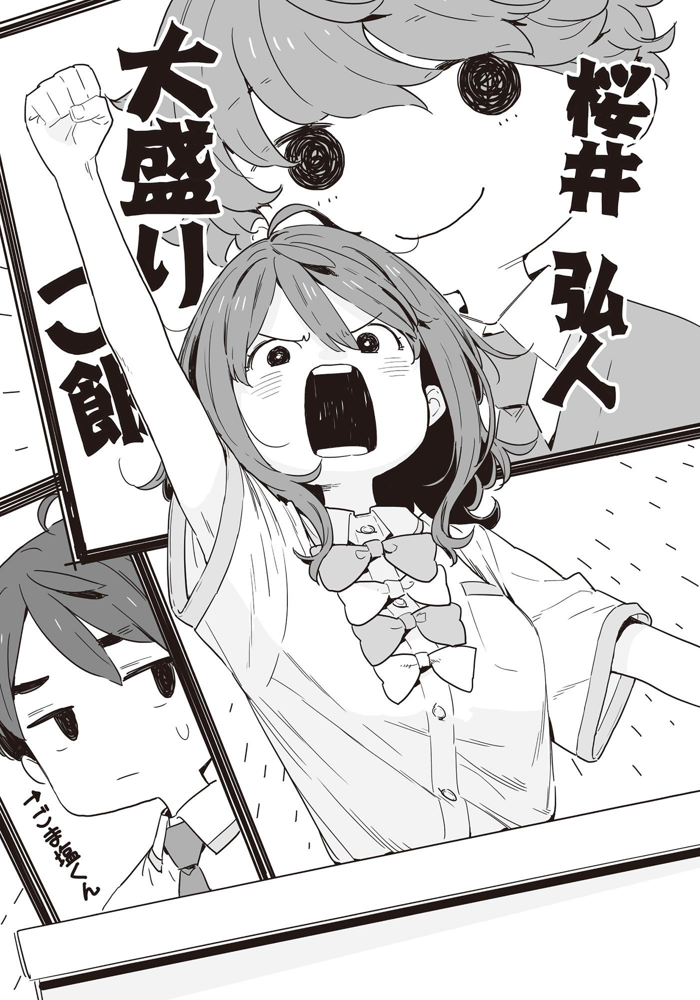

# Ch.118 — เล่ม 8 บทที่ 3-7

Ch.118 — เล่ม 8 บทที่ 3-7

By Monica

Published: 2025-06-08T09:16:20Z

Source: https://www.nekopost.net/novel/14560/118

เล่ม 8 บทที่ 3-7

การกล่าวคำปราศรัยสนับสนุนผู้ลงสมัครประธานนักเรียน ซากุไร ฮิโรโตะ 〜 ยานามิ อันนะ 〜

เมื่อยานามิขึ้นมายืนอยู่บนโพเดียมตรงกลางเวที เธอก็หมุนปรับตำแหน่งของไมโครโฟนไปมาอย่างแรง

[ อา— เทสต์ เทสต์ ]

หลังจากใช้เวลาทดสอบไมค์อยู่นาน เธอก็ไอกระแอมเอาเสียงเล็กน้อย

[ เอ่อ… สวัสดีค่ะ ฉัน ยานามิ อันนะ เป็นเพื่อนร่วมห้องกับซาคุไรคุงที่ลงสมัครเป็นประธานนักเรียน ก็…ประมาณนั้นแหละค่ะ ]

เปิดตัวได้ชิลสุด ๆ แต่อย่าลืมว่าเธอเป็นคนแรกที่ต้องเผชิญหน้ากับหอประชุมที่ยังไม่อบอุ่นเต็มที่ จำเป็นต้องสร้างบรรยากาศให้ผ่อนคลายราวกับบทเกริ่นในละครเวที

เมื่อโยนมุกชิล ๆ ไปสองสามประโยค ยานามิก็เอนตัวเข้าไปใกล้ไมโครโฟน

ถึงเวลาเข้าเรื่องแล้ว──

[ อาจจะกระทันไปหน่อย แต่ขอถามอะไรสักหน่อยนะตะ ทุกคนเป็นสายขนมปังหรือสายข้าวกันคะ? ]

ไม่สิ... อาจจะเป็นกลยุทธ์ที่ใช้คำเกริ่นไปจนจบเลยก็ได้

แม้บรรยากาศในหอประชุมจะงง ๆ ไปบ้าง ยานามิก็ยังคงพูดต่ออย่างมั่นใจ

[ ตอนเช้าฉันชอบกินขนมปัง ตอนกลางวันเป็นข้าวค่ะ ตอนเช้าไม่มีเวลามากก็หยิบขนมปังง่าย ๆ ไป ส่วนกลางวันก็กินข้าวสวยในกับของในข้าวกล่องนั่นแหละค่ะ สรุปแล้วนะคะ ถ้าอยากผ่านคาบเรียนช่วงบ่ายและเวลาหลังเลิกเรียนยาว ๆ ไปให้ได้──ใช่ค่ะ! ต้องใช้พลังของข้าว! ]

เธอกล่าวอย่างหนักแน่นพลางกวาดสายตามองไปรอบหอประชุม

[ ถึงตรงนี้ ทุกคนคงเข้าใจแล้วใช่มั้ยคะว่าฉันอยากจะสื่ออะไร ]

ขอโทษนะ ยังไม่เข้าใจเลย

นี่ดีเหรอซาคุไรคุง? พอผมหันไปมองก็เห็นเขาจ้องมองยานามิด้วยสีหน้าเหมือนกำลังสนุก

ขนาดนี้เลยเหรอ ความสามารถในการรับฟังของซาคุไรคุง…

ยานามิกระแอมอีกครั้ง

[ ใช่ค่ะ! ซากุไรคุงก็คือข้าวนั่นเอง ! ข้าวสามารถเข้ากับกับข้าวทุกชนิดได้อย่างอ่อนโยน ไม่ว่าจะเป็นสตูว์หรือต้มโอเด้ง ข้าวก็พร้อมจะรับทุกอย่างไว้ได้หมด! ]

เครื่องยนต์ของยานามิเริ่มติดแล้ว และสิ่งที่ตามมาคือโรงละครยานามิ ที่ไม่สนใจผู้ชมอีกต่อไป

[ ถ้าฉันเป็นเมนไทโกะ เพื่อนของเขาก็อาจจะเป็นไก่ทอดบ้าง งาคั่วเกลือบ้าง แต่เขาไม่เคยแบ่งแยกเลย! ]

ยานามิชี้นิ้วไปยังหลังม่านเวทีอย่างเฉียบขาด

ปลายนิ้วนั้น ชี้ไปยังซาคุไรคุงที่โผล่ออกมาจากม่านอย่างเงียบ ๆ

[ ซาคุไรคุงไม่เคยพูดจาแทงใจดำเหมือนงาคั่วเกลือคุง ที่พูดจาเสียมารยาทเหมือนใช้สิ่วสลักมากรีดหัวใจคนเล่น แถมเขาตั้งใจฟังเวลาฉันพูดจริง ๆ นะคะ! ทุกคนควรเอาอย่างบ้างค่ะ ! เอาอย่างบ้างนะคะ ! ]

ไม่รู้หรอกนะว่าใครคืองาคั่วเกลือคุง แต่โดนด่าแรงไปมั้ย และยานามิ…ทำไมมองผมล่ะ

ยานามิหันกลับมามองผู้ชมตรงหน้าอีกครั้ง

[ สภานักเรียนมีอยู่เพื่อช่วยให้ทุกคนใช้ชีวิตในโรงเรียนได้ดียิ่งขึ้นค่ะ แต่บางครั้งก็อาจจะต้องขอความร่วมมือจากทุกคน เพื่อเดินหน้าไปด้วยกัน ในสถานการณ์แบบนั้น ถ้าเป็น ซากุไร ฮิโรโตะ ที่เป็นเหมือนข้าวพูนชามแล้วล่ะก็ เขาสามารถรับฟังและเข้ากับความรู้สึกของทุกคนได้อย่างเอร็ดอร่อยแน่นอนค่ะ! ]

ปัง! ยานามิตบสองมือใส่โพเดียมอย่างแรง

[ จะไม่ปล่อยให้ทุกคนหิวโหยแน่นอน ! ซากุไร ฮิโรโตะ! ซากุไร ฮิโรโตะ, ด้วยพลังของทุกคน ได้โปรดทำให้เขาเป็นข้าวสวยร้อนๆกันเถอะค่ะ! ]

ความเงียบชั่วครู่หนึ่ง

นักเรียนที่ถูกพลังลึกลับกดดันไว้ เริ่มตบมือแผ่ว ๆ ขึ้นมา

และเมื่อยานามิยกแขนข้างหนึ่งขึ้นแล้วเดินลงจากโพเดียม──เสียงปรบมือดังกึกก้องไปทั่วหอประชุม

◇

ไม่มีข้อกังขาเลยว่าบรรยากาศนั้นครึกครื้นขึ้นมาด้วยความฮึกเหิม แต่คำปราศรัยเมื่อกี้อะไรกัน….. ถ้าเป็นตอนหิวล่ะก็ ผมว่ามันอันตรายเลยนะ...

จากนั้นยานามิก็กลับมาแปะมือกับซากุไรคุง

ผมละสายตาจากสีหน้าภูมิใจของยานามิ แล้วหันไปมองซากุไรคุงแทน

เขายังคงยิ้มอย่างสงบ เหมือนทุกครั้งจ้องเวทีอย่างตั้งใจ

เสียงของประธานนักเรียนก็ดังขึ้นกลางหอประชุมที่ยังคงคึกคักจากโรงละครยานามิ

[ ──ต่อไปเป็นการกล่าวคำปราศรัยผู้ลงสมัครประธานนักเรียน ชั้นมัธยมปลายปี 2 ห้อง C ซากุไร ฮิโรโตะ เชิญค่ะ]

◇

การกล่าวคำปราศรัยผู้สมัครประธานนักเรียน 〜ซากุไร ฮิโรโตะ〜

ซากุไรคุงย่อตัวลงเล็กน้อยหน้าไมโครโฟน

[ สวัสดีครับ ผมซากุไร ฮิโรโตะ ปัจจุบันดำรงตำแหน่งเหรัญญิกของสภานักเรียน ]

ต่างจากเมื่อครู่โดยสิ้นเชิง เปิดตัวด้วยความสงบนิ่ง

ซากุไรคุงกวาดสายตามองทั่วทั้งหอประชุมช้า ๆ

[ ถึงอย่างนั้น ผมเองก็ไม่ค่อยได้ออกหน้าสักเท่าไหร่ หลายคนอาจจะยังไม่รู้จักผมดี ]

มีเสียงเชียร์ “รู้จักอยู่นะ~” ดังขึ้นจากกลุ่มนักเรียนหญิง

อะไรเนี่ย นึกว่าเราพวกเดียวกันซะอีก ซากุไรคุง

[ ผมเป็นผู้ช่วยของทุกคนในสภานักเรียนครับ คอยให้การสนับสนุน ถึงแม้จะไม่มีผลงานที่น่าภูมิใจมากนัก แต่ผมก็อยากจะแนะนำผลงานที่ผ่านมาของสภานักเรียนให้ทุกคนได้ทราบครับ ]

คำปราศรัยของซากุไรคุงเป็นการโจมตีโดยตรงที่คาดไม่ถึง เป็นคำปราศรัยที่จริงจังอย่างยิ่ง

ในเมื่อเขาเป็นส่วนหนึ่งของสภานักเรียน การที่เขาจะโฆษณาผลงานของสภานักเรียนจึงอยู่ในขอบเขตที่คาดการณ์ได้

การเปลี่ยนระบบการจองสถานที่ให้เป็นอิเล็กทรอนิกส์ การทบทวนงบประมาณกิจกรรม การติดตั้งอุปกรณ์ให้แสงสว่างในอาคารชมรมกีฬาหญิง—

เขารวบรวมมาตรการที่ดูเรียบง่ายแต่มีประสิทธิภาพสูงได้อย่างแม่นยำ

ขณะที่ฟังคำปราศรัยของซากุไรคุง ผมก็เริ่มรู้สึกถึงความผิดปกติ

หรือว่านี่...ในตอนนั้นเองเทียร่าซังก็แตะแขนของผม

[ นุคุมิซึซัง ขอดูต้นฉบับหน่อยค่ะ ]

[ อ่า รอเดี๋ยว ]

ตามแผนของเรา ผมจะโฆษณาผลงานในอดีตในการกล่าวคำปราศรัยสนับสนุน และเทียร่าซังจะพูดถึงนโยบายในอนาคตของสภานักเรียน

ผลงานของเทียร่าซังที่เขียนไว้ในต้นฉบับของผมคือ การเปลี่ยนระบบการจองสถานที่ให้เป็นอิเล็กทรอนิกส์ การทบทวนงบประมาณกิจกรรม การติดตั้งอุปกรณ์ให้แสงสว่างในอาคารชมรมกีฬาหญิง—

[ นี่มัน... ]

เทียร่าซังพยักหน้าด้วยสีหน้าเคร่งขรึม

ใช่แล้ว สิ่งที่ซากุไรคุงกำลังกล่าวถึงในคำปราศรัยของเขาก็คือมาตรการที่เทียร่าซังเป็นคนทำนั่นเอง

— ตรงเป๊ะเลย

แน่นอนว่าในการดำเนินการนั้น สภานักเรียนได้ร่วมกันดำเนินการ และซากุไรคุงก็กล่าวไว้อย่างชัดเจนว่าเขาเป็นเพียงผู้ช่วย

ไม่มีการโกหกใดๆ ไม่มีการชักจูงให้เข้าใจผิด

ถึงอย่างนั้น—หากเรากล่าวถึงผลงานเดียวกันหลังจากนี้ มันอาจจะทำให้เกิดความรู้สึกว่าเราแย่งผลงานของเขาไป ไม่ใช่แค่การซ้ำรอยเดิม

[ ...แย่แล้วสิ ไม่คิดเลยว่าซากุไรคุงจะมาไม้แบบนี้]

[ เป็นกลยุทธ์ที่ถูกต้องแล้วค่ะ พวกเราเองก็ใช้ประโยชน์จากลำดับการกล่าว เลือกที่จะสร้างความประทับใจด้วยชุด ซากุไรคุงก็แค่ใช้กลยุทธ์เปลี่ยนข้อเสียของการได้กล่าวคำปราศรัยก่อนให้เป็นข้อได้เปรียบเท่านั้นเองค่ะ ]

เทียร่าซังกำหมัดแน่นด้วยสีหน้าจริงจัง

[ เราคงต้องยอมแพ้กับต้นฉบับที่เตรียมมาค่ะ แทนที่จะเป็นอย่างนั้น ช่วยพูดแบบฟรีสไตล์ตามความถนัดไปก่อนนะคะ ]

[ ผมไม่ถนัดแบบนั้นนะ?! ]

ยานามิมองพวกเราที่กำลังตื่นตระหนกด้วยความงงงวย

[ ส่งเสียงดัง มีอะไรกันเหรอ? ใกล้ถึงคิวของนุคุมิซึคุงแล้วนะ ]

เสียงปรบมือดังเข้ามาในหูของเรา การกล่าวคำปราศรัยของซากุไรคุงจบลงแล้ว

ซากุไรคุงก้มศีรษะลงลึกต่อหน้าผู้ชม แล้วกลับมาที่หลังเวที

เทียร่าซังยืนกอดอกต้อนรับเขา

[ ทำได้ดีมากเลยนะ ซากุไรคุง ]

[ ขอโทษนะ บาโซริจัง เดี๋ยวจะขอโทษเท่าที่เธอต้องการทีหลัง ]

คนที่ซากุไรคุงต้องขอโทษควรจะเป็นผมไม่ใช่เหรอ

...ไม่สิ เรื่องบ่นเอาไว้ทีหลัง

ผมรีบกวาดสายตาดูต้นฉบับซ้ำไปซ้ำมาแต่ยิ่งดูมากเท่าไหร่ก็ยิ่งเหมือนกับของซากุไรคุง

หรือว่าไม่มีทางเลือกอื่นนอกจากต้องลองพูดฟรีสไตล์ต่อหน้าทั้งโรงเรียนงั้นเหรอ...?

[ ──ต่อไปเป็นการกล่าวคำปราศรัยขอเชิญผู้สนับสนุน บาโซริ เทียร่า ชั้นมัธยมปลายปี 2 ห้อง C นุคุมิซึ คาซึฮิโกะ เชิญค่ะ]

เสียงอันสง่างามของประธานโฮโคบารุดังขึ้น ....ถึงคิวของผมแล้ว
