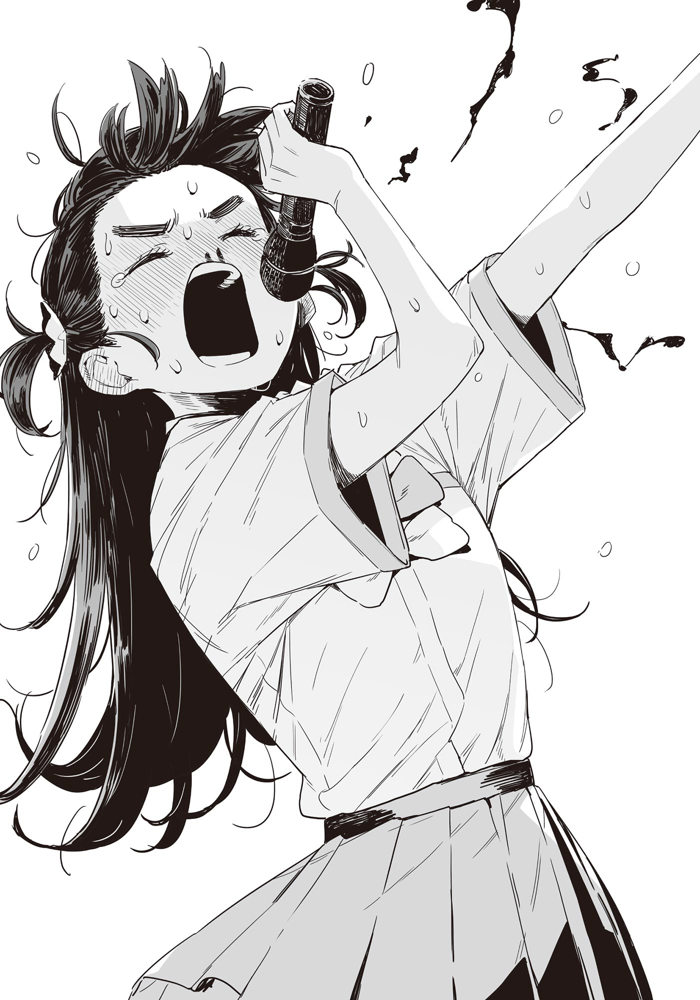

# Ch.120 — เล่ม 8 บทที่ 3-9

Ch.120 — เล่ม 8 บทที่ 3-9

By Monica

Published: 2025-06-08T09:18:30Z

Source: https://www.nekopost.net/novel/14560/120

เล่ม 8 บทที่ 3-9

การกล่าวคำปราศรัยผู้ลงสมัครประธานนักเรียน ～บาโซริ เทียร่า ～

เมื่อเทียร่าซังปรากฏตัวจากหลังเวทีความฮือฮาก็แผ่กระจายไปทั่วหอประชุม

ถึงจะลืมไปบ้างก็เถอะ แต่คนคนนี้แต่งคอสเพลย์ออกสาธารณะอยู่นะ…

เทียร่าซังโค้งคำนับต่อผู้ชมจากข้างโพเดียม แล้วจึงมายืนที่หน้าไมค์

[ ฉันผู้สมัครเข้าชิงตำแหน่งประธานนักเรียนคนถัดไป บาโซริ เทียร่า ค่ะ ]

เริ่มต้นด้วยท่าทีเคร่งขรึม สวนทางกับรูปลักษณ์ภายนอก

บรรยากาศล่องลอยจากการปรากฏตัวของชิกิยะรุ่นพี่ค่อย ๆ สงบนิ่งลง

[ เช่นเดียวกับซากุไรคุงเมื่อครู่นี้ ฉันรับหน้าที่เป็นรองประธานนักเรียนในปัจจุบันค่ะ บางท่านที่อยู่ที่นี่ก็อาจจะเคยพบกันในงานกิจกรรมต่าง ๆ ของโรงเรียน ]

เมื่อเห็นว่าบรรยากาศในหอประชุมเริ่มสงบ เทียร่าซังก็พูดต่อด้วยน้ำเสียงนุ่มนวล

[ ตอนแรกก็ตั้งใจว่าจะพูดถึงสิ่งที่ได้ทำมาตลอดหนึ่งปีนี้ในฐานะนักเรียนสภานักเรียนแหละค่ะ──แต่ซากุไรคุงพูดไปหมดแล้วนี่นะ ]

เธอกล่าวพร้อมหัวเราะเบา ๆ และหันไปมองซากุไรคุงที่อยู่หลังเวที

เสียงหัวเราะจากผู้ชมพลอยดังขึ้นตามไปด้วย

เมื่อเทียร่าซังหันกลับมาทางผู้ชม ก็เปลี่ยนน้ำเสียงเป็นน้ำเสียงจริงจัง

[ ตอนมัธยมต้น โรงเรียนสึวะบุกิแห่งนี้เป็นโรงเรียนในฝันของฉันค่ะ ]

……สิ่งที่เธอเริ่มพูด ดูเหมือนจะไม่ตรงกับที่คุยกันไว้เลย

[ รุ่นพี่ที่เรียนอยู่ที่นี่ เป็นทั้งฮีโร่และนางเอกสำหรับฉัน ฉันใฝ่ฝันมาตลอดว่าสักวันจะสอบเข้าโรงเรียนสึวะบุกิให้ได้ และได้ใช้ชีวิตมัธยมปลายร่วมกับพวกเขา ]

น้ำเสียงของเธอเหมือนกำลังพูดกับตัวเองในอดีตมากกว่าผู้ชมเบื้องหน้า

เทียร่าซังพูดต่ออย่างกับพึมพำกับตัวเอง

[ เรียนหนังสืออย่างธรรมดา ซ้อมกิจกรรมชมรมอย่างธรรมดา และ ใช้ชีวิตนักเรียนอย่างธรรมดาที่โรงเรียนสึวะบุกิ── ]

แล้วเธอก็หยุดพูดชั่วครู่ ก่อนจะมองไปยังผู้ชมด้วยสีหน้าจริงจัง

[ ฉันคิดว่าถ้าเข้าเรียนที่นี่ได้ ก็จะกลายเป็นคนธรรมดาของสึวะบุกิได้เช่นกัน แต่ความจริงนั้นไม่ง่ายแบบนั้นเลยค่ะ ]

เธอลังเลเล็กน้อย ก่อนจะพูดต่อ

[ ฉันเรียนไม่เก่ง หรือจะเรียกว่าผลการเรียนแย่ก็ไม่ผิดนักค่ะ ทุกครั้งที่สอบ ก็แค่พอผ่านไม่ให้ติดศูนย์เท่านั้น ]

── ความลับที่เธอเคยปิดบังไว้ในอดีต เป็นปมด้อยของเธอโดยตรง

[ กีฬาเองก็ไม่ถนัด บางครั้งแม้แต่เวลาคุยกับเพื่อนก็รู้สึกถึงความแตกต่างอยู่เสมอ ฉันไม่สามารถเป็น คนธรรมดา ที่เคยใฝ่ฝันไว้ได้เลย หลังจากเข้าเรียนที่นี่ก็ได้รู้เรื่องนั้นทันที ]

เมื่อพูดถึงตรงนี้ สีหน้าของเทียร่าซังก็เปลี่ยนเป็นเหมือนคนที่ปลดปล่อยตัวเองแล้ว

[ เมื่อประมาณช่วงนี้ของปีที่แล้ว ฉันเข้าร่วมกิจกรรมอาสาสมัครที่จัดโดยสภานักเรียน แล้วก็ถูกรุ่นพี่ชวนให้เข้าร่วมสภานักเรียนค่ะ เห็นว่าคนที่แนะนำชื่อฉันคือซากุไรคุงตรงนั้นแหละ ]

เธอหัวเราะอย่างซุกซนแล้วพูดต่อ

[ หลังจากนั้นหลายท่านคงจะพอทราบเรื่องราวของแล้วฉันนะคะ ]

เธอพูดติดตลกเล็กน้อย ก่อนจะเปลี่ยนสีหน้าเป็นจริงจังทันที

[ สารภาพตามตรงว่าที่ผ่านมาฉันสร้างความเดือดร้อนให้ทุกท่านมากมายค่ะ บางครั้งก็ทำร้ายคนอื่นเพราะความไม่รู้จักโตของตัวเองค่ะ ]

ไม่รู้ตั้งแต่เมื่อไหร่ แต่ซากุไรคุงก็มายืนอยู่ข้าง ๆ ผมแล้ว

ผมสะกิดศอกเขาเบา ๆ เหมือนจะบอกว่า ทุกอย่างออกมาดีแล้ว ขอบใจนะ ด้วยเสียงแผ่วเบา และเขาตอบกลับว่า ไม่เป็นไรหรอก──

จากนั้นเราก็ยืนดูความจริงจังของเทียร่าซังข้างๆ กัน

[ ──ฉันตระหนักได้จากการทำกิจกรรมสภานักเรียนค่ะ ว่าฉันไม่สามารถเป็นฮีโร่หรือนางเอกอย่างที่ใฝ่ฝันตั้งแต่เด็กได้ แต่ฉันสามารถสนับสนุนฮีโร่และนางเอกเหล่านั้นได้ค่ะ...! ]

เทียร่าซังคว้าไมค์ออกจากขาตั้ง

[ ใช่ค่ะ ทุกท่านที่สึวะบุกิ—ทุกท่านที่อยู่ที่นี่! คือฮีโร่และนางเอกที่ฉันใฝ่ฝันและอยากจะเป็นมาโดยตลอดค่ะ! ]

เสียงตะโกนที่เต็มไปด้วยอารมณ์ดังก้องไปทั่วโรงยิม

[ ฉัน──และสภานักเรียนจะสร้างมันขึ้นมาเองค่ะ ! สภาพแวดล้อมที่ทำให้ทุกคนสามารถทุ่มเทให้กับการเรียนและกิจกรรมต่าง ๆ ได้อย่างเต็มที่! ]

เทียร่าซังตะโกนใส่ไมค์โดยไม่สนใจเสียงหอนของลำโพง

นักเรียนที่ถูกกระหน่ำด้วยอารมณ์อันรุนแรงของเธอ ยืนจ้องมองเธออย่างไม่ขยับเขยื้อน

[ ถึงอย่างนั้น ฉันก็อาจจะยังมีข้อบกพร่อง อาจจะทำให้ทุกคนเดือดร้อนบ้าง! อาจจะมีความไม่พอใจบ้าง! ถ้าเป็นเช่นนั้น ก็เชิญระบายความรู้สึกใส่ฉันได้เลยค่ะ ! ฉันจะรับไว้ทั้งหมดเอง ! ระบายมาได้เลยค่ะ ! ไม่ต้องเกรงใจ! ]

เหมือนจะมีประตูอะไรบางอย่างแฝงอยู่เบื้องหลังคำพูดพวกนั้น……แต่ขอข้ามไปก่อนก็แล้วกัน

……แต่ยังไงซะ ก็กำลังไปได้สวยทีเดียว เทียร่าซังดูทุ่มสุดตัว แต่ผู้ฟังกลับไม่ถอยห่าง

ตรงกันข้าม บรรยากาศในหอประชุมกลับถูกดึงดูดด้วยความกระตือรือร้นที่ตรงไปตรงมาของเทียร่าซัง

จนถึงตอนนี้ ทุกคนก็ยังไม่รู้ว่าจะจัดการกับเครื่องหมายคำถามที่ลอยอยู่ในหัวอย่างไรดี

เทียร่าซังที่หน้าแดงก่ำ เอนตัวเข้าหาโพเดียม

[ เพราะฉะนั้น…เพราะฉะนั้น……！ ]

ว่าแต่ ดูเหมือนจะตื่นเต้นเกินไปหรือเปล่า ถ้าตื่นเต้นมากไป──

[ ฉัน──?! ]

เธอรีบใช้สองมือกดจมูกตัวเอง

ไมโครโฟนตกลงกระแทกพื้นโพเดียม เกิดเสียงดัง “ตุบ”

……อย่าบอกนะ

ไหล่ของเทียร่าซังเริ่มสั่นระริก เอ่อ นี่แปลว่า…

เสียงซุบซิบในหอประชุมเริ่มดังขึ้นเพราะเหตุขัดจังหวะกะทันหัน

[ นี่ บาโซริซังเป็นอะไรน่ะ ? กินเยอะไปเหรอ? ]

ยานามิที่เคี้ยวอะไรบางอย่างเดินเข้ามาใกล้ด้วยสายตาเป็นห่วง—นี่ยังอยู่ในคาบเรียนอยู่เลยนะ

แต่ช่างเถอะ ตอนนี้แย่แล้ว

ถึงจะไม่รู้ว่ามันแย่แค่ไหน แต่ยังไงก็ต้องรีบทำอะไรสักอย่างแล้ว…

ขณะที่กำลังหาทิชชู่ในกระเป๋า จู่ ๆ เทียร่าซังที่กำลังสั่นอยู่ก็หยุดลง

ในดวงตานั้น──มีแสงแห่งความมุ่งมั่นอยู่

เทียร่าซังปล่อยมือออกจากจมูก แล้วคว้าไมค์

──โดยที่เลือดยังไหลออกมาจากจมูกอยู่

[ พูดให้เข้าใจง่ายก็คือ ทุกคนคือ <โอชิ> ของฉันค่ะ! เพราะฉะนั้น! ]

เสียงตะโกนสุดกำลังแบบไม่หวงภาพลักษณ์และเลือดกำเดาที่ไหลไม่หยุด

แล้วเทียร่าซังก็สูดลมหายใจเข้าลึกๆ──ก่อนจะตะโกนเสียงดังที่สุดของวันนี้ออกมา

[ ขอร้องล่ะคะ ! ให้ฉันได้สนับสนุนพวกคุณทุกคนเถอะนะคะ ! ]

เสียงหอน “วิ้งงง” ดังจากลำโพง

ท่ามกลางความเงียบงันของหอประชุมที่แทบหยุดหายใจ เสียงหอบหายใจของเทียร่าซังดังก้อง

แล้วเธอก็สูดลมหายใจอีกครั้ง ก่อนจะชี้ตรงไปยังรุ่นพี่ชิกิยะที่อยู่ข้างเวที

[ แล้วก็รุ่นพี่ชิกิยะ ! อย่าเรียกชื่อจริงของฉันต่อหน้าคนอื่นสิคะ ! ]

เธอเช็ดเลือดที่ไหลด้วยแขนเสื้อ แล้วหันหน้าไปยังนักเรียนทั้งโรงเรียนสึวะบุกิ──

[ จบแล้วค่ะ ! ฉันบาโซริ เทียร่า ขอลาไปก่อนค่ะ! ]

เธอตะโกนลั่น

ในวันนั้น บาโซริ เทียร่า ก็ได้รับแต่งตั้งเป็นประธานนักเรียนคนถัดไปของโรงเรียนสึวะบุคิ

และในเวลาต่อมา เธอก็ถูกเรียกว่า

── ประธานนักเรียนสีชาด
