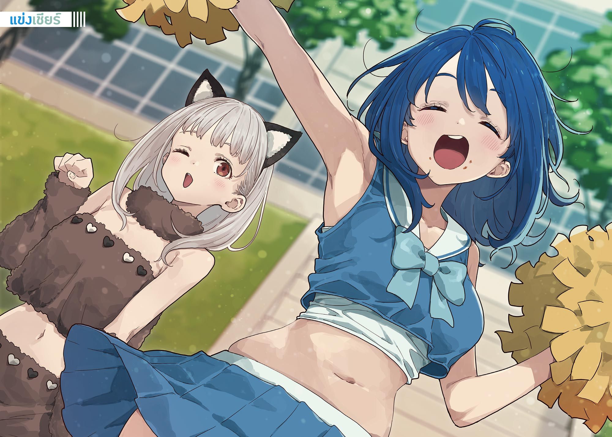

# Ch.122 — เล่ม 8 บทที่ 4-1

Ch.122 — เล่ม 8 บทที่ 4-1

By Monica

Published: 2025-06-08T09:22:12Z

Source: https://www.nekopost.net/novel/14560/122

เล่ม 8 บทที่ 4-1

บทที่ 4 ศัตรูของผู้หญิงนี่หมายถึงใครกันนะ ?

วันนี้เป็นวันกีฬาสีของโรงเรียนสึวะบุกิ และเป็นวันที่ท้องฟ้าแจ่มใส ซึ่งสวนทางกับความปรารถนาของผม

การเลือกตั้งประธานนักเรียนก็ผ่านพ้นไปได้ด้วยดี และเมื่อกีฬาสีครั้งนี้จบลง สภานักเรียนชุดปัจจุบันก็จะถูกยุบ

แน่นอนว่าสำหรับนักเรียนส่วนใหญ่ของสึวะบุกิ เรื่องนั้นไม่เกี่ยวข้องอะไรเลย และสำหรับผมเอง เมื่อการเลือกตั้งสิ้นสุดลง ก็ไม่ใช่เรื่องที่เกี่ยวข้องโดยตรงอีกต่อไป—

ขณะที่คิดเช่นนั้น ผมก็มองดูพวกกลุ่มป็อปๆที่กำลังวิ่งโดยมีเสียงเชียร์ให้กำลังใจ

ผมลงแข่งวิ่งแข่งและชักเย่อที่ทุกคนต้องเข้าร่วมไปแล้ว และตอนนี้ก็รู้สึกเหนื่อยเต็มที

โดยเฉพาะสำหรับการวิ่งแข่ง ผมคิดว่าถ้าเป็นผมที่วิ่งได้เร็วกว่าค่าเฉลี่ยของเด็กผู้ชาย ม.ปลายปี 1 ตั้งแต่เดือนมีนาคม ก็น่าจะทำได้ดีเหมือนคนทั่วไป แต่ผมกลับประเมินผิดไปอย่างหนึ่ง

—ทุกคนกลายเป็นเด็ก ม.ปลายปี 2 ไปแล้วน่ะสิ

แถมเพื่อนร่วมวิ่งทั้งห้าคนยังเป็นข้อยกเว้น เพราะพวกนั้นเป็นพวกที่อยู่ในชมรมกีฬา รวมทั้งชมรมกรีฑา และฮาคามาดะ โซสุเกะด้วย

ฮาคามาดะ หมอนั่นได้ที่ 1 เหนือกว่าพวกชมรมกรีฑาชายซะอีก พลังเสริมของตัวละครเอกนี่น่ากลัวจริงๆ แน่นอนว่าผมได้ที่โหล่

รู้สึกเจ็บไหล่ขึ้นมาด้วย ชักเย่อทำเอาผมสะบักสะบอมขนาดนี้ ผมคงไม่ไหวแล้วใช่มั้ยเนี่ย...

[ เฮ้ นุคุมิซึ ใกล้ถึงเวลาแล้วนะ ]

[ อ่า รู้แล้ว ]

ผมกับอายาโนะสบตากัน แล้วหันกลับไปมองสนามอีกครั้ง

ตอนนี้กำลังแข่งวิ่งผลัดผสมชายหญิงระหว่างห้อง

เป็นกีฬาที่เต็มไปด้วยบรรยากาศของพวกป็อปๆซึ่งไม่เกี่ยวกับผมเลย แต่คราวนี้ผมจะเมินเฉยไม่ได้

เพราะยากิชิโอะจากห้อง 2-E จะลงแข่งเป็นไม้สุดท้าย

ขณะที่เราปักหลักอยู่ใกล้หัวโค้งที่ 4 ก็มีการส่งไม้ให้ยากิชิโอะ

[ ดูสิเลม่อน ได่ที่หนึ่งแน่ๆ ! ]

[ ดูอยู่ๆ ไม่ต้องดึงเสื้อกันขนาดนั้น ]

ไม้สุดท้ายวิ่งระยะ 400 เมตร ซึ่งยาวกว่าคนอื่น

ทันทีที่ยากิชิโอะเริ่มวิ่ง เสียงฮือฮาก็ดังก้องไปทั่วสนาม

เธอพุ่งเข้าสู่หัวโค้งที่ 1 อย่างรวดเร็ว ดูไม่ใช่ความเร็วของคนถนัดวิ่งระยะกลางเลย

...เร็วมาก แน่นอนว่าปีที่แล้วก็เร็ว แต่ปีนี้ดูน่าเกรงขามขึ้นเยอะเลย

ขณะที่ผมมองอย่างน่าทึ่ง อายาโนะก็กอดอกพยักหน้าหงึกๆ

[ รู้อะไรมั้ย ? ที่จริงแล้วเลม่อนน่ะ เวลาวิ่งระยะสั้นก็ดีขึ้นด้วยนะ ]

[ เอ๋ จริงเหรอ ]

[ อ่า ก่อนวิ่งผลัด ลองจับเวลาดูแล้วทำลายสถิติส่วนตัวด้วยแหละ ]

ผมยักไหล่อย่างจงใจใส่อายาโนะที่ดูภาคภูมิใจไม่รู้เรื่อง

[ สถิติส่วนตัวนั่นน่ะ เป็นเวลาอย่างเป็นทางการก่อนที่จะแข่งกับผมใช่มั้ย? เสียใจด้วยนะ นั่นน่ะเลม่อนทำลายสถิติไปตั้งแต่เดือนมีนาคมตอนที่แข่งกับผมแล้วล่ะ ]

เมื่อได้ยินอย่างนั้น อายาโนะก็แว่นตาเปล่งประกายวับ

[ งั้นนี่ล่ะรู้มั้ย? เลม่อนน่ะ วันแข่งจะไม่กินอาหารแข็งนะ เขาบอกว่าพวกเยลลี่หรือเครื่องดื่มจะปรับร่างกายได้ง่ายกว่า ]

โอ้โห อย่างนั้นเหรอเนี่ย ยานามิทำไม่ได้แน่นอน

ว่าแต่คนที่คบกับคนอื่นแล้วมาทำเป็นรู้ใจคนรักเก่าอย่างนี้น่ะมันยังไงกันนะ

[ อายาโนะ นี่รู้มั้ย ยากิชิโอะน่ะก่อนแข่งจะฟังเพลงเพื่อรวมสมาธินะ ]

[ อ่า แน่นอน รู้สิ ]

[ ก็คงงั้นแหละ แล้วนี่คือเรื่องสำคัญเลยนะ ในการแข่งขันครั้งก่อนไม่ได้ใช้หูฟังแต่เสียงมันออกมาจากตัวเครื่องเลยนะ แล้วเลม่อนก็อายมากเลยแหละ ]

[ หืม สมกับเป็นเลม่อนจริงๆ ]

[ ใช่มั้ยล่ะ? ]

ขณะที่เรากำลังโต้เถียงกันอย่างดุเดือด ยากิชิโอะก็เข้าสู่หัวโค้งที่ 4 แล้ว

วินาทีที่ผมรู้สึกเหมือนสบตากับเธอ—แล้วในชั่วพริบตาถัดมา ยากิชิโอะก็ยกนิ้วชี้ขึ้นมาทางผม แล้ววิ่งผ่านหน้าผมไปอย่างรวดเร็ว

จากนั้นก็เร่งความเร็วอีกครั้งในไม้สุดท้าย สลัดผู้ชายที่ไล่ตามมา แล้วเข้าเส้นชัย

ยากิชิโอะกระโดดเข้าไปในวงของสมาชิกทีมวิ่งผลัดห้อง 2-E โดยมีเสียงเชียร์ดังกึกก้องอยู่เบื้องหลัง

เราที่เคยถูกยากิชิโอะวิ่งแซงไปนั้น มองหน้ากันแล้วพูดว่า

[ [ —เมื่อกี้เธอส่งสัญญาณให้ผมใช่มั้ย? ] ]

ทำไมต้องพูดพร้อมกันด้วยนะ

ผมถอนหายใจอย่างอ่อแรง แล้ววางมือบนไหล่อายาโนะ

[ ใจเย็นๆ แล้วคิดดูนะ ถึงจะเป็นเพื่อนกัน แต่ยากิชิโอะคงไม่ทำอย่างนั้นกับผู้ชายที่มีแฟนแล้วหรอก ดังนั้นใช้วิธีตัดตัวเลือกแล้วคิดว่าเธอทำสัญญาณให้ผมต่างหาก ดูเป็นธรรมชาติดี ]

[ ไม่เกี่ยวกันเลยนะ การทำสัญญาณให้เพื่อนที่มาเชียร์น่ะไม่ใช่เรื่องแปลกอะไรเลย ]

[ ถ้าอย่างนั้น สัญญาณนั้นจะให้ผมก็ได้ไม่ใช่เหรอ? นายนั่นแหละที่บอกว่าผมเป็นเพื่อนของยากิชิโอะ ]

อายาโนะครุ่นคิดอยู่ครู่หนึ่งกับคำพูดของผม แล้วดันแว่นขึ้นด้วยปลายนิ้ว

[ ...แว่นตา ]

[ หมายความว่าไง? ]

[ ก็แว่นตามันสะท้อนแสงไง เลม่อนเลยสังเกตเห็น ไม่อย่างนั้นคงหานายท่ามกลางคนเยอะขนาดนี้ไม่ได้หรอก ]

[ นั่นมันคงรบกวนสายตาจนน่ารำคาญมากกว่ามั้ย ? รู้สึกเหมือนเมื่อกี้เธอชูนิ้วกลางให้ผมด้วยซ้ำ ]

ผมกับอายาโนะสบตากันโดยไม่พูดอะไรเลย กำลังจะเริ่มยกที่ 2 อยู่แล้วเชียว

[ มิตสึกิซัง! ]

คนที่ปรากฏตัวคืออาซากุโมะซัง เธอโค้งคำนับให้ผมเล็กน้อย แล้วยิ้มให้อายาโนะ

[ เลม่อนซังวิ่งเป็นไงบ้างคะ ? สุดยอดไปเลยใช่มั้ยคะ ]

[ อ่า จิฮายะก็ดูอยู่เหมือนกันเหรอ? หมอนั่นสุดยอดจริงๆ นั่นแหละ ]

[ ใช่แล้วค่ะ นุคุมิซึซังคะ ฉันขอยืมมิตสึกิซังไปหน่อยได้มั้ยคะ? มีเรื่องจะคุยด้วยนิดหน่อยน่ะค่ะ ]

เมื่อผมพยักหน้าโดยไม่พูดอะไร อาซากุโมะซังก็คว้าแขนอายาโนะไว้ด้วยสองมือ

[ จิฮายะ มีเรื่องอะไรเหรอ? ]

[ ค่ะ มีอะไรคะ? เราไปคุยกันตรงนั้นดีกว่าค่ะ ]

ผมประสานมือไปทางด้านหลังของอายาโนะที่ถูกพาตัวไป

...บทสนทนาเมื่อกี้คงถูกได้ยินสินะ

แต่ก็นั่นแหละ คนที่มีแฟนแล้วแต่ยังไปเอาอกเอาใจผู้หญิงที่เคยหักอกตัวเองก็ผิดเองอยู่แล้ว ต้องสำนึกผิดซะบ้าง

เอาล่ะ การแข่งขันช่วงเช้ากำลังจะสิ้นสุดลงแล้ว

เหลืออะไรอีกบ้างนะ...

ขณะที่ผมกำลังควานหาตารางการแข่งขันในกระเป๋า ยานามิก็วิ่งเข้ามาหาผม

[ อยู่นี่เอง! ]

[ มีอะไรเหรอ รีบร้อนขนาดนั้น ]

ยานามิซังหอบหายใจให้เป็นปกติ แล้วยื่นมือทั้งสองข้างให้ผมด้วยดวงตาที่สดใส

[ นุคุมิซึคุง ขอข้าวกล่องหน่อย! ]

[ ไม่ให้หรอก ]

ผมตอบทันควัน ยานามิซังยักไหล่อย่างอ่อนใจ

[ ช่วยไม่ได้นะ งั้นจะอธิบายให้นุคุมิซึคุงเข้าใจนะ ]

[ คำตอบก็ไม่เปลี่ยนหรอกนะ ]

ยานามิพูดต่อไปโดยไม่สนใจผมที่ยืนยัน

[ การเชียร์น่ะมีตอนแรกของช่วงบ่ายใช่มั้ยล่ะ? พวกเราน่ะพอพักเที่ยงก็จะรีบไปเปลี่ยนชุด แล้วก็ประชุมไปกินข้าวกล่องไปน่ะ ]

[ เหรอ ]

แล้วมันเกี่ยวอะไรกับผมล่ะ

ยานามิจ้องผมเขม็งเมื่อผมตอบแบบไม่ใส่ใจ

[ ก็เนี่ย พอออกกำลังกายตั้งแต่เช้ามันก็หิวใช่มั้ยล่ะ แล้วก็— ]

[ ...กินข้าวกล่องล่วงหน้าไปแล้วสินะ ]

[ แค่ชิมนิดหน่อยเองนะ ข้าวกล่องน่ะมันไม่ค่อยมีแรงใจเลย ]

แรงใจ ข้าวกล่องมีค่าสถานะลับแบบนั้นด้วยเหรอเนี่ย

ผมเข้าใจสถานการณ์แล้ว แต่ผมให้ข้าวกล่องสุดพิเศษของคาจูกับคนที่ไม่เห็นคุณค่าของมันไม่ได้หรอก

[ ไปซื้อขนมปังที่ร้านค้าก็ได้นี่ ]

[ เดี๋ยวฉันต้องไปแข่งวิ่งกินขนมปังแล้ว ไม่มีเวลาไปซื้อหรอกนะ ไปซื้อมาให้หน่อยสิ ]

[ เอาขนมปังนั่นเป็นข้าวกลางวันไปเลยก็ได้นี่? ]

[ คิดว่าพอเหรอ? ]

อืม ไม่พอจริงๆ นั่นแหละ ผมผิดเอง

เมื่อผมพยักหน้า ยานามิซังก็กล่าวขอบคุณแล้วกำลังจะจากไป

[ เดี๋ยวก่อน เงินค่าขนมปังน่ะ เป็นหนี้ไม่ดีนะ ]

[ ...ฉันดูเป็นผู้หญิงที่ไม่คืนเงินเหรอ? ]

เรื่องนั้นผมขอไม่แสดงความคิดเห็น

ยานามิซังควานหาอะไรในกางเกงขาสั้นแล้วหยิบเหรียญ 500 เยนออกมา

[ งั้นเอาขนมปังที่มีแรงใจหน่อยนะ ]

ผมมองส่งยานามิซังที่โบกมือและวิ่งจากไป แล้วก็เอียงคอ

ขนมปังที่มีแรงใจ...มันเป็นยังไงกันนะ?

◇

ระหว่างทางกลับจากร้านค้า ผมแบกขนมปังเต็มสองมือ

ผมได้ขนมปังแกงกะหรี่ลดราคาพิเศษ 7 ชิ้น ซึ่งจะหมดอายุวันนี้

ถ้าเป็นขนมปังแกงกะหรี่ก็น่าจะมีแรงใจดีนะ ยานามิงคงดีใจ

ผมเดินฮัมเพลงเบาๆไปตามทางเดินข้างสนามหญ้า มีนักเรียนหญิงน่ารักคนหนึ่งเดินสวนมา

นั่นคือชิราทามะซัง เธอสังเกตเห็นผมก็เดินกะเตงๆ เข้ามาใกล้ น่ารักจริงๆ

ไม่มีข้อโต้แย้งเรื่องความน่ารักของเธอ แต่ว่าวันนี้เธอดูน่ารักเป็นพิเศษ

เธอสวมที่คาดผมหูสัตว์ ชุดสัตว์มีหางฟูๆ ยิ่งเพิ่มความน่ารักเข้าไปอีก

ชิราทามะซังยกมือสองข้างขึ้นตรงหน้าผม แล้วพูดว่า

[ ประธานคะ ‘กรร ‘! ]

เธอก็ทำท่าทางล้อเลียนอย่างน่ารักให้ดู

[ นี่มันชุดสำหรับเชียร์ใช่มั้ย? ]

[ ใช่ค่ะ ที่ห้องจะเต้นคอนโปโกะของสุนัขจิ้งจอกกับทานุกิค่ะ ฉันเลยกลายเป็นทานุกิ ]

ชิราทามะซังแลบลิ้นออกมาอย่างออดอ้อน เจ้าเล่ห์จัง แล้วก็น่ารักด้วย

ชิราทามะซังมองขนมปังแกงกะหรี่ที่ผมอุ้มมาแล้วตาโต

[ ว้าว ประธานกินเยอะจังเลยนะคะ ]

[ ไม่ นี่มัน— ]

[ ของยานามิซังใช่มั้ยคะ ]

ชิราทามะซังหัวเราะคิกคัก แล้วมองตาผมด้วยสายตาอ้อนวอน

[ แข่งเชียร์ของห้อง 1-E ประธานจะมาดูมั้ยคะ? ]

[ เอ๋? อ่า ถ้าไม่ตรงกับห้องผมก็… ]

ชิราทามะซังยิ้มสวยราวกับดอกไม้ให้ผมที่ตอบอึกอัก

[ ว้าว น่าตื่นเต้นจังเลยค่ะ! ตอนเต้น จะส่งสัญญาณให้นะคะ มาดูให้ได้เลยนะคะ ]

[ เอ๋ ให้ผมเหรอ? ]

[ ...ให้แค่ประธานคนเดียวนะคะ? ]

ชิราทามะซังกระซิบเสียงแผ่วเบา

เมื่อชิราทามะซังหันหลังกลับไปอย่างรวดเร็ว หางทานุกิที่ติดอยู่กับชุดก็พลิ้วไหวในอากาศ

◇

การแข่งขันช่วงเช้าจบลง และเข้าสู่ช่วงพักกลางวันแล้ว

ซากุไรคุงกับอายาโนะไปรวมกลุ่มกับการเชียร์ ผมจึงเพลิดเพลินกับการกินข้าวกล่องคนเดียวที่มุมสนาม

ภายใต้ร่มไม้ เสียงกิ่งไม้เสียดสีกันเบาๆ และบางครั้งก็ได้ยินเสียงนกจากด้านบน

[ นานๆ ทีได้ใช้เวลาสงบๆ ก็ดีเหมือนกันนะ… ]

เอาล่ะ หลังจากไส้กรอกเบคอนแล้วจะกินอะไรต่อดีนะ

มินิโอเด้งเสียบไม้ หรือไก่ทอดสุดคลาสสิกดี—

ขณะที่ผมกำลังมองข้าวกล่องพิเศษของคาจูก็มีเงาทาบทับลงมาที่มือ

เงยหน้าขึ้นไปก็เห็น โคมาริ ถือห่อข้าวกล่องยืนอยู่ตรงนั้น

[ เอ่อ...คะ...คือ... ]

โคมาริซังบิดไปมา เล่นกับผมหน้าม้าของเธอ

[ อ้าว พวกสมาชิกทีมเชียร์ไม่กินข้าวกล่องไปด้วยประชุมไปด้วยเหรอ? ]

[ ฉะ...ฉันน่ะไม่มีอะไรทำในวันจริงหรอกนะ เพะ...เพลงก็คณะกรรมการจะเปิดให้ ]

[ อืม อย่างนั้นเองเหรอ แล้วทำไมถึงมาอยู่ตรงนี้ล่ะ— ]

[ อ๊ะ?! คะ...คือ… ]

เห็นโคมาริซังมีท่าทางร้อนรน ผมก็พยักหน้าอย่างแรง อ๋อ อย่างนี้นี่เอง

[ เข้าใจแล้ว กำลังหาสถานที่ลับตาคนอยู่ใช่มั้ยล่ะ? ]

[ ...เอ่อ? ]

ผมชี้ไปด้านหลังด้วยนิ้วโป้ง

[ แนะนำหลังพุ่มไม้นั่นเลยนะ เงียบสงบดี แถมพื้นยังมีหญ้าขึ้นเหมือนสนามหญ้าด้วย นั่งสบายเลยล่ะ ผมเลือกที่นี่เพราะได้ยินเสียงนก แต่โดยรวมแล้วตรงนั้นดีกว่านะ ]

อ่าฮะ ทำดีแล้วเรา คนประเภทเดียวกันก็ต้องช่วยเหลือกันสิ

ขณะที่ผมพอใจแล้วคีบไก่ทอดด้วยตะเกียบ โคมาริซังก็พึมพำเสียงต่ำ

[ ...ปะ...ไปตายซะ ]

ทำไมถึงด่ากันแบบนั้นล่ะ

ขณะที่ผมกำลังสับสนกับความไม่สมเหตุสมผลที่เกิดขึ้นกะทันหัน กลิ่นหอมของดอกไม้ก็ลอยมาตามลม

เสียงเพลงBGMที่เบาแต่ก็ดูสง่างาม ซึ่งค่อยๆ ใกล้เข้ามาคือ—

[ ดีจัง เจอแล้ว! ]

คนที่วิ่งเข้ามาคือ ฮิเมมิยะ คาเรน ในชุดเชียร์ลีดเดอร์

เมื่อฮิเมมิยะซะงเบรกกะทันหันตรงหน้าโคมาริ สิ่งที่เต็มไปด้วยความฝันของผู้ชายก็เด้งขึ้นลงตามแรงเฉื่อย

... สุดยอดเลย ไม่ต้องพูดว่าอะไรแต่ก็สุดยอดมาก

ขณะที่ผมแข็งทื่อด้วยความประทับใจ ฮิเมมิยะซังก็จับมือโคมาริไว้แน่น

[ นี่โคมาริจัง มาช่วยเชียร์ได้มั้ย ! ]

[ เอ๋?! ]

[ เมื่อกี้ทาคานาชิซังข้อเท้าพลิกน่ะ เธอเป็นคนต้องถูกยกขึ้นไปข้างบน เลยต้องหาคนมาแทน! ]

ทาคานาชินี่ถ้าจำไม่ผิดเป็นผู้หญิงตัวเล็กๆ เท่าโคมาริสินะ

ฮิเมมิยะซังรุกไส่โคมาริซังอย่างหนัก

[ โคมาริจังจำท่าเต้นทั้งหมดได้อยู่แล้วใช่มั้ยล่ะ? มาช่วยเป็นคนถูกยกแทนคุณทาคานาชิได้มั้ย! ]

[ เอ่อ...คือ… ]

โคมาริซังที่หวาดกลัวขอความช่วยเหลือจากผม ผมก็แอบเบนสายตาไปทางอื่น

[ ขอร้องล่ะนะ มีแค่โคมาริจังเท่านั้นที่ฉันพึ่งได้นะ ! ]

[ ยะ...ยานามิซังก็ได้นี่… ]

[ ก็อันนะหนัก—ไม่ใช่สิ เธอมีพละกำลังเยอะ ฉันเลยอยากให้เธอช่วยยกน่ะ ไม่เป็นไรหรอกนะ ทุกคนจะช่วยกัน! ]

วิ๊ง รอยยิ้มที่เปล่งประกายของฮิเมมิยะซังทำให้เรี่ยวแรงของโคมาริซังหายไป

โคมาริซังคอพับลงอย่างหมดเรี่ยวแรง

ฮิเมมิยะซังที่ตีความว่าเป็นการยินยอม ก็ลากคอมาริซังไปอย่างไม่ลดละ

...ดูจะลำบากน่าดูเลยนะ

ผมถือไม้โอเด้งเงยหน้ามองกิ่งไม้เหนือหัว

อ๊ะ นั่นคือนกจับแมลงอกส้มนะ สงสัยจะบินไปทางเหนือไม่ทัน...

ผมเคี้ยวบุกก้อนที่ซึมซับรสชาติพร้อมกับฟังเสียงนกที่ร้องอย่างโศกเศร้า

◇

ไม่นานจากนั้น กิจกรรมช่วงบ่ายก็เริ่มต้นขึ้น

เสียงเพลงจังหวะร่าเริงดังออกมาจากลำโพงในสนาม ห้อง 2-C เริ่มการแสดงการเชียร์

การแสดงของห้องเราคือเชียร์ลีดเดอร์ และ ชุดนักเรียนชายสไตล์ยากูซ่า

เป็นการเต้นแบบชิล ๆ ที่หาได้เฉพาะในงานกีฬาสี ก็ดูน่ารักดี แต่เรื่องนั้นไม่ใช่ประเด็นหลัก

── ฮิเมมิยะ คะเรน ทรวงอกอันรุนแรงและใบหน้าอันงดงาม รัศมีเปล่งประกายของเธอปกคลุมบรรยากาศโดยรอบ

เหมือนว่ากฎฟิสิกส์รอบตัวเธอจะทำให้ความฝันของผู้ชายล่องลอยไปมาในอากาศ

นี่มันเหมาะสมกับงานโรงเรียนมัธยมปลายของรัฐในช่วงกลางวันจริง ๆ เหรอ…?

รู้ตัวอีกที เหล่าผู้ชมก็มากมายเต็มไปหมด ชายหนุ่มทั้งโรงเรียนคงมารวมตัวกันอยู่ตรงนี้แล้วแน่ ๆ ──

ยานามิที่กินขนมปังแกงกะหรี่ไปตั้ง 7 ชิ้น ก็ยังดูสดใสเหมือนเดิม

ชุดเชียร์ลีดเดอร์ที่แอบเผยให้เห็นหน้าท้องเล็กน้อย ทำให้ผมแอบเป็นห่วงหน้าท้องของยานามิอยู่เหมือนกัน แต่ดูเหมือนจะไม่เด่นออกมาเลย หลังจากที่ถูกครอบครัวชิราทามะว่า ‘อ้วนขึ้น’ ยานามิก็ตั้งใจลดน้ำหนักอยู่

แต่ขนมปังพวกนั้นมันหายไปไหนหมดนะ……?

ผมกังวลเรื่องหน้าท้องของยานามิไปพลาง สอดสายตาหาตัวโคมาริ

ชักเป็นห่วงว่าเธออาจจะหนีไปแล้ว แต่พอหันไปมองหลังก็เห็นโคมาริยืนโบกพู่เชียร์เล็ก ๆ อย่างกลมกลืนอยู่ด้านหลังเหล่าสาว ๆ

……ยัยนั่น ซ่อนตัวเก่งจริง ๆ อ้าว หายไปอีกแล้ว

กำลังมองเธอด้วยความรู้สึกเหมือนดูสัตว์ป่าอยู่เพลิน ๆ เพลงก็มาถึงจุดไคลแมกซ์

เชียร์ลีดเดอร์เปลี่ยนฟอร์เมชั่น ทุกคนล้อมใครบางคนเอาไว้

คนที่ถูกล้อมก็คือ──โคมารินั่นเอง

เมื่ออายาโนะจากฝั่งเชียร์เป่านกหวีดดังขึ้น เชียร์ลีดเดอร์ทั้งหมดก็ยกโคมาริที่พยายามขัดขืนแบบแผ่ว ๆ ขึ้นไปสูงจนถึงระดับไหล่

โคมาริที่โดนมองจากทุกทิศทาง หน้าซีดเผือด ยกพอมพอมทั้งสองข้างขึ้นเหนือหัวเหมือนหุ่นยนต์

ในจังหวะนั้นเอง เพลงก็ดับลง

เสียงนกหวีดดังอีกครั้ง เชียร์ลีดเดอร์ก็พร้อมใจกัน──โยนโคมาริขึ้นฟ้า

เสียงกรีดร้องของโคมาริดังก้องทั่วสนาม และในที่สุด เหล่าเชียร์ลีดเดอร์ก็รับตัวเธอได้อย่างงดงาม

ทันที──เสียงปรบมือดังสนั่น เป็นความสำเร็จอย่างยิ่งใหญ่

มองดูโคมาริที่ถูกสาว ๆ รุมล้อม ผมได้แต่พยักหน้าด้วยความรู้สึกซาบซึ้ง

โคมาริ เธอเติบโตขึ้นมากเลยนะ… ถึงตัวเองจะหมดสติไปแล้วก็ตาม

