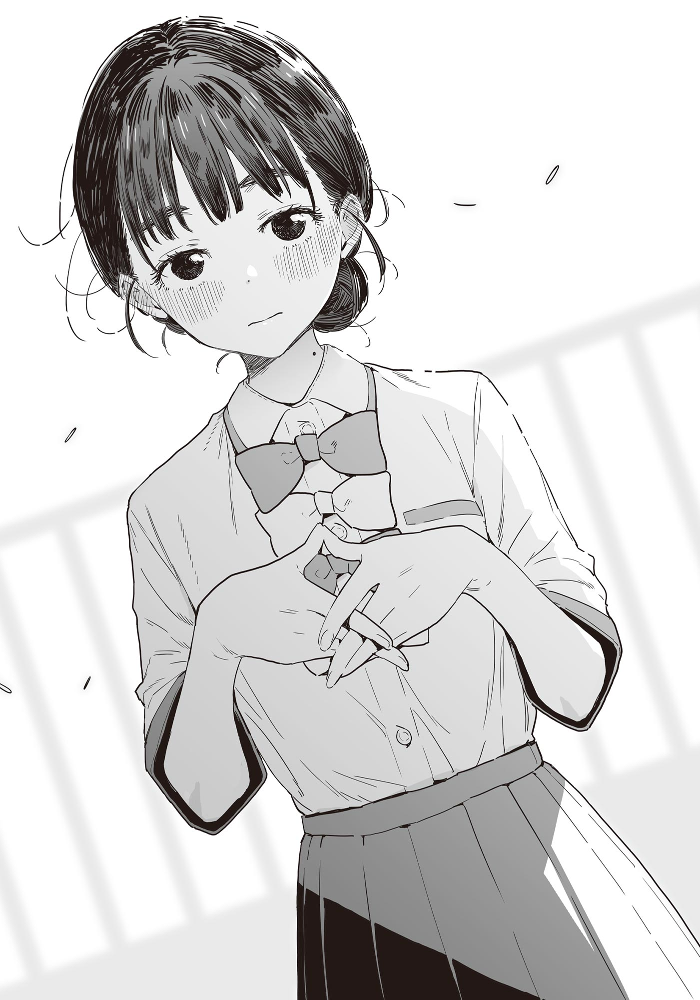

# Ch.124 — เล่ม 8 บทที่ 4-3

Ch.124 — เล่ม 8 บทที่ 4-3

By Monica

Published: 2025-06-08T09:24:16Z

Source: https://www.nekopost.net/novel/14560/124

เล่ม 8 บทที่ 4-3

งานกีฬาสีของโรงเรียนมัธยมปลายสึวาบุกิจบลงแล้ว ทิ้งไว้เพียงรอยถลอกกับอาการปวดเมื่อยกล้ามเนื้อให้ผม

ภาพของเหล่าเชียร์ลีดเดอร์มากหน้าหลายตา, การวิ่งสุดชีวิตของอากิชิโอะ, การแสดงของชิราทามะ, แล้วก็ข้าวกล่องสุดพิเศษฝีมือคาจู──

ความทรงจำเหล่านั้นได้เปลี่ยนเป็นเพียงอดีตไปแล้ว ส่วนเรื่องที่ว่าทีมขาวหรือทีมแดงฝ่ายไหนเป็นผู้ชนะ ก็เริ่มจะเลือนหายไปจากความทรงจำอย่างรวดเร็ว

[ ใกล้ได้เวลาแล้วสินะ... ]

ผมเหลือบมองตัวเลขดิจิทัลบนนาฬิกาข้อมือแวบหนึ่ง ก่อนจะเหม่อมองท้องฟ้าที่เริ่มมืดลงอย่างเลื่อนลอย

──ตอนนี้ผมอยู่บนสะพานข้ามสระน้ำที่มุไกยามะโออิเกะ ใช้เวลาปั่นจักรยานจากโรงเรียนสึวะบุกิมาประมาณ 15 นาที

ครั้งล่าสุดที่มาที่นี่ก็เมื่อครึ่งปีก่อน นับตั้งแต่ตอนที่เทียร่าซังเรียกตัวมาเพื่อเก็บโดจินวายฉบับคนจริงที่รุ่นพี่สึคิโนกิเขียนเอาไว้

เมื่อเทียบกับตอนนั้นแล้ว ช่วงเวลากลางวันยาวนานขึ้นเยอะเลย

ท้องฟ้ายามเย็นที่เริ่มย้อมจากสีฟ้าเป็นสีน้ำเงินเข้ม ทำให้รู้สึกใจคอไม่สงบ คล้ายกับความรู้สึกไม่สบายใจและความปรารถนาที่ผสมปนเปกัน

มีบางสิ่งกำลังจะผ่านพ้นไป แต่กลับไม่รู้ว่ามันคืออะไร เป็นความรู้สึกที่คล้ายกับความร้อนรนในใจ

── เพิ่งจะอายุ 16 แต่ก็อยู่ปี2 แล้ว

ถ้อยคำที่ไม่ขัดแย้งกันแต่กลับตรงกันข้าม ผุดขึ้นมาในหัวแล้วก็หายไป

แต่ว่า ทำไมถึงนัดเจอกันที่นี่ แทนที่จะเป็นโต๊ะที่สวนหย่อมกลางโรงเรียนล่ะ

ตามที่เทียร่าซังว่าไว้ สวนหย่อมกลางโรงเรียนเหมาะกับการคุยความลับที่สุดเพราะเสียงไม่เล็ดลอดไปถึงคนรอบข้าง

นั่นหมายความว่าการเลือกสถานที่แห่งนี้──คือสิ่งที่ต้องปิดบังไม่ใช่การได้ยิน แต่เป็นการมองเห็น

แปลว่ามีบางอย่างที่ไม่อยากให้ใครเห็นสินะ

หัวข้อการแข่งวิ่งยืมของคงเป็นแค่เรื่องหลอก ส่วนเป้าหมายที่แท้จริงก็คือ──

[ ...สินค้าอนิเมะสินะ ]

เกือบลืมไปเลยเพราะเจอเรื่องน่าตกใจหลายอย่างถาโถมเข้ามา แต่เดิมทีสาเหตุที่ผมช่วยเทียร่าซังก็เพราะของจิกะเปียวนี่นา คงตั้งใจจะเอาของนั่นมาให้ผมแน่ๆ

จริงอยู่ที่การแลกเปลี่ยนสินค้าอนิเมะในโรงเรียนคงจะรู้สึกเกรงใจอยู่บ้าง แต่ก็ไม่เห็นต้องเรียกมาถึงที่นี่เลยนี่นา

ขณะที่ผมกำลังมองไปรอบๆ อย่างตื่นเต้น เด็กผู้หญิงในชุดเครื่องแบบของโรงเรียนสึวะบุกิก็เดินเข้ามาใกล้จากอีกฟากของสะพานยาวที่ทอดข้ามสระน้ำ เทียร่าซังนั่นเอง

บริเวณที่ผมอยู่บนสะพานค่อนข้างกว้างและมีม้านั่งตั้งอยู่ด้วย คราวก่อนผมเป็นฝ่ายเดินมาหาคุณเทียร่าซังที่รออยู่ตรงนี้สินะ...

ขณะที่กำลังนึกถึงเรื่องเก่าๆ อย่างคิดถึง เธอก็คงสังเกตเห็นว่าผมมองอยู่ เทียร่าซังจึงรีบวิ่งเหยาะๆ เข้ามาหา

[ ขอโทษที่ให้รอค่ะ พอดีงานมันยืดเยื้อนิดหน่อย ]

เทียร่าซังในชุดเครื่องแบบเอ่ยพลางใช้มือกดปอยผมที่หลุดลุ่ยลง แล้วก้มศีรษะเล็กน้อย

[ ไม่เป็นไร ผมก็เพิ่งมาถึงเหมือนกัน ]

เมื่อผมแกล้งพูดโกหกไปเล็กน้อย เทียร่าซังก็ยิ้มบางๆ แล้วกวักมือเรียกผม

[ นี่ ดูนั่นสิคะ นุคุมิซึซัง มีครอบครัวเป็ดอยู่ด้วยค่ะ ]

[ น่าจะเป็นเป็ดน้ำลายจุดนะ ช่วงนี้เป็นฤดูผสมพันธุ์ของมันพอดี ]

ทำไมเทียร่าซังวันนี้ดูอารมณ์ดีเป็นพิเศษจังแฮะ

เทียร่าซังพิงตัวกับราวสะพานแล้วชี้ไปยังครอบครัวเป็ด

[ เป็ดตัวใหญ่น่าจะเป็นแม่เป็ดนะคะ แล้วพ่อเป็ดไปไหนกันนะ ]

[ คงไม่อยู่แถวนี้หรอก เป็ดน้ำลายจุดตัวผู้พอตัวเมียวางไข่เสร็จก็จะหายตัวไปเลยน่ะ ]

[ อ๊ะ อย่างนั้นเหรอคะ... ]

อารมณ์ของเธอดร็อปลงไปเล็กน้อย เอ๊ะ หรือว่าผมเลือกหัวข้อสนทนาผิด...？

เทียร่าซังมองครอบครัวเป็ดที่กำลังว่ายน้ำอยู่บนผืนน้ำอย่างอารมณ์ดีอย่างน่าประหลาด

เอ... แล้วเมื่อไหร่จะได้ของจิกะเปียวล่ะเนี่ย

ขณะที่ยืนเหม่อมองเป็ดอยู่ข้างๆ กัน เสียงของเทียร่าซังก็ดังขึ้นมา

[ เรื่องตอนปราศัยสนับสนุน──จำเรื่องตอนที่เจอกันครั้งแรกได้ด้วยสินะคะ ]

[ ก็โดนดุตั้งแต่แรกครั้งแรกที่เจอกันแบบนั้น ลืมไม่ลงหรอกน่า ]

ตอนที่ผมไปส่งเอกสารที่ห้องสภานักเรียน เทียร่าซังก็เข้ามาต่อว่าผมทันทีที่เห็นป้ายชื่อ

เทียร่าซังยกมือขึ้นปิดปากพลางหัวเราะคิกคัก

[ ตอนนั้นต้องขอโทษด้วยนะคะ ตอนนั้นฉันคิดว่าชมรมวรรณกรรมเป็นแหล่งรวมคนประหลาดๆ น่ะค่ะ ]

[ อืม จะว่าไปมันก็ไม่ผิดซะทีเดียวนะ ]

[ โธ่ อุตส่าห์ช่วยพูดแก้ต่างให้แล้วแท้ๆ ทำเสียเรื่องหมดเลยนะคะ ]

เทียร่าซังหัวเราะออกมาโดยไม่คิดจะกลั้นไว้

[ ว่าไปแล้ว ก็เคยมีเรื่องที่เอาโดจินที่ไม่เหมาะสมเข้ามาในโรงเรียนด้วยสินะคะ ]

[ คนที่เอาเข้ามาไม่ใช่ผม แต่เป็นรุ่นพี่สึคิโนกิต่างหาก ]

[ อ๊ะ อย่างนั้นเหรอคะ ]

ผมได้แต่ยิ้มแหยๆ ให้กับการแสดงสีหน้าล้อเลียนของเทียร่าซัง

[ เทียร่าซังเองก็เปลี่ยนไปจากเมื่อก่อนนะ พูดเก่งขึ้นเยอะเลย ]

ผมพูดออกไปแล้วรอให้เทียร่าซังตบมุกกลับมา

...

.........เอ๊ะ? ไม่ตบมุกเหรอ?

เทียร่าซังท้าวข้อศอกทั้งสองข้างลงบนราวสะพานแล้วเงยหน้ามองผม

[ มีอะไรรึเปล่าคะ ? ขอโทษทีค่ะ พอดีไม่ได้ค่อยได้ฟัง ]

[ อ๊ะ เปล่า──แค่คิดว่าเทียร่าซังวันนี้ไม่โกรธเลยนะ ]

[ ถ้าไม่ทำเรื่องที่น่าโกรธ ฉันก็ไม่โกรธหรอกค่ะ ]

นั่นสินะ เป็นเหตุผลที่ถูกต้องที่สุด

หมายความว่าที่เทียร่าซังโกรธอยู่เสมอ เป็นเพราะผมพูดอะไรที่ทำให้เธอโกรธสินะ...

[ ไม่สิ แต่ว่า ถ้าไม่โดนเกลียดนิดๆหน่อยๆ มันก็รู้สึกไม่คุ้มค่าน่ะสิ ]

[ ที่แท้ก็แกล้งฉันมาตลอดเลยสินะคะ?! ]

แย่ล่ะ เผลอหลุดปากไปจนได้

เทียร่าซังทำแก้มป่องท่าทางโกรธเล็กน้อยแล้วเขยิบเข้ามาใกล้ผม

[ จุดนี้นี่แหละค่ะ! แกล้งกันแบบนี้อยู่เรื่อยเลย แถมยังไม่เคยตั้งใจฟังเรื่องของฉันเลยใช่มั้ยล่ะคะ ]

[ ไม่ๆ ไม่ได้แกล้งเทียร่าซังซะหน่อย ]

[ ก็บอกว่าอย่าเรียกด้วยชื่อจริงไงคะ! ]

เอาล่ะ กลับมาเป็นเหมือนเดิมแล้ว

เทียร่าซังถอนหายใจอย่างระอา

[ ทั้งที่อุตส่าห์ตั้งใจจะมาขอบคุณเรื่องที่ผ่านมาแท้ๆ พังหมดเลยค่ะ ]

[ เอ๋ งั้น จะไม่ขอบคุณแล้วเหรอ ? ]

[ ค่ะ น่าเสียดายนะคะ ]

ใบหน้าที่แสร้งทำเป็นบูดบึ้งนั้นอยู่ได้ไม่นาน

เทียร่าซังกลับไปวางข้อศอกทั้งสองข้างบนราวสะพานอีกครั้งโดยไม่คิดจะปิดซ่อนริมฝีปากที่เริ่มคลี่ยิ้ม

[ ...ที่จริงแล้ว ฉันรู้สึกขอบคุณนุคุมิซึซังจริงๆ นะคะ ยอมทนกับความเอาแต่ใจของฉันแบบนี้ แถมยังช่วยสู้ศึกเลือกตั้งประธานนักเรียนด้วยกันอีก ]

[ แต่สุดท้าย คนที่ได้ซีนดีๆ ไปก็คือรุ่นพี่ชิกิยะนี่นะ ]

[ ค่ะ เรื่องนั้นฉันก็ตกใจเหมือนกัน ]

ความรู้สึกห่วงใยที่เทียร่าซังมีต่อรุ่นพี่ชิกิยะ

คนคนนั้นคงจะเป็นคนที่ไม่ถนัดในการแสดงออกพอๆ กับเทียร่าซังแน่ๆ

เพราะอย่างนั้น ถึงได้แสดงความรู้สึกออกมาในรูปแบบนั้นสินะ──

ขณะที่ผมกำลังครุ่นคิด เทียร่าซังก็ท้าวคางจ้องมองมา

[ ...กำลังคิดถึงเรื่องรุ่นพี่ชิกิยะอยู่เหรอคะ? ]

[ เอ๊ะ? ก็เมื่อกี้เพิ่งพูดถึงนี่นา ]

[ คิดถึงเรื่องของรุ่นพี่มากกว่าฉันที่อยู่ตรงนี้สินะคะ ]

เทียร่าซังหันหน้าหนีไปทางอื่นท่าทางงอนๆ

...ทำไมจู่ๆ ถึงทำตัวเหมือนแฟนสาวน่ารำคาญแบบนี้ล่ะเนี่ย

ผมท้าวข้อศอกลงบนราวระเบียงแบบเดียวกับเธอที่อยู่ข้างๆ แล้วเหม่อมองท้องฟ้าที่เริ่มมืดลง

[ ที่สภานักเรียน ซากุราไรคุง จะมาเป็นรองประธานสินะ ]

[ ค่ะ เขารับตำแหน่งแล้วค่ะ แต่ก็อยากได้คนมาช่วยงานเพิ่มอีกสักคนนะคะ? ]

เทียร่าซังส่งสายตามีนัยมาให้ผม

[ เอ่อ ผมคงจะยากหน่อยล่ะมั้ง เพราะเป็นประธานชมรมวรรณกรรมแล้ว...นี่ไงล่ะ มันติดเรื่องข้อบังคับน่ะนะ? ]

[ อาระ , รู้จักศัพท์ยากๆ ด้วยสินะคะ ]

[ ก็แน่สิ หรือว่าไม่ต้องให้สอนวิชาภาษาญี่ปุ่นแล้วเหรอ? ]

พอผมแกล้งพูดใจร้ายเล็กน้อย เทียร่าซังก็โชว์ฟันขาวให้เห็นแล้วหัวเราะออกมา

[ ค่ะ ไม่เป็นไรเลย กลับกันฉันจะเป็นคนสอนให้เอง ]

[ งั้นก็ฝากตัวด้วยนะ ]

เราคุยเรื่องไร้สาระกัน แล้วก็หัวเราะออกมานิดหน่อย

ผมเพิ่งจะรู้สึกตัวว่า แม้จะทำแค่นั้นแต่กลับรู้สึกสบายใจอย่างน่าประหลาด

ช่วงเวลาที่สายตาของเราสองคนสบกันเริ่มมีมากขึ้น และคำพูดก็น้อยลงตามส่วน

ผมรู้สึกจั๊กจี้คล้ายกับความกระอักกระอ่วนใจ จึงผละตัวออกจากราวสะพาน

[ เอ่อ...ลมเริ่มเย็นแล้วนะ ]

[ นั่นสินะคะ อากาศเย็นลงนิดหน่อยแล้ว ]

เอาล่ะ กลับก่อนที่ฟ้าจะมืดดีกว่า

ขณะที่ผมกำลังจะออกเดิน เทียร่าซังก็เรียกผมไว้โดยไม่ทันตั้งตัว

[ ขอโทษค่ะ ฉันลืมไปเลย ]

อ๊ะ ใช่แล้วสิ ลืมเรื่องสำคัญไปเลย...!

[ ของจิกะเปียว── ]

[ หัวข้อการแข่งวิ่งยืมของ สัญญากันไว้ว่าจะเดี๋ยวจะบอกให้สินะคะ ]

...เอ๊ะ? เรื่องนั้นผมไม่ค่อยสนใจเท่าไหร่หรอกนะ

เทียร่าซังยื่นเศษกระดาษแผ่นเล็กๆ มาให้ผมที่กำลังงุนงง

[ เชิญค่ะ ]

[ เอ๊ะ อ๊ะ ขอบคุณ ]

ก็ไม่ใช่เรื่องที่ต้องปฏิเสธนี่นา

คงเพราะไม่สามารถพูดขอบคุณออกมาได้ตรงๆ ถึงได้ใช้เรื่องนี้เป็นข้ออ้างในการเรียกตัวมา

ผมมองกระดาษแผ่นนั้นด้วยความรู้สึกสบายๆ แต่แล้วถ้อยคำที่เขียนอยู่บนนั้นก็ทำให้ผม──แทบหยุดหายใจไปชั่วขณะ

...

.........

..................นี่มันหัวข้อการแข่งวิ่งยืมของใช่มั้ย

คำที่เขียนอยู่บนกระดาษคือ──คนที่ชอบ

เอ่อ การที่สุ่มได้หัวข้อนี้ แล้วเทียร่าซังมาพาตัวผมไป หมายความว่า...？

ดวงตาของเทียร่าซังจ้องมองมาที่ผมซึ่งสับสนไปหมดแล้ว

เทียร่าซังประสานนิ้วมือไว้ตรงหน้าอก ด้วยสายตาเหมือนกำลังอธิษฐาน

และแล้ว ราวกับตัดสินใจอะไรบางอย่างได้ เธอก็เปิดปากพูด

[ ชอบนะคะ นุคุมิซึซัง ]

เป็นการสารภาพรักที่กะทันหันและไม่ทันให้ตั้งตัว

[ เอ๊ะ เอ่อ... ]

เดี๋ยวก่อนสิ จะด่วนสรุปว่าเป็นการสารภาพรักยังเร็วไป

ในพล็อตเลิฟคอมเมดี้ นี่มันคืออีเวนต์ที่เกิดจากความเข้าใจผิด──

[ แน่นอนว่าในความหมายเชิงความรักค่ะ ช่วยคบกับฉันได้มั้ยคะ? ]

ไม่ นี่มันคือการสารภาพรัก

ไม่ใช่ความเข้าใจผิด หรือได้ยินผิดเพี้ยนไป

ผม──กำลังโดนสารภาพรัก

เหตุการณ์ที่เคยเห็นแต่ในไลท์โนเวลกำลังเกิดขึ้นตรงหน้า ในฐานะที่ผมเป็นตัวละครในนั้น

จะ...เป็นผมจริงๆ เหรอ?

เทียร่าซังเป็นคนที่อยู่ด้วยแล้วสนุก หน้าตาก็น่ารัก

ไม่ว่าจะคิดยังไง เธอก็เป็นคนที่ดูดีเกินไปสำหรับผม

แค่ตอบว่า [ ครับ ] เพียงคำเดียว ผู้หญิงที่เคยมีตัวตนอยู่แค่ในจินตนาการก็จะมาเป็นของผม──

[ เอ่อ...เอ่อ... ]

ในที่สุดผมก็ขยับริมฝีปากที่แห้งผากของตัวเอง

[ คือว่า …. ผมน่ะ คิดว่าบาโซริซังเป็นเพื่อนมาตลอดน่ะครับ ]

...หา?

[ เพราะมันกะทันหันไปเลยตกใจน่ะ เรื่องนั้น ]

...ผมกำลังพูดอะไรอยู่เนี่ย

เทียร่าซังเป็นคนดีแล้วก็น่ารัก อยู่ด้วยกันก็สนุก

ตอนแรกอาจจะดูเข้าถึงยากไปหน่อย แต่พอได้รู้จักกันมากขึ้น รอยยิ้มของเธอก็ช่างดูไร้เดียงสาเหลือเกิน

[ เพิ่งเคยมีคนมาพูดอะไรแบบนี้เป็นครั้งแรก สงสัยเลยกำลังสับสนอยู่ล่ะมั้ง ]

เวลาที่อยู่ด้วยกันสองต่อสองก็รู้สึกสบายใจ

ถ้าได้คบกันล่ะก็คงจะ──สนุกแน่ๆ

ไม่มีเหตุผลที่จะปฏิเสธเลยสักนิด เพราะฉะนั้นผมแค่พูดคำว่า [ ครับ ] ออกไปคำเดียวก็พอ

แค่เพียงเท่านั้น ก็จะได้คบกับเทียร่าซังแล้ว──

[ เอ่อ ผมน่ะ ]

ผมเอ่ยค้างไว้แค่นั้น ก่อนจะเงียบไปเพราะหาคำพูดที่จะพูดต่อไม่เจอ

...ทำบ้าอะไรของผมอยู่เนี่ย โอกาสแบบนี้อาจจะไม่มีครั้งที่สองแล้วก็ได้นะ

ขณะที่ผมกำลังจะเค้นคำพูดอะไรบางอย่างออกไปนั้นเอง

[ เดี๋ยวก่อนค่ะ! ]

เทียร่าซังก็พูดขัดขึ้นมา

[ เอ่อ คือว่า ]

[ กะทันหันเกินไปสินะคะ! ไม่สิ ที่จริงฉันเองก็เหมือนยังไม่ได้เตรียมใจเท่าไหร่ คิดว่าถ้าสารภาพรักออกไปแล้วจะทำใจได้ แต่เอาเข้าจริงก็รับไม่ค่อยไหวเหมือนกันค่ะ── ]

เทียร่าซังยกมือกุมหน้าอก แล้วทรุดตัวลงนั่งยองๆ กับพื้น

[ เป็นอะไรรึเปล่า? ]

[ ....ค่ะ เอ่อ นุคุมิซึซัง ]

เทียร่าซังที่กำลังนั่งยองๆ สูดหายใจลึกๆ อยู่ ค่อยๆ เงยหน้าขึ้น

[ ──เรามาเริ่มจากการเป็นเพื่อนกันก่อนมั้ยคะ? ]

เธอพูดยังงั้นแล้วยื่นมือมาหาผม

[ เป็นเพื่อนเหรอ...ผมว่าตอนนี้พวกเราก็เป็นเพื่อนกันอยู่นะ ]

[ ดีใจนะคะที่นุคุมิซึซังคิดว่าฉันเป็นเพื่อน แต่ว่า ]

เทียร่าซังจับมือผมไว้ แล้วลุกขึ้นยืนอย่างโซเซ

[ อยากจะให้เราคุยกันสบายๆ มากขึ้น หรือไปเที่ยวด้วยกันได้ ถ้าทำแบบนั้นได้ฉันจะดีใจมากเลยค่ะ ]

[ หา แค่นั้นเองเหรอครับ ]

เมื่อผมตอบกลับไปอย่างหมดแรง เทียร่าซังก็ส่งยิ้มที่อ่อนโยนมาให้

[ และก็...ถ้าวันหนึ่ง มาชอบฉันได้ก็คงจะดีนะคะ ]

── เหมือนโดนโจมตีแบบไม่ทันตั้งตัว

คงไม่มีคำไหนจะเหมาะไปกว่านี้

รอยยิ้มของเทียร่าซังที่รอคอยอยู่ปลายทางของการเลื่อนคำตอบออกไป

รอยยิ้มนั้นมันเจิดจ้าเกินไปสำหรับผม

ผมรู้สึกเจ็บที่หน้าอก

ต่อหน้าผมที่กำลังหลงทางอยู่ในความรู้สึกของตัวเอง เทียร่าซังก็ใช้ฝ่ามือพัดใบหน้าที่แดงก่ำของตัวเองไปมา

[ เพิ่งจะมาตื่นเต้นเอาตอนนี้เองค่ะ หวา ฉันนี่พูดอะไรที่บ้าๆออกไปสินะคะเนี่ย ! ]

ผมมองภาพนั้นพลางเกาแก้มอย่างกระอักกระอ่วน

[ เอ่อ เรื่องที่สารภาพรักน่ะ ผมดีใจมากเลย เพราะงั้น จะเอาไปคิดจริงจังดูนะ... ]

พอผมเค้นคำพูดออกมาได้เท่านั้น เทียร่าซังก็เผยอยิ้มอย่างเขินอาย

[ ค่ะ จะรอฟังข่าวดีนะคะ แต่ว่า ฉันเองก็เป็นผู้หญิงเหมือนกัน เพราะงั้น ]

เทียร่าซังประสานนิ้วไว้ด้านหลัง ก่อนจะเงยหน้ามองผมแล้วพูดต่อว่า

[ ── รีบมาชอบฉันเร็วๆ จะดีกว่านะคะ? ]
