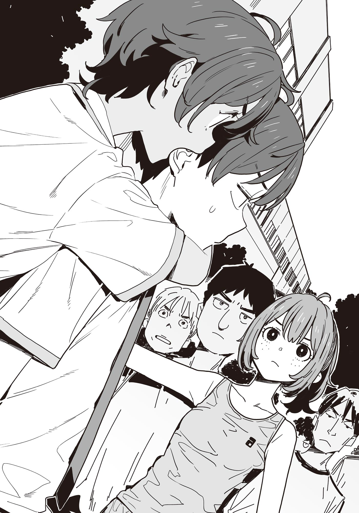

# Ch.126 — เล่ม 8.5 บทที่ 1-1

Ch.126 — เล่ม 8.5 บทที่ 1-1

By มนก.

Published: 2026-02-21T08:15:34Z

Source: https://www.nekopost.net/novel/14560/126

เป้าหมายคือสาวผิวแทน

งานกีฬาสีจบลงแล้ว อีเวนต์ใหญ่สุดท้ายของเทอมหนึ่ง——การสอบปลายภาคกำลังคืบคลานเข้ามาในสัปดาห์หน้า

หลังเลิกเรียน ผมเดินมุ่งหน้าไปยังอาคารเรียนฝั่งตะวันตกพลางครุ่นคิดเรื่องต่างๆ ไปด้วย

ผลการเรียนที่ร่วงไม่หยุด , ยานามิที่พักนี้ดูจะชอบหาเรื่องกันแปลกๆ, โคมาริที่แอบติดต่อกับใครบางคนแบบลับๆ ล่อๆ, คาจูที่ชอบละเมอมุดเข้ามาในฟูกนอน——หมู่นี้มีเรื่องให้ต้องกังวลเยอะเหลือเกิน

แถมเรื่องที่เทียร่าซังมาสารภาพรักนั่นอีก ในสายตาคนทั่วไป นี่มันคงเป็นสถานการณ์ที่เรียกว่ากั๊กเอาไว้สินะ?

......ไม่สิ แต่ทางฝ่ายนั้นเป็นคนขอเลื่อนเวลาออกไปเองนี่นา ผมไม่ผิดสักหน่อย อื้ม

แม้เรื่องกลุ้มใจจะยังไม่หมดไป แต่ผมก็จับมันยัดใส่ลิ้นชักในใจเอาไว้ก่อน แล้วเร่งฝีเท้าให้เร็วขึ้น

ผมมีนัดติวหนังสือกับยานามิและโคมาริที่ห้องชมรมวรรณกรรม

[ นุคุมิซึซัง จะไปชมรมวรรณกรรมเหรอคะ ]

คนที่ทักทายด้วยน้ำเสียงที่ฟังดูร่าเริงผิดปกติ คือประธานนักเรียนโรงเรียนซึวาบุกิ บาโซริ เทียร่า

เธอวิ่งเหยาะๆ เข้ามาเทียบข้างๆแล้วเริ่มเดินไปพร้อมกันในจังหวะเดียวกับผม

แม้จะแอบหวั่นไหวที่จู่ๆคนที่อยู่ในความคิดก็โผล่มาแต่ผมก็แสร้งทำเป็นนิ่งเฉยแล้วเอ่ยปากตอบ

[ อ่า กะว่าจะไปติวหนังสือที่ห้องชมรมนิดหน่อยน่ะ บาโซริซังจะไปห้องสภานักเรียนเหรอ? ]

[ วันนี้รุ่นพี่โฮโคบารุกับรุ่นพี่ชิกิยะ สัญญาว่าจะช่วยดูหนังสือให้ค่ะ ]

เทียร่าซังพูดอย่างดีใจ พลางกอดกระเป๋านักเรียนไว้แนบอก

[ ถ้าเป็นสองคนนั้นก็หายห่วงได้เลย ดูจะพึ่งพาได้มากกว่าผมเยอะ ]

[ นั่นสินะคะ ไม่เหมือนใครบางคน แถมไม่บังคับให้ใส่หูแมวด้วย ]

นั่นเธอเป็นคนทำเองเลยไม่ใช่เรอะ แล้วถ้าเป็นชิกิยะซังล่ะก็ คงไม่จบแค่หูแมวแน่

ผมกำลังจะเถียงกลับ แต่พอเห็นนักเรียนคนอื่นเดินสวนมาข้างหน้า ก็เผลอเงียบไปโดยอัตโนมัติ

[ เป็นอะไรไปคะ จู่ๆ ก็เงียบเชียว ]

[ เปล่า ก็เห็นมีนักเรียนคนอื่นอยู่ด้วย ]

พอได้ยินผมพูดแบบนั้น เทียร่าซังก็แลบลิ้นเลียริมฝีปากเบาๆ

[ ——หรือว่า ตั้งใจจะพูดเรื่องที่ให้คนอื่นได้ยินไม่ได้เหรอคะ? ]

[ ......บาโซริซัง ไอ้มุขเมื่อกี้มันก็ให้คนอื่นได้ยินไม่ได้เหมือนกันไม่ใช่เหรอ? ]

ผมหยุดเดินพลางฟังเสียงหัวเราะของเทียร่าซัง

การจะไปอาคารฝั่งตะวันตกที่มีห้องชมรมอยู่ จำเป็นต้องเดินออกไปทางทางเชื่อมตึกจากตรงนี้

[ งั้น ขอแยกไปทางนี้นะ ]

[ ถ้าไม่รังเกียจ นุคุมิซึซังจะไปด้วยกันไหมคะ? ]

ติวหนังสือกับคู่หูอดีตสภานักเรียนปี 3 งั้นเหรอ เอาจริงนะ... น่าสนใจมาก

[ เอ่อ พอดีมีนัดไว้แล้วน่ะ ]

[ แหม โดนหักอกซะแล้ว ]

เทียร่าซังพูดทีเล่นทีจริง ก่อนจะยื่นหน้าเข้ามาใกล้ๆ อย่างกะทันหัน

[ ......ว่าแต่ พักนี้ไม่ยอมเรียกชื่อต้นฉันเลยนะคะ ]

[ เอ๊ะ ]

พอเห็นผมพูดไม่ออก เธอก็หัวเราะคิกคักที่ข้างหู ก่อนจะพลิกตัวหันกลับไป

[ งั้นขอตัวเท่านี้นะคะ พยายามทำข้อสอบให้เต็มที่นะ ]

[ อะ อื้ม ]

เทียร่าซังโบกมือเล็กๆ แล้วหมุนตัวเดินจากไป

ผมโบกมือตอบแผ่นหลังนั้น พลางขบคิดถึงความเปลี่ยนแปลงในจิตใจช่วงนี้

——การสารภาพรัก

ถึงจะบอกว่าขอเก็บไปพิจารณาก่อน แต่ก็ถือว่ามีอีเวนต์ที่สั่นคลอนความสัมพันธ์ระหว่างผมกับเทียร่าซังเกิดขึ้นแล้ว

หลังจากนั้น เธอก็เข้ามาคุยด้วยบ่อยๆ ในฐานะเพื่อน แต่ถึงจะเป็นการพูดคุยเหมือนที่ผ่านๆ มา ผมกลับรู้สึกถึงความเปลี่ยนแปลงเล็กๆ ในใจตัวเอง

——อีกฝ่ายมีความรู้สึกดีๆ ให้เรา

แค่ความจริงข้อนั้น ก็ต้องยอมรับเลยว่ามันทำให้ระยะห่างของหัวใจใกล้ชิดกันมากขึ้น

เอาเถอะ พูดง่ายๆ ก็คือ...

การได้คุยกับคนที่ชอบเราเนี่ย มันก็ค่อนข้างสนุกดีเหมือนกันแฮะ——ก็คงประมาณนั้นแหละมั้ง

◇

พอเปิดสมุดโน้ตในห้องชมรมวรรณกรรม ผมก็สูดหายใจเข้าลึกๆ เพื่อเรียกความมุ่งมั่น

ถึงโดยส่วนตัวผมจะไม่ค่อยเห็นด้วยกับระบบการจับกลุ่มติวหนังสือที่ดูไม่มีประสิทธิภาพเท่าไหร่ แต่จะให้ถูกมองว่าหนีหน้าก็คงไม่ได้

โดยเฉพาะโคมาริที่เพิ่งแซงอันดับคะแนนผมไปในการสอบวัดระดับเมื่อวันก่อน ผมเลยจำเป็นต้องมีข้ออ้างว่าเตรียมตัวสอบมาอย่างดีเพื่อไม่ให้แพ้ติดกันสองครั้ง——

พอเริ่มติวกันไปได้ไม่นาน โคมาริที่กำลังค้นกระเป๋าอยู่ก็ส่งเสียงทักขึ้นมา

[ นะ นุคุมิซึ นายมีคู่มือวิชาประวัติศาสตร์โลกไหม ]

[ อ่า อยู่ตรงนี้น่ะ แต่ประวัติศาสตร์โลกมันสอบช่วงครึ่งหลังไม่ใช่เหรอ ]

โคมาริคว้าคู่มือของผมไป แล้วส่งสายตาเอือมระอามาให้

[ ขะ ขอบเขตการสอบรอบนี้ ไม่ใช่เรื่องเล่นๆนะ ถ้าอ่านคืนเดียวก่อนสอบ จบเห่แน่ ]

[ เห , มันขนาดนั้นเลยเหรอ ]

พอผมทำเนียนจะหยิบหนังสือคืน โคมาริก็รีบขยับหนีอย่างไว

[ ยานามิซัง มีคู่มือประวัติศาสตร์โลกไหม? ]

ช่วยไม่ได้แฮะ พอผมลองหันไปถาม ยานามิก็ไม่อยู่ตรงที่นั่งเมื่อกี้ซะแล้ว

แต่เธอกำลังเปิดตู้เย็นที่มุมห้องชมรม แล้วจ้องเขม็งเข้าไปข้างใน

[ ยานามิซัง อย่าเปิดตู้เย็นทิ้งไว้สิ ]

[ ......พุดดิ้ง ]

ยานามิพึมพำแค่นั้นแล้วก็นิ่งค้างไปอีกรอบ

ความสำเร็จในการลดน้ำหนักจากคดีขนมชิราทามะกลายเป็นเกียรติยศในอดีตไปแล้ว ยานามิเข้าสู่ช่วงไดเอทครั้งที่เท่าไหร่ไม่รู้ของปีนี้

ทฤษฎีลดความหนักคราวนี้คือ การจ้องมองของกินเพื่อให้ร่างกายเข้าใจผิดและกระตุ้นการเผาผลาญ แค่เลิกพูดว่ากินแล้วผอมก็ถือว่ามีการพัฒนาขึ้นแล้วล่ะมั้ง

[ จ้องมาขนาดนี้แล้ว ต่อให้กินเข้าไปร่างกายอาจจะไม่ทันรู้ตัวแล้วก็ทำให้ไม่อ้วนก็ได้นะ ]

[ เดี๋ยวก็อ้วนหรอก มาทางนี่เลย ]

ยานามิ ไม่ได้โตขึ้นเลยสักนิด

เธอถอนหายใจพลางปิดประตูตู้เย็น

[ นุคุมิซึคุง ขอบเขตข้อสอบรอบนี้มันกว้างไปหน่อยไหม? ตอนปี 1 อุตส่าห์อ่านไปตั้งขนาดนั้น น่าจะออกซ้ำอีกสักรอบนะ ]

[ ถ้าออกแบบนั้น ก็แสดงว่าเรียนซ้ำชั้นไม่ใช่รึไง ]

รู้งี้ไปห้องสภานักเรียนซะก็ดี

ถึงจะมารู้สึกเสียดายทีหลังก็ไม่ช่วยอะไร แต่ก็จริงที่พอขึ้นปี 2 ขอบเขตการสอบก็กว้างขึ้น ผมพอจะเข้าใจความรู้สึกของยานามิที่จ้องพุดดิ้งในตู้เย็นอยู่เหมือนกัน

[ จะว่าไป ไม่ได้ชวนชิราทามะซังมาเหรอ ]

[ เห็นบอกว่ามีติวที่ห้องสภานักเรียนน่ะ ]

ยานามิหันมาจ้องผมเขม็ง

[......หรือว่า อยากติวกับชิราตามะจังงั้นเหรอ?]

[ ไม่ใช่สักหน่อย ก็แค่ชิราทามะซังชอบช่วยเก็บยางลบให้ ]

[ ช่วยอย่าเอาเรื่องส่วนตัวมาปนกับเรื่องงานหน่อยได้มั้ย คงมีแผนจะสอนหนังสือรุ่นน้องน่ารักๆ เพื่อโชว์เท่ล่ะสิ? ]

[ เหรอ สอนหนังสือแล้วจะดูเท่ขึ้นงั้นเหรอ ]

[......นุคุมิซึคุง ช่วงนี้ความตระหนักในฐานะประธานชมรมมันชักจะหย่อนยานไปหน่อยไหม? ]

ตุบ ยานามิทิ้งตัวลงนั่งเก้าอี้ฝั่งตรงข้าม

[ ฟังนะ ทั้งการทำตัวระริกระรี้กับรุ่นน้องผู้หญิง หรือไปทำตัวระริกระรี้ท่ามกลางสาวๆในห้องสภานักเรียนน่ะ ในฐานะตัวแทนชมรมวรรณกรรม ถือว่าผิดกฎระเบียบว่าด้วยความประพฤติอย่างแรง ไม่ไหวเลยจริงๆ ]

[ ทั้งสองอย่างมันก็เกี่ยวกับชิราทามะซังไม่ใช่เรอะ การดูแลรุ่นน้องในชมรมก็เป็นหน้าที่ของรุ่นพี่นะ ]

[ ก็ อาจจะใช่แหละ ]

ก๊อก ก๊อก ก๊อก ยานามิเริ่มเคาะโต๊ะด้วยปลายนิ้ว

เธอลังเลอยู่ครู่หนึ่ง ก่อนจะเบือนหน้าหนีแล้วเอ่ยปาก

[ นี่......นุคุมิซึคุง ช่วงนี้กับบาโซริซังเป็นไงบ้าง ]

[ เอ๊ะ เป็นไงเนี่ยนะ? ]

ทำไมจู่ๆ ถึงวกมาเรื่องนี้......?

เรื่องที่ผมโดนเทียร่าซังสารภาพรักน่าจะยังไม่มีใครรู้ ขนาดเรื่องที่บึงมุไคยามะโออิเกะ คาจูหรืออาซากุโมะซังยังตามไปสืบไม่ได้ ยานามิไม่มีทางรู้แน่ๆ

[ เลือกตั้งสภานักเรียนก็จบแล้ว ก็แค่ยืนคุยกันบ้างเป็นครั้งคราวนั่นแหละ อื้ม ]

ผมพยายามซ่อนความประหม่า พลางยกชาเย็นขึ้นดื่ม

[ แถมช่วงนี้ นายไม่ได้เรียกชื่อต้นบาโซริซังแล้วนี่? ]

[ ไม่รู้สิ เธอสังเกตขนาดนั้นเลยเหรอ ]

ก๊อกก๊อกก๊อกก๊อกก๊อก ความเร็วในการเคาะโต๊ะเพิ่มขึ้น

ทำไมผมต้องมาโดนยานามิใช้อำนาจกดขี่ด้วยแล้วทำไมผมต้องมานั่งเลิ่กลั่กแบบนี้ด้วยเนี่ย

พอเงยหน้าขึ้นกะจะโต้ตอบความไม่สมเหตุสมผล ก็ไปปะทะกับสายตาที่ดูอารมณ์เสียของยานามิเข้าจังๆ

[ อะไร? ]

[ เปล่า แค่คิดว่าชานี่อร่อยดีเนอะ ]

......ไม่ไหว โดนออร่าข่มซะอยู่หมัด

ขณะที่ผมกำลังจ้องมองถ้วยชาที่ว่างเปล่า ก็มีเสียงพับหนังสือปิดดังปัง

[ ระ รีบๆ ติวซักทีเถอะ ]

[[......ครับ / ค่าา ]]

ผมกับยานามิประสานเสียงตอบรับคำพูดที่ถูกต้องที่สุดของโคมาริโดยไม่รู้ตัว

จริงด้วย ไม่ใช่เวลามาทำอะไรแบบนี้สักหน่อย

ทว่า ทันทีที่เริ่มกลับมาติวเพื่อหลบสายตาของโคมาริ ประตูห้องชมรมก็ถูกเปิดออกอย่างแรง

[ เลม่อนอยู่ไหม?! ]

เจ้าของเสียงตะโกนที่พุ่งพรวดเข้ามาคือนักเรียนหญิงผมทรงหางม้าสั้น

เอ่อ คนคนนี้คือ——คุราตะซัง ประธานชมรมกรีฑาหญิงสินะ

ประธานคุราตะกวาดสายตาไปรอบห้องชมรม ก่อนจะไหล่ตกอย่างผิดหวัง

[ อ้าว นึกว่าอยู่ที่นี่ซะอีก แปลกจังน้า ]

[[[..................]]]

ประธานคุราตะมองพวกผมที่นั่งเงียบสลับไปมา พลางเอามือแตะหน้าผากแล้วมองขึ้นไปบนเพดาน

[ แย่จัง ไปอยู่ที่ไหนกันนะ ]

เหลือบ เหลือบนิดๆ ประธานคุราตะแอบมองมาอย่างมีจริตจะก้าน

......นี่มันสถานการณ์ที่ถ้าไม่เลือกคำสั่งชวนคุยเนื้อเรื่องก็จะไม่เดินสินะ

[ เอ่อ มีเรื่องอะไรเหรอครับ ]

ในฐานะตัวแทน ผมจึงเอ่ยปากถาม ประธานคุราตะยักไหล่กว้าง

[ ก็สอบปลายภาคใกล้เข้ามาแล้วใช่มั้ยล่ะ? ทางชมรมกรีฑาหญิงเลยระดมพลช่วยกันติวเข้มให้เลมอนน่ะสิ ]

[ ......แล้วเธอก็หนีไปงั้นเหรอครับ? ]

ประธานคุราตะพยักหน้าหงึกหงัก

[ ก็นะ ยากิชิโอะก็เป็นแบบนั้นตลอดแหละครับ ถึงจะสอบตกก็น่าจะมีเรียนซ่อมไม่ใช่เหรอครับ? ]

[ ก็ใช่นะ ถ้าผลสอบยังเหมือนเดิม ก็มีตารางเรียนซ่อมพิเศษรออยู่——แบบอัดแน่นตลอดช่วงปิดเทอมหน้าร้อนเลยล่ะ ]

งั้นก็ดีแล้วนี่นา อย่างน้อยยากิชิโอะก็สบายใจเรื่องสอบตก——

[ ......เดี๋ยวนะครับ ถ้าจำไม่ผิด ยากิชิโอะต้องไปแข่งอินเตอร์ไฮ ]

[ ช่วงปิดเทอมหน้าร้อนไง ]

หมายความว่า ยากิชิโอะจะอดไปแข่งอินเตอร์ไฮงั้นเหรอ......?

ประธานคุราตะ ไม่ใช่เวลามาทำหน้าภูมิใจนะครับ

[ เข้าใจแล้วครับ แต่ว่าทำไมต้องมาหาพวกเรา ]

[ ใช่แล้วล่ะ อยากให้ช่วยจับตัวเลม่อนหน่อยน่ะ! ]

แปะ ประธานคุราตะพนมมือไหว้

[ เจอตัวตั้งหลายรอบแล้ว แต่ก็โดนหนีไปได้ตลอดเลย ถ้าเป็นพวกเด็กๆ ชมรมวรรณกรรม ยัยนั่นน่าจะตายใจ เผื่อจะมีลุ้นบ้างไง? ]

พูดซะเหมือนจะให้ไปจับแมวจรจัดเลยแฮะ

[ เอ่อ เรื่องนั้นต้องถามความเห็นสมาชิกคนอื่นก่อน......]

[ ถ้าช่วยจะเลี้ยงโยคังของร้านคินุโยะเลย ถ้าจับตัวได้ให้เพิ่มอีกแท่ง ]

[ ตกลงค่ะ! ]

ยานามิยกมือตอบรับอย่างร่าเริง ห้ามไม่ทันซะแล้ว

จังหวะที่ผมกับโคมาริถอนหายใจพร้อมกัน ที่หางตาก็พลันเห็นอะไรบางอย่างส่องแสงวาบ

ที่อีกฝั่งของประตูที่เปิดอ้าซ่า ตรงทางเดินมีหน้าผากส่องแสงลึกลับ——ผู้หญิงที่โดนแบนจากชมรมวรรณกรรม อาซากุโมะ จิฮายะ นั่นเอง

[ ......อาซากุโมะซัง ได้ยินด้วยเหรอ? ]

[ ค่ะ ได้ยินหมดเลยค่ะ ]

อาซากุโมะซังยื่นนามบัตรให้ประธานคุราตะจากนอกห้อง

[ รุ่นพี่คุราตะ ชมรมกรีฑาหญิงสินะคะ ฉันทำธุรกิจแบบนี้อยู่ค่ะ ]

[ แก้ทุกปัญหาได้ปิ๊งปั๊ง ที่ปรึกษาฝ่ายสืบสวนโรงเรียนซึวาบุกิ......? ]

จะงงก็ไม่แปลกหรอก จู่ๆ นักเรียนหน้าแปลกที่ดวงตาและหน้าผากเปล่งประกายด้วยความอยากรู้อยากเห็น ก็ยื่นนามบัตรพิลึกๆ มาให้

ผมกระแอม แล้วเดินไปยืนแทรกกลางระหว่างรุ่นพี่คุราตะกับอาซากุโมะซัง

[ รุ่นพี่คุราตะครับ การยืมมือคนนอกในเรื่องส่วนตัวแบบนี้ มันจะดีเหรอครับ ]

[ แต่ว่า เด็กคนนี้เกี่ยวข้องกับชมรมวรรณกรรมไม่ใช่เหรอ? ]

เอ๊ะ ไปเอาข่าวลือมืดมนนั่นมาจากไหน

ประธานคุราตะโชว์นามบัตรให้ผมที่กำลังตกใจดู

[ ดูสิ ตรงนี้เขียนว่า คู่ค้าหลักคือสภานักเรียนและชมรมวรรณกรรม ]

......ก็จริงที่ไม่ใช่เรื่องโกหก พอไปพัวพันกับองค์กรต่อต้านสังคม บาดแผลมันก็จะติดตัวไปตลอดสินะ

พอเห็นผมพูดไม่ออก อาซากุโมะซังก็ก้าวเท้าขวาเข้ามาในห้องชมรม

[ เลม่อนซังก็เป็นเพื่อนสำคัญของฉันเหมือนกันค่ะ งานนี้เลยไม่คิดเงิน ]

[ ก็ขอบคุณหรอกนะ แต่จะใช้วิธีไหนตามหาล่ะ?]

พอได้ยินดังนั้น อาซากุโมะซังก็ยิ้มหวาน แล้วก้าวเท้าซ้ายเข้ามาในห้องชมรมบ้าง

[ ฉันมีแผนค่ะ ก่อนอื่นดูที่หน้าจอนี้ก่อน ]

สมาร์ตโฟนที่อาซากุโมะซังหยิบออกมาแสดงผังอาคารเรียนโรงเรียนซึวาบุกิ

ยานามิที่ทำท่าไม่สนใจในตอนแรก ชะโงกหน้ามาดูหน้าจออย่างสนใจ

[ อาซากุโมะซัง นี่รู้ตำแหน่งของเลมอนจังได้เลยเหรอ? ]

[ ค่ะ สามารถใช้ AI คำนวณความน่าจะเป็นได้ค่ะ ]

อาซากุโมะซังเริ่มอธิบายอย่างกระตือรือร้น

[ คนเราจะมีจังหวะฝีเท้าและคลื่นเสียงที่แตกต่างกันค่ะ เราสามารถใช้ข้อมูลนั้นคาดการณ์ได้ว่าคุณเลมอนอยู่ตรงไหนของอาคารเรียน ]

ทำไมถึงดักฟังเสียงได้ทั่วโรงเรียน ผมสงสัยแต่ไม่กล้าถาม เพราะผมเองก็รักตัวกลัวตายเหมือนกัน

[ ตรงสีแดงเข้มในแผนที่ คือจุดที่มีความน่าจะเป็นที่เลม่อนซังจะอยู่สูงค่ะ ]

[ แบบนี้เลม่อนจังมีตั้ง 5 คนไม่ใช่เหรอ? แยกร่างได้เหรอ?]

จากข้อสงสัยของยานามิ อาซากุโมะซังเอานิ้วแตะคาง แล้วเอียงคออย่างน่ารัก

[จริงอยู่ที่ถ้ามีแค่ข้อมูลเสียง ความแม่นยำจะไม่ค่อยสูงเท่าไหร่ ดังนั้น]

อาซากุโมะซังหันไปหาประธานคุราตะที่กำลังอ้าปากค้าง

[อยากให้ทุกคนในชมรมกรีฑาหญิง ช่วยลงทะเบียนข้อมูลการพบเห็นคุณเลมอนหน่อยค่ะ]

[แค่ลงทะเบียนก็พอเหรอ]

[ ค่ะ ข้อมูลจะช่วยบีบความน่าจะเป็นให้แคบลง ทำให้คาดการณ์ตำแหน่งของคุณเลมอนได้แม่นยำสูง ยิ่งไปกว่านั้นยังสามารถวิเคราะห์เสียงด้วย AI แบบเรียลไทม์เพื่อเพิ่มความแม่นยำได้อีก การตีวงล้อมเพื่อจับกุมเลม่อนซังก็น่าจะเป็นไปได้ค่ะ ]

ประธานคุราตะเบิกตากว้างอย่างประทับใจ

[ โห สุดยอดไปเลย! แล้วต้องลงทะเบียนยังไงอ่ะ? ]

ปฏิกิริยาของประธานคุราตะทำให้หน้าผากของอาซากุโมะซังส่องประกายวิ้ง

[ ก่อนอื่นต้องให้ทุกคนในชมรมกรีฑาหญิงลงแอปตัวนี้ค่ะ! ]

[เข้าใจแล้ว!]

อย่าหาทำเลยครับ พูดจริงๆ

คิดในใจแต่ไม่ได้พูดออกไป แล้วก็นะยานามิ อย่าหยิบมือถือออกมาสิ

ในระหว่างที่ผมกับโคมาริกำลังห้ามยานามิ เหยื่อรายใหม่ก็ติดกับดักไปเรียบร้อย

[ นี่ มันขึ้นเตือนว่า <ไม่สามารถยืนยันความปลอดภัยของแอปนี้ได้> น่ะ ]

[ไม่ต้องสนใจค่ะ กด <ตกลง> ไปเลย]

[มันขออนุญาตเชื่อมต่อกับแอปอื่นๆ เพียบเลยแฮะ]

[ไม่ต้องสนใจค่ะ กด <ตกลง> ไปเลย]

[ อ้อ แบบนี้ก็ได้สินะ เดี๋ยวจะบอกพวกชมรมกรีฑาให้ด้วยนะ— ]

ทำได้แค่มองดูชมรมกรีฑาหญิงถูกรุกรานไปต่อหน้าต่อตาโดยไม่อาจทำอะไรได้

ถึงอย่างนั้นชมรมวรรณกรรมก็ยังรอดปลอดภัยมาได้ ขณะที่กำลังถอนหายใจอย่างโล่งอก ยานามิก็โชว์มือถือให้ดูด้วยท่าทางตื่นเต้น

[ นุคุมิซึคุง อันนี้สุดยอดเลย รู้ตำแหน่งเลมอนจังแบบเรียลไทม์เลยด้วย ]

[ยานามิซัง ลงแอปไปแล้วเรอะ?!]

[ฉะ ฉันห้ามแล้วนะ!]

อาซากุโมะซังส่งยิ้มหวานให้พวกเราที่กำลังลนลาน

[เอาล่ะค่ะ ทุกคนมาช่วยกันจับคุณเลมอนกันเถอะค่ะ!]

◇

เมื่อได้อาซากุโมะซังมาเป็นคนช่วย ปฏิบัติการบุกของชมรมกรีฑาหญิงก็เริ่มต้นขึ้น

ข้อมูลการพบเห็นยากิชิโอะจากเหล่าสมาชิกชมรมทยอยเด้งขึ้นมาบนหน้าจอแอป ทำให้พิกัดที่อยู่ถูกบีบให้แคบลงเรื่อยๆ

ในขณะเดียวกัน ผมกับยานามิกำลังเดินไปตามทางเดินของอาคารเรียนฝั่งตะวันตกพลางชะโงกดูหน้าจอมือถือไปด้วยกัน

คำสั่งจากอาซากุโมะที่มอบหมายให้พวกเราคือ ให้แยกกันเดินกับชมรมกรีฑาหญิง แสร้งทำเป็นบังเอิญไปเจอ เพื่อให้อีกฝ่ายตายใจแล้วค่อยรวบตัว

อนึ่ง โคมาริกำลังติวหนังสืออยู่ในห้องชมรม ยัยนั่นชิงตัดช่องน้อยแต่พอตัวไปแล้ว

[ ไอ้ไวรัส——เอ้ย แอปนี่ ดูเหมือนจะระบุตำแหน่งของยากิชิโอะได้จริงๆ สินะ ]

[ ขี้ระแวงจังน้า นุคุมิซึคุงเนี่ยไม่มีหัวใจที่เชื่อมั่นในตัวผู้อื่นเลยหรือไง ]

คนที่ขโมยหัวใจที่เชื่อมั่นไปจากผม ก็คือหล่อนนั่นแหละ

ผมดึงสติกลับมามองแผนที่ในแอป จุดที่มีความน่าจะเป็นว่ายากิชิโอะจะอยู่มากที่สุดคือลานกลางแจ้ง

[ เอาล่ะ งั้นไปจับตัวเลมอนจังกันสักตั้งไหม ]

[ จะไหวเหรอ? ขนาดคนของชมรมกรีฑายังจับไม่ได้เลยนะ ]

พอยกเหตุผลที่เถียงไม่ขึ้นมาอ้าง ยานามิก็ยักไหล่ทำท่าเพลียใจ

[ รุ่นพี่คุระ...อะไรสักอย่างบอกไว้ใช่ไหมล่ะ? ถ้าคู่ต่อสู้เป็นพวกเรา เลม่อนจังจะประมาท แถมเรายังมีแผนเด็ดอยู่ด้วย ]

——แผนการของยานามิมีดังนี้

เริ่มจากให้ยานามิหาตัวยากิชิโอะให้เจอแล้วเข้าไปชวนคุย อีกฝ่ายคงไม่คิดหรอกว่ายานามิจะเป็นมือสังหารที่ถูกส่งมา ดังนั้นต้องตายใจแน่นอน

พอร่นระยะเข้าไปได้ระดับหนึ่ง ผมก็จะย่องเข้าไปจากข้างหลังแล้วประสานงานจับกุมแบบขนาบข้าง... ซึ่งดูทรงแล้วคงไม่รอด

[ ไม่ลองคิดแผนอื่นหน่อยเหรอ ยากิชิโอะเปรียบเสมือนสัตว์ป่านะจะบอกให้ ]

[ ไหวน่า ช่วงนี้หัวเข่าฉันกำลังเข้าที่เข้าทางอยู่ด้วย]

ยานามิเริ่มลุกนั่งยืดเส้นยืดสายตรงนั้น

[หัวเข่าลั่นกร๊อบแกร๊บอยู่นะนั่น ]

[มันคืออาการสั่นสู้ต่างหาก เอาล่ะ ไปล่าโยคังกันเถอะ!]

ยานามิยิ้มอย่างไม่เกรงกลัว แล้วชูนิ้วโป้งส่งมาให้ผม

◇

ยานามิเดินขาสั่นพับๆ มาพิงตู้กดน้ำอัตโนมัติสภาพหมดแรง

[ ดะ......เดี๋ยวก่อน...... ]

[ อ่า... พักตามสบายเถอะ ]

ประกาศผลการแข่งขัน ก็อย่างที่คิด... ไม่รอดครับ

เราเจอยากิชิโอะอยู่ 2 ครั้ง แต่แค่จะเข้าไปใกล้ร่างที่เคลื่อนที่ด้วยความเร็วสูงนั่น ยังทำไม่ได้เลยด้วยซ้ำ

ยานามิถอดใจไปเรียบร้อยแล้ว และไม่รู้ทำไมถึงกำลังยืนดื่มน้ำอัดลมอยู่

[ ไดเอทอยู่ไม่ใช่เรอะ ]

[ นุคุมิซึคุง มันมีทฤษฎีที่บอกว่าการรับแคลอรีที่เหมาะสมระหว่างออกกำลังกาย จะช่วยกระตุ้นการเผาผลาญไขมันด้วยนะ หรือก็คือการดื่มอึกนี้ คือหนทางสู่การมีหุ่นนาฬิกาทรายยังไงล่ะ ]

พูดจบก็กระดกโค้กอึกใหญ่ อ้อ เข้าใจล่ะ คำว่าหุ่นนาฬิกาทรายสมัยนี้คงเป็นคอนเซปต์ที่มีความหลากหลายทางชีวภาพสูงสินะ

ในขณะที่ผมกำลังทำความเข้าใจอยู่คนเดียว สายลมสีข้าวสาลีก็พัดผ่านหน้าไป ยากิชิโอะในชุดนักเรียนนั่นเอง

[ หยุดนะโว้ยยย! ] [ ไปทางนั้นแล้ว! ] [ พวก ปี 1 แม้จะต้องแลกด้วยชีวิต หยุดไว้ให้ได้ซะ! ]

เหล่าหัวกะทิของชมรมกรีฑาหญิงวิ่งไล่กวดตามหลังไป

......เร็วชะมัด ขืนให้ชมรมวรรณกรรมอย่างพวกเราไปสู้ มีหวังตายหยั่งเขียด

[ ยานามิซัง เราไปดักรอสักที่น่าจะดีกว่า ]

[ ......พุดดิ้ง ]

จู่ๆ ยานามิก็พ่นคำศัพท์ปริศนาออกมา

[ เป็นอะไรไป เห็นภาพหลอนเหรอ? ]

[ ไม่ได้เห็นย่ะ แค่คิดว่าพุดดิ้งที่ห้องชมรม ตอนนี้น่าจะเป็นจังหวะที่ควรค่าแก่การกินที่สุดแล้วรึเปล่านะ ]

[ ไม่ใช่ตอนนี้หรอกมั้ง น้ำตาลในเลือดเธอก็ดูปกติดีนี่ ]

ยานามิโยนกระป๋องน้ำอัดลมเปล่าลงถังขยะ

[ หลังจากวิ่งมาหมาดๆ นี่แหละคือช่วงโกว์เดนไทม์ที่ระบบเผาผลาญจะพุ่งสูงสุด กินตอนนี้ไม่อ้วนหรอก เผลอๆ ด้วยโมเมนตัมนี้จะทำให้ผอมลงด้วยซ้ำ]

[ เหรอ...... ]

คิดว่ายานามิวิ่งไปไม่ถึง 50 เมตรด้วยซ้ำ แต่ก็นะ การไดเอทมันอยู่ที่กำลังใจของเจ้าตัวเป็นสำคัญ

หลังจากส่งยานามิผู้ร่าเริงกลับไปแล้ว ผมก็มองไปทางลานกลางแจ้งพลางครุ่นคิด

อุตส่าห์ยืมสมาร์ตโฟนยานามิที่ติดไวรัสมาแล้วแท้ๆ แต่ดูเหมือนยากิชิโอะจะสลัดการติดตามของชมรมกรีฑาหญิงหลุดไปได้

ยากิชิโอะบนแผนที่กลายเป็นหมอกควันแห่งความน่าจะเป็นอีกครั้ง โดยกระจายตัวไปอยู่ตามจุดต่างๆ ของโรงเรียนถึง 3 จุด

[ คงต้องดูท่าทีไปสักพัก...... ]

[ โอ้ นุคุมิซึ ไอ้พวกที่วิ่งพล่านกันอยู่นั่นมันอะไรกันน่ะ ]

คนที่เข้ามาทักด้วยสีหน้าสงสัย คือ อาจารย์อามานัตสึ

ถึงจะโดนตัวปัญหาเข้ามาพัวพัน แต่ยังไงซะคนคนนี้ก็ขึ้นชื่อว่าเป็นครูประจำชั้น จะเมินก็คงไม่ได้

[ เอ่อ ดูเหมือนยากิชิโอะจะโดดติวหนังสือน่ะครับ ชมรมกรีฑาหญิงเลยกำลังไล่จับตัวกันอยู่ ]

[ ถึงกับวุ่นวายขนาดนี้เลยเรอะ ยัยยากิชิโอะ ไม่เปลี่ยนเลยจริงๆ ]

อาจารย์อามานัตสึมองนักเรียนหญิงที่วิ่งไปมา พลางถอนหายใจอย่างเอือมระอา

[ อาจารย์ครับ พอจะยกเว้นการเรียนซ่อมให้สักวันไม่ได้เหรอครับ วันที่มีแข่งอินเตอร์ไฮน่ะ ]

[ ......โฮ่ นุคุมิซึ พวกนายเป็นอะไรกัน ? ]

ถามอะไรของเขา หรือเพราะพลาดโอกาสแต่งงานจนกลายเป็นคนหมกมุ่นกับปรัชญาไปแล้ว?

[ เอ่อ หมายถึงเรื่องมนุษย์คือต้นอ้อที่รู้จักคิดอะไรทำนองนั้นเหรอครับ]

[ไม่ใช่โว้ย พวกนายเป็นนักเรียนไม่ใช่เรอะ หน้าที่ของนักเรียนคือการเรียน เข้าใจไหม? ]

นานๆ ทีจะพูดจามีเหตุผล อาจารย์อามานัตสึโบกไม้โบกมือไปมา

[ ขืนปล่อยเกรดแล้วเกิดซ้ำชั้นขึ้นมา คราวนี้แหละจะดูไม่จืดของจริง เดิมทียัยนั่นเลื่อนชั้นขึ้นปี 2 มาได้ก็ปาฏิหาริย์แล้วนะ ]

[ งั้นอาจารย์ ช่วยไปดูยากิชิโอะหน่อยไม่ได้เหรอครับ ]

[ ดูยากิชิโอะ...... ติวหนังสือสินะ......]

แววตาของอาจารย์อามานัตสึเหม่อลอยไปไกลโพ้น

[ อื้ม เอาเถอะ ถ้ามีโอกาสนะ พอดีฉันยุ่งๆ น่ะ ไปล่ะ ]

อาจารย์อามานัตสึทำท่าจะชิ่งหนีไปดื้อๆ

[ เอ๊ะ ไม่ช่วยติวให้เหรอครับ?]

[ ก็แหม ยัยนั่น——ไม่ใช่เด็กห้องฉันสักหน่อย ]

ก็ถูก แต่ก็นะ นี่หรือคือสิ่งที่เรียกว่าผู้ใหญ่......

คงจะสังเกตเห็นความคิดในใจผม อาจารย์อามานัตสึเลยรีบส่ายหน้าปฏิเสธพัลวัน

[ ก็ปีที่แล้วน่ะ ลำบากรากเลือดเลยนะเฮ้ย?! ยัยนั่นยังคิดว่าจักรวรรดิโรมันยังดำรงอยู่ถึงปัจจุบันอยู่เลยนะ! ]

เข้าใจล่ะ มิน่าอาจารย์ถึงได้ไม่อยากสอน

ช่วยไม่ได้แฮะ ผมปั้นหน้าเครียด แล้วพยักหน้าช้าๆ

[ ——กะแล้วเชียว รอบนี้ยัยนั่น โดยเฉพาะวิชาประวัติศาสตร์โลกดูท่าจะอาการหนักซะด้วยสิครับ ]

[ เอ๊ะ งั้นเหรอ ]

[ ครับ ถึงวิชาอื่นจะไม่มีปัญหา แต่ถ้าเพราะประวัติศาสตร์โลกวิชาเดียวทำให้กระทบกับอินเตอร์ไฮ——ชื่อเสียงคงจะดูแย่น่าดูเลยนะครับ ]

[ เฮ้ยๆ อย่ามาขู่กันสิ ]

ผมไม่สนใจอาจารย์อามานัตสึที่เริ่มทำหน้ากังวล แล้วพูดต่อ

[ จะว่าไป โรงเรียนซึวาบุกินี่ สมาคมศิษย์เก่าเข้มแข็งมากเลยใช่ไหมครับ ถ้าจำไม่ผิดเดือน 9 จะมีการประชุมรายงานผลการแข่งขันกีฬาประจำปีด้วยนี่นา? ]

[ ............ ]

อาจารย์อามานัตสึครุ่นคิดอยู่ครู่หนึ่ง ก่อนจะชี้นิ้วไปยังกลุ่มนักเรียนชายที่จับกลุ่มกันอยู่ในลานกลางแจ้ง

[ เฮ้ยยย ตรงนั้นน่ะ ชมรมปิงปอง! รวมพลเดี๋ยวนี้! ไปจับตัวยากิชิโอะกัน! ]

อาจารย์อามานัตสึวิ่งแกว่งแขนออกไปทันที

ถึงเหตุการณ์จะต่างจากที่คาดไว้หน่อย แต่ถือว่าวงล้อมจับกุมยากิชิโอะแข็งแกร่งขึ้นแล้ว

แต่เดี๋ยวนะ ชมรมปิงปองชาย... ให้นักเรียนชายไปไล่จับยากิชิโอะงั้นเหรอ......ผู้ชายเนี่ยนะ......

[.....ไปช่วยหน่อยดีกว่า ]

รู้สึกตะหงิดใจแปลกๆ ผมเลยหยิบมือถือยานามิออกมา แล้วมุ่งหน้าไปยังจุดที่มีคนพบเห็นล่าสุด

