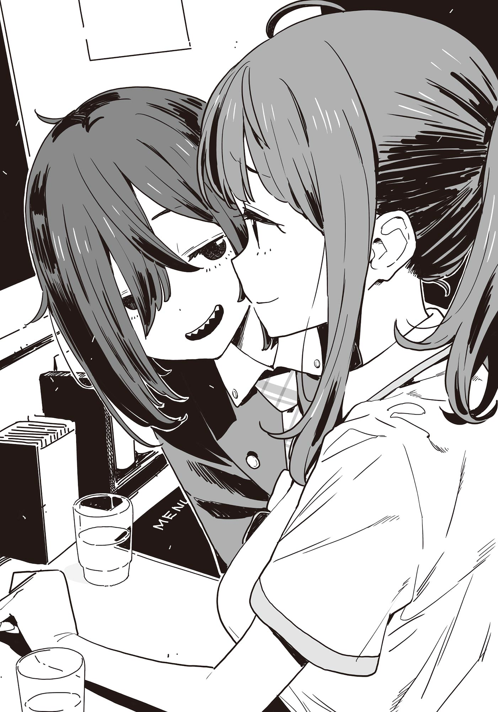

# Ch.129 — เล่ม 8.5 บทที่ 2

Ch.129 — เล่ม 8.5 บทที่ 2

By มนก.

Published: 2026-02-21T08:16:48Z

Source: https://www.nekopost.net/novel/14560/129

ยานามิ・ราเมง・ตระเวนกิน

ณ ร้านราเมงที่ตั้งอยู่ไม่ไกลจากสวนสาธารณะโทโยฮาชิ ร้านคาโดวาระ

รูปลักษณ์ภายนอกที่ดูเก๋จนมองแวบแรกนึกว่าเป็นคาเฟ่ มีม่านหน้าร้านสีขาวโบกสะบัดตามสายลม

ในช่วงเวลาที่จุดพีคของมื้อเที่ยงเพิ่งผ่านพ้นไป หญิงสาววัยรุ่นสองคนก็นั่งลงที่เคาน์เตอร์

ดูจากเครื่องแบบนักเรียนที่สวมใส่คนละแบบกันแล้ว ทั้งคู่น่าจะอยู่คนละโรงเรียนกัน

ทั้งสองรับผ้าเช็ดมือมาพลางสั่งอาหารด้วยท่าทางที่คุ้นเคย

[ ยานะมิน จะว่าไปไม่ได้มาที่นี่ซะนานเลยเนอะ— ]

คนที่กำลังใช้ผ้าเช็ดมือ อยู่คือรองประธานชมรมการละครโรงเรียนคิริโนกิ นีนะ ซานาเอะ

เธอเป็นเพื่อนสมัยมัธยมต้นของยานามิ อันนะ และเป็นคู่หูตระเวนกินด้วยกัน

[ มันมีเรื่องหลายอย่างน่ะสิ ฟังนะนีนะ ]

ยานามิวางแก้วน้ำที่ดื่มจนหมดลงบนเคาน์เตอร์ดังตึง

[ ฟังอยู่จ้า— หรือว่าจะเป็นเรื่องน้ำอุ่นคุงคนเดิมนั่นอีกแล้วล่ะ ] T/L: นางใช้คำว่าぬるま湯ที่แปลว่าน้ำอุ่นน่ะนะ

นี่เป็นครั้งที่เท่าไหร่แล้วนะที่ต้องฟังเรื่องนี้

นีนะพยายามสะกดกลั้นคำว่ารีบๆคบกันไปซะทีเถอะไว้ในใจ แล้วเอื้อมมือไปหยิบเครื่องปรุงบนโต๊ะ

[ ไม่ใช่นะ ครั้งนี้ไม่ใช่แค่ความแค้นส่วนตัวของฉันหรอก เดิมทีฝั่งนุคุมิซึคุงต่างหากที่เป็นฝ่ายชวนฉัน ว่าไปกินราเมงด้วยกันไหม น่ะ ]

การเคลื่อนไหวของนีนะที่กำลังดูส่วนประกอบของเครื่องปรุงหยุดชะงักไปครู่หนึ่ง

[ เห— ในที่สุดก็โดนชวนเดทแล้วเหรอ ]

[ ไม่ใช่เดทหรืออะไรแบบนั้นหรอก เรียกว่าเป็นการตอบแทนหรือตามน้ำล่ะมั้ง? ที่โดนชวนน่ะ ]

ยานามิใช้นิ้วม้วนปลายผมเล่นวนไป

[ ......ก็นะ ไม่รู้เหมือนกันว่านุคุมิซึคุงเขาคิดยังไง ]

[ นี่หรือว่าฉันกำลังโดนบังคับให้ฟังเรื่องอวดแฟนอยู่เหรอ? วันนี้เลี้ยงป่ะ ]

นีนะใช้นิ้วหมุนขวดทาบาสโกเล่นไปมา

[ เรื่องมันต่อจากนี้ต่างหาก แล้วคือพอชวนเสร็จ นุคุมิซึคุงก็ไม่ทักมาเลยสักนิด หรือจะพูดว่าพอบอกว่า 'เสร็จธุระคราวนี้แล้วไปกันเถอะ' —นี่มันก็ผ่านมาเดือนกว่าแล้วนะ?! ]

ยานามิดื่มน้ำแก้วที่สองจนหมดก่อนจะร่ายยาวต่อ

[ เพราะงั้นฉันก็เลยอุตส่าห์เกรงใจ เปิดบทความราเมงในนิตยสารให้ดูเป็นคำใบ้แล้วนะ? ขนาดฉันบอกว่า 'สนใจราเมงร้านนี้จัง' แล้วเนี่ย มันก็น่าจะเข้าบทสนทนาแบบ 'งั้นคราวหน้าไปร้านนั้นกันไหม' —ไม่ใช่เหรอ?! นุคุมิซึคุงจะไม่สนใจฉันเกินไปแล้วนะ?! ]

[ โฮ่โฮ่ ยานะมินอยากให้น้ำอุ่นคุงสนใจในสินะ ]

[ ไม่ได้พูดแบบนั้นสักหน่อย! ]

พอบ่นจนพอใจและเริ่มสงบสติอารมณ์ได้ ยานามิก็รินน้ำใส่แก้ว

[ ......เฮ้อ ก็นะ นุคุมิซึคุงก็มีมุมแบบนั้นอยู่แล้ว ช่วยไม่ได้ๆ แต่ก็น่าจะเห็นใจความลำบากของฉันที่ต้องคอยดูแลหน่อยสิ ]

[ โฮะโฮ น้ำอุ่นคุงนี่ก็เป็นผู้ชายบาปหนาเหมือนกันนี่— ]

[ บอกว่าไม่ใช่อย่างนั้นไงล่ะ? ]

จังหวะนั้นเอง พนักงานหญิงท่าทางกระฉับกระเฉงก็วางจานลงตรงหน้าทั้งสองคน

[ ไก่ทอดสองที่ ได้แล้วค่ะ! ]

ขวับ— แววตาของยานามิเปลี่ยนเป็นแววตาของนักรบทันที

[ นีนะ เอาล่ะนะ ]

[ โอ้ จัดไป ]

ท่าทางการหยิบตะเกียบและพนมมือตรงหน้าอก คือบทเพลงส่งวิญญาณให้กับชีวิตที่ถูกพรากมา

ไก่ทอดของร้านนี้มีชื่อเสียงเรื่องเนื้อสัมผัสที่กรอบนอกนุ่มในและรสชาติของเนื้อที่ยอดเยี่ยม

วิถีของยานามิคือ เริ่มจากทานคำแรกโดยไม่จิ้มอะไรเลย

ทันใดนั้น สิ่งที่วิ่งพล่านไปทั่วสมองของเธอก็คือ—ความอร่อยระดับรุนแรง

มุมปากที่มันวาวด้วยน้ำมันเผลอยกยิ้มขึ้นมาเอง

เมื่อลิ้มรสความอร่อยของแป้งและเนื้อจนเต็มคราบแล้ว เธอก็จิ้มเครื่องปรุงสูตรพิเศษที่มุมจานแล้วกัดลงไป

กลิ่นที่พุ่งขึ้นจมูกและผลลัพธ์ที่เสริมกันของรสชาติทำให้เธอถึงกับเคลิ้มไปชั่วขณะ

ยานามิพยายามฝืนทนต่อสิ่งยั่วยวนที่อยากจะปล่อยตัวปล่อยใจไปกับมัน แล้วเอื้อมมือไปหาเครื่องปรุง

[ ......ยานามิน จะเอาตัวนั้นเลยเหรอ ]

นีนะถามด้วยสีหน้าเคลิบเคลิ้ม

ยานามิพยักหน้าเงียบๆ แล้วโรยสิ่งที่อยู่ในขวดเล็กลงบนไก่ทอดชิ้นที่สอง

บนฉลากของขวดเล็กนั้นมีตัวอักษรเขียนว่า'lemosco' T/L: レモスコ

เลมอสโก— คือเครื่องปรุงที่มีเบสเป็นน้ำเลมอน ผสมด้วยน้ำส้มสายชูและพริก

แป้งไก่ทอดที่บางแต่เคี้ยวสู้ฟันเข้ากันได้ดีกับความเปรี้ยวของเลมอสโก ช่วยดึงสติของยานามิที่กำลังจะหลุดลอยให้กลับมาสู่โลกความจริง

ยานามิกลืนชิ้นไก่ลงคอ ก่อนจะวางตะเกียบลงบนจานดังแป๊ะเธอทานไก่ทอดหมดแล้ว

ท่ามกลางเสียงถอนหายใจอย่างพึงพอใจของยานามิ นีนะที่อยู่ข้างๆ ก็หยิบขวดเล็กที่เขียนว่า 'YUZUSCO' ขึ้นมา

[ อ๊ะ ลืมใส่ไอ้นั่นเลย ]

[ ไม่แบ่งให้หรอกนะ— ]

นีนะเลื่อนจานหนีจากยานามิแล้วโรยสิ่งที่อยู่ในขวดลงบนไก่ทอดของตัวเอง

เธอทานจนหมดโดยไม่สนใจสายตาของยานามิ แล้ววางตะเกียบดังแป๊ะเช่นกัน

[ อา เมื่อกี้คุยเรื่องอะไรกันนะ อ๋อ ยานะมินอารมณ์ไม่ดีเพราะน้ำอุ่นคุงไม่ชวนไปเดท สินะ? ]

[ ไม่ใช่สักหน่อย คือโดนชวนอยู่แล้ว ถึงจะไม่ใช่เดทก็เถอะ ]

นีนะมองยานามิที่กำลังเถียงข้างๆ คูๆ ด้วยรอยยิ้มล้อเลียน ก่อนจะเปลี่ยนสีหน้าเป็นจริงจังขึ้นมาทันที

[ แต่ก็นะ พักนี้เธอกลับมาร่าเริงได้ก็ดีแล้วล่ะ— ]

ยานามิที่พยายามจะฝืนยิ้มแห้งๆ ก็ยอมล้มเลิกและผ่อนคลายสีหน้าลง

[ ......ตอนนั้นขอบคุณที่เป็นห่วงนะ ]

[ ก็ช่วงที่เธอไม่สั่งแบบจานยักษ์หรือสั่งเส้นเพิ่มเลย ฉันน่ะเป็นห่วงจริงๆ เลยนะ— ]

—นั่นมันเพราะฉันกำลังไดเอทอยู่ต่างหากล่ะ

ยานามิเกือบจะพูดออกไปแต่ก็เปลี่ยนเป็นยิ้มเงียบๆ แทน ผู้หญิงที่ดีจะไม่พูดทุกอย่างออกมาหมดหรอก

[ ทั้งหมดนี่เป็นเพราะน้ำอุ่นคุงด้วยหรือเปล่านะ—]

[ อา ก็น่าจะมีส่วนล่ะมั้ง ]

คำตอบของยานามิทำให้นีน่าทำหน้าแปลกใจ

[ เห— ว่านอนสอนง่ายผิดคาดเลยนะ ]

[ คือนุคุมิซึคุงน่ะ สุดท้ายแล้วถ้าฉันไม่คอยดูแลเขามันก็ไม่ได้ใช่ไหมล่ะ? จะบอกว่าไม่มีเวลาให้เศร้าหรอก มีคนที่สร้างปัญหามากกว่าฉันอีก ]

[ โอ้ะ....โอ้? ]

พูดแบบนั้นเดี๋ยวก็โดนอีกหรอก—

ขณะที่นีนะกำลังต่อสู้กับคำพูดที่ติดอยู่ที่ลำคอ สุภาพบุรุษที่สวมหมวกฮัทสีดำ—เจ้าของร้าน ก็วางชามลงบนเคาน์เตอร์

[ ราเมงเนื้อเกลือพิเศษ - บะหมี่มะเขือเทศพิเศษเพิ่มท็อปปิ้งชีส ได้แล้วครับ ]

[[......! ]]

[ ข้าวเปล่าถ้วยเล็กสองที่ค่า! ]

[[ ............อึก! ]]

เมื่อเจอการโจมตีซ้ำจากพนักงานหญิง ทั้งสองก็เข้าสู่โหมดต่อสู้ในพริบตา

พวกเธอรีบมัดผมไปด้านหลังอย่างรวดเร็ว พร้อมกับพนมมือตบดังแปะ

—จากนี้ไป ไม่จำเป็นต้องมีคำพูดใดๆ

สิ่งที่วางอยู่ตรงหน้ายานามิคือราเมงเนื้อเกลือ

ในน้ำซุปชินตันที่ใสกระจ่าง มีหัวไชเท้าและกระดูกอ่อนหมูตุ๋นใส่มาด้วย

ยานามิสะกดความตื่นเต้นไว้แล้วใช้ช้อนตักซุปขึ้นมาซดคำแรก

—รสชาติที่ลึกซึ้ง เสียงพึมพำที่หาคำบรรยายไม่ได้เล็ดลอดออกมาจากปากของยานามิ

ความกลมกล่อมของน้ำซุปและความหนืดของคอลลาเจนเคลือบไปทั่วลิ้น เติมเต็มลำคอด้วยความรื่นรมย์

มันไม่ได้เลี่ยนจนเกินไป แต่ก็ไม่ได้ทำให้เด็กอายุ 16 ปีที่กำลังโตอย่างเธอรู้สึกไม่จุใจเลยแม้แต่นิดเดียว

—กำลังถูกปั่นหัวอยู่สินะ เธอรู้ตัวดี แต่ก็ไม่ได้รู้สึกแย่เลยสักนิด

ใจหนึ่งอยากจะซดซุปให้หมดในคราวเดียว แต่เธอก็ฝืนสัญชาตญาณนั้นแล้วคีบเส้นขึ้นมาสูดเข้าปาก

เส้นบะหมี่เส้นเล็กที่มีน้ำซุปเคลือบอยู่พุ่งผ่านลำคอไปในรวดเดียว ความปีติยินดี

......ไม่ได้นะ จะรีบเคลิ้มตอนนี้ไม่ได้

ยานามิเอาหัวไชเท้าหั่นเต๋าเข้าปาก หัวไชเท้าที่รสชาติซึมลึกพ่นน้ำซุปที่แสนอร่อยออกมาเต็มปาก

ตามด้วยการเอาหมูตุ๋นเข้าปาก ความรุนแรงของรสชาติเข้าครอบงำสมองของยานามิ

............เคลิ้มไปซะแล้ว

ต้องยอมรับเลยจริงๆ

เธอทำเพียงแค่คีบเส้น สูดเส้น และเคี้ยวหัวไชเท้ากับเนื้อ

ทำซ้ำไปซ้ำมาอยู่อย่างนั้น จนในที่สุดปลายตะเกียบก็แตะเข้ากับก้นชาม ทานหมดแล้ว

[ ......ยานะมิน เสร็จแล้วเหรอ? ]

ยานามิยิ้มตอบเพื่อนร่วมรบที่กำลังซดบะหมี่มะเขือเทศพร้อมเหงื่อที่ซึมบนหน้าผาก ก่อนจะยกมือขึ้นอย่างรวดเร็ว

[ —ขอ คิริกาเอะที่หนึ่งค่ะ }

คิริกาเอะ คือเส้นที่เป็นตัวชูโรงของร้านนี้

นอกจากเส้นแล้ว ยังมีซอสและเครื่องของทันทันเมงใส่มาด้วย

นั่นหมายความว่า การใส่คิริกาเอะเข้าไป จะทำให้ราเมงเกลือแปลงร่างกลายเป็นทันทันเมงรสเกลือ

สำหรับยานามิที่กลายเป็นนางฟ้าตกสวรรค์ไปแล้ว การจัดการราเมงชามที่สองให้หมดจดเป็นเรื่องที่ง่ายดายเกินไป

ชั่วพริบตาเธอก็ทานเส้นคิริกาเอะจนหมด แล้วเทข้าวเปล่าที่ออมไว้ลงไปในน้ำซุปที่เหลือ

เมื่อจัดการทุกอย่างที่กินได้ในชามจนหมดสิ้น ยานามิก็ถอนหายใจออกมาเฮือกใหญ่

......ชัยชนะที่สมบูรณ์แบบ

เธอทุ่มเททุกอย่างและสวาปามมันจนหมด

ขณะที่ยานามิกำลังปล่อยตัวไปกับความรู้สึกอ่อนเพลียที่แสนสุข สายตาของเธอก็เหลือบไปเห็นเพื่อนร่วมรบที่กำลังทำอะไรบางอย่างอยู่ข้างๆ

นีนะราดน้ำซุปบะหมี่มะเขือเทศลงบนข้าวเปล่า และบรรจงวางชีสท็อปปิ้งลงไปอย่างประณีต

เมื่อเห็นแบบนั้น ลำคอของยานามิก็ดังอึก

[ ......น่าอร่อยจัง ]

[ ไม่ให้หรอกนะ— ]

[ ไม่ๆๆ ฉันเคยอยากได้ของกินของคนอื่นด้วยเหรอ? ]

[ ก็บ่อยอยู่นะ? ]

นีนะตอบสวนกลับมาทันควันก่อนจะตักของในถ้วยเข้าปากและสูดเส้นต่อ

คงจะชินแล้วสินะ เธอเลื่อนชามหนีจากยานามิพลางทานต่อไปโดยไม่สนสายตาที่มองมา

หลังจากยานามิไม่กี่นาที นีนะที่จัดการจนเกลี้ยงชามก็พนมมือตบดังแป๊ะ

[ ขอบคุณสำหรับอาหารค่า—]

[ ......ขอบคุณสำหรับอาหารค่ะ ]

ยานามิที่ดูเหมือนจะยังไม่อิ่มดี พนมมือตามด้วยความรู้สึกอาลัยอาวรณ์

นีนะใช้ผ้าเช็ดหน้าเช็ดปากแล้วลุกขึ้นยืนพลางก้มมองยานามิด้วยสายตาเย้ยหยัน

[ ยานะมิน ยังต่อได้อีกใช่ไหม? ]

[ ......เธอคิดว่าฉันเป็นใครกันน่ะ? ]

ยานามิลุกขึ้นยืนอย่างช้าๆ ทั้งที่ยังมีเมล็ดข้าวติดอยู่ที่แก้ม

[ จะบอกว่าได้คูปองส่วนลดจากร้านมารุเก็นราเมงมาล่ะ จะเอาไง ยานะมิน ]

[ ......ฉันเอา นิกุโซบะ กับ ข้าวผัดไข่กระทะร้อน ]

ยานามิตอบราวกับว่ามันเป็นคำถามที่ไม่ต้องถามด้วยซ้ำ

[ แบบจานยักษ์ด้วยไหมล่ะ? ]

[ แน่นอน— ต้องจานยักษ์สิ ]

ในช่วงบ่ายคล้อยของวันหยุดสุดสัปดาห์วันหนึ่ง

การตระเวนกินของสองสาว ยานามิ อันนะ และ นีนะ ซานาเอะ เพิ่งจะเริ่มต้นขึ้นเท่านั้น .

