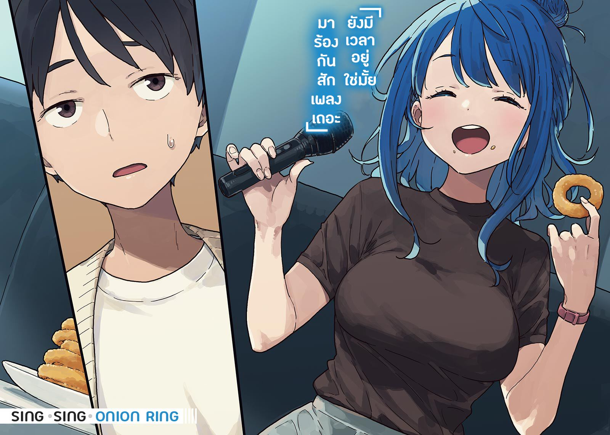

# Ch.12 — เล่ม4 บทที่ 2-2

Ch.12 — เล่ม4 บทที่ 2-2

By Monica

Published: 2024-12-06T15:18:54Z

Source: https://www.nekopost.net/novel/14560/12

เล่ม 4 บทที่ 2-2

ร้านหนังสือเซบุงคังที่อยู่ก่อนถึงสถานี ตอนนี้ผมกำลังอยู่ในห้องคาราโอเกะใกล้ๆกับที่นั่น

นาฬิกาของผมแสดงเวลา 13:05

จริงๆแล้วผมมาถึงก่อนประมาณหนึ่งชั่วโมง เพื่อไม่ให้ใครรู้ว่าผมมาคาราโอเกะครั้งแรก

[ เกือบไปแล้ว ]

กับดักแรกก็คือเครื่องดื่ม พนักงานอธิบายเกี่ยวกับบาร์เครื่องดื่มให้ผมอย่างใจดี ตอนที่ผมกำลังจะสั่งโคล่าที่เคาน์เตอร์

นี่เป็นครั้งแรกที่ผมรู้ว่าผมสามารถเลือกชนิดของคาราโอเกะได้ ถ้านี่ไม่ใช่การซ้อมล่ะก็ ผมคงตายแน่ๆ

ผมเงยหน้าขึ้นมาหลังจากมองเมนู และเห็นโทรศัพท์รับออเดอร์ติดอยู่บนผนัง

นี่คือวิธีที่คนสั่งเครื่องดื่มกันใช่มั้ย? จะลองซ้อมใช้ดูหน่อยดีมั้ยเนี่ย ?

ผมเผลอหยิบหูโทรศัพท์ขึ้นมา เสียงก็ดังออกมาทันที

[ สวัสดีค่ะ แผนกต้อนรับค่ะ ! ]

เดี๋ยวนะ พอหยิบหูโทรศัพท์ขึ้นมาก็เริ่มการโทรเลยหรอ? ผมนึกว่ามันมีปุ่มกดเพื่อเริ่มโทรซะอีก

[ สวัสดีค่ะ!? จะสั่งอะไรดีคะ? ]

[ อ่า ขออะไรที่มันนิยมๆหน่อยครับ อ่ะ แค่นั้นแหละ ]

ผมวางหูโทรศัพท์ลง เหงื่อไหลย้อยออกมาจากหน้าผาก

จิตใจของผมใกล้จะถึงขีดจำกัดแล้ว ผมรีบหนีออกจากห้องและไปที่บาร์เครื่องดื่ม

มีคนอยู่หน้าตู้กดน้ำแล้ว ผมก็ทำได้แค่ยืนรออย่างเหม่อลอยอยู่ด้านหลัง

เด็กสาวที่ยืนอยู่ข้างหน้าดูเหมือนจะมีแก้วอยู่ในมือทั้งสองข้าง

เธอกดน้ำผลไม้ลงในแก้วใบหนึ่งแล้วดื่มแก้วอีกใบ จากนั้นเธอก็ดื่มน้ำผลไม้ที่เพิ่งกดมาและเติมแก้วอีกใบ

เครื่องจักรที่เคลื่อไหวได้ชั่วนิรันด์เสร็จสมบูรณ์แล้ว

หืม? ดื่มเยอะจัง ผมรู้สึกว่าเคยเห็นเธอที่ไหนมาก่อนจากผมกึ่งยาวของเธอ...

แล้วเธอก็หันหน้ามาขณะที่กำลังดื่มโคล่า

[ อ๊ะ อยู่นี่ นี่เองนุคุมิซึคุง เป็นไงบ้าง? มีความคืบหน้ามั้ย? ]

[ ...ยานามิซัง ทำไมเธอถึงอยู่ที่นี่? ]

แย่แล้ว ผมประมาทไปเพราะทรงผมของเธอดูไม่เหมือนเดิม

[ น้องสาวจังบอกว่านุคุมิซึคุงออกไปแบบหล่อผิดปกติ มันยังเร็วไปนะ ฉันพนันได้เลยว่ากำลังเตรียมตัวสำหรับเดทที่คาราโอเกะล่ะสิ ฉันทายถูกใช่มั้ย? ]

เธอเดาถูกเกือบหมด จริงๆ แล้วผมไม่อยากจะยอมรับเลย

[ ไม่ใช่เดทหรอก แต่นี่เป็นครั้งเป็นครั้งแรกที่ผมมาคาราโอเกะด้วย ก็เลยอยากซ้อมก่อน ]

[ ฉันเข้าใจ ฉันก็มีตรวจสอบล่วงหน้าแล้วเหมือนกัน ตอนที่ฉันไปเดทกับโซสุเกะ อืม แล้วห้องของนายอยู่ไหนล่ะ? ]

[ เอ๋ ยานามิซังก็จะมาด้วย ? แต่เธอมากับเพื่อนๆไม่ใช่เหรอ? ]

[ ยังพอมีเวลา…นายไม่อยากให้ฉันมาเหรอ? ]

ทุกอย่างมันแย่หมด

ยานาเดินตามผมมาที่ห้อง เธอนั่งลงบนโซฟาและมองไปรอบๆ

[ โซสุเกะกับฉันก็มาร้านนี้เหมือนกัน ตอนนั้นก็ห้องนี้แหละ ]

สีหน้าของยานามิเปลี่ยนเป็นหม่นหมอง

[ ฉันเข้าใจ …ตอนนั้น …เข้าใจล่ะ ]

ช่วยหยุดเปิดสวิตช์แปลกๆของเธอทีเถอะ ผมรีบเปลี่ยนหัวข้ออย่างเร็ว

[ เอ่อ ดูนี่สิ เมนูนี้มีอะไรเยอะแยะเลย ยานามิซังมีอะไรแนะนำมั้ย? ]

[ เรากินเฟรนช์ฟรายส์ด้วยกัน โซสุเกะจะชอบแซวอยู่ตลอดว่า ‘อันนะเธอกินเยอะกินไปหรือเปล่า?’ ]

ผมกำลังคิดว่าจะดุเธอดีมั้ย แล้วก็มีคนเคาะประตูเข้ามา พนักงานเข้ามาในห้อง

[ ขอบคุณที่รอค่ะ นี่หอมทอดมาแล้วค่ะ ]

บางสิ่งที่น่าทึ่งถูกวางลงบนโต๊ะ

แสงในดวงตาของยานามิกลับคืนมาหลังจากเห็นหอมทอดที่ซ้อนกันอยู่

[ ...เอ๋? นุคุมิซึคุงรู้หรอว่าฉันจะมา? หรือนายรอฉันอยู่? ]

[ หืม? ไม่ใช่หรอก ]

[ ฉันเข้าใจๆ นุคุมิซึคุงคงเหงาสินะ ไม่ต้องเขินหรอก ขอโทษนะ ฉันควรจะอยู่กับนายตั้งแต่แรกแล้ว ]

อารมณ์ของยานามิฟื้นคืนมาเต็มที่ เธอหยิบหอมทอดใส่ปาก ผมไม่ได้บอกว่าเธอกินได้ซะหน่อย

[ ไม่อะ ผมอยู่คนเดียวตั้งแต่แรกแล้ว ]

[ แล้วทำไมนายถึงสั่งมาล่ะ? กว่าบาโซริซังจะมาก็คงเย็นหมดแล้วนะ? ]

แก้มของยานามิพองแน่น เธอเอียงคอ

ผมยกหูโทรศัพท์ต่อสายถึงเคาน์เตอร์ข้างหน้า สั่งอะไรแบบสุ่มๆ และนี่คือสิ่งที่ได้- ใช่…ผมอายเกินกว่าจะพูดออกมา

[ จริงๆ แล้ว ผมก็นึกว่ายานามิซังจะมาน่ะ ]

ผมเปลี่ยนใจตอบกลับไปทันที ยานามิยกนิ้วโป้งให้พร้อมกับถือโคล่าในมือ

[ ฉันชอบคำตอบนี้ งั้นโอเน่ซังจะสอนอะไรหลายๆ อย่างให้เอง ]

ยานามิหยิบรีโมทขึ้นมาและเริ่มคลิกหน้าจอด้วยปากกาทัชสกรีน

[ การควบคุมพื้นฐานทำได้ด้วยรีโมท ลองคุ้นเคยกับมันก่อนนะ ]

[ อ่า งั้นก็เลือกเพลงได้สินะ? ]

[ ใช่ นายหาเนื้อเพลงได้ด้วยอันนี้ และยังปรับคีย์เพลงขณะที่ร้องได้ด้วย ]

รีโมทนี้มันเทพไปหรือเปล่า?

[ งั้นเมนูนี้ล่ะ? ]

[ อืม นั่นคือ- ]

นี่คือจุดเริ่มต้นของการบรรยายคาราโอเกะโดยยานามิ ที่จริงแล้ว การอธิบายของเธอง่ายกว่าที่ผมคิดไว้มาก เธอคนนี้น่าจะเหมาะกับการนำเสนองานอดิเรกให้ผู้ใหญ่ฟัง ผมว่าพวกเขาคงให้ขนมกับเธอเยอะทีเดียว

[ โอเค นี่คือสิ่งที่นายต้องรู้จะได้ไม่ต้องขายหน้า ]

ยานามิลุกขึ้นยืนหลังจากที่แบ่งปันความคิดเห็นและประสบการณ์เกี่ยวกับคาราโอเกะ

[ ยังมีเวลาอยู่ใช่มั้ย มาร้องกันสักเพลงเถอะ ]

ผมดูนาฬิกา ตอนนี้เวลา 13:40 น. เหลือเวลาแค่ 20 นาที

[ แต่บาโซริซังอาจจะมาเร็วก็ได้นะ เธอเป็นคนจริงจัง.. ]

[ หืม? หมายความว่าไง? ]

ยานามิถือโทรศัพท์ด้วยมือทั้งสองข้าง เธอดูตกใจ

[ อ่า, …หมายถึง ผมจะจ่ายให้ยานามิซังเอง แล้วก็ถึงเวลาที่เธอต้องกลับแล้วใช่มั้ย? ]

[ โห…. ]

เป็นอะไรของเธออีก? ยานามิส่งเสียงเหมือนนกฮูก

ผมเข้าใจแล้ว เพราะผมไม่ได้ขอบคุณเธออย่างเหมาะสมใช่มั้ย? มารยาทเป็นสิ่งจำเป็น ถึงจะพูดถึงยานามิ แต่ผมก็ก้มหัว

[ ขอบคุณสำหรับวันนี้นะ ผมซาบซึ้งมาก อย่าลืมของใช้ส่วนตัวล่ะ ]

โอเค ผมขอบคุณเธอแล้ว

ผมยังเตือนเธอด้วยว่าอย่าลืมของใช้ส่วนตัวของเธอ ผมคิดว่าผมทำได้ดีทีเดียว

[ ............ ]

[ เฮ้ ยานามิซัง? ]

ยานามิบ่น “โห” อีกครั้ง เธอจ้องผมอย่างดุเดือดเหมือนนกฮูกก่อนจะเดินออกจากห้องไป

…อะไรน่ะ? บางทีเธออาจจะโกรธเพราะไม่มีของหวาน

เดี๋ยวค่อยคิดว่าทำไมยานามิถึงโกรธทีหลัง ตอนนี้ต้องโฟกัสที่เทียร่าซัง

ผมส่งข้อความบอกหมายเลขห้องเธอหลังจากทำความสะอาดเล็กน้อย

ผมไม่ค่อยถนัดใช้เมลนัก ผมใช้แค่ลงทะเบียนพวกนิตยสารกับเว็บไซต์เท่านั้น

ในที่สุดก็เจอปุ่มส่งแล้ว ผมกดปุ่มนั่นอย่างระมัดระวัง

---
