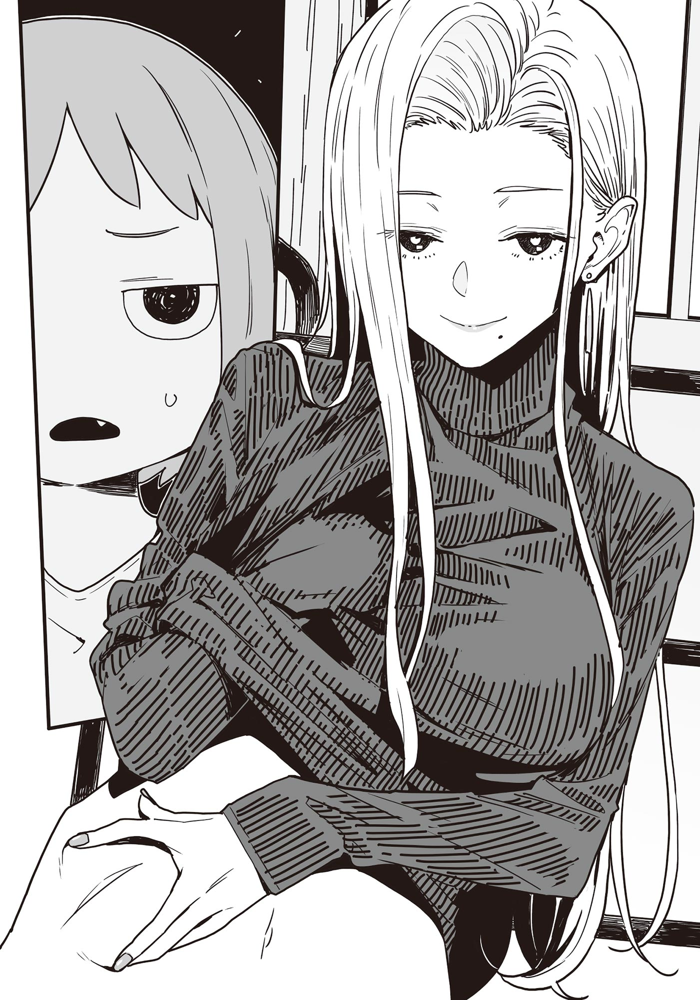

# Ch.130 — เล่ม 8.5 บทที่ 3

Ch.130 — เล่ม 8.5 บทที่ 3

By มนก.

Published: 2026-02-21T08:17:05Z

Source: https://www.nekopost.net/novel/14560/130

มิตรภาพมากกว่ากิเลส

ในห้องหนึ่งของแมนชันภายในตัวเมือง หญิงสาวกำลังซุกตัวอยู่ในผ้าห่มบนเตียงตั้งแต่กลางวัน

จากข่าวในโทรทัศน์ ดูเหมือนว่าคืนนี้จะเป็นคืนที่หนาวที่สุดในฤดูหนาวปีนี้

เธอใช้รีโมตเปลี่ยนช่องจากบนเตียง เป็นฉากที่กลุ่มตลกหน้าใหม่กึ่งเปลือยถูกผลักตกสระน้ำ กฎกติกาไม่แน่ชัด แต่ดูเหมือนว่าถ้าใครรอดไปได้จะได้ไปออกรายการพิเศษวันขึ้นปีใหม่

หญิงสาวปิดสวิตช์โทรทัศน์ แล้วจ้องมองไปบนเพดาน

[ ……วันส่งท้ายปีเก่าแบบนี้ ฉันทำอะไรอยู่กันแน่เนี่ย ]

อาจารย์โรงเรียนมัธยมปลายสึวาบุกิ อามานัตสึ โคนามิ

เธอต้องนอนซมทั้งที่อยู่ในช่วงสิ้นปี เพราะโดนคอมโบสองเด้งทั้งไข้หวัดและอาหารเป็นพิษ

จะไอคนเดียวก็เหงา... ในขณะที่คำพูดทำนองนั้นวนเวียนอยู่ในหัว แมวตัวผู้ลายสลิดก็เดินเข้ามาใกล้หมอน มันทำจมูกฟุดฟิดดมกลิ่นเหมือนกำลังดูอาการของอามานัตสึ

[ โอ้ เป็นห่วงฉันงั้นเหรอ สุดท้ายฉันก็มีแต่ทามาคิจิเท่านั้นแหละที่— ฟุเกี๊ยะ! ]

โลกนี้ไม่ได้หวานชื่นขนาดนั้น ทามาคิจิ แมวตัวผู้ ปล่อยหมัดแมวรัวเข้าที่ตาของอามานัตสึอย่างแม่นยำ

หลังจากเอาชีวิตรอดจากการโจมตีอันดุเดือดของแมวรัก อามานัตสึก็มองนาฬิกาแล้วพยุงตัวลุกขึ้น เพราะมันเลยเวลาอาหารมาแล้ว—อาหารของแมวน่ะนะ

[ รู้แล้วๆ รอเดี๋ยวสิ... ]

อามานัตสึเดินโซเซไปที่ห้องครัว พอเปิดตู้เธอก็ต้องไหล่ตก เพราะอาหารกระป๋องที่กินประจำหมดเสียแล้ว

[ ทามาคิจิ วันนี้กินอาหารเม็ดไปก่อนนะ—อ๊ะ รู้แล้วๆ เข้าใจแล้วน่า ]

เมื่อถูกแมวรักประท้วงอย่างหนัก อามานัตสึก็ถอนหายใจ ช่วยไม่ได้ คงต้องออกไปหาร้านที่ยังเปิดอยู่สินะ...

ในขณะที่มือกุมท้องและกำลังหากุญแจรถ เสียงกริ่งหน้าห้องก็ดังขึ้น

ทั้งที่เป็นวันส่งท้ายปีเก่า ใครกันที่มาหา? หรือว่าจะเป็นพ่อแม่ที่เป็นห่วงจนยอมกลับจากการไปเที่ยวออนเซ็นกันนะ—

พอชะโงกหน้ามองที่มอนิเตอร์ริมกำแพง ภาพที่ปรากฏคือบุคคลที่คาดไม่ถึง

[ ฮัลโหล โคนามิ ฉันมาแล้วนะ ]

อาจารย์ห้องพยาบาลโรงเรียนสึวาบุกิ โคนุกิ ซาโยะ เพื่อนสนิทตั้งแต่สมัยมัธยมปลายนั่นเอง

◇

โคนุกิวางกระเป๋าใบใหญ่ลงบนโต๊ะโคทัตสึ แล้วกวาดสายตามองไปรอบห้อง

พอเห็นจานชามกองเป็นพะเนินอยู่ที่อ่างล้างจาน เธอก็หัวเราะแห้งๆ พร้อมกับถกแขนเสื้อขึ้น

[ เดี๋ยวทางนี้ฉันจัดการให้ โคนามินอนพักไปเถอะ ]

อามานัตสึที่ดูเหมือนจะยังตามสถานการณ์ไม่ทัน ได้แต่เกาศีรษะที่ยุ่งเหยิงแกรกๆ

[ โคนุกิจัง วันนี้วันส่งท้ายปีเก่านะ ไม่เป็นไรเหรอ ทิ้งแฟนไว้แบบนั้นน่ะ ]

[ ไม่เป็นไรหรอก ปีนี้ฉันทำให้เขาพอใจไปเรียบร้อยแล้ว สามวันแรกของปีคงหมดสภาพทำอะไรไม่ได้ ฉันเองก็กำลังเบื่อๆ อยู่พอดี ]

ขณะที่โคนุกิกำลังล้างจาน ทามาคิจิก็ร้องอ้อนและเดินคลอเคลียอยู่ที่แทบเท้าของเธอ

[ ตายจริง หิวแล้วเหรอจ๊ะ? ]

[ พอดีอาหารประจำมันหมดน่ะ เจ้านี่ก็เลยหิวโซเลย ]

พออามานัตสึทำท่าจะอุ้ม ทามาคิจิก็พลันมุดหนีไปอย่างรวดเร็ว

[ ถ้าเรื่องนั้นล่ะก็ ฉันซื้อติดมือมาด้วยแล้วล่ะ งั้นเริ่มจากอาหารของทามาคิจิจังก่อนเลยละกัน ]

ดูเหมือนมันจะฟังภาษามนุษย์รู้เรื่อง ทามาคิจิส่งเสียงร้องอย่างตื่นเต้นแล้วกระโดดขึ้นไปเกาะบนไหล่โคนุกิ

[ จ้าๆ จะเตรียมให้เดี๋ยวนี้แหละ ]

[ ……เจ้านี่มันติดโคนุกิจังมากกว่าฉันอีกหรือเปล่านะ? ฉันคิดไปเองใช่ไหม?"

[ ทั้งแมวทั้งผู้ชายนั่นแหละ ถ้าเอาใจมากเกินไปจะเสียคนเอาได้นะ เอ้า ทานให้อร่อยนะ ]

หลังจากลูบหลังทามาคิจิที่กำลังก้มหน้าก้มตากินอาหารกระป๋องทีหนึ่ง เธอก็เงยหน้ามองอามานัตสึด้วยสายตาอ่อนโยน

[ เอาละ ทางนี้ปล่อยเป็นหน้าที่ฉันเอง หิวยัง? ]

[ หิว... แต่ว่า ปวดท้องน่ะ ]

[ อุ๊ย ท้องเสียด้วยเหรอ ไข้หวัดปีนี้ก็น่ากลัวเหมือนกันนะ ]

ที่จริงท้องเสียเพราะกินเค้กคริสต์มาสเก่าๆ ตั้งแต่เมื่อเช้า แต่อามานัตสึก็เลือกที่จะพยักหน้าเงียบๆ

[ งั้นเดี๋ยวฉันทำอะไรที่ย่อยง่ายๆ ให้กินนะ โคนามินอนพักรอเถอะ ]

[ อือ…… ]

อามานัตสึมุดเข้าไปในเตียง แล้วเผลอหลับไปในขณะที่มองแผ่นหลังของโคนุกิซึ่งยืนอยู่ในครัวอย่างเลือนลาง

◇

……นอนไปนานแค่ไหนกันนะ

เธอลืมตาขึ้นเพราะกลิ่นน้ำซุปหอมละมุนที่โชยมาแตะจมูก ที่โต๊ะโคทัตสึ โคนุกิกำลังนั่งอ่านหนังสืออยู่

พออามานัตสึพยายามจะพยุงตัวลุกขึ้น ก็รู้สึกถึงน้ำหนักที่กดทับ ทามาคิจินอนอยู่บนผ้าห่มนั่นเอง

อามานัตสึค่อยๆ ขยับตัวอย่างระมัดระวังเพื่อไม่ให้ทามาคิจิตื่น แล้วลุกออกจากเตียง

[ หลับสบายไหม? ]

เธอขยี้ตาพลางพยักหน้า โคนุกิจึงปิดหนังสือแล้วลุกขึ้นยืน

[ ข้าวต้มน่าจะพอทานไหวนะ เดี๋ยวฉันอุ่นให้เดี๋ยวนี้แหละ ]

อามานัตสึที่ยังกึ่งหลับกึ่งตื่นมุดเข้าไปในโคทัตสึแล้วเปิดโทรทัศน์ ขณะที่กำลังดูเหล่าคนดังทายราคาไวน์หรู หม้อดินใบเล็กที่มีควันฉุยก็ถูกวางลงตรงหน้า

มันคือข้าวต้มที่โปะด้วยไข่นุ่มฟู มีเครื่องเคราหั่นละเอียดดูสีสันสวยงาม

[ โอ้…… ดูเป็นผู้เป็นคนขึ้นมาหน่อยแฮะ ]

เมื่อใช้ช้อนไม้ตักข้าวต้มเข้าปาก รสความอูมามิก็แผ่ซ่านไปทั่วลิ้น

[ อะไรเนี่ย อร่อยชะมัดเลย ]

[ ฉันตั้งใจเคี่ยวน้ำซุปให้รสชาติเข้มข้นจะได้ไม่จืดชืดเกินไป ส่วนผักกับเนื้อก็หั่นจนละเอียด น่าจะย่อยง่ายนะ ]

พอเห็นว่าอามานัตสึเริ่มกินแล้ว โคนุกิก็วางจานออเดิร์ฟไว้ตรงหน้าตัวเอง และ—

แกร๊ก— เธอเปิดฝากระป๋องเบียร์

[ โคนุกิจัง จะดื่มเหรอ ]

[ ก็นานๆ ทีจะมีวันส่งท้ายปีเก่านี่นา ขอฉันสนุกหน่อยเถอะ ]

เธอยกขึ้นดื่มจากกระป๋องคำหนึ่งแล้วถอนหายใจอย่างมีความสุข

อามานัตสึที่จ้องมองอยู่ กลืนน้ำลายเอื๊อก

[ ……ข้าวต้มนี่ เป็นกับแกล้มได้ดีเลยนะ ]

[ ตายจริง ป่วยอยู่แบบนี้ดื่มไปด้วยจะดีเหรอ? ]

[ ไข้ลดแล้วล่ะ แถมข้าวก็ตกถึงท้องแล้วด้วย อีกอย่าง สาเกญี่ปุ่นมันก็คือข้าวนั่นแหละ ]

อามานัตสึยิ้มกริ่มพลางชี้ไปที่ตู้เย็น

[ ฉันเตรียมสาเกดีๆ ไว้สำหรับฉลองปีใหม่ด้วยนะ โคนุกิจังดื่มด้วยกันไหมล่ะ? ]

[ โคนามิ....ให้แค่แก้วเดียวนะ ]

พอเป็นแบบนี้ก็หยุดไม่ได้ งานเลี้ยงดื่มสังสรรค์ข้ามปีจึงเริ่มต้นขึ้น

อามานัตสึที่เพิ่งฟื้นไข้ ถือสาเกญี่ปุ่นแก้วที่สามไว้ในมือ จ้องมองรายการเพลงทางสถานีโทรทัศน์แห่งชาติด้วยสายตาฉ่ำเยิ้มจากความเมา

[ โคนุกิจางงงงง…… ทำไมวันแบบนี้ ถึงมายอมอยู่เป็นเพื่อนฉันล่ะ? }

[ ถ้าสถานการณ์สลับกัน โคนามิก็คงทำแบบเดียวกันให้ฉันไม่ใช่เหรอ ]

โคนุกิแกว่งแก้วด้วยนิ้วเรียวยาว

[ เอ๋— ไม่ได้เป็นพวกชอบดูแลคนขนาดนั้นซะหน่อยยยย ]

[ ตอนอยู่มหาลัยปี 2 เธอก็ทำแบบนั้นนี่นา ]

—มหาวิทยาลัยปี 2 พอได้ยินคำสำคัญนี้ อามานัตสึก็เผยยิ้มขื่นๆ ออกมา

[ ตอนที่เธอถูกแทงในงานบรรลุนิติภาวะน่ะเหรอ ฉันล่ะอยากจะลืมมันจริงๆ ]

[ ตอนที่วุ่นวายหลายๆ อย่าง ก็ได้โคนามิเนี่ยแหละที่ช่วยไว้ ]

[ อา... มีเรื่องแบบนั้นด้วยเหรอ ]

อามานัตสึหันหน้าหนีเหมือนเขินอาย

[ ทั้งเรื่องที่ไปเคลียร์กับพวกที่ปล่อยข่าวลือด้วย เห็นว่าทำเรื่องบ้าระห่ำไปไม่น้อยเลยนี่ ]

[ ก็ข่าวลือพวกนั้นส่วนใหญ่มันดันเป็นเรื่องจริงน่ะสิ ฉันเลยลำบากแทบตาย ]

เมื่ออามานัตสึยื่นขวดเหล้าให้ โคนุกิก็หัวเราะพลางชูแก้วขึ้น

[ แด่การมีชีวิตรอดจนข้ามปีได้... ชนแก้ว ]

[ เธอน่ะ โชคดีแค่ไหนที่ไม่ตายน่ะ...? ]

[ สงสัยฉันจะจ่ายค่าตอบแทนสำหรับความซนแพงเกินไปหน่อยล่ะมั้ง ]

ต่อหน้าอามานัตสึที่ทำหน้าละเหี่ยใจ โคนุกิก็เลิกชายเสื้อขึ้น

[ เดี๋ยวนี้รอยแผลเป็นแทบมองไม่เห็นแล้วนะ จะดูไหม? ]

[ ไม่ดูหรอก อ๋า— บอกว่าอย่าให้ดูไงเล่า ]

แม้จะปากแข็ง แต่เธอก็เหลือบมองหน้าท้องของโคนุกิขณะจิบเหล้า

บนผิวขาวเนียนราวกับเครื่องปั้นดินเผานั้นไม่มีไขมันส่วนเกินเลยแม้แต่นิดเดียว กลับกัน—

[ โคนุกิจัง เหมือนจะมีซิกแพ็กบางๆ หรือเปล่านะ? ฝึกร่างกายมาหนักพอดูเลยนี่ ]

[ เป็นผู้หญิงก็ควรฝึกร่างกายไว้นะ มันมีประโยชน์ตอนต้องแบกผู้ชายขี้เมาขึ้นเตียงน่ะ ]

อามานัตสึเผยยิ้มเหมือนระอาใจกับคำพูดที่แยกไม่ออกว่าล้อเล่นหรือเรื่องจริง

[ ……เดี๋ยวก็โดนแทงอีกหรอก ]

โคนุกิตอบกลับด้วยรอยยิ้มที่ไม่รู้สึกผิดแม้แต่น้อย

[ —ก็นี่มันเหรียญตราแห่งเกียรติยศของผู้หญิงนี่นา ]
