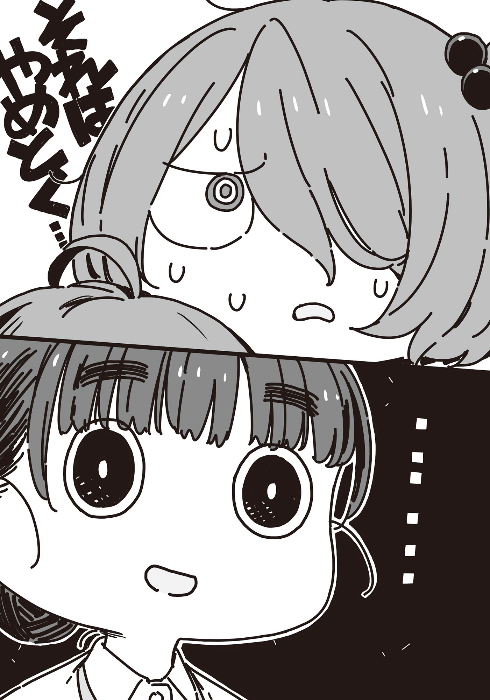

# Ch.131 — เล่ม8.5 บทที่ 4

Ch.131 — เล่ม8.5 บทที่ 4

By มนก

Published: 2026-02-21T08:17:26Z

Source: https://www.nekopost.net/novel/14560/131

ศูนย์การเรียนรู้เด็กและเยาวชนโคโคนิโกะ

สถานที่สาธารณะสำหรับเด็ก ซึ่งอยู่ห่างจากสถานีโทโยฮาชิด้วยการเดินเพียง 10 นาที

นอกจากจะมีการจัดอีเวนต์และห้องเรียนกิจกรรมแล้ว ยังมีพื้นที่สำหรับให้เด็กเล็กวิ่งเล่นอีกด้วย

ผู้ที่กำลังเดินอยู่ในโถงทางเข้านั้นคือประธานนักเรียนโรงเรียนมัธยมปลายสึวาบุกิ── บาโซริ เทียร่า

เทียร่าเดินตรงเข้าไปที่แผนกต้อนรับ แล้วเอ่ยทักทายเจ้าหน้าที่

[ ขอโทษนะคะ บาโซริจากสภานักเรียนโรงเรียนมัธยมปลายสึวาบุกิ ที่ติดต่อมาเมื่อวันก่อนค่ะ ]

[ อ๋อ เด็กจากสึวาบุกิสินะคะ ได้ยินเรื่องไว้แล้วค่ะ ]

เจ้าหน้าที่หญิงที่แผนกต้อนรับก้มลงมองเอกสารในมือ

[ เอ่อ บาโซริ...... ]

[ ใช่ค่ะ บาโซริค่ะ! วันนี้เอาใบปลิวงานเล่านิทานของเดือนหน้ามาส่งค่ะ! ]

ไม่ยอมให้เรียกชื่อจริงหรอก

เทียร่ารีบตัดบทสนทนาอย่างรวดเร็ว แล้ววางใบปลิวลงบนเคาน์เตอร์

[ ขอบใจที่อุตส่าห์มานะ เดี๋ยวจะรีบเอาวางไว้ให้เลยจ้ะ── ]

ทันทีที่การพูดคุยกำลังจะจบลงด้วยดี เด็กสาวตัวเล็กคนหนึ่งก็วิ่งพรวดพราดเข้ามาที่เคาน์เตอร์

ผู้ที่ปรากฏตัวคือสมาชิกชมรมวรรณกรรมโรงเรียนมัธยมปลายสึวาบุกิ──โคมาริ จิกะ

[ ข...ขอโทษค่ะ! น้องสาว หลงทาง ค่ะ! ]

พอพูดจบแค่นั้น ก็ไอโขลกออกมา

[ อา...อายุ 4 ขวบ ทรงผมเหมือนฉัน ค่ะนี่ ร...รูป── ]

โคมาริที่พยายามจะหยิบสมาร์ตโฟนออกมา ลนลานจนทำตกลงพื้น

คนที่ยื่นมือออกไปเร็วกว่าที่โคมาริจะก้มลงเก็บ คือเทียร่านั่นเอง

[ โคมาริซัง ถ้ามีเรื่องอะไรเกิดขึ้น ให้ฉันช่วยนะคะ ]

[ อะ เอ๋...... ]

เทียร่ายื่นสมาร์ตโฟนที่เก็บได้ส่งให้โคมาริที่กำลังตกใจกับใบหน้าคุ้นเคย

............

..................

........................โนรีแอ็กชัน

[ เอ่อ โคมาริซัง? ฉันบาโซริ จากสภานักเรียนสึวาบุกิค่ะ ถ้าไม่รังเกียจให้ฉันช่วยเถอะค่ะ ]

การที่โคมาริจะหวาดกลัวก็เป็นเรื่องธรรมดา ทั้งสองคนมีความบาดหมางกันนิดหน่อยในการประชุมหัวหน้าชมรมเมื่อปีก่อน

หนามแห่งความรู้สึกผิดทิ่มแทงและควงสว่านอยู่ในอกของเทียร่า

[ ......ขอโทษที่ทักกะทันหันนะคะ เดี๋ยวจะลองไปดูรอบๆ ให้นะ ]

เทียร่าวางสมาร์ตโฟนของโคมาริไว้บนเคาน์เตอร์ประชาสัมพันธ์ แล้วหันหลังกลับ

น้องสาววัย 4 ขวบหลงทาง ถ้าทรงผมเหมือนพี่สาว เห็นปุ๊บก็คงรู้ปั๊บ

มีใครบางคนดึงชายเสื้อของเธอที่กำลังจะผละออกจากตรงนั้นเอาไว้

[ ......โคมาริซัง? ]

[ ช...ช่วย ด้วยก๊ะ! ]

เสียงของโคมาริหลงผิดคีย์ นิ้วที่กำเสื้ออยู่ก็สั่นระริก

เมื่อเห็นดังนั้น เทียร่าจึงกุมมือของโคมาริเอาไว้อย่างอ่อนโยน

[ ค่ะ ให้ฉันช่วยนะคะ พอจะนึกออกไหมคะว่าน่าจะไปที่ไหน? ]

[ พ...พอกลับมาจากห้องน้ำ ก็ไม่เห็นแล้ว.. ]

โคมาริสูดหายใจเฮือกใหญ่ แล้วพูดต่อ

[ ด...เดินดูในตัวตึกรอบนึงแล้ว แต่ไม่เจอ ที่ไหนเลย ]

[ งั้นโคมาริซังช่วยแจ้งรูปร่างหน้าตาของน้องสาวให้เจ้าหน้าที่นะคะ เดี๋ยวฉันจะออกไปดูข้างนอกรอบๆ เอง ]

[ ข...ข้างนอก? ]

โคมาริมองออกไปข้างนอกผ่านกำแพงกระจกด้วยสีหน้ากังวล

[ ที่อันตรายที่สุดคือการออกไปนอกพื้นที่ค่ะ การจะออกไปข้างนอกต้องผ่านทางเข้าออกหลัก หรือไม่ก็ลงบันไดไปที่ลานจอดรถ โคมาริซังช่วยเฝ้าทางเข้าออกหลักที่โถงทางเข้านี้ไว้นะคะ เดี๋ยวฉันจะไปหาที่ลานจอดรถกับรอบนอกอาคารเอง ]

เมื่อเห็นโคมาริพยักหน้าตอบรับ เทียร่าก็รีบสาวเท้าตรงไปยังบันได

[ ด...เดี๋ยว! ]

เทียร่าหันกลับไปตามเสียงเรียก ก็เห็นโคมาริหันหน้าจอสมาร์ตโฟนมาทางนี้

บนหน้าจอปรากฏภาพเด็กผู้หญิงน่ารักที่มัดผมไว้ข้างเดียว

[ น...นี่ฮินะ ฝ...ฝากด้วยนะ ]

[ ค่ะ เป็นเด็กที่น่ารักจังเลยนะคะ ]

เทียร่ายิ้มบางๆ เพื่อให้อีกฝ่ายสบายใจ แล้ววิ่งลงบันไดไปรวดเดียว

◇

โคมาริวิ่งเข้ามาหาเทียร่าที่กลับมาพร้อมเหงื่อซึมหน้าผาก

[ ป...เป็นยังไงบ้าง? ]

[ ที่ลานจอดรถกับรอบตึกไม่เจอค่ะ ลองถามคนที่เดินผ่านไปมาแล้ว แต่ไม่มีใครเห็นเลย ]

เทียร่าแตะหลังโคมาริที่หน้าซีดเผือดเบาๆ พลางเงยหน้ามองโถงเพดานสูง

[ ดูชั้น 2 หรือยังคะ? ]

[ ด...ดูแล้ว แต่ว่า...... ]

โคมาริมองตามสายตาของเทียร่าขึ้นไปที่ระเบียงทางเดินชั้น 2

บนระเบียงทางเดินจึงมีกลุ่มพ่อแม่ลูกเดินอยู่หลายกลุ่ม คงจะมีอีเวนต์หรืออะไรสักอย่างเพิ่งจบลง

[ ยะ...ยังไม่ได้ดู ในห้องอบรม ]

[ เข้าใจแล้วค่ะ เดี๋ยวฉันไปดูให้ ]

โคมาริทำท่าจะตามหลังเทียร่าที่กำลังมุ่งหน้าไปทางบันได

[ ฉ...ฉันก็จะไปหาด้วย ]

[ แต่ว่าโคมาริซังรออยู่ที่นี่── ]

ขณะที่เทียร่ากำลังลำบากใจ เจ้าหน้าที่ที่แผนกต้อนรับก็เอ่ยทักขึ้น

[ ถ้าแค่แป๊บเดียว เดี๋ยวฉันช่วยดูให้ว่าน้องสาวจะเดินผ่านมาไหม รีบไปตามหาเถอะค่ะ ]

[ ข...ขอบคุณมาก ! ]

พอขอบคุณเสร็จ โคมาริก็ออกตัววิ่งไปที่บันไดทันที

เทียร่าตกใจกับความเร็วที่คาดไม่ถึง แต่ก็ตามหลังไปติดๆ

ในที่สุดก็ตามทันและช่วยกันหาในห้องอบรมจนทั่ว แต่ก็ไม่เจอตัวฮินะ

เทียร่าหยิบแผนผังอาคารให้โคมาริที่ยืนน้ำตาคลออยู่กลางห้องดู

[ ใจเย็นๆ แล้วลองตรวจสอบอีกครั้งนะคะ ดูโซนเสียเงินที่ชั้น 1 หรือยังคะ? อาจจะเผลอเดินเข้าไปก็ได้ ]

[ ด...ดูแล้ว ไม่เจอ ]

[ งั้นที่เหลือก็──ตรงที่เรียกว่า 'โคโซดาเตะพลาซ่า' นี่ล่ะคะ ]

[ ตะ...ตรงนั้นเป็นที่สำหรับเด็กอายุไม่เกิน 3 ขวบ ตอนนี้ไม่ได้เข้าไปใช้ ]

[ ตอนอายุไม่เกิน 3 ขวบ เคยมาใช้เหรอคะ? ]

[ อ...อื้อ ฮินะชอบ ที่นี่── ]

ยังพูดไม่ทันจบดี โคมาริก็ออกวิ่งอีกครั้ง

เทียร่าปาดเหงื่อที่เริ่มแห้งบนหน้าผาก สูดหายใจลึก แล้ววิ่งตามโคมาริไป

◇

โคโซดาเตะพลาซ่า พื้นที่แลกเปลี่ยนเรียนรู้สำหรับเด็กเล็กอายุไม่เกิน 3 ขวบและผู้ปกครอง

มีทั้งเครื่องเล่นเสริมพัฒนาการและของเล่นสำหรับเด็กเล็ก เป็นสถานที่ที่เด็กเล็กสามารถเล่นได้ทั้งวัน

ที่มุมหนังสือนิทาน มีร่างของโคมาริ ฮินะ นอนหลับอยู่หน้าหนังสือที่เปิดค้างไว้

โคมาริ จิกะ และบาโซริ เทียร่า นั่งหมดแรงขนาบข้างฮินะซ้ายขวา

[ ค่อยยังชั่วนะคะ ที่เจอตัวอย่างปลอดภัย ]

[ อ...อื้อ ค่อยยังชั่ว ]

เธอพูดพลางลูบศีรษะของฮินะ

โคมาริทำแบบนั้นอยู่ครู่หนึ่ง ก่อนจะเหลือบมองเทียร่าอย่างกล้าๆ กลัวๆ

[ ทะ...ทำไมถึงช่วยล่ะ ]

[ นั่นก็แน่นอนอยู่แล้วค่ะ ถ้านักเรียนสึวาบุกิกำลังเดือดร้อน── ]

เทียร่าพูดค้างไว้แค่นั้น แล้วก้มหน้าลงอย่างกระอักกระอ่วน

จะมาสร้างภาพเอาตอนนี้ก็คงไม่มีประโยชน์ เธอจึงเอ่ยปากด้วยความสัตย์จริง

[......ขอโทษค่ะ ฉันคิดว่าคงทำเพื่อลบล้างความรู้สึกผิดของตัวเองค่ะ ]

คำตอบที่คาดไม่ถึงทำให้ความงุนงงแผ่ซ่านบนใบหน้าของโคมาริ

[ การประชุมหัวหน้าชมรมเมื่อปีที่แล้ว──ยังจำได้ไหมคะ? ]

[ เอ่อ คือ...... ]

โคมาริหาคำพูดอยู่ครู่หนึ่ง สุดท้ายก็พยักหน้าเงียบๆ หนึ่งครั้ง

[ ฉันอยากขอโทษเรื่องตอนนั้นมาตลอดเลยค่ะ ]

เทียร่าพูดต่อราวกับยกภูเขาออกจากอก

[ ตอนนั้นฉันไม่มีความยืดหยุ่นเลย ในหัวคิดแต่เรื่องรักษาเวลาอย่างเดียว ตอนนี้ฉันเข้าใจแล้วว่าทำเรื่องโหดร้ายกับโคมาริซังไป ขอโทษจริงๆ ค่ะ ]

โคมาริรีบโบกมือให้เทียร่าที่ก้มหัวลงต่ำ

[ อะ อันนั้นฉันเองที่มอง ไม่เห็นรอบข้าง เพราะงั้น บาโซริซังไม่ผิดหรอก ]

──คนที่มองไม่เห็นรอบข้างคือทางนี้ต่างหาก

เทียร่าตั้งท่าจะพูดแบบนั้น แต่พอมองสีหน้าของโคมาริก็กลืนคำพูดลงคอ

ไม่เหมือนกับโคมาริในตอนนั้นแล้ว

ใบหน้านั้นดูเป็นผู้หญิงที่มีแก่นแกนในจิตใจ เชื่อมั่นในบางสิ่งบางอย่าง

[......นุคุมิซึซัง สินะคะ? ]

คนที่ตกใจกับคำถามกะทันหันนั้นที่สุดคือตัวเทียร่าเอง

ทำไมชื่อของนุคุมิซึถึงหลุดออกมาในจังหวะนี้ได้

ตรงข้ามกับเทียร่าที่กำลังสับสน โคมาริลุกขึ้นยืนโดยที่สีหน้าไม่เปลี่ยนแม้แต่น้อย

[ ต...ต้องไปแล้ว ตรงนี้ ฮินะใช้ไม่ได้ด้วย ]

[ วันนี้คนใช้น้อย เดี๋ยวลองขอให้เขาอนุญาตให้ใช้ดูไหมคะ ]

โคมาริส่ายหน้าช้าๆ ปฏิเสธข้อเสนอของเทียร่า

[ พ...เพราะตรงนี้ ไม่ใช่ที่ของเด็กคนนี้แล้ว ]

โคมาริอุ้มฮินะที่กำลังหลับขึ้นมา

[ ฮ...ฮินะยังเป็นเด็กก็จริง──แต่ถึงจะโตขึ้นได้ ก็กลับไปตัวเล็กไม่ได้แล้ว ]

[ ......ค่ะ นั่นสินะคะ ]

แม้จะเดินออกจากโคโซดาเตะพลาซ่ามาถึงโถงทางเข้า ฮินะก็ยังหลับปุ๋ยอยู่ในอ้อมอกของโคมาริ

ริมฝีปากของเทียร่าคลี่ยิ้มเมื่อเห็นแววตาอ่อนโยนที่โคมาริมองน้องสาว

[ ──โคมาริซัง ]

[ เอ๋ะ......อะ อะไรคะ? ]

น้ำเสียงที่ดูเป็นทางการของเทียร่า ทำให้โคมาริถอยหลังไปครึ่งก้าว

ความผิดพลาดในอดีต และการให้อภัย

ตัวเธอกับโคมาริ บางทีอาจจะมีส่วนที่คล้ายกันอยู่บ้าง

ขี้ขลาด แล้วก็สร้างหนามขึ้นมาห่อหุ้มเพื่อปกป้องตัวเอง

แต่พอได้สัมผัสกับความใจดีของคนรอบข้าง ก็เรียนรู้ที่จะยื่นมือออกไปเอง

และที่สำคัญ──คงกำลังเฝ้ามองคนคนเดียวกันอยู่

เทียร่ายิ้มพลางยื่นมือออกไปหา

[ วันหลังขอฉันไปเยี่ยมที่ห้องชมรมวรรณกรรมแล้วมาคุยกันหน่อยไหมคะ? ]

[ ระ...เรื่องนั้น ขอผ่านดีกว่า ]

──ตอบทันควัน

โคมาริก้มหัวปลกๆ ให้เทียร่าที่ยืนตัวแข็งทื่อ

[ วะ...วันนี้ขอบคุณมากจริงๆ ค่ะ ง...งั้นไปนะ ]

[ ......อะ ค่ะ เดินทางปลอดภัยนะคะ ]

โคมาริเดินออกจากอาคารไปทั้งที่ยังอุ้มน้องสาวอยู่

เทียร่ามองตามแผ่นหลังนั้นพลางถอนหายใจเฮือกใหญ่

──ชีวิตคนเรา เต็มไปด้วยเรื่องที่ไม่ได้ดั่งใจ

เทียร่าพึมพำไล่หลังสองพี่น้องโคมาริด้วยความรู้สึกสดชื่นอย่างน่าประหลาด

[ ......โดนหักอก อีกแล้วสินะคะเนี่ย ]

