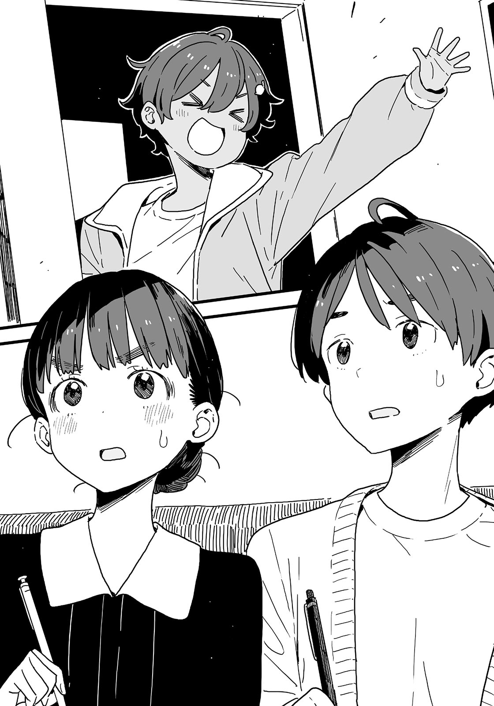

# Ch.13 — เล่ม4 บทที่ 2-3

Ch.13 — เล่ม4 บทที่ 2-3

By Monica

Published: 2024-12-06T15:23:20Z

Source: https://www.nekopost.net/novel/14560/13

เล่ม4 บทที่2-3

เสียงเคาะประตูดังขึ้นตอนบ่ายสองพอดี

เทียร่าซังเดินเข้ามาในห้อง เธอนั่งลงบนโซฟาที่ยานามิเพิ่งนั่งเมื่อครู่นี้

[ ขอโทษที่ให้รอค่ะ นุคุมิซึซัง ]

[ ไม่หรอก เพิ่งมาถึงเหมือนกัน ]

ผมมองไปที่เทียรซัง เธอสวมชุดเดรสสีน้ำเงินเข้มมีปกสีขาว ดูเหมือนเธอจะไปงานแต่งญาติมากกว่ามาเจอกัน ]

[ มองอะไรอยู่? มีอะไรติดหน้าฉันเหรอ? ]

[ ไม่มีอะไรหรอก แค่สงสัยว่าทำไมเราถึงมาที่คาราโอเกะกัน? ]

[ เรามาที่นี่เพื่อหลีกเลี่ยงการพบปะผู้คนและไม่ให้นายคิดอะไรเพี้ยน ๆ พนักงานจะคอยอยู่ด้วยตลอดเวลา นี่เป็นสถานที่ที่ดีสำหรับการคุยแบบส่วนตัว ]

เทียร่าซังพองอกที่พอดีกับอายุของเธอขึ้น เธอคนนี้ไม่มีมารยาทเหมือนเดิมเลย

[ เข้าใจแล้ว งั้นเธออยากดื่มอะไรหน่อยมั้ย? ]

[ ไม่ล่ะ ฉันพกน้ำมาด้วยแล้ว ]

เอาอีกแล้ว ผมรู้สึกแปลกใจ แต่เทียร่าซังก็แค่ส่งสายตาที่ดูดุใส่ผม

[ การมาคาราโอเกะครั้งนี้คือการลดการเจอกับคนอื่น ฉันไม่ได้มาเพื่อเล่นนะ ]

เธอวางโบรชัวร์ที่มีสีสันลงบนโต๊ะ

[ นี่มัน... โบรชัวร์โรงเรียนกวดวิชาเหรอ? ]

[ นุคุมิซึซัง ได้ยินว่านายไปกวดวิชากับสองคนนั้นเมื่อไม่กี่วันที่แล้วใช่มั้ย? ว่าจะขอข้อมูลจากนายสักหน่อย ]

เอ๊ะ เราไม่ได้มาคุยเรื่องชิกิยะซังกับรุ่นพี่สึกิโนะคิเหรอ? แม้ว่าเธอจะเคยถามผมเกี่ยวกับเรื่องเรียนมาก่อน แต่ผมก็รู้สึกงงเล็กน้อย

[ ตอนนี้ไม่ได้ไปกวดวิชาแล้ว ถ้าเธออยากรู้รายละเอียดเพิ่มเติม จะถามสองคนนั้นให้ก็ได้ ]

[ ไม่เป็นไรหรอก ทั้งสองคนเป็นคนดีนะ เข้าใกล้พวกเขาต่อหน้านายมันก็ออกจะ…ฉันจะไม่พูดมากแล้วกัน นี่ไม่ใช่เรื่องในโรงเรียนด้วย! ]

ช่วยไม่ได้จริง ๆ ผมเปิดโบรชัวร์โรงเรียนกวดวิชาดู

[ ผทชอบการเรียนแบบพบหน้าครูในห้องเรียนมากกว่าถ้าเทียบการเรียนออนไลน์ นี่แหละที่ทำให้ผมชอบโรงเรียนนี้ ห้องเรียนก็ดี อุปกรณ์การเรียนก็เยอะ ]

[ เข้าใจแล้ว ฉันไม่ชอบการเรียนแบบตัวต่อตัวนัก พอมีประสบการณ์บ้างมั้ย นุคุมิซึซัง ? ]

[ ไม่ได้คิดเกี่ยวกับเรียนตัวต่อตัวเลย ไม่ค่อยอยากคุยกับคนแปลกหน้าเท่าไหร่ ]

[ นายก็คุยกับครูที่สอนอยู่ไม่ใช่เหรอ? ]

นั่นสินะ ดูเหมือนเธอจะคิดแบบนั้น

ถึงอย่างนั้น วันนี้เทียร่าซังก็ไม่ได้ดูน่ากลัวเหมือนทุกที เธอที่ดูโกรธง่ายในโรงเรียนนั้นหายไปแล้ว

หลังจากพูดคุยกันไปสักพัก ผมก็สังเกตว่าบางทีเธอก็ยิ้มออกมาบ้าง

...ถ้าเป็นแบบนี้ก็ดูน่ารักดีนะ ? หวังว่าเธอจะเป็นแบบนี้ต่อไป

ผมมองเธออย่างใจลอย เทียร่าซังหันมาสบตากับผม

[ มีอะไรหรือเปล่า นุคุมิซึซัง? ]

[ ป-เปล่า ไม่มีอะไร แค่คิดว่าเรายังมีเวลาอยู่ ]

ผมหยิบรีโมตขึ้นมา ในที่สุดถึงเวลาที่จะลองร้องคาราโอเกะครั้งแรกแล้ว

ผมพยายามนึกคำสอนของยานามิในใจ

1. มือใหม่ห้ามร้องเพลงรัก

2. ห้ามร้องเพลงอนิเมะเด็ดขาด แม้แต่เพลงดัง ๆ

3. เพลงตลกต้องรู้จังหวะและสถานการณ์ถึงจะได้ผล

4. คนเราจะร้องไห้ในช่วงเวลาที่ตึงเครียดเพราะความต่างทางอารมณ์

5. เพราะอย่างนั้นเพลงอนิเมะถึงไม่เวิร์ค

เพลงอนิเมะไปฆ่ๅพ่อแม่ยานามิมาเหรอ?

แต่ถ้าไม่ใช่เพลงพวกนั้น ผมจะร้องอะไรดี…?

ขณะที่ผมลังเลกับรีโมต เทียร่าซังก็หยิบหนังสือเรียนภาษาญี่ปุ่นออกมาจากกระเป๋า

[ บาโซริซัง เธอทำอะไรอยู่น่ะ? ]

[ ฉันจะเริ่มเรียนก่อน นายเองก็เหมือนกัน ทำไมไม่เอาสมุดกับปากกามาล่ะ? ]

[ เอ๊ะ เธอจะมาเรียนจริง ๆ เหรอ? ]

เทียร่าซังทำหน้าจริงจัง

[ นายบอกเองไม่ใช่เหรอว่าฉันขอคำปรึกษาจากนายได้? แล้วนายคิดว่าเรามาที่นี่เพื่อทำอะไรกัน? ]

เอ๋ ก็นึกว่าเรามาร้องคาราโอเกะไง...

ผมเงียบไปเพราะความอาย เทียร่าซังส่งหนังสือศัพท์ภาษาอังกฤษมาให้

[ จะใช้เล่มนี้มั้ย? ]

[ อ่า ได้สิ ]

ผมเริ่มอ่านหนังสือคำศัพท์อย่างที่เธอว่า

...ทำไมต้องมานั่งท่องศัพท์อยู่ในห้องคาราโอเกะกับผู้หญิงที่ผมไม่ได้สนิทขนาดนั้นด้วย?

หลังจากท่องคำศัพท์ไปได้สามคำ ผมก็แอบยกหนังสือขึ้นบังหน้าแล้วมองเทียร่าาซัง

เธอยังคงเก็บผมเรียบร้อยเหมือนในโรงเรียน เธอไม่ใส่เครื่องประดับ และก็ดูสงบนิ่งเหมือนเคย

เทียร่าซังจดจ่อกับตารางการใช้คำศัพท์และพูดพึมพำคนเดียว แบบนี้มันไม่เหมือนนัดเดทเลยสักนิด

หลังจากผ่านไปสักพัก เทียร่าซังก็ยืดตัวตรง

[ เริ่มเหนื่อยแล้ว มีเพลงอะไรอยากฟังมั้ย? ]

[ อืม…ผมอยากคุยเรื่องอื่นมากกว่า ]

ถ้านี่ไม่ใช่เดทผมจะไม่ลังเลเลย เทียร่าซังปิดหนังสือเมื่อเห็นสีหน้าจริงจังของผม

[ เธอจะพูดถึงรุ่นพี่ชิกิยะใช่มั้ย? ]

ผมพยักหน้าอย่างจริงจัง

[ ใช่ เธอก็เคยบอกว่าผมควรจัดการเรื่องยุ่ง ๆ ของพวกเขาให้จบด้วยใช่มั้ย? ]

[ ฉันบอกเอง นั่นคือเงื่อนไขที่จะคืนหนังสือให้นาย ]

[ เราสองคนไม่รู้ว่าเกิดอะไรขึ้นระหว่างพวกเขา พูดตรง ๆ ถ้าเราเข้าไปยุ่ง เธอคิดว่ามันโอเคเหรอ? ]

เทียร่าซังเทน้ำชาฝาใส่ขวดน้ำของเธออย่างเงียบ ๆ เธอค่อย ๆ สูดลมหายใจลึกๆและดมกลิ่นไอน้ำที่ลอยขึ้นมา

บรรยากาศโดนความเงียบครอบงำ ผมพยายามพูดเพื่อทำลายความเงียบ แต่เธอก็พูดแทรกขึ้นมาก่อน

[ ...สองคนนั้นดูเหมือนจะไม่ได้เกลียดกันนะ ในสายตาฉัน ]

เทียร่าซังค่อย ๆ จิบชา หลังจากพูดจบ

ผมคิดอย่างรอบคอบเกี่ยวกับคำพูดของเธอ

[ งั้นบาโซริซังคิดว่าสองคนนั้นจะเข้าใจกันได้ถ้าพวกเขาได้คุยกันใช่มั้ย? ]

[ จะพูดยังไงดี... ฉันคิดว่าเพราะพวกเขารู้จักกันมาก่อน ถ้าได้พบกันอีกครั้งอาจทำให้พวกเขาตัดขาดจากกันโดยสมบูรณ์ก็ได้ ]

เทียร่าซังมองเข้ามาในตาผม

[ คนที่หลีกเลี่ยงการพบปะกัน มักจะกลัวว่าความสัมพันธ์ที่คลุมเครือของพวกเขาจะพังลงถ้าพวกเขาต้องเผชิญหน้ากัน นี่มันค่อนข้างเป็นเรื่องธรรมดาเลยใช่มั้ยล่ะ? ]

ผมก้มลงเพื่อหลบสายตาของเทียร่าซัง

ผมเข้าใจความหมายของเธอนะ แต่-

[ ยังมีคำถามอีกข้อ บาโซริซัง ทำไมเธอถึงใส่ใจความสัมพันธ์ของสองคนนั้นมากขนาดนี้? ]

[ ฉันเคยบอกนายแล้วใช่มั้ย? ฉันไม่อยากโดนลากเข้าไปเกี่ยวข้องกับอดีตของพวกเขา ]

[ แต่ถ้านั่นคือเหตุผลของเธอ ทำไมถึงไม่เมินพวกเขาไปเลยล่ะ? รุ่นพี่สึกิโนะคิจะเรียนจบในเร็ว ๆ นี้อยู่แล้ว แถมยังมีสอบรออยู่ข้างหน้าอีก แค่ปล่อยเธอไปก็ได้นะ ]

[ บางที...อาจจะเป็นอย่างนั้น ]

[ ถ้าเธอเมินไม่ได้ มันคงเป็นเพราะเหตุผลของบาโซริซังเองมากกว่ามั้ง? ]

[ นั่น... ]

เทียร่าซังก้มลงและมองถ้วยน้ำชาในมือ

[ นั่นเป็นเพราะรุ่นพี่ชิกิยะ... ดูโดดเดี่ยวมากตอนที่สึกิโนะคิ โคโตะ ปฏิเสธเธอ ]

เทียร่าซังดื่มน้ำชาหลังจากตอบอย่างสงบ

จากนั้นเธอก็จ้องมาที่ผมด้วยท้าทาย

[ แค่นี้พอมั้ย? ]

พอแล้วแหละ ผมพยักหน้าเงียบ ๆ

[ ขอโทษที่ถามเยอะเกินไป แต่หวังว่าเธอจะไม่คิดร้ายกับรุ่นพี่สึกิโนะคินะ ]

[ ถึงนายจะพูดแบบนั้น ฉันก็ไม่มีเหตุผลที่จะรู้สึกดีต่อเธอหรอก ]

[ แน่นอน บางครั้งเธอก็อาจจะ... ไม่สิ เธอกวนประสาทมากก็ว่าได้ แต่เธอก็มีข้อดีอยู่บ้างนะ ถึงจะไม่เยอะเท่าไหร่ก็เถอะ ]

[ ...ชื่นชมความใจกว้างของเธอนะ ]

เทียร่าซังถอนหายใจ

[ ฉันเกลียดคนที่ทำอะไรแบบลวกๆ และไม่ใส่ใจ และฉันก็เกลียดคนที่ทำให้รุ่นพี่ที่ฉันให้ความสำคัญต้องทำหน้าตาแบบนั้นด้วย และที่สำคัญที่สุด ฉันเกลียดคนที่ทำลายคุณค่าของฉันมากที่สุด ]

ความแตกต่างในคุณค่าของแต่ละคนนั้นเราไม่สามารถแก้ไขได้ แม้ว่าจะไม่มีข้อแก้ตัวสำหรับการเขียนแฟนฟิค BL ถึงอย่างงั้นผมก็ไม่อยากให้เธอหยุดเขียน แต่ถ้าเป็นไปได้อยากจะเก็บเรื่องนี้เป็นความลับด้วย

[ จะพยายามทำอะไรสักอย่างเกี่ยวกับสองคนนั้นดู อย่าลืมสัญญาของเรานะ เรื่องโดจินชิ ]

[ ฉันก็เหมือนกัน ขอร้องล่ะ ]

เทียร่าซังกลับไปสนใจหนังสือเรียนอย่างเงียบ ๆ

...เอาล่ะ ผมควรจะกลับได้แล้ว

ขณะที่ผมกำลังเช็คตารางรถไฟบนโทรศัพท์ เทียร่าซังก็พูดขึ้นมา

[ แต่ฉันก็กังวลเรื่องโรงเรียนกวดวิชาจริง ๆ นะ ]

เธอพูดพลางเปิดหน้าหนังสืออีกหน้า

[ ฉันมีน้องชายอยู่ เขาไม่อยากไปเรียนกวดวิชาเลยไม่ว่าจะพยายามโน้มน้าวเขาเท่าไหร่ ]

[ ทำไมล่ะ? ]

[ เขาเพิ่งเข้าชมรมฟุตบอล และต้องจ่ายค่าฝึกซ้อม ฐานะของครอบครัวเราก็ไม่ได้ดีนัก ]

เธอกล่าวพลางเน้นข้อความในหนังสือเรียน

[ ถึงอย่างนั้น ฉันคิดว่าเขาคงจะไปถ้าฉันขอให้พ่อแม่ช่วยคุยกับเขา แต่ฉันอยากหาวิธีที่เป็นภาระกับพวกเขาน้อยที่สุดเท่าที่จะทำได้ ]

เรื่องราวของเทียร่าซังก็จบลงแค่นั้น

เธอยังคงอ่านหนังสืออย่างเงียบ ๆ ผมจึงพูดขึ้นมา

[ พ่อแม่เคยบอกผมว่าถ้ามีสิ่งที่อยากทำให้บอกพวกเขาได้เลย พวกเขาจะช่วยเท่าที่ทำได้ ]

[ แล้วไงล่ะ? ]

เทียร่าซังหยุดและค่อย ๆ เงยหน้าขึ้นมามอง

[ เพาระงั้นผมคิดว่าพ่อแม่ของบาโซริซังก็คงคิดเหมือนกัน ]

[ ครอบครัวของนุคุมิซึซังคงโชคดีมากสินะ ]

[ หา? เปล่าหรอก แต่ว่าพ่อแม่ผมทำงานทั้งคู่นะ- ]

[ ไม่เกี่ยวกับเรื่องเงินหรอก ครอบครัวฉันก็ไม่ได้ยากจนขนาดนั้น ]

เทียร่าซังดูเหมือนจะมีบางอย่างที่ เธออยากจะพูดเพิ่ม ใบหน้าของเธอดูเหมือนว่าเธอไม่สามารถทนได้อีกต่อไป

[ เฮ้อ น่ารำคาญจัง ฉันจะพูดตรง ๆ ล่ะนะ ]

เทียร่าซังประสานนิ้วและยืดหลังตรง

[ ความจริงแล้ว วันนี้ฉันตั้งใจมาที่นี่เพื่อแกล้งนุคุมิซึซัง ]

[ หา? ทำแบบนั้นทำไม? ]

[ ก็นายมาที่นี่เพื่อเอาโดจินชิคืนตามคำแนะนำของรุ่นพี่ชิกิยะใช่มั้ย? ฉันรู้สึกว่าฉันควรจะมีสิทธิ์แก้แค้นสักหน่อย ]

ผมไม่มีอะไรจะพูดนอกจากยิ้มแห้ง ๆ เทียร่าซังจ้องเขม็งใส่ผม

[ แต่ได้อย่าเข้าใจผิดล่ะ! ไม่ใช่ว่าฉันแค่พูดกับนายโดยไม่มีจุดหมายอะไรนะ! กฎของโรงเรียนชัดเจนว่าความสัมพันธ์ระหว่างเพศตรงข้ามต้องมีความเหมาะสมและโปร่งใส ไม่มีการมีปฏิสัมพันธ์เกินความจำเป็น- ]

เทียร่าซังบ่นอย่างรวดเร็ว

[ ...นุคุมิซึซัง ที่ฉันพูดไปผิดตรงไหนเหรอคะ? ]

[ ไม่หรอก แค่คิดว่านี่มันเหมือนกับเทียร่าซังปกติมากกว่า ]

[ หา!? หมายความว่านายคิดว่าฉันเป็นคนขี้โมโหตลอดเวลางั้นเหรอ!? แล้วก็ อย่าเรียกฉันด้วยชื่อจริงได้มั้ย! ]

เทียร่าซังหยิบหนังสือคำถามขึ้นมาจากกระเป๋าด้วยท่าทีหงุดหงิด

[ ฉันจะไม่ยั้งอีกแล้วนะ นุคุมิซึซัง นายเก่งคณิตใช่มั้ย? ]

[ ก็ไม่เชิง ]

[ งั้นช่วยสอนฉันหน่อย ]

หา แล้วผมจะทำยังไง ถ้าไม่ออกจากที่นี่เร็วๆนี้จะไปไม่ทันแล้ว

ผมลังเลที่จะตอบ เทียร่าซังก็เปิดหนังสือคำถามโดยไม่รอฟังคำตอบ

[ ฉันเข้าใจเรื่องไซน์กับโคไซน์แล้ว แต่ทำไมฉันถึงแก้โจทย์ข้อนี้ไม่ได้ก็ไม่รู้ ]

หรือจะเป็นเพราะเธอยังไม่เข้าใจทั้งหมด? ผมมองโจทย์ของเทียร่าซังจากอีกฝั่งของโต๊ะ

[ อืม มันมืดอะ มองไม่เห็นชัดเลย ]

[ งั้นมานั่งตรงนี้สิ ]

เทียร่าซังตบโซฟาข้าง ๆ เธอ

[ เอ๊ะ? ข้าง ๆ เธอ? นี่ไม่ดีเลยนะ ]

[ ฉันแค่ขอให้นายสอนฉันเท่านั้นแหละ อย่าคิดอะไรแปลก ๆ ล่ะ ]

ผมไม่อยากจะยอมรับเลย แต่รู้สึกว่ามีแค่ผมคนเดียวที่รู้สึกประหม่า ผมทำท่าทางปกติแล้วนั่งข้างเทียร่าซัง มีกลิ่นหอมบางเบาของเครื่องสำอางลอยมา

…เทียร่าซัง ทาเครื่องสำอางอยู่เหรอ? อ่ะ เห็นไฝเล็ก ๆ ที่คอเธอด้วย

[ โจทย์อันนี้ รู้มั้ยว่าต้องแก้ยังไง? ]

เทียร่าซังส่งหนังสือโจทย์มาให้ ผมรีบสลัดความคิดแย่ๆออกไปแล้วจ้องมองมัน

เธอทำโจทย์ไปครึ่งทางแล้ว มาดูกัน…

[ ฉันไปไม่ถึงไหนเลย เป็นไปได้มั้ยว่าโจทย์นี้มีอะไรผิด? ]

[ เอ่อ อันนี้ ฉันคิดว่าเธอสลับกฎของโคไซน์กับไซน์น่ะ ]

[ ............ ]

เทียร่าซังเขียนอะไรบางอย่างลงในหนังสือโจทย์อยู่พักหนึ่ง แล้วก็ปิดมันดัง “ปัง”

[ ฉันผิดเอง ไม่ได้เป็นหนังสือโจทย์หรอก ]

อ่า ใช่ มันก็เป็นเรื่องปกติที่เกิดขึ้นได้

ผมรู้สึกอึดอัดกับความรู้สึกอับอายแทน เลยพยายามจะลุกขึ้นยืน แต่เทียร่าซังลดสายตาลงแล้วจับแขนผมไว้

[ เอ๊ะ ยังมีอะไรที่เธอไม่เข้าใจอีกมั้ย? ]

[ เปล่า ไม่แล้วล่ะ ฉันแค่อยากจะพูดอะไรบางอย่าง ]

[ โอเค…? ]

เทียร่าซังก้มหน้าลง แล้วเล่นนิ้วของเธอไปมา

[ เอ่อ นอกจากที่ฉันมาที่นี่เพื่อเรียนกับปรึกษาเรื่องรุ่นพี่แล้ว ยังมีอีกเรื่องที่ฉันไม่อยากให้ใครได้ยิน ]

…หืม? คืออะไร?

เดี๋ยวนะ เธอมีเรื่องที่ไม่อยากให้คนอื่นรู้ แล้วก็ยังเรียกผมออกมาในวันหยุดสุดสัปดาห์อีก-

เอ๊ะ เดี๋ยวก่อนนะ หรือว่านี่คือ…ช่วงที่ผมจะกลายเป็นคนฮ๊อต ?

ใบหน้าเล็กๆของเทียร่าซังก้มลงและสั่นไหวเล็กน้อย คอของเธอที่เรียวบางมีแสงสีซากุระจาง ๆ

ผมกลืนน้ำลาย เสียงในลำคอดังขึ้น

[ นี่ นุคุมิซึซัง! ]

[ ค-ครับ! ]

[ ----------หรือเปล่า--? ]

หืม? เธอพูดอะไรน่ะ? จากการดำเนินเรื่อง น่าจะถามว่าผมมีแฟนหรือเปล่า ?

[ เอ่อ ไม่มีใครแบบนั้นหรอก ]

[ ...จริงเหรอ? ]

เทียร่าซังเงยหน้าขึ้นมา

[ งั้น...หนังสือเล่มนั้นมีต่อมั้ย? ]

[ เอ๊ะ? หนังสือเล่มนั้นเหรอ? ]

ผมสับสน เทียร่าซังโมโหขึ้นมาทันที

[ ฉ-ฉันหมายถึงภาคต่อของโดจินชิน่ะ! มันมีมั้ย? ยังไม่ออกอีกเหรอ!? ]

[ เอ่อ คนนั้นเป็นนักเรียนเตรียมสอบน่ะ เธอเขียนไม่เร็วขนาดนั้นหรอก ]

[ เข้าใจแล้ว ทำอะไรไม่ได้จริง ๆ เตรียมสอบสำคัญกว่านี่นา ]

ไหล่ของเทียร่าซังตกลงทันที งั้นเธอ-

[ …เธออยากอ่านภาคต่อเหรอ? ]

[ ว๊า!? อ-อย่ามาคิดเองเออเองนะ! ฉันก็แค่สงสัยว่าเรื่องจะเป็นยังไงต่อเพราะมันจบค้างคาแค่นั้นแหละ! ]

แสดงว่าเธอก็อยากอ่านภาคต่อ

แน่นอน คนเราสามารถเลือกได้ว่าจะจมดิ่งในโลก BL หรือไม่ แต่ว่าการที่มีจุดเริ่มต้นจากนิยาย BL ของรุ่นพี่ที่เคารพมันเป็นจุดเริ่มต้นที่ลึกเกินไป เธอไม่มีทางจะพอใจได้หรอก

[ นี่ ที่ฉันพูดเมื่อกี้เป็นความลับนะ! โดยเฉพาะกับ สึกิโนะคิ โคโตะ อย่าบอกเด็ดขาดเลยนะ! ]

[ งั้นบอกประธานนักเรียนได้มั้ย? ]

ผมพูดอย่างใจเย็น ใบหน้าของเทียร่าซังซีดเผือด

[ ทำไมจะบอกได้ล่ะ!? นายบ้าไปแล้วเหรอ!? ]

ไม่ปฏิเสธนะ แต่เทียร่าซังก็ไม่ได้ดีกว่าหรอก

อีกอย่าง ผมผิดเองที่ไปแกล้งเธอ

[ เทียร่าซัง หน้าเธอ…ใกล้เกินไปหน่อยนะ ]

[ เอ๊ะ? ]

และใช่ ตอนนี้เทียร่าซังอยู่ห่างจากผมแค่ก้าวเดียว ผมรีบถอยออกมา

เทียร่าซังก็กระโดดออกมาทันที คราวนี้แม้แต่หูของเธอก็แดง เธอก้มหน้าลง

[ อ่ะ ก็เพราะนายพูดอะไรแปลก ๆ น่ะสิ! แล้วก็อย่าเรียกฉันด้วยชื่อจริงนะ! ]

[ เอ่อ ขอโทษ… ]

นี่มัน…..อึดอัดชะมัด

การอยู่ตามลำพังกับผู้หญิงในห้องส่วนตัวแบบนี้โดยเฉพาะกับเทียร่าซังมันทำให้ผมรู้สึกอึดอัดมาก

บรรยากาศช่างต่างจากตอนที่อยู่กับยานามิเมื่อกี้อย่างสิ้นเชิง

ผมรับมือกับการเปลี่ยนแปลงนี้ไม่ได้เลย

ผมมองนาฬิกาบนผนังโดยไม่ตั้งใจ ใกล้จะบ่ายสามแล้ว เวลาที่ต้องไปเจอกับชิกิยะซังใกล้เข้ามาทุกที

[ ขอโทษนะ ถ้าฉันไม่ไปตอนนี้ รุ่นพี่ชิกิยะอาจต้องรอ... ]

ผมพูดด้วยความโล่งใจ เทียร่าซังเงยหน้าขึ้นมามอง

[ ...นายต้องไปหารุ่นพี่ชิกิยะเหรอ? ]

[ ใช่ สมาชิกคนอื่นๆก็ไปแล้ว ฉันต้องไปรวมกับพวกเขา ]

จริงๆ จะไปสายหน่อยก็ไม่เป็นไรหรอก เพราะโคมาริและยากิชิโอะอยู่ที่นั่นแล้ว แต่ถ้าผมยังอยู่ที่นี่ต่อไป หัวใจผมคงรับไม่ไหวแน่

ผมพยายามลุกขึ้นยืน เสียงกระซิบของเทียร่าซังตามมา

[ ...อยู่ต่ออีกสักพักได้มั้ย ? ]

อะไรนะ? ผมเกือบจะถามออกไปแล้ว แต่ก็กลืนคำพูดนั้นกลับลงไป

ไม่รู้จริงๆ ว่าเธอหมายความว่าอะไร แต่ที่ผมรู้คือผมสามารถอยู่ที่นี่ต่อไปได้

...อยู่ต่ออีกสักพักได้มั้ย ?

เทียร่าซังหันหน้าหนีแล้วเลื่อนสมุดโจทย์ไปทางผม

[ อย่าเข้าใจผิดนะ ! ฉันแค่อยากจะถามคำถามอีกข้อเท่านั้นเอง ]

[ โอ๊ะ งั้นเหรอ? คำถามอะไรล่ะ ? ]

[ เอ่อ...จะถามข้อนี้ค่ะ ]

เทียร่าซังวางนิ้วที่บอบบางของเธอลงบนสมุดโจทย์

แสงสลัวๆในห้องทำให้ผมต้องเอาหน้าเข้าไปใกล้และเพ่งสายตาเพื่ออ่านโจทย์ อืม ไหนดูสิ

[ ช่วยฉันแก้โจทย์ข้อนี้ได้มั้ยคะ ? ]

ทันใดนั้นเอง เสียงของเทียร่าซังก็ดังขึ้นข้างๆหูผม

เทียร่าซัง เธออยู่ใกล้ไปแล้วนะ ถ้าผมหันหน้าไปตอนนี้จะเกิดอะไรขึ้น...?

ผมยังคงอยู่กับที่ แล้วประตูก็เปิดออกเสียงดัง

[ ขอโทษที่ให้รอ ! ขอโทษที่มาสายด้วย ! ]

เอ๊ะ ทำไมเธอถึงมาอยู่ที่นี่!?

[ ขอโทษนะ ฉันเข้าห้อง...ผิด... ]

ผมกับเทียร่าซังรีบถอยห่างจากกัน

เลม่อน ยากิชิโอะ รอยยิ้มบนใบหน้าของเด็กผู้หญิงที่ไม่ควรจะมาอยู่ที่นี่ค่อยๆ เปลี่ยนเป็นสีหน้าสับสน

[...เอ๊ะ ฉันขัดจังหวะพวกเธอรึเปล่า? ]

[ เปล่านะ! ] [ ไม่ใช่หรอก! ]

เราตอบพร้อมกัน สีหน้าของยากิชิโอะยิ่งดูแข็งกระด้างขึ้น

ไม่ใช่อย่างที่เธอคิดจริงๆ นะ ผมลุกขึ้นแล้วพายากิชิโอะไปที่มุมห้อง

[ เอ่อ ยากิชิโอะ ทำไมเธอถึงมาที่นี่ล่ะ? ไม่ได้อยู่กับโคมาริเหรอ? ]

[ ห๊ะ? ก็เพราะว่าร้องคาราโอเกะมันสนุกกว่าเล่นบอร์ดเกมส์ไงล่ะ ]

เอ๊ะ นี่เธอพูดถึงอะไร? ยานามิ เธอไปบอกอะไรยากิชิโอะเนี่ย...?

ยากิชิโอะมองข้ามไหล่ผมไปที่เทียร่าซัง

[ ขอโทษนะ ฉันไม่คิดว่าพวกเธอจะเป็นแบบนี้ ฉันกลับบ้านก็ได้นะถ้าฉันขัดจังหวะ ]

[ ม-ไม่ๆ ! พวกเราก็แค่มาติว- แค่มาประชุมแผนการเรียนเท่านั้นค่ะ ! ]

[ ใช่ๆ! ดูสิ เธอนั่งข้างฉันเพราะมีสมุดโจทย์แค่เล่มเดียวน่ะ! ]

[...ประชุมแผนการเรียน? ]

ยากิชิโอะหยิบสมุดโจทย์บนโต๊ะขึ้นมาแล้วพลิกหน้าดู

[ พวกเธอเรียนในห้องคาราโอเกะทำไม? ไม่ใช่ว่าควรร้องเพลงหรอ? ]

[ เอ๊ะ อ่า เธอพูดถูก บาโซริซัง ร้องเพลงสักเพลงมั้ย? ]

[ อ่า ฉันไม่รังเกียจ- ]

[ ใช่สิ..... ]

ยากิชิโอะไปหยิบรีซีฟเวอร์ขึ้นมา เทียร่าซังยืนอยู่ข้างผม

[ นายเป็นคนเรียกยากิชิโอะมาที่นี่ใช่มั้ย? รู้จักคำว่า 'ความลับ' รึเปล่า?]

[ เอ๊ะ? ไม่นะ หมายถึง ฉันไม่ได้บอกเธอ ]

เทียร่าซังจ้องมาที่ผมด้วยสายตาที่ดูโกรธ ผมอ้ำอึ้งอยู่สักพัก เธอพูดต่อด้วยน้ำเสียงที่เย็นยะเยือกยิ่งขึ้น

[ นุคุมิซึซัง อย่าลืมคำสัญญาของเรานะ รู้ใช่มั้ยว่าจะเกิดอะไรขึ้นถ้าผิดสัญญา? ]

เธอแทงผมด้วยสายตาที่จริงจัง มันเหมือนกับบรรยากาศเมื่อครู่นี้ไม่เคยมีอยู่จริง

คือ ผมทำอะไรผิดเหรอ...?

---

*note เอาtextมาจากในเพจ/บางอันพิมพ์ใหม่ถ้ามันคำมันแตกหรืออะไรก็บอกได้คับ
