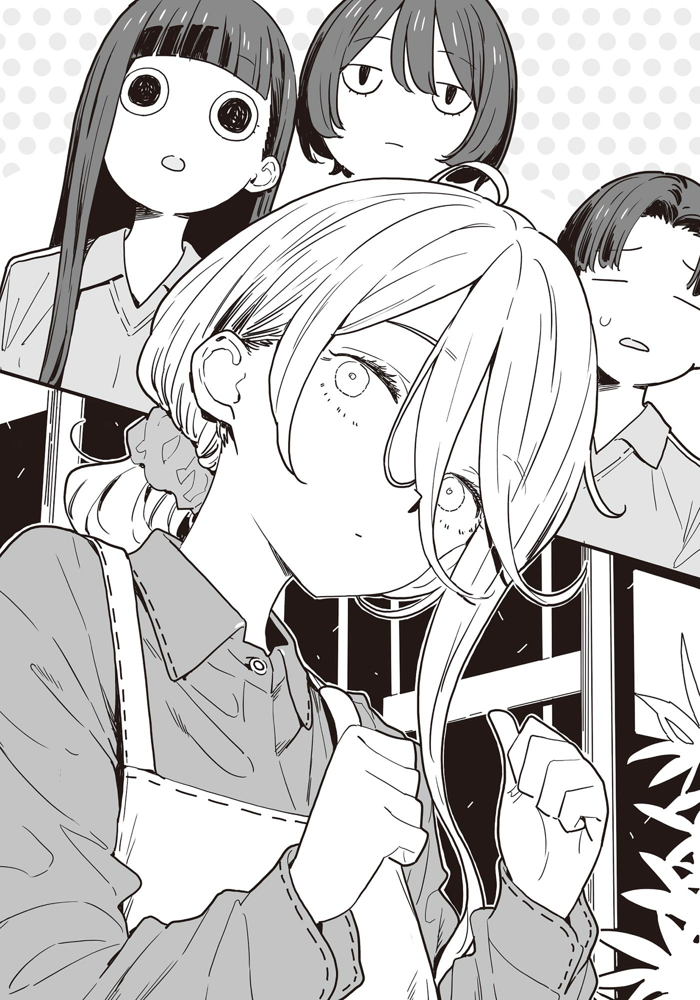

# Ch.140 — เล่ม 8.5 บทที่ 10

Ch.140 — เล่ม 8.5 บทที่ 10

By มนก

Published: 2026-02-21T08:21:39Z

Source: https://www.nekopost.net/novel/14560/140

ฤดูกาลแห่งการผลิบาน

นุคุมิซึ คาจู กับ กอนโด อาสามิ นั่งรถไฟและเดินเท้าจากสถานีโทโยฮาชิ 30 นาที ทั้งสองคนกำลังยืนอยู่หน้าร้านขายต้นไม้ในแถบชานเมือง

ที่นี่เป็นร้านขนาดใหญ่ที่มีพื้นที่หลายพันสึโบะ ไม่ได้ขายแค่ต้นไม้แต่ยังมีอุปกรณ์ทำสวนจำหน่ายอย่างกว้างขวาง

ทั้งสองคนที่มาเยือนที่นี่เพื่อทำกิจกรรมทดลองฝึกงานของโรงเรียน อยู่ในชุดพละของโรงเรียนมัธยมต้น

คาจูทอดสายตาไปยังทิศทางของสถานีรถไฟ เส้นผมสีดำยาวสลวยพลิ้วไหว

[ ทาจิบานะคุงช้าจังเลยนะ ใกล้จะถึงเวลานัดแล้วด้วย ]

ผู้เข้าร่วมคนที่ 3 คือ ทาจิบานะ ซาโตชิ ซึ่งเป็นเพื่อนร่วมชั้น

เขาคือผู้กล้าที่สารภาพรักกับอาจารย์อามานัตสึในงานทัศนศึกษาของโรงเรียนมัธยมปลายสึวาบุกิ และยังเป็นคนที่กอนจังแอบชอบอยู่ด้วย

[ หมอนั่นก็มาฉิวเฉียดตลอดนั่นแหละเนอะ ]

กอนจังพูดห้วนๆ ก่อนจะเริ่มจับผมตัวเองเล่นด้วยความกระวนกระวาย

กอนจังที่ตัดสินใจแล้วว่าจะไม่สารภาพรัก ก็ยังคงเป็นเพื่อนสมาชิกชมรมจัดสวนกันเหมือนที่ผ่านมา──น่าจะเป็นแบบนั้น

[ กอนจัง เป็นอะไรรึเปล่า? ]

[ ไม่ได้เป็นอะไรสักหน่อย ]

คงจะรู้ตัวว่าเมื่อกี้เผลอทำเสียงแข็งไปหน่อย กอนจังเลยพูดต่อด้วยน้ำเสียงที่อ่อนลง

[ รู้สึกว่าช่วงนี้ ……หมอนั่น จะทำตัวกร่างขึ้นมานิดหน่อยแล้วสิ ]

[ ทาจิบานะคุงน่ะเหรอ? ]

คาจูเอียงคอครุ่นคิด แต่ก็ไม่เคยได้ยินเรื่องแบบนั้นเลย

ในฐานะประธานชมรมจัดสวน เขาก็น่าจะเป็นที่เคารพรักของพวกรุ่นน้องสิ

[ ดูพึ่งพาได้มากขึ้นรึเปล่านะ วันก่อนกอนจังก็พูดเรื่องประมาณนั้น── ]

[ ไม่ได้พูดซะหน่อย ]

กอนจังกลับไปใช้น้ำเสียงห้วนๆ อีกครั้ง

คาจูรู้สึกว่ามุมปากตัวเองกำลังยกยิ้มขึ้น ขณะที่เอานิ้วจิ้มแขนกอนจัง

[ จะดีเหรอ ทาจิบานะคุงน่ะป๊อปพอตัวเลยนะ? ]

[……นุคุจัง เดี๋ยวก็จับโยนขึ้นฟ้าซะหรอก ]

คาจูแลบลิ้นแผล็บ แล้วถอยห่างออกมาจากกอนจัง

ระหว่างที่ทั้งสองคนกำลังหยอกล้อกัน ทาจิบานะคุงก็โผล่พรวดออกมาจากในร้านขายต้นไม้

[ ซาโตชิ อยู่ในร้านเองหรอกเหรอเนี่ย ]

[ อื้อ พอดีมีเรื่องสงสัยนิดหน่อยน่ะ ต้นกล้าที่มือโปรปลูกนี่มันต่างกันจริงๆ นะ ]

ทาจิบานะคุงหันกลับไปมองที่ร้านด้วยดวงตาเป็นประกาย

[ วิธีผสมดินต่างกันรึเปล่านะ อยากลองฟังตั้งแต่เรื่องวิธีเลือกเมล็ดพันธุ์เลยแฮะ…… ]

กอนจังมองทาจิบานะคุงที่กำลังพึมพำงึมงำด้วยความระอาใจ

[ ทั้งสองคน ถึงเวลานัดพอดีเลย ]

วินาทีที่คาจูละสายตาจากนาฬิกา ความเย็นเยียบก็แล่นปลาบไปตามสันหลัง

……ความรู้สึกแบบนี้ คุ้นๆ แฮะ

ทันใดนั้น ผู้หญิงคนหนึ่งก็เดินโซเซออกมาจากในร้าน พนักงานหญิงที่มัดผมยาวสีน้ำตาลอ่อนไว้ด้านหลังและสวมผ้ากันเปื้อนมีโลโก้ร้าน ก้มหัวให้พวกคาจูแบบโงนเงน

[ พวกวัยรุ่น……มากันแล้วสินะ…… ]

[ ชิกิยะซัง?! ทำไมถึงมาอยู่ที่นี่ได้คะ ]

ชิกิยะเอียงคอพับให้กับคาจูที่กำลังตกใจ

[ ที่นี่……ร้านบ้านฉันเอง……ตามมาสิ…… ]

เหมือนจะบอกว่าอธิบายแค่นั้นพอแล้ว เธอหันหลังให้ทั้งสามคนแล้วเดินนำไป

พอรีบเดินตามไป ทาจิบานะคุงก็มาเดินอยู่ข้างๆ

[ นุคุมิซึซัง พนักงานคนนั้นหรือว่าจะเป็น ]

[ อื้ม เป็นอดีตกรรมการนักเรียนของสึวาบุกิน่ะ เขาเอ็นดูคาจูมากเลยล่ะ ]

คาจูเดินตามชิกิยะจนทัน แล้วตั้งคำถามต่อไป

[ เอ่อ ชิกิยะซังทำงานพิเศษอยู่ที่นี่เหรอคะ? ]

[ บริษัทของพ่อแม่น่ะ……มีทำอย่างอื่น……อีกตั้งหลายอย่าง…… ]

ตอนที่ชิกิยะเดินผ่านกองปุ๋ย พนักงานหญิงสาวคนหนึ่งก็ส่งเสียงทักทาย

[ ยูเมโกะจัง มีดอกคลีมาติสสีใหม่เข้ามาแล้วนะ ]

[ ขอบใจนะ……เดี๋ยวค่อย……มาดู……]

ชิกิยะหยุดยืนที่โซนต้นไม้จัดสวน

ตรงนั้นมีต้นไม้จัดสวนสูงพอๆ กับผู้ใหญ่ ทั้งแบบปลูกลงดินและปลูกในกระถางวางเรียงรายปะปนกันอยู่

[ ก่อนจะร้อนไปกว่านี้……ต้องรดน้ำ……ซะก่อน…… ]

[ ถ้างั้นผมขอเป็นคนทำได้ไหมครับ ]

ชิกิยะยื่นสายยางให้กับทาจิบานะคุงที่เสนอตัว

[ รดน้ำที่โคนต้นนะ……เดี๋ยวแดดจะทำ……ใบไม้ไหม้…… ]

[ เข้าใจแล้วครับ รดให้ชุ่มๆ เลยได้ไหมครับ? ]

[ อืม……ชุ่มๆ เลย…… ]

คงจะดูจากฝีมือของทาจิบานะคุงแล้วตัดสินใจว่าปล่อยให้จัดการได้ล่ะมั้ง

เธอลากสายยางมาอีกเส้น แล้วยื่นให้กอนจัง

[ อีกครึ่งนึงฝั่งนี้……ของเธอนะ…… ]

[ อ๊ะ ค่ะ เข้าใจแล้วค่ะ ]

[ พอเสร็จแล้ว……ก็ให้เด็กหนุ่มคนนั้นช่วยดูให้ทีนะ…… ]

เมื่อสั่งงานทั้งสองคนเสร็จ ชิกิยะก็กวักมือเรียกคาจู

[ คาจูจัง……มาทางนี้…… ]

[ ค่ะ ชิกิยะซัง!]

คาจูเดินขนาบข้างชิกิยะที่ก้าวเดินไปอย่างไม่มีความลังเล

[ ไม่นึกเลยนะคะว่าคนที่มาช่วยสอนงานในกิจกรรมทดลองฝึกงานจะเป็นชิกิยะซัง ตกใจเลยค่ะ ]

[ ฉันเอง……ก็ตกใจเหมือนกัน…… ]

คาจูเหลือบมองเสี้ยวหน้าของชิกิยะ

คาจูสัมผัสได้ถึงบางอย่างที่ต่างไปจากใบหน้าไร้อารมณ์ตามปกติ จึงลองหยั่งเชิงถามดู

[ ชิกิยะซังกับท่านพี่ เราเจอกันตอนงานทัศนศึกษาสถานที่จัดงานแต่งงานสินะคะ หลังจากนั้นเป็นยังไงบ้างคะ? ]

กึก ชิกิยะหยุดเดิน แล้วเอียงคอโงนเงน

[ เป็นยังไง……เหรอ? ]

โดนดวงตาสีขาวขุ่นจ้องเขม็งเข้า คาจูก็เผลอถอยกรูดโดยไม่รู้ตัว

[ หนูนึกว่าน่าจะมีโอกาสได้พูดคุยกันที่สึวาบุกิบ้างน่ะค่ะ……คุณกับท่านพี่ก็ไม่ได้มีจุดเชื่อมโยงอะไรกันขนาดนั้นนี่เนอะ ขอโทษนะคะที่พูดอะไรแปลกๆ ออกไปค่ะ ]

คาจูเขกหัวตัวเองเบาๆ ชิกิยะที่นิ่งอึ้งไปครู่หนึ่งค่อยๆ ขยับปากพูด

[ กับพี่ชายของเธอ……ฉันไปเที่ยวด้วยบ่อยนะ…… ]

[ งั้นเหรอคะ?! ]

คาจูเผลอร้องเสียงหลง

ในสายตาของคาจู ชิกิยะ ยูเมโกะเป็นสาวสวยดูลึกลับและเป็นเหมือนดอกฟ้า ไม่ใช่ว่าไม่เหมาะสมกับท่านพี่หรอกนะ แต่ไม่คิดเลยว่าเขาจะมีจุดเชื่อมโยงกับรุ่นพี่สาวคนนั้นมากขนาดนี้

[ อืม……คาเฟ่บอร์ดเกม……ก็ไปบ้างเป็นบางครั้ง…… ]

[ วิเศษไปเลยค่ะ! แล้วมีไปที่ไหนอีกบ้างไหมคะ? ]

ชิกิยะโยกตัวไปมาโงนเงนราวกับกำลังค้นหาความทรงจำ

[ วันก่อน……ก็ให้ช่วยเลือก……ดอกไม้ที่จะให้เพื่อน…… ]

คาจูตื่นเต้นจนชะโงกตัวไปข้างหน้า

[ ถ้าอย่างนั้น! ชิกิยะซังก็ไปเดตกับท่านพี่บ่อยๆ สินะคะ? ]

[ เดต……? ]

ชิกิยะหลบสายตาล่อกแล่กไปมา ก่อนจะกระซิบพึมพำโดยไม่ยอมสบตาด้วย

[ นุคุมิซึคุง……ได้พูดอะไร……เกี่ยวกับฉันบ้างไหม……? ]

คาจูถึงกับพูดไม่ออก เธอไม่เคยได้ยินเรื่องของชิกิยะซังจากปากพี่ชายเลย ด้วยเหตุนั้นจึงไม่ได้จับตามองเอาไว้ แต่พอรู้ว่าทั้งสองคนมีความสัมพันธ์ที่ไปพบเจอกันบ่อยๆ แบบนี้ ก็คงต้องเปลี่ยนความคิดซะใหม่แล้ว

ระหว่างที่คาจูกำลังคิดวนไปวนมา ชิกิยะก็เริ่มออกเดินอีกครั้ง

[ ทางนี้……ต้องเอาเมล็ดพันธุ์ที่เพิ่งเข้ามา……ไปเรียง…… ]

[ อ๊ะ ค่ะ! ]

ขณะที่เดินตามหลังชิกิยะไป คาจูก็มั่นใจแล้ว

แผนผังศึกชิงว่าที่เจ้าสาวของท่านพี่ ดูท่าจะจำเป็นต้องอัปเดตครั้งใหญ่ซะแล้วสิ──

◇

ทั้งรดน้ำ เติมสินค้า และรับรองลูกค้า──พอได้ทดลองทำจนครบทุกอย่าง เวลาก็ล่วงเลยไปจนถึงบ่ายโมงแล้ว

ข้างๆ คาจูและกอนจังที่กำลังกินมื้อเที่ยงที่ล่าช้าอยู่หลังร้าน ทาจิบานะคุงรีบกินข้าวแบบลวกๆ แล้วเอาแต่รัวคำถามใส่ชิกิยะไม่หยุด

[ วันก่อนผมปลูกเมล็ดมะเขือม่วงไปน่ะครับ แต่มันไม่ค่อยโตเลย พอจะมีคำแนะนำอะไรไหมครับ? ]

[ แล้วเธอ……ทำยังไงบ้างล่ะ……? ]

[ ช่วยดูรูปหน่อยได้ไหมครับ ]

ชิกิยะและทาจิบานะคุงชะโงกหน้าดูสมาร์ทโฟนเครื่องเดียวกันแล้วคุยกันต่อ

กอนจังมองดูภาพนั้นอยู่ห่างๆ พลางเคี้ยวข้าวปั้นตุ้ยๆ

[ กอนจังไม่เข้าไปคุยด้วยกันเหรอ ]

[ ฉันไม่เป็นไรหรอก ]

ง่ำๆๆ กอนจังกินข้าวปั้นต่อไป

[ ดินไม่มีปัญหา……เรื่องอุณหภูมิกับความชื้น……ถ้าปรับให้เป๊ะกว่านี้อีกนิด……ก็จะดีขึ้นนะ…… ]

[ ผมก็วัดอุณหภูมิกับความชื้นอยู่ทุกวันนะครับ แต่ว่า── ]

[ เครื่องวัดความชื้น……ใช้แบบไหนอยู่ล่ะ……? ]

กอนจังปรายตามองทั้งสองคนที่กำลังคุยเรื่องผักกันอย่างออกรส ก่อนจะยกกระติกน้ำชากระดกเบาๆ

คาจูขยับเก้าอี้เข้าไปใกล้กอนจัง แล้ววางช็อกโกแลตห่อเล็กๆ ไว้ตรงหน้าเธอ

[ เข้าใจนะว่ารู้สึกกังวล ก็ชิกิยะซังน่ะ ดูเป็นผู้ใหญ่แถมยังสวยมากเลยนี่นา ]

[ ……แต่ฉันตัวสูงกว่าตั้งเยอะนี่นะ ]

ปิ๊ง กอนจังใช้ปลายนิ้วดีดช็อกโกแลตกลับไปหาคาจู

คาจูแกะห่อช็อกโกแลตออก แล้วป้อนให้กอนจังกิน

──อยากให้อยู่เงียบๆ ปล่อยไปแบบนี้แหละ เมื่อก่อนเธอเคยพูดแบบนั้น

ไม่ได้อยากจะคบกับทาจิบานะคุงซะหน่อย เธอก็เคยพูดแบบนั้นด้วย

แต่ทว่าเมื่อฤดูกาลผันผ่าน กอนจังเองก็เริ่มเปลี่ยนไปทีละนิด

ทั้งทาจิบานะคุง และความสัมพันธ์ที่อยู่รอบตัว คาจูเองก็ไม่ได้เป็นเหมือนช่วงวันวาเลนไทน์อีกแล้วเช่นกัน

คาจูรู้สึกเอ็นดูขึ้นมาอย่างบอกไม่ถูก จึงเอานิ้วจิ้มแก้มกอนจัง

[ กอนจัง ซื่อตรงกับความรู้สึกตัวเองให้มากกว่านี้หน่อยดีกว่านะ? ]

[ ก็เหมือนกันทั้งคู่นั่นแหละเนอ ]

กอนจังเถียงกลับด้วยท่าทีบึ้งตึงที่แสร้งทำขึ้น ก่อนจะหยิกแก้มคาจูเบาๆ

──สิ่งที่เปลี่ยนไป และสิ่งที่ไม่เปลี่ยนแปลง

สำหรับพวกเธอที่เพิ่งใช้ชีวิตมาได้แค่สิบกว่าปี ยังมีเรื่องที่ไม่รู้อีกตั้งมากมาย

แต่ทั้งสองคนก็คิดตรงกันว่า ถ้ามีอะไรบางอย่างที่ไม่เปลี่ยนแปลงหลงเหลืออยู่ระหว่างพวกเธอบ้างสักนิด ก็คงจะดีนะ
