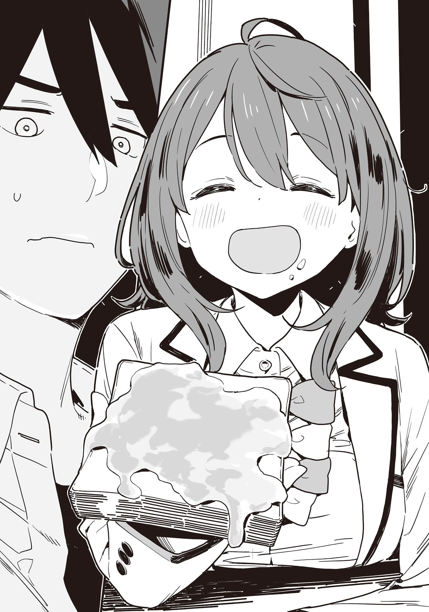

# Ch.141 — เล่ม 8.5 บทที่ 11

Ch.141 — เล่ม 8.5 บทที่ 11

By มนก .

Published: 2026-02-22T04:40:23Z

Source: https://www.nekopost.net/novel/14560/141

เสียงนกร้องดังมาจากนอกหน้าต่าง

แสงแดดอ่อนๆ ยามเช้าที่สาดส่องผ่านช่องว่างของผ้าม่าน ค่อยๆ เติมเต็มห้องนอนให้กลายเป็นยามเช้า

เสียงพูดคุยแว่วๆ จากนอกห้อง เสียงจักรยานแล่นผ่านหน้าบ้าน──

บรรยากาศยามเช้าที่เริ่มชัดเจนขึ้น กำลังพยายามดึงตัว ฮากามาดะ โซสึเกะ ให้ตื่นจากภวังค์อย่างอ่อนโยน

แต่อากาศอันแสนสบายในเดือนพฤษภาคม ก็ไม่ยอมปล่อยเขาไปง่ายๆ ระหว่างที่โซสึเกะกำลังเอาผ้าห่มม้วนพันตัวอยู่นั้น เสียงฝีเท้าเดินขึ้นบันไดอย่างไม่เกรงใจก็ดังขึ้น

เจ้าของเสียงฝีเท้ามาหยุดยืนอยู่หน้าห้อง แล้วเปิดประตูพรวดเข้ามาทันที

[ โซสึเกะ—ตื่นเร็วเข้า เดี๋ยวข้าวเช้าก็หมดพอดีหรอก! ]

คนที่เดินเข้ามาในห้องคือเด็กสาวคนหนึ่งในชุดเครื่องแบบโรงเรียนมัธยมปลายสึวาบุกิ──ยานามิ อันนะ นั่นเอง

ยานามิเดินตรงดิ่งไปที่หน้าต่าง แล้วรวบเปิดผ้าม่านออกรวดเดียว

เมื่อแสงแดดสาดส่องเข้ามาเต็มห้อง โซสึเกะก็ส่งเสียงครางพลางดึงผ้าห่มขึ้นมาคลุมโปง

[ ค่าาา ตื่นได้แล้วค่ะ ขนมปังปิ้งเสร็จแล้วนะ ]

พอถูกดึงผ้าห่มออกไปอย่างแรง โซสึเกะก็คงจะยอมแพ้ เขาหาวหวอดพลางยันตัวลุกขึ้นนั่ง

[ อันนะ ขอนอนต่ออีกนิดเถอะ เมื่อคืนนอนดึกน่ะ ]

[ มีเรื่องอะไรเหรอ สอบก็ยังอีกตั้งนานไม่ใช่หรือไง ]

อันนะพูดพลางเปิดหน้าต่างเพื่อระบายอากาศ

[ ดูบอลจนถึงดึกเลยน่ะสิ โคตรมันส์เลยนะ ]

[ เรื่องแค่นั้นดูย้อนหลังเอาก็ได้นี่นา ]

[ มันเป็นการชิงแชมป์ช่วงท้ายฤดูกาลเลยนะ ก็ต้องอยากดูสดๆ อยู่แล้ว ]

ยานามิตอบ เหรอออ พลางหยิบชุดนักเรียนที่พาดทิ้งไว้บนเก้าอี้ไปแขวนไม้แขวนเสื้อที่ผนังให้เรียบร้อย

[ ชุดนักเรียนจะยับเอานะ แขวนไม้แขวนเสื้อให้มันดีๆ หน่อยสิ ]

[ รู้แล้วน่า อันนะช่วงนี้ เธอชักจะเหมือนแม่ฉันเข้าไปทุกทีแล้วนะ ]

[ ฉันเพิ่งจะม.4 เองนะคะ ]

โซสึเกะยิ้มแหยๆ พลางลงจากเตียง แล้วเอามือจับกระดุมชุดนอน

……

…………

[ ……อันนะ มาจ้องตอนคนกำลังเปลี่ยนเสื้อผ้าแบบนี้มันทำตัวไม่ถูกนะ ]

[ เอ๊ะ?! ขอโทษที ฉันลงไปรอข้างล่างก่อนนะ! ]

ยานามิรีบวิ่งลุกลนออกจากห้องไป

โซสึเกะถอนหายใจอย่างระอาใจ แล้วปลดกระดุมเสื้อออก──

ยานามิ อันนะ กับ ฮากามาดะ โซสึเกะ

ทั้งสองคนบ้านอยู่ติดกัน และตั้งแต่เดือนเมษายนก็เรียนอยู่ที่โรงเรียนมัธยมปลายสึวาบุกิเหมือนกัน

ทั้งสองคนที่คบหากันมาถึง 12 ปี──ใช่แล้ว พวกเขาคือเพื่อนสมัยเด็กแบบขนานแท้เลยล่ะ

◇

[ อันนะจัง เอาขนมปังปิ้งอีกแผ่นไหมจ๊ะ? ]

[ ค่ะ ขอบคุณค่า! ]

ตอนที่โซสึเกะเดินลงบันไดมา ที่โต๊ะอาหารของบ้านฮากามาดะก็มีแม่ของเขากับยานามินั่งอยู่สองคน

ยานามิกำลังกินข้าวเช้าตามปกติเหมือนทุกที

แน่นอนว่าที่บ้านของตัวเองเธอก็น่าจะกินมาแล้วแหละ แต่โซสึเกะก็ไม่กล้าพูดทักออกไปหรอก

โซสึเกะทักทายแม่ตัวเองแบบห้วนๆ ก่อนจะนั่งลงตรงข้ามยานามิแล้วรินนมใส่แก้วของตัวเอง

ยานามิทาแยมมาร์มาเลดลงบนขนมปังปิ้งที่รับมาจนชุ่ม แล้วยื่นไปทางโซสึเกะ

[ นี่อร่อยมากเลยนะ อ้ามมม อ้าปากสิー ]

[ ฉันกินเองได้น่า ]

โซสึเกะรับขนมปังปิ้งมา แล้วกัดไปหนึ่งคำ

[ อร่อยดีแฮะ อันนะเอามาเหรอ? ]

[ อื้อ พ่อได้มาจากตัวอย่างที่ทำงานน่ะ ]

[ เหรอ คุณลุงเนี่ยนะ…… ]

โซสึเกะพูดอ้ำอึ้งพลางมองดูขวดแยมมาร์มาเลด

[ ช่วงนี้พ่อของอันนะทำงานอะไรอยู่เหรอ? ]

[ ช่วงนี้เริ่มพูดถึงงอาหารอังกฤษแล้ว ดูเหมือนจะทำอะไรหลายอย่างเลยแหละ ]

คำพูดนั้นทำเอาโต๊ะอาหารของบ้านฮากามาดะถึงกับตึงเครียดขึ้นมาทันที

ถึงจะเป็นเพื่อนบ้านกัน แต่ก็ไม่อยากเห็นภาพที่ต้องเดินไปหาความโชคร้ายหรอกนะ

ยานามิไม่รู้ตัวถึงบรรยากาศนั้น ยังคงกัดขนมปังปิ้งทาแยมมาร์มาเลดชุ่มๆ ต่อไป

[ อื้ม อร่อยใช้ได้เลยนะเนี่ย อร่อยรองลงมาจากแยมสตรอว์เบอร์รีเลยล่ะ ]

เมื่อเห็นท่าทางฟินสุดๆ ของยานามิ สองแม่ลูกฮากามาดะก็เลิกคิดเรื่องนั้นไปเลย

ใช่แล้ว ต่อหน้ารอยยิ้มนี้ ความเป็นห่วงมันก็แค่เรื่องไร้สาระเท่านั้นแหละ──

[ อันนะ แก้วเปล่าแล้วนะ จะดื่มนมเพิ่มใช่ไหม ]

[ จริงสิ อันนะจัง กินแอปเปิ้ลไหมจ๊ะ? ]

[ ได้เหรอคะ? ขอบคุณค่า! ]

ระหว่างที่ยานามิกำลังโดนสองแม่ลูกฮากามาดะเอาอกเอาใจ ผู้หญิงคนหนึ่งก็เดินลงบันไดมา

ผมยาวตรงสลวย รูปร่างผอมเพรียวราวกับนางแบบแฟชั่น

คนที่ปรากฏตัวด้วยท่าทางงัวเงียพลางเสยผมก็คือ ลูกสาวคนโตของบ้านฮากามาดะ มิโคโตะ นั่นเอง

[ อันนะจัง อรุณสวัสดิ์ー ]

[ อรุณสวัสดิ์ค่ะ พี่มิโคโตะ วันนี้ตื่นเช้าจังเลยนะคะ ]

มิโคโตะหยิบกล่องน้ำมะเขือเทศออกมาจากตู้เย็นพลางหาวหวอดใหญ่

[ วันนี้มีเรียนคาบแรกน่ะสิ ถ้าขาดอีกมีหวังแย่แน่ๆー ]

พูดพลางใช้แผ่นหลังดันปิดประตูตู้เย็น

[ มิโคโตะ มารยาทไม่ดีเลยนะ จะปิ้งขนมปังให้กี่แผ่นล่ะ? ]

[ ไม่เอาขนมปังงง หนูเอาแค่นี้ก็พอแล้ว ]

มิโคโตะนั่งลงข้างๆ ยานามิ แล้วเจาะหลอดลงในกล่องน้ำมะเขือเทศ

[ พี่มิโคโตะ กินแค่นั้นจะอิ่มเหรอคะ? ]

[ ว่าจะรีดน้ำหนักลงหน่อยเพื่อรับหน้าร้อนน่ะ ]

[ เอ๊ะ จะรีดน้ำหนักอีกเหรอคะ?! ผอมกว่านี้อีกเนี่ยนะ?! ]

แอปเปิ้ลร่วงแหมะลงจากส้อมของยานามิ

ยานามิมองเปรียบเทียบรูปร่างของตัวเองกับมิโคโตะ แล้วค่อยๆ ลูบท้องของตัวเองเบาๆ

[ อันนะจังเป็นแบบนั้นน่ะดีแล้วล่ะ กินเผื่อในส่วนของพี่ให้เยอะๆ เลยนะ ]

มิโคโตะหัวเราะอย่างร่าเริง แล้วลูบหัวยานามิอย่างเอ็นดู

[ ก็แหม พี่มิโคโตะหุ่นดีจะตายนี่นา น่าอิจฉาจังเลย ]

โซสึเกะโบกมือไปมาอย่างระอา

[ พี่น่ะผอมเกินไปต่างหาก อันนะอย่าไปเอาเป็นแบบอย่างเชียวนะ ]

[ งั้นโซสึเกะก็ชอบผู้หญิงหุ่นประมาณอันนะจังงั้นสิ? ]

เจอคำพูดนั้นเข้าไป ยานามิก็กลืนแอปเปิ้ลลงคอเอื๊อกใหญ่

[ เอ๊ะ โซสึเกะชอบแบบนี้เหรอ?! ]

[ หา? ไม่ได้หมายความแบบนั้นซะหน่อย ]

พอรู้สึกว่าหอกกำลังพุ่งเป้ามาที่ตัวเอง โซสึเกะก็จัดการยัดขนมปังที่เหลือเข้าปากแล้วดื่มนมตามรวดเดียว ก่อนจะลุกพรวดขึ้น

[ ฉันไปโรงเรียนล่ะ อันนะเดี๋ยวก็สายหรอก ]

[ อ๊ะ รอเดี๋ยวสิ ขอจัดการแอปเปิ้ลก่อน ]

ยานามิกินแอปเปิ้ลที่เหลือรวดเดียวจนหมด แล้วลุกขึ้นตามโซสึเกะ

[ คุณป้าคะ ขอบคุณสำหรับอาหารค่า! ]

[ จ้า ไม่เป็นไรเลยจ้ะ โซสึเกะ ลืมข้าวกล่องแล้วนะลูก! ]

[ อ๊ะ เดี๋ยวฉันเอาไปให้── ]

ตอนที่ยานามิกำลังจะยื่นมือไปรับข้าวกล่อง โซสึเกะก็วิ่งกระหืดกระหอบกลับมา

[ แม่ ขอบคุณครับ! อันนะ แยมติดปากอยู่น่ะ ]

[ เอ๊ะ จริงดิ? ออกยัง? ]

เหล่าสาวๆ บ้านฮากามาดะมองส่งสองคนที่เดินออกไปอย่างเอะอะมะเทิ่ง ก่อนจะเริ่มจับเข่าคุยกันอย่างลึกซึ้ง

[ ……มิโคโตะ ลูกคิดยังไงกับสองคนนั้นล่ะ?]

[ อืมมม เจ้าน้องโซสึเกะนี่ไม่เอาไหนเลยจริงๆ เนอะ ]

เจอความในใจของลูกสาวเข้าไป แม่ของฮากามาดะก็ถอนหายใจเฮือกใหญ่

[ อันนะจังเวลากินข้าวก็ดูอร่อยน่ากิน แถมยังเป็นเด็กดีแท้ๆ เชียว…… ]

[ โซสึเกะน่ะ เพ้อฝันเรื่องความรักมากเกินไปแล้ว ]

แม่ของฮากามาดะส่งสายตามีความหมายบางอย่างไปให้เมื่อได้ยินคำพูดของมิโคโตะ

[ แล้วลูกล่ะ ไม่มีคนดีๆ เข้ามาบ้างเหรอ? ]

[ ก็หนูป๊อปเกินไปจนเลือกไม่ถูกน่ะสิแม่ ]

มิโคโตะดูดน้ำมะเขือเทศจนหมดเกลี้ยง ก่อนจะบีบกล่องกระดาษจนแบนแต๊ดแต๋ พลางภาวนาเอาใจช่วยให้น้องสาวสู้ๆ ต่อไป

◇

พักเที่ยงของวันนั้น

ยานามิ อันนะ นั่งกินข้าวกล่องกับเพื่อนๆ ที่ม้านั่งตรงลานกลางแจ้ง พลางถอนหายใจเฮือกใหญ่

[ ก๊ตจิน เนกิจัง ฟังฉันหน่อยสิー ]

เจอโหมดบ่นระบายของยานามิเข้าไป เพื่อนทั้งสองคนก็หันมามองหน้ากันด้วยความระอา

[ เรื่องพ่อหนุ่มหน้าหล่อคนนั้นอีกแล้วเหรอ? นี่พวกเธอยังไม่ลงเอยกันอีกเหรอเนี่ย ]

คนที่กัดแซนด์วิชพลางยิ้มแหยๆ ไปด้วยก็คือ ก๊ตจิน หรือ คุเรฮะ ซุมิ

[ ดีออก ช่วงเวลาก่อนจะคบกันนี่แหละ สนุกที่สุดแล้ว ]

[ แต่ไอ้ช่วงเวลาที่ว่านั่น มันลากยาวมา 12 ปีแล้วนะคะ ]

ยานามิใช้ตะเกียบคีบไข่ม้วนขึ้นมา พลางพูดด้วยน้ำเสียงตัดพ้อ

[ คนที่มีแฟนแล้วอย่างก๊ตจินไม่เข้าใจหรอก คนที่จะเข้าใจฉันก็มีแต่เนกิจังเท่านั้นแหละเนอะ ]

เด็กสาวที่ถูกเรียกว่าเนกิจัง ค่อยๆ ยกมือขวาขึ้นมาอย่างกล้าๆ กลัวๆ

[ ──ดิฉัน เนกิชิ คานาโกะ ในที่สุดก็มีแฟนแล้วค่ะ ]

[[ เอ๊ะ! ]]

เนกิจังเริ่มเล่าให้ทั้งสองคนที่กำลังตกใจฟังด้วยท่าทีเขินอาย

[ ที่เคยบอกไปคราวก่อนไง ว่าโดนคนรู้จักสมัยก่อนชวนไปเที่ยวน่ะ? แล้วจู่ๆ เขาก็…… ]

[ สารภาพรักงั้นเหรอ?]

เมื่อยานามิถาม เนกิจังก็หน้าแดงแปร๊ดแล้วพยักหน้าหงึกหงักรับ

ก๊ตจินคว้ามือเนกิจังมากุมไว้แล้วแกว่งไปมา

[ ยินดีด้วยนะ! ไว้คราวหน้าไปเที่ยวกับแฟนของเธอด้วยกันไหม? เดี๋ยวฉันพาแฟนฉันไปด้วย! ]

[ อื้อ เอาสิ ต่างคนต่างชวนแฟนมา── ]

ทั้งสองคนที่กำลังคุยกันอย่างออกรส ในที่สุดก็นึกขึ้นได้ว่ายังมียานามิอยู่ด้วย

[ ขอโทษนะยานามิ ไม่ได้ตั้งใจจะทิ้งให้เธออยู่คนเดียวนะ? ]

[ อื้อ อันนะจังก็มาด้วยกันสิ── ]

[ เดี๋ยวสิ เนกิจัง! ]

ยานามิใช้ตะเกียบคีบมะเขือเทศราชินีขึ้นมาไว้ตรงหน้าด้วยรอยยิ้ม

[ ไม่เป็นไร ไม่ได้คิดมากสักหน่อย? ยินดีด้วยนะเนกิจัง อะ นี่ ]

ยานามิวางมะเขือเทศราชินีลงในกล่องข้าวของเนกิจัง

ใช่แล้ว ยานามิ อันนะ เป็นผู้หญิงที่สามารถยินดีกับความสุขของคนอื่นได้อย่างบริสุทธิ์ใจ

ก๊ตจินพยายามลอบสังเกตสีหน้าของยานามิพลางชวนคุยต่อ

[ แฟนคนนี้บอกว่าเป็นคนรู้จักมาตั้งแต่เมื่อก่อนใช่ปะ ]

[ อื้อ ตอนเด็กๆ อยู่กลุ่มเดินทางไปโรงเรียนเดียวกันน่ะ ก็เลยได้คุยกันบ่อยๆ ]

ได้ยินดังนั้น ตะเกียบของยานามิก็ชะงักกึก

[ หมายความว่า เป็นเพื่อนสมัยเด็กงั้นเหรอ? ]

[ เอ๊ะ ก็น่าจะเรียกว่าแบบนั้นได้……มั้ง ]

ยานามิคีบไก่ทอดคาราเกะใส่เพิ่มลงไปในกล่องข้าวของเนกิจัง

[ ขอแสดงความยินดีด้วยจริงๆ นะ! ยินดีด้วยจากใจจริงเลย! ]

[ อ-อื้อ ขอบใจนะ ]

เมื่อเห็นเนกิจังมีท่าทีผงะกับแรงฮึดของยานามิ ก๊ตจินก็รีบพูดแทรกขึ้นมา

[ ยานามิก็พยายามเข้าล่ะ กับฮากามาดะก็คบกันมาตั้งแต่เด็กเลยไม่ใช่หรือไง? ]

[ ……ฉันเองก็พยายามอยู่นะ ]

ยานามิเหม่อมองออกไปไกลทันที

[ คือแบบ พอฉันรุกเข้าไป เขาก็ชอบทำเป็นหลบเลี่ยงตลอดเลย ]

[[ อ้อออ ]]

เพื่อนทั้งสองประสานเสียงกันโดยไม่ได้นัดหมาย ทั้งคู่สบตากัน ก่อนที่ก๊ตจินจะเป็นตัวแทนพูดขึ้น

[ สงสัยคงต้องสร้างบรรยากาศสักหน่อยแล้วล่ะมั้ง ยานามิน่ะไม่มีมู้ด──เอ่อ ไม่ใช่สิ เพราะคบกันมานาน ก่อนอื่นก็ต้องทำให้หมอนั่นเริ่มรู้สึกถึงเธอในฐานะผู้หญิงก่อน ]

[ บรรยากาศงั้นเหรอ……พวกเธอสองคนพอจะมีไอเดียดีๆ บ้างไหมล่ะ? ]

เมื่อยานามิโยนคำถามมา เนกิจังก็ค่อยๆ ยกมือขึ้นอย่างกล้าๆ กลัวๆ

[ ว่าไงจ๊ะ เนกิจัง ]

[ ……ที่มืดๆ น่ะ ก็ดีเหมือนกันนะ ]

[[ หือ? ]]

คราวนี้เป็นตาร้องประสานเสียงของยานามิกับก๊ตจินบ้าง

เนกิจังบิดตัวไปมาด้วยความเขินพลางพูดต่อ

[ จับมือกันในความมืดมันใจเต้นตึกตักดีออก แถมมองไม่เห็นด้วยว่ากำลังจะโดนทำอะไร มันให้ความรู้สึกดีจะตาย หรือถ้าจะให้ดี ปิดตาไปเลยก็──]

เพื่อนสาวเปิดเผยรสนิยมทางเพศแบบไม่มีปี่มีขลุ่ย ทำเอาอีกสองคนถึงกับอึ้ง

เนกิจังที่เพิ่งจะหลุดพ้นจากสถานะโสดตั้งแต่เกิดมาได้ไม่นาน เติบโตขึ้นมาถึงขั้นนี้แล้วเชียวเหรอ……

ก๊ตจินชำเลืองมองยานามิที่กำลังแข็งทื่อเป็นหิน ก่อนจะรีบพูดเปลี่ยนเรื่อง

[ จริงสิ เร็วๆ นี้จะมีงานถนนคนเดินตอนกลางคืนตรงหน้าสถานีรถไฟนี่นา ยานามิ ลองชวนฮากามาดะไปสิ? ]

[ ตอนกลางคืนงั้นเหรอ…… ]

──ใกล้ชิดกันเกินไปจนมองไม่เห็นความต่างทางเพศ เป็นเรื่องที่ได้ยินบ่อยๆ เลย

บางทีการรุกแบบสร้างบรรยากาศที่ไม่เหมือนเดิมในยามค่ำคืนของเมือง อาจจะเข้าท่าก็ได้นะ

ยานามิเคี้ยวไส้กรอกหยุบหยับๆ พลางพยักหน้าอย่างมุ่งมั่น

◇

งานถนนคนเดินตอนกลางคืน ชื่องานอย่างเป็นทางการคือ 『ถนนคนเดินใจกลางเมืองโทโยฮาชิ』

โดยจะปิดถนนให้เป็นถนนคนเดินยามค่ำคืน โดยมีศูนย์กลางอยู่ที่ถนนฮิโรโคจิ ซึ่งเป็นที่ตั้งของร้านหนังสือเซบุงคันสาขาใหญ่

ภายในงานจะมีทั้งซุ้มยิงปืน ร้านขายของกระจุกกระจิกมาตั้งเรียงราย นอกจากนี้ยังร่วมมือกับถนนโทคิวะและตึกซุยโจ ถือเป็นงานที่ขับเคลื่อนโดยคนในท้องถิ่น

──ท้องฟ้าหลังดวงอาทิตย์ลับขอบฟ้า ถูกฉาบด้วยแสงไฟจากตัวเมืองจนกลายเป็นสีครามอมขาว

ยานามิเดินเคียงข้างโซสึเกะไปตามใจกลางถนนที่ปกติแล้วจะมีรถวิ่งขวักไขว่

[ โซสึเกะ ขอบใจนะที่ยอมมาเป็นเพื่อน ]

[ จะปล่อยให้อันนะมาเดินเตร็ดเตร่คนเดียวตอนดึกๆ ดื่นๆ ได้ยังไงล่ะ ]

โซสึเกะตอบห้วนๆ พลางเบี่ยงตัวหลบครอบครัวที่เดินสวนมา

ถึงคนจะพลุกพล่าน แต่ก็อยู่ในระดับที่เรียกว่ากำลังคึกคักพอดี

ขณะที่เดินดูของกุ๊กกิ๊กตามร้านรวงริมทาง ยานามิก็สะกิดโซสึเกะเบาๆ

[ รู้สึกว่าบรรยากาศของเมืองไม่เหมือนปกติเลยเนอะ ]

[ ก็ปกติตอนเวลานี้ มีแต่พวกคนเมานี่นา ]

ทั้งสองคนมองหน้ากันแล้วหัวเราะร่วน

เพื่อเตรียมตัวสำหรับงานวันนี้ ยานามิได้วางแผนร่วมกับก๊ตจินและเนกิจังมาอย่างรัดกุม

──ธีมก็คือ ความไม่จำเจ

ด้วยเหตุนี้ ยานามิจึงมาในชุดกระโปรงสั้นเหนือเข่ากับเสื้อเบลาส์แขนกุด

ผมก็ถักเปียเล็กๆ ไว้ส่วนหนึ่ง แถมยังฉีดน้ำหอมที่ไม่ค่อยได้ใช้อีกต่างหาก

เป็นแผนการที่จะทำให้โซสึเกะต้องหันมามองด้วยบรรยากาศความเป็นผู้ใหญ่ที่ต่างไปจากตอนอยู่โรงเรียน

และอีกเรื่องที่ถูกสองคนนั้นกำชับมาอย่างหนักแน่นก็คือ 『ห้ามกิน』

ถ้าเขากินแล้วเรากินเป็นเพื่อนก็ไม่เป็นไร แต่ห้ามเป็นฝ่ายเรียกร้องอยากกินเองเด็ดขาด──

[ นี่ๆ ลองไปยิงปืนกันไหม? ฉันยิงแม่นพอตัวเลยนะ ]

[ เหรอ น่าสนุกดีแฮะ ]

──แล้วก็ต้องเป็นฝ่ายริเริ่มสนุกไปกับสิ่งที่พวกผู้ชายชอบด้วย

นอกจากความไม่จำเจแล้ว ยังเป็นการปลูกฝังความคิดที่ว่า การอยู่กับเธอเป็นเรื่องสนุกนั่นเอง

ระหว่างที่เดินดูร้านรวงไปหัวเราะคุยกันไป ยานามิก็ไปสะดุดตากับร้านแผงลอยร้านหนึ่ง

[ อันนะ สนใจร้านนั้นเหรอ? ]

[ เอ่อ คือ── ]

โซสึเกะไม่รอฟังคำตอบ พาตัวยานามิเดินไปที่ร้านนั้นทันที

ที่ร้านนั้นมีเครื่องประดับวางเรียงรายอยู่ ยานามิยืนจ้องมองต่างหูตาไม่กะพริบ โซสึเกะเห็นแล้วก็ทำหน้าประหลาดใจ

[ อันนะก็สนใจพวกต่างหูเหมือนกันเหรอเนี่ย ]

[ ก็สนใจอยู่นะ แต่รู้สึกกลัวๆ ยังไงก็ไม่รู้ การทำร่างกายตัวเองให้เป็นแผลนี่มันแอบรู้สึกลังเลนิดหน่อยน่ะ ]

……การเปลี่ยนแปลงเป็นเรื่องน่ากลัว

แต่ถ้าไม่ก้าวออกมา ก็จะต้องเป็นแบบนี้ต่อไปเรื่อยๆ หรือเปล่า นั่นก็น่ากลัวพอกันนั่นแหละ

ยานามิยื่นมือออกไปหาต่างหู

[ ──ฉันว่าไม่เห็นต้องฝืนตัวเองเลยนะ ]

คำพูดนั้นทำให้มือของเธอชะงักงัน

[ ……งั้นเหรอ ]

[ พวกเรายังเป็นเด็กม.ปลายกันอยู่เลย ไม่เห็นต้องพยายามทำตัวเป็นผู้ใหญ่หรอก เดี๋ยวก็ถึงเวลาที่ยอมรับมันได้อย่างเป็นธรรมชาติเองแหละ ]

คงจะคิดว่าตัวเองพูดมากเกินไป โซสึเกะเลยเบือนหน้าหนีด้วยความเขิน

[ อีกอย่าง อันนะน่ะ ต่อให้ไม่ใส่เครื่องประดับอะไร ก็ป๊อปมากพออยู่แล้วล่ะ ]

เมื่อเจอคำพูดที่ไม่คาดคิด รอยยิ้มก็ผุดขึ้นมาบนใบหน้าของยานามิอย่างปิดไม่มิด

[ ……เหรอออ โซสึเกะมองฉันแบบนั้นเองเหรอเนี่ย ]

[ ก็ที่เธอป๊อปมันเป็นเรื่องจริงนี่นา เอ้า ถ้าไม่ซื้อก็ไปร้านต่อไปกันได้แล้ว ]

โซสึเกะเดินหนีไปอย่างรวดเร็ว ยานามิรีบวิ่งตามไปจนเดินเบียดเอาไหล่ชน

[ น่าเสียดายจัง อุตส่าห์กะว่าจะใส่ต่างหูให้ป๊อปกว่านี้ซะหน่อยー ]

[ โอ๊ย พอเลย ลืมๆ มันไปซะเถอะ ว่าแต่อันนะ── ]

โซสึเกะหันมามองยานามิที่เดินอยู่ข้างๆ ด้วยสีหน้าจริงจัง

[ เมื่อกี้นี้ตอนที่ฉันไปเข้าห้องน้ำ เธอโดนคนถามทางใช่ไหม ]

[ อื้อ เขามาถามว่าไปสถานีรถไฟยังไง ทั้งๆ ที่อยู่ใกล้แค่นี้เอง ทำไมถึงไม่รู้กันนะ ]

โซสึเกะทำหน้าเอือมระอากับยานามิที่ดูจะสงสัยอย่างจริงจัง

[ นั่นน่ะ เขามาจีบต่างหาก ]

[ อ้าว……หรอกเหรอเนี่ย ]

[ อันนะ เอ๊ย เธอนี่นะ โตเป็นเด็กม.ปลายแล้วแท้ๆ── ]

พูดค้างไว้แค่นั้น โซสึเกะก็เผลอยิ้มแหยๆ ออกมา

เดี๋ยวก็บอกว่า 'ยังเป็นเด็กม.ปลาย' เดี๋ยวก็บอกว่า 'โตเป็นเด็กม.ปลายแล้ว' เขารู้ตัวแล้วว่าตัวเองช่างสรรหาคำพูดมาอ้างซะเหลือเกิน

[ ……โซสึเกะ? ]

[ อ้อ เปล่าหรอก แค่คิดว่าวันนี้ไม่เห็นเธอกินอะไรเลยนะ ]

[ เดี๋ยวนะโซสึเกะ นายคิดว่าฉันเอาแต่คิดเรื่องของกินอยู่ตลอดเวลาเลยหรือไง? ]

โซสึเกะกลั้นหัวเราะกับคำประท้วงของยานามิ

ความทรงจำตลอด 12 ปีที่ผ่านมา แล่นเข้ามาในหัวราวกับภาพความทรงจำก่อนตาย

[ จะว่าไงดีล่ะ เมื่อกี้นี้เห็นมีไส้กรอกแฟรงก์เฟิร์ตขายอยู่นะ ไปกินด้วยกันไหม ]

[ ไส้กรอกแฟรงก์เฟิร์ต……กิน! ]

──ถ้ากินเป็นเพื่อนก็ไม่เป็นไร ได้รับการรับรองจากสองสาวที่มีแฟนแล้วเป็นที่เรียบร้อย

โซสึเกะยิ้มกริ่มพลางเดินตามยานามิที่วิ่งนำหน้าไปด้วยความดีใจ

◇

เช้าวันจันทร์ ยานามิในชุดนักเรียนที่เพิ่งซักรีดมาหมาดๆ เปิดประตูบ้านของครอบครัวฮากามาดะ

[ อรุณสวัสดิ์ค่าาา! ]

เมื่อส่งเสียงทักทายอย่างร่าเริงตามปกติ แม่ของฮากามาดะก็รีบวิ่งเหยาะๆ ออกมาที่หน้าประตู

[ อันนะจัง มาได้จังหวะพอดีเลย! โซสึเกะลืมข้าวกล่องน่ะ ช่วยเอาไปให้หน่อยได้ไหมจ๊ะ? ]

[ค่ะ ได้เลยค่ะ โซสึเกะไปโรงเรียนแล้วเหรอคะ? ]

ยานามิรับข้าวกล่องมา พลางกะน้ำหนักของมันด้วยความเคยชิน

[ เห็นบอกว่าลืมไปว่าวันนี้เป็นเวรประจำวัน เลยรีบร้อนออกไปใหญ่เลยน่ะจ้ะ ]

อ้อ แบบนี้นี่เอง ตรงจุดนี้แหละที่สมกับเป็นโซสึเกะ

ยานามิยืนคุยกับแม่ของโซสึเกะอยู่ครู่หนึ่ง แล้วจึงมุ่งหน้าไปโรงเรียน

──วันนี้อากาศดีจัง

ท้องฟ้าเดือนพฤษภาคมช่างสดใสไร้ที่ติ ลมจากทิศตะวันตกพัดมาจับเส้นผมของยานามิให้พลิ้วไหวอย่างอ่อนโยน

ยานามิที่กำลังปั่นจักรยานอยู่ สัมผัสได้ถึงกลิ่นหอมที่ลอยมาเตะจมูก

[ กลิ่นดอกไม้……? ]

กลิ่นหอมหวานของดอกไม้ที่ลอยมาจากที่ไหนสักแห่ง

ถึงขั้นรู้สึกเหมือนได้ยินเสียงBGMอันไพเราะบรรเลงมาจากที่ไกลๆ เลยด้วยซ้ำ

ยานามิออกแรงเหยียบบันไดจักรยานมากขึ้น

คืนนั้น ฉันสามารถก้าวเข้าไปในใจของโซสึเกะได้อีกนิดแล้ว

ความสัมพันธ์ของเราสองคน อาจจะมีอะไรเปลี่ยนแปลงไปบ้างก็ได้นะ

รู้สึกเหมือนกับว่า วันใหม่ที่แตกต่างไปจากที่ผ่านมา กำลังจะเริ่มต้นขึ้นเลยล่ะ
