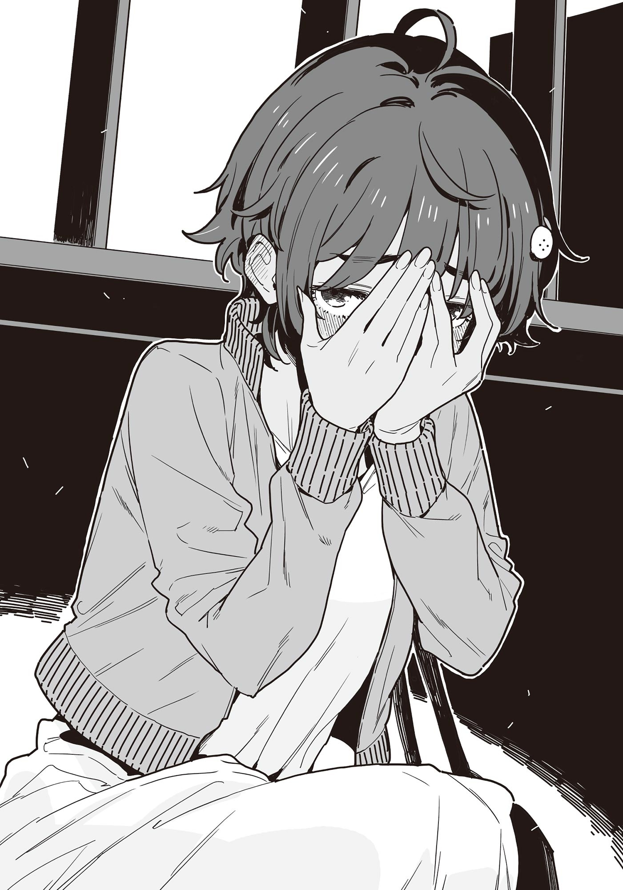

# Ch.147 — เล่ม 8.5 บทที่ 14-4

Ch.147 — เล่ม 8.5 บทที่ 14-4

By มนก.

Published: 2026-02-27T09:00:21Z

Source: https://www.nekopost.net/novel/14560/147

หลังจากโยกเยกอยู่บนรถบัส 30 นาที พวกเราก็มาอยู่ที่ซาคาเอะ ย่านการค้าที่ใหญ่ที่สุดของนาโกย่า

สวนฮิซายะโอโดริที่ทอดยาวตัดผ่านใจกลางย่านนั้นจากเหนือจรดใต้สว่างไสวไปด้วยแสงไฟประดับประดา และมีผู้คนพลุกพล่านไม่ขาดสาย

ตลอดริมทางเดินมีคาเฟ่และร้านอาหารสุดเก๋เรียงราย พอตกเย็นก็อบอวลไปด้วยบรรยากาศแบบผู้ใหญ่

[ โอ้โห สวยจังเลย ดูสิ มีหอคอยด้วยล่ะ! ]

[ ถ้าไม่มองทางดีๆ มันอันตรายนะ ]

ใจกลางสวนมีหอคอยส่งสัญญาณโทรทัศน์ขนาดมหึมาที่ชวนให้นึกถึงหอไอเฟลตั้งตระหง่านอยู่ และกลายเป็นสัญลักษณ์ของเมืองนี้

ระหว่างที่เดินตามยากิชิโอะที่กำลังตื่นเต้นและกวักมือเรียก ผมก็ขยับคอเสื้อยืดของตัวเอง เพราะว่ามีกลิ่นหอมของซิตรัสโชยออกมาจากร่างกายของผมน่ะสิ

……ไม่ได้มีเรื่องอะไรน่าละอายหรอกนะ เพราะงั้นขอแก้ตัวก่อนเลยแล้วกัน

เบาะนั่งของรถบัสประจำทางไม่ได้กว้างเลยสักนิด ถ้ามานั่งคู่กัน การที่เนื้อตัวจะสัมผัสกันบ้างก็เป็นเรื่องที่ช่วยไม่ได้

การที่ต้องแนบชิดกันทุกครั้งที่รถบัสโยกเยกมันเป็นเรื่องธรรมดา และการที่แขนของผมสัมผัสได้ถึงสัดส่วนร่างกายของยากิชิโอะที่สวมเสื้อผ้าบางๆ รับเดือนกรกฎาคม ก็เป็นเหตุสุดวิสัยล้วนๆ จบการแก้ตัวเพียงเท่านี้

[ นุกคุง ทางนี้ๆ! มาถ่ายรูปด้วยกันเถอะ! ]

[ อ-อืม…… ]

พอเดินไปยืนข้างยากิชิโอะตามที่เรียก ภาพที่ทอดตัวอยู่เบื้องหน้าคือผืนน้ำที่ส่องประกายระยิบระยับรับกับวิวทิวทัศน์ยามค่ำคืน

ผืนน้ำนั้นมีรูปร่างเหมือนสระว่ายน้ำสี่เหลี่ยมผืนผ้าขนาดใหญ่ แต่ก็ไม่ใช่บ่อน้ำ

มันคือการขังน้ำไว้บนพื้นกระเบื้อง และที่ปลายทางของผืนน้ำที่ทอดยาวไปหลายสิบเมตรนั้น มีหอคอยส่งสัญญาณโทรทัศน์ที่ถูกประดับประดาด้วยแสงไฟตั้งตระหง่านอยู่

วิวยามค่ำคืน──แสงไฟประดับ──ผืนน้ำระยิบระยับ──

แสงไฟที่สะท้อนบนผิวน้ำสาดส่องยากิชิโอะจากด้านล่าง

องค์ประกอบที่ดูดีมีระดับมากมายขนาดนี้ ต่อให้เป็นผมที่ขึ้นชื่อเรื่องท่าทีเย็นชาเป็นปกติ ก็อดไม่ได้ที่จะรู้สึกหวั่นไหว

[ เอ้า นุกคุงมองกล้องสิ นี่ ถ้าไม่ขยับเข้ามาอีกมันจะไม่โฟกัสเอานะ ]

[ เอ๊ะ อะ อื้ม ]

แถมยังเป็นการถ่ายเซลฟี่วิวกลางคืนกับเด็กผู้หญิงน่ารักๆ ซะด้วย

เมื่ออยู่ต่อหน้าความจริงข้อนั้นแล้ว นโยบายหรือความเชื่อส่วนตัวอะไรนั่นมันก็เป็นแค่เรื่องเล็กน้อยไปเลย

[ ถ่ายออกมาสวยเลยล่ะ ส่งรูปนี้ไปให้ทุกคนดูดีไหมนะ ]

[ เดี๋ยวๆ แบบนั้นมันไม่แย่เอาเหรอ?! โดนเข้าใจผิดเต็มประตูเลยนะ ]

ยากิชิโอะหันดวงตาสีน้ำตาลเข้มมาจ้องมองผมที่กำลังลุกลี้ลุกลน

[ เข้าใจผิดเรื่อง──อะไรล่ะ? ]

[ ก็เรื่อง…… ]

ยากิชิโอะหัวเราะอย่างสนุกสนานเมื่อเห็นผมพูดไม่ออก

[ ล้อเล่นน่า อุตส่าห์มาทั้งที ขึ้นไปบนหอคอยกันไหม? ]

[ ป่านนี้นี่นะ? ]

[ วันนี้วันเสาร์น่ะ ก็เลยเปิดดึกหน่อย ]

โห งั้นเหรอ ยากิชิโอะรู้ละเอียดจังแฮะ

มาถึงขนาดนี้แล้ว ก็มีแต่ต้องไปให้สุดทาง เราเดินลัดเลาะผ่านระหว่างลานคาเฟ่เปิดโล่งที่คึกคัก มุ่งหน้าไปยังหอคอยโทรทัศน์

จะว่าไป ยากิชิโอะอ้างว่าจะไปร้านสะดวกซื้อถึงได้ออกมาจากห้องนี่นา มาเที่ยวเล่นอยู่แถวนี้แบบนี้ ทุกคนจะไม่เป็นห่วงเอาเหรอ

พอผมเผลอตวัดสายตาไปมองยากิชิโอะ ก็พบกับดวงตาที่ราวกับเฝ้ารออยู่ก่อนแล้ว

[ หืม เป็นอะไรเหรอ? ]

[ อ-อ๋อ เปล่าหรอก…… ]

น้ำเสียงที่ฟังดูเหมือนจงใจยั่วยุอยู่ลึกๆ ทำเอาผมรู้สึกโดนกดดันจนต้องหลบสายตาไปโดยปริยาย

……ทำให้เป็นห่วงสักหน่อยก็คงไม่เป็นไรมั้ง ถึงจะนึกเหตุผลไม่ออกก็เถอะ

◇

พอลงจากลิฟต์ ทิวทัศน์ยามค่ำคืนของนาโกย่าก็แผ่กว้างอยู่เบื้องหน้า

ที่อีกด้านหนึ่งของกระจกห้องกระจกชมวิว สวนสาธารณะที่เพิ่งเดินผ่านมาเมื่อครู่ดูเล็กลงเมื่อมองลงไป

[ โห สวยสุดๆ ไปเลย! นี่ นุกคุง ดูสิ! ]

ยากิชิโอะส่งเสียงร้องดีใจอย่างไร้เดียงสา แล้วกวักมือเรียกผม

ประโยคที่ว่า เธอน่ะสวยกว่าวิวยามค่ำคืนซะอีก ผุดขึ้นมาในหัว แต่นั่นเป็นเพราะอิทธิพลจากอนิเมะที่เพิ่งดูไปเมื่อวันก่อน แน่นอนว่าผมไม่ได้พูดออกไปหรอก

ผมยืนชมวิวกลางคืนอยู่ข้างๆ พลางเปิดบทสนทนาเรื่องอื่นขึ้นมา

[ จะว่าไป ตอนเด็กๆ ยานามิซังเคยถูกพ่อหลอกว่าที่นี่คือโตเกียวทาวเวอร์ด้วยล่ะ แล้วก็── ]

[ เอาล่ะ พลังชีวิตของนุกคุงลดลงไป 1 หน่วยแล้ว ]

จู่ๆ ยากิชิโอะที่อารมณ์เสียขึ้นมาก็พูดแบบนั้น

ทั้งที่ไม่ได้มาเดตกันแท้ๆ แต่ห้ามพูดเรื่องผู้หญิงคนอื่นงั้นเหรอ……?

[ แล้วถ้าพลังชีวิตเหลือ 0 จะเป็นยังไงล่ะ? ]

[ ถึงตอนนั้น นุกคุงก็จะโดนกินไงล่ะ ]

แบบนั้นก็แย่สิ ต่อให้เป็นเด็กหนุ่มม.ปลาย แต่ถ้าตกอยู่ในมือยานามิก็คงโดนกินเรียบภายในไม่กี่วันแน่──

……ไม่ได้สิ เพิ่งจะโดนโกรธเพราะเอาผู้หญิงคนอื่นมาอ้างอิงไปหมาดๆ เอง

[ เอ่อ ต่อไปจะระวังครับ ]

[ ดีมาก ยกโทษให้ก็ได้ ]

พอพูดแล้วหัวเราะอย่างสนุกสนาน ยากิชิโอะก็หันสายตากลับไปที่วิวยามค่ำคืนอีกครั้ง

ใบหน้าด้านข้างนั้นดูเป็นผู้ใหญ่กว่ายากิชิโอะที่ผมรู้จักอยู่สักหน่อย

ผมรู้สึกเขินขึ้นมาอย่างบอกไม่ถูก เลยหันไปมองวิวยามค่ำคืนบ้าง

ใจกลางเมืองนาโกย่ามีตึกสูงไม่มากนัก แสงไฟของเมืองจึงทอดยาวออกไปไกลสุดลูกหูลูกตา

[ ……ยากิชิโอะ อยากเห็นมุมนี้เองสินะ ]

ยากิชิโอะตอบกลับคำพูดที่หลุดปากออกไปของผมด้วยท่าทีอ้ำอึ้ง

[ อืมม จะว่าถูกครึ่งหนึ่งก็ได้ล่ะมั้ง ]

[ ครึ่งหนึ่งเหรอ? ]

[ ก็ช่วงนี้ไม่มีโอกาสได้คุยกับนุกคุงแค่สองคนเลยนี่นา นานๆ ทีมีแบบนี้บ้างก็ดีเหมือนกันนะ ]

ยากิชิโอะพูดพลางชะโงกตัวเข้าหากระจก

[ ก็มาที่บ้านประจำอยู่แล้วนี่ เอ่อ……มาขอยืมอาบน้ำน่ะ ]

[ อันนั้นฉันขอยืมน้องสาวนายต่างหากล่ะ ตอนที่นุกคุงอยู่คนเดียว ฉันไม่ได้ไปสักหน่อยใช่ไหมล่ะ? ]

อาจจะใช่ แต่ความจริงที่ว่าเพื่อนร่วมชั้นผู้หญิงมาขอยืมใช้ห้องน้ำที่บ้านก็ไม่เปลี่ยนไปอยู่ดี

มันทำให้ว้าวุ่นใจสุดๆ เพราะงั้นช่วยระวังตัวหน่อยเถอะ ถึงจะไม่ได้บอกให้เลิกทำก็เถอะ

[ แต่เมื่อวันก่อนเธอมานอนบนเตียงผมนี่ คาจูอยู่บ้านก็เลยไม่เป็นไรหรอก แต่แบบนั้นมันไม่ดีนะ ]

[ ตอนนั้นขอโทษทีนะ ก็มันเหนื่อยไปหน่อยนี่นา── ]

ยากิชิโอะพูดค้างไว้ แล้วหันมามองผมด้วยใบหน้าที่ดูประหลาดใจ

[ ที่บอกว่าคาจูจังอยู่ด้วยเลยไม่เป็นไร แล้วถ้าไม่อยู่ล่ะจะเป็นยังไง? ]

[ ก็ ถ้ามานอนในห้องเด็กผู้ชายในบ้านที่ไม่มีใครอยู่ล่ะก็── ]

[ ถ้านอนแล้ว? จะเป็นยังไงล่ะ? ]

……เดี๋ยวก่อน นี่มันเป็นหัวข้อที่ละเอียดอ่อนมากๆ เลยนะ

ขึ้นอยู่กับคำตอบ มันอาจทิ้งรากเหง้าของปัญหาไว้ในอนาคตได้เลย ผมกระแอมอย่างหนักแน่น

[ ยากิชิโอะ ฟังให้ดีนะ การมานอนในห้องผู้ชายด้วยสภาพที่เหมือนใส่แค่ชุดชั้นในแบบนั้นมันไม่ระวังตัวเอาซะเลย แถมถ้าอยู่กันแค่สองคนในบ้านด้วยแล้ว เดี๋ยวเพื่อนบ้านก็เอาไปลือเสียๆ หายๆ หรอก ]

──เพื่อนบ้าน ถือเป็นข้ออ้างหลบเลี่ยงแบบขี้ขลาดที่ผลักไสหัวข้อละเอียดอ่อนให้กลายเป็นแรงกดดันทางสังคมแบบกลายๆ

แต่ดูเหมือนจะได้ผลชะงัดกับยากิชิโอะ เธอหน้าแดงและก้มหน้าลงอย่างเขินอาย

[ เอ่อ เข้าใจแล้วใช่ไหม? ]

[ ……นุกคุง ตอนนั้น นายเห็นสภาพฉันสินะ ]

ก็เห็นแหละ

[ ไม่สิ คือว่า ตัวเธอมันโผล่ออกมาจากผ้าห่มน่ะ ก็ใส่เสื้อผ้าเรียบร้อยดีไม่ใช่เหรอ ]

[ ช-ใช่ ใส่เรียบร้อยดีก็เลยเซฟ── ]

ยากิชิโอะที่กำลังพูดอยู่ ยกสองมือขึ้นปิดหน้าแล้วทรุดตัวลงนั่งยองๆ

[ ……ซะที่ไหนล่ะ นั่นมันชุดชั้นในต่างหาก ]

เอ๊ะ นั่นชุดชั้นในหรอกเหรอ

แต่ยัยนี่ ก็ป้วนเปี้ยนไปมาด้วยสภาพคล้ายๆ แบบนั้นอยู่ตลอดไม่ใช่เหรอ……

[ นี่ไง อันนั้นมันคือสิ่งที่เรียกว่า 'ชุดชั้นในที่โชว์ได้' ใช่ไหมล่ะ? ]

[ ของแบบนั้นมันไม่มีหรอกนะ?! ]

งั้นเหรอ ของแบบนั้นไม่มีหรอกเหรอเนี่ย งั้นก็ใส่เสื้อผ้าให้มันดีๆ สิ

[ ผมก็ไม่ได้จ้องมองแบบจริงจังขนาดนั้นสักหน่อยนะ? ]

[ เรื่องนั้น...เลิกพูดกันได้แล้วน่า?! ]

อืม แบบนั้นอาจจะดีกว่าก็ได้ ยากิชิโอะสูดหายใจเข้าลึกๆ แล้วลุกขึ้นยืน

[ ……ฉัน กำลังพูดเรื่องอะไรอยู่นะ ]

[ เอ่อ บอกว่าอยากคุยกับผมน่ะ มีเรื่องอะไรงั้นเหรอ ]

[ อืมม……รอบตัวนุกคุงช่วงนี้ ดูเหมือนจะมีเรื่องวุ่นวายหลายอย่างเลยนะ ]

ผมรู้สึกว่ามันวุ่นวายมาตลอดทั้ง 1 ปีนี้เลยนะ

เดี๋ยวก่อนนะ ถ้าพูดถึงเหตุการณ์ใหญ่ๆ ช่วงนี้ก็คือ──

[ ……ยากิชิโอะ รู้ถึงไหนแล้วล่ะ? ]

พอเผลอถามด้วยน้ำเสียงจริงจัง ยากิชิโอะก็ส่งสายตาจับผิดมาให้ผม

[ ของจริงสินะเนี่ย ศัตรูของผู้หญิงชัดๆ ]

[ ก็เลยถามไง ว่าเรื่องอะไร? ]

[ ลองเอามือทาบอกแล้วคิดดูเอาเองสิ ]

หรือว่ายากิชิโอะจะรู้เรื่องที่เทียร่าซังสารภาพรักแล้วงั้นเหรอ……?

ไม่สิ เดี๋ยวก่อน อาจจะเป็นเรื่องที่แกล้งคบกับชิราทามะซังอยู่ก็ได้ หรืออาจจะโดนเห็นตอนที่ไปร้านดอกไม้กับชิกิยะซังเมื่อวันก่อน หรือว่าเรื่องที่บังเอิญเจอประธานคุราตะหน้าสถานีเมื่อสัปดาห์ก่อนแล้วโดนลากเข้าไปในคาเฟ่ข้างป้อมตำรวจจะความแตกแล้ว──

คราวนี้แหละห้ามตอบพลาดเด็ดขาด ผมเปิดปากพูดอย่างระมัดระวัง

[ เอ่อ──เรื่องไหนล่ะ? ]

[ ศัตรูของผู้หญิงจริงๆ ด้วย ]

แย่ล่ะ เลือกตัวเลือกผิดซะแล้ว ยากิชิโอะถอนหายใจเฮือกใหญ่และยาวเหยียดราวกับจะสูดเอาอากาศออกจากปอดจนหมด

[ ก็ไม่ได้ว่าอะไรหรอกนะ แต่อีกไม่นานนุกคุงก็คง──ไปอยู่ในที่ที่ฉันตามไม่ทันแน่ๆ เลย ]

……ยากิชิโอะตามผมเนี่ยนะ? เอ่อ หูฝาดไปเองสินะ

คนที่วิ่งนำหน้าผมไปไกลลิบคือยากิชิโอะต่างหาก และยังเปล่งประกายอยู่ไกลจนเอื้อมไม่ถึงด้วยซ้ำ

ยากิชิโอะคนนั้น กลับมองผมด้วยสายตาแบบเดียวกับที่มองน้องชายที่ไม่ได้เรื่องซะอย่างนั้น

[ จะว่าไป ได้คุยเรื่องเส้นทางอนาคตกับรุ่นพี่สึคิโนกิแล้วสินะ ]

ทำไมถึงรู้ได้ล่ะเนี่ย คนๆ นั้นปากเบาจังแฮะ

[ ก็นะ……ถ้าเรียนจบแล้ว ก็กะว่าจะเรียนต่อแล้วย้ายออกจากบ้านน่ะ ]

[ หืมม นุกคุงก็จะออกไปข้างนอกเหมือนกันสินะ ]

ผมก็เหมือนกัน หมายความว่าแน่นอนว่ายากิชิโอะก็คงเป็นแบบนั้นด้วย

ผมดูท่าทีของเธอพลางเปิดปากพูด

[ แล้วยากิชิโอะจะไปที่ไหนล่ะ? ]

[ อืมม หลังจากรอบคัดเลือกภูมิภาคโทไก ก็มีคนมาทาบทามอยู่บ้างน่ะ ที่ที่เก่งเรื่องวิ่งผลัด ]

โห มีการทาบทามมาเร็วขนาดนี้เลยเหรอเนี่ย

ที่ผ่านมายากิชิโอะเป็นนักกีฬาที่ไม่มีชื่อเสียง และยังไม่เคยไปแข่งระดับประเทศด้วยซ้ำ สถานการณ์แบบนั้นกลับพลิกผันไปอย่างสิ้นเชิงจากผลงานการแข่งเพียงครั้งเดียว

[ การเรียนต่อมันก็เกี่ยวพันถึงการทำงานด้วยใช่ไหมล่ะ ถึงจะอยากวิ่งต่อไปเรื่อยๆ แต่ถ้าจะทำเป็นอาชีพก็ต้องคิดถึงอนาคตต่อจากนี้ตั้งแต่ตอนนี้ล่ะนะ ]

ยากิชิโอะสั่นไหวอย่างว้าเหว่ พลางจ้องมองตัวเองที่สะท้อนอยู่ในกระจก

[ เมื่อไม่นานมานี้ยังเป็นเด็กม.ต้น ยังเป็นเด็กอยู่เลย ถึงตอนนี้ก็ยังคิดว่าตัวเองเป็นเด็กแท้ๆ แต่กลับต้องมาตัดสินใจเรื่องในอนาคตซะแล้ว ]

ยากิชิโอะสูดลมหายใจเข้า แล้วพ่นออก

[ พวกเราน่ะ──เป็นผู้ใหญ่กันแล้วหรือยังนะ ]

[ ……นั่นสินะ ]

ไม่ว่าจะเป็นผู้ใหญ่แล้ว หรือยังไม่เป็นก็ตาม

พวกเราก็ต้องทำตัวเลียนแบบผู้ใหญ่ทั้งที่ไม่เคยเป็นมาก่อน

ในระหว่างที่เลียนแบบต่อไปเรื่อยๆ นั้น พอรู้ตัวอีกทีก็คงกลายเป็นผู้ใหญ่จริงๆ ไปแล้วล่ะมั้ง

ยากิชิโอะเอนตัวมาทางผมเล็กน้อย พลางพึมพำออกมา

[ อยากเป็นเด็กต่อไป──อีกสักหน่อยจังเลยนะ ]

ทั้งความหมายของคำพูดนั้น และความรู้สึกที่แท้จริงของยากิชิโอะ

ผมไม่สามารถเข้าใจได้ทั้งหมดหรอก และยากิชิโอะเองก็คงรู้เรื่องนั้นดีอยู่แล้ว

ตัวผมที่ไม่เข้าใจ กับเธอที่ไม่ทำความเข้าใจอยู่ตรงนี้

พวกเรายืนนิ่งเงียบอยู่ที่ตรงนั้นต่อไป พลางปล่อยให้หัวใจละลายไปกับทิวทัศน์ยามค่ำคืนที่สั่นไหวไปมา
