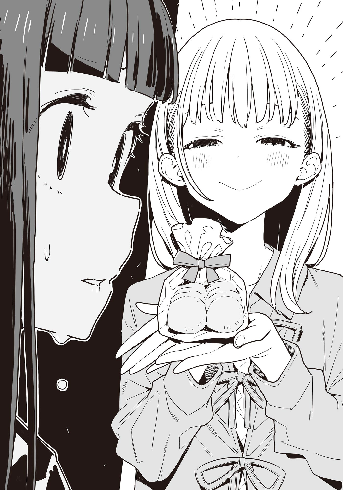

# Ch.149 — เล่ม 8.5 บทที่ 15

Ch.149 — เล่ม 8.5 บทที่ 15

By มนก

Published: 2026-03-02T07:52:09Z

Source: https://www.nekopost.net/novel/14560/149

บ่ายวันหยุดสุดสัปดาห์วันหนึ่ง

นุคุมิซึ คาจู ผูกเชือกผ้ากันเปื้อนให้แน่นอยู่ในห้องครัวที่บ้าน เธอตั้งใจจะทำของว่างยามบ่ายสามก่อนที่ท่านพี่ซึ่งออกไปซื้อของจะกลับมา

ช่วงนี้อากาศเริ่มอุ่นขึ้นแล้ว ทำคอฟฟี่เจลลี่ดีไหมนะ──

ขณะที่กำลังเช็กน้ำแข็งในช่องแช่แข็ง จู่ๆ เสียงกริ่งประตูก็ดังขึ้น

เมื่อคาจูโงกหน้าไปมองหน้าจอมอนิเตอร์ของอินเตอร์คอม ก็ปรากฏภาพของเด็กสาวหน้าตาน่ารักสวมที่คาดผมหูสัตว์อยู่บนนั้น

『ทานุกิชิราทามะมาหลอกท่านประธานแล้วค่าー』

ติ๊ด

คาจูรีบกดปิดสวิตช์อินเตอร์คอมอย่างรวดเร็ว แล้วเดินกลับเข้าครัว

เอาล่ะ ทำเจลลี่ด้วยเอสเปรสโซ่แล้วท็อปปิ้งด้วยไอศกรีมวานิลลาดีกว่า ท่านพี่จะต้องพอใจอย่างแน่นอน

ขณะที่คาจูกำลังเลือกเมล็ดกาแฟที่ชั้นวางอาหาร เสียงกริ่งประตูก็ดังแว่วเข้าหูมาอีกครั้ง

เธอเดินไปที่หน้าจอมอนิเตอร์พลางกลั้นเสียงถอนหายใจ ก็พบชิราทามะ ริโกะ กำลังส่งยิ้มแฉ่งให้กับกล้อง

『นั่นคาจูจังใช่มั้ยเอ่ย? ฉันมาหาตามที่นัดไว้กับท่านประธานน่ะ』

──นัดไว้

คำๆ นั้นทำให้นิ้วของคาจูที่กำลังเอื้อมไปกดสวิตช์ชะงักลง

ในเมื่อมีนัดกับท่านพี่ จะไล่กลับไปก็คงไม่ได้

ดีไม่ดี ให้มาเจอกันในที่ที่สายตามองเห็น ยังดีกว่าปล่อยให้ไปพลอดรักกันสองต่อสองซะอีก

คาจูตัดสินใจอย่างยากลำบาก ก่อนจะกดสวิตช์สนทนา

[ ยินดีต้อนรับค่ะ ชิราทาทามะซัง จะไปเปิดประตูให้เดี๋ยวนี้แหละค่ะ ]

◇

ชิราทามะ ริโกะ ที่นั่งปุ๊กหลุ๊กอยู่บนโซฟาในห้องนั่งเล่น พนมมือขอโทษคาจูอย่างน่ารักน่าเอ็นดู

[ ขอโทษนะ คาจูจัง ทั้งที่เป็นวันอาทิตย์แท้ๆ ]

[ ถ้าเป็นแขกละก็ ยินดีต้อนรับเสมอค่ะ? ถ้าเป็นแขกน่ะนะคะ ]

คาจูส่งยิ้มพร้อมกับวางถ้วยชาฝรั่งลงตรงหน้าชิราทามะ

……แม้แต่ในสายตาของคาจู เธอก็น่ารักมากๆ

ชุดเดรสสีฟ้าอ่อนดูสดใสที่สวมใส่อยู่นั้นช่างเข้ากับเธอมากๆ คนส่วนใหญ่ที่เดินสวนกันจะต้องเหลียวหลังมองอย่างแน่นอน

ถึงกระนั้น ก็ใช่ว่าจะฝากฝังท่านพี่ให้ได้เพียงเพราะความน่ารักหรอกนะ

ได้ยินมาว่าชิราทามะ ริโกะ กำลังตามตื๊อพี่ชายบุญธรรมของตัวเองอยู่อย่างหนัก

การกระทำที่ผิดศีลธรรมเช่นนั้นเป็นเรื่องที่ให้อภัยไม่ได้ และแค่จุดนั้นจุดเดียวก็ไม่คู่ควรกับท่านพี่แล้ว สามารถฟันธงได้เลย

[ ขอโทษด้วยนะคะ ท่านพี่เนี่ยดันลืมนัดแล้วออกไปข้างนอกซะได้ ถ้าเป็นนัดกับคาจูละก็ ไม่มีทางเป็นแบบนั้นเด็ดขาดเลยล่ะค่ะ ]

คาจูทรุดตัวลงนั่งบนโซฟาด้วยท่าทีรู้สึกผิด

ชิราทามะส่ายหน้าไปมาราวกับจะบอกว่าไม่ต้องใส่ใจ

[ ไม่หรอก เป็นความผิดฉันเองที่มาโดยไม่ได้บอกกล่าวล่วงหน้าน่ะ ]

[ เอ๊ะ ไม่ใช่ว่ามีนัดกับท่านพี่ไว้หรอกเหรอคะ?! ]

ชิราทามะยื่นห่อของที่หยิบออกมาจากกระเป๋าให้กับคาจูที่กำลังตกใจด้วยท่าทีเรียบเฉย

[ ฉันสัญญากับประธานเอาไว้ว่า ถ้าคราวหน้าทำคุกกี้แล้วจะเอามาให้น่ะ ]

[ คะ? ]

……โดนหลอกเข้าแล้ว สัญญาที่ว่าคือการเอาคุกกี้มาให้ ไม่ใช่เรื่องที่จะมาเที่ยวเล่นที่บ้านซะหน่อย

ชิราทามะแลบลิ้นปลิ้นตาใส่คาจูที่กำลังครุ่นคิดหาวิธีไล่เธอกลับไป

[ อืม รอให้ถึงวันจันทร์ไม่ไหวก็เลยบุกมาถึงบ้านเลยน่ะ ]

[ ……บุกมาเลยงั้นเหรอคะ ]

[ บุกมาเลยค่ะ ]

ชิราทามะซังแกะริบบิ้นห่อของออกด้วยรอยยิ้ม

[ ไหนๆ ก็มาแล้ว อยากให้คาจูจังได้ทานด้วยจัง คราวนี้ฉันตั้งใจทำเป็นพิเศษเลยนะ? ]

[ เฮ้อ ]

คาจูตอบรับอย่างหมดอาลัยตายอยากพลางหยิบคุกกี้ขึ้นมาหนึ่งชิ้น

เป็นคุกกี้ชิ้นเล็กๆ ผสมอัลมอนด์สไลซ์ หน้าตาดูน่าทานทีเดียว

พอดมกลิ่นเบาๆ แล้วเอาเข้าปาก กลิ่นเนยอันหรูหราก็แผ่ซ่านไปทั่วปาก และรสชาติของอัลมอนด์ก็ทะลวงจมูกตามมาติดๆ

……ทำไมกันนะ กลิ่นเนยนี้รู้สึกคุ้นๆ ถึงตัวเองจะไม่เคยใช้ แต่ก็รู้สึกเหมือนเพิ่งได้กินที่ไหนสักแห่งเมื่อไม่นานมานี้

[ นี่ใช้เนยอะไรเหรอคะ? ]

[ อืมー รู้สึกจะเขียนว่าเอชิเร่จากฝรั่งเศสนะ ราคาสูงไปหน่อย แต่ก็อยากให้ท่านประธานดีใจเลยยอมทุ่มทุนสร้างน่ะ ]

[ ทุ่มทุนสร้างเลยเหรอคะ ]

[ ทุ่มเลยค่ะ เอ้า คาจูจังทานได้เลยไม่ต้องเกรงใจนะ ]

คาจูหยิบคุกกี้ชิ้นที่สองตามคำเชิญชวน พลางจ้องมองผิวหน้าของมัน

คุกกี้นี้ไม่ได้มีดีแค่เนย ทั้งแป้งสาลีและอัลมอนด์ที่ใช้ ต่างก็เป็นวัตถุดิบคนละชั้นกับที่คาจูเคยสัมผัสมาอย่างเทียบไม่ติด

[ เอ่อ แล้วแป้งสาลีใช้ของอะไรคะ……? ]

[ เป็นของสั่งตรงจากผู้ผลิตต่างประเทศน่ะ เห็นว่าพวกมือโปรเขาก็ใช้กัน ฉันเป็นพวกชอบเริ่มต้นจากเปลือกนอกน่ะ ]

ชิราทามะส่งสายตามีความหมายแฝงไปให้คาจูที่เอาแต่เงียบ

[──บางทีเรื่องความรักก็อาจจะเหมือนกันก็ได้นะ]

[ เริ่มจากเปลือกนอกเหรอคะ? ในเรื่องความรักเนี่ยนะ?]

[ ใช่ ฉันเป็นพวกที่ว่า ถ้าได้คบกันแล้วเดี๋ยวก็คงจะชอบอีกฝ่ายไปเองล่ะมั้ง ]

[ อ๊ะ!? จะคบกับคนที่ไม่ได้ชอบเนี่ยนะคะ?! ]

ชิราทามะส่งยิ้มแบบผู้ใหญ่ให้กับคาจูที่เผลอส่งเสียงดังออกมา

[ แค่ลำดับการตกหลุมรักมันต่างกันเท่านั้นเองนะ? ]

ชิราทามะหยิบถ้วยชาฝรั่งขึ้นมา โดยไม่สนใจคาจูที่กำลังพูดไม่ออก

[ ฉันเป็นคนหัวอ่อนน่ะ เลยคิดว่าน่าจะเหมาะกับคนอายุมากกว่าที่ใจดีหน่อย คาจูจังคิดว่าไงจ๊ะ? ]

[ ชิราทามะซังทำขนมเก่งขนาดนี้ ลองคบคนอายุน้อยกว่าดูไหมคะ! ต้องไปได้สวยแน่ๆ ค่ะ! ]

ชิราทามะแหงนมองเพดานด้วยสีหน้าครุ่นคิดอย่างน่ารัก

[ คนอายุน้อยกว่าไม่ใช่สเปกซะด้วยสิー แต่ถ้าคบกันไปแล้วก็อาจจะชอบขึ้นมาก็ได้มั้ง ]

[ ใช่ค่ะ! คนอายุน้อยกว่าที่ดูดีก็มีตั้งเยอะตั้งแยะ! ]

[ นั่นสินะ ไม่ว่าจะอายุมากกว่าหรือน้อยกว่า คนที่ดูดีก็คือดูดีนั่นแหละ──อย่างเช่นประธานเป็นต้น ]

ชิราทามะหยิบคุกกี้ขึ้นมา พลางทำเป็นไม่สังเกตเห็นคาจูที่ตัวแข็งทื่อไปอีกครั้ง

[ ดีใจจังที่ได้คุยเรื่องความรักกับคาจูจัง คุกกี้อร่อยไหมจ๊ะ? ]

[ ค-ค่ะ…… ]

พูดตามตรง แม้แต่ในสายตาของคาจูมันก็ทำออกมาได้ดีมาก ที่สำคัญคือวัตถุดิบมันคนละชั้นกัน

ชิราทามะยิ้มบางๆ อย่างอ่อนโยนให้กับคาจูที่กำลังเงียบ

[ ถ้าไม่รังเกียจ จะกินให้หมดเลยก็ได้นะ? ]

[ ! จะทานไม่ให้เหลือเลยค่ะ! ]

แผนรับมือค่อยว่ากันหลังจากนี้ ก่อนอื่นต้องลบของกินปีศาจนี่ออกไปให้พ้นหน้าท่านพี่ให้ได้ซะก่อน──

คาจูใช้ชาฝรั่งดื่มกลั้วคอ พลางฝืนกินคุกกี้ทั้งหมดจนหมดเกลี้ยง

[ ว้าว ดีใจจัง ที่คาจูจังกินให้เยอะขนาดนี้ ]

[ ……อ-อร่อยจนเผลอกินมากไปหน่อยน่ะค่ะ ]

คาจูฝืนยิ้มแข็งๆ แล้วปรายตามองกล่องเปล่า

[ ขอโทษด้วยนะคะ ส่วนของท่านพี่หมดซะแล้ว ]

[ ไม่เป็นไรจ้ะ ไม่ต้องใส่ใจหรอก ]

ชิราทามะยังคงยิ้มแย้ม พลางหยิบห่อของอันใหม่ลูกใหญ่กว่าเดิมออกมาจากกระเป๋า

[ ──เพราะยังมีอีกห่อนึงไงล่ะ ]

[ ………… ]

คราวนี้คาจูถึงกับตัวแข็งทื่อราวกับถูกแช่แข็งของจริง

เวลาผ่านไปนานแค่ไหนแล้วก็ไม่รู้ ชิราทามะขยับมานั่งข้างๆคาจู

[ นี่ คาจูจัง รู้สึกว่าพวกเราน่าจะเข้ากันได้ดีนะ ]

[ ……นั่นสินะคะ ]

ชิราทามะหยิบสมาร์ทโฟนออกมาโดยที่รอยยิ้มอันสมบูรณ์แบบยังคงไม่คลายลง

[ ขอแลกช่องทางติดต่อกันหน่อยได้ไหมจ๊ะ ]

[ …………! ]

──ชิราทามะ ริโกะ จะปล่อยผู้หญิงคนนี้ให้ลอยนวลไม่ได้เด็ดขาด

นุคุมิซึ คาจู วัย 15 ปี สัญชาตญาณลูกผู้หญิงมันบอกอย่างนั้น

[ …………ได้ค่ะ ด้วยความยินดี ]

คาจูยื่นสมาร์ทโฟนให้ด้วยรอยยิ้มที่สมบูรณ์แบบไม่แพ้กัน

ขณะที่ทั้งสองคนซึ่งเพิ่งบรรลุข้อตกลงปรองดองอันน่าจดจำกำลังแลกเปลี่ยนช่องทางติดต่อกันอย่างเงียบๆ เสียงเปิดประตูก็ดังมาจากโถงทางเข้า ท่านพี่ หรือ นุคุมิซึ คาซึฮิโกะ กลับมาถึงบ้านแล้ว

ทั้งสองคนรีบลุกขึ้นยืนอย่างรวดเร็ว แล้ววิ่งไปที่โถงทางเข้า

[ ยินดีต้อนรับกลับบ้านค่ะ── ]

[ ท่านพี่ ] [ ประธาน ]
