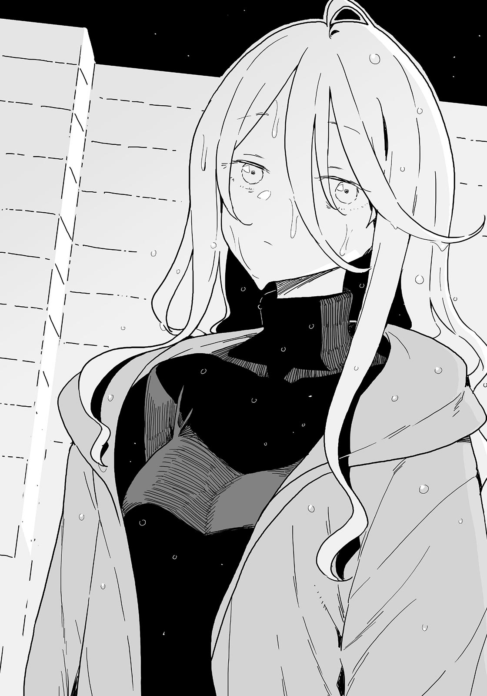

# Ch.14 — เล่ม4 บทที่ 2-4

Ch.14 — เล่ม4 บทที่ 2-4

By Monica

Published: 2024-12-06T15:26:51Z

Source: https://www.nekopost.net/novel/14560/14

เล่ม 4 บทที่ 2-4

สถานีไอจิไดกาคุมาเอะ เป็นสถานีที่ใกล้กับโรงเรียนมัธยมซึวะบุกิมากที่สุด

ผมกับเทียร่าซังแยกกันที่นั่น เมื่อผมลงจากชานชาลาพร้อมกับยากิชิโอะตอนนั้นก็เริ่มมืดแล้ว

พวกเรายืนรอสัญญาณไฟที่ทางม้าลาย ผมตรวจสอบนาฬิกา

เวลาผ่านไปจนตอนนี้ 4 โมงเย็น ซึ่งเลยเวลานัดมาเป็นชั่วโมงแล้ว

[ บอกแล้วว่าเพลงสุดท้ายมันไม่จำเป็น เราพลาดรถไฟเลยเห็นมั้ย? ]

[ นุกคุงเองก็ดูจะสนุกไม่ใช่เหรอ? นายก็เล่นมาราคัสได้เก่งไม่เบาเลยนะ ]

เอ๊ะ จริงเหรอ? บางทีผมอาจจะตั้งใจฟังจังหวะและทำนองเพลงมากไป

พอได้คำชมแล้วก็รู้สึกเขินอยู่ ยากิชิโอะเอาศอกสะกิดผม

[ นี่ โคมาริจังส่งข้อความมาหานายบ้างมั้ย? โทรศัพท์ฉันแบตหมดแล้ว ]

[ อืม คิดว่าเธอน่าจะส่งมาแล้วล่ะ ]

ผมพูดตะกุกตะกักพร้อมหยิบโทรศัพท์ขึ้นมา ที่จริงแล้ว โคมาริส่งข้อความหาผมทาง Line, SMS, โทรศัพท์, อีเมล และ Twitter DM ผมไม่ได้ตอบอะไรเลยสักอย่าง

ยากิชิโอะมองดูโทรศัพท์ผมข้าง ๆ แล้วทำหน้า “อุว้า”

[ เธอส่งข้อความมาตลอดเลยนี่ นุกคุง นายมันแย่จริงๆ ]

...อีกข้อความของ "ไปตายซะ" ส่งมาแล้ว

ยากิชิโอะบังตาด้วยฝ่ามือ เธอเหยียดตัวตรงและมองข้ามถนนไปอีกฝั่ง

คาเฟ่บอร์ดเกมอยู่ฝั่งตรงข้ามพอดี แต่ผมมองไม่เห็นว่าเกิดอะไรขึ้นข้างใน

[ ชิกิยะซังจากสภานักเรียนเป็นสาวสวยแต่ก็แอบน่ากลัวใช่มั้ย? โคมาริจังอยู่กับเธอคนเดียวจะโอเคเหรอ? ]

[ โคมาริเริ่มชินกับเธอแล้วล่ะ พวกเขาน่าจะคุยกันได้สักชั่วโมงก็ไม่มีปัญหา ]

ข้างหน้าคือถนนที่มีสองเลนในแต่ละฝั่ง การจราจรค่อนข้างหนาแน่น

สัญญาณไฟคงไม่เปลี่ยนในเร็ว ๆ นี้แน่ แล้วผมก็เห็นผู้หญิงคนหนึ่งเดินเข้าไปในคาเฟ่บอร์ดเกม

ผมของเธอมัดเป็นสองหางด้านหลัง ดูคุ้น ๆ ยากิชิโอะดึงเสื้อผม

[ นุกคุง นั่นใช่รุ่นพี่สึกิโนะคิรึเปล่า? นายชวนเธอมาที่นี่เหรอ? ]

ผมส่ายหัว

รุ่นพี่สึกิโนะคิไม่รู้เรื่องทั้งหมดนี้เลย และผมก็ไม่ได้ขอให้ชิกิยะซังช่วยด้วย

แล้วทำไมรุ่นพี่สึกิโนะคิถึงมาอยู่ที่นี่- ผมไม่คิดว่ามันเป็นเรื่องบังเอิญ

...ผมรู้สึกไม่สบายใจ

ผมรอให้สัญญาณไฟเปลี่ยนด้วยความกังวล

ยากิชิโอะเริ่มวิ่งทันทีที่ไฟเขียว

ผมเดินตามอย่างรวดเร็วและวิ่งตามหลังยากิชิโอะไป

ต้องมีอะไรเกิดขึ้นระหว่างสองคนนั้นแน่ ๆ ผมรู้สึกถึงกำแพงบางอย่างระหว่างพวกเธอ

แต่พวกเธอก็คุยกันปกติเมื่อเจอหน้ากัน ไม่เคยเห็นพวกเธอโต้เถียงกันอย่างรุนแรงเลย

อาจจะกังวลมากเกินไป

ยากิชิโอะวิ่งด้วยท่าทางกังวล

แสงออร่าประหลาดแผ่ออกมาจากด้านหลังของรุ่นพี่สึกิโนะคิ

...ผมตามยากิชิโอะเข้าไปและเปิดประตูคาเฟ่ พวกเขาจ้องหน้ากันข้ามโต๊ะ

ไม่ใช่ รุ่นพี่สึกิโนะคิกำลังยืนอยู่หน้าตโต๊ะด้วยใบหน้าขึงขัง

ชิกิยะซังยังคงไร้อารมณ์เหมือนเคย เธอนั่งอยู่บนเก้าอี้ ดวงตาสีขาวอันงดงามของเธอจ้องมองรุ่นพี่สึกิโนะคิ

ยากิชิโอะยืนอยู่ที่ประตู ผมเลยถามเธอ

[ ไม่รู้ มันเป็นแบบนี้ตั้งแต่ฉันเข้ามาแล้ว ]

โคมาริดูวุ่นวายอยู่ระหว่างทั้งสองคน พอเห็นผม เธอก็รีบวิ่งเข้ามาหา

[ ฉ-ฉันบอกกับรุ่นพี่สึกิโนะคิแล้วว่าฉันมาที่นี่กะ...กับคนนั้น ขอโทษนะ ไม่คิดว่าจะเป็นแบบนี้ ]

น้ำตาเริ่มเอ่อล้นออกมาจากดวงตาของโคมาริ เธอยื่นโมเดลไก่ไม้เล็ก ๆ มาให้ผม

ตอนนี้ผมเข้าใจเรื่องทั้งหมดแล้ว แต่ไก่นี่มาจากไหน?

[ ไม่เลวนี่ โคมาริ แล้วเกิดอะไรขึ้นล่ะ? ]

[ พ-พวกเขาจ้องตากันไม่หยุดตั้งแต่รุ่นพี่มาถึง ]

เข้าใจแล้ว ยังมีอะไรอีก

รุ่นพี่สึกิโนะคิตบโต๊ะเสียงดัง

[ ชิกิยะ เธอคิดจะทำอะไรกันแน่? ]

รุ่นพี่สึกิโนะคิระเบิดอารมณ์ออกมาเป็นคนแรก

ชิกิยะซังเอียงคอ เธอดูไม่หวั่นไหวกับความโกรธของรุ่นพี่เลย

[ มี…..อะไรเหรอ? ]

[ ฉันรู้ว่าเธอคอยดูแลรุ่นน้องของฉัน แต่ช่วงนี้เธอจะทำเกินไปแล้ว ]

[ มันแย่เหรอ...ทุกคนใจดีกับฉันมาก... ]

ชิกิยะซังลุกขึ้นยืนอย่างเซื่องซึม ผมยาวโค้งของเธอพริ้วไหวอย่างอ่อนโยน

ดวงตาสีขาวของชิกิยะซังมองเห็นผม

รุ่นพี่สึกิโนะคิหันมองตามสายตา เธอเห็นผมแล้วสีหน้าของเธอกระตุก

[ นุคุมิซึคุงสินะ คราวนี้เธอเลือกนุคุมิซึเหรอ ชิกิยะ? บางทีนี่อาจดูเหมือนเกมสำหรับเธอ แต่เธอเคยคิดถึงพวกเราบ้างมั้ย? ]

[ เกม….มันไม่ดีเหรอ?]

[ ชิ! เธอ! ]

เอ๊ะ ผมเหรอ? พวกเธอพูดถึงผมเหรอ? ผมรีบเข้ามาแทรกกลางระหว่างพวกเธอสองคน

[ เดี๋ยวก่อน! ผมขอให้ชิกิยะซังช่วยตอนที่นิยายของรุ่นพี่โดนยึดไป เธอไม่ได้ทำอะไรแปลก ๆ นะ ]

[ นุคุมิซึคุง เรื่องจริงเหรอ? สำหรับฉัน ชิกิยะกับ- ]

รุ่นพี่สึกิโนะคิหยุดพูดกลางคัน

[ อ่า ใช่ ไม่ใช่เรื่องใหญ่อะไรขนาดนั้น ]

[ รุ่นพี่... โคโตะซัง... ประธานขอให้ฉันช่วยน่ะ ]

ชิกิยะซังยืนข้างผมอย่างเงียบ ๆ โดยที่ผมไม่ทันรู้ตัว

[ นั่นแหละ เธอ- ]

[ ทุกคน...กำลังตามเก็บความยุ่งเหยิงของโคโตะซัง... ]

ชิกิยะซังย่างเข้ามาใกล้รุ่นพี่สึกิโนะคิเล็กน้อยในท่าทางยั่วยุ

[ เธอ...เข้าใจมั้ย ? ]

รุ่นพี่สึกิโนะคิจ้องใบหน้าของชิกิยะซังอย่างเงียบ ๆ

เธอถอยหลังไปเล็กน้อยและหันหน้าหนี ก่อนที่สถานการณ์จะตึงเครียดมากขึ้น

[ ขอโทษนะ นุคุมิซึคุง โคมาริจัง ยากิชิโอะจัง ฉันขอโทษที่ทำให้พวกเธอต้องเข้ามายุ่งเรื่องนี้ด้วย ]

รุ่นพี่สึกิโนะคิโค้งคำนับให้พวกเรา

[ พวกเธอไม่ต้องมาเกี่ยวข้องกับเรื่องนี้อีกแล้ว นี่เป็นความผิดของฉันเอง ฉันจะรับผิดชอบทั้งหมดเอง ]

รุ่นพี่สึกิโนะคิเงยหน้าขึ้นพร้อมรอยยิ้มอันอ่อนแรง

[ เพราะงั้น...อย่าเข้าใกล้ชิกิยะมากนักเลย ]

พวกเราทุกคนเงียบไปทันทีเมื่อได้ยินคำนั้น

ทั้งร้านเงียบสนิท ผมค่อย ๆ เลือกคำพูดของตัวเองก่อนจะถามออกไป

[ ...นี่เป็นคำแนะนำของรุ่นพี่ใช่มั้ย? ]

[ ก็คงอย่างนั้น ถึงฉันจะไม่จำเป็นต้องพูดก็เถอะ ]

[ เข้าใจแล้ว แต่ว่ายังไง..รุ่นพี่ก็ออกจากชมรมวรรณกรรมไปแล้วนี่ ]

[ เฮ้ นุกคุง! ]

ยากิชิโอะดึงไหล่ผมจากข้างหลัง

รุ่นพี่สึกิโนะคิกัดริมฝีปากแล้วก้มศีรษะลง

[ ...นายพูดถูก ฉันขอโทษ ฉันจะไม่ก่อปัญหาให้ทุกคนอีกแล้ว ]

[ เพราะอย่างนั้น รุ่นพี่ควรจะปล่อยเรื่องโดจินชิและเรื่องอื่น ๆ ให้สมาชิกปัจจุบันจัดการเถอะ ไม่ว่ารุ่นพี่จะออกไปแล้วหรือไม่ก็ตาม รุ่นพี่ก็ยังเป็นส่วนหนึ่งของชมรมวรรณกรรมอยู่ดี ปล่อยให้รุ่นน้องอย่างพวกเราดูแลและเชื่อใจพวกเราเถอะ ]

...ผมไม่รู้ว่านี่คือคำตอบที่ถูกต้องหรือไม่

แต่ที่แน่ ๆ คือ ผมเคยได้รับความช่วยเหลือจากรุ่นพี่ที่น่าปวดหัวคนนี้อยู่เสมอ

แม้ผมจะต้องเจ็บปวดเพราะเธอหลายครั้ง แต่เธอก็ให้บางสิ่งบางอย่างกลับมามากกว่าเสมอ

เพราะอย่างนั้น ผมถึงไม่อยากเห็นรุ่นพี่ต้องเจ็บปวดเพื่อพวกเรา ไม่ว่าจะเป็นใครก็ตาม

ผมไม่รู้ว่าเธอเข้าใจมั้ย รุ่นพี่สึกิโนะคิก้มหัวลงอีกครั้ง

[ ...ฉันต้องขอโทษจากใจจริง ทุกคน ขอโทษที่ทำให้เกิดปัญหากับคนในร้านด้วย ]

หลังจากนั้น เธอสังเกตเห็นชิกิยะซังที่กำลังมองเธออยู่ เธอลังเลอยู่สักพักก่อนจะพูดขึ้น

อย่างไรก็ตาม คำพูดที่พวกเราหวังเล็กน้อยว่ามันจะช่วยแก้ปัญหาทุกอย่างนั้นกลับไม่ปรากฏออกมา เพราะคำพูดมหัศจรรย์แบบนั้นมันไม่มีอยู่จริง

[ ขอโทษที่รบกวนเธอนะ ชิกิยะซัง ]

แล้วรุ่นพี่สึกิโนะคิก็ออกจากร้านไปอย่างเงียบ ๆ

ผมยืนนิ่งอยู่ที่เดิม โคมาริเป็นคนแรกที่ขยับตัว

[ ฉ-ฉันจะตามรุ่นพี่สึกิโนะคิไป ]

[ อืม ฝากด้วยนะ โคมาริ ]

โคมาริพยักหน้า ก่อนจะรีบวิ่งออกจากร้านไป

หลังจากนั้นไม่นาน ความวุ่นวายก็กลับมาสู่ร้านอีกครั้ง

ชิกิยะซังยืนนิ่งอยู่พักหนึ่ง เธอหยิบธนบัตรจากกระเป๋าสตางค์แล้ววางลงบนโต๊ะ

[ ขอโทษนะ...ฉันจะวางเงินค่าเครื่องดื่มไว้ตรงนี้ ]

ชิกิยะซังเดินออกจากร้านด้วยท่าทางโซเซ

ผมลังเลที่จะวิ่งตามเธอไป ยากิชิโอะดันหลังผมเบา ๆ

[ ไปสิ นุกคุง ]

[ ...ไปได้จริง ๆ เหรอ? ]

ชิกิยะซังเพิ่งจะถูกเพื่อนสนิทปฏิเสธ

ความคิดมากมายวนเวียนอยู่ในหัว แต่คำตอบที่ชัดเจนกลับไม่มีให้เห็น

[ ผมคิดว่าในเวลาแบบนี้เธอคงอยากอยู่คนเดียว ]

ยากิชิโอะดันหลังผมอีกครั้ง คราวนี้แรงกว่าเดิมหน่อย

[ อยากอยู่คนเดียวกับความรู้สึกเหงามันไม่เหมือนกันนะ ]

ดวงตาสีน้ำตาลเข้มของยากิชิโอะส่งความรู้สึกที่ยากจะอธิบายออกมา

ผมเดินออกจากร้านไป โดยไม่รู้ตัวว่าทำไม ผมเงยหน้ามองท้องฟ้าที่เริ่มมืดขณะกดแก้มที่ร้อนผ่าวเพราะแสงแดดเมื่อครู่

— ฝนเริ่มตกแล้ว

◇

ชิกิยะซังกำลังเดินอยู่บนทางเท้าตรงไปยังโรงเรียนซึวะบุกิ

ฝนเย็นที่ตกเป็นช่วง ๆ กลบแสงอันริบหรี่ของฤดูหนาวอย่างรวดเร็ว

ชิกิยะซังเดินในความมืด ไฟหน้ารถที่แล่นผ่านส่องสว่างร่างของเธอเป็นช่วง ๆ

ผมรีบวิ่งไปหาเธอแล้วเดินเคียงข้าง

[ เธอโอเคมั้ย? เอ่อ จะไปไหนเหรอ? ]

[ กลับ...บ้าน... ]

ชิกิยะซังพึมพำด้วยน้ำเสียงที่ฟังดูเหมือนเด็กไร้เดียงสาเช่นเคย

[ บ้านเธออยู่ไหนล่ะ? ผมเดินไปส่งครึ่งทางได้นะ ]

ซ่า... เสียงฝนบ่งบอกว่าฝนเริ่มตกหนักขึ้น

ผมเร่งให้ชิกิยะซังเดินต่อ เราไปหาที่หลบฝนใต้ชายคาอพาร์ตเมนต์ใกล้ ๆ

ถึงแม้ว่าจะยังไม่ค่ำ แต่ท้องฟ้ากลับมืดราวกับมีใครทาสีทึบลงไป

ผมถอนหายใจโล่งอกแล้วหันไปมองชิกิยะซังที่อยู่ข้าง ๆ

หยดน้ำไหลจากผมที่เปียกของเธอลงมาผ่านแก้มที่ขาวซีด

ผมค้นในกระเป๋า แต่ก็พบว่าผมลืมผ้าเช็ดหน้าไว้ที่ไหนสักแห่ง

เรื่องพลาด ๆ แบบนี้เป็นเรื่องปกติสำหรับผมเสมอ

[ ฝนยังไม่หยุดเลย เดี๋ยวไปซื้อร่มตรงนั้นนะ รอแป๊บนึงได้มั้ย?]

[ ไม่เป็นไร... ฉันเรียกแท็กซี่แล้ว... ]

หน้าจอโทรศัพท์ของชิกิยะซังเปียกฝน เธอมองมันอย่างไร้อารมณ์

แสงจากหน้าจอทำให้ใบหน้าของเธอดูซีดลงกว่าเดิม

[ ไม่หนาวเหรอ? ]

[ ...ไม่รู้สิ ]

ชิกิยะซังตอบอย่างหมดแรง

เธอป่วยถึงขนาดที่ไม่รู้สึกหนาวหรือเปล่านะ? น่าเป็นห่วงจริง ๆ

[ ฉันไม่เข้าใจ...สิ่งที่โคโตะพูด ]

เธอพึมพำอย่างหมดเรี่ยวแรงกว่าเดิม

[ อืม... คนแบบนั้นบางทีก็พูดเอาแต่ใจตัวเองเกินไปน่ะ อย่าคิดมากเลย ]

ชิกิยะซังหยิบเส้นผมที่เปียกติดหน้าผากขึ้นแล้วเอียงหัว

[ ฉัน...ทำให้พวกเธอลำบากเหรอ...? ]

[ เอ๋? เปล่าหรอก ไม่จริงเลย พวกเราเป็นฝ่ายขอให้เธอช่วยต่างหาก ]

ผมยื่นซองทิชชู่ที่เจอในกระเป๋าให้เธอ

[ ขอบคุณนะ... ใจดีจัง ]

ชิกิยะซังหยิบทิชชู่มาเช็ดหน้าผากที่เปียกของเธอ

[ น้องสาวเป็นคนใส่มาให้เอง เธอเป็นคนใจดีจริงๆนั้นแหละ ]

ตอนที่เธอพูดว่าผมใจดีมันให้ความรู้สึกเหมือนเลิฟคอมฯเลย เพียงเพราะผมแค่ให้ทิชชู่กับเธอเนี่ย

ขณะที่กำลังคิดถึงเรื่องนั้น ปลายนิ้วของชิกิยะซังก็แตะกับปลายนิ้วของผม

[ งั้น...แค่ตอนนี้...ได้โปรด…ใจดีกับฉันหน่อยนะ ]

เอ๋? หมายถึงอะไร-

มือของผมเริ่มแข็งทื่อ ปลายนิ้วของเธอแตะกับผมอีกครั้ง

นี่คือ...จับมือกันเหรอ?

ไม่สิ เดี๋ยวก่อน ถ้าผมคิดมากเกินไปแล้วจับเธอกลับล่ะ จะกลายเป็นการล่วงละเมิดทางเพศมั้ยเนี่ย?

ว่ากันว่าหลายโศกนาฏกรรมเกิดขึ้นเพราะความเข้าใจผิดในช่วงที่การลูบหัวได้รับความนิยม

[ เอ่อ... รุ่นพี่ชิกิยะ? ]

ไม่มีคำตอบ

ชิกิยะซังยืนใกล้ผมจนไหล่ของเราชนกัน เธอไม่ขยับไปไหน

แท็กซี่ก็ยังไม่มา

จากนั้น ปลายนิ้วของชิกิยะซังก็แตะกับนิ้วของผมอีกครั้งเบา ๆ ก่อนจะถอยออกไป

เธอทำซ้ำอยู่สามครั้ง แล้วครั้งที่สี่เธอก็ไม่ปล่อยไปอีกหลังจากแตะปลายนิ้วของผม

...ผมไม่รู้ว่ามันผ่านไปนานแค่ไหนแล้ว

อาจจะไม่นานนัก แต่สำหรับผมมันรู้สึกเหมือนยาวนานชั่วกัปชั่วกัลป์

นั่นคือเหตุผลที่ผมตัดสินใจจับมือของชิกิยะซังไว้ตอนที่ปลายนิ้วของเธอกำลังจะผละออกไปอีกครั้ง

นิ้วของชิกิยะซังบอบบางและเย็นเฉียบ

เธอค่อย ๆ จับมือผมอย่างนุ่มนวล ราวกับว่ากำลังดูแลนกตัวเล็ก ๆ

มันเป็นเรื่องที่เรียบง่ายกว่าความรู้สึกโรแมนติกหรืออะไรแบบนั้น

แค่อยากสัมผัสกับใครสักคน ความรู้สึกของเธอถูกถ่ายทอดมาให้ผมอย่างเจ็บปวด

ใบหน้าด้านข้างของชิกิยะซังยังคงไร้อารมณ์เช่นเคย

นี่เป็นครั้งแรกที่ผมตระหนักได้

— เด็กสาวคนนี้ไม่เคยหลั่งน้ำตาแม้แต่ตอนที่เธอร้องไห้

---
