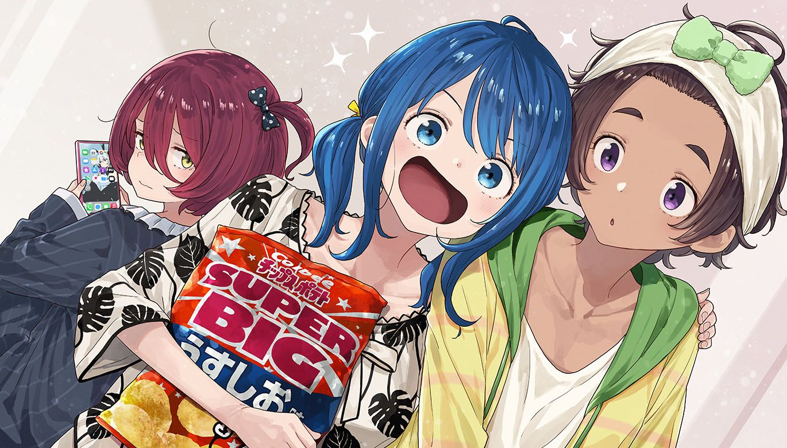
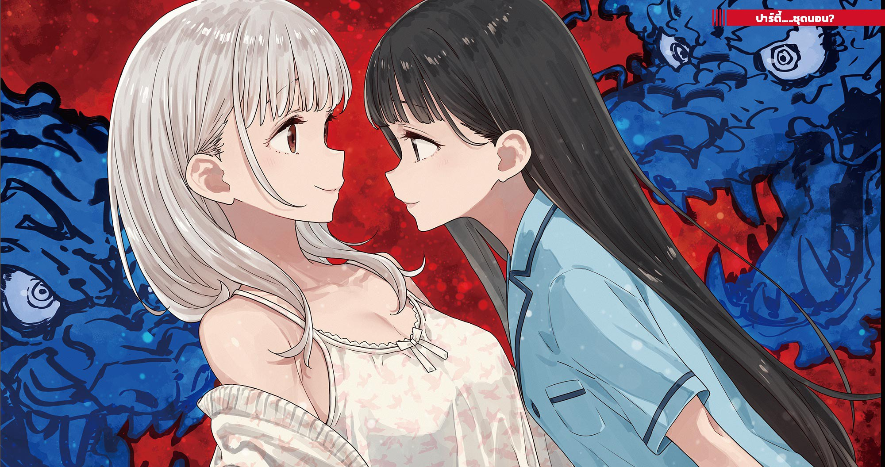

# Ch.155 — เล่ม 8.5 บทที่ 19-3

Ch.155 — เล่ม 8.5 บทที่ 19-3

By มนก

Published: 2026-03-06T16:25:10Z

Source: https://www.nekopost.net/novel/14560/155

ปาร์ตี้ชุดนอนบ้านนุคุมิซึ ครั้งที่ 1 นำโดย นุคุมิซึ คาจู

คาจูในชุดนอนลายเดียวกับพี่ชาย นั่งลงบนฟูกดังปุบ ก่อนจะก้มหัวให้กับสาวๆ ชมรมวรรณกรรม

[เอาล่ะค่ะทุกคน วันนี้เหนื่อยกันหน่อยนะคะ ต่อจากนี้ไปคือช่วงเวลาของสาวๆ ค่ะ!]

สาวๆ ชมรมวรรณกรรมพร้อมใจกันปรบมือรับคำประกาศเปิดงาน

ห้องของคาจูมีขนาดประมาณ 10 เสื่อทาทามิ มีเตียงขนาดเซมิดับเบิล และเนื่องจากวันนี้จัดงานปาร์ตี้ เลยปูฟูกไว้บนพื้นอีก 3 ที่

คาจูปะรบมือพลางกวาดสายตามองไปรอบห้องอย่างไม่ประมาท ผู้หญิงที่อยู่ที่นี่คือว่าที่เจ้าสาวของท่านพี่ไม่ผิดแน่(ยกเว้นประมาณ 1 คน)นี่แหละคือโอกาสดีที่จะได้พิจารณาดูนิสัยใจคอ──

อันดับแรกเธอปรายตามองไปที่เตียง คนที่นั่งอยู่คือยากิชิโอะกับโคมาริ

สองคนนี้ต้องนอนเตียงเดียวกัน แต่โคมาริยังไม่รู้เรื่องนั้น คงกำลังสงสัยอยู่ล่ะสิว่าทำไมฟูกถึงขาดไปหนึ่งที่

ยากิชิโอะที่กำลังหวีผมให้โคมาริ ทำหน้าเหมือนสังเกตเห็นอะไรบางอย่าง

[โคมาริจัง ผมสวยขึ้นกว่าแต่ก่อนเยอะเลยนะ]

[อะ เอ่อ ช่วงนี้ บำรุงผมอยู่น่ะ......]

พอเห็นโคมาริก้มหน้าอย่างเขินอาย คาจูก็บวกคะแนนในสมุดพกใจ +1 คะแนน

เส้นผมคือชีวิตของผู้หญิง เพราะท่านพี่น่ะชอบผมยาวๆของคาจูมากที่สุดเลยนี่นา

[รุ่นพี่โคมาริ ลองใช้น้ำมันใส่ผมที่ฉันใช้ดูไหมคะ?]

ชิราทามะหยิบขวดสเปรย์เล็กๆ ออกมา

[นะ น้ำมันเหรอ?]

[ค่ะ มันช่วยฟื้นฟูผมเสียได้นะคะ]

งั้นเหรอ น้ำมันใส่ผมน่าจะดีกับผมของโคมาริที่มักจะแห้งเสีย ถึงอย่างนั้นการไปจุ้นจ้านเรื่องสภาพเส้นผมของรุ่นพี่ก็ถือว่าเสียมารยาท ในสมุดพกใจ ชิราทามะ ริโกะ -1 คะแนน

เผลอแป๊บเดียว ทุกคนก็เข้าไปรุมล้อมดูแลเส้นผมให้โคมาริกันใหญ่

คาจูถอยห่างออกมาเล็กน้อย แล้วคอยสังเกตการณ์สาวๆ ชมรมวรรณกรรม

ยากิชิโอะให้โคมารินอนหนุนตักพลางแหย่เล่นจากด้านล่าง ท่าทางเหมือนเด็กประถมไม่มีผิด แต่ท่าทีที่ไม่เสแสร้งแบบนี้ก็แสดงให้เห็นถึงความซื่อตรงในจิตใจของเธอ +1 คะแนน

แน่นอนว่าโคมาริที่นอนหนุนตักอยู่ก็ +1 คะแนนด้วยเช่นกัน

ส่วนชิราทามะที่กำลังชโลมน้ำมันใส่ปลายผมให้โคมาริ....เอาเป็นว่า -3 คะแนนไปก่อน

พอคาจูเบนสายตาไปทางยานามิ เธอก็กำลังเคี้ยวอะไรตุ้ยๆ อยู่บนฟูก ถึงจะมีหลายเรื่องให้ต้องคิด แต่ก็ไม่ได้ทำหกเลอะเทอะ เพราะงั้นถือว่าเจ๊ากันไปก็แล้วกัน──

ขณะที่คาจูกำลังรวมคะแนนในหัว ยากิชิโอะก็หาวหวอดใหญ่

[ยากิชิโอะซัง ง่วงแล้วเหรอคะ?]

[อื้อ เมื่อเช้าตื่นเช้าด้วยสิ แล้วพอไปนอนในห้องนุกคุง ก็ดันโดนอุ้มจนตื่นซะนี่]

พอยากิชิโอะพูดพลางขยี้ตา ยานามิก็เอ่ยปากด้วยท่าทีอึกอัก

[อาー......เลม่อนจัง เรื่องเมื่อกี้นี้มันไม่ดีนะ เห็นแบบนั้นนุคุมิซึคุงก็เป็นผู้ชายนะ?]

[เอ๋อ ถ้านุกคุงล่ะก็ เป็นสุภาพบุรุษอยู่แล้ว ไม่เป็นไรหรอกน่า]

ยากิชิโอะตอบกลับอย่างสบายๆ พลางขยับตักให้หนุนถนัดขึ้น

[ทะ ทำไมต้องเป็นห้องของนุคุมิซึล่ะ?]

[ก็เตียงนุกคุง ฉันแอบไปใช้อยู่บ่อยๆ น่ะ มันติดเป็นนิสัยน่ะสิ]

มีสัญญาณไฟเตือนให้ตรวจสอบพฤติกรรมสว่างวาบขึ้นเหนือหัวยานามิและพรรคพวก แต่ดูเหมือนพวกเธอจะตัดสินใจมองข้ามมันไป

สาวๆ ชมรมวรรณกรรมสบตากันแล้วพยักหน้า

[......ก็เนอะ นุคุมิซึคุงไม่มีความกล้าขนาดนั้นหรอก]

[มะ ไม่มีน้ำยา สินะ]

[ค่ะ ประธานเป็นสุภาพบุรุษค่ะ]

ในตอนที่สาวๆ ชมรมวรรณกรรมกำลังจะยอมรับ คาจูก็เผลอโพล่งขึ้นมา

[ไม่ใช่นะคะทุกคน ท่านพี่ก็เป็นผู้ชายเหมือนกันค่ะ ถึงเวลาเข้าจริงๆ ก็สามารถกลายร่างเป็นสัตว์ป่าได้นะคะ!]

──สัตว์ป่า พอได้ยินคำนั้น ยานามิก็หน้าซีดแล้วชะโงกตัวเข้ามา

[เอ๊ะ อย่าบอกนะว่าน้องสาวจัง! โดนนุคุมิซึคุงทำอะไรเข้าให้แล้ว?!]

[เปล่าค่ะ น่าเสียดายที่ไม่ได้ทำอะไรเลย]

สาวๆ ชมรมวรรณกรรมพากันถอนหายใจอย่างโล่งอก

[แต่ว่าท่านพี่ช่วงนี้น่ะ──มีลางสังหรณ์แห่งความรักแผ่ออกมาค่ะ]

คำพูดของคาจู ทำให้บรรยากาศความตึงเครียดของสาวๆ ในชุดนอนค่อยๆ พุ่งสูงขึ้น

ยากิชิโอะลุกขึ้นจากตักของโคมาริ แล้วถามคาจู

[ลางสังหรณ์แห่งความรักเนี่ย นุกคุงมีอะไรแปลกไปเหรอ?]

[ค่ะ ช่วงนี้ท่านพี่มักจะค้นหาข้อมูลเกี่ยวกับการคบหาดูใจระหว่างชายหญิงในเน็ตบ่อยๆ ค่ะ ถ้าจะให้คิดว่าเขากำลังจินตนาการถึงการคบกับใครเป็นพิเศษอยู่──ก็คงจะไม่แปลกใช่ไหมคะ]

[นุคุมิซึคุงเนี่ยนะ......?]

ยานามิส่งสายตาจับผิดไปทางคนอื่นๆ

ยากิชิโอะที่ทำตาเป็นประกายด้วยความอยากรู้อยากเห็น และโคมาริที่ก้มหน้าด้วยความหวาดกลัว──

ส่วนชิราทามะก็ทำหน้าดีใจพลางตบมือดังแปะ

[งั้น หลังจากนี้ก็เป็นช่วงเวลาคุยเรื่องความรักสินะคะ]

──คุยเรื่องความรัก

พวกเธอเองก็อยู่ในวัยรุ่น พอได้ยินว่าคุยเรื่องความรักก็อดไม่ได้ที่จะตื่นเต้น

ยานามิยิ้มกริ่ม ก่อนจะหยิบถุงมันฝรั่งทอดออกมา

[เอาล่ะ คืนนี้คงอีกยาวไกลแน่ๆ!]

......ปาร์ตี้มันฝรั่งทอดบนฟูก

คาจูใช้ความคิดอยู่ครู่หนึ่ง ก่อนจะตัดสินใจยอมรับทุกสิ่งทุกอย่าง

การสอบคัดเลือกเจ้าสาวของท่านพี่เพิ่งจะเริ่มต้นขึ้นเท่านั้นเอง──ยกเว้นอยู่คนหนึ่งล่ะนะ

◇

กลิ่นหอมหวานที่โอบล้อมร่างกาย ดึงผมกลับมาจากห้วงนิทราสู่ความเป็นจริง

ขณะที่จ้องมองเพดานอย่างเหม่อลอย ผมก็ตระหนักได้ว่านั่นคือกลิ่นของยากิชิโอะที่หลงเหลืออยู่บนฟูก

ดูเหมือนปาร์ตี้ชุดนอนที่จัดขึ้นในห้องข้างๆ จะจบลงแล้ว บ้านของผมจึงถูกปกคลุมไปด้วยความเงียบสงัด

ข้างนอกยังคงมืดมิด เมื่อเพ่งมองฝ่าความมืดไป นาฬิกาบนผนังบอกเวลาตีสองกว่าแล้ว

……คอแห้งจังแฮะ

ผมคลานออกมาจากฟูกด้วยความรู้สึกเสียดายเล็กน้อย แล้วเดินลงไปชั้น 1 โดยพยายามเก็บเสียงฝีเท้าให้เบาที่สุด

ในปาร์ตี้ชุดนอนพวกเธอคุยเรื่องอะไรกันนะ รู้สึกเหมือนจะได้ยินชื่อตัวเองลอดผ่านกำแพงมาเป็นระยะๆ แต่ถ้าผมแค่หูแว่วไปเองก็คงดี……

ด้วยหัวที่ยังคงมีหมอกควันของความง่วงงุนปกคลุม ผมรินน้ำประปาใส่แก้วแล้วดื่มรวดเดียวจนหมดในห้องครัว

น้ำอ่อนที่ดื่มง่าย ซึมซาบเข้าสู่ร่างกายที่ยังสะลึมสะลืออย่างอ่อนโยน

[อ้าว นุคุมิซึคุง ยังไม่นอนอีกเหรอ]

เสียงหนึ่งดังขึ้นอย่างกะทันหันจากห้องนั่งเล่นที่มืดมิด เงาคนที่นั่งอยู่บนโซฟากำลังกวักมือเรียกผม

[พอดีคอแห้งนิดหน่อยน่ะ ยานามิซังนั่นแหละ ยังไม่นอนอีกเหรอ]

[อยู่ๆ ก็ตื่นขึ้นมาน่ะ]

พอเดินเข้าไปใกล้ ยานามิก็ตบโซฟาข้างๆ ปุๆ

ผมคิดอยู่ครู่หนึ่ง ก่อนจะนั่งลงโดยเว้นระยะห่างไว้ประมาณครึ่งช่วงตัว

[ทำแบบนี้แล้ว ชวนให้คิดถึงตอนนั้นเลยเนอะ]

ยานามิพูดพลางยกเข่าขวาขึ้นมากอดไว้

──ตอนนั้น

คืนของวันที่ยากิชิโอะหนีไป แล้วพวกเราทุกคนไปตามหากันที่ภูเขาในชินชิโระ

คืนนั้น ท่ามกลางแสงจันทร์ที่สาดส่องผ่านหน้าต่างบนเพดาน ยานามิส่งยิ้มให้กับผม

[……นี่ก็เกือบจะหนึ่งปีแล้วสินะ ตั้งแต่ตอนนั้น]

เป็นความทรงจำที่ชวนให้รู้สึกคิดถึง

ตั้งแต่นั้นมา ก็มีเรื่องราวต่างๆ เกิดขึ้นมากมายกับยานามิ โคมาริ และคนอื่นๆ อีกหลายคน

ระหว่างที่กำลังจมอยู่ในห้วงความทรงจำ ยานามิก็เปิดปากพูดอย่างกล้าๆ กลัวๆ

[……นี่ นุคุมิซึคุง ช่วงนี้ดูสนิทกับบาโซริจังเลยนะ]

[ ก็……มีคุยกันบ้างแหละ ]

ถูกซักไซ้เรื่องความสัมพันธ์กับเทียร่าซังเป็นครั้งที่เท่าไหร่แล้วนะ

ท่ามกลางความมืดมิด เวลาของการหยั่งเชิงกันและกันได้ล่วงเลยไป

[ยานามิซัง มีเรื่องอะไรกับบาโซริซังเหรอ?]

พอผมถามกลับไป ยานามิก็ตอบด้วยน้ำเสียงแบ่งรับแบ่งสู้

[ก็ไม่ได้มีอะไรหรอกนะ]

ในสภานักเรียนมีชิราทามะซังอยู่ และเป็นความจริงที่ผมมักจะคอยฟังข่าวคราวของเธอจากชิราทามะเสมอ

แต่นอกจากเรื่องนั้นแล้ว สภานักเรียนกับชมรมวรรณกรรมก็ไม่ได้มีจุดเชื่อมโยงอะไรกันขนาดนั้น

เพราะงั้น การที่เทียร่าซังเข้ามาวุ่นวายกับผม คงไม่ใช่ในฐานะประธานนักเรียนหรอก──

[นุคุมิซึคุงน่ะ──คิดยังไงกับบาโซริซังเหรอ?]

เจอคำถามรุกคืบเข้ามาอีกก้าว ผมถึงกับลืมหายใจ

──คิดยังไงกับเทียร่าซังอย่างนั้นเหรอ

นั่นแหละคือปัญหาที่ผมกำลังเผชิญหน้าอยู่ตอนนี้เลย

ถึงจะพยายามหาคำตอบ แต่มันก็ไม่ง่ายเลย

[ทำไมถึงสงสัยเรื่องนั้นขึ้นมาล่ะ]

เมื่อเจอคำพูดหนีปัญหาของผม ยานามิก็ลังเลอยู่พักหนึ่งก่อนจะเอ่ยปาก

[……ถ้านุคุมิซึคุงคิดแบบนั้น พวกเราก็ไม่ควรไปเกะกะขวางทางไม่ใช่เหรอ]

พอพูดจบ ยานามิก็นั่งกอดเข่าทั้งสองข้างด้วยท่าทีอึดอัดใจ

[ขวางทางเนี่ย──]

[ก็เลยคิดว่า ให้บอกความรู้สึนั้นเอาไว้ก่อนน่าจะดีกว่าน่ะ]

ผมมองไม่เห็นสีหน้าของยานามิที่ก้มหน้าอยู่

……ผมทำให้ยานามิซังต้องมาคอยเกรงใจหรือเปล่านะ

เป็นความจริงที่ผมกำลังลังเลกับคำสารภาพรักของเทียร่าซัง

ความขัดแย้งในใจนั้น อาจจะส่งผ่านไปถึงคนรอบข้างแล้วก็ได้

──ถ้าชอบเทียร่าซัง ก็จะไม่เข้าไปขวาง

ยานามิหมายความแบบนั้น

คำว่าไม่ขวางเนี่ย……ก็ หมายความตามนั้นแหละนะ

ผมพูดออกไปราวกับต้องการปัดเป่าความรู้สึกที่ยังจัดการไม่ได้ทิ้งไป

[──บาโซริซังคือเพื่อนคนนึงนะ]

ใช่แล้ว เพื่อน เทียร่าซัง คือเพื่อน และยานามิก็เป็นเพื่อนผมเหมือนกัน

แต่ว่าผมกับเทียร่าซัง คงจะเป็นแบบนี้ไปตลอดไม่ได้หรอก

[ก็พอดีไปสนิทกับเธอคนนั้นตอนช่วงเลือกตั้ง แล้วก็ถูกชวนให้เข้าสภานักเรียนด้วยน่ะ]

[……จะเข้าเหรอ?]

ผมส่ายหน้า

[ไม่เข้าหรอก มีชมรมวรรณกรรมอยู่แล้วนี่]

[อืมม……]

ยานามิยังคงก้มหน้า และเงียบไปทั้งอย่างนั้น

ในห้องนั่งเล่นที่มืดมิด มีเพียงเสียงลมหายใจของคนสองคน และเสียงเข็มวินาทีของนาฬิกาที่เดินเป็นจังหวะดังแผ่วเบา

[……เป็นเพื่อนกับบาโซริซัง สินะ]

คนที่ทำลายความเงียบอันยาวนานลงก็คือยานามิ

บนใบหน้าที่ค่อยๆ เงยขึ้นมา ปรากฏรอยยิ้มแบบกวนๆ อย่างที่ชอบทำเป็นประจำ

[เอ๊ะ อื้อ……ก็ใช่น่ะสิ]

[นุคุมิซึคุงเมื่อก่อนน่ะ แค่ได้มาเป็นเพื่อนฉันก็โวยวายซะใหญ่โตแท้ๆ เปลี่ยนไปเยอะเลยน้า]

[เดี๋ยวสิ ตอนนั้นมัน──]

ตัวผมในตอนนั้น ยังไม่เข้าใจคำว่าเพื่อนด้วยซ้ำ

ได้แต่พยายามยื่นมือออกไปอย่างบ้าบิ่นเท่านั้น

ผมที่กำลังพูดไม่ออก โดนยานามิที่ทำหน้าตายิ้มกริ่มเอานิ้วมาจิ้มๆ

[ตอนนั้นมัน? ทำไมเหรอ?]

[ก็แบบว่า ผทยังเด็กอยู่อะไรทำนองนั้น ความคึกคะนองในวัยเยาว์ไง]

[ หมายความว่าไง?!]

[เปล่า ก็เลยบอกไงว่า──]

ไม่รู้ตั้งแต่เมื่อไหร่ที่การจิ้มๆ กลายเป็นการตีเผียะๆ แทน

ระหว่างที่กำลังพยายามปลอบยานามิให้ใจเย็นลง ผมก็ตระหนักได้ว่าตัวเองรู้สึกโล่งใจอย่างบอกไม่ถูก

◇

เช้าวันอาทิตย์ คาจูวางขนมปังอบใหม่สูตรพิเศษไว้กลางโต๊ะ

[งั้นทุกคน เชิญทานได้เลยค่ะ!]

เมนูอาหารเช้ามีแฮมไข่ สลัด และซุปมิเนสโตรเน่

ผลไม้หั่นชิ้นสำหรับของหวานคือเมล่อนและเกรปฟรุต

[ค่า จะทานแล้วนะคะ!]

เจ้าของเสียงขานรับอันยอดเยี่ยมนี้ จะเป็นใครไปไม่ได้นอกจากยานามิ

เธอทาแยมแอปริคอตทำเองลงบนขนมปังแผ่นที่เพิ่งหั่นเสร็จใหม่อย่างจุใจ

พอผมนั่งมองท่าทางการกินของเธอ ยานามิก็มองกลับมา

[อะไรเหรอ ถ้าอยากกินจะแบ่งให้เอามั้ย]

[อย่าพยายามยื่นของที่กินค้างไว้ให้สิ?]

ผมทาแยมมาร์มาเลดที่ยานามิซื้อมาฝากลงบนขนมปัง พลางจิบกาแฟร้อนๆ

โคมาริกำลังดื่มนมจิบๆ ส่วนยากิชิโอะที่เพิ่งไปจ๊อกกิ้งยามเช้าเสร็จ ก็กำลังราดโยเกิร์ตรสธรรมชาติลงบนผลไม้

ชิราทามะซังที่กำลังกินสลัดอยู่ เอามือปิดปากราวกับตกใจอะไรบางอย่าง

[คาจูจัง แรดิชอันนี้อร่อยจังเลย ปลูกเองเหรอ?]

[ค่ะ คุณแม่เป็นคนปลูกน่ะค่ะ ถูกปากไหมคะ]

[อื้ม อร่อยมากเลย ฉันเนี่ย คงจะเข้ากับคุณแม่ของคาจูจังได้ดีแน่ๆ เลยน้า]

[แหม ถ้ามีโอกาสแบบนั้นก็คงดีนะคะ]

ยิ้มๆๆ เวลาสองคนนี้คุยกัน มักจะมีรอยยิ้มเต็มใบหน้าเสมอ

แอบรู้สึกน่ากลัวยังไงพิกล เลยเบือนหน้าหนี ก็ไปสบตากับโคมาริเข้าพอดี

[มะ มีอะไรตั้งแต่เมื่อกี้แล้ว จ้องอยู่ได้]

[อาー……หยิบน้ำสลัดตรงนั้นให้หน่อยได้มั้ย]

ระหว่างที่รับขวดน้ำสลัดมา ผมก็กวาดตามองทุกคนที่นั่งล้อมโต๊ะอยู่

สมาชิกชมรม เพื่อน รุ่นน้อง──และน้องสาว

ผู้ที่มีสถานะแตกต่างกันมากมาย กำลังนั่งล้อมโต๊ะอาหารเดียวกันอยู่

ผู้หญิงทั้ง 5 คนที่กำลังพูดคุยกันอย่างสนุกสนาน

ในสายตาของแต่ละคนจะแบกรับสถานะแบบไหนเอาไว้อยู่นะ

[นุกคุง ไม่กินเหรอ?]

ยากิชิโอะผู้เป็นเพื่อนถามด้วยความสงสัย

ดูเหมือนผมจะถือขนมปังค้างไว้ แล้วเหม่อคิดอะไรเพลินไปหน่อย

เมื่องับขนมปังทาแยมมาร์มาเลดเข้าปากไปโดยไม่พูดอะไร ความหวานอมขมก็แผ่ซ่านไปทั่วทั้งปาก
