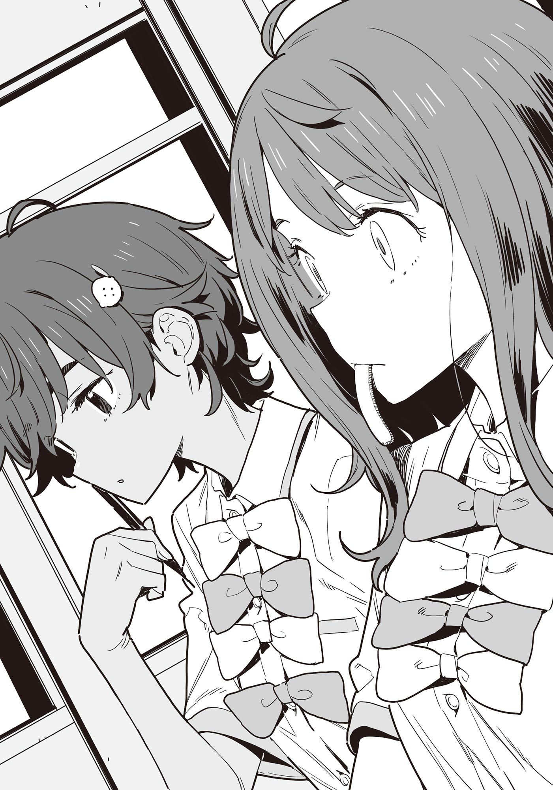

# Ch.156 — เล่ม 8.5 บทพิเศษท้ายเล่ม

Ch.156 — เล่ม 8.5 บทพิเศษท้ายเล่ม

By มนก

Published: 2026-03-06T16:27:43Z

Source: https://www.nekopost.net/novel/14560/156

ช่วงหลังเลิกเรียนที่การสอบใกล้เข้ามา ในห้องชมรมวรรณกรรมมีร่างของสมาชิกชมรมหญิงสองคน

คนหนึ่งคือ ยานามิ อันนะ ห้อง 2-C เธอกำลังแทะปลาหมึกรมควันพลางจดอะไรบางอย่างลงในหนังสือเรียนวิชาคณิตศาสตร์ ท่าทางตอนปัดเศษปลาหมึกที่ร่วงหล่นอย่างชี่ยวชาญ

อีกคนคือ ยากิชิโอะ เลมอน ห้อง 2 -E เธอกำลังมองสมาร์ตโฟนสลับกับหนังสือเรียนพลางเอียงคอสงสัย

[นี่ ยานะจัง มีกระดาษคำตอบควิซวิชาเลขไหม? ของเมื่อวันก่อนน่ะ]

[ควิซเหรอ?]

ยานามิยื่นชีตที่สอดไว้ในสมุดโน้ตให้

[อยู่คนละห้องกัน แต่ใช้เจ้านี่ได้ใช่ไหมนะ]

[อ๊ะ อันนี้แหละๆ เห็นว่าอาจารย์ทากาฮาชิจะออกข้อสอบจากตรงนี้ตั้งครึ่งนึง ถ้าจำไว้ได้ก็รอดพ้นจากการสอบตกแล้วล่ะ]

[เหรอ]

ยานามิเคี้ยวปลาหมึกตุ้ยๆ พลางละสายตากลับไปที่หนังสือเรียน

หลังจากนั่งเรียนต่อไปได้สักพัก ยานามิก็ล้วงมือเข้าไปในถุงปลาหมึกพร้อมกับเอ่ยปาก

[ไปเอาข้อมูลเรื่องข้อสอบมาจากไหนเนี่ย? อาซากุโมะซังเหรอ?]

[อืมม ก็ประมาณนั้นแหละ]

ยากิชิโอะตอบแบบแบ่งรับแบ่งสู้พลางจดลงสมุดโน้ตต่อไป

พอยานามิตวัดสายตามองเหมือนมีอะไรจะพูด ยากิชิโอะก็เริ่มพูดขึ้นมาทั้งที่ตายังคงมองสมุดโน้ต

[ยานะจัง ทริปไปนาโกย่าเมื่อวันก่อนสนุกดีเนอะ]

[สนุกสิ ของกินที่นาโกย่าเนี่ยเป็นสีน้ำตาลแล้วช่วยเยียวยาจิตใจได้จริงๆ ด้วย]

ตุ้ยๆๆ เธอเคี้ยวปลาหมึกพลางปรายตามองยากิชิโอะอีกครั้ง

[......นี่ ตอนกลางคืนออกไปไหนกับนุคุมิซึคุงมาใช่ไหม]

[อื้อ อยากไปดูไฟประดับที่หอคอยโทรทัศน์น่ะ]

ยากิชิโอะตอบอย่างเรียบง่าย แล้วก็เขียนดินสอกดต่อไป

เมื่อเห็นว่าไม่มีคำพูดใดๆ ต่อจากนั้น ยานามิก็พูดต่อด้วยน้ำเสียงราบเรียบ

[ดีจังน้าー น่าจะชวนฉันไปด้วยแท้ๆ]

[ก็มันดึกแล้ว แถมทุกคนก็กำลังกินข้าวกันอยู่นี่นา ขืนชวนก็คงจะเกรงใจแย่เลย]

ยากิชิโอะตอบกลับด้วยท่าทีราบเรียบยิ่งกว่ายานามิเสียอีก

[อ๋อ ถ้าเป็นนุคุมิซึคุงล่ะก็ไม่ต้องเกรงใจอะไรทำนองนั้นสินะ]

[ก็นุกคุงใจดีนี่นา]

[ก็คงงั้นมั้งー]

แกร๊กๆๆ ยานามิกดดินสอกด

ความเงียบดำเนินต่อไป ยานามิที่หยุดมือไปแล้ว จู่ๆ ก็พูดขึ้นมา

[......ก็นะ นุคุมิซึคุงก็เป็นผู้ชายเหมือนกันนี่เนอะ]

[หืม?]

ยากิชิโอะเงยหน้าขึ้นมาอย่างสงสัย ยานามิเลยพูดเสริมราวกับเพิ่งนึกขึ้นได้

[แบบว่า จะเดินถนนตอนกลางคืนน่ะ ถ้าไม่มีผู้ชายไปด้วยมันก็อันตรายใช่ไหมล่ะ]

[อ้อ มีเรื่องนั้นด้วยแฮะ ไม่ทันคิดเลย]

ยากิชิโอะหัวเราะแบบไม่มีเสียง แล้วก็เรียนต่อไป

บทสนทนาขาดห้วงไป

พักหนึ่งมีเพียงเสียงขีดเขียนของดินสอกด และเสียงพลิกหน้ากระดาษดังแว่วมา

จนกระทั่งเข็มยาวของนาฬิกาเดินผ่านตัวเลขไปหลายตัว

ป๊อก เสียงไส้ดินสอกดหักดังขึ้น

[──ถ้าคาใจล่ะก็ ยานะจังก็ชวนไปซะก็สิ้นเรื่อง]

เจอคำพูดที่โพล่งขึ้นมาอย่างกะทันหัน ยานามิก็ซ่อนความตกใจไว้พลางเงยหน้าขึ้น

[เอ่อ......มันก็ไม่ใช่แบบนั้นหรอกนะ แต่จะให้อุตส่าห์ไปชวนมันก็ดูแปลกๆ ไหมล่ะ]

แกร๊กๆๆ ยากิชิโอะกดดินสอกดพลางส่งยิ้มให้

[เอ๋ ดีออกนี่นา หรือว่าเกลียดนุกคุงเหรอ?]

[จะว่าเกลียดก็ไม่ใช่หรอก แค่อยู่ห้องเดียวกันเลยต้องเจอหน้ากันทุกวันอยู่แล้วไง]

[งั้นฉันอยู่คนละห้อง ชวนได้สินะ]

ยากิชิโอะพูดด้วยน้ำเสียงสบายๆ ก่อนจะพลิกหน้ากระดาษสมุดพึ่บพั่บ

ยากิชิโอะโยนคำพูดใส่ยานามิที่จนมุมจนต้องเงียบไปอีกระลอก

[สอบเสร็จแล้วมีงานเทศกาลดอกไม้ไฟด้วยนี่ ปีนี้อยากไปจังเลยเนอะ]

ปีที่แล้วกำหนดการเข้าค่ายของชมรมวรรณกรรมน่าจะทับซ้อนกับงานเทศกาลดอกไม้ไฟพอดี

ยานามิอ้าปากพูดราวกับรอโอกาสนี้อยู่แล้ว

[งั้นก็ ไปกับทุกคนในชมรมวรรณกรรม──]

[ชวนนุกคุงดีกว่ามั้ง]

[เอ๊ะ]

ยานามิชะงักกึก

[เอ่อ คือว่า......เลม่อนจังไม่ไปกับคนในชมรมกรีฑาเหรอ?]

[ถ้าไปกับชมรมกรีฑาก็จะมีพวกผู้ชายมาด้วยไง รู้สึกน่ารำคาญนิดหน่อยน่ะ]

ในที่สุดยากิชิโอะก็เงยหน้าขึ้น แล้วส่งยิ้มหวานให้ยานามิ

[อ๊ะ นุกคุงก็เป็นผู้ชายด้วยนี่นา]

[นั่นสิ......เนอะ]

ในที่สุดยานามิก็ส่งรอยยิ้มเจื่อนๆ กลับไป

เมื่อเห็นดังนั้น ยากิชิโอะก็กลับไปเรียนต่ออย่างพึงพอใจ

[ก็นะ ช่วงงานเทศกาลดอกไม้ไฟต้องซ้อมหนัก คงไม่ได้ไปหรอก]

[เอ๊ะ งั้นหรอกเหรอ]

[......เพราะงั้นแหละ ถ้ามาลนลานเอาทีหลังฉันไม่รู้ด้วยนะ]

บทสนทนาขาดหายไปตรงนั้น

มีเพียงเสียงยากิชิโอะจรดปากกาลงบนสมุดโน้ตดังก้องอยู่ในห้องชมรมที่เงียบสงัด

ขณะที่ยานามิซึ่งยังคงชะงักมืออยู่กำลังจะอ้าปากพูดอย่างลังเล ประตูห้องชมรมก็เปิดออก

[ทะ ทั้งสองคน ยังอยู่อีกเหรอ]

คนที่พูดพลางเดินเข้ามาในห้องชมรมคือ โคมาริ จิกะ

พอสัมผัสได้ถึงบรรยากาศในห้อง เธอก็ทำหน้าวิตกกังวล

[มะ มีเรื่องอะไรกันงั้นเหรอ]

ยากิชิโอะส่งยิ้มแล้วตบเก้าอี้ข้างๆ ปุๆ

[อ่านหนังสือสอบมันเหนื่อยน่ะสิー โคมาริจังต่างหาก ยังไม่กลับอีกเหรอ]

[ปะ เป็นเวรห้องสมุดอยู่น่ะ ยากิชิโอะ นี่]

โคมารินั่งลงข้างๆ ยากิชิโอะ แล้ววางเซ็ตแปรงสีฟันลงบนโต๊ะ

[ละ ลืมไว้ที่บ้านรุ่นพี่สึกิโนะกิใช่ไหมล่ะ]

[อุตส่าห์เอามาให้เลยเหรอ?]

[พะ พอดีเขาเอาหนังสือมาส่งให้หลายเล่ม ก็เลยติดมือมาด้วย]

รอยยิ้มชั่วร้ายที่ปิดไม่มิด ส่วนจะเป็นหนังสือแบบไหนนั้น คงเดากันได้ไม่ยาก

พอยากิชิโอะเริ่มแหย่โคมาริเล่น ยานามิกก็ลุกขึ้นยืนโดยไม่ให้เกิดเสียง

[ฉันไปซื้อน้ำแป๊บนึงนะ สองคนจะเอาอะไรไหม?]

พอเห็นทั้งสองคนส่ายหน้า ยานามิก็เดินออกจากห้องชมรมไปราวกับกำลังหลบหนี

◇

ยานามิเดินมาถึงตู้กดน้ำใกล้ลานกว้างกลางโรงเรียน แล้วเอาหน้าผากโขกแผงตู้ดังโป๊ก

[ฉัน ทำบ้าอะไรอยู่เนี่ย......]

คำพูดหลุดออกจากปากไปโดยไม่รู้ตัว

ขณะที่กำลังเตรียมจะถอนหายใจเฮือกต่อไป ก็มีเสียงทักมาจากด้านหลัง

[อ้าว ยานามิซัง มาทำอะไรตรงนี้ล่ะ]

[อึ้ก!]

คนที่ทักมาไม่ใช่ใครที่ไหน นุคุมิซึ คาซึฮิโกะ ศัตรูของผู้หญิงที่โรงเรียนสึวาบุกิภาคภูมิใจนั่นเอง

นุคุมิซึมองยานามิที่พูดไม่ออกไปชั่วขณะ แล้วพยักหน้าหงึกๆ ราวกับเข้าใจทุกอย่าง

[อ้อ ไม่มีเงินสินะ]

[มีค่ะ]

ยานามิถอนหายใจตามที่เตรียมไว้ แล้วหยอดเหรียญลงในตู้กดน้ำ

[นุคุมิซึคุง คิดว่าฉันเป็นผู้หญิงที่ไม่มีเงินสักบาทหรือไง?]

นุคุมิซึไม่ตอบคำถามนั้น ได้แต่ยิ้มแบบแบ่งรับแบ่งสู้

ต้องกำลังคิดเรื่องเสียมารยาทอยู่แน่ๆ ยานามิกดปุ่มเลือกชานม แล้วเอาไหล่ชนนุคุมิซึเบาๆ

[นุุคุมิซึคุง กำลังจะไปห้องชมรมเหรอ?]

[อื้อ ห้องสมุดคนเริ่มแน่นแล้ว ก็เลยว่าจะไปอ่านหนังสือสอบที่ห้องชมรมน่ะ]

นุคุมิซึซื้อกาแฟสูตรน้ำตาลน้อย พึมพำอะไรบางอย่างเสียงเบา แล้วทำท่าจะเดินจากไป

[เดี๋ยวสิ ฉันก็ไปด้วย]

ยานามิเดินเคียงคู่ไปห้องชมรมกับนุคุมิซึ

[เอ่อ ยานามิซัง คราวนี้เนื้อหาสอบกว้างหน่อย อ่านหนังสือไปถึงไหนแล้ว?]

เจอหัวข้อสนทนาเรื่อยเปื่อย ยานามิก็ยืดอกทำเสียงหึหึ

[นุคุมิซึคุง เนื้อหาสอบมันก็กว้างเหมือนกันทุกคนนั่นแหละ]

[หา]

[พูดง่ายๆ ก็คือ ถ้าทำตัวตามปกติ คะแนนมันก็จะออกมาคล้ายๆ เดิมนั่นแหละ]

[อ่าฮะ......]

นุคุมิซึ คาซึฮิโกะ ยังคงตอบกลับแบบเย็นชาเหมือนเดิม

ยานามิที่กำลังจะอ้าปากบ่น หันซ้ายหันขวามองไปรอบๆ

[ยานามิซัง เป็นอะไรไป]

[......นี่ คืนวันที่ไปนาโกย่าเมื่อวันก่อนน่ะ]

──นาโกย่า พอได้ยินคำนั้น นุคุมิซึก็สะดุ้งโหยง

[คืนที่นาโกย่ามัน──เอ่อ ทำไมเหรอ?]

ท่าทีลุกลี้ลุกลนอย่างเห็นได้ชัด ยานามิหยุดเดิน

[......ไปดูวิวตอนกลางคืนกับเลมอนจังมาใช่ไหม]

[เอ๊ะ อ๊ะ ใช่]

ยานามิเดินไปดักหน้านุคุมิซึที่ยืนตัวแข็งทื่อ แล้วตวัดสายตามองค้อนขึ้นไป

[นี่มันช่วงเวลาสำคัญก่อนแข่งอินเตอร์ไฮเลยนะ? ถ้าเกิดอะไรขึ้นมา นายรับผิดชอบไม่ไหวหรอกนะ]

[ครับ ถูกต้องตามนั้นเลยครับ]

......ว่านอนสอนง่ายผิดปกติแฮะ

เวลานุคุมิซึเป็นแบบนี้ แสดงว่ากำลังปิดบังอะไรอยู่ ยานามิ อันนะ รู้ดี

ยานามิชะโงกหน้าเข้าไปจ้องตานุคุมิซึที่กำลังหลบตา

[มีเรื่องอะไรกันงั้นเหรอ──กับเลม่อนจัง?]

[ไม่ได้มีอะไรสักหน่อยนี่?!]

ยานามิยังคงจ้องมองนุคุมิซึที่กำลังลนลานเงียบๆ

นี่มัน──แพตเทิร์นที่วนกลับมาว่าไม่มีอะไรเกิดขึ้นจริงๆ นี่นา

ถ้ามีอะไรเกิดขึ้นจริงๆ หมอนี่จะต้องพยายามปกปิดจนโป๊ะแตกแน่ๆ นุคุมิซึ คาซึฮิโกะ เป็นผู้ชายแบบนั้นแหละ

ยานามิรู้สึกโล่งใจอย่างบอกไม่ถูก แล้วเริ่มเดินเคียงข้างนุคุมิซึต่อไป

[ระวังตัวหน่อยสิ นุคุมิซึคุงเป็นถึงประธานชมรมวรรณกรรมเลยนะ]

[อา อื้อ ไม่ได้มีอะไรเกิดขึ้นจริงๆ เพราะงั้นจบเรื่องนี้กันเถอะ]

......ไม่สิ หรือว่าวนไปอีกครึ่งรอบแล้วมีอะไรเกิดขึ้นกันแน่นะ

ระหว่างที่กำลังนึกถึงเรื่องคืนนั้นอีกครั้ง ก็มีอะไรบางอย่างมาสัมผัสที่มือของยานามิ

ข้างๆ มือที่ถูกสัมผัสนั้น มีนุคุมิซึที่ก้มหน้าด้วยท่าทีอึดอัดใจอยู่

[?]

......มือ? เมื่อกี้ ตานี่พยายามจะจับมือเรางั้นเหรอ?

ยานามิรีบหันไปมองหน้านุคุมิซึอย่างลนลาน

[นุคุมิซึคุง? เอ๊ะ จู่ๆ เป็นอะไรไปน่ะ?]

[อ๊ะ เปล่า......ก็ถ้าเป็นในห้องชมรมมันมีคนอื่นอยู่ด้วยไง]

[อึ้ก!?]

ชัวร์เลย ยานามิ อันนะ วัย 16 ปี กำลังจะมีอีเวนต์อะไรบางอย่างเกิดขึ้นกับเธอแล้ว

ยานามิมองซ้ายมองขวาพลางจับผมตัวเองอย่างกระสับกระส่าย

[นี่......ที่นี่โรงเรียนนะ มันควรจะต้องมีบรรยากาศ หรืออะไรทำนองนั้นอีกหน่อยสิ......]

[แต่ยานามิซังไม่สนใจเรื่องพวกนั้นไม่ใช่เหรอ?]

[สนใจสิยะ?! อีกอย่าง ก่อนอื่นมันต้องหาข้อตกลงร่วมกันก่อนไม่ใช่หรือไง?!]

เจอยานามิโวยวายเข้า นุคุมิซึก็ทำหน้าสับสน

[ก็ตอนไปกินที่นาโกย่ามันอร่อยนี่นา เลยคิดว่ายานามิซังก็น่าจะชอบ]

[หา......?]

นี่เรากำลังโดนพูดจายอดแย่ใส่รึเปล่าเนี่ย

ความคิดต่างๆ นานาแล่นผ่านเข้ามาในหัวยานามิ

[นุคุมิซึคุง กำลังพูดเรื่องอะไรอยู่เนี่ย......?]

[ก็เลย ว่าจะเอา โมนากะ ให้ไง]

[......โมนากะ]

สิ่งที่นุคุมิซึยื่นมาให้คือ ชาจิโฮโกะ โมนากะ ขนมขึ้นชื่อของนาโกย่าที่ทำเป็นรูปปลาชาจิโฮโกะ

อันที่ถูกเอามาเสิร์ฟเป็นขนมกินคู่กับชาที่บ้านรุ่นพี่สึคิโนะกินั่นเอง

[ทำไมจู่ๆ ถึงมาพูดเรื่องโมนากะ......?]

[ก็ยานามิซังพยายามจะซื้อตอนขากลับจากนาโกย่า แต่เงินไม่พอเลยไม่ได้ซื้อนี่นา]

[อื้อ]

[ผมซื้อไปเป็นของฝากที่บ้าน ก็เลยว่าจะแบ่งให้......]

[......โห]

ยานามิมองสลับระหว่างขนมชาจิโฮโกะโมนากะ กับใบหน้าของนุคุมิซึช้าๆ

[ยานามิซัง เป็นอะไรไป]

[เดี๋ยวๆ แล้วทำไมถึงต้องแอบยัดใส่มือกันแบบนั้นด้วยล่ะ?! นึกว่า──]

[นึกว่า?]

กึก ยานามิหยุดนิ่งราวกับเวลาถูกหยุดเอาไว้

[เอ่อ ยานามิซัง......?]

[ ก็เป็นซะแบบนี้ไง นุคุมิซึคุง!]

ยานามิกระแทกเสียงใส่ แล้วเดินจ้ำอ้าวทิ้งนุคุมิซึไว้ข้างหลัง

คราวนี้ตาของนุคุมิซึที่จะงงบ้าง เขารีบวิ่งตามยานามิไปทั้งที่ไม่เข้าใจอะไรเลย

[เอ่อ ก็ผมเอามาแค่อันเดียวนี่นา ขืนคนอื่นเห็นเข้ามันจะดูไม่ดี......]

ถึงอย่างนั้นก็ไม่เห็นต้องให้กันท่าทีแบบนั้นเลยนี่นา คิดได้อย่างเดียวว่าคงจะเขินเอามากๆ ล่ะมั้ง──

เมื่อคิดได้ถึงตรงนั้น ยานามิก็หยุดยืนอยู่กับที่กะทันหัน

นุคุมิซึอุตส่าห์เลือกขนมที่ยานามิซื้อไม่ได้เป็นของฝากที่บ้าน แล้วยังแบ่งมาให้เธอคนเดียวอีก

ยานามิยังคงหลบตา พลางยื่นมือไปหานุคุมิซึ

[......เอามาสิ]

[หือ? อา เชิญเลย]

ยานามิรับขนมโมนากะมา แล้วยัดใส่กระเป๋าทั้งอย่างนั้น

[อ้าว ไม่กินเหรอ]

[ความลับกับทุกคนไม่ใช่เหรอ?]

ยานามิเดินก้าวฉับๆ อย่างอารมณ์ดี ราวกับลืมความหงุดหงิดเมื่อครู่ไปจนหมดสิ้น
