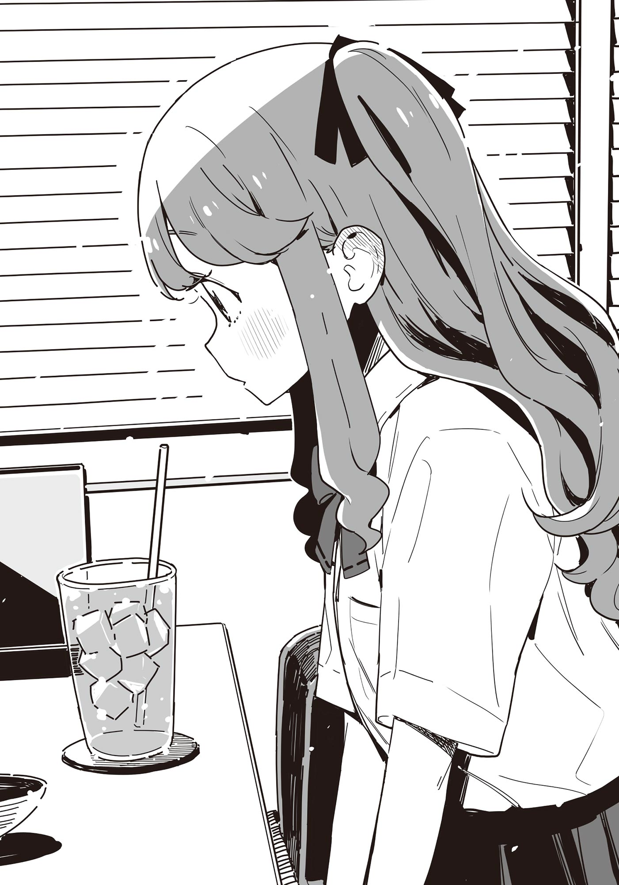

# Ch.159 — เล่ม 9 บทที่ 1-1

Ch.159 — เล่ม 9 บทที่ 1-1

By มนก

Published: 2026-07-18T03:18:53Z

Source: https://www.nekopost.net/novel/14560/159

บทที่ 1-1 ยินดีที่ได้รู้จัก ฉัน มิซึชิมะ โคฮารุ ค่ะ

...ผมกำลังถูกเข้าใจผิดอยู่จริงๆ ด้วย

ทันทีที่มาถึงห้องชมรม ผมก็ถูกจับให้นั่งบนเก้าอี้ โดยมี ยานามิ กับ โคมาริ ยืนก้มหน้ามองผมอยู่

[เอาล่ะ นุคุมิซึคุง ถ้าจะแก้ตัวล่ะก็ จะยอมฟังให้ก็ได้]

[ต...ตายซะ]

ทำไมผมถึงโดนรุมด่าอยู่เนี่ย จะว่าพอรู้สาเหตุไหมก็พอรู้อยู่หรอก แต่ผมทำผิดขนาดนั้นเลยหรือไง

แล้วทำไมโคมาริที่ไม่รู้เรื่องรู้ราวอะไรด้วยถึงมาด่าผมล่ะ

[เดี๋ยวสิ โคมาริยังไม่รู้เลยไม่ใช่เหรอว่าเกิดอะไรขึ้น? ถ้าได้ฟังเรื่องราวแล้วอาจจะมาอยู่ฝ่ายผมก็ได้นะ]

[ ถ...ถ้าเป็นบทกวีสั่งเสียก่อนตายล่ะก็จะยอมฟังให้ ]

คำพูดปากดีแบบนั้นคงจบแค่นี้แหละ ผมกระแอมไอ แล้วเริ่มอ้าปากพูดด้วยน้ำเสียงจริงจัง

[ คือว่านะ ตอนกำลังเดินอยู่ บังเอิญเห็นนักเรียนหญิงต่างโรงเรียนก็เลยมองน่ะ แต่ว่า ]

[ ร...รีบๆ ตายซะที ]

ตัดสินใจเร็วจริง ผมยกสองมือขึ้นปรามโคมาริแบบใจเย็นๆ

[ ฟังให้จบก่อนสิ ดูเหมือนว่าทางนั้นจะรู้จักผม ก็เลยขอแลกคอนแทค  ก็แค่ยอมทำตามเท่านั้นเอง ]

[นุคุมิซึคุงรู้จักอีกฝ่ายด้วยเหรอ?]

ยานามิพูดแทรกขึ้นมา

[ เพิ่งเคยเจอกันครั้งแรก ชื่อก็ไม่เคยได้ยิน ]

ผมปัดผมม้าแล้วนั่งไขว่ห้าง

[ สรุปก็คือตามนั้นแหละ โคมาริ ช่วยตัดสินให้ที ]

[ ย...ยังไม่ตายอีกเรอะ ]

ปากร้ายไม่เปลี่ยนเลยนะ

เอาเถอะ โคมาริก็เป็นแบบนี้ประจำแหละ ยานามิก็น่าจะเข้าใจแล้วเหมือนกัน

พอผมเหลือบสายตาไปมอง ยานามิกลับกำลังก้มมองผมด้วยสายตาเย็นชา

[ นุคุมิซึคุง ทั้งที่เป็นถึงประธานชมรมวรรณกรรมแท้ๆ กลับไปจีบเด็กต่างโรงเรียนในเขตโรงเรียน สมควรตายเป็นหมื่นครั้ง ]

[ เดี๋ยวสิ อีกฝ่ายเป็นคนเข้ามาทักก่อนนะ ]

แบบนี้น่าจะเรียกว่าโดนผู้หญิงจีบมากกว่าไม่ใช่หรือไง สรุปคือผมไม่ผิด

ระหว่างที่กำลังคิดหาคำโต้แย้ง ยานามิก็ค่อยๆ หยิบสมาร์ทโฟนออกมา

[ งั้น ให้คุณน้องสาวช่วยตัดสินก็แล้วกันนะ ]

[ ทำไมล่ะ?! แบบนั้นไม่ดีนะ ไม่ดีแน่ๆ! ]

ผมรีบลุกขึ้นลุกลี้ลุกลน แต่ยานามิกับโคมาริก็กดไหล่ทั้งสองข้างของผมเอาไว้

[ ถ้าไม่ได้ทำอะไรผิด ก็ไม่เห็นเป็นไรเลยนี่ ]

[ ถ...ถ้ารู้เข้า จะมีเรื่องแย่ๆ เกิดขึ้นหรือไง ]

ก็ไม่มีหรอก แต่แค่ไม่อยากให้คาจูรู้เรื่องนี้ต่างหาก

ปล่อยให้เป็นแบบนี้ต่อไปไม่ได้ จะพิสูจน์ความบริสุทธิ์ของตัวเองต้องทำยังไงดีเนี่ย...

ระหว่างที่กำลังเหงื่อตก สมาร์ทโฟนของผมก็มีเสียงแจ้งเตือนดังติ๊ง

[นุคุมิซึคุง เชิญเลย]

[อ... ครับ...]

ท่ามกลางสายตาที่จ้องเขม็งของทั้งสองคน ผมก็หยิบสมาร์ทโฟนออกมา ชื่อที่แสดงบนหน้าจอแจ้งเตือนคือ──มิซึชิมะ

โคฮารุ

[โห เด็กผู้หญิงเมื่อกี้สินะ รุกน่าดูเลยนี่นา]

[ไม่ใช่แบบนั้นหรอก...]

หืม? โคฮารุ? ถ้าจำไม่ผิด แฟนของซากุไรคุงก็ชื่อประมาณนี้นี่นา

แถมโรงเรียนที่เรียนอยู่ก็คือ──โรงเรียนรัฐบาลอายาเมะ

[เด็กผู้หญิงเมื่อกี้นี้ คือแฟนของซากุไรคุงไง! ถ้าอย่างนั้นจะรู้จักฉันก็ไม่แปลกใช่ไหมล่ะ?]

เฮ้อ ในที่สุดก็พ้นข้อสงสัยสักที

โล่งใจได้เพียงอึดใจเดียว โคมาริก็มองมาด้วยสายตาเหมือนกำลังมองขยะ

[ ก...แก ไปจีบแฟนเพื่อนงั้นเหรอ ]

[ ไม่ได้จีบเห้ย ดูสิ ข้อความที่ส่งมาก็แค่ทักทายเฉยๆ เอง ]

พอผมเปิดหน้าจอสมาร์ทโฟนให้ทั้งสองคนดู ยานามิก็พึมพำออกมาเบาๆ

< ──หลังจากนี้ ไปหาอะไรดื่มกันไหมคะ? เก็บเป็นความลับไม่ให้ฮิโระคุงรู้นะ >

...ดื่มชา? พอดูที่หน้าจอสมาร์ทโฟน ก็เห็นข้อความชักชวนจากโคฮารุซัง

ฮ่าฮ่า... ไปดื่มชาโดยปิดเป็นความลับไม่ให้ซากุไรคุงที่เป็นแฟนรู้สินะ... อย่างนี้นี่เอง...

ผมฝืนยิ้มแห้งๆ พลางเงยหน้ามองเหล่าสาวๆ ชมรมวรรณกรรม

[ เอ่อ... ทั้งสองคนก็ไปดื่มชาด้วยกันไหม? ]

◇

ในร้านที่ยานามิถูกหักอก ที่โต๊ะตัวเดิมที่ยานามิถูกหักอก มีผมกับยานามินั่งอยู่ด้วยกัน

สรุปก็คือนัดเจอกันที่ร้านนี้นั่นเอง อนึ่ง โคมาริหนีไปแล้ว

ยานามิที่ซัดเมล่อนโซดาแก้วที่ 2 หมดอย่างรวดเร็ว วางแก้วลงดังตึง

[ นุคุมิซึคุงเนี่ย พอถูกผู้หญิงที่เพิ่งเจอกันครั้งแรกชวนไปดื่มชา ก็ยอมออกมาหาอย่างง่ายดายเลยเนอะ ]

[มันน่าจะมีเหตุผลอะไรสักอย่างไหมล่ะ? ถึงขนาดต้องปิดเป็นความลับไม่ให้ซากุไรคุงรู้น่ะ]

ผมจิบโคล่าพลางทนรับแรงกดดัน

[นี่นะ ผู้หญิงปกติน่ะ ทั้งที่มีแฟนอยู่แล้ว เขาไม่แอบมาเจอผู้ชายคนอื่นแบบลับๆ หรอก]

[ยานามิซัง ไม่เคยมีแฟนไม่ใช่เหรอ?]

[...แล้วมันเกี่ยวไหม?]

คงจะไม่ค่อยเกี่ยวล่ะมั้ง พอเห็นสีหน้าผม ยานามิก็เอาเท้ามาเตะกระแทกผมโคฮารุซัง รีบๆ มาหน่อยเถอะ...

[จะว่าไป ไม่สั่งของกินหน่อยเหรอ? ชอบเฟรนช์ฟรายส์ภูเขาไฟไม่ใช่เหรอ]

พอผมเปลี่ยนเรื่องเพื่อเอาใจ ยานามิก็ถอนหายใจอย่างเอือมระอา

[นี่นะ แม้แต่ไก่ตีกัน การโจมตีครั้งแรกก็สำคัญที่สุดนะ ต้องเปิดมาให้มันปังๆ ก่อนสิ]

พูดเรื่องอะไรเนี่ย อยากกินไก่ทอดหรือไง

เมื่อเห็นผมทำหน้างงๆ ยานามิก็อธิบายเพิ่ม

[ในโลกของผู้หญิงน่ะ แค่แต่งตัวพลาดนิดหน่อยก็โดนดูถูกได้แล้วนะ ครั้งแรกที่เจอกัน จะให้เห็นริมฝีปากมันแผล็บเพราะน้ำมันเฟรนช์ฟรายส์ได้ยังไงล่ะ?]

ยานามิยังมีความรู้สึกแบบนั้นหลงเหลืออยู่อีกเหรอเนี่ย

ขณะที่ผมกำลังประหลาดใจกับเรื่องแปลกใหม่นี้ ยานามิก็เริ่มพูดเสียงเบา

[...เด็กคนนั้น มิซึชิมะซังสินะ ก็น่ารักดีเหมือนกันนะ]

[อ่า... ก็คงงั้นมั้ง]

ผมตอบปัดไปแบบเซฟๆ พลางเหลือบมองท่าทีของยานามิ

ยานามิใช้ปลายนิ้วม้วนผมเล่น พลางจ้องมองแก้วที่ว่างเปล่า

โคฮารุซัง เป็นเด็กผู้หญิงที่น่ารักแบบที่ผู้ชายชอบจริงๆ นั่นแหละ ในเวลาแบบนี้อาจจะควรพูดว่า เธอเองก็น่ารักกว่านะ อะไรทำนองนี้ก็เถอะ แต่การปลอบใจแบบมักง่ายมันไม่ดีหรอก

[แต่ดูสิ ยานามิซังเอง เรื่องความหนาของผมก็ไม่แพ้หรอกนะ]

[ไม่ได้พูดเรื่องนั้นสักหน่อย]

อืม ไม่ได้พูดจริงๆ ด้วย

ตอนที่ความอึดอัดใกล้จะถึงขีดจำกัด นักเรียนหญิงในชุดเครื่องแบบโรงเรียนอายาเมะก็เดินเข้ามาในร้าน

มิซึชิมะ โคฮารุ แฟนของซากุไรคุงนั่นเอง พอเธอสังเกตเห็นผม ก็รีบเดินจ้ำอ้าวมาที่โต๊ะ

[ขอโทษทีที่มาช้านะคะ ]

โคฮารุซังลูบผมพลางนั่งลง แล้วยิ้มแย้มอย่างน่ารัก

โคฮารุซังมีผมยาวฟูฟ่องน่าสัมผัส มัดริบบิ้นที่ผมบางส่วนทั้งซ้ายขวา แล้วปล่อยยาวลงมา ถึงจะรู้สึกว่าตัวเองเปรียบเทียบได้น่าขนลุกไปหน่อยก็เถอะ แต่น่ารักเหมือนเอาสายไหมมาทำให้เป็นคนเลย

[พวกเราก็เพิ่งมาถึงเหมือนกัน เอ่อ เอาเป็นดริ้งก์บาร์ก็แล้วกันเนาะ]

[อืม ขอบใจจ้ะ เดี๋ยวไปเอาเครื่องดื่มมาก่อนนะ]

โคฮารุซังที่กลับมานั่งร่วมโต๊ะอีกครั้ง ถือชาเย็นไว้ในมือ พลางมองยานามิอย่างสงสัย

[เอ่อ... ทางนั้นคือแฟนเหรอคะ?]

[ [ ไม่ใช่ครับ/ค่ะ ] ]

หลังจากรีบแก้ความเข้าใจผิดอย่างรวดเร็ว ยานามิก็เปิดบทสนทนาราวกับรอคอยมานาน

[มิซึชิมะซัง สินะ คบอยู่กับซากุไรคุงใช่ไหม]

โคฮารุซังขยับผมยาวสลวยให้พลิ้วไหว แล้วส่งยิ้มหวาน

[อืม กับฮิโระคุง──คบกับซากุไรคุงอยู่ค่ะ ขอโทษนะ อุตส่าห์เป็นวันหยุดแท้ๆ ฉันมารบกวนหรือเปล่า]

[ก็ ไม่ได้รบกวนหรอก ว่างอยู่พอดี]

ยานามิเคี้ยวน้ำแข็งกร้วมๆ ด้วยท่าทางหงุดหงิด

ไม่ได้การล่ะ ขืนปล่อยให้คะแนนห่างไปมากกว่านี้ ต้องรีบพูดแทรกหน่อยแล้ว

[เอ่อ วันนี้ทำไมถึงชวนผมมาดื่มชาล่ะครับ]

[ได้ยินเรื่องของนุคุมิซึคุงจากฮิโระคุงมาตั้งนานแล้วน่ะ ก็เลยคิดว่าอยากเจอจังเลยน้า]

โห ซากุไรคุงเล่าเรื่องของผมให้แฟนฟังด้วยเหรอ คงจะไม่มีเรื่องคุยจริงๆ สินะ

[เขาพูดถึงผมว่ายังไงบ้างเหรอ?]

[บอกว่าเป็นคนที่น่าสนใจมากๆ เลยล่ะ บอกว่าถ้าฉันได้เจอ ก็จะต้องชอบแน่ๆ]

ซากุไรคุงพูดแบบนั้นเนี่ยนะ? ระหว่างที่กำลังดีใจอยู่ลึกๆ โคฮารุซังก็ส่งยิ้มละมุนละไม

[อาจจะจริงอย่างที่ฮิโระคุงบอกก็ได้ นุคุมิซึคุงเนี่ย คุยด้วยง่ายมากๆ เลยเนอะ]

[เอ๊ะ งั้นเหรอ ไม่หรอกมั้ง บางทีก็มีคนบอกแบบนั้นบ้างล่ะนะ]

ไม่รู้ทำไมยานามิถึงเตะผมจากใต้โต๊ะ หยุดนะ

โคฮารุซังเปลี่ยนสีหน้าให้จริงจังขึ้นเล็กน้อย แล้วใช้หลอดคนชาเย็นในแก้วดังกรุ้งกริ้ง

[ฮิโระคุงที่โรงเรียนเป็นยังไงบ้างเหรอ?]

[ในห้องเรียนก็มักจะอยู่ด้วยกัน ตอนเที่ยงก็กินข้าวด้วยกันบ่อยๆ นะ]

[อื้อๆ แล้วไงต่อ]

แล้วไงต่ออะไรล่ะ เรื่องมันก็จบแค่นี้แหละ ถ้าจะให้พูดฝืนๆ ก็คงเป็นเรื่องเนื้อหอมในหมู่เด็กผู้หญิงปี 2 แล้วก็ปี 1 กับปี 3 ด้วย แต่จะให้พูดเรื่องแบบนั้นก็คงไม่ได้สินะ... ขณะที่ผมกำลังลำบากใจ ยานามิก็พูดแทรกขึ้นมาจากด้านข้าง

[เขาน่ะ พยายามในงานสภานักเรียนอย่างหนักเลยนะ หลังเลิกเรียนก็ดูจะยุ่งตลอดเลย]

[งั้นเหรอ สภานักเรียนของทสึวาบุกิมีแค่ 3 คนเองนี่เนอะ วันนี้ฮิโระคุงก็ไม่อยู่ด้วยสิ]

[งั้นวันนี้ก็มีธุระกับสภานักเรียนสินะ]

พอผมพูดไปแบบนั้น โคฮารุซังก็พยักหน้าหงึกๆ

[อื้ม ฉันอยู่สภานักเรียนของโรงเรียนอายาเมะน่ะ ปีนี้โรงเรียนเรากับทสึวาบุกิเป็นเจ้าภาพจัดค่ายสภานักเรียนเมืองโทโยฮาชิ ก็เลยมาประชุมกัน]

อืมมม นั่นมันค่ายร่วมม.ต้น-ม.ปลายที่คาจูไปเข้าร่วมเมื่อปีที่แล้วนี่นา หวังว่าเทียร่าซังพอเห็นพวกเด็กผู้ชายต่างโรงเรียนแล้วจะไม่ทำตัวมีพิรุธนะ

[ฮิโระคุง อยู่สึวาบุกิก็คงเนื้อหอมเหมือนเดิมใช่ไหมล่ะ?]

[เอ๊ะ เรื่องนั้น]

พอโดนจู่โจมกะทันหันจนผมพูดไม่ออก โคฮารุซังก็หัวเราะคิกคัก

[ขอโทษทีนะที่ถามอะไรแปลกๆ เรื่องที่เขาเนื้อหอมน่ะ ฉันรู้อยู่แล้วล่ะ ตั้งแต่สมัยก่อนเลย]

[...แสดงว่าก็กังวลสินะ?]

พอผมถามไป โคฮารุซังก็ส่ายหน้าทั้งที่ยังยิ้มอยู่

[เปล่า ไม่ได้กังวลเรื่องนอกใจหรอกนะ]

[เชื่อใจเขาสินะ]

พอผมหลุดพูดคำพูดเรียบง่ายออกไป รอยยิ้มของโคฮารุซังก็หมองลงเล็กน้อย

[...นั่นสินะ ฮิโระคุงน่ะ รักเดียวใจเดียวจะตายไป]

เสียงพึมพำนั้น ทำให้ผมกับยานามิรู้สึกถึงอะไรบางอย่างเลยสบตากัน

ยานามิสลับแก้วเปล่าของเธอมาวางแทนแก้วของผม แล้วเปิดประเด็น

[มิซึชิมะซัง เรื่องวันนี้น่ะ]

[เรียก โคฮารุ ก็ได้จ้ะ คนอื่นเขาก็เรียกฉันแบบนั้นเหมือนกัน]

ยานามิพยักหน้ารับ แล้วเริ่มพูดอีกครั้ง

[โคฮารุจัง ทำไมถึงเรียกพวกเราออกมาล่ะ? ที่จริงไม่ได้สนใจนุคุมิซึคุงเลยใช่ไหมล่ะ]

ยานามิเอ๋ย ช่วยเลือกคำพูดหน่อยสิ

โคฮารุซังซ่อนรอยยิ้มเจื่อนๆ ไว้ แล้วจ้องมองพวกเราตรงๆ

[เห็นว่าทั้งสองคนดูเป็นคนดี งั้นจะพูดตรงๆ เลยนะ อยากให้ช่วยเป็นแม่สื่อพ่อสื่อให้ฉันกับฮิโระคุงหน่อยน่ะ]

...? คำพูดที่คาดไม่ถึงทำเอาบรรยากาศแข็งทื่อไปเลย

ยานามิที่ถือวิสาสะดื่มโคล่าของผม เอียงคอด้วยความงุนงง

[แต่ทั้งสองคน ก็คบกันอยู่แล้วไม่ใช่เหรอ?]

[อื้ม ฮิโระคุงเขาเทคแคร์ดูแลฉันดีมากๆ เลยล่ะ]

โคฮารุซังกวาดสายตามองไปรอบๆ แวบหนึ่ง

[แต่ตั้งแต่ที่เริ่มคบกันตอนประถม ก็แทบจะไม่มีอะไรคืบหน้าเลยน่ะสิ...]

พอพูดถึงตรงนั้น โคฮารุซังก็ก้มหน้าลงด้วยความเขินอาย

[เอ่อ ถ้างั้น... อยากให้ช่วยทำให้ซากุไรคุงกับโคฮารุซัง ก้าวไปข้างหน้าอีกขั้นงั้นเหรอ?]

โคฮารุซังพยักหน้าหงึกๆ ทั้งที่หน้าแดงก่ำ

อย่างนี้นี่เอง เป็นผู้หญิงที่ดูนุ่มฟูขนาดนี้ คงจะใสซื่อสุดๆ ไปเลยสินะ

ยานามิที่ดื่มโคล่าของผมจนหมดเกลี้ยง เลิกคิ้วขึ้นข้างหนึ่งอย่างสงสัย

[แล้ว สรุปว่าอยากจะทำอะไรล่ะ?]

นั่นสิ เรื่องนั้นต้องยืนยันให้ชัดเจนก่อน

เอาเถอะ ถ้าแค่จับมือกันเดินเล่นในทุ่งดอกไม้ล่ะก็ จะช่วยหน่อยก็ได้

โคฮารุซังบิดนิ้วไปมาอย่างขัดเขิน แล้วพึมพำด้วยน้ำเสียงน่ารัก

[ฉัน──กะว่าจะสร้างสถานการณ์มัดมือชกกับฮิโระคุงน่ะ]

สถานการณ์มัดมือชก...หมายถึงเหตุการณ์ที่เกิดขึ้นไปแล้วและหลีกเลี่ยงไม่ได้ที่จะต้องยอมรับความจริง แต่ถ้าใช้ในแง่ของชายหญิง มันจะหมายถึง 'การเลยเถิดไปจนถึงขั้นนั้นแล้ว'

โคฮารุซังเขี่ยปลายนิ้วไปมาอย่างขัดเขิน พลางพูดต่อไป

[คุณแม่ก็เริ่มถามแล้วว่า 'กับฮิโระโตะคุงเป็นยังไงบ้างล่ะ?' คนรอบข้างก็เข้าใจพวกเราดี ถ้ามีแรงผลักดันอีกสักนิด หรือ

มีจังหวะสักหน่อย ก็น่าจะก้าวข้ามกำแพงไปได้น่ะค่ะ]

โคฮารุซังหน้าแดงก่ำแล้วบิดตัวไปมา

เพราะยานามิช็อกค้างไปแล้ว ผมเลยเลือกคำพูดดีๆ ก่อนจะอ้าปากพูด

[อืม... ก็เป็นเด็กม.ปลายกันแล้ว ถ้าสมยอมกันทั้งสองฝ่าย แล้วก็ป้องกันความเสี่ยงอย่างรอบคอบ เอ่อ... จะมัดมือชกให้มันจบๆ ไปก็คงไม่เป็นไร...มั้ง]

[แต่ว่าต้องให้ฮิโระคุงสมยอมด้วยสินะ?]

[อยู่แล้วสิ?!]

ถึงจะเป็นแฟนของซากุไรคุงก็เถอะ แต่ผมอดตบมุกไม่ได้จริงๆ

ไม่ได้การ ต้องดึงจังหวะกลับมาให้ได้ ผมสูดหายใจเข้าลึกๆ

[สมมติว่าจะสร้างสถานการณ์มัดมือชก แล้วอยากให้พวกเราทำอะไรล่ะ?]

[คือว่านะ อยากให้ไปด้วยกันทริปเช้าไปเย็นกลับน่ะ]

...เที่ยว? โคฮารุซังทำตาเป็นประกายวิบวับ พลางชะโงกตัวเข้ามาใกล้

[แล้วก็ ให้ฉันกับฮิโระคุงแกล้งตกรถไฟเที่ยวสุดท้าย ทีนี้ก็จำเป็นต้องค้างคืนด้วยกันใช่ไหมล่ะ?]

[เอ่อ... แล้วเหตุผลที่พวกเราต้องไปด้วยล่ะ?]

[ช่วงนี้ฮิโระคุงระวังตัวแจเลย ไม่ยอมไปเที่ยวไกลๆ ด้วยกันเลยน่ะสิ]

ซากุไรคุงไม่ได้สมยอมจริงๆ ด้วยแฮะ

ไม่ว่ายังไงก็รับปากเรื่องพรรค์นี้ไม่ได้หรอก

[เอ่อ เรื่องแบบนี้น่าจะคุยกันสองคน──]

ตอนที่ผมกำลังจะพูด ยานามิก็เอาเท้ามาเตะเบาๆ

[นี่ ทั้งสองคนคบกันมาตั้งแต่สมัยประถมเลยใช่ไหม]

[อื้อ เป็นเพื่อนบ้านกันมาตั้งแต่เด็กๆ แล้วก็เริ่มคบกันตอนป.6 น่ะ]

โคฮารุซังเริ่มสงบสติอารมณ์ลง แล้วจิบชาเย็นไปอึกหนึ่ง

ยานามิเท้าคางข้างหนึ่ง พลางมองแก้วที่ว่างเปล่า

[ถ้าแค่รับฟังล่ะก็จะยอมฟังให้ก็ได้นะ]

[ยานามิซัง?!]

ยานามิเอาเท้ามาเตะกระแทกผมอีกครั้ง คราวนี้แรงกว่าเดิม

[จริงเหรอ?! แน่นอนว่าค่าใช้จ่ายฉันออกให้เอง]

[...ค่าข้าวด้วยเหรอ?]

[แน่นอนจ้ะ!]

แบบนั้นเลิกคิดดีกว่า เอาจริงๆ นะ บทสนทนาดำเนินต่อไปโดยไม่สนใจผมที่กำลังลุ้นระทึกในอีกความหมายหนึ่งเลย

[ งั้น ถ้าแผนการชัดเจนแล้วจะติดต่อมานะ เสาร์อาทิตย์หน้าทำตัวให้ว่างไว้ได้ไหม?]

[เข้าใจแล้ว แต่ว่านะ──ถึงก้าวไปข้างหน้า ก็ใช่ว่าจะมีเรื่องดีๆ รออยู่เสมอไปหรอกนะ]

น้ำเสียงจริงจังของยานามิดังขึ้นอย่างกะทันหัน หลังจากเงียบไปครู่หนึ่ง โคฮารุซังก็พยักหน้ารับด้วยสีหน้าเคร่งขรึม

เอ๊ะ บรรยากาศแบบนี้มันอะไรกันเนี่ย เอ่อ คนที่รับปากคือยานามินี่นา ผมไม่เกี่ยวใช่ไหม...?

ตอนที่ผมลุกขึ้นเพื่อจะไปเติมโคล่า ยานามิก็ยกมือขึ้น

[อ๊ะ นุคุมิซึคุง ของฉันเอาชากุหลาบนะ โคฮารุจังล่ะ?]

[ฉันก็เอาเหมือนกันค่ะ]

[อ๊ะ ครับ เข้าใจแล้วครับ]

มาขัดขืนเอาป่านนี้ก็คงวุ่นวายเปล่าๆ ผมเหล่มองทั้งสองคนที่กำลังแลกคอนแทคกัน ก่อนจะเดินไปที่ดริ้งก์บาร์

...บังเอิญเจอยานามิที่ร้านนี้ ก็จะครบ 1 ปีแล้วสินะ

วันที่ยานามิโดนหักอก วันนั้นผมทนอยู่ต่อไม่ไหวจนต้องลุกออกจากโต๊ะ แล้วชงเครื่องดื่มมาให้ยานามิ ยังจำได้อยู่เลย ถ้าจำไม่ผิด เครื่องดื่มที่ชงให้ยานามิวันนั้นก็คือ──

[ผู้จัดการคะ! ไม่ได้ทำอะไรเลยแท้ๆ แต่น้องแมวพังซะแล้วค่ะ!]

เสียงคุ้นหูเสียงหนึ่ง ดึงผมหลุดออกจากห้วงความคิด

เสียงดังกังวานเหมือนนักแสดงละครเวทีแบบนี้ ไม่มีทางฟังผิดแน่

[...รุ่นพี่โฮโคบารุเหรอครับ?]

ใช่แล้ว คนที่สวมชุดพนักงานแฟมิลี่เรสเตอรองต์ แล้วกำลังลูบหุ่นยนต์แมวส่งอาหารอยู่ ก็คืออดีตประธานนักเรียนโรงเรียนสึวาบุกิ โฮโคบารุ ฮิบาริ พอเธอสังเกตเห็นผม เธอก็หันกลับมาพร้อมกับผมที่พลิ้วไหว

[อ้าว นุคุมิซึคุงเหรอ บังเอิญจังนะ]

[รุ่นพี่ ทำไมถึงมาทำงานพิเศษที่นี่ล่ะครับ?]

[เพื่อเป็นประสบการณ์ชีวิตน่ะ ก็เลยฝืนขอร้องให้รับเข้าทำงานน่ะ เธอมาคนเดียวเหรอ?]

[เอ่อ...]

ในมือทั้งสองข้างของผมมีชากุหลาบที่ยังมีควันลอยกรุ่น รุ่นพี่โฮโคบารุมองตามสายตาผมแล้วทำหน้าประหลาดใจ

[...โคฮารุ? ทำไมพวกเธอถึงมาอยู่ด้วยกันได้]

ตอนนั้นเอง พนักงานวัยกลางคนก็วิ่งกระหืดกระหอบเข้ามา

[โฮโคบารุคุง พังอีกแล้วเหรอ!]

[ค่ะ หน้าของน้องแมวกลายเป็นเหมือนน้องหมา แล้วก็ขึ้นรหัสข้อผิดพลาดที่ไม่เคยเห็นมาก่อนเลยค่ะ]

[ตรงนี้ฉันจัดการเอง เธอไปช่วยในครัวที!]

ผู้จัดการทำหน้าซีดเผือดพลางชะโงกดูหุ่นยนต์แมว

รู้สึกว่า... การต้องมาเห็นผู้ใหญ่ที่กำลังลำบากจริงๆ แบบนี้มันปวดใจจังแฮะ...

[เอ่อ ดูเหมือนจะยุ่งอยู่ งั้นผมขอตัวก่อนนะครับ]

[อ่า ขอโทษทีนะ เอาไว้ค่อยคุยกันต่อวันหลังนะ]

...คุยต่อ? คุยเรื่องอะไร?

ผมพยายามจะถามกลับ แต่รุ่นพี่โฮโคบารุก็หายวับเข้าไปในครัวแล้ว
