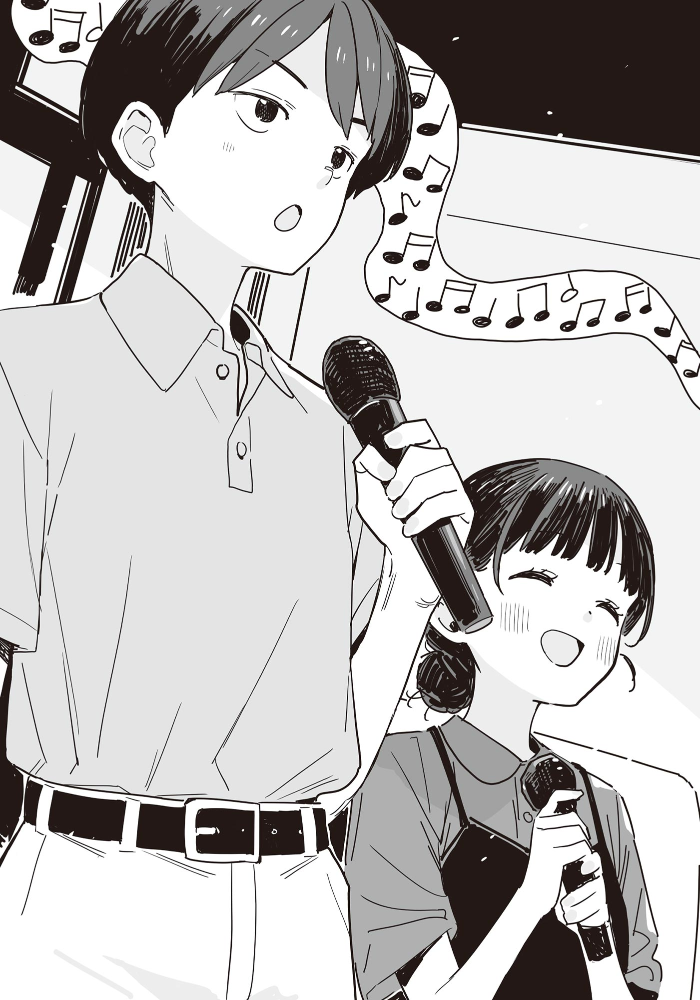

# Ch.160 — เล่ม 9 บทที่ 1-2

Ch.160 — เล่ม 9 บทที่ 1-2

By มนก

Published: 2026-07-18T06:32:57Z

Source: https://www.nekopost.net/novel/14560/160

ระหว่างทางกลับบ้าน ผมเดินอยู่ตรงอาเขตถนนโทกิวะใกล้ๆ สถานีรถไฟ ผมมาซื้อเมล็ดกาแฟตามที่คาจูขอร้องไว้

──เรื่องที่รุ่นพี่โฮโคบารุมาเห็นตอนกำลังคุยความลับกันนั่น ผมไม่ได้บอกพวกยานามิหรอก

ไม่ได้ถูกสั่งห้ามพูดหรืออะไรหรอก แต่ผมรู้สึกตะหงิดๆ กับท่าทีของคนคนนั้นนิดหน่อย

ยานามิที่ไม่รู้เรื่องรู้อะไรเลย กำลังกินไก่ทอดร้านสะดวกซื้อพลางมองซ้ายมองขวาไปรอบๆ

[ นี่ นุคุมิซึคุง มาซื้ออะไรเหรอ? ]

[ คาจูฝากซื้อเมล็ดกาแฟมาน่ะ ]

ว่าแต่ทำไมถึงตามมาด้วยล่ะเนี่ย……

ข้างๆ ผมที่กำลังสงสัย ยานามิแกว่งไก่ทอดที่กินค้างไว้ไปมาอย่างภาคภูมิใจ

[นุคุมิซึคุง จะบอกเกร็ดความรู้เรื่องเมล็ดให้ฟังแล้วกัน ความจริงแล้วเมล็ดกาแฟกับเมล็ดโกโก้เป็นคนละอย่างกันนะ]

ครับ รู้ครับ ยานามิที่ทำหน้าหยิ่งยโสไม่รู้ทำไมถึงพูดต่อเองเออเอง

[เมื่อก่อนฉันเคยคิดว่าเมล็ดโกโก้คือเมล็ดกาแฟที่ทำให้หวานขึ้นน่ะสิ]

[อ่าー เด็กเล็กๆ ก็มักจะคิดอะไรแปลกๆ แบบนั้นแหละนะ]

[……อืม นั่นสินะ ตอนเด็กๆ ไง? ไม่ใช่เมื่อเร็วๆนี้นะ?]

ยานามิเอ๋ย ทำไมต้องร้อนรนขนาดนั้นด้วย

จะว่าไป ตอนเด็กๆ คาจูก็ดึงดันว่าพี่น้องโตขึ้นแล้วต้องแต่งงานกันเหมือนกัน ผมเองก็ยังเด็กอยู่ เลยเกือบจะโดนล้างสมองไปซะแล้ว

ขณะที่กำลังคิดถึงความหลังอยู่นั้น ตอนที่กำลังจะเดินเข้าไปในร้านกาแฟวอลทซ์บนถนนโทกิวะ ก็มีผู้หญิงคนหนึ่งปรากฏตัวออกมาจากข้างใน

[ แหม นุคุมิซึซัง มาซื้อของเหรอคะ? ]

คนที่เดินออกมาจากร้านคือประธานนักเรียนโรงเรียนทสึวาบุกิ บาโซริ เทียร่า

เธอชำเลืองมองยานามิแวบหนึ่ง ก่อนจะหยุดยืนอยู่ตรงหน้าผม

[ก็นิดหน่อยน่ะ บาโซริซังก็มาเหมือนกันเหรอ]

[ค่ะ มาซื้อเมล็ดกาแฟ โดนนุคุมิซึซังป้ายยาเข้าเต็มๆ เลยค่ะ]

เทียร่าซังหัวเราะหึๆ อย่างดีใจ

ผมที่กำลังจะหัวเราะตาม ก็สัมผัสได้ถึงสายตาของยานามิ จึงรีบหุบยิ้มทันที

[ ……นุคุมิซึคุง แล้วเรื่องซื้อของล่ะ ]

เทียร่าซังพึมพำ [แหม] เบาๆ ราวกับเพิ่งสังเกตเห็นยานามิเป็นครั้งแรก

[ ยานามิซังก็อยู่ด้วยเหรอคะ มาซื้อของด้วยกันสองคนเหรอคะ? ]

[ เปล่าหรอก แค่ตามมาเองเฉยๆ ]

ปึ้ก ยานามิเอาไหล่มากระแทก

[ พอดีมีเรื่องนิดหน่อยน่ะー นุคุมิซึคุง ถ้าจะซื้อของก็รีบเข้าไปเถอะ ]

[ เดี๋ยวสิ ยานามิซัง อย่าดันสิ ]

ตอนที่ผมกำลังจะถูกดันเข้าไปในร้าน เทียร่าซังก็คว้าแขนผมเอาไว้

[ จริงสิ คราวหน้าช่วยพาไปร้านกาแฟร้านนั้นอีกนะคะ ]

[ เอ๊ะ อ่า ถ้ามีโอกาสนะ ]

ทำไมถึงพูดเรื่องนั้นต่อหน้ายานามิล่ะเนี่ย

ตอนที่ผมทำเนียนปล่อยผ่านแล้วเตรียมจะเข้าร้าน ยานามิก็คว้าแขนอีกข้างของผมไว้

[ ……นุคุมิซึคุง ไปทำเรื่องแบบนั้นมาสินะ ]

[ หา? ไม่หรอก แค่ไปร้านกาแฟด้วยกันเฉยๆ ไม่ได้มีอะไรแบบนั้นสักหน่อย ]

ระหว่างที่ผมกำลังแก้ตัวตะกุกตะกัก เทียร่าซังก็ทำหน้าเหมือนตกใจ

[ แหม ยานามิซังไม่เคยถูกพาไปเหรอคะ? ]

[ …………! ]

ยานามิฝืนยิ้มกระตุกๆ พลางบีบแขนผมแน่น เจ็บนะ

[ ก...ก็ฉันไม่ได้ชอบกาแฟขนาดนั้นนี่นา? นุคุมิซึคุงก็เลยเกรงใจไม่ชวนรึเปล่านะ? รึเปล่านะ? ]

ยานามิซัง อย่าจ้องผมขนาดนั้นสิครับ

พอผมเผลอหลบสายตา เทียร่าซังก็มองยานามิด้วยรอยยิ้ม

[ เมื่อก่อนฉันก็ไม่ค่อยชอบเหมือนกัน แต่เขาก็พาไปนะคะ เป็นร้านประจำของนุคุมิซึซัง เขาเลือกเมนูอื่นที่ไม่ใช่กาแฟให้ด้วยล่ะ ]

[ เหรอー นุคุมิซึคุงนี่ใจดีจังเลยเนอะー เหรอー…… ]

ขณะที่ผมกำลังหวาดกลัวกับแรงกดดันของยานามิ เทียร่าซังก็เอามือมาแตะแขนผมเบาๆ ราวกับจะเป็นห่วง

[ น้ำองุ่นแก้วนั้น อร่อยมากเลยค่ะ อยากดื่มด้วยกันอีกจังเลยนะคะ ]

[ น...นั่นสินะ ขอให้เก็บองุ่นได้เยอะๆ นะ…… ]

กับคำตอบที่แม้แต่ตัวเองยังงง เทียร่าซังหัวเราะคิกคัก

[ นั่นสินะคะ อยู่ใกล้แค่นี้เอง ไปลองดูไหมคะว่าเก็บองุ่นได้หรือยัง? ]

[ เอ่อ…… ]

สถานการณ์นี้มันอะไรกันเนี่ย สิ่งเดียวที่มั่นใจได้ คือความหงุดหงิดของยานามิที่ต่อให้ไม่มองก็รู้

[ ……นุคุมิซึคุง มาซื้อของไม่ใช่เหรอ แถมยังมีเรื่องของโคฮารุจังอีก ]

[ เอ๊ะ เรื่องของโคฮารุซัง ผมโดนดึงไปเอี่ยวด้วยเหรอ? ]

พอได้ยินบทสนทนานั้น เทียร่าซังก็พึมพำออกมาเบาๆ

[……โคฮารุซัง?]

[มีอะไรเหรอ บาโซริซัง]

พอผมเผลอถามกลับไป เทียร่าซังก็ส่งยิ้มบางๆ

[เปล่าค่ะ ไม่มีอะไรหรอก ดูท่าทางกำลังยุ่งๆ งั้นฉันขอตัวก่อนนะคะ]

[อ๊ะ ครับ งั้นเจอกันที่โรงเรียนนะครับ]

[ค่ะ แล้วเจอกันพรุ่งนี้นะคะ]

เทียร่าซังโบกมือแล้วหันหลังกลับ

ขณะที่ผมกำลังมองส่งแผ่นหลังของเธออยู่เพลินๆ ยานามิก็เอานิ้วจิ้มหลังผม

[นี่ จะซื้อเมล็ดกาแฟไม่ใช่เหรอ]

[อ๊ะ อืม]

ระหว่างที่สั่งเมล็ดกาแฟในร้านและรอแพ็กของ ยานามิก็เริ่มพูดทั้งที่สายตายังจดจ่ออยู่กับสมาร์ทโฟน

[ จะว่าไป โคฮารุจังติดต่อมาแล้วนะ นุคุมิซึคุงก็ดูไว้ด้วยล่ะ ]

[เดี๋ยวสิ ยังไม่ได้บอกว่าจะให้ความร่วมมือเลยนะ]

ยานามิเงยหน้าจากสมาร์ทโฟน

[ก็เด็กคนนั้นเป็นแฟนของซากุไรคุงไม่ใช่เหรอ?]

[ก็นะ มันก็ใช่แหละ]

ยานามิถอนหายใจ เฮ้อ

[นี่นะ การที่ปล่อยให้แฟนที่คบกันมาตั้งแต่ประถมต้องมาพูดเรื่องแบบนั้นน่ะ มันไม่ปกติหรอกนะ]

[ถึงอย่างนั้น การที่พวกเราจะเข้าไปยุ่งมันก็ยังไงๆ อยู่นะ]

[ที่ผ่านมานายก็ชอบเอาตัวเข้าไปพัวพันกับเรื่องไม่เป็นเรื่องตั้งเยอะไม่ใช่รึไง ฉันเองก็ลำบากที่ต้องคอยดูแลเหมือนกันนะ รู้ไหม?]

พอโดนพูดแบบนี้ก็เถียงไม่ออก

แต่ว่า ที่ผ่านมามันก็แค่ถูกดึงเข้าไปพัวพันเอง หรือจะเรียกว่ารู้สึกเหมือนเป็นเรื่องของคนอื่นมากกว่าน่ะ

การต้องไปเป็นฝ่ายก่อเรื่องซะเอง มันรู้สึกแปลกๆ หรือขัดๆ ยังไงชอบกล

[นุคุมิซึคุง เป็นเพื่อนกับซากุไรคุงไม่ใช่เหรอ ช่วยเป็นห่วงหมอนั่นสักหน่อยสิ]

[แต่ว่า──]

พอผมเริ่มคิดหนัก ยานามิก็ยิ้มมุมปากอย่างเจ้าเล่ห์

[แถมยังได้ไปเที่ยวฟรีด้วยนะ? จะไปไหนดีน้า ฮอกไกโดก็ดีนะー]

……นั่นคือความในใจสินะ

แต่ผมก็อยากจะเลี่ยงไม่ให้ซากุไรคุงของผมต้องมาพัวพันกับปัญหาล่ะนะ

แถมถ้าไปทำตัวเหมือนคนฟ้อง แล้วทำให้ทั้งสองคนต้องเลิกกันขึ้นมาล่ะก็ คงมองหน้ากันไม่ติดแน่

[ขอโทษที่ให้รอครับ วอลทซ์เบลนด์ บดระดับกลาง 200 กรัมครับ]

[อ๊ะ ครับ ขอบคุณครับ]

พอรับเมล็ดกาแฟแล้วเดินออกจากร้าน ยานามิก็เดินมาตีคู่ข้างๆ

[ว่าแต่ ร้านกาแฟที่บาโซริซังพูดถึงเมื่อกี้นี้ล่ะ]

[เอ๊ะ อะไรนะ?]

พอผมถามกลับไปแบบเหม่อๆ ยานามิก็ถอนหายใจอย่างเอือมระอา

[……ไม่มีอะไร เรื่องของโคฮารุจัง ไปคิดมาดีๆ ด้วยล่ะ]

[อ๊ะ อืม เข้าใจแล้ว]

ระหว่างที่เดินไปตามอาเขต ผมก็ทบทวนบทสนทากับเทียร่าซังเมื่อครู่นี้

ปฏิกิริยาของเทียร่าซังตอนที่ได้ยินชื่อของโคฮารุซัง ดูแปลกๆ ไปหน่อยล่ะมั้ง──

เห็นบอกว่าเจอกันพรุ่งนี้ด้วยสิ ไว้ลองไปคุยที่โรงเรียนดูดีกว่า

[เอ๊ะ พรุ่งนี้มันวันอาทิตย์นี่นา?]

[ก็ใช่น่ะสิ? ตั้งสติหน่อยสิ นุคุมิซึคุง]

……ถ้างั้นเทียร่าซังคงจะพูดผิดมั้ง

ผมพยักหน้าส่งๆ ให้ยานามิที่ยังคงพูดเจื้อยแจ้ว พลางเดินทะลุออกจากอาเขต

◇

ผมวางกระเป๋าหนักอึ้งลงบนพื้น แล้วจัดรองเท้าที่ถอดไว้ตรงโถงทางเข้าให้เรียบร้อย

แค่ไปรับหนังสือโละทิ้งแท้ๆ แต่กลับมีเรื่องเกิดขึ้นตั้งเยอะแยะเลยแฮะ……

[ท่านพี่ กลับมาแล้วเหรอคาาー]

[กลับมาแล้ว คาจู]

คาจูวิ่งเข้ามาหาอย่างร่าเริงเหมือนอย่างเคย──ซะที่ไหนล่ะ

คาจูที่แปะแผ่นเจลลดไข้ไว้บนหน้าผาก เดินโซเซมาตามระเบียงทางเดิน

[เป็นอะไรไปคาจู ไม่สบายเหรอ]

พอผมรีบวิ่งเข้าไปหา คาจูก็ซบแหมะลงตรงอกผม

[พอตั้งใจอ่านหนังสือตั้งแต่เช้า หัวก็เลยมึนๆ ไปหมดเลยค่ะ]

[ไม่มีไข้ใช่ไหม? เดี๋ยวพี่ชงชาให้ ไปพักสักหน่อยดีกว่าไหม]

[ อยากทำแบบนั้นค่ะ ท่านพี่]

คาจูชูแขนทั้งสองข้างมาทางผม

[อะไร อุ้มเหรอ]

ให้ตายสิ ขึ้นม.3 แล้วแต่ข้างในยังเป็นเด็กอยู่เลยนะ เวลาคาจูเป็นหวัดหรือไม่สบาย ก็มักจะอ้อนแบบนี้แหละ ผมอุ้มคาจูขึ้นแล้วเดินไปที่ห้องนั่งเล่น

คาจูที่คล้องแขนรอบคอผมและสูดลมหายใจเข้าลึกๆ หรี่ตาลงฟึ่บ──

[……ท่านพี่ มีกลิ่นของผู้หญิงที่ไม่รู้จักค่ะ]

[เอ๊ะ?]

ผู้หญิงที่ไม่รู้จักที่ไปเจอวันนี้ จะใช่โคฮารุซังรึเปล่านะ

[วันนี้พี่ไปห้องสมุดโรงเรียนมา แล้วก็แวะแฟมิลี่เรสเตอรองต์ด้วย กลิ่นคงจะติดมาจากที่ไหนสักแห่งล่ะมั้ง]

พอผมตีเนียนกลบเกลื่อน คาจูก็กอดคอผมแน่นอย่างไม่พอใจ

[ อาー คาจูก็อยากไปดื่มชากับท่านพี่เหมือนกันค่ะ]

[ครับๆ ไว้คราวหน้าไปด้วยกันนะ]

ผมวางคาจูลงบนโซฟาในห้องนั่งเล่น แล้วเดินไปที่ห้องครัว

เอาล่ะ ทำน้ำขิงให้หน่อยดีกว่า ถ้าจำไม่ผิดน่าจะมีน้ำผึ้งจากฮิกาชิมิคาวะเหลืออยู่นะ

ระหว่างที่กำลังนึกขั้นตอนแล้วเติมน้ำใส่กา สมาร์ทโฟนในกระเป๋าก็ดังขึ้น

พอหยิบออกมาดูหน้าจอ ก็เห็นชื่อ 『เทียร่าซัง』

อะไรเนี่ย จะเป็นเรื่องวุ่นวายอีกไหมนะ ผมเหลือบมองคาจูแวบหนึ่ง ก่อนจะกดรับสาย

[ฮัลโหล มีอะไรเหรอ?]

[ขอโทษนะคะ ตอนนี้สะดวกคุยไหมคะ?]

เพราะถูกโซฟาบังอยู่ เลยมองไม่เห็นคาจู

[อืม ได้สิ]

[เมื่อกี้นี้ ฉันได้ยินชื่อ มิซึชิมะ โคฮารุซัง น่ะค่ะ ก็เลยสงสัยว่ามีเรื่องอะไรกับเธอรึเปล่า]

[อ้อ พอดีถูกไหว้วานมานิดหน่อย──]

……เอ๊ะ เรื่องนี้พูดออกไปจะดีเหรอ

ถึงจะเกี่ยวกับซากุไรคุงก็เถอะ แต่การเอาเรื่องระหองระแหงของคนเป็นแฟนกันไปเล่าให้คนอื่นฟังง่ายๆ มันคงจะไม่ดีมั้ง

[เอ่อ แค่คุยสัพเพเหระเรื่องซากุไรคุงที่เป็นแฟนของเธอน่ะ──]

[แฟนของซากุไรคุงคือมิซึชิมะซังเหรอคะ?!]

เพราะเสียงตะโกนของเทียร่าซัง ผมเลยต้องดึงสมาร์ทโฟนออกห่างจากหู

[บาโซริซังไม่รู้หรอกเหรอ]

[จริงอยู่ที่เธอเรียกซากุไรคุงด้วยชื่อเล่น แต่คบกันอยู่หรอกเหรอคะเนี่ย……]

ผมหันไปมองโซฟาอีกครั้ง ก่อนจะวางกาน้ำลงบนเตา

[เห็นว่าคบกันมานานแล้วนะ แล้วมันมีอะไรเหรอ?]

ไม่รู้ทำไมเทียร่าซังถึงเงียบไป

ตอนที่เสียงหวีดของกาน้ำเริ่มดังเป็นระยะๆ เสียงของเทียร่าซังก็ดังมาจากสมาร์ทโฟน

[──มันค่อนข้างจะซับซ้อนนิดหน่อย พรุ่งนี้พอจะมาเจอและคุยกันตรงๆ ได้ไหมคะ?]

[พรุ่งนี้? ก็ ไม่ได้มีธุระอะไรหรอก……]

ในตอนที่คำสารภาพรักของเทียร่าซังยังถูกแขวนไว้อยู่แบบนี้ จะยอมออกไปเจอเธอง่ายๆ มันจะดีแน่เหรอ

แต่ไม่ได้ไปเดตนี่นา คงไม่เป็นไรหรอกมั้ง……?

พอเหลือบมองไป ก็เห็นคาจูโผล่หน้าแค่ครึ่งบนมาจากพนักพิงโซฟา แล้วจ้องมองผมเขม็ง

[เอ่อ ไว้ค่อยคุยกันทาง LINE หรืออะไรก็แล้วกันนะ อืม ไว้คุยกันต่อทีหลังนะ]

ผมตัดจบบทสนทนาแบบส่งๆ แล้วเก็บสมาร์ทโฟนใส่กระเป๋า

[……ท่านพี่ มีอะไรหรือเปล่าคะ?]

[เปล่า ไม่มีอะไรหรอก]

ผมพูดปดไปเบาๆ แล้วปิดสวิตช์เตา

ตอนนั้น หน้าผากของคาจูที่อยู่เหนือแผ่นเจลลดไข้ดูเหมือนจะมีแสงวาบขึ้นมา──สงสัยจะคิดไปเองล่ะมั้ง

◇

วันอาทิตย์ในวันรุ่งขึ้น ผมอยู่ในห้องคาราโอเกะเพียงลำพัง

สถานที่นัดพบที่เทียร่าซังระบุไว้คือร้านคาราโอเกะใกล้สถานีรถไฟ เป็นร้านเดียวกับที่เทียร่าซังเรียกผมมาเมื่อฤดูหนาวปีที่แล้ว

ผมจิบโคล่าจากดริ้งก์บาร์ โดยมีเสียงร้องเพลงจากห้องข้างๆ เป็นเพลงประกอบฉาก

นึกว่าแค่มาเจอแล้วคุยกันก็เลยตอบตกลงไปง่ายๆ แต่แบบนี้มันเรียกว่าเดตรึเปล่าเนี่ย……?

แต่เพื่อนฝูงไปคาราโอเกะด้วยกันมันก็เรื่องปกตินี่นา คิดมากไปเองแหละ อืม ไม่ใช่เดตหรอก

ขณะที่กำลังจับผมม้าเล่นด้วยความกระวนกระวาย ก็มีใครบางคนชะโงกหน้าเข้ามาในห้องผ่านกระจกประตู

ผมที่ถูกรวบอย่างเรียบร้อยกับใบหน้าเล็กๆ นั่น──เทียร่าซังนี่เอง

พอสบตากับผม เธอก็ทำหน้าโล่งใจแล้วเดินเข้ามาในห้อง

[ค่อยยังชั่ว คิดอยู่ว่าถ้าเป็นคนอื่นขึ้นมาจะทำยังไงดีเนี่ย]

[ผมเองก็คิดอยู่เหมือนกัน ว่าถ้ามีคนอื่นเข้ามาจะทำยังไงดี]

[อะไรกันคะนั่น]

เทียร่าซังหัวเราะพลางนั่งลงข้างๆ

……เอ๊ะ เพื่อนกันเนี่ย เขานั่งข้างกันเป็นเรื่องปกติขนาดนั้นเลยเหรอ

แถมยังมีกลิ่นน้ำหอมแบบผู้ใหญ่โชยมาด้วย ชุดเดรสสีน้ำตาลสุดชิคก็ส่งเสียงสวบสาบฟังสบายหูทุกครั้งที่เทียร่าซังขยับตัว

[ เอ่อ แล้วเรื่องที่จะคุยกับผม…… ]

ขณะที่ผมกำลังประหม่ากับบรรยากาศที่ไม่เหมือนปกติ เทียร่าซังก็ยื่นรีโมตมาให้

[ แหม เข้าเรื่องไวเลยนะคะ อุตส่าห์มาทั้งที ไม่ร้องเพลงหน่อยเหรอคะ? ]

[ร้องด้วยเหรอ]

[ก็ที่นี่ร้านคาราโอเกะนี่คะ]

มันก็ใช่อยู่หรอก แต่ไม่คิดเลยว่าจะโดนเทียร่าซังพูดแบบนี้ใส่

ระหว่างที่กำลังนึกย้อนถึงฤดูหนาวปีที่แล้วด้วยความตื้นตัน เทียร่าซังก็ใช้นิ้วเรียวเล็กกดรีโมต

[เพลงนี้ ร้องด้วยกันไหมคะ? เพลงของเรื่อง 『 แก๊งสาวเส้นยาแดงผ่าแปด 』 ค่ะ]

[ เอ๊ะ วันนี้ร้องเพลงอนิเมะได้เหรอ? ]

[มีปัญหาอะไรเหรอคะ?]

[ก็เพลงอนิเมะมัน──]

ไม่สิ ไม่มีปัญหาอะไรนี่นา ที่นี่ไม่มีผู้แอนตี้เพลงอนิเมะเด็ดขาดอยู่ซะหน่อย

ไม่นานนัก อินโทรเพลง OP ซีซัน 1 ของ 『แก๊งสาวเส้นยาแดงผ่าแปด』 ก็เริ่มบรรเลง

ผมเริ่มร้องเพลงตามที่เธอส่งไมค์มาให้ แต่การโดนฟังอยู่ข้างๆ แบบนี้ก็แอบเขินนิดๆ แฮะ……

พอใกล้ถึงท่อนฮุก เทียร่าซังก็หยิบไมค์ตัวที่สองขึ้นมา

เอ๊ะ หรือว่านี่คือ──

[Narifuri kamawazu, shudan wa towanai, ruuru wa ato kara tsuite kuruー]

( ไม่อายฟ้าดิน ไม่เลือกวิธีการ กฎเกณฑ์ไว้ค่อยว่ากันทีหลังー)

พอสบตากับผมที่กำลังร้องเพลง เทียร่าซังก็มองตอบด้วยสีหน้าซุกซน

[Girigiriー]

ลูกคอรับ! เทียร่าซัง ร้องท่อนคอรัสรับเข้ามาแล้ว ผมก็เลยยิ่งฮึกเหิมเข้าไปใหญ่

[Kirei na mama ja irarenaiー, shinu made susume Girigiri Gaaruzuー]

(สวยงามอยู่ตลอดไปไม่ได้หรอกー จงก้าวต่อไปจนกว่าจะตาย กิริกิริเกิร์ลส์ー)_

[Girigiri outtoー]

เทียร่าซังยื่นฝ่ามือมาหาผมขณะที่กำลังร้องเพลง ผมลังเลอยู่แวบหนึ่งก่อนจะประกบฝ่ามือเข้าด้วยกัน

──ใช่แล้ว มันคือท่าโพสของจิกะเปียวกับโนโนกะ ในท่อนฮุกของเพลง OP ไงล่ะ

พอเข้าสู่ช่วงบรรเลงคั่น เทียร่าซังก็หัวเราะพลางลดไมค์ลง

[หุหุ นุคุมิซึซัง ร้องเก่งจังเลยนะคะ]

[เอ๊ะ งั้นเหรอ หุเหะเหะ……]

ตัวผมตอนนี้ อาจจะดูน่าขนลุกไปหน่อยก็ได้

พวกเราที่ร้องเพลงจนจบ ก็ชะโงกดูหน้าจอบนรีโมต

[นี่ ยังมีเพลงอื่นอีกนะคะ เพลงเอนดิ้งกับ──]

[เพลงโอเพนนิ่งกับเอนดิ้งของซีซัน 2 สินะ ร้องได้ไหม?]

[ค่ะ มาร้องให้หมดกันเถอะค่ะ]

เทียร่าซังที่กำลังจะเอื้อมมือไปหยิบรีโมต ก็กระแอมไอเบาๆ

[ก่อนหน้านั้น ขอตัวไปเติมเครื่องสำอางแป๊บนึงนะคะ]

[อ๊ะ ครับ จะรอนะ]

พอเทียร่าซังเดินออกจากห้อง ผมก็ถอนหายใจอย่างโล่งอก

กลายเป็นว่าผมสนุกไปกับมันซะอย่างงั้น ก็นะ เพื่อนกันนี่นา การมาร้องคาราโอเกะด้วยกันอย่างสนุกสนานก็คงเป็นเรื่องปกติแหละ

อืม ปกติสิ ปกติ──ใช่ไหมนะ?

……

…………ไม่ใช่สิ นี่มันเดตนี่นา ยังไงก็เดตชัดๆ

ความทรงจำตอนที่ไปเดตกับยากิชิโอะที่พิพิธภัณฑ์สัตว์น้ำทาเคชิมะยังคงสดใหม่ นี่มันคืออีเวนต์ประเภทเดียวกันเลย

ผมจิบโคล่าที่จืดชืดไปแล้ว พลางดึงสติกลับมา

ร้องเพลงอนิเมะคู่กับเด็กผู้หญิงเนี่ย มันต้องสนุกอยู่แล้ว สนุกอยู่แล้วก็จริง แต่จะเผลอเคลิ้มตามไม่ได้เด็ดขาด ผมกับเทียร่าซังเป็นแค่เพื่อนกันนะ

จะไม่เคลิ้มตามหรอก อืม ผมจะไม่เคลิ้มตามเด็ดขาด──

……

…………แต่ว่า ทำไมถึงเคลิ้มตามไม่ได้ล่ะเนี่ย

มาทบทวนกันหน่อย ข้อแรก ผมไม่มีแฟน

อีกฝ่ายชอบผม และผมเองก็มีความรู้สึกดีๆ และความสนิทสนมกับเธอในฐานะคนคนหนึ่ง

ในฐานะเพศตรงข้าม เธอก็มีเสน่ห์ และที่สำคัญกว่าสิ่งอื่นใด──อยู่ด้วยแล้วสนุก

ถ้าจะเคลิ้มตามไป มันมีปัญหาอะไรตรงไหนงั้นเหรอ……?

ระหว่างที่กำลังคิดวกไปวนมา หน้าจอสมาร์ทโฟนที่วางอยู่บนโต๊ะก็สว่างขึ้น

พอมองเห็นชื่อของยานามิบนหน้าจอแจ้งเตือน ผมก็เผลอมองไปที่ประตูทันที แต่ก็ไม่มีวี่แววของใครอยู่แถวนั้น

……คิดมากไปเองแหละ ยานามิจะมาอยู่ที่นี่ได้ยังไงกัน

ผมเปิดอ่านข้อความที่ส่งมาด้วยความรู้สึกประหม่าอย่างบอกไม่ถูก

[ในหนังสือที่ได้มาเมื่อวาน มีไลท์โนเวลของนุคุมิซึคุงปนอยู่ด้วยล่ะ]

อ่า เล่มที่หาไม่เจอ ไปอยู่ที่ยานามินี่เอง

ผมพิมพ์ขอให้เธอเอามาให้ที่โรงเรียนพรุ่งนี้ ก่อนจะคว่ำหน้าจอสมาร์ทโฟนลงบนโต๊ะ

……เอ่อ เมื่อกี้คิดเรื่องอะไรอยู่นะ

เรื่องของยานามิช่างมันก่อน ในเมื่อผมกับเทียร่าซังไม่ได้คบกัน การไปทำตัวสวีตหวานเกินความจำเป็นโดยยังไม่ได้ให้คำตอบ ก็เป็นเรื่องที่ควรหลีกเลี่ยง แต่ว่า ถ้าเกิดเผลอเคลิ้มไปล่ะก็──

ยังไม่ทันจะรวบรวมความคิดจนจบ เทียร่าซังก็กลับมาพอดี

เทียร่าซังวางแก้วชาอู่หลงลง แล้วกลับมานั่งข้างผมอีกครั้ง

[รอนานไหมคะ เอาล่ะ มาร้องเพลงกันเถอะ]

[เดี๋ยวก่อนสิ ขอคุยธุระให้เสร็จก่อนได้ไหม]

พอเห็นท่าทีของผม เทียร่าซังก็ทำหน้าจริงจังขึ้นมากะทันหัน

[ค่ะ นั่นสินะคะ พอดีมันสนุกมากก็เลยเผลอลอยไปหน่อย]

เทียร่าซังจิบชาอู่หลงอึกหนึ่ง รวบเข่าเข้าหากัน แล้วหันตัวมาทางผม

[งั้นเริ่มเลยนะคะ นุคุมิซึซัง มีความสัมพันธ์ยังไงกับมิซึชิมะซังเหรอคะ?]

[เอ่อ ก็แค่คุยปรึกษาเรื่องซากุไรคุงนิดหน่อยน่ะ หรือจะเรียกว่าแลกเปลี่ยนข้อมูลกันดีล่ะ……]

พอผมตอบอ้อมแอ้มไป เทียร่าซังก็จ้องตาผมเขม็ง

[แค่นั้นเหรอคะ?]

[ครับ แค่นั้นจริงๆ]

เทียร่าซังจ้องผมอยู่ครู่หนึ่ง ก่อนจะพูดว่า [งั้นก็โล่งอกไปทีค่ะ] แล้วคลายสีหน้าลง

[พอดีไปได้ยินข่าวลือแปลกๆ มาจากเพื่อนที่อยู่โรงเรียนอายาเมะน่ะค่ะ]

โห เทียร่าซังมีเพื่อนอยู่ต่างโรงเรียนด้วยเหรอเนี่ย ไม่สิ เรื่องนั้นช่างมันก่อน

[ข่าวลือที่ว่า คือเรื่องของโคฮารุซังเหรอ?]

เทียร่าซังพยักหน้า

[ในสภานักเรียนของโรงเรียนอายาเมะ มีเด็กผู้หญิงที่ค่อนข้าง... เอ่อ ปล่อยตัวเรื่องผู้ชายอยู่น่ะค่ะ]

ปล่อยตัว……? อะไรล่ะ ช่วยเก็บยางลบให้งั้นเหรอ

[แล้วคนคนนั้นคือโคฮารุซังเหรอ?]

[ก็เป็นแค่ข่าวลือน่ะค่ะ]

เทียร่าซังมองผมที่กำลังคิดหนักด้วยสายตาเป็นห่วง

[เมื่อวานพอได้ยินว่านุคุมิซึซังรู้จักกับเธอ ฉันก็เลย──]

[เป็นห่วงผมสินะ]

เทียร่าซังส่ายหน้าเบาๆ

[……แอบหึงนิดหน่อยค่ะ]

ชั่วขณะหนึ่ง หัวใจก็เต้นแรงขึ้นมา

[ง...งั้นเหรอ]

[แต่ก็ดีแล้วล่ะค่ะ ที่เธอไม่ได้เป็นฝ่ายเข้ามาเข้าหานุคุมิซึซัง]

กับรอยยิ้มเขินอายของเทียร่าซัง ผมก็เลยเขินจนต้องหลบตา

[ผมไม่ได้เนื้อหอมขนาดนั้นสักหน่อย]

[แหม งั้นก็ค่อยยังชั่วค่ะ อัตราการแข่งขันจะได้ลดลงไงคะ]

เทียร่าซังพูดติดตลก

[แต่ทำไมเรื่องนี้ถึงคุยทางโทรศัพท์ไม่ได้ล่ะ?]

เจอคำถามซื่อๆ ของผมเข้าไป เทียร่าซังก็แลบลิ้นอย่างรู้สึกผิด

[สารภาพก็ได้ค่ะ ก็ฉันอยากเจอนุคุมิซึซังนี่นา]

[ห...เหรอ……งั้นเหรอ……]

……อย่าเผลอเคลิ้มตามเชียวนะ ตัวผม

แต่ว่า ไม่คิดเลยว่าโคฮารุซังจะมีข่าวลือแย่ๆ แบบนั้น

ในฐานะแฟนของซากุไรคุงที่ผมรู้จัก เด็กคนนั้นเหมาะสมจริงๆ งั้นเหรอ แต่ก็นะ ผมไม่รู้เรื่องราวของโรงเรียนอื่นหรอก คงจะดีกว่าถ้าไม่เข้าไปก้าวก่ายให้มากไปกว่านี้……

แต่ระหว่างที่ร้องเพลง ED ซีซัน 1 ของ 『 แก๊งสาวเส้นยาแดงผ่าแปด 』 กับเทียร่าซัง ผมก็เพิ่งนึกขึ้นได้

── ผมนึกออกแล้ว ว่ามีคนที่น่าจะรู้เรื่องราวของโรงเรียนอายาเมะเป็นอย่างดีอยู่

◇
