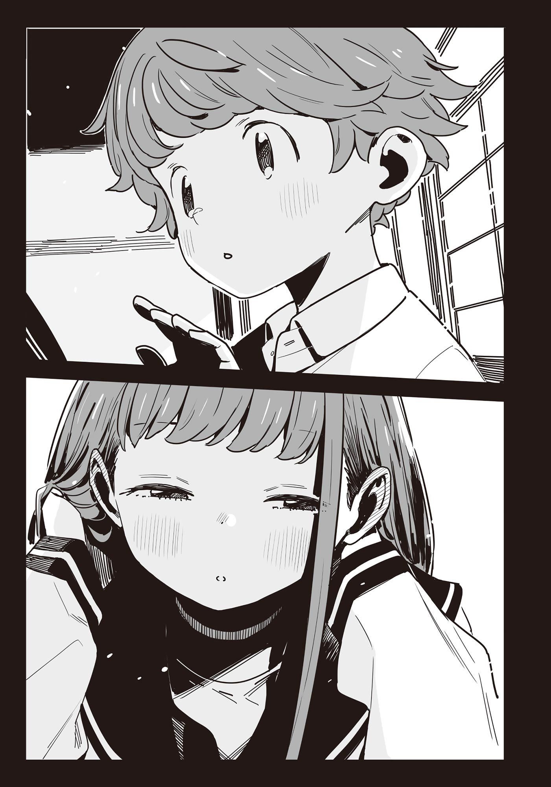

# Ch.162 — เล่ม 9 บทที่คั่น 1

Ch.162 — เล่ม 9 บทที่คั่น 1

By มนก

Published: 2026-07-29T06:08:15Z

Source: https://www.nekopost.net/novel/14560/162

บทคั่น 1 - เมื่อยามดอกตูมผลิบานเป็นดอกไม้

ซากุไร ฮิโรโตะ วิ่งพรวดมาตรงโถงทางเข้าบ้าน แล้วตะโกนเรียกเสียงดัง

[ รบกวนด้วยนะครับ! พี่ฮิบะอยู่ไหม?]

[อ้าว ฮิโรโตะคุง มาแล้วเหรอจ๊ะ ฮิบาริอยู่ที่ห้องพระจ้ะ]

คนที่โผล่หน้าออกมาจากข้างใน คือแม่ของโฮโคบารุ ฮิบาริ

ซากุไรวิ่งไปตามระเบียงทางเดิน แล้วเปิดประตูบานเลื่อนกระดาษออกอย่างแรง

[พี่ฮิบะ เครื่องแบบของซาซายูริ──]

คำพูดที่กำลังจะหลุดจากปากของซากุไรพลันละลายหายไป

ตรงนั้นมีร่างของโฮโคบารุ ฮิบาริ ในชุดนักเรียนกะลาสีเรือยืนอยู่

โฮโคบารุหันกลับมามองผ่านไหล่จากหน้ากระจกเงาบานยาว

[เป็นอะไรไป ลุกลี้ลุกลนเชียว]

[ก็...ได้ยินว่าเครื่องแบบม.ต้นส่งมาถึงแล้วนี่นา...]

ซากุไรหน้าแดง แล้วก้มหน้าลงอย่างทำตัวไม่ถูก

โฮโคบารุเผยรอยยิ้ม แล้วหันขวับมาพลางจัดระเบียบผ้าพันคอตรงหน้าอก

[เป็นไงบ้าง ฮิโรโตะ ฉันใส่แล้วเข้ากัน──]

[อ๊ะー ฮิโระคุงขี้โกงนี่นา! ฉันอยากเห็นก่อนแท้ๆー]

คนที่วิ่งตามซากุไรเข้ามาคือ มิซึชิมะ โคฮารุ

โคฮารุกระโดดเกาะหลังซากุไรจนแทบจะชนเข้าเต็มแรง พลางจ้องมองโฮโคบารุในชุดนักเรียนด้วยดวงตาเป็นประกาย

[ฮิบาริ เข้ากันสุดๆ ไปเลย!]

[หุหุ ขอบใจนะ]

โคฮารุผละออกจากแผ่นหลังของซากุไร พลางแกล้งทำแก้มป่องอย่างจงใจ

[ฮิโระคุงได้พูดความรู้สึกออกไปดีๆ หรือยัง?]

[เอ๊ะ อา...ยังเลย]

ไม่รู้ทำไมเขาถึงไม่กล้ามองใบหน้าของลูกพี่ลูกน้องตรงๆ ซากุไรเอาแต่ก้มหน้ามองเสื่อทาทามินิ่ง

[ปีหน้าฉันก็จะได้ใส่แล้วเหมือนกันนะ ทำตัวแบบนี้ไม่ได้หรอกนะ]

[ฉันเองก็ต้องใส่เหมือนกันนั่นแหละ]

[ของฮิโระคุงมันเป็นชุดนักเรียนชายกะคุรันนี่นา]

โฮโคบารุลูบหัวของทั้งสองคนที่เริ่มเถียงกันด้วยเรื่องแปลกๆ อย่างเอ็นดู

[ทั้งสองคนใจเย็นๆ ก่อน ที่ส่งมาน่ะมันเครื่องแบบของฉันนะ]

[ว้าー ผมเสียทรงหมดแล้วー]

ซากุไรช้อนตามองโฮโคบารุกับโคฮารุที่กำลังหยอกล้อกันอย่างสนุกสนานไว้ที่หางตา

ส่วนสูงของโฮโคบารุนั้นเกิน 160 เซนติเมตรไปอย่างสบายๆ

รูปลักษณ์ของเธอนั้นอย่าว่าแต่เด็กม.ต้นเลย จะบอกว่าเป็นเด็กม.ปลายก็ยังเชื่อ

[ดีจังน้าー ฉันเองก็อยากรีบใส่ไวๆ จัง]

โฮโคบารุพูดกับโคฮารุที่กำลังจ้องมองด้วยดวงตาชวนฝัน

[ปีหน้าก็ถึงตาของโคฮารุแล้วล่ะ แป๊บเดียวเอง]

[ถ้าถึงตอนนั้น ขอเครื่องแบบของฮิบาริเป็นของตกทอดนะ!]

กับคำขอที่ไม่มีปี่มีขลุ่ยนั้น ทำให้โฮโคบารุเผลอหัวเราะออกมา

[ไว้ชีวิตเถอะ ถึงตอนนั้นฉันเพิ่งจะอยู่ม.2 เองนะ]

[อาจจะตัวสูงขึ้นจนใส่ไม่ได้แล้วก็ได้นะ?]

[โห งั้นก็ต้องยืดตัวโคฮารุให้สูงพอที่จะใส่ชุดนี้ได้สินะ]

โฮโคบารุอ้อมไปด้านหลังของโคฮารุ แล้วสอดแขนรอบตัวเธอเพื่อยกขึ้น

[จ๊ากー โดนหมุนแล้วー]

[เอ้า จะช่วยยืดตัวให้สูงขึ้นอีก!]

โฮโคบารุหัวเราะพลางหมุนโคฮารุไปรอบๆ

[เดี๋ยวสิ ทั้งสองคน อย่าเล่นกันแรงนักสิ]

ซากุไรรีบร้องห้าม โฮโคบารุหยุดหมุน แล้วหันมาสบตากับโคฮารุ

[ฮิบาริ คราวนี้ช่วยยืดตัวให้ฮิโระคุงหน่อยสิ!]

[เอาล่ะ ไว้ใจฉันได้เลย!]

[เดี๋ยวสิ!?]

ขณะที่ซากุไรกำลังถูกเด็กผู้หญิงสองคนล็อกตัวไว้ แม่ของโฮโคบารุก็โผล่หน้ามา

[นี่พวกเธอ เอะอะโวยวายอะไรกัน!]

ผู้เป็นแม่ก้าวฉับๆ เข้ามาในห้อง แล้วตีก้นโฮโคบารุเบาๆ

[ฮิบาริเองก็เป็นพี่สาวนะ ต้องคอยห้ามน้องๆ สิ]

[ก็แค่เล่นกันเองน่า]

กับท่าทีไม่สะทกสะท้านของลูกสาว คนเป็นแม่ก็ถอนหายใจอย่างเอือมระอา

[ฤดูใบไม้ผลินี้ก็จะขึ้นม.ต้นแล้วนะ จริงๆ เล้ย โตเอาๆ แค่ความสูงเนี่ย]

[...ไม่ได้ตัวโตเท่าพี่ชายซะหน่อย]

เธอยังคงบ่นลูกสาวที่ทำหน้ามุ่ยต่อไป

[ลูกเป็นผู้หญิงนะ ขึ้นม.ต้นแล้วยังจะเล่นกรีฑาต่ออีกเหรอ?]

[อืม กะว่าอย่างนั้นแหละ]

...ขืนพูดต่อไปก็คงไม่ได้ข้อสรุป

คนเป็นแม่คงตัดสินใจแบบนั้น จึงหมุนตัวกลับโดยไม่พูดอะไรอีก

[อย่าทำเสียงดังกันนักล่ะ โคฮารุจัง มีขนมอยู่นะ มาช่วยชงชาหน่อยสิจ๊ะ]

[ค่า คุณป้า]

[งั้นผมก็──]

ตอนที่ซากุไรทำท่าจะตามไปด้วย แม่ของโฮโคบารุก็ส่ายหน้า

[ฮิโรโตะคุงเป็นเด็กผู้ชาย ไม่ต้องหรอกจ้ะ ฮิบาริ อย่าทำเครื่องแบบเลอะเชียวนะ]

พร้อมกับเสียงประตูบานเลื่อนปิดลง โฮโคบารุก็ถอนหายใจเฮือกใหญ่

[...ขอโทษทีนะ แม่ฉันก็เป็นแบบนั้นแหละ]

[ไม่เป็นไรหรอก นานๆ ทีฉันถึงจะถูกปฏิบัติแบบเด็กผู้ชายบ้างน่ะ]

ด้วยน้ำเสียงสดใสเชิงปลอบใจของซากุไร รอยยิ้มก็กลับมาบนใบหน้าของโฮโคบารุอีกครั้ง

โฮโคบารุหมุนตัวตรงหน้าซากุไร กระโปรงพลิ้วไหวอย่างนุ่มนวล

เมื่อเส้นผมยาวสลวยสั่นไหวและกลับมาอยู่ตำแหน่งเดิม โฮโคบารุก็พูดด้วยน้ำเสียงที่ดูเป็นผู้ใหญ่ขึ้นเล็กน้อยว่า

[──ฮิโรโตะ ฉันใส่แล้วเข้ากันไหม?]

หลังจากเงียบไปครู่หนึ่ง ซากุไรก็พยักหน้าเงียบๆ

โฮโคบารุชำเลืองมองเพื่อให้แน่ใจว่าประตูบานเลื่อนกระดาษตรงหน้าต่างปิดอยู่ ก่อนจะค่อยๆ หันหลังให้

[ดูเหมือนกระดุมตรงปกเสื้อจะหลุดน่ะ ช่วยติดให้ใหม่หน่อยได้ไหม]

[ก็ได้อยู่หรอก...แต่มันอยู่ตรงไหนล่ะ?]

โฮโคบารุเอื้อมมือไปด้านหลังคอ ยกผมยาวขึ้น เผยให้เห็นต้นคอขาวเนียน

[หลังคอไง สอดมือเข้าใต้ปกเสื้อสิ──]

[อ-อืม]

ซากุไรยื่นมือไปที่แผ่นหลังของโฮโคบารุด้วยความประหม่า

ท่ามกลางความเงียบงัน มีเพียงเสียงสวบสาบของเนื้อผ้าเครื่องแบบที่เสียดสีกัน

รถยนต์แล่นผ่านหน้าบ้านไป ทำให้กรอบหน้าต่างสั่นสะเทือน

เสียงพูดคุยของแม่กับโคฮารุดังแว่วผ่านประตูบานเลื่อนมา──

เมื่อจังหวะหัวใจและเสียงสูดลมหายใจของทั้งสองคนเริ่มประสานกัน จู่ๆ นาฬิกาลูกตุ้มตรงระเบียงทางเดินก็ส่งเสียงบอกเวลา

ราวกับเป็นสัญญาณ ซากุไรชักมือกลับจากโฮโคบารุ

[...พี่ฮิบะ เสร็จแล้วล่ะ]

[ขอบใจนะ]

โฮโคบารุยิ้มออกมาเขินนิดๆ ก่อนจะเปิดบานเลื่อนกระดาษตรงหน้าต่างออก

แสงแดดยามเย็นอันอ่อนโยนสาดส่องใบหน้าด้านข้างของโฮโคบารุ ประกายแสงระยิบระยับลอดผ่านเรือนผมยาวสลวย

ซากุไรพยายามจะหลบตาด้วยความเขินอายอีกครั้ง แต่ทว่าเขากลับไม่อาจละสายตาไปจากเธอได้เลย
