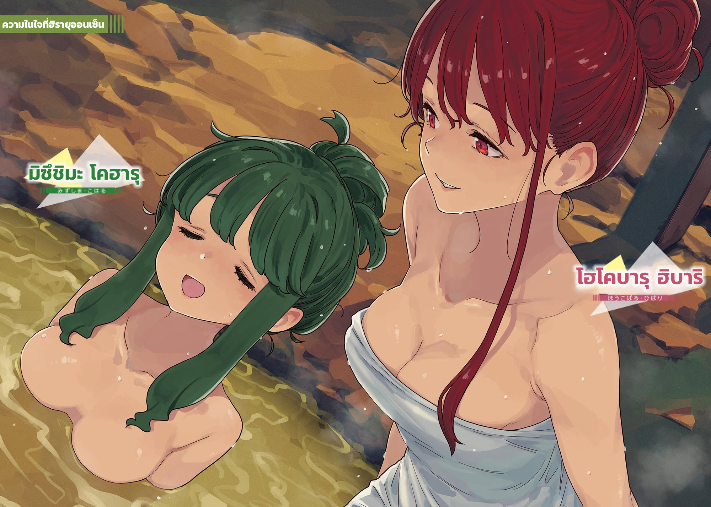

# Ch.166 — เล่ม 9 บทที่ 2-4

Ch.166 — เล่ม 9 บทที่ 2-4

By มนก

Published: 2026-07-29T06:12:59Z

Source: https://www.nekopost.net/novel/14560/166

จากสถานีรถไฟ นั่งรถบัสมาประมาณ 20 นาที ก็จะถึงโรงเรียนมัธยมปลายประจำจังหวัดชิดะที่ตั้งอยู่ริมแม่น้ำ

เป็นโรงเรียนที่เหล่าตัวละครในอนิเมะ 『อะเทนารุโมโนะ』 เข้าเรียน วันนี้เป็นวันเสาร์ เลยมีแค่นักเรียนที่มาทำกิจกรรมชมรมประปราย โรงเรียนจึงเงียบสงบ

พวกเราเดินไปตามถนนระหว่างอาคารเรียนกับสนามฟุตบอล พลางเริ่มการตามรอยสถานที่ศักดิ์สิทธิ์อย่างเงียบๆ

โรงเรียนนี้ต่างจากสึวาบุกิ ตรงที่สนามฟุตบอลอยู่ด้านนอกประตูใหญ่ เลยสามารถเข้าไปใกล้ตัวอาคารเรียนได้ค่อนข้างมาก

[โหー โรงเรียนล่ะ]

ยานามิเคี้ยวถั่วขนมกร้วมๆ พลางมองไปรอบๆ

[อุตส่าห์เป็นสถานที่ศักดิ์สิทธิ์ทั้งที นึกว่าจะมีป้ายอะไรซะอีก]

[ที่นี่เป็นโรงเรียนธรรมดานะ ต้องระวังไม่ให้กระทบกับการใช้ชีวิตของนักเรียนกับคนแถวนี้สิ]

[โหー เป็นงั้นเองเหรอ]

โคฮารุซังที่ได้ยินบทสนทนา โผล่หน้าเข้ามาแทรกกลาง

[เป็นกฎเหล็กของการตามรอยเลยล่ะ แค่คิดว่าทุกวันคาราสุยะคุงเดินผ่านถนนเส้นนี้ การหายใจก็คล่องขึ้นแล้วล่ะ]

ผู้หญิงคนนี้ ชอบลมหายใจของคาราสุยะคุงจริงๆ เลยแฮะ อยากสูดเท่าไหร่ก็เชิญเลย

[ไม่ค่อยเข้าใจหรอกนะ แต่อากาศสดชื่นดีเนอะ โคฮารุจัง เอาถั่วไหม?]

[อื้อ ขอบใจนะ แล้วก็นะ ในวงการเค้ากำลังวิเคราะห์ช่วงก้าวเดินของคาราสุยะคุงกันอยู่ล่ะ──]

ผมปล่อยโคฮารุซังที่กำลังเครื่องติดไว้กับยานามิ แล้วตีตัวออกห่างจากทั้งสองคน

คนที่มีระดับความอินต่างกันเนี่ย เวลามองจากข้างนอกแล้วมันน่าอายแปลกๆ แฮะ...

ระหว่างที่เดินไปโดยไม่ดูตัวเอง รุ่นพี่โฮโคบารุก็เข้ามาทัก

[ตอนแรกก็คิดว่าการตามรอยเป็นงานอดิเรกที่แปลกดีนะ แต่เอาเข้าจริงก็น่าสนใจกว่าที่คิดแฮะ]

[ถ้าไม่ได้ดูอนิเมะ ก็คงไม่อินไม่ใช่เหรอครับ?]

[ก็ไม่เชิงหรอก พอเห็นปฏิกิริยาของเธอกับโคฮารุแล้ว ก็ได้รู้ว่าทิวทัศน์ธรรมดาๆ แค่เปลี่ยนมุมมองก็ทำให้ดูเปลี่ยนไปได้ น่าสนใจดีนะ]

สายลมแห้งๆ จากสนามพัดมา ทำให้ผมของรุ่นพี่โฮโคบารุปลิวไสว

สายตาของเธอไม่ได้มองไปที่อาคารเรียน แต่มองไปที่ซากุไรคุงซึ่งกำลังยืนดูป้ายข้างประตูใหญ่อยู่

[──จะดีเหรอครับ ถ้าปล่อยให้ไปต่อแบบนี้]

ถึงจะมาถามเอาป่านนี้ก็เถอะ รุ่นพี่โฮโคบารุเอามือจับผมที่ถูกลมพัดจนเสียทรง แล้วหันหลังให้ผม

[ก็มาเพื่อการนี้นี่นา?]

[แต่รู้สึกครึ่งๆ กลางๆ ยังไงก็ไม่รู้สิครับ ก็แผนนี้โคฮารุซัง──]

[เรื่องสถานการณ์มัดมือชกอะไรนั่น ตอนนี้ช่างมันไปก่อนเถอะ]

เมื่อเห็นผมเงียบ รุ่นพี่โฮโคบารุก็พูดต่อ

[ฮิโรโตะควรจะเผชิญหน้ากับโคฮารุจริงๆจังๆได้แล้ว ถ้ามันจำเป็น เพื่อการนั้น จะโกหกหรืออะไรก็งัดมาใช้ให้หมดนั่นแหละ]

...จะโกหกหรืออะไรก็ตามงั้นเหรอ

ความจริงผมยังลังเลอยู่ ทั้งเรื่องที่จะต้องหลอกซากุไรคุง และเรื่องที่จะปล่อยเลยตามเลยแบบนี้

เพราะความลังเล ก็เลยถูกน้ำเชี่ยวพัดพามาจนถึงที่นี่

[...พี่สาวของคนรู้จัก เป็นครูสอนอยู่ที่โรงเรียนอายาเมะน่ะครับ]

คงไม่ต้องบอก ก็พี่สาวชิราทามะนั่นแหละ ผมไม่กล้ามองแผ่นหลังของรุ่นพี่โฮโคบารุตรงๆ เลยต้องหลบตา

[หรือว่า โคฮารุซังจะ──]

[เรื่องข่าวลือของโคฮารุใช่ไหม?]

ราวกับไม่สนใจความลังเลของผม เธอพูดออกมาอย่างชัดเจน

[ไม่เห็นจำเป็นต้องสนใจเรื่องที่ยังไม่รู้ว่าจริงหรือเท็จเลย ฉันเห็นโคฮารุกับความรู้สึกที่เขามีต่อฮิโรโตะมาด้วยตานี้แล้ว แค่นั้นก็พอแล้วล่ะ]

[แต่ว่า]

[ถ้ามีเรื่องที่พูดไม่ได้ ก็เอาติดตัวลงหลุมไปซะเถอะ]

ผมที่พูดไม่ออก ในที่สุดรุ่นพี่โฮโคบารุก็หันกลับมามอง

แล้วก็ปรบมือแปะๆ ให้ทุกคนได้ยิน

[เอาล่ะ ทุกคน ได้เวลากลับกันแล้ว ฉันเองก็ตั้งตารอออนเซ็นอยู่เหมือนกันนะ]

◇

อีกประมาณ 1 ชั่วโมงกว่าจะถึงย่านออนเซ็นเป้าหมาย

ผมนั่งโยกเยกอยู่บนรถบัสประจำทาง สายตามองออกไปนอกหน้าต่างผ่านยานามิที่นั่งอยู่ข้างๆ

ภูเขาของฮิดะ เขียวขจีจนแสบตา ผมพยายามจะนึกถึงภูเขาชินชิโระที่เคยไปเยือนเมื่อหน้าร้อนปีที่แล้ว แต่ความทรงจำกลับเลือนลาง นึกไม่ค่อยออกแล้ว──

[เป็นอะไรไป นุคุมิซึคุง หลงเสน่ห์ฉันเข้าแล้วเหรอ?]

ยานามิพูดติดตลก แต่แน่นอนว่าผมเลือกที่จะเมิน

[คิดว่าปล่อยให้เป็นแบบนี้ต่อไปจะดีจริงๆ เหรอ?]

[...เรื่องอะไรล่ะ]

ไม่รู้ทำไมยานามิถึงทำหน้ามุ่ย แต่ผมก็เมินต่อ

หลังจากเหลือบมองไปที่เบาะหลังเพื่อเมคชัวร์ว่าซากุไรคุงกับคนอื่นๆ กำลังคุยกันอย่างสนุกสนาน ผมก็ลดเสียงลงแล้วพูดต่อ

[ก็เรื่องแผนการของโคฮารุซังไง ขืนทำตามนั้นจริงๆ จะดีเหรอ?]

[...นี่ ซากุไรคุงน่ะ ไม่ได้ถามอะไรเลยนะ]

หืม หมายความว่าไง? ผมทำหน้างง ยานามิเลยอธิบายต่อ

[จู่ๆ ก็มาตัดสินใจไปเที่ยวเช้าเย็นกลับไกลขนาดนี้แบบกะทันหัน แต่เขาไม่ได้ถามเหตุผลสักคำ แค่บอกว่า ถ้าโคฮารุอยากไปก็โอเค แล้วก็จบ คิดว่ามันหมายความว่ายังไงล่ะ?]

[ก็เพราะซากุไรคุงเป็นคนใจดียังไงล่ะ]

[ค่าใช้จ่ายก็ไม่ใช่น้อยๆ ปกติมันน่าจะมีอะไรมากกว่านั้นไม่ใช่หรือไง การยอมทำตามทุกอย่าง กับการไม่สนใจน่ะ มันต่างกันนะ]

แต่ผมก็มักจะเจอเรื่องแบบนั้นบ่อยๆ ไม่ใช่เหรอ... สงสัยคิดไปเองมั้ง...

ระหว่างที่กำลังคิดหาคำพูด ยานามิกถอนหายใจ

[ตอนเลือกตั้งประธานนักเรียน ฉันอยู่กับซากุไรคุงใช่ไหมล่ะ ตอนนั้นแหลที่สังเกตเห็น]

ยานามิเท้าคางกับกรอบหน้าต่าง แล้วมองออกไปข้างนอก

[...ซากุไรคุงน่ะ บางทีก็ทำสายตาว่างเปล่าสุดๆ ไปเลยนะ]

[ว่างเปล่า?]

ผมถามกลับ ยานามิพยักหน้าเงียบๆ

[เหมือนกับ... ลืมอะไรสักอย่างไว้ที่ไหนสักแห่ง อะไรประมาณนั้นแหละ]

ดูอ่อนไหวปนเศร้าชอบกล

เสี้ยววินาทีหนึ่งที่ผมถูกสะกดด้วยใบหน้าด้านข้างของยานามิ ผมก็รีบอ้าปากพูดราวกับจะปฏิเสธภาพนั้น

[ถ้าเรื่องมันวุ่นวายขึ้นมา สองคนนั้นอาจจะเลิกกันเลยก็ได้นะ]

ยานามิไม่ได้มีท่าทีหวั่นไหวกับคำพูดของผม กลับพูดด้วยน้ำเสียงราบเรียบเหมือนเป็นเรื่องธรรมดาว่า

[ก็ชอบมาตั้งแต่เด็กๆ เลยไม่ใช่เหรอ? ถ้างั้นก็]

ยานามิมองผมด้วยดวงตาที่ใสซื่อ

[──ช่วยทำให้เขาสบายใจทีเถอะ]

◇◇◇

แสงอาทิตย์ยามเย็นสาดส่องเข้ามาในห้องของโคฮารุ ซากุไรวางปากกาลง แล้วทอดสายตามองแสงพลบค่ำผ่านหน้าต่าง

เวลา 17.00 น. เสียงเพลงอันแสนเศร้าดังแว่วมาจากลำโพงกระจายเสียงไร้สายของหมู่บ้าน

ซากุไร ฮิโรโตะ และ มิซึชิมะ โคฮารุ ตั้งแต่จำความได้ ทั้งสองคนก็ฟังท่วงทำนองนี้มานับครั้งไม่ถ้วน

[เวลาป่านนี้แล้วเหรอเนี่ย]

[อื้อ ปิดม่านเลยไหม?]

โคฮารุลุกขึ้นยืนโดยไม่รอคำตอบ แล้วรูดม่านปิดดังแกรก

แม้จะเป็นวันธรรมดา แต่อย่างน้อยสัปดาห์ละครั้งหลังเลิกเรียน พวกเขาจะมาใช้เวลาด้วยกันแบบนี้ นี่คือกฎที่ตกลงกันไว้ตอนรู้ว่าจะต้องเรียนต่อคนละโรงเรียน

ถึงจะขึ้นม.ปลายมาได้ 3 เดือนแล้ว แต่พวกเขาก็ยังคงรักษากฎนี้ไว้ได้โดยไม่เคยผิดนัดเลยสักครั้ง

รอให้โคฮารุกลับมานั่งฝั่งตรงข้าม ซากุไรก็เริ่มเปิดประเด็น

[──ผมตัดสินใจว่าจะเข้าสภานักเรียนจริงจังแล้วล่ะ]

มือที่กำลังจะทำหรืองานต่อของโคฮารุชะงักไป เธอพยายามฝืนขยับมือ เขียนตัวอักษรที่อ่านไม่ออกลงไปบนสมุดสองสามตัว ก่อนจะพูดด้วยน้ำเสียงแผ่วเบา

[...ฮิบาริเป็นประธานสินะ]

[พี่ฮิบะคนเดียวคงรับมือไม่ไหวหรอก คนอื่นๆ ก็เก่งนะ แต่ถ้าคนไม่พอก็คงลำบาก]

ซากุไรพูดยาวเหยียดทั้งที่ไม่ได้ถูกถาม

ความเงียบของโคฮารุทำให้ซากุไรเริ่มกระวนกระวาย เขาพูดต่อเพื่อหยั่งเชิง

[...ช่วงนี้ คงจะกลับดึกหน่อยนะ เพราะงั้น]

[เพราะงั้น?]

ซากุไรพูดไม่ออกไปชั่วขณะ

[เพราะงั้น──ช่วงนี้คงไม่ได้กลับด้วยกันแล้วล่ะ ขอโทษนะ]

[ไม่เป็นไรหรอก ช่วยไม่ได้นี่นา ตอนเช้าก็ยังไปโรงเรียนด้วยกันเหมือนเดิมใช่ไหมล่ะ?]

โรงเรียนของโคฮารุอยู่ระหว่างทางไปโรงเรียนของซากุไร ตลอดมาพวกเขาก็ไปโรงเรียนด้วยกันทุกเช้า ขากลับก็พยายามจะกลับพร้อมกันให้มากที่สุด แต่ซากุไรไม่ค่อยชอบให้โคฮารุต้องมารอ

[...ใช่ไหม?]

เมื่อโคฮารุถามย้ำราวกับทนรอไม่ไหว ซากุไรก็ตอบกลับด้วยสีหน้าเจื่อนๆ

[ช่วงนี้มีงานสภานักเรียน ตอนเช้าเลยกะว่าจะไปโรงเรียนเช้าหน่อยน่ะ]

[เข้าใจแล้ว เดี๋ยวจะออกจากบ้านให้เช้าขึ้นนะ]

ทำท่าเหมือนปัญหาคลี่คลายแล้ว และเตรียมจะกลับไปทำการบ้านต่อ แต่โคฮารุก็เงยหน้าขึ้นมามองซากุไรอีกครั้ง เพราะสัมผัสได้ถึงท่าทีแปลกๆ

[จะติดรถคุณพ่อของฮิบาริไปเหรอ?]

แถวๆ บ้านที่ซากุไรอยู่ไม่มีรถบัสผ่าน

ดังนั้นจึงต้องปั่นจักรยานหรือให้คนขับรถไปส่งที่สถานีรถไฟหรือป้ายรถบัสระหว่างทาง

และโรงเรียนของโคฮารุก็อยู่ใกล้ๆ สถานีรถไฟที่ซากุไรต้องไปต่อรถไฟนั่นเอง

[เปล่าหรอก ก็ปั่นจักรยานไปสถานีเหมือนเดิมนั่นแหละ]

ซากุไรพยายามฝืนยิ้ม แล้วพูดติดตลก

[──ไม่ค่อยถูกชะตากับคุณพ่อของพี่ฮิบะเท่าไหร่น่ะ]

พอพูดออกไป ก็เพิ่งรู้ตัว ว่ามันเป็นมุกตลกที่ฝืดเอามากๆ

[ จริงๆ เกรงใจน่ะ จนกว่างานจะเข้าที่เข้าทาง กะว่าจะไปโรงเรียนคนเดียวไปก่อน...]

หน้ากากแห่งรอยยิ้มหลุดลอกออกจนหมดสิ้น

ความรู้สึกผิด ความละอายใจ และความลังเลของซากุไร

โคฮารุรับรู้ความรู้สึกเหล่านั้นทั้งหมดอย่างเต็มอก แต่ก็ยังคงส่งยิ้มแล้วถามต่อ

[อื้อ เข้าใจแล้ว แล้วจะเข้าที่เข้าทางเมื่อไหร่ล่ะ?]

[เอ่อ... ก็ยังไม่รู้หรอก เดี๋ยวจะคอยทักหาบ่อยๆ นะ]

[ขอบใจนะ แต่อย่าฝืนตัวเองมากล่ะ]

รอยยิ้มยังคงประดับอยู่บนใบหน้า น้ำเสียงก็ยังคงอ่อนโยน

โคฮารุจ้องมองรอยหมึกจากปลายปากกาที่เพิ่งเริ่มเป็นรูปเป็นร่างบนหน้ากระดาษ

รู้อยู่แล้ว ว่าระยะห่างมันจะค่อยๆ ถอยห่างออกไปเรื่อยๆ แบบนี้แหละ

เพราะงั้น ถ้าระยะห่างมันเพิ่มขึ้น ก็แค่ขยับเข้าไปใกล้ ดึงมันกลับมา

จะขอดิ้นรนให้ถึงที่สุด ตัดสินใจแบบนั้นไปแล้วนี่นา

◇◇◇

น้ำพุร้อนสีน้ำตาลทอง โอบกอดร่างกายของผมที่เหนื่อยล้าจากการนั่งรถไฟและรถบัสมาตั้งแต่เช้าอย่างอ่อนโยน

[อ้าー... คลายเมื่อยดีจัง...]

ถ้าความเหนื่อยล้าทางใจทั้งหมดละลายไปกับน้ำพุร้อนนี้ได้ก็คงดี...

จุดหมายปลายทางของพวกเราคือฮิรายุออนเซ็น บ่อฮิรายุโนะยุ

เป็นบ่อน้ำพุร้อนสาธารณะที่ตั้งอยู่คู่กับพิพิธภัณฑ์พื้นบ้าน เดินจากสถานีขนส่งฮิรายุเพียงไม่กี่นาที

มีแค่บ่อออนเซ็นกลางแจ้งแยกชายหญิงแบบเรียบง่าย แต่คุณภาพน้ำแร่นั้นสมศักดิ์ศรีชื่อหมู่บ้านออนเซ็นโอคุฮิดะจริงๆ

ซากุไรคุงหน้าแดงปลั่งจากความร้อน ชูสองแขนบิดขี้เกียจ

[ ดีจริงๆ เลยน้า คุ้มค่าที่มาเลยแหละ]

[อา กลิ่นกำมะถันอ่อนๆกับแร่ธาตุออนเซ็นที่สัมผัสได้นี่เยี่ยมสุดๆ เป็นน้ำพุร้อนที่ดีจริงๆ]

ในน้ำสีน้ำตาลทองที่กวักขึ้นมามีตะกอนน้ำแร่ลอยอยู่ การชมดอกไม้ในฝ่ามือแบบนี้ก็เพลินไปอีกแบบ

...เดี๋ยวก่อน นี่ไม่ใช่เวลามาดื่มด่ำกับออนเซ็น

ปฏิบัติการสร้างสถานการณ์มัดมือชก ของโคฮารุซังกำลังดำเนินอยู่ ถึงผมจะเป็นผู้สมรู้ร่วมคิดแบบไม่ค่อยเต็มใจนัก ความผิดเลยอาจจะเบาบาง แต่ยังไงก็ถือว่ารวมหัวกันวางกับดักซากุไรคุงอยู่ดี

ขึ้นอยู่กับสถานการณ์ ผมอาจจะต้องเป็นคนช่วยซากุไรคุงออกมา ที่ผมตามมาด้วยก็เพื่อการนี้แหละ ถ้าคิดว่าผมตามมาง่ายๆ แค่เพราะได้มาตามรอยอนิเมะฟรีๆ ล่ะก็ คิดผิดถนัด

บ่อฝั่งนี้อยู่ห่างจากบ่อหญิงพอสมควร คงไม่ต้องห่วงว่าพวกผู้หญิงจะได้ยินที่เราคุยกัน

ในบ่อกลางแจ้งมีแค่ผมกับซากุไรคุงสองคน นี่คือโอกาสสุดท้ายที่จะได้หยั่งเชิงความรู้สึกของซากุไรคุงในทริปนี้

ก่อนอื่นก็ต้องใช้การชวนคุยแบบเนียนๆ เพื่อโยนหินถามทางสินะ

[──ช่วงนี้ ความสัมพันธ์ของนุคุมิซึคุงกับยานามิซังเป็นยังไงบ้างล่ะ?]

[เอ๊ะ]

โดนโจมตีก่อนแบบไม่ทันตั้งตัวจนทำตัวไม่ถูก กับยานามิเนี่ยนะ เป็นยังไงบ้างคืออะไร? น้ำหนักเหรอ?

[ก็เหมือนเดิมนั่นแหละ ไม่ได้มีอะไรเปลี่ยนไปเลย...]

ผมตอบกลับไปอย่างกระอักกระอ่วน จู่ๆ น้ำสีน้ำตาลทองก็กระเพื่อมไหว

ซากุไรคุงขยับเข้ามาใกล้ ส่งสายตาจับผิดมาทางผม

[ สงสัยมาตั้งแต่ตอนเลือกตั้งสภานักเรียนแล้วล่ะ เรื่องความสัมพันธ์ของพวกนายน่ะ]

จะมาถามเรื่องความสัมพันธ์อะไรล่ะ ก็แค่เพื่อนร่วมชมรมวรรณกรรม แล้วก็บังเอิญอยู่ห้องเดียวกัน──

[แค่เพื่อนกันเท่านั้นแหละ ยานามิซังเพิ่งโดนหักอกมาแค่ปีเดียวเองนะ]

[เพราะเพิ่งผ่านไปแค่ปีเดียวงั้นเหรอ?]

...หา? ผมหันขวับไปมองด้วยความตกใจ ก็สบเข้ากับดวงตาที่จริงจังเกินคาดของซากุไรคุง

[เอ่อ ก็เลย... แบบว่าไม่ได้มองผู้ชายคนอื่นในแง่นั้นไง... หรือจะบอกว่าไม่ได้หวังให้ถูกมองแบบนั้นก็คงได้มั้ง...]

พอผมตอบตะกุกตะกัก ซากุไรคุงก็พึมพำ [งั้นเหรอ] แล้วเงยหน้ามองฟ้า

[──เพิ่งจะปีเดียว เองสินะ]

ดวงตาของซากุไรคุงที่พึมพำประโยคนั้น ทอดมองออกไปไกลแสนไกล

ขณะที่ผมเงียบไปเพราะไม่รู้จะถามอะไร ซากุไรคุงก็กลับมายิ้มอีกครั้งแล้วถามต่อ

[งั้นขอถามอีกข้อหนึ่ง นายกับบาโซริจัง เกิดอะไรขึ้นบ้างหรือเปล่า?]

[อึ้ก เปล่านะ ไม่มีอะไรสักหน่อย ทำไมถึงคิดแบบนั้นล่ะ?]

ผมพยายามซ่อนความตกใจแล้วถามกลับ ซากุไรคุงตอบกลับมาโดยที่สีหน้าไม่เปลี่ยนเลยสักนิด

[ก็บาโซริจังดูไม่ใช่คนที่จะเป็นฝ่ายสารภาพรักก่อนนี่นา]

[ทำไมถึงรู้ล่ะเนี่ย?!]

ผมเผลอลุกพรวดขึ้น ซากุไรคุงก็ยิ้มอย่างอ่อนโยน

[อะไรกัน เรื่องจริงเหรอเนี่ย]

...โดนหลอกเข้าแล้ว ซากุไรคุงวักน้ำราดไหล่บางๆ ของตัวเองเบาๆ

[ช่วงนี้บาโซริจังดูซอฟต์ลงเยอะเลยนะ ก็เลยเดาว่าน่าจะมีเรื่องดีๆ เกิดขึ้นล่ะมั้ง]

[ ไม่ได้คบกันสักหน่อย ผมแค่ขอผลัดคำตอบออกไปก่อน อารมณ์ประมาณนั้นแหละ──]

[อ๋อ อย่างนี้นี่เอง ระวังเป็นหวัดล่ะ ลงไปแช่น้ำก่อนดีกว่าไหม?]

...อ๊ะ ตำแหน่งความเซ็กซี่ของชมรมวรรณกรรมไม่ได้เป็นของผมสักหน่อยผมรีบหย่อนตัวลงแช่น้ำใหม่

ถึงจะเข้าฤดูร้อนแล้ว แต่ลมยามเย็นก็ยังพัดพาความเย็นสบายมาให้

เสียงนกร้องใสแจ๋วที่ดังก้องอยู่นี่คือนกจับแมลงสีเหลืองสินะ ผมสูดหายใจเข้าลึกๆ เพื่อสงบสติอารมณ์ แล้วเปิดปากพูด

[นอกจากนายแล้ว มีใครรู้เรื่องผมกับบาโซริซังอีกไหมเนี่ย?]

[คนอื่นเหรอ?]

เห็นซากุไรคุงทำหน้าสงสัย ผมก็เผลอปากไวถามต่อ

[อย่างเช่น──รุ่นพี่ชิกิยะ อะไรทำนองนี้]

[ยูเมโกะซังเหรอ? ไม่รู้สิ คนคนนั้นอ่านสีหน้าไม่ออกด้วยสิ]

ซากุไรคุงตอบกลับมาอย่างสบายๆ แต่สีหน้ากลับเปลี่ยนไปเล็กน้อย

[...นายกับยูเมโกะซังก็มีอะไรเกิดขึ้นด้วยเหรอ?]

[ไม่มีอะไรทั้งนั้นแหละ]

ผมรีบปฏิเสธทันควัน ใช่แล้ว ไม่มีอะไรทั้งนั้น การที่ได้ไปดูดาวด้วยกันที่ริมหาดตอนกลางคืน หรือการที่ถูกกอดอกในเมืองตอนกลางคืนนั่น มันก็แค่เรื่องบังเอิญ ไม่ได้มีความหมายอะไรลึกซึ้งในเชิงชู้สาวเลยสักนิด

ซากุไรคุงจ้องหน้าผมอยู่พักหนึ่ง ก่อนจะเอียงคอด้วยสีหน้าเป็นห่วง

[ถ้ามีปัญหาเรื่องมนุษยสัมพันธ์อะไรล่ะก็ ปรึกษาได้เสมอนะ]

[งั้นถ้าถึงคราวจำเป็นก็ฝากด้วยละกัน]

กลายเป็นว่าผมโดนเป็นห่วงซะเอง

แต่เรื่องนั้นช่างมันก่อน ต้องหยั่งเชิงความรู้สึกของซากุไรคุงให้ได้ เอาล่ะ จะใช้การชวนคุยแบบเนียนๆ ละนะ

[แล้วทางนายล่ะ กับโคฮารุซังเป็นยังไงบ้าง?]

...ไม่เห็นจะเนียนตรงไหนเลย

ระหว่างที่ผมกำลังสมเพชตัวเอง ซากุไรคุงก็เงยหน้ามองฟ้า แล้วพึมพำออกมา

[ตั้งแต่ขึ้นม.ปลายมา เวลาที่ได้เจอกันก็น้อยลงน่ะ อาจจะทำให้เขาแอบกังวลอยู่ก็ได้]

[ถ้างั้น เรื่องของโคฮารุซังน่ะ──]

ซากุไรคุงหัวเราะเบาๆ

[ถ้าไม่ชอบ คงไม่มาไกลถึงที่นี่หรอกนะ]

...นั่นสินะ อืม

ในเมื่อรู้แบบนี้แล้ว แผนการบ้านี่ก็สมควรถูกยกเลิกไปซะดีกว่า

ไม่เห็นต้องใช้วิธีหลอกลวงแบบนี้เลย พาไปกินปลาไหล หรือจับใส่หูแมว หรือไม่ก็ไปปรึกษาอาจารย์โคนุกิ... ไม่สิ อันหลังสุดนี่ไม่เวิร์คแหง

ยังไงก็ต้องสารภาพความจริงให้หมด ผมสูดลมหายใจเข้าลึกๆ

[เอ่อ คือว่าความจริงแล้ว──]

[โคฮารุเป็นคนบังคับให้มาใช่ไหมล่ะ]

ซากุไรคุงพูดแทรกขึ้นมาราวกับรู้ทัน

[เอ่อ... ก็ประมาณนั้นแหละ แต่ว่านะ]

ซากุไรคุงส่ายหน้า

[ขอโทษนะ พอจะรู้สาเหตุแล้วล่ะ]

เอ๊ะ รู้สาเหตุแล้วงั้นเหรอ ความจริงแล้วผมเองก็ยังไม่ค่อยเข้าใจเลย แต่สมกับเป็นซากุไรคุงจริงๆ

ซากุไรคุงประสานนิ้วมือเข้าด้วยกันใต้น้ำ แล้วยืดแขนออกไป

[ช่วงนี้ ผมพยายามหลบหน้าโคฮารุน่ะ──พอทำท่าจะกลายเป็นเรื่องซีเรียส ก็จะหาเรื่องเปลี่ยนประเด็นตลอดเลย]

[ทำไมถึงทำแบบนั้นล่ะ?]

เจอคำถามซื่อๆ ของผมเข้าไป ซากุไรคุงก็พยายามจะฝืนยิ้ม แต่แล้วก็เปลี่ยนเป็นสีหน้าจริงจังในทันที

[──กลัวน่ะสิ กลัวว่าจะโดนบอกเลิก]

เอ๊ะ? คำสารภาพที่คาดไม่ถึง ทำเอาสมองผมรวนไปหมด

สรุปก็คือ ซากุไรคุงไม่อยากเลิกกับโคฮารุซัง

ส่วนโคฮารุซังก็ไม่เข้าใจความรู้สึกของซากุไรคุง เลยกังวล เอ่อ แล้วคำตอบที่ถูกต้องสำหรับเรื่องนี้คืออะไรกันล่ะ──

...ให้โคฮารุซังจับซากุไรคุงกดก็สิ้นเรื่องไม่ใช่เหรอ

เอาล่ะ ถือว่าแฮปปี้เอนดิ้ง เพลงปิดตอนดังขึ้นในหัวผมเรียบร้อยแล้ว

[งั้นเหรอ ซากุไรคุงไม่ได้อยากเลิกนี่เอง]

[ที่แท้ก็คิดแบบนั้นนี่เองสินะ]

อ้าว สงสัยจะเผลอพูดอะไรแปลกๆ ออกไป ผมลุกลี้ลุกลน ซากุไรคุงก็ยิ้มให้

[เห็นแบบนี้ แต่ผมรักโคฮารุจริงๆ นะ]

ซากุไรคุงพูดอย่างหนักแน่น ด้วยสีหน้าที่เหมือนได้ยกภูเขาออกจากอก

[──ผมเองก็คงต้องเตรียมใจได้แล้วล่ะ]

ผมตอบว่า [นั่นสินะ] แล้วจมตัวลงไปในน้ำจนถึงระดับไหล่

ต่างฝ่ายต่างก็ชอบพอกัน แต่กลับเต็มไปด้วยความหวาดระแวง

หรือว่า แผนการบ้าระห่ำของโคฮารุซัง จะเป็นสิ่งที่ถูกต้องแล้วกันนะ...?

ซากุไรคุงเลือกโคฮารุซัง เป็นการตัดสินใจที่ผ่านการคิดมาอย่างดีแล้ว คงทำได้แค่เฝ้าดูต่อไปล่ะนะ

ถ้าเกิดเรื่องมันวุ่นวายขึ้นมา... ค่อยว่ากันอีกทีตอนนั้นก็แล้วกัน

จะว่าไป อีเวนต์อาบน้ำกับซากุไรคุงนี่ชักจะบ่อยไปแล้วนะ ตามโควตาแล้ว คราวหน้าผมควรชวนอายาโนะมาดีไหมเนี่ย...?

ระหว่างที่กำลังคิดเรื่องไร้สาระแบบนั้น ผมก็ทอดสายตามองท้องฟ้าที่ใกล้จะค่ำมืดผ่านม่านไอน้ำต่อไป

◇

ยานามิ อันนะ อ้าปากค้างอย่างหมดมาดพลางเงยหน้ามองไอน้ำ

[หวาー... คลายเมื่อยสุดๆー...]

น้ำพุร้อนสีน้ำตาลทองที่ช่วยบดบังทุกสิ่งทุกอย่าง ปลดปล่อยยานามิจากก้นบึ้งของหัวใจ

ออนเซ็นทั้งหมดควรจะทำเป็นน้ำขุ่นให้หมด ในอนาคตถ้าได้เป็นใหญ่เป็นโตล่ะก็ จะออกกฎหมายแบบนั้นให้ดู──

ยานามิคิดเรื่องแบบนั้นไปพลาง ส่งสายตาไปยังสองคนที่นั่งเคียงไหล่กันอยู่อีกฝั่งของบ่อกลางแจ้ง

──โฮโคบารุ ฮิบาริ กับ มิซึชิมะ โคฮารุ

ในมุมมองของยานามิ สองคนนี้กับซากุไร ฮิโรโตะ มีความสัมพันธ์ที่ไม่ธรรมดาต่อกัน

ก็นะ การที่เป็นเพื่อนสมัยเด็กและอยู่ด้วยกันมาตลอดจนถึงป่านนี้มันก็เป็นเครื่องยืนยันอยู่แล้ว แต่พอได้เห็นความสนิทสนมกลมเกลียวราวกับปลาขาดน้ำไม่ได้ของโฮโคบารุกับซากุไรที่โรงเรียนสึวาบุกิแล้ว ก็ยิ่งมั่นใจได้เลยว่าเป็นความสัมพันธ์ที่ซับซ้อนและจัดการไม่ได้ง่ายๆ แน่

ในเมื่อโคฮารุเป็นแฟนของซากุไร จะฟันธงว่าโฮโคบารุเป็นแมวขโมยก็ยังได้

แต่ถึงอย่างนั้น ท่าทีของทั้งสองคนที่กำลังพูดคุยกันอย่างยิ้มแย้มแจ่มใส สำหรับยานามิแล้วมันดูแปลกประหลาดมาก

ความรักไม่ได้มีแต่เรื่องสวยหรูเสมอไป ช่วงหลายวันที่ผ่านมา เธอเฝ้าคิดถึงความรู้สึกของโฮโคบารุที่คอยช่วยเหลือซากุไรกับโคฮารุมาตลอด แต่คิดยังไงก็ไม่เข้าใจ ไม่เข้าใจหรอกนะ แต่ว่า

[...ก็นะ เดี๋ยวนุคุมิซึคุงก็คงจัดการเองแหละ]

ยานามิมองท้องฟ้าผ่านม่านไอน้ำ พลางเงี่ยหูฟังบทสนทนาของทั้งสองคนโดยไม่ได้ตั้งใจ──

โฮโคบารุใช้ฝ่ามือวิดน้ำรดไหล่บางๆ พลางเงยหน้ามองท้องฟ้าที่ความสว่างกำลังค่อยๆ จางหายไป

ทริปครั้งนี้ก็กำลังจะจบลงแล้ว──ยกเว้นแค่ซากุไรกับโคฮารุสองคน

คนที่เป็นแฟนกันทั้งสองคนจะใช้เวลาในค่ำคืนนี้อย่างไร นั่นเป็นเรื่องที่เธอไม่อาจล่วงรู้ได้

[จังหวะที่จะลงมือ ไม่มีปัญหาใช่ไหม?]

[อื้อ ยังมีเวลาเหลืออยู่ ไปกะเวลาที่ห้องเปลี่ยนเสื้อผ้าก่อนออกไปก็น่าจะได้มั้ง]

คำถามที่ถามเพื่อเตรียมใจ กลับได้รับคำตอบด้วยน้ำเสียงเรียบเฉยของโคฮารุ

สายลมเอื่อยๆ พัดเคลียคลอต้นคอของโฮโคบารุอย่างแผ่วเบา

[...จะดีเหรอ? ฮิบาริ]

จู่ๆ โคฮารุก็เอ่ยขึ้น

[ไม่ได้]

โคฮารุชะงักไปชั่วขณะจนทำผิวน้ำกระเพื่อม โฮโคบารุก็แสยะยิ้มกริ่ม

[──ถ้าพูดแบบนั้นแล้วจะทำยังไงล่ะ?]

[ฮิบาริー]

โคฮารุใช้ปลายนิ้วดีดน้ำใส่โฮโคบารุ

โฮโคบารุจัดผมที่มัดกิ๊บเอาไว้ พลางเผยสีหน้าสบายๆ

[ทั้งสองคนคบกันอยู่นะ เรื่องจะสร้างสถานการณ์มัดมือชกหรือไม่มันก็แค่เรื่องเล็กน้อย การได้คุยเปิดอกกับฮิโรโตะ โคฮารุต้องการโอกาสนั้นไม่ใช่เหรอ?]

พอพูดจบในรวดเดียว โฮโคบารุก็หย่อนตัวลงแช่น้ำจนถึงระดับไหล่

เมื่อเงี่ยหูฟัง ก็ได้ยินเสียงนกและเสียงกิ่งไม้เสียดสีกัน

ภูเขายามเย็นนั้นอึกทึก ช่วงเวลาที่แสงอาทิตย์จากไป และค่ำคืนที่กำลังมาเยือนสลับสับเปลี่ยนกันอย่างเร่งรีบ

เป็นเช่นนี้ทุกวันไม่เคยขาดหาย สืบเนื่องมาตั้งแต่ก่อนที่มนุษย์จะย่างกรายเข้ามาในภูเขาเสียอีก──

[...ฉันน่ะ ไม่ได้เป็นเด็กดีอย่างที่ฮิบาริคิดหรอกนะ]

[ฉันเองก็เหมือนกัน]

โฮโคบารุที่ถูกขัดห้วงความคิด ดีดน้ำกลับไปแปะหนึ่ง──

ยานามิมองดูทั้งสองคนที่กำลังหยอกล้อกัน พลางปล่อยตัวให้ลอยไปในน้ำ

ไม่ว่าจะเป็นยังไง อะไรจะเกิดมันก็ต้องเกิด ความตัดใจกับความหวังมักจะอยู่เคียงคู่กันเสมอ

[หวา... อันนี้ซึมซาบสุดๆ เลยแฮะ...]

ยานามิพึมพำ ราวกับจะปล่อยให้หัวใจละลายไปกับน้ำร้อนที่โอบล้อมร่างกายไว้

◇
