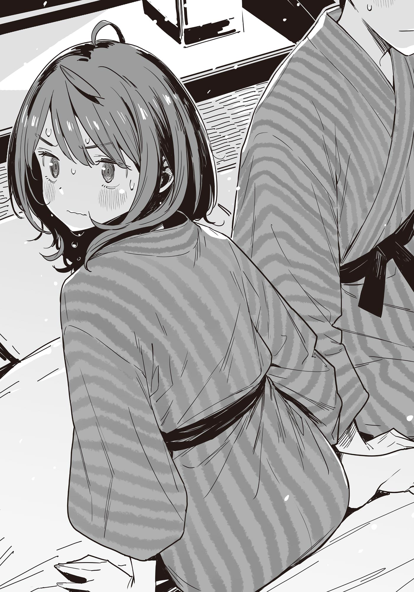

# Ch.167 — เล่ม 9 บทที่ 2-5

Ch.167 — เล่ม 9 บทที่ 2-5

By มนก

Published: 2026-07-29T06:14:29Z

Source: https://www.nekopost.net/novel/14560/167

──เวลา 17.05 น. ในที่สุดก็ได้เวลาเริ่มปฏิบัติการ

พวกเราที่เปลี่ยนเสื้อผ้าเสร็จและมารวมตัวกันที่หน้าอาคาร ก็เริ่มเดินมุ่งหน้าไปยังสถานีขนส่ง

ท้องฟ้ายามค่ำคืนกำลังคืบคลานเข้ามาทางทิศตะวันออกอย่างช้าๆ

ตอนที่เดินมาใกล้ถึงถนน จู่ๆ ยานามิก็หยุดเดิน

[อ๊ะ ฉันลืมของไว้ในห้องน้ำ!]

ตามสัญญาณของยานามิ โคฮารุซังก็เป็นฝ่ายเปิดบทสนทนา

[เป็นอะไรไหม? เดี๋ยวฉันถือของไว้ให้นะ]

[ขอบใจจ้ะ เดี๋ยวรีบกลับมานะ รอแป๊บนึง]

ยานามิส่งกระเป๋าให้โคฮารุซังตามที่ตกลงกันไว้

พอทำท่าจะเดินกลับไปทางเดิม ยานามิก็เหลือบมองผม

...หืม? อะไรนะ โคฮารุซังกับรุ่นพี่โฮโคบารุก็มองมาที่ผมเหมือนกัน

[เอ่อ... ยานามิซัง ผมไปด้วยสิ]

อ้อ จริงด้วย ผมต้องแยกตัวออกมาจังหวะนี้นี่นา

รู้สึกแปลกๆ ที่ต้องทำตัวติดกับยานามิ แต่จะมาทำตัวเอาแต่ใจตอนนี้ก็ไม่ได้

พอเดินพ้นสายตาของทั้งสามคน ยานามิก็หันกลับมาหาผม

[แล้วพวกเราต้องทำยังไงต่อนะ]

[ระหว่างที่รั้งซากุไรคุงไว้ เราจะแอบออกไปทางหลังอาคารนี้ไง]

แล้วก็เดินเลียบถนนไปที่ป้ายรถบัส──ป้ายที่อยู่ถัดจากสถานีขนส่งไปหนึ่งป้าย เพื่อไม่ให้ไปจ๊ะเอ๋กับซากุไรคุง นี่คือแผนรัดกุมขั้นสุด

[หวา ตรงนี้มีต่างระดับด้วย]

[เอ้า ระวังเท้าหน่อยสิ]

เห้ย ขืนส่งเสียงดังเดี๋ยวก็โดนเจอตัวหรอก ผมยื่นมือไปให้ยานามิ

[...นุคุมิซึคุง?]

[นี่ไง ตรงนี้มันมีร่องน้ำอยู่นะ]

[อ-อืม...]

ผมจูงมือยานามิที่จู่ๆ ก็ทำตัวว่าง่ายผิดปกติ เดินลัดเลาะหลังอาคารออกไปที่ถนน

พอมองดูนาฬิกาข้อมือ ตอนนี้ 17.10 น. จากตรงนี้เดินไปถึงป้ายรถบัสเป้าหมายน่าจะใช้เวลาประมาณ 15 นาที

รถบัสออกตอน 17.32 น. ถ้าไม่มีปัญหาอะไรก็ทันถมเถ

ถึงจะลังเลมาตลอด แต่มาถึงขั้นนี้แล้วก็ต้องเตรียมใจลุยลูกเดียว

พอผมเร่งฝีเท้า มือก็ถูกดึงกลับ

[เอ่อ นุคุมิซึคุง... มือ]

มือ? พอมองดู ก็เห็นว่าผมจับมือยานามิแน่นไม่ยอมปล่อยเลยนี่นา

[อ้อ โทษที เมื่อกี้มันเดินลำบากน่ะ]

ผมปล่อยมือยานามิ แล้วรีบเดินจ้ำอ้าว

ขืนมัวชักช้าอยู่แถวนี้แล้วโดนจับได้ แผนก็พังหมดสิ

[เอาล่ะ ยานามิซังรีบๆ เข้าเถอะ อยู่ตรงนี้มันอันตรายนะ]

ยานามิมองผมด้วยสายตาหงุดหงิดแปลกๆ แล้วพูดว่า

[...ตาบ้า]

เอ๊ะ เธอเอาไหล่กระแทกผม แล้ววิ่งเหยาะๆ แซงหน้าไป

...ทำไมผมถึงโดนด่าล่ะเนี่ย ไม่เข้าใจเลยจริงๆ

ผมแอบเอามือที่ชื้นเหงื่อเช็ดกางเกงเบาๆ แล้วรีบเดินตามยานามิไป

◇

17.20 น. ทั้งสามคนที่ถูกทิ้งไว้หน้าบ่อแช่เท้ายังคงรอคอยพวกยานามิกลับมา

ซากุไรเอียงคอพลางจ้องสมาร์ทโฟน

[...แปลกจัง โทรหานุคุมิซึคุงไม่ติดเลย]

[ยานามิซังก็โทรไม่ติดเหมือนกัน สงสัยอยู่บนเขาคลื่นเลยอ่อนล่ะมั้ง]

โคฮารุเอาสมาร์ทโฟนออกจากหูแล้วส่ายหน้า

โฮโคบารุหรี่ตาสู้แสงอาทิตย์ยามเย็น พลางจ้องมองไปทางถนน

[หรือว่าพวกเขาจะเข้าใจผิดคิดว่าพวกเราไปที่สถานีขนส่งแล้ว ก็เลยล่วงหน้าไปก่อนกันนะ]

[แต่ถ้าผ่านตรงนี้ไปก็ต้องมีใครสักคนสังเกตเห็นสิ?]

คำถามของซากุไรสมเหตุสมผล โฮโคบารุจึงชี้ไปที่อาคารหลังคาฟาง

[หลังพิพิธภัณฑ์พื้นบ้านนั่นมีทางทะลุไปถนนได้นะ อาจจะอยากรีบตามพวกเราให้ทันก็เลยใช้ทางลัดหรือเปล่า]

ซากุไรยังทำหน้าไม่ค่อยเชื่อ โฮโคบารุจึงยักไหล่เบาๆ

[งั้นเดี๋ยวฉันไปดูที่สถานีขนส่งให้เอง ทั้งสองคนรออยู่ที่นี่นะ]

พูดจบโฮโคบารุก็ปลีกตัวออกไป ซากุไรจ้องมองแผ่นหลังนั้นนิ่ง

[...ฮิโระคุง เป็นอะไรไป?]

[เปล่า ไม่มีอะไร พวกเราก็ไปช่วยตามหาด้วยเถอะ]

[ฮิโระคุงต้องรออยู่ที่นี่สิ รอฮิบาริติดต่อมาไง?]

โคฮารุคว้ามือของซากุไรที่กำลังจะก้าวเดิน

ซากุไรชะงักด้วยท่าทีดึงดันของแฟนสาว แต่ก็ยอมทำตามอย่างว่าง่าย

ระหว่างที่เขากวาดตามองรอบๆ ด้วยความกระวนกระวาย สมาร์ทโฟนก็ดังขึ้น เป็นสายจากโฮโคบารุนั่นเอง

[ฮัลโหล ทั้งสองคนอยู่ที่นั่นไหม?]

[ไม่อยู่ ทางนี้ก็ไม่เจอเหมือนกัน ยังไม่กลับมาอีกเหรอ?]

พอได้ยินคำตอบของโฮโคบารุ ซากุไรก็เหลือบมองนาฬิกาข้อมือทันที

──17.25 น. เหลืออีกแค่ 5 นาทีรถบัสก็จะออกแล้ว

จากตรงนี้ไปสถานีขนส่ง ต่อให้รีบวิ่งก็ต้องใช้เวลาตั้ง 3 นาที จะรอช้ากว่านี้ไม่ได้แล้ว

[โคฮารุ พวกเราก็ไปที่สถานีขนส่งกันเถอะ──]

[ที่โรงอาบน้ำอาจจะเกิดเรื่องอะไรขึ้นก็ได้ เดี๋ยวฉันไปดูให้เอง ฮิโระคุงรออยู่นี่นะ]

โคฮารุพูดแทรกขึ้นมา แล้วทำท่าจะหันหลังกลับ

[──เดี๋ยวก่อน]

น้ำเสียงเฉียบขาดนั้น ทำให้โคฮารุหยุดชะงัก

[มีอะไรเหรอ? ถ้าไม่รีบเดี๋ยวจะหมดเวลา]

[มีอะไรปิดบังฉันอยู่หรือเปล่า?]

นี่ไม่ใช่คำถาม──แต่เป็นการยืนยัน ซากุไรมองสีหน้าของโคฮารุ แล้วคว้ามือเธอไว้

[รีบไปเถอะ ไม่มีเวลาแล้วไม่ใช่เหรอ]

[เดี๋ยว รอเดี๋ยวก่อน...]

ซากุไรออกแรงดึงโคฮารุให้เดินไปทางสถานีขนส่งอย่างเอาแต่ใจ ซึ่งขัดกับสีหน้าของเขา

[ฮิโระคุง ต้องรอสองคนนั้นก่อนนะ──]

[ตั้งแต่เมื่อกี้ ทุกคนเคลื่อนไหวกันเป๊ะๆ ทีละ 5 นาทีเลยนะ?]

ซากุไรพิมพ์ข้อความหานุคุมิซึด้วยมือข้างเดียว พลางก้าวเดินต่อไป

[ปกติแล้วน่าจะไปดูที่โรงอาบน้ำก่อนเป็นอันดับแรกสิ แต่กลับปล่อยเวลาล่วงเลยมาจนถึงนาทีสุดท้ายถึงเพิ่งจะไปดู]

[นั่นมัน──]

คำพูดที่กำลังจะหลุดจากปากถูกกลืนหายไป

โคฮารุรับรู้ได้ว่านี่คือขีดจำกัดแล้ว เธอถูกจูงมือไปพลางกัดริมฝีปากแน่น

[...ขอโทษนะ]

[เรื่องนั้นเอาไว้ทีหลังเถอะ นุคุมิซึคุงกับยานามิซัง คงไปรอที่สถานีขนส่งแล้วใช่ไหม?]

[สองคนนั้นไปรอที่ป้ายรถบัสถัดไปน่ะ]

[...อ้อ อย่างนี้นี่เอง รอบคอบดีนะ]

ซากุไรขมวดคิ้วกับคำพูดประชดประชันของตัวเอง

...ไม่ควรพูดอะไรไปมากกว่านี้ คำพูดบางครั้งก็ทำร้ายจิตใจคนฟังได้

ซากุไรเตือนตัวเองพลางก้าวเดินต่อไป

ไม่นานก็มองเห็นอาคารสถานีขนส่งขนาดใหญ่

พออ้อมมาทางด้านหน้าที่ป้ายรถบัสตั้งอยู่ ก็เห็นรถบัสที่จะมุ่งหน้าไปทาคายามะจอดรออยู่แล้ว

โฮโคบารุที่ยืนอยู่หน้ารถบัส พอเห็นทั้งสองคนเดินมา ก็เปิดปากพูดราวกับรออยู่แล้ว

[ติดต่อสองคนนั้นไม่ได้เลย กระเป๋าของยานามิคุง โคฮารุถือไว้อยู่ใช่ไหม?]

โฮโคบารุยังคงพยายามจะสานต่อแผนการ โคฮารุส่ายหน้าอย่างหมดแรง

[...ขอโทษนะ ฮิบาริ]

โฮโคบารุคงจะเข้าใจทุกอย่างแล้ว เธอถอนหายใจพลางเอามือกุมขมับ

[...ขอโทษที ฉันจะไม่แก้ตัวอะไรทั้งนั้น]

[พี่ฮิบะก็ค่อยคุยกันทีหลังเถอะ เอาล่ะ ขึ้นรถกันเถอะ]

เมื่อผู้โดยสารลงจากรถจนหมด ซากุไรก็บอกให้ทั้งสองคนขึ้นรถ

โคฮารุที่ก้าวขึ้นบันไดรถบัสตามหลังโฮโคบารุ หันกลับมามองด้วยใบหน้าเหมือนจะร้องไห้

[เอ่อ ฮิโระคุง]

[อืม ไม่ได้โกรธหรอกนะ ฉันเองก็ผิดที่ไม่ได้คุยกับเธอให้รู้เรื่อง ขอโทษนะ]

ซากุไรฝืนยิ้ม แล้วก้าวขึ้นรถบัส

โฮโคบารุกับโคฮารุนั่งคู่กัน ส่วนซากุไรนั่งเบาะฝั่งตรงข้ามโดยมีทางเดินคั่น

เมื่อทั้งสามคนนั่งประจำที่ ไม่นานรถบัสก็เคลื่อนตัวออก

ซากุไรรู้สึกได้ถึงสายตาที่จ้องมองมา เขามองออกไปนอกหน้าต่าง ดูอาคารสถานีขนส่งเลื่อนผ่านไปโดยไม่ได้โฟกัสอะไร

...พูดตามตรง ในหัวตอนนี้สับสนไปหมด ไม่รู้เลยว่าเกิดอะไรขึ้นบ้าง

ทุกคนคงเตี๊ยมกันไว้ และกะจะทิ้งให้เขากับโคฮารุอยู่ด้วยกันแค่สองคนแน่ๆ

โคฮารุจะทำอะไรกับเขามันก็ไม่เป็นไรหรอก เธอมีสิทธิ์นั้น

แต่การดึงพวกนุคุมิซึเข้ามาเกี่ยวด้วยมันไม่ถูก การให้คนนอกสองคนมาร่วมรับผิดชอบในแผนการแบบนี้มัน──

เมื่อคิดมาถึงตรงนี้ ซากุไรก็ส่ายหน้า

อย่าเอาความรู้สึกที่คล้ายกับความโกรธของตัวเอง ไปลงที่คนอื่นเลย

ความรู้สึกนี้เป็นของเขาคนเดียว และบางทีมันอาจจะเป็นความโกรธที่เขามีต่อตัวเองด้วยซ้ำ

『สถานีต่อไป หน้าจุดตั้งแคมป์โอทาคิกุจิ ผู้โดยสารที่จะลงสถานีนี้ โปรดกดกริ่ง──』

เสียงประกาศดังขึ้นในรถบัส นี่คือป้ายที่พวกนุคุมิซึจะขึ้นมา

พอเห็นหน้าเขา สองคนนั้นจะทำหน้ายังไงนะ

ขณะที่ซากุไรกำลังมองดูความเขียวขจีสองข้างทาง ด้วยความรู้สึกผิดผสมกับความรู้สึกอยากแกล้งนิดๆ

──รถบัสก็ขับผ่านป้ายนั้นไปโดยไม่ได้จอด

◇

17.22 น.

ผมละสายตาจากตัวเลขดิจิตอลบนนาฬิกาข้อมือ แล้วมองดูต้นไม้ที่ขึ้นหนาทึบตามทางเดิน

เวลาที่รถบัสจะมาถึงป้ายคือ... น่าจะ 17.32 น. สินะ

ถ้าเดินด้วยความเร็วปกติ อีกแค่ 5 นาทีก็คงถึงป้ายรถบัสแล้ว แต่ยานามิกลับเดินช้าลงเรื่อยๆ

[เจ็บเข่าอีกแล้วเหรอ?]

[เปล่า แค่หิวข้าวนิดหน่อยน่ะ]

พอหิวข้าวแล้วความเร็วในการเดินจะลดลงสินะ นึกว่าตัวละครสายตะกละในเกมซะอีก

ยานามิถอนหายใจ แล้วยื่นมือมาตรงหน้าผม

[นุคุมิซึคุง ขอกระเป๋าฉันหน่อยสิ ข้างในมีลูกอมอยู่น่ะ]

[ครับๆ]

ผมเปิดเป้ที่สะพายอยู่

นอกจากกระเป๋าปลอมที่ฝากโคฮารุซังไว้แล้ว ผมยังเก็บกระเป๋าถือของยานามิเอาไว้อีกใบด้วย

พอยานามิเปิดกระเป๋าถือก็พึมพำออกมาเบาๆ

[...นี่มันกระเป๋าปลอมนี่]

[หา?]

ตามแผนคือเราจะฝากกระเป๋าปลอมไว้กับโคฮารุซัง แล้วหนีกลับกันเอง

ยานามิหน้าซีดเผือด รีบรื้อค้นกระเป๋าใหญ่

[เอ๊ะ ทำไงดี ดันเอาผ้าขนหนูไปใส่กระเป๋าจริง มันก็เลยสลับกันไปหมดอะ]

[เอ่อ เรื่องกระเป๋าไว้ค่อยทวงคืนสัปดาห์หน้าก็ได้นี่]

[ในนั้นมันมีทั้งกระเป๋าตังค์ สมาร์ทโฟน แล้วก็ตั๋วรถไฟขากลับเลยนะ?!]

สรุปก็คือ ยานามิไม่มีทั้งเงินทั้งตั๋วเลยสินะ... อย่างนี้นี่เอง...

[ถ้างั้น ยานามิซังคงต้องค้างคืนแถวนี้แล้วล่ะ]

[ไม่ค้างย่ะ?! นุคุมิซึคุง จะทิ้งฉันไว้ที่นี่เหรอ?!]

เห็นแก่ส่วนรวมต้องยอมเสียสละส่วนน้อย คำนี้ผุดขึ้นมาในหัวผมเลย

ระหว่างที่ผมกำลังคิดหาทางออก ยานามิกหันขวับแล้วเดินย้อนกลับไปทางเดิม

[ยานามิซัง จะไปไหนน่ะ?]

[ก็จะกลับไปเอากระเป๋าที่ฝากโคฮารุจังไว้น่ะสิ?]

[เดี๋ยวสิ ขืนทำแบบนั้นแผนก็แตกสิ]

[แผนการกับความเป็นความตายของฉัน อันไหนมันสำคัญกว่ากันล่ะ?!]

ถ้าให้พูดจริงๆ ก็คงเป็นแผนการมั้ง... ก็หน้าร้อนแล้ว ยานามิซังน่าจะรอดชีวิตสักคืนแหละ

ผมเดินตามยานามิที่กำลังหัวฟัดหัวเหวี่ยงไป แต่เธอเดินช้าเป็นบ้า

[เดินช้าขนาดนี้กลับไปไม่ทันหรอก เจ็บเข่าจริงๆ ใช่ไหมเนี่ย]

[ไม่ได้เจ็บสักหน่อย แช่ออนเซ็นแล้วหายดีแล้วย่ะ]

...แย่แล้วสิ ระเบิดเวลาที่เข่าดันมาปะทุบนทางเดินเขาของฮิดะซะได้

[เอ้า อีกนิดเดียวเอง พยายามเข้า]

[...นี่นะ ให้ฉันพูดตรงๆ แผนนี้มันพังตั้งแต่แรกแล้วย่ะ]

จู่ๆ ยานามิก็พาลใส่ผมเฉยเลย

[แบบว่า ตัวเลขมันยังไงๆ อยู่? เหมือนยังคำนวณไม่เป๊ะ ไม่มีแผนสำรองเวลามีปัญหา หรือที่เรียกว่าความซ้ำซ้อนอะไรทำนองนั้นแหละ ไม่ได้เอามาคิดเผื่อไว้เลยใช่ไหมล่ะ]

[ซ้ำซ้อนอะไรนะ?]

เจอคำถามของผมเข้าไป ยานามิกทำหน้าเครียดมองฟ้า

[โมจิเนี่ยถึงจะแข็ง แต่พอเอาไปย่างมันก็ยืดได้ใช่ไหม? น่าจะเกี่ยวกับอะไรประมาณนั้นแหละมั้ง]

น่าจะไม่เกี่ยวกันเลยสักนิด

แผนก็แตกแล้ว ยานามิก็ทั้งหิวทั้งเจ็บเข่า หรือผมจะทิ้งยัยนี่ไว้ตรงนี้ดีนะ...?

ระหว่างที่กำลังลังเล ผมเหลือบมองนาฬิกาข้อมือ──เวลา 17.26 น.

[รถบัสมากี่โมงนะ]

[ตั้งสติหน่อยสิ 32 นาทีไง จากการกะระยะของฉัน น่าจะทันแบบฉิวเฉียดนะ]

มาถึงขั้นนี้แล้ว คงต้องยกเลิกแผนลูกเดียว

กระเป๋าก็ฝากไว้แล้ว ก่อนอื่นต้องรีบไปรวมตัวกับซากุไรคุงให้ได้ก่อน...

พอหยิบสมาร์ทโฟนขึ้นมา ก็เห็นประวัติสายไม่ได้รับกับข้อความจากซากุไรคุงเต็มหน้าจอไปหมด

จากข้อความล่าสุด ดูเหมือนทั้งสองคนจะกำลังมุ่งหน้าไปสถานีขนส่ง

[...เอ๊ะ ไม่เหมือนที่ตกลงกันไว้นี่นา]

[เป็นอะไรไปน่ะ?]

ยานามิปาดเหงื่อบนหน้าผากพลางถามขึ้น

[อ้อ ซากุไรคุงบอกว่ารออยู่ที่สถานีขนส่งน่ะ เราไปขอโทษ แล้วเอากระเป๋าคืนกันเถอะ]

[อืม... กระดูกอ่อนปลาฉลามช่วยเรื่องข้อต่อได้จริงเหรอ...?]

เข่าของยานามิใกล้จะถึงขีดจำกัดแล้ว

ผมคอยให้กำลังใจเธอพลางเดินไปเรื่อยๆ จนในที่สุดก็มองเห็นอาคารสถานีขนส่ง

รถบัสที่จอดอยู่ตรงนั้น คือคันที่เราต้องขึ้นหรือเปล่านะ

ตัวเลขดิจิตอลบนนาฬิกาบอกเวลา 17.30 น. เหลืออีกแค่ 2 นาทีรถบัสก็จะออกเหรอ ฉิวเฉียดสุดๆ ไปเลยแฮะ...

ถึงแผนจะล้มเหลว แต่ระหว่างนั่งรถไฟกลับทาคายามะ เราค่อยมาคิดแผนสำรอง──

ขณะที่กำลังคิดแผนใหม่พลางเดินเข้าไปในลานจอดรถของสถานีขนส่ง รถบัสที่จอดอยู่หน้าอาคารก็เริ่มเคลื่อนตัว

อ้าว รถบัสที่จอดอยู่ไม่ใช่คันที่เราต้องขึ้นหรอกเหรอ

ผมเหลือบมองป้ายไฟบอกปลายทางของรถบัสที่เพิ่งวิ่งผ่านพวกเราไป

[...ยานามิซัง รถบัสที่เราต้องขึ้นมันไปไหนนะ]

[ไปศูนย์รถบัสทาคายามะไง? ตรงหน้าสถานีนั่นแหละ]

ยานามิเอามือพัดหน้าตัวเองพลางมองไปรอบๆ

[...อ้าว? แล้วรถบัสล่ะ?]

[สงสัย──คงเป็นคันเมื่อกี้แหละมั้ง]

[เอ๊ะ?!]

ยานามิยื่นนาฬิกาข้อมือมาจ่อตรงหน้าผม

[ยังไม่ถึงเวลาเลยนะ?! น่าจะมีคันอื่นอีกสิ?]

[นั่นสิ เอ่อ ลองไปดูตารางเดินรถก่อนละกัน]

พวกเราลากสังขารไปที่ป้ายรถบัส แล้วชะโงกหน้าดูตารางเดินรถ

เวลารถบัสเที่ยวสุดท้ายออกคือ──17.30 น.

ส่วนนาฬิกาข้อมือของผมบอกเวลา 17.31 น.

[...ยานามิซัง ที่บอกว่า 32 นาทีเนี่ย มันเวลาของป้ายถัดไปหรือเปล่า?]

[...อาจจะใช่]

ช่องว่างใต้ตัวเลข 『30』 บนตารางเดินรถ กำลังตอกย้ำความเป็นจริงอันโหดร้าย

...เอ่อ ก่อนอื่นเรามาทบทวนสถานการณ์ปัจจุบันกันก่อนดีกว่า

① ซากุไรคุงกับโคฮารุซังส่งข้อความมาบอกว่ากำลังมุ่งหน้าไปที่สถานีขนส่ง

② ยานามิเอากระเป๋าตังค์กับสมาร์ทโฟนใส่ไว้ในกระเป๋าปลอมที่ฝากโคฮารุซังไป

③ ผมกับยานามิตกรถบัสเที่ยวสุดท้าย

พอมองไปรอบๆ ก็ไม่เห็นคนรู้จักเลยสักคน

ร้านค้าก็ปิดไฟเงียบสนิท นั่นแปลว่า──

④ มีแค่ผมกับยานามิที่ถูกทิ้งไว้ในหมู่บ้านออนเซ็นอันห่างไกลในฮิดะ

...ก็ประมาณนั้นแหละ

ผมหันไปมองใบหน้าด้านข้างของยานามิที่กำลังจ้องตารางเดินรถเขม็ง

สงสัยจะเพิ่งเข้าใจสถานการณ์ ยานามิหันขวับมามองผมช้าๆ... กึกกึกกึก...

[...นุคุมิซึคุง]

[ค-ครับ!]

ไม่รู้ทำไมผมถึงต้องตอบรับอย่างสุภาพ ยานามิยื่นมือมาหาผมอย่างเกรงใจ

[ขอยืมเงินซื้อน้ำผลไม้หน่อยสิ]

◇

เดินจากสถานีขนส่งมาประมาณ 5 นาที คู่หนุ่มสาวคู่หนึ่งกำลังเดินไปตามระเบียงทางเดินของเรียวกังออนเซ็นแห่งหนึ่ง

[ข้าว... อร่อยดีนะ]

[อ-อืม รสชาติโดยรวม... ถือว่าเยี่ยมไปเลยล่ะ]

ทั้งสองคนคุยกันอย่างเก้ๆ กังๆ พลางก้าวขึ้นบันไดโดยมีชายชุดยูคาตะพลิ้วไหว──

สองคนนั้นจะเป็นใครไปไม่ได้ นอกจากผม นุคุมิซึ คาสึฮิโกะ และยานามิ อันนะ นั่นเอง

ต่อให้เป็นผมก็เถอะ ถ้าไม่มองสถานการณ์จากมุมมองบุคคลที่สามล่ะก็ คงไม่เข้าใจสถานการณ์นี้เหมือนกัน

[ยานามิซัง เติมข้าวไปแค่รอบเดียว อิ่มเหรอ?]

[อื้อ กินแค่พออิ่มแปดส่วนกำลังดีน่ะ]

อนึ่ง ในเรียวกังออนเซ็น ข้าวจะเสิร์ฟมาในโถไม้ การที่บอกว่า 'เติมข้าว' ก็คือการขอข้าวเพิ่มทั้งโถนั่นแหละ

ส่วนเหตุผลที่ผมกับยานามิได้มาแช่ออนเซ็นแหล่งแรก ใส่ชุดยูคาตะ แล้วก็ได้กินเนื้อฮิดะสุดหรูน่ะเหรอ

พูดง่ายๆ ก็คือ โคฮารุซังเลี้ยงนั่นเอง หลังจากนั้นผมก็ติดต่อซากุไรคุงไป สรุปก็คือผมกับยานามิได้มาพักที่เรียวกังที่โคฮารุซังจองเอาไว้แทน

และแน่นอนว่า โคฮารุซังจองห้องไว้แค่ห้องเดียว แล้วก็──

[นุคุมิซึคุง กุญแจห้องล่ะ?]

[เอ่อ รอเดี๋ยวนะ]

ผมล้วงกุญแจออกมาจากแขนเสื้อยูคาตะแล้วไขเปิดประตู สิ่งที่อยู่กลางห้องก็คือ──ฟูกสองที่ปูเรียงกัน

ขณะที่ผมกำลังยืนอึ้งกับฟูกที่ปูเรียงกัน ยานามิกหลบตาแล้วเดินเข้าไปในห้อง

[ฉ-ฉัน ขอไปแปรงฟันก่อนนะ]

ผมปล่อยยานามิที่เดินไปที่อ่างล้างหน้าอย่างเก้ๆ กังๆ ไว้ แล้วจ้องมองฟูกที่ปูเรียงกันเขม็ง

ปูใกล้กันเกินไปแล้ว ผ้าห่มมันซ้อนทับกันอยู่เลยนะเนี่ย

แต่ถ้าจู่ๆ ไปเลื่อนฟูกออกห่างกันมันก็จะดูเหมือนจงใจเกินไป แล้วปกติต้องเว้นระยะห่างแค่ไหนล่ะ? หรือควรจะปูใหม่ให้มันอยู่ตรงข้ามกันคนละมุมห้องเลยดี...

แกรกๆๆ. เสียงยานามิแปรงฟันดังก้องอยู่ในหูผมที่กำลังคิดหนัก

...เอาเถอะ เรื่องฟูกไว้ทีหลังละกัน ผมนั่งลงบนเก้าอี้พนักพิงเตี้ย แล้วเปิดทีวี

ตอนนี้เพิ่งจะสองทุ่มกว่าๆ ยังเร็วเกินไปที่จะนอน

รายการที่กำลังฉายอยู่คือ 『เปิดอกวัยรุ่นเสวนา』 ทีมงานกำลังสัมภาษณ์ผู้หญิงวัยรุ่นคนหนึ่งตามท้องถนน

『คบกับแฟนปัจจุบันมากี่เดือน ถึงยอมทำเรื่องแบบนั้นคะ?』

『เอー ลบ 2 เดือนมั้ง? แบบว่าตกรถไฟเที่ยวสุดท้ายー ก็เลยเลยตามเลย』

เสียงหัวเราะจากในห้องส่งดังลอดออกมา ผมรีบกดปิดทีวีทันที

...เห้อ ทำไมต้องมาฉายรายการแบบนี้ในเวลาแบบนี้ด้วย ทีวีนี่มันส่งผลเสียต่อการศึกษาจริงๆ

[อ้าว ทำไมไม่ดูทีวีล่ะ?]

[อ้อー เหมือนสัญญาณจะไม่ค่อยดีน่ะ]

ผมตอบส่งๆ ไป แล้วหยิบสมาร์ทโฟนขึ้นมาดูแก้เก้อ

ข้อความจากคาจูส่งมาแบบรัวๆ ไม่สิ ตอนนี้ก็ยังส่งมาไม่หยุด น่ากลัวชะมัด

อนึ่ง ผมให้ซากุไรคุงโทรไปบอกที่บ้านผม ส่วนรุ่นพี่โฮโคบารุก็โทรไปบอกบ้านยานามิซัง ว่าเราค้างคืนบ้านเพื่อนผู้หญิงด้วยกัน เพราะงั้นเรื่องผู้ปกครองก็หายห่วง แต่เรื่องน้องสาวอันนี้ไม่รับประกัน

ระหว่างที่ไล่กดอ่านข้อความมหาศาลจากคาจู การแจ้งเตือนก็เด้งขึ้นมาจากขอบจอบน

──จากโคฮารุซัง

[ยานามิซัง ข้อความจากโคฮารุซังน่ะ]

[อ๊ะ ค่าー]

ผมส่งสมาร์ทโฟนให้ยานามิที่ยื่นมือข้ามโต๊ะเตี้ยมารับ

โคฮารุซังที่ถือสมาร์ทโฟนของยานามิอยู่ คอยส่งต่อข้อความที่ส่งหาบ้านยานามิมาให้ทางเครื่องผม

[เหวอ พ่อนี่น่ารำคาญชะมัด...]

ผมปล่อยยานามิที่บ่นอุบอิบไว้ แล้วไปแปรงฟันบ้าง

พอน้ำตาลในเลือดเริ่มสูงขึ้น ยานามิก็น่าจะสงบลงแล้ว ตอนนี้กำลังฮัมเพลงพลางไถสมาร์ทโฟนอยู่

ผมโล่งใจขึ้นนิดหน่อย พอไปยืนหน้าอ่างล้างหน้า ก็เห็นแปรงสีฟันที่ใช้แล้วเสียบอยู่ในแก้ว

...

…………ก็แค่แปรงสีฟันแหละน่า อืม ในร้านสะดวกซื้อก็มีขาย

ผมพยายามทำสมาธิให้ว่างเปล่าตอนแปรงฟัน ว่างเปล่าเข้าไว้ ตัวผม

อ๊ะ ยานามิเปิดทีวีแล้ว...ปิดไปละ

ระหว่างที่ต่อสู้กับความว่างเปล่า ฟันผมก็สะอาดเอี่ยม ผมบ้วนปากแล้ววางแปรงสีฟันลงในแก้ว

พอไปวางข้างๆ แก้วของยานามิแล้วรู้สึกแปลกๆ แฮะ...

ผมสูดหายใจเข้าลึกๆ แล้วเดินกลับเข้าไปในห้อง ยานามิยังคงจิ้มสมาร์ทโฟนของผมอยู่

[นุคุมิซึคุง หินอัญเชิญนี่จะหาเพิ่มได้ยังไงเหรอ?]

ยัยนี่ แอบเล่นเกมผมเฉยเลย

ผมถอนหายใจพลางชะโงกหน้าดูจอ

[คงต้องค่อยๆ เก็บสะสมจากพวกอีเวนต์ครบรอบอะไรพวกนี้น่ะ ไม่ก็ต้องเติมเงินเอา]

[โหー... ต้องเสียเงินด้วยเหรอเนี่ย]

ยานามิแอบซ่อนหน้าจอสมาร์ทโฟน ท่าทีแบบนี้ หรือว่า──

[หรือว่า เอาหินอัญเชิญไปหมุนกาชาแล้วเหรอ?!]

[ก็มันมีเรตอัปกับตู้รีรันขึ้นวิบวับๆ อยู่ไงเล่า!]

ผมรีบคว้าสมาร์ทโฟนคืนมาจากยานามิที่พยายามซ่อน

หินอัญเชิญเหลือ──0 เอาจริงดิ อุตส่าห์อดทนเก็บแทบตาย

ยานามิพูดปลอบผมที่คอตกอย่างอ่อนโยน

[แต่ดูสิ ได้ตัวที่มีดาวเยอะๆ มาด้วยนะ...]

[เอ๊ะ ออก ★5 ด้วยเหรอ?]

ผมรีบเปิดดูหน้าตัวละครที่ครอบครอง ก็เห็นตัวอักษร 『NEW』 สีแดงเด้งขึ้นมา

[โห วิสคอนติ ร่างลิมิเต็ดอีเวนต์นี่นา! เอ๊ะ กดได้จริงๆ เหรอเนี่ย?]

สุดยอดไปเลยยานามิ ผู้หญิงคนนี้ดวงดีทุกเรื่องยกเว้นเรื่องความรัก

[ตัวนี้มันหายากขนาดนั้นเลยเหรอ?]

[อืม นึกว่าจะไม่มีโอกาสได้แล้วซะอีก อ๊ะ ได้ตัวที่ผมไม่มีมาด้วยแหละ]

ไม่ยักรู้ว่ายานามิมีความสามารถพิเศษ(?) เดี๋ยวก่อนนะ ถ้าเป็นแบบนี้ล่ะก็──

[นี่ นุคุมิซึคุง]

[จริงสิ ลองเอาไปหมุนกาชาเกมอื่น──]

ด้วยความตื่นเต้น ผมละสายตาจากหน้าจอสมาร์ทโฟนเงยหน้าขึ้นมา ก็พบกับดวงตากลมโตของยานามิที่จ้องมองอยู่ในระยะประชิด

ยานามิส่งยิ้มแหยๆ ให้ผมที่แข็งทื่อเป็นหิน

[มะ-เหมือนจะ... ใกล้ไปหน่อยนะ]

[ทะ-โทษที!]

ผมรีบถอยออกห่าง แล้วนั่งพับเพียบสำนึกผิด

ยานามิเองก็คงรู้สึกอึดอัดเหมือนกัน เธอจัดคอเสื้อยูคาตะพลางทำท่าทีเขินอายแล้วหันหน้าหนีไปทางอื่น

แย่แล้วสิ บรรยากาศเริ่มแปลกๆ ซะแล้ว ต้องรีบหาเรื่องคุยเปลี่ยนบรรยากาศด่วน

ผมเอื้อมมือไปหยิบรีโมตทีวีแบบกึ่งไร้สติ

『เคยถูกเพื่อนผู้ชายเข้ามาจีบตอนอยู่ด้วยกันสองต่อสองไหม? ตอบ Yes 42%──』

ติ๊ด. ผมรีบกดปิดทีวีอีกครั้ง

...บรรยากาศแปลกไปกว่าเดิมอีก ทำไงดีเนี่ย

เพิ่งจะสองทุ่มครึ่งเอง แต่นอนเลยดีไหม อืม เอาแบบนั้นแหละ

ผมกระแอมไอเบาๆ แล้วพูดด้วยน้ำเสียงจริงจัง

[ยานามิซัง]

[ค-ค่ะ!]

ยานามิยืดหลังตรงแหน่ว

[วันนี้เหนื่อยมาทั้งวันแล้ว รีบนอนกันเถอะ]

[น-นั่นสินะ! พรุ่งนี้ต้องตื่นมากินข้าวเช้าอีก!]

พวกเรารีบลุกขึ้นเตรียมตัวเข้านอน

แต่เอาเข้าจริงก็ไม่มีสัมภาระอะไร เลยทำแค่ซุกตัวเข้าใต้ผ้าห่ม

ระหว่างที่ผมหันหน้าเข้ากำแพงจัดชุดยูคาตะให้เข้าที่ ก็ได้ยินเสียงยานามิจัดชุดยูคาตะอยู่ข้างหลัง

การที่คนสองคนมาแก้สายโอบิชุดยูคาตะด้วยกันแบบนี้มันรู้สึกแปลกๆ แฮะ...

ไม่สิ การที่ผมกับยานามิอยู่ด้วยกันสองต่อสองหลังเลิกเรียนก็ไม่ใช่เรื่องแปลกอะไรนี่นา เคยติดกระดุมเสื้อให้ ยืมเสื้อวอร์มก็เคยมาแล้ว

แค่คราวนี้เปลี่ยนสถานที่มาเป็นห้องพักในเรียวกังออนเซ็น แล้วก็ต้องอยู่ด้วยกันจนถึงเช้าก็แค่นั้นเอง

แน่นอนว่ามันจะไม่มีเรื่องผิดพลาดอะไรเกิดขึ้น ไม่มีทางเด็ดขาด

ในเมื่อทั้งสองฝ่ายไม่มีใจให้กัน เรื่องผิดพลาดทางกายภาพก็ย่อมไม่มีทางเกิดขึ้นอยู่แล้ว

[นุคุมิซึคุง ฉันเรียบร้อยแล้วล่ะ...]

ยานามิไม่รู้ทำไมถึงไปนั่งพับเพียบอยู่บนฟูก

ผมพยักหน้าเงียบๆ แล้วนั่งพับเพียบบนฟูกตาม

...ไม่สิ เลิกหลอกตัวเองได้แล้ว

ชายหญิงม.ปลายปี2 สองคนอยู่ด้วยกันตามลำพังในห้องพักเรียวกังออนเซ็น ไม่มีครอบครัวหรือคนรู้จักอยู่รอบๆ

สถานการณ์แบบนี้ มันต่างจากการให้ก้อนน้ำตาลยานามิในห้องชมรมลิบลับเลยนะ──

ผมเตรียมใจ──แล้วเอื้อมมือออกไป

จากนั้นก็คว้าหมอนมากอดไว้แนบอก แล้วลุกขึ้นยืน

[งั้น เดี๋ยวฉันออกไปแล้วอย่าลืมล็อกประตูให้ดีล่ะ สมาร์ทโฟนฉันทิ้งไว้ให้นะ]

[เอ๊ะ จะไปไหนน่ะ?]

ยานามิมองผมด้วยความตกใจ

[กะว่าจะไปนอนบนโซฟาตรงล็อบบี้น่ะ มีอะไรก็ไปเรียกได้นะ]

[เดี๋ยวสิ ขืนทำแบบนั้นก็เป็นเรื่องสิ?!]

เอ๊ะ ทำไมต้องโกรธขนาดนั้นด้วย

[จะให้นอนห้องเดียวกับผู้ชายที่ไม่รู้หัวนอนปลายเท้าได้ยังไงล่ะ?]

[นายน่ะเป็นคนของบ้านนุคุมิซึไม่ใช่เรอะ...]

ยานามิถอนหายใจอย่างเอือมระอาเต็มทน

[เอาน่า รีบนอนได้แล้ว มีห้องเดียวนี่นาช่วยไม่ได้หรอก]

[ก็ใช่อยู่หรอก แต่ว่า...]

ขณะที่ผมกำลังลังเล ยานามิกใช้มือตบฟูกของผมดังป้าบๆ

[อีกอย่าง โคฮารุจังอุตส่าห์เลี้ยงทั้งที ไม่นอนก็เสียดายแย่]

[น-นั่นสินะ เดิมทีซากุไรคุงกับโคฮารุซังก็กะจะมาสร้างสถานการณ์มัดมือชกที่นี่──]

พอผมเผลอหลุดปากออกไป ความเงียบงันที่ลึกยิ่งกว่าภูเขาในฮิดะก็ปกคลุมทั่วห้อง

[............งั้น เรามานอนกันเถอะ]

เอาล่ะ ทำเป็นลืมๆ เรื่องเมื่อกี้ไปแล้วลุยต่อดีกว่า เรื่องหน้าหนาน่ะผมถนัด

ตอนที่ผมกำลังจะเอื้อมมือไปดึงเชือกหลอดไฟ ยานามิกะร้อง [อ๊ะ] ขึ้นมา

[เปิดไฟดวงเล็กๆ ทิ้งไว้ด้วยนะ]

...ไฟดวงเล็ก?

[อ้อ ไฟนอนสินะ เอาแค่นี้โอเคไหม?]

[อื้อ]

แสงสีส้มดวงเล็กๆ ส่องสว่างสลัวๆ ท่ามกลางความมืดในห้อง

ผมเอนตัวลงนอน ดึงผ้าห่มผืนบางขึ้นมาคลุมหน้าอก เอาล่ะ ต้องตื่นเช้าด้วย ต้องรีบนอนแล้วล่ะ...

แสงสีส้มดวงเล็กๆ ส่องผ่านเปลือกตาที่ปิดลงครึ่งหนึ่ง

[ยานามิซัง เรียกไอ้นี่ว่าไฟดวงเล็กๆ สินะ]

[...ก็ที่บ้านฉันเรียกแบบนี้นี่นา]

งั้นเหรอ ถ้าเรียกแบบนั้นก็ช่วยไม่ได้

[ไม่ได้จะล้อเลียนสักหน่อย ผมแค่คิดว่ายานามิซังคงไม่ชอบให้นอนมืดสนิทล่ะมั้ง]

ผมพูดไปเรื่อยเปื่อย ก่อนจะหลับตาลง

เสียงน้ำไหลผ่านท่อดังก้องมาจากที่ไกลๆ

เสียงหัวเราะจากห้องอื่นแว่วมาให้ได้ยินเบาๆ

เสียงฝีเท้าของใครบางคนที่ไม่รู้จัก ค่อยๆ ใกล้เข้ามาแล้วห่างออกไป──

ในขณะที่สติกำลังเลือนลางเข้าสู่ห้วงนิทรา ยานามิกพึมพำออกมาเบาๆ

[...บางทีฉันก็ฝันร้ายน่ะ]

คำพูดที่ไม่ได้คาดคิด ทำให้ผมต้องลืมตาขึ้น

ไฟดวงเล็กส่องแสงสีส้มอ่อนโยน

[...ฝันร้ายเหรอ?]

[ฝันว่าทุกคนหายไปหมดเลย ทิ้งให้ฉันในวัยเด็กยืนอยู่กลางทุ่งดอกไม้คนเดียว]

พูดจบยานามิกก็เงียบไป

ในห้องที่เงียบสงัด มีเพียงเสียงของผมกับยานามิดังก้องอยู่เบาๆ

เสียงผ้าห่มและชุดยูคาตะเสียดสีกัน และเสียง──ลมหายใจของพวกเราสองคน

เวลาผ่านไปนานแค่ไหนแล้วนะ

รู้สึกเหมือนยานามิกำลังรอคำพูดบางอย่างจากผมอยู่ ผมจึงเอ่ยปากขึ้น

[วันนี้... ยานามิซังไม่ได้อยู่คนเดียวนะ]

ยานามิตอบกลับมาว่า [อื้อ]

บทสนทนาเรียบง่ายที่จบลงแค่นั้น

ที่เหลือก็แค่หลับตาลง พอลืมตาขึ้นมาอีกทีก็คงเป็นเช้าวันใหม่แล้ว

ความทรงจำในคืนนั้นของผม สิ้นสุดลงพร้อมกับเสียงลมหายใจของยานามิที่เริ่มดังขึ้น

◇

แสงแดดยามเช้าและเสียงนกร้องลอดผ่านช่องว่างของผ้าม่านเข้ามา ปลายทางของสายตาที่พร่ามัวคือเพดานที่ไม่คุ้นเคย

ผมใช้สมองที่ยังเบลอๆ นึกทบทวนสถานการณ์ที่ตัวเองกำลังเผชิญอยู่

...หลับสบายกว่าที่คิดแฮะ

ถ้าเป็นในไลท์โนเวล เวลาแบบนี้มันต้องใจเต้นตึกตักจนนอนไม่หลับยันเช้าถึงจะถูกสิ

พอมองไปข้างๆ ยานามิก็คงจะเพิ่งตื่นเหมือนกัน เธอค่อยๆ ยันตัวลุกขึ้นนั่งจากฟูกอย่างเชื่องช้า

ยานามิในสภาพผมเผ้ายุ่งเหยิง พึมพำออกมาเบาๆ ด้วยดวงตางัวเงีย

[...ข้าวเช้า]

คำแรกที่พูดตอนตื่นนอนคือไอ้นี่เนี่ยนะ

ผมลุกขึ้นไปเปิดม่านพลางรู้สึกโล่งใจอย่างบอกไม่ถูก

[อีกเดี๋ยวก็ถึงเวลาอาหารเช้าแล้ว หิวขนาดนั้นเลยเหรอ?]

ยานามิขยี้ตาพลางพยักหน้าหงึกๆ

[...ก็เมื่อวาน ไม่ได้กินข้าวนี่นา]

กินสิ กินเยอะกว่าชาวบ้านเขาเป็นเท่าตัวเลยด้วย

ยานามิที่มองไปรอบห้องอย่างเหม่อลอย หรี่ตาขึ้นมาจ้องผมเขม็ง

[...นุคุมิซึคุง? ทำไมถึงมาอยู่ที่นี่ล่ะ?]

[เมื่อวานตกรถบัส ก็เลยมาค้างที่นี่ไง]

[อาー นั่นสินะ...]

ยานามิเกาหัวแกรกๆ อยู่พักหนึ่ง ก่อนจะสะดุ้งเฮือกขึ้นมาทันที

[เอ๊ะ นั่นมันความฝันเหรอเนี่ย ตั้งแต่ตรงไหนกัน?!]

[...ความฝัน? เอ่อ ในฝันมันเกิดอะไรขึ้นล่ะ?]

[เกิดอะไรก็──]

ใบหน้าของยานามิซังที่มองมาทางผมแดงแปร๊ดขึ้นมาในพริบตา แล้วก็

[ก็เพราะเป็นซะแบบนี้ไงล่ะ นุคุมิซึคุง!]

พูดจบ ก็ปาหมอนใส่ผมเฉยเลย

เอ๊ะ... ทำไมผมถึงโดนโกรธล่ะเนี่ย ไร้เหตุผลเอาซะจริงๆ

แต่ก็นะ ไม่ได้หลับสนิทแบบนี้มานานแล้วเหมือนกัน หรือว่าการที่ไม่ต้องคอยกังวลว่าคาจูจะละเมอมุดเข้าผ้าห่มมามันจะส่งผลดีกันนะ...?

ผมปล่อยให้คำบ่นของยานามิเข้าหูซ้ายทะลุหูขวา พลางบิดขี้เกียจสุดเหยียดรับท้องฟ้าสีครามของฮิดะ
