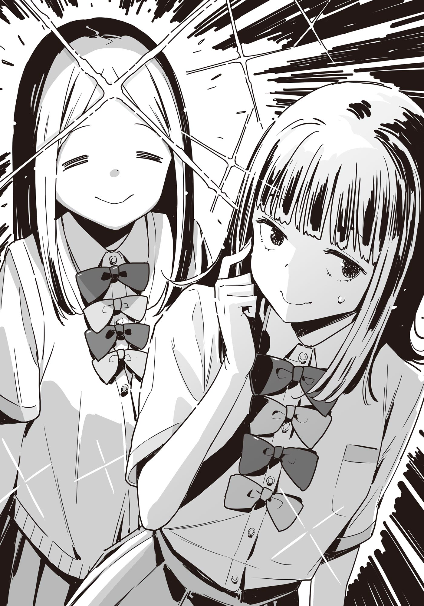

# Ch.169 — เล่ม 9 บทที่ 3-1

Ch.169 — เล่ม 9 บทที่ 3-1

By มนก

Published: 2026-07-30T06:46:41Z

Source: https://www.nekopost.net/novel/14560/169

บทที่ 3-1  ค่ำคืนแห่งความลับ

หลังวันหยุด ผมส่องกระจกดูตัวเองในชุดนักเรียนเต็มยศพลางทบทวนความหลัง

ผมได้ใช้เวลาหนึ่งคืนร่วมกับยานามิ

ถึงยานามิจะยังคงเป็นยานามิคนเดิม แต่ความจริงข้อนี้ก็ไม่เปลี่ยน ความจริงนั้นยังไงก็ไม่เปลี่ยน แต่ว่า──

[...ไม่มีอะไรเกิดขึ้นเลยแฮะ]

จู่ๆ คำพูดนั้นก็หลุดออกจากปาก เสียงแปลกใจดังออกมาจากลำโพงสมาร์ทโฟน

『พูดเรื่องอะไรน่ะ?』

[อ้อ ไม่มีอะไรหรอก แล้วเมื่อกี้เราคุยกันถึงไหนแล้วนะ]

คนที่ผมคุยด้วยผ่านสมาร์ทโฟนที่วางไว้บนโต๊ะ คือ มิซึชิมะ โคฮารุ

ตั้งแต่เกิดเรื่องนั้น เธอก็ติดต่อมาบ่อยผิดปกติ โดยอ้างว่าอยากขอโทษ

พูดตามตรง ผมค่อนข้างรำคาญ แต่จะทำเมินแฟนของเพื่อนสนิทก็คงไม่ดี

『คือว่านะ วันนี้สึวาบุกิก็มีพิธีปิดภาคเรียนเหมือนกันใช่ไหม? หลังเลิกเรียน ฉันอยากจะไปขอโทษต่อหน้าน่ะ』

[ไม่ต้องใส่ใจหรอกครับ ที่ตกรถบัสน่ะก็เป็นความผิดของพวกเราเอง]

ผมพูดพลางจัดเนกไทหน้ากระจก

『ขอบใจนะ ขอโทษจริงๆ นะ』

ไม่ต้องมาขอโทษหรอก ที่จริงถ้าไม่ต้องมาข้องเกี่ยวกันอีกเลยจะดีที่สุด

[ไม่ต้องคิดมากจริงๆ ครับ ถ้างั้น ผมขอตัว──]

『แล้วก็นะ เมื่อวานฮิโระคุงบอกฉันว่า──』

อ้าว ทิศทางลมเปลี่ยนซะแล้ว

ผู้หญิงคนนี้ พอเผลอทีไรก็เริ่มเล่าเรื่องที่แยกไม่ออกว่ากำลังอวดแฟนหรือบ่นแฟนกันแน่...

[อ่า ครับๆ งั้นเหรอครับ]

『ฮิโระคุงบอกว่า ผมก็ผิดเหมือนกัน แต่คราวนี้ต่อให้ฉันถูกดุ──』

[เอ่อ ใกล้จะได้เวลาข้าวเช้าแล้ว ขอวางสายก่อนนะครับ...]

『อ๊ะ จริงด้วย ขอโทษนะถ้านุคุมิซึคุงรำคาญล่ะก็ ปฏิเสธตรงๆ ได้เลยนะ?』

รับทราบครับ ต่อไปนี้จะเข้มงวดให้เท่ากับตอนรับมือยานามิเลยครับ

[ก็นะ ไหนๆ ก็ลงเรือลำเดียวกันแล้ว แถมถ้าเป็นซากุไรคุงล่ะก็ ถ้าคุยกันดีๆ เขาก็ยอมฟังอยู่แล้วล่ะ]

『...ก็คงยอมฟังแหละมั้ง』

โคฮารุซังเงียบไปที่ปลายสาย

...แย่ล่ะสิ ท่าทางจะคุยกันยาวแฮะ ปลดเนกไทแล้วผูกใหม่ดีไหมเนี่ย

ระหว่างที่กำลังคิดแบบนั้น ก็มีเสียงเคาะประตูดังก๊อกๆ

[ท่านพี่คะ อาหารเช้าเตรียมเสร็จแล้วนะคะ]

[อา เดี๋ยวลงไป ขอโทษนะโคฮารุซัง ผมต้องไปกินข้าวเช้าแล้ว อืม แล้วคุยกันนะ]

ผมรีบตัดสายแบบส่งๆ แล้วเปิดประตู ก็เจอคาจูยืนทำหน้าเรียบเฉยเหมือนหน้ากากโน

[...ท่านพี่ คุยกับใครอยู่เหรอคะ?]

[เอ่อ──ซากุไรคุงน่ะ คุยเรื่องทริปเมื่อวันก่อนนิดหน่อย]

พอผมเผลอโกหกไป คาจูก็ยิ้มบางๆ

[งั้นเหรอคะ แต่คาจูได้ยินเป็นเสียงผู้หญิงนะคะ]

[ซากุไรคุง วันไหนอารมณ์ดีๆ เสียงก็เหมือนเด็กผู้หญิงนั่นแหละ]

ผมพูดจบก็เดินลงไปชั้นล่าง โดยมีคาจูเดินตามหลังมาติดๆ

[...เมื่อสุดสัปดาห์ ท่านพี่ค้างคืนกับซากุไรซังใช่ไหมคะ]

[ใช่ คาจูก็คุยโทรศัพท์ด้วยกันแล้วนี่นา]

...หวังว่าคงยังไม่ความแตกหรอกนะ

คืนนั้นผมไม่ได้ใช้กล้องสมาร์ทโฟนถ่ายรูปเลย แล้วก็ลบประวัติการค้นหาในเน็ตจนเกลี้ยง

เตี๊ยมกันไว้ดิบดี คาจูไม่มีทางรู้เรื่องนี้ได้หรอก

ขณะที่ผมเดินลงบันไดมาจนสุดด้วยใจที่เต้นรัว คาจูก็พึมพำขึ้นมาลอยๆ

[──คนคนนั้น เสียงน่ารักจังเลยนะคะ]

หา? คนคนนั้น นี่หมายถึงใคร?

ผมชะงักเท้าไปชั่วขณะ คาจูเดินแซงผมไปแล้วหันกลับมาส่งยิ้มสดใสให้

[เป็นอะไรไปคะ? ข้าวจะเย็นหมดแล้วนะคะ ท่านพี่]

◇

เหนื่อยตั้งแต่เช้าเลยแฮะ... ผมเข็นจักรยานผ่านประตูโรงเรียนสึวาบุกิ

อุตส่าห์รีบออกจากบ้านเพื่อหนีการซักไซ้ของคาจู ทางเดินที่มีต้นไม้เรียงรายสองข้างทางเลยยังมีคนบางตา

ระหว่างที่เดินเหม่อมองพวกนักเรียนซ้อมกีฬาตอนเช้าอยู่ที่สนาม ก็ได้ยินเสียงเบรกจักรยานดังมาจากข้างหลัง

[นุคุมิซึ อรุณสวัสดิ์!]

คนที่ทักทายเสียงใสตั้งแต่เช้าคืออายาโนะ มิตสึกิ เขาลงจากจักรยานแล้วเดินขนาบข้างผม

[อ่า อรุณสวัสดิ์ มาเช้าจังนะ]

[มาเรียนเสริมรอบเช้าของพวกอาสาสมัครน่ะ อุตส่าห์มีทั้งที นุคุมิซึจะไม่เข้าหน่อยเหรอ]

[เรียนเสริมยันวันพิธีปิดภาคเรียนเลยเหรอ?]

ผมตกใจ แต่อายาโนะกลับขยับแว่นตาจนแสงสะท้อนวับ

[หน้าร้อนปีนี้ กะจะตั้งใจให้เต็มที่น่ะ สมัครเข้าค่ายกวดวิชาไว้ด้วย จะได้ตามจิฮายะทันไง]

[อย่าบอกนะว่าปิดอาซากุโมะซังไว้?]

[อ่า กะจะเซอร์ไพรส์จิฮายะน่ะ]

งั้นเหรอ อาซากุโมะซังคงจะเซอร์ไพรส์น่าดูเลยล่ะ

ขณะที่ผมกำลังตัวสั่นด้วยลางสังหรณ์ถึงปัญหา อายาโนะก็เหลียวมองรอบๆ แล้วกระซิบถาม

[แว่วๆ มาว่า นายไปเที่ยวกับพวกซากุไรมาเหรอ?]

เอ๊ะ ทำไมถึงรู้ล่ะ?

ผมตกใจ อายาโนะก็ต่อว่าด้วยน้ำเสียงตัดพ้อ

[แอบไปทำเรื่องสนุกๆ โดยไม่มีฉันงั้นเรอะ]

[ไม่ได้สนุกขนาดนั้นหรอกนะ? เอาจริงๆ]

ผมเถียงกลับ อายาโนะกลับทำหน้ามีเลศนัย

[แล้ว ช่วงนี้นายกับยานามิซัง เป็นไงบ้างล่ะ?]

[เป็นไง นี่คือ?]

พอผมถามกลับแบบซื่อๆ อายาโนะก็ยิ้มกริ่ม

[ไม่ต้องมาปิดบังเลย ไปเที่ยวกันมาต้องมีซัมติงแน่ๆ ใช่ไหมล่ะ?]

[ไม่ได้มี──]

จะบอกว่าไม่มีอะไรเลยก็พูดได้ไม่เต็มปาก

ขณะที่กำลังลังเลว่าจะอธิบายสถานการณ์ซับซ้อนนี้ยังไงดี อายาโนะก็เปลี่ยนสีหน้าเป็นจริงจัง

[ถึงจะมีความเห็นส่วนตัวอยู่บ้าง แต่ถ้าเป็นทางที่นุคุมิซึเลือก ฉันก็จะสนับสนุนนะ]

[ก็ไม่ได้เลือกทางไหนทั้งนั้นแหละ]

ดันมีตัวน่ารำคาญมารู้ความลับเข้าซะแล้ว

บอกว่าแว่วๆ มาเนี่ย ไปได้ยินมาจากไหนกันล่ะ...?

ไม่รู้สิ แต่ถ้าเป็นอาซากุโมะซังคงน่ากลัวพิลึก เลิกคิดเรื่องนี้ดีกว่า

ผมปล่อยให้คำพูดของอายาโนะทะลุหูขวาไป พลางคิดว่าคราวหน้าจะพาคาจูไปปัดเป่ารังควานที่ศาลเจ้าดีกว่า

◇

...มองหน้ายานามิไม่ค่อยติดแฮะ

ตอนนั่งรถไฟกลับหลังจากค้างคืนที่เรียวกัง ยานามิเงียบผิดปกติ

ถึงจะซัดข้าวกล่องสถานีไป 2 กล่อง แถมยังแย่งกับข้าวผมไปกินด้วยก็ตาม แต่ดูทำตัวเหินห่างแปลกๆ... หรือจะพูดว่าไม่เหมือนยานามิคนเดิมก็คงได้

แถมตั้งแต่แยกย้ายกันที่สถานีโทโยฮาชิ ก็ไม่ได้ติดต่อกันเลย บรรยากาศมันก็เลยอึดอัดชอบกล

ระหว่างที่คิดอะไรเพลินๆ ผมก็หยุดเดินตรงระเบียงทางเดิน

──มีอะไรบางอย่างกำลังเข้ามาใกล้

BGM อลังการ กลิ่นดอกไม้หอมฟุ้ง แถมบรรยากาศรอบๆ ยังดูสว่างไสวขึ้นอีกต่างหาก

ผมหันหลังกลับ เปลี่ยนเส้นทางไปห้องเรียน

ถ้าเดินอ้อมไปทางระเบียงด้านนอก น่าจะไปถึงห้องเรียนได้โดยไม่ต้องปะทะกัน

ตอนที่กำลังเดินไปทางระเบียงด้านนอก ตรงหัวมุมข้างหน้าก็มีแสงสว่างวาบขึ้นมา

แย่ล่ะ โดนดักหน้าซะแล้ว! ยังไม่ทันได้หนี แสงสว่างเจิดจ้าก็ห่อหุ้มตัวผม

[นุคุมิซึคุง อรุณสวัสดิ์!]

คนที่ทักทายอย่างร่าเริง คือไอดอลประจำโรงเรียน ฮิเมมิยะ คาเรน นั่นเอง

เธอส่งรอยยิ้มเจิดจ้าแบบจัดเต็มมาให้ผม

[อรุณสวัสดิ์ ฮิเมมิยะซัง เช้าๆ แบบนี้สดใสจังนะ]

เพิ่งจะเจอออร่าฮิเมมิยะเข้าไปแต่เช้าตรู่ จู่ๆ การขยิบตาแบบฮิเมมิยะก็จู่โจมผมเข้าอีก

[หุหุ คนที่สดใสมีแค่ฉันคนเดียวเหรอจ๊ะ?]

[เอ่อ หมายความว่าไง...]

คนคนนี้พูดอะไรของเขาน่ะ ผมกำลังงง แต่ฮิเมมิยะซังกลับปล่อยออร่าวิบวับยิ่งกว่าเดิม

[ก็จริงนะ ตอนแรกๆ มันก็จะเก้ๆ กังๆ เขินๆ แบบนี้แหละ แต่ความรู้สึกแบบนั้นมันมีแค่ช่วงแรกเท่านั้นแหละ ถ้าจำความรู้สึกตอนนี้เอาไว้ ความจำเจในอนาคตก็จะ──]

ตกลงพูดเรื่องอะไรอยู่เนี่ย

ผมหรี่ตาสู้แสงจ้า พยายามจะเบรกความคึกของฮิเมมิยะซัง

[เข้าใจอะไรผิดหรือเปล่า ไม่เห็นมีอะไรเปลี่ยนไปเลยนะ]

กลับกัน ผมรู้สึกเหนื่อยตั้งแต่เช้าเลยต่างหาก

ฮิเมมิยะซังจะรู้ความรู้สึกของผมหรือเปล่าไม่รู้ แต่เธอเอานิ้วมาจิ้มหน้าอกผมเบาๆ

[รู้น่า──เรื่องที่・ไป・ค้าง・คืน น่ะ]

หา?! ทำไม? ทำไมถึงรู้ล่ะ?!

เดี๋ยวก่อน ตามเรื่องแล้ว ผมอ้างว่าไปค้างคืนกับซากุไรคุงนี่นา

ฮิเมมิยะซังคงไปได้ยินมา แล้วก็เอาไปจินตนาการมโนไปเองแน่ๆ

จังหวะนี้คงต้องตอบกลับแบบผู้ใหญ่ใจเย็นๆ สินะ

[อ้อ ใช่ ไปเที่ยวกับพวกซากุไรคุงมาน่ะ แล้วไงเหรอ?]

[ทริปนี้น่ะ อันนะก็ไปด้วยใช่ไหมล่ะ!]

ทริปนี้ไม่ได้เป็นความลับอะไร ขืนโกหกแปลกๆ ไป เดี๋ยวจะโดนสงสัยซะเปล่าๆ

[แน่นอน ไปด้วยกัน 5 คนรวมพวกซากุไรคุงน่ะ ที่ทาคายามะไง]

[งั้นตอนเที่ยงเมื่อวาน──ทำไมถึงกลับมาถึงสถานีโทโยฮาชิกันแค่สองคนล่ะ?]

[เอ๊ะ เห็นด้วยเหรอ?!]

ผมเผลออุทานออกมา บรรยากาศรอบตัวก็เต็มไปด้วยกลิ่นหอมของดอกไม้และประกายวิบวับอีกครั้ง

[จริงๆ ด้วยสินะ นุคุมิซึคุง!]

[ไม่ๆ ไม่ใช่ๆ! คือว่า มันไม่ได้เป็นแบบนั้น ไม่มีอะไรเกิดขึ้นสักหน่อย!]

[ไม่มีอะไร──เกิดขึ้นเลยเหรอ?]

พอผมพยักหน้ารัวๆ แสงออร่าฮิเมมิยะก็ค่อยๆ หรี่ลง

ฮิเมมิยะซังจ้องหน้าผมอยู่พักหนึ่ง ในที่สุดก็ยอมเชื่อ ก่อนจะคอตก

[...งั้นเหรอ ไม่มีอะไรเกิดขึ้นเลยสินะ]

[ก็บอกแล้วไงว่าแค่ไปเที่ยว]

คนคนนี้ ต้องมโนอะไรแปลกๆ ไว้แน่เลย เอาเถอะ อธิบายให้เข้าใจผิดก็พอแล้ว

เอาล่ะ รัศมีของฮิเมมิยะซังเริ่มเรียกความสนใจจากคนรอบข้างแล้ว รีบปลีกตัวดีกว่า...

[งั้นผมขอตัวไปห้องเรียนก่อนนะ]

[──ตอนแรกมันก็จะตื่นเต้น แล้วก็อาจจะทำอะไรติดขัดไปบ้างแหละเนอะ]

[หา?]

เดี๋ยวนะ คราวนี้พูดอะไรขึ้นมาอีกล่ะเนี่ย

ระหว่างที่ผมกำลังกังวลสายตาคนรอบข้าง ฮิเมมิยะซังก็ยื่นหน้าเข้ามาใกล้

[ไม่เป็นไร อันนะไม่ใช่คนคิดมากเรื่องแบบนั้นหรอก! ถ้าให้ฉันช่วย──]

[อ๊ะ เสียงออดเตือนดังแล้วนี่นา? รีบไปห้องเรียนกันเถอะ!]

[นุคุมิซึคุง?! ถึงอย่างนั้น ในโรงเรียนมันก็──]

ผมคว้ามือฮิเมมิยะซังที่เอาแต่พ่นคำพูดประหลาดๆ แล้วกึ่งลากกึ่งจูงเดินจ้ำอ้าวออกไป

...ให้ตายสิ ทำไมเรื่องที่ผมกับยานามิกลับตอนกลางวัน(?) ถึงได้แดงไปทั่วแบบนี้เนี่ย

ผมสาปแช่งความซวยที่ถาโถมเข้ามา พลางจูงมือฮิเมมิยะซังมุ่งหน้าไปยังห้องเรียน

◇

เสียงจักจั่นดังก้องอยู่หลังอาคารเรียน ท่ามกลางหมู่มวลต้นไม้ที่เปียกชื้นด้วยหยาดน้ำค้างยามเช้า มีนักเรียนหญิงสองคนยืนอยู่

อาซากุโมะ จิฮายะ จากห้อง 2-E และ โคอิคาวะ สึคุชิ จากห้อง 2-A นั่นเอง อาซากุโมะพลิกดูสมุดบันทึกแบบผ่านๆ แล้วคืนให้โคอิคาว่า (TL : โคอิคาวะ สึคุชิ จากชมรมหนังสือพิมพ์ เล่ม 8.5)

[อ้าว พอแล้วเหรอ?]

[ค่ะ จำได้หมดแล้ว เดี๋ยวจะไปทบทวนในหัวอีกรอบนะคะ]

อาซากุโมะหลับตาลง หน้าผากเป็นประกายวิบวับ

[อย่างนี้นี่เอง ไม่มีหลักฐานแน่ชัดว่านุคุมิซึซังกับยานามิซังคบกันอยู่──สินะคะ]

[อื้อ ไปหลอกถามมาจากเพื่อนที่สนิทที่สุดของทั้งสองคนแล้ว ข้อมูลนี้น่าจะชัวร์แหละ]

อาซากุโมะลืมตาขึ้น แล้วจ้องมองโคอิคาวะที่ทำหน้ามั่นใจเต็มเปี่ยม

[เพื่อความแน่ใจ เรื่องเมื่อสุดสัปดาห์ ไม่ได้หลุดปากบอกคุณมิตสึกิกับฮิเมมิยะซังไปใช่ไหมคะ?]

[อ่าー...]

โคอิคาวะ สึคุชิ เกาแก้มพลางหลบตา

[...โคอิคาวะซัง?]

[เปล่าๆ! ถ้าจะล้วงความลับ มันก็ต้องยอมคายข้อมูลบ้างใช่ไหมล่ะ? แต่แน่นอนว่ากำชับให้ปิดเป็นความลับแล้วนะ]

[...ก็เถอะนะ ถ้าเป็นสองคนนั้นก็คงไม่ต้องห่วงหรอก]

อาซากุโมะพยักหน้าอย่างเห็นด้วย

ฮิเมมิยะ คาเรน เป็นเพื่อนสนิทของยานามิ อันนะ คงไม่ทำอะไรแย่ๆ หรอก ส่วนอายาโนะ มิตสึกิ ยิ่งไม่ต้องห่วงใหญ่ และถ้าเกิดเหตุสุดวิสัยขึ้นมาจริงๆ ก็ค่อยใช้กำลังจัดการเอาก็ได้

...พูดตามตรง การที่สองคนนั้นใกล้ชิดกันเร็วขนาดนี้มันเหนือความคาดหมายไปหน่อย อยากจะให้บรรยากาศมันเนิบนาบแบบนี้ไปเรื่อยๆ จนกว่าความรู้สึกของยากิชิโอะจะนิ่งเสียก่อน แต่เรื่องแบบนี้มันก็บังคับกันไม่ได้ล่ะนะ

นุคุมิซึซังเป็นผู้มีพระคุณของฉันและเหมือนเป็นน้องชายแสนน่ารักคนนึง ส่วนยากิชิโอะ เลม่อนก็เป็นเพื่อนสนิท จะให้ทำอะไรซี้ซั้วคงไม่ได้

[...ก็นะ อะไรจะเกิดมันก็ต้องเกิดล่ะนะคะ]

อาซากุโมะถอนหายใจออกมาด้วยความกังวล โคอิคาวะมองเธออย่างเป็นห่วง

[ฉันขอตัวกลับก่อนได้ไหม]

[ค่ะ ขอบคุณมากนะคะ เดี๋ยวฉันจะเตรียมสกู๊ปเด็ดๆ ไว้ให้นะคะ]

[ทางนี้ก็พึ่งพาเธออยู่นะ เพราะเธอแท้ๆ ยอดขายหนังสือพิมพ์ช่วงนี้ถึงได้พุ่งกระฉูดเลย]

โคอิคาวะทำมือเป็นรูปตัวโอด้วยนิ้วชี้กับนิ้วโป้ง แล้วฉีกยิ้มกว้าง

ตอนนั้นเอง ก็มีเสียงสวบสาบดังขึ้น พร้อมกับร่างของนักเรียนหญิงคนหนึ่งโผล่ออกมาจากพุ่มไม้ด้านใน

[อ้าว โคอิคาวะนี่ มาทำอะไรแถวนี้เนี่ย]

คนที่ปรากฏตัวพร้อมกับกล้อง DSLR ในมือ คือ นุมาตะ ริตสึโกะ จากห้อง E ห้องเดียวกับอาซากุโมะ

เมื่อเทียบกับโคอิคาวะที่มีรูปร่างเพรียวบาง รูปลักษณ์ของนุมาตะจัดอยู่ในเกณฑ์มาตรฐานสมส่วน ริบบิ้นที่เอียงกระเท่เร่ดูเหมือนจะไม่ได้ตั้งใจแต่งให้ดูเซอร์ แต่ดูเหมือนจะเกิดจากความไม่ใส่ใจและปล่อยปละละเลยเสียมากกว่า

[อ้อ มาคุยเรื่องหนังสือพิมพ์กับอาซากุโมะซังน่ะ เธอล่ะ มาถ่ายอะไรแถวนี้?]

[อาจารย์ทานากะบอกว่าได้ยินเสียงนกแซวสวรรค์แถวนี้น่ะ ก็เลยคิดว่าถ้าเป็นตอนเช้าอาจจะเจอตัวก็ได้ー]

เธอเอามือปาดโคลนที่แก้ม โดยที่ยังมีใบไม้ติดอยู่บนผมเผ้ายุ่งเหยิง

[แล้วถ่ายมาได้ไหมล่ะ?]

[ได้แบบเต็มๆ เลยล่ะ──แต่ได้แค่เสียงนะ]

ทั้งสองคนมองหน้ากันแล้วระเบิดเสียงหัวเราะคิกคัก

ในสายตาของอาซากุโมะ เธอไม่ใช่คนที่มีเสน่ห์แบบผู้หญิงนัก แต่ก็เป็นผู้หญิงที่มีอัธยาศัยดี และดูเหมือนจะสนิทสนมกับอดีตประธานชมรมส่องนกอยู่ไม่น้อย

จู่ๆ นุมาตะก็หันมามองอาซากุโมะด้วยสายตาแปลกใจ

[ อาซากุโมะซังสนิทกับโคอิคาวะด้วยเหรอเนี่ย]

[ค่ะ ช่วงนี้โคอิคาวะซังกำลังสอนเรื่องกล้องให้อยู่น่ะค่ะ ใช่มั้ยคะ โคอิคาวะซัง?]

[อ-อื้อ ช่วงนี้แหละ]

นุมาตะส่งยิ้มสบายๆ โดยไม่ทันสังเกตเห็นรอยยิ้มเจื่อนๆ ของโคอิคาวะ

[โหー ดีจังเลย ถ้าไม่รังเกียจ ปิดเทอมหน้าร้อนไปถ่ายรูปกับพวกเราไหม?]

[น่าสนุกจังเลยนะคะ แต่ว่าปิดเทอมหน้าร้อนฉันมีนัดไปติวหนังสือกับแฟนแล้วล่ะค่ะ]

เมื่อโดนเสิร์ฟความหวานแบบไม่ทันตั้งตัว นุมาตะก็หัวเราะอย่างอารมณ์ดี

[ค่าๆ รับทราบความหวานแล้วจ้า โคอิคาว่า เรื่องค่ายฤดูร้อน เลิกเรียนแล้วมาเจอกันนะ]

[โอเค เดี๋ยวเคลียร์คิวไว้ให้]

เธอโบกมือแล้วเดินจากไป อาซากุโมะมองแผ่นหลังนั้นพลางเอียงคอสงสัย

[นุมาตะซังเนี่ย เป็นอดีตสมาชิกชมรส่องนกใช่ไหมคะ]

[ใช่ แต่ไม่ได้มีเอี่ยวกับเรื่องนั้นหรอกนะ ขู่ไปก็เปล่าประโยชน์]

[แหม ฉันไม่เคยขู่เพื่อนร่วมชั้นหรอกนะคะ?]

กับรอยยิ้มที่ไร้เมฆหมอกของอาซากุโมะ โคอิคาว่าทำได้เพียงส่งยิ้มแห้งๆ กลับไป

