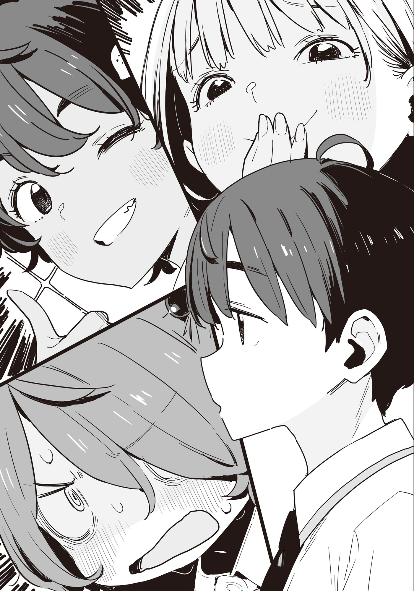

# Ch.170 — เล่ม 9 บทที่ 3-2

Ch.170 — เล่ม 9 บทที่ 3-2

By มนก

Published: 2026-07-30T06:48:25Z

Source: https://www.nekopost.net/novel/14560/170

รักนกเล่ม 9 บทที่ 3-2

ผมทิ้งตัวลงนั่งที่โต๊ะเรียน ค่อยๆ เปิดสมุดพกออก──แล้วก็ค่อยๆ ปิดมันลง

แย่แล้วสิ ปีที่ผ่านมามีเรื่องนู่นนี่นั่นเต็มไปหมด เลยไม่ได้ตั้งใจเรียนเท่าไหร่เลย...

ระหว่างที่กำลังกุมขมับ อายาโนะก็เข้ามาทัก

[เป็นไงบ้างนุคุมิซึ แย่เลยเหรอ]

[ก็ตามที่เห็นนั่นแหละ แล้วนายล่ะ?]

[ก็ประคองตัวไว้ได้ละนะ]

อายาโนะยิ้มกริ่มอย่างผู้มีชัย แล้วตบบ่าผมแปะๆ

[งั้นปิดเทอมหน้าร้อนไปเข้าค่ายด้วยกันไหม? ติวเข้มวันละ 14 ชั่วโมงเลยนะ]

[ไม่อะ แล้วก็เลิกเอาใบปลิวมายัดใส่มือสักที]

ทำไมหมอนี่ถึงทำตาเป็นประกายเหมือนพวกโอตาคุที่กำลังจะได้ไปอากิฮาบาระล่ะเนี่ย

ระหว่างที่พยายามปัดป้องคำชวนของคนเสียสติ ซากุไรคุงที่อยู่ข้างๆ ก็หยิบใบปลิวไปดู

[โห เน้นปฏิบัติจริงจังเลยนะเนี่ย จะไปเข้าค่ายกับอาซากุโมะซังเหรอ?]

[เปล่า กะจะแอบไปเซอร์ไพรส์จิฮายะน่ะ]

ซากุไรคุงทำหน้าเหมือนอยากจะพูดอะไรบางอย่าง แต่ผมส่ายหน้าเงียบๆ เป็นเชิงห้าม

ป่านนี้อายาโนะคงโดนอาซากุโมะซังลบความทรงจำพร้อมกับอะไรบางอย่างที่สำคัญไปแล้วแน่ๆ

[นี่ นุคุมิซึคุง──]

วินาทีที่ซากุไรคุงเริ่มอ้าปากพูด อาจารย์อามานัตสึก็ปรบมือดังแปะๆ

[เอาล่ะ ทุกคนได้สมุดพกครบแล้วนะ เอ้า กลับไปนั่งที่ได้แล้วー]

พวกเพื่อนในห้องพากันทยอยกลับไปนั่งที่ตัวเอง ซากุไรคุงกะจะพูดอะไรนะ...

ถึงจะสงสัย แต่อาจารย์อามานัตสึเริ่มพูดแล้ว ผมเลยจำใจต้องหันไปสนใจแกแทน

[พรุ่งนี้ก็ปิดเทอมหน้าร้อนแล้ว ชีวิตม.ปลายของพวกเธอก็ผ่านมาครึ่งทางแล้วนะ]

อาจารย์อามานัตสึกวาดสายตามองพวกเราที่ทำหน้าเซ็งๆ

[ฟังนะ ตั้งแต่เทอม 2 เป็นต้นไป ชีวิตวัยรุ่นของพวกเธอจะมืดมนลงเพราะต้องเตรียมตัวสอบเข้ามหาลัย ฉันเองก็เคยเป็นแบบนั้น]

นั่นมันความแค้นส่วนตัวของอาจารย์หรือเปล่าครับ

อาจารย์อามานัตสึทุบกระดานดำปังๆ ใส่พวกเราห้อง 2-C ที่กำลังทำหน้าสงสัย

[จำไว้ให้ดี ปิดเทอมหน้าร้อนปีนี้คือปิดเทอมหน้าร้อนครั้งสุดท้ายในชีวิตของพวกเธอ! ปิดเทอมหน้าร้อนตอนปี 3 ก็ต้องหมดไปกับการเรียนเสริมและกวดวิชา ส่วนปิดเทอมของเด็กมหาลัยมันก็ไม่ได้เรื่องหรอก ไม่กินเหล้าก็ทำงานพิเศษ ไม่ก็ต้องมานั่งเรียนวิชาที่ไม่ได้สนใจเพราะหน่วยกิตไม่พอ!]

ก็บอกว่านั่นมันอาจารย์คนเดียวไม่ใช่เหรอครับ ช่วยอย่าเอาความมืดมนมาสาดใส่เด็กม.ปลายผู้ใสซื่อเลยครับ

[เพราะงั้นปิดเทอมหน้าร้อนนี้จงใช้เวลาให้คุ้มค่า──เดี๋ยวก่อน ไม่ใช่อย่างนั้นสิ จะบอกว่าทำอะไรก็ให้มันพอดีๆ หน่อยต่างหากล่ะ เฮ้ย นุคุมิซึ เข้าใจที่พูดใช่ไหม]

ทำไมต้องเจาะจงชื่อผมด้วยล่ะครับ เลิกเถอะครับอาจารย์อามานัตสึ

ขณะที่ผมต้องทนรับสายตาจากเพื่อนร่วมห้อง อาจารย์อามานัตสึก็เอาสมุดเช็คชื่อฟาดโต๊ะหน้าชั้นเรียนดังป้าบ

[ช่างเถอะ พวกเธออย่าก่อเรื่องให้ฉันต้องปวดหัวก็แล้วกัน เริ่มปิดเทอมหน้าร้อนได้!]

◇

บันไดหนีไฟของอาคารเรียนเก่า ผมเท้าคางกับราวบันไดพลางจิบตึกนมสด มองขึ้นไปบนท้องฟ้า

ท้องฟ้าสีครามสดใสตัดกับก้อนเมฆรูปดอกเห็ดที่ก่อตัวชัดเจน

ฤดูใบไม้ผลิผ่านพ้นไปทิ้งไว้เพียงความทรงจำลางๆ ฤดูร้อนได้แผ่ขยายปกคลุมทั่วผืนฟ้าแล้ว

เริ่มต้นด้วยเรื่องวุ่นวายจากการขอเข้าชมรมและยุบชมรมชั่วคราวของชิราทามะ ริโกะ ตามด้วยการถูกดึงเข้าไปพัวพันกับการเลือกตั้งประธานนักเรียนในเทอมแรก

และ... การถูกสารภาพรักครั้งแรกในชีวิต

สายตาที่จริงจังของเทียร่าซังในวันนั้น ยังคงตราตรึงอยู่ในความทรงจำของผมไม่รู้ลืม──

ขณะที่กำลังหวนนึกถึงเรื่องราวในช่วงหลายเดือนที่ผ่านมา โคมาริที่อยู่ข้างๆ ก็หันมาจ้องหน้าผม

[ม-มีอะไรเหรอ คิดเรื่องผู้หญิงอยู่ล่ะสิ]

[ไม่ใช่นะ เธอเห็นผมเป็นคนยังไงเนี่ย]

[ศ-ศัตรูของผู้หญิง]

พูดทิ้งท้ายไว้แค่นั้น โคมาริก็เริ่มดูดนมจากกล่องต่อ

...โคมาริ จิกะ พอขึ้นปี 2 สภาพแวดล้อมรอบตัวเธอก็เปลี่ยนไป

โคมาริที่ไม่เคยคุยกับใครในห้องเลย กลับกลายมาเป็นคนที่สนิทสนมกับยานามิและฮิเมมิยะซัง คู่หูดูโอ้ 12K ซะอย่างนั้น ถึงส่วนใหญ่จะแค่นั่งเงียบๆ แต่ก็นับว่าเป็นก้าวที่ยิ่งใหญ่แล้ว

ผมเองก็อยู่กับอายาโนะและซากุไรคุงบ่อยขึ้น โอกาสที่จะมาตรงบันไดหนีไฟก็น้อยลงไปด้วย

บางทีที่เวลาไม่ตรงกับสองคนนั้น ผมก็จะมานั่งกินข้าวเที่ยงที่นี่ แต่ก็มักจะเจอโคมาริซะส่วนใหญ่ สงสัยคงมีกระแสจิตเรียกพวกกินข้าวคนเดียวให้มารวมตัวกันล่ะมั้ง

[ม-มีอะไร จ้องอยู่ได้]

[ อ้อ วันนี้กินนมสูตรเข้มข้น สินะ]

พอผมพูดลอยๆ โคมาริก็แสยะยิ้มทั้งที่มีคราบนมติดริมฝีปาก

[ฉ-ฉลองปิดเทอมหน้าร้อนน่ะ]

งั้นเหรอ รู้งี้ผมซื้อสูตรเข้มข้นมาบ้างก็ดี...

ระหว่างที่กำลังคิดเพลินๆ รับลมเย็นๆ โคมาริก็กระตุกเสื้อผมยิกๆ

[มีอะไร โคมาริ]

[ว-วันนี้ นายไม่ได้คุยกับยานามิ ใช่ไหมล่ะ]

...โคมารินี่เซนส์แรงชะมัด สมแล้วที่ทำคะแนนสอบชนะผมได้ติดต่อกัน

ผมละปากจากหลอดนม แล้วแกล้งตีหน้าซื่อตอบกลับไป

[งั้นเหรอ ปกติเวลาอยู่ในห้องเราก็ไม่ค่อยได้คุยกันอยู่แล้วนี่นา อืม ไม่ทันสังเกตเลยแฮะ]

กำลังภูมิใจในคำตอบที่เพอร์เฟกต์ของตัวเอง โคมาริก็มองผมด้วยสายตาเหมือนมองขยะ

[ม-มีเรื่องผู้หญิงต่างโรงเรียนคนนั้นมาเกี่ยวด้วยใช่ไหมเนี่ย?]

แค่กๆ. ผมเผลอสำลัก โคมาริก็เอาก้นกล่องนมมากระทุ้งแก้มผม

[ไม่ใช่นะ แค่มีเรื่องวุ่นวายนิดหน่อย──เอ่อ ก็แค่มีเรื่องวุ่นวายนิดหน่อยนั่นแหละ]

[ต-ตายซะ]

ในขณะที่ความเข้าใจผิดครั้งใหม่กำลังจะก่อตัวขึ้น ก็มีเสียงฝีเท้าร่าเริงดังใกล้เข้ามาจากชั้นล่าง

[โอ้ อยู่นี่จริงๆ ด้วย──]

คนที่ปรากฏตัวพร้อมกระโปรงที่พลิ้วไหว คือยากิชิโอะนั่นเอง

เธอมองหน้าผมสลับกับโคมาริ ก่อนจะประกบมือเข้าหากันด้วยสีหน้าเจื่อนๆ

[...ฉันเข้ามาขัดจังหวะอะไรหรือเปล่าเนี่ย]

[ไม่ได้ขัดสักหน่อย] [ม-ไม่ได้ขัด!]

พวกเราเผลอตอบพร้อมกันโดยไม่ได้นัดหมาย ยากิชิโอะก็โถมตัวทับโคมาริจากด้านหลังพลางบอกว่า [งั้นก็ค่อยยังชั่ว]

[ยากิชิโอะ มีธุระอะไรบนนี้เหรอ?]

ผมลืมตัวว่าตัวเองก็อยู่บนนี้เหมือนกันแล้วถามออกไป ยากิชิโอะตอบพลางเล่นผมของโคมาริ

[วันนี้ชมรมงดน่ะสิ กะว่าจะมาฆ่าเวลารอพวกชมรมกรีฑาน่ะ]

ประโยคคุ้นหูจังแฮะ

ถ้าจำไม่ผิด วันปิดเทอมหน้าร้อนปีที่แล้ว ก็รวมตัวกันเยอะๆ แบบนี้เหมือนกัน

หลังเลิกเรียนเมื่อ 1 ปีก่อน ยังมีอีกคน──

เหมือนเธอจะรู้จังหวะ เสียงฝีเท้าดังขึ้นจากชั้นล่าง ผมเลยชะโงกหน้าไปดู

[ประธานนี่ ป๊อปจังเลยนะคะ]

คนที่ปรากฏตัวคือสมาชิกสภานักเรียนและเด็กปี 1 ของชมรมวรรณกรรม ชิราทามะ ริโกะ นั่นเอง

ขณะที่ผมกำลังทำตัวไม่ถูกกับแขกที่ไม่ได้รับเชิญ ชิราทามะซังก็แทรกตัวเข้ามาประกบข้างผมกับโคมาริ

[ว้าว ลมเย็นดีจังเลยนะคะ]

ชิราทามะซังชะโงกหน้าออกไปมองวิวไกลๆ

[ทำไมถึงขึ้นมาบนนี้ล่ะ]

[ขึ้นมาบนนี้แล้วรู้สึกว่าน่าจะมีเรื่องดีๆ น่ะค่ะ เดาถูกจริงๆ ด้วย]

ชิราทามะซังเอามือกดผมม้าไว้พลางส่งยิ้ม ยังน่ารักและตัวหอมเหมือนเดิมไม่เปลี่ยน

ยากิชิโอะเอาคางเกยไหล่ผมพลางทักทายชิราทามะ

[ทามะจัง ไม่เจอกันนานเลย สบายดีไหม?]

[สบายดีค่ะ รุ่นพี่ ตอนนี้ก็ยังไปอาบน้ำที่บ้านประธานชมรมอยู่เหรอคะ?]

[อื้อ ช่วงนี้มันร้อนนี่นา ทามะจังก็ลองไปใช้ดูสิ?]

[ก็ดีเหมือนกันนะคะ]

...เอ๊ะ ได้เหรอ? ไม่สิ แบบนั้นไม่ได้เด็ดขาด

เด็กผู้หญิงวัยกำลังโตจะมาขอยืมห้องน้ำบ้านเด็กผู้ชายง่ายๆ ได้ยังไงกัน

[แต่ว่า คาจูจังจะว่ายังไงน้าー ประธานคิดว่าไงคะ?]

เธอพูดพลางช้อนตามองผม

[จะว่ายังไงดีล่ะ คาจูค่อนข้างขี้อาย ไม่สิ ออกจะหัวโบราณหน่อยๆ ด้วยซ้ำ]

ชิราทามะซังที่น่ารักไปซะทุกระเบียดนิ้ว เอามือกดผมม้าพลางเอียงคอ

[งั้น ใส่ชุดว่ายน้ำลงสระพร้อมกันเลยดีไหมคะ? ห้องน้ำบ้านประธานชมรมก็กว้างดีด้วย]

[น่าสนุกดีนี่! ปาร์ตี้ชุดว่ายน้ำไงล่ะ]

ปาร์ตี้ชุดว่ายน้ำในห้องน้ำบ้านผมเนี่ยนะ...?

ช่างไม่สำรวมเอาซะเลย แต่ปกติเวลาอาบน้ำมันต้องเปลือยเปล่าไม่ใช่เหรอ

การใส่ชุดว่ายน้ำในห้องน้ำ มันน่าจะมิดชิดและปลอดภัยกว่า

ถึงจะแอบสนใจปาร์ตี้ชุดว่ายน้ำ แต่ในฐานะประธานชมรมวรรณกรรม ผมต้องเหยียบเบรกไว้ก่อน

[นั่นรวมผมเป็นผู้เข้าร่วมด้วยหรือเปล่า?]

ประโยคที่เผลอหลุดปากไป ทำให้บรรยากาศเงียบกริบลงทันที

ยังไม่ทันจะได้รู้สึกตัวว่าพูดอะไรผิดไป ยากิชิโอะกับชิราทามะที่ประกบซ้ายขวาก็ยิ้มกริ่ม

[เอาสิ! นุกคุงก็มาใส่ชุดว่ายน้ำด้วยกันเลย!]

[ประธานรุกเก่งเหมือนกันนะคะเนี่ย แบบนี้ฉันคงไม่ต้องเกรงใจแล้วสิคะ]

ไม่ใช่นะ ก็แค่สงสัยเฉยๆ ไม่ได้พูดจริงจังซะหน่อย

สงสัยผมจะจนตรอกจริงๆ เลยส่งสายตาขอความช่วยเหลือไปที่โคมาริ แต่กลับโดนตอบกลับมาว่า

[ส-ใส่ชุดว่ายน้ำแล้วไปตายซะ]

ใจร้ายที่สุด

ก็บอกว่าไม่ใช่ไง ถึงจะไม่รู้ว่าไม่ใช่ยังไง แต่รับรองว่าเป็นเรื่องเข้าใจผิดแน่นอน

ผมปล่อยเสียงเจี๊ยวจ๊าวของแก๊งสาวๆ ให้ทะลุหูขวาไป พลางเหลือบมองลงไปที่บันได

──ดูเหมือนจะไม่มีใครขึ้นมาอีกแล้ว

ระหว่างที่กำลังเหม่อมองไปเรื่อยๆ โคมาริก็เอาศอกกระทุ้งผมแรงๆ

[ย-ยานามิไม่มาหรอกนะ ไปคาราโอเกะกับพวกฮิเมมิยะแล้ว]

[ไม่ได้รอสักหน่อย แค่คิดว่าถ้ามาอีกคน ชมรมวรรณกรรมก็ครบแก๊งพอดี]

[สรุปก็รอยานามิจังนี่นา นุกคุง เสียแต้มอีกแล้วนะ]

ชิราทามะซังผสมโรงซ้ำเติมสายตาจับผิดของยากิชิโอะ

[รุ่นพี่ เรื่องนั้นคืออะไรเหรอคะ? ท่าทางน่าสนุกจังเลยนะคะ]

[ก็คือว่านะ วันก่อนนุกคุงน่ะไปทำเรื่องที่นาโกย่า──]

[เรื่องนั้นไม่ต้องพูดก็ได้มั้ง?!]

พอผมรีบห้าม

[เอาเลย!][ต้องพูดสิคะ][ต-ตายซะ!]

สาวๆ ก็ประสานเสียงรุมทึ้งผม ทำไมวันสุดท้ายของเทอมแรก ผมถึงต้องมาโดนรังแกแบบนี้ด้วยเนี่ย...

ผมถอนหายใจพลางเงยหน้ามองท้องฟ้าฤดูร้อน

ท้องฟ้าสีครามที่ทอดยาวสุดลูกหูลูกตา ดูคล้ายกับวันนั้นเมื่อ 1 ปีก่อนไม่มีผิด

ผมเฝ้ามองสีฟ้าขาวของท้องฟ้า พลางนึกถึงความเปลี่ยนแปลงของสภาพแวดล้อมรอบตัวไปเรื่อยๆ

◇

คืนนั้น ผมนั่งอยู่ที่โต๊ะในห้องตัวเอง กำลังดูตารางเรียนช่วงปิดเทอมหน้าร้อนที่ได้รับแจกมาจากโรงเรียน

──ตัวอักษรคำว่า 『เรียนเสริม』 ที่เรียงรายอยู่บนปฏิทิน

ตอนปี 1 ผมไม่ได้เข้าเรียนเสริมเลย แต่ช่วงนี้แค่เรียนด้วยตัวเองก็ชักจะตามไม่ทันแล้วจริงๆ

[คงต้องเริ่มคิดเรื่องสอบเข้ามหาลัยบ้างแล้วสินะ...]

ผมทิ้งน้ำหนักลงบนพนักพิงเก้าอี้ แล้วมองขึ้นไปบนเพดาน

อายาโนะถึงจะไม่ได้บอกตรงๆ แต่เหมือนจะเล็งม.โตเกียวไว้ ส่วนซากุไรคุงดูเหมือนจะเล็งมหาลัยในจังหวัด

ยากิชิโอะกะจะใช้โควตากรีฑา โคมาริช่วงนี้ก็ดูมีพิรุธ สงสัยจะแอบไปติวเข้มแหงๆ

เอี๊ยดดด เสียงพนักพิงเก้าอี้ดังลั่น

[...แล้วยานามิล่ะ จะเอายังไง]

จู่ๆ คำพูดนั้นก็หลุดออกจากปาก ผมไม่เคยคุยเรื่องเรียนต่อกับยานามิเลย

สิ่งที่ประกอบขึ้นมาเป็นยัยนั่นก็มีแค่ของกินกับความรักที่ไม่สมหวัง

รู้จักกันมาตั้ง 1 ปีแล้ว แต่ผมนอกจากเรื่องพวกนั้นแล้ว ผมไม่รู้เรื่องอื่นของยานามิเลย

จู่ๆหน้าจอสมาร์ทโฟนก็สว่างวาบเหมือนจะขัดจังหวะความคิดของผม ตามด้วยเสียงเรียกเข้า

พอหยิบสมาร์ทโฟนขึ้นมา ก็ต้องแปลกใจกับชื่อที่ปรากฏบนหน้าจอ ก่อนจะกดรับสาย

[ฮัลโหล นุคุมิซึครับ]

『ขอโทษที่โทรมาดึกดื่นป่านนี้ โคฮารุติดต่อมาหาบ้างไหม?』

เสียงที่ดังมาตามสายคือ โฮโคบารุ ฮิบาริ ผมเหลือบมองนาฬิกาแขวนผนังพลางตอบ

[เปล่านะครับ ไม่มีอะไรเป็นพิเศษ มีอะไรเหรอครับ?]

『ดูเหมือนโคฮารุจะยังไม่กลับบ้านน่ะสิ ติดต่อไปตามที่ต่างๆ ที่น่าจะเป็นไปได้หมดแล้ว แต่ก็อยากจะโทรถามให้แน่ใจน่ะ』

ตอนนี้เลย 4 ทุ่มไปแล้ว ถ้าติดต่อไม่ได้เวลาป่านนี้ก็น่าเป็นห่วงอยู่

[เข้าใจแล้วครับ ถ้ามีเรื่องอะไรเดี๋ยวผมติดต่อกลับไปนะครับ]

คุยกันอีกสองสามประโยคก็วางสาย

พอได้ยินว่าดึกป่านนี้ยังติดต่อไม่ได้ ก็พาลให้นึกถึงสองสามีภรรยาฮิเมมิยะเมื่อ 1 ปีก่อน

สมองของยานามิที่ถูกทำลายในคืนนั้น จนป่านนี้ก็ยังพังอยู่เลย

แต่โคฮารุซังคงไม่ได้อยู่กับซากุไรคุงหรอก อันนี้น่าเป็นห่วงจริงๆ แฮะ...

ระหว่างที่กำลังนึกหาความเป็นไปได้ ประตูห้องก็เปิดออกอย่างเกรงใจ พร้อมกับใบหน้าของคาจูที่โผล่เข้ามา

[มีอะไร ไม่ยอมเคาะประตูก่อน]

[ท่านพี่คะ มีแขกมาหาค่ะ...]

แขกมาหาผมดึกป่านนี้เนี่ยนะ?

ผมลูบหัวคาจูที่กำลังลุกลี้ลุกลนจับต้นชนปลายไม่ถูก ก่อนจะเดินไปที่โถงทางเข้า

...รู้สึกสังหรณ์ใจไม่ดีเลยแฮะ พล็อตแบบนี้เคยอ่านเจอในไลท์โนเวลบ่อยๆ ด้วยสิ

ผมเมินสายตาของพ่อแม่ที่แอบมองลอดมาจากประตูห้องนั่งเล่น แล้วเดินไปที่ประตูบ้าน──และตรงนั้นก็มีตัวการของลางสังหรณ์ยืนอยู่

นักเรียนปี 2 โรงเรียนอายาเมะ มิซึชิมะ โคฮารุ กอดกระเป๋าใบใหญ่ไว้แน่น พร้อมกับรอยยิ้มเจื่อนๆ ที่ซ่อนไม่มิด

[...มาซะแล้ว]

งั้นเหรอ มาซะแล้วเหรอเนี่ย... งั้นหรอกเหรอー...

[ดูหนักนะ เดี๋ยวผมช่วยถือกระเป๋าให้ละกัน เข้ามาจิบชาข้างในก่อนไหม?]

ผมรับกระเป๋าใบหนักอึ้งมาถือไว้ พลางกุมขมับในใจ

◇

คืนเมื่อสองวันก่อน การปรากฏตัวอย่างกะทันหันของมิซึชิมะ โคฮารุ ได้สร้างความปั่นป่วนให้กับบ้านนุคุมิซึ

เด็กผู้หญิงที่มีปัญหาบุกมาหาลูกชายคนโตของบ้านนุคุมิซึกลางดึก พ่อแม่และคาจูก็เลยวุ่นวายกันใหญ่

เดาไม่ผิดเลย ทะเลาะกับซากุไรคุงมาก็เลยหนีออกจากบ้าน

คืนนั้นมันดึกมากแล้วก็เลยให้ค้างที่บ้าน แต่หลังจากนั้นน่ะเหรอ──

[นุคุมิซึคุง มีเสื้อผ้าจะซักไหม? เดี๋ยวฉันเอาไปซักรวมกันให้เลยนะ]

[อ้อ อืม... ไม่เป็นไร]

ยังอยู่บ้านผมอีก ทำไมไม่กลับไปสักที แล้วที่สำคัญ ทำไมต้องมาบ้านผมด้วย

บ้านเพื่อนหรือบ้านรุ่นพี่โฮโคบารุ น่าจะมีที่ที่ดีกว่านี้ตั้งเยอะ

[แล้วก็ ผ้าที่ซักเมื่อวานฉันพับไว้ให้แล้วนะ ถุงเท้าหายไปข้างนึงน่ะ หล่นอยู่ในห้องหรือเปล่า?]

เธอยื่นเสื้อผ้าที่พับเรียบร้อยมาให้ผมที่เพิ่งตื่นสายและเปิดประตูห้องออกมา

[อาー... สงสัยจะหล่นอยู่หลังเตียงมั้ง]

[งั้นเดี๋ยวพอกินข้าวเช้าเสร็จ ก็เอาชุดนอนมาทิ้งไว้ด้วยนะ]

พูดจบ เธอก็เดินลงบันไดไปชั้นล่าง เสียงรองเท้าสลิปเปอร์ดังป้าบๆ

...ผู้หญิงคนนั้น ทำไมถึงทำตัวกลมกลืนได้ขนาดนี้เนี่ย

ผมเดินงัวเงียลงมาที่ห้องนั่งเล่น แล้วเอื้อมมือไปหยิบอาหารเช้าที่คาจูจัดเตรียมไว้บนโต๊ะอาหาร

[...ท่านพี่คะ หนูไม่ไหวแล้วค่ะ]

คาจูวางแก้วกาแฟเย็นลง พลางโอดครวญด้วยน้ำเสียงปวดร้าว

[เอ่อ... ทะเลาะกับโคฮารุซังมาเหรอ...?]

คาจูส่ายหน้าดิก

[คาจูรู้สึกว่ามีอะไรบางอย่างที่ไม่ถูกโฉลกกับมิซึชิมะซังอย่างแรงเลยค่ะ แล้วทำไมแฟนของซากุไรังที่หนีออกจากบ้าน ถึงต้องมาค้างบ้านเราด้วยล่ะคะ?]

นั่นสิ ผมก็ไม่รู้เหมือนกัน ไม่รู้จริงๆ

ไม่รู้ทำไมพ่อกับแม่ถึงคึกคักกันนัก บอกว่า คิดซะว่าเป็นบ้านตัวเอง อยากอยู่กี่วันก็อยู่ไปเลย โคฮารุซังก็เลยทำตัวเหมือนภรรยาที่ย้ายเข้ามาอยู่ด้วยซะอย่างงั้น

[เห็นว่าทะเลาะกับซากุไรคุง ก็เลยหนีออกมาน่ะ...]

[ถึงจะทะเลาะกับแฟน ก็ไม่เห็นจำเป็นต้องหนีออกจากบ้านตัวเองเลยนี่คะ?]

คาจูสะบัดผมยาวสลวย เดินเข้ามาประชิดตัวผม

นั่นสิ ทะเลาะกับซากุไรคุง กับการหนีออกจากบ้าน มันไม่ได้มีความเกี่ยวข้องกันเลยสักนิด

สรุปก็คือ เหตุผลที่โคฮารุซังบุกมาบ้านผมก็คือ──

[...มาเพื่อประชดสินะคะ]

คาจูใช้ส้อมจิ้มลูกพีชที่หั่นไว้ แล้วยัดใส่ปากผม

[ท่านพี่เป็นผู้ชายที่วิเศษที่สุดในโลกนี้ค่ะ การที่แฟนสาวมาค้างคืนที่บ้านท่านพี่ ต่อให้เป็นซากุไรซังก็คงกลั้นความหึงหวงไว้ไม่อยู่แน่ๆ ค่ะ]

งั้นเหรอ ง่ำๆๆ ลูกพีช อร่อยจัง

คาจูยิ่งเดือดพล่าน กำส้อมแน่น แล้วจ้องลึกเข้ามาในดวงตาของผม

[สรุปก็คือ เธอใช้ท่านพี่เป็นเครื่องมือทำให้แฟนหนุ่มจอมเย็นชาหึงไงคะ! แล้วเหตุการณ์ที่จะตามมาก็คือ──]

เอื๊อก. ผมกลืนลูกพีชลงคอ

[เหตุการณ์ที่จะตามมา คืออะไรเหรอ?]

[เธอจะตกหลุมรักท่านพี่ไงคะ!]

ไม่หรอกมั้ง ผมปรามคาจูพลางทาแยมส้มบนขนมปังปิ้ง

[อย่าพูดจาเสียมารยาทแบบนั้นสิ โคฮารุซังกับซากุไรคุงกำลัง──]

...ดูท่าทางจะไปกันไม่ค่อยรอดแฮะ

ถ้าไปกันรอด คงไม่หนีมาอยู่บ้านเพื่อนของแฟนเพื่อประชดหรอกมั้ง

[อืม ก็นะ คงมีเรื่องอะไรหลายๆ อย่างแหละ เดี๋ยวพอเบื่อก็คงกลับไปเอง]

[อีกเดี๋ยวนี่ มันเมื่อไหร่ล่ะคะ?!]

เมื่อไหร่กันนะ ปิดเทอมหน้าร้อนด้วยสิ อย่างแย่สุดก็คงสิ้นเดือนหน้ามั้ง...

คาจูเขย่าตัวผมไปมาอย่างแรง ทำเอาผมกินขนมปังปิ้งไม่ถนัดเลย

[ท่านพี่ไปเกลี้ยกล่อมคุณซากุไรให้หน่อยสิคะ!]

[แต่เห็นว่าโคฮารุซังไม่ยอมรับสายซากุไรคุงเลยนะ]

แถมถ้ามาเกิดฉากดราม่าขึ้นที่บ้านผมก็คงจะแย่เหมือนกัน ช่วงนี้เลยคิดว่าปล่อยให้เป็นแบบนี้ไปก่อนน่าจะดีกว่า

ท่าทีลังเลของผมทำเอาคาจูถอนหายใจ

[...หนูปรึกษายานามิไปแล้วซังนะคะ แต่ยังไม่ได้ตอบกลับมาเลย]

[เอ๊ะ เดี๋ยวก่อน บอกเรื่องนี้ให้ยานามิรู้แล้วเหรอ? จริงดิ?]

ไม่ใช่เวลามากินขนมปังปิ้งแล้วสิ

ผมรีบหยิบสมาร์ทโฟนขึ้นมาดู ในหน้าจอแจ้งเตือนมีข้อความจากยานามิเรียงกันเป็นพรืด

[ครับ... เดี๋ยวผมจะจัดการเองครับ]

[ฝากด้วยนะคะ ท่านพี่]

ตอนนั้นเอง ประตูห้องนั่งเล่นก็เปิดออก พร้อมกับโคฮารุซังที่โผล่หน้ามา

[คาจูจัง ผงซักฟอกหมดแล้วอะ มีถุงใหม่ไหม?]

[อ๊ะ มีค่ะ เดี๋ยวไปเอาให้นะคะ งั้นก็ ท่านพี่ ฝากด้วยนะคะ]

ผมมองตามหลังคาจูที่เดินแกมวิ่งออกจากห้องนั่งเล่นไป แล้วหันมาเช็กข้อความจากยานามิ

ไม่ค่อยเข้าใจเท่าไหร่แต่รู้ว่ากำลังโกรธอยู่ แล้วก็หิวข้าวมากด้วย แค่นั้นแหละที่รู้

...แบบนี้ คงต้องหาทางทำอะไรสักอย่างแล้วล่ะ

ผมรวบรวมความกล้า แล้วกัดขนมปังปิ้งที่เย็นชืดไปแล้วคำโต

◇
