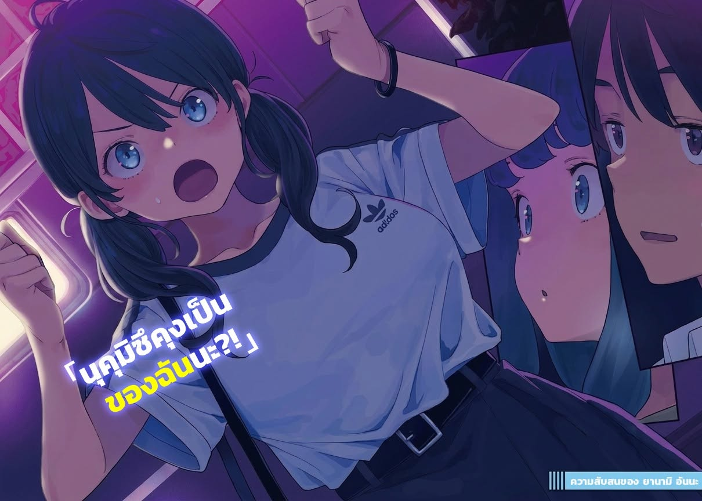

# Ch.173 — เล่ม 9 บทที่ 3-5

Ch.173 — เล่ม 9 บทที่ 3-5

By มนก

Published: 2026-07-31T12:23:35Z

Source: https://www.nekopost.net/novel/14560/173

พอไปที่ห้องสมุดกลางเมืองก็ไม่เห็นวี่แววของมิซึชิมะ โคฮารุ แถมเดินหาจนทั่วทุกชั้นในตึกสถานีคัลเมีย เวลาก็ล่วงเลยไปจนสองทุ่มกว่าแล้ว

พวกเราเดินออกมาที่โถงทางเดินสถานีโทโยฮาชิด้วยความจนปัญญา มองดูผู้คนที่กำลังเร่งรีบกลับบ้าน

[ยานามิซัง ดึกแล้วนะ คงต้องกลับแล้วล่ะ]

[ยังมีรถบัสอยู่นี่ หาต่ออีกหน่อยเถอะ แล้วก็นะ──]

ยานามิเสยผมอย่างรู้สึกผิด

[จะว่ายังไงดี รู้สึกว่าตัวเองก็มีส่วนผิดนิดหน่อยน่ะ ถ้ายอมให้ซากุไรคุงตามไปตั้งแต่แรกก็คงดีー ถึงจะมาคิดได้เอาป่านนี้ก็เถอะ]

ช้าไปจริงๆ นั่นแหละ แต่จะมาโทษยานามิตอนนี้ก็ใช่ที่

เด็กม.ปลายที่ไม่มีทั้งเงินทั้งสมาร์ทโฟน คงเดินเตร็ดเตร่ไปไหนไกลจากตัวเมืองไม่ได้หรอก

จะไปทางเหนือตรงถนนมัตสึบะ หรือไปทางศาลาว่าการเมืองดีล่ะ──

ขณะที่กำลังมองตู้โชว์ตรงหน้าอย่างเหม่อลอย สายตาก็ไปสะดุดกับโมเดลชิคุวะโปรตีนขนาดยักษ์ ชิคุวะงั้นเหรอ...

[...สถานีฝั่งตะวันตกล่ะ เป็นไง]

[สถานีฝั่งตะวันตก? ตรงนั้นไม่มีอะไรเลยนี่]

เสียมารยาท คนดังสมัยก่อนเขาบอกไว้ว่ามีในสิ่งที่ไม่มีต่างหากเล่า

[เอาน่า ถ้าไม่อยากเจอคนรู้จัก สถานีฝั่งตะวันตกนี่แหละเหมาะสุด นอกจากร้านยามาสะชิคุวะแล้ว แถวนั้นก็มีแต่บาร์ โอกาสเจอคนรู้จักแทบจะเป็นศูนย์]

ไม่รู้ว่าประทับใจในไอเดียผมหรือเปล่า ยานามิเอานิ้วแตะคางพลางทำเสียงครางในลำคออย่างครุ่นคิด

[...เกี๊ยวซ่า]

[หืม?]

ตาของยานามิเป็นประกายวิบวับ

[นุคุมิซึคุง ทางฝั่งตะวันตกน่ะ มีร้านเกี๊ยวซ่าเจ้าเด็ดอยู่ตั้งหลายร้านเลยนะ]

[โห งั้นเหรอ ถ้าเป็นเรื่องไม่เกี่ยวกับที่กำลังหาคนอยู่ล่ะก็ ไว้ค่อยคุยทีหลังนะ]

ถึงผมจะตอบกลับแบบเย็นชา แต่ยานามิก็ยังทำหน้าภูมิใจแล้วเล่าต่อ

[สถานีฝั่งตะวันตกมีร้านเกี๊ยวซ่าเฉพาะทางกับร้านอาหารจีนสไตล์บ้านๆ อยู่ด้วยนะ ถ้ารวมกับร้านเกี๊ยวซ่าที่เดินออกไปอีกนิดล่ะก็ 3 ร้านนั้นจะถูกเรียกว่า สามเหลี่ยมเกี๊ยวซ่าแห่งสถานีตะวันตก ล่ะ──ฉันคิดชื่อเองแหละ]

[งั้นเหรอ น่าสนใจดีนะ เล่าจบยัง?]

พอเดินออกมาที่ฝั่งตะวันตกยามค่ำคืน คนส่วนใหญ่ที่เห็นก็มีแต่คนที่กำลังขึ้นรถมารับหลังลงชินคันเซ็น นอกนั้นก็เป็นพวกขี้เมาที่เดินโซเซไปมาประปราย

[แถวนี้เด็กม.ปลายเดินคนเดียวมันอันตราย เดี๋ยวผมไปหาเอง ยานามิซังรออยู่ที่นี่ถอะ]

พูดยังไม่ทันจบ ยานามิก็มองผมด้วยสายตาเจ้าเล่ห์

[โหー เป็นห่วงฉันด้วยเหรอเนี่ย โหー]

[เอ่อ คือในฐานะประธานชมรมวรรณกรรมน่ะ ความปลอดภัยของสมาชิกก็ถือเป็นความรับผิดชอบของประธานไง]

[จ้าๆ งั้นเดี๋ยวฉันไปเดินดูตามร้านสะดวกซื้อริมถนนใหญ่ละกัน แค่นี้โอเคไหม?]

[ถ้าแค่นั้นก็เอาเถอะ...]

ไม่รู้ทำไมยานามิถึงดูอารมณ์ดีตอนเดินไปที่ถนนใหญ่ กะจะไปกวาดล้างของกินในร้านสะดวกซื้อหรือไงนะ...

เอาเถอะ แยกกันเดินน่าจะหาเจอกว่า ยานามิชอบเถลไถล เอาจริงๆ ก็เกะกะการค้นหาอยู่นิดหน่อยนั่นแหละ

งั้น... เริ่มจากทางที่คนน้อยๆ ก่อนละกัน...

ผมเดินผ่านร้านอาหารจีนที่ทาสีแดงสด เลี้ยวตรงมุมถนนพลางมองโรงแรมธุรกิจ

เดินไปเรื่อยเปื่อยจนมาหยุดอยู่หน้าลานจอดจักรยานของเทศบาล

แถวนี้ตกดึกแล้วแทบไม่มีคนเดินผ่าน ต่อให้ตั้งใจจะหลบคน ก็ถือว่าเงียบเกินไปอยู่ดี

ตอนที่กำลังจะหันหลังกลับ สายตาก็มองเห็นคน 3 คนอยู่ไกลๆ

สองคนเป็นชายวัยทำงานที่ดูเหมือนกำลังเมาได้ที่

ส่วนอีกคนเป็นผู้หญิงสาวผมยาว──โคฮารุซังนั่นเอง

เหมือนกำลังคุยอะไรกันอยู่ ควรเข้าไปแทรกดีไหมเนี่ย...?

ภาพพนักงานบริษัทขี้เมากับเด็กสาวม.ปลาย มันดูไม่ค่อยดีเอาซะเลย ผมค่อยๆ เดินเข้าไปใกล้ๆ แล้วเอ่ยปากทักด้วยความกล้าๆ กลัวๆ ยิ่งกว่า

[เอ่อ... ขอโทษที่ขัดจังหวะนะครับ]

สายตาทั้ง 3 คู่หันขวับมามองผมทันที เสียงผมกลืนน้ำลายดังเอื้อก

[ผู้หญิงคนนี้ เอ่อ... มาด้วยกันกับผมน่ะครับ ขอตัวเธอกลับไปจะได้ไหมครับ]

ผมพูดตะกุกตะกักจนจบประโยค สองพนักงานบริษัทก็หัวเราะร่วน

[แฟนเหรอน้องชาย?]

[เอ่อ คือว่า]

[ปล่อยแฟนไว้คนเดียวแบบนี้ไม่ได้นะเว้ย เดี๋ยวก็โดนพวกขี้เมาทำไม่ดีหรอก]

[ก็พวกเรานี่หว่า]

พูดจบ สองคนนั้นก็หัวเราะกันอีกรอบ พวกนี้น่ารำคาญพอๆ กับยานามิเลยแฮะ...

ขณะที่ผมกำลังเอือมระอา สองคนนั้นก็ตบบ่าผมแล้วเดินจากไป

[ไอ้หนุ่ม ดูแลแฟนดีๆ ล่ะー!]

[ขอให้มีความสุขนะน้องสาวー!]

[อ-ครับ ขอบคุณครับ]

...ถ้ายานามิเมาแล้วจะเป็นแบบนี้หรือเปล่านะ

ระหว่างที่กำลังแอบหมดหวังเบาๆ โคฮารุซังก็มองผมด้วยสีหน้าแปลกใจ

[นุคุมิซึคุง ทำไมถึงมาอยู่ที่นี่ล่ะ?]

[ก็ตามหาอยู่น่ะสิ แล้วพวกนั้นมันอะไรกันล่ะ?]

[เขาเข้ามาทักน่ะ... แล้วฉันก็ว่างๆ อยู่พอดี]

เธอตอบพลางก้มหน้าหลบตาอย่างรู้สึกผิด

ก็นะ วัยรุ่นสมัยนี้ถ้าไม่มีสมาร์ทโฟนก็คงเบื่อแย่ล่ะมั้ง

ขณะที่ผมกำลังเข้าใจเหตุผล โคฮารุซังก็เดินทิ้งห่างออกไป

ผมรีบส่งข้อความบอกยานามิว่าเจอโคฮารุซังแล้ว พลางเดินตามเธอไป

[นี่ จะไปไหนน่ะ]

โคฮารุซังเดินต่อไปเงียบๆ

ดูเหมือนเธอจะยังคอยสังเกตจังหวะการเดินของผมที่ตามหลังมา ไม่ได้กะจะสลัดผมทิ้ง

ผมลองกระซิบถามขณะที่เดินผ่านย่านที่พักอาศัยอันเงียบสงัด

[เอ่อ... กำลังจะไปไหนเหรอครับ]

[ขอโทษนะ ถ้ารบกวน นุคุมิซึคุงกลับไปก่อนก็ได้นะ]

[เอ่อ จะให้ทำแบบนั้นได้ยังไงล่ะ ซากุไรคุงก็เป็นห่วงอยู่นะ]

พอได้ยินชื่อแฟน โคฮารุซังก็ชะงักฝีเท้าทันที

ตอนที่ผมกำลังจะอ้าปากทัก เธอก็ออกเดินต่อ

ตกลงกำลังจะไปไหนกันเนี่ย หรือแค่เดินไปเรื่อยเปื่อยไม่มีจุดหมาย

ระหว่างที่กำลังลังเลว่าจะโทรเรียกซากุไรคุงดีไหม โคฮารุซังก็หยุดเดินอีกครั้ง

...น่าจะได้เวลาแล้วล่ะ ดึกป่านนี้แล้ว วันนี้พากลับไปนอนบ้านผมก่อนดีกว่า

[โคฮารุซัง ดึกแล้ว กลับบ้านผมกันเถอะ]

ผมส่งเสียงเรียกพลางเดินเข้าไปหา โคฮารุซังก็คว้าข้อมือผมไว้

แล้วก้มหน้าลงพึมพำเบาๆ

[...จะเอาที่ไหนดีล่ะ?]

? ที่ไหนคืออะไร หรือว่าเรากำลังยืนอยู่กลางสามเหลี่ยมเกี๊ยวซ่างั้นเหรอ...?

พอมองไปรอบๆ ที่ที่พวกเรายืนอยู่ คือช่องว่างระหว่างตึก 2 ตึกที่สร้างหันหน้าเข้าหากัน

ตึกสูงๆ ที่ประดับประดาด้วยไฟหลากสีนั่นไม่ใช่โรงแรมธุรกิจ──แต่เป็นสถานที่สำหรับพักผ่อนและทำกิจกรรมเข้าจังหวะของชายหญิงต่างหาก

[ด-เดี๋ยวสิ รู้ไหมเนี่ยว่าที่นี่คือที่ไหน?!]

[...อื้อ]

โคฮารุซังยังคงจับข้อมือผมไว้แน่น พยักหน้ารับอย่างว่าง่าย

งั้นเหรอ งั้นก็ค่อยยังชั่ว ในเมื่อโคฮารุซังก็รู้ว่าที่นี่คือโรงแรม──

[ไม่ๆๆๆ! ไม่เลือกสักที่แหละ! ทำไมถึงคิดแบบนั้นล่ะเนี่ย]

[...ฉันว่า แค่นี้ก็พอแล้วล่ะ]

[เอ๊ะ?]

บนใบหน้าของเธอฉายแววของความยอมแพ้ การปลดปล่อย──และความไร้เรี่ยวแรงราวกับต้องการที่พึ่งพิง

รอยยิ้มที่เหมือนจะพังทลายลงได้ทุกเมื่อ กรีดลึกลงไปในใจผม

[พยายามมาเต็มที่แล้วล่ะ แต่แค่นี้ก็พอแล้ว นุคุมิซึคุงอุตส่าห์ใจดีกับฉัน เพราะงั้น]

[ถึงอย่างนั้นก็มาทำเรื่องแบบนี้ไม่ได้หรอกนะ...]

ถ้าไม่ใช่เรื่องแบบนี้ แล้วต้องทำยังไงดีล่ะ

ซากุไรคุงให้ความสำคัญกับโคฮารุซังในฐานะแฟนเสมอ

แต่ในส่วนที่สำคัญที่สุดของหัวใจ กลับมีโฮโคบารุ ฮิบาริ อยู่

ซึ่งเรื่องนั้น──โคฮารุซังเองก็รู้ดี

[ฉันเองก็เพิ่งเคยมาที่แบบนี้ครั้งแรก ไม่ค่อยรู้เรื่องอะไรหรอกนะ...]

มือของโคฮารุซังที่กำข้อมือผมอยู่ สั่นระริก

...จะยอมรับข้อเสนอนี้ไม่ได้เด็ดขาด

แต่จะผลักไสเธอไปก็ทำไม่ได้เหมือนกัน

ในเสี้ยววินาทีที่ผมตัดสินใจจะพูดอะไรบางอย่างออกไปแบบไม่คิดหน้าคิดหลัง

[ทั้งสองคน กำลังทำอะไรกันอยู่น่ะ?!]

เงาร่างหนึ่งพุ่งเข้ามาดุจลูกกระสุน แทรกกลางระหว่างพวกเราสองคน

[ยานามิซัง?!]

ใช่แล้ว คนที่พุ่งเข้ามาขย้ำคอด้วยสีหน้าดุดันราวกับยักษ์มาร ก็คือยานามินั่นเอง

ยานามิตัวสั่นเทิ้มด้วยความโกรธ จ้องเขม็งไปที่ใบหน้าของโคฮารุซัง

[โคฮารุจัง! คิดจะทำอะไรนุคุมิซึคุงฮะ?!]

[เอ๊ะ ก็จะทำอะไรล่ะ...]

เธอเอียงคอเล็กน้อย เหมือนประหลาดใจกับคำถามนั้น

[ก็กำลังคิดอยู่ว่าจะเข้าโรงแรมไหนกับนุคุมิซึคุงดีไง]

[อึ้ก!]

ขวับ รังสีอำมหิตหันมาทางผมทันที

[ไม่ๆๆ ปฏิเสธไปแล้ว! อีกอย่าง ฟังดูจากน้ำเสียงก็รู้แล้วใช่ไหมว่าไม่ได้พูดจริงจังน่ะ?]

[ฉันจริงจังนะ?]

โคฮารุซัง ขอร้องล่ะ ช่วยเออออตามน้ำไปหน่อยเถอะ

ขณะที่ผมกำลังเหงื่อแตกพลั่ก โคฮารุซังก็มองยานามิด้วยความสงสัย

[ขอถามเพื่อความแน่ใจนะ ยานามิซังไม่ได้คบกับนุคุมิซึคุงอยู่ใช่ไหม?]

[ไม่ได้คบย่ะ!]

เมื่อเห็นยานามิที่กำลังของขึ้น โคฮารุซังก็ยิ้มออกมาเหมือนโล่งใจ

[งั้น ถึงฉันจะเข้าโรงแรมกับนุคุมิซึคุงก็ไม่เป็นไรใช่ไหมล่ะ]

[...อึ้ก!]

ยานามิถึงกับพูดไม่ออก เดี๋ยวก่อน ทำไมสองคนนี้ถึงต้องมาทะเลาะกันด้วยล่ะ

ระหว่างที่ผมกำลังทำตัวไม่ถูก โคฮารุซังก็กระตุกมือผมแรงๆ

[ป่ะ เข้าไปกันเถอะ]

ไม่เข้าเฟ้ย──เดี๋ยวนะ โคฮารุซังแรงเยอะกว่าที่คิดแฮะ?!

วินาทีต่อมา ยานามิก็สะบัดมือของโคฮารุซังออกอย่างแรง แล้วประกาศลั่น

[นุคุมิซึคุงเป็นของฉันนะ?!]

............เอ๊ะ

ในขณะที่พวกเรากำลังอึ้ง ยานามิก็คงได้สติกลับมาเหมือนกัน

ธอยกมือทั้งสองข้างขึ้นมาตรงหน้า ส่ายหน้าปฏิเสธรัวๆ

[ด-เดี๋ยว ไม่ใช่นะ ไม่ได้หมายความแบบนั้น นี่ เข้าใจใช่ไหม?]

[เอ่อ... นุคุมิซึคุง?]

โคฮารุซังที่รับมือกับสถานการณ์ไม่คาดฝันไม่ถูก หันมามองผมเพื่อขอคำอธิบาย

เอาล่ะ ถึงตาผมออกโรงแล้ว ในฐานะคนสติดีเพียงคนเดียวในที่นี้ ผมมีหน้าที่ต้องเคลียร์สถานการณ์ให้กระจ่าง

[อ้อ อืม เข้าใจน่า ยานามิซัง]

ใช่แล้ว มันไม่ใช่อย่างนั้นสักหน่อย ผมไม่ใช่สิ่งของของยานามิ และแน่นอนว่าเราไม่ได้มีความสัมพันธ์แบบนั้นกันด้วย

[ประธานชมรมวรรณกรรมขืนไปทำเรื่องเสื่อมเสียแบบนั้นคงไม่ดีแน่ เดี๋ยวโดนสั่งยุบชมรมชั่วคราวอีกจะแย่เอา]

[หา?]

ไม่รู้ทำไมยานามิถึงจ้องผมเขม็งด้วยสายตาน่ากลัว

อะไรกัน ผมพูดอะไรผิดไปหรือเปล่านะ...

[เอ่อ อีกอย่าง การที่ยานามิซังเป็นห่วงชมรมวรรณกรรมขนาดนี้ ผมก็ดีใจนะ อืม]

[[หา?]]

คราวนี้ไม่ใช่แค่ยานามิ แต่โคฮารุซังก็มองผมด้วยสายตาเหมือนมองตัวประหลาดด้วย

เอ่อ... นี่ผมพูดอะไรผิดไปจริงๆ สินะ

ระหว่างที่ผมกำลังสับสนเพราะไม่เข้าใจอะไรเลย จู่ๆ โคฮารุซังก็ไปจับมือยานามิซังไว้

[เรื่องแบบนี้ ไม่อยากจะเชื่อเลย?! ยานามิซัง โอเคจริงๆ เหรอ?]

[ไม่โอเคย่ะ?! ถึงจะไม่โอเค แต่มันก็ไม่ได้เป็นแบบนั้นซะหน่อยนะ?]

ยานามิบีบมือโคฮารุซังตอบ

เดี๋ยวนะ ทำไมจู่ๆ สองคนนี้ถึงสนิทกันขึ้นมาล่ะ ความทรงจำผมหายไปสัก 2 ชั่วโมงหรือเปล่าเนี่ย?

ถึงจะสับสนขั้นสุด แต่การที่ชายหญิง3คนมายืนเถียงกันในที่แบบนี้มันไม่ดีแน่

เริ่มมีคนมุงดูแล้ว ต้องรีบออกไปจากที่นี่ให้เร็วที่สุด...

[ก็นะ ในเมื่อตกลงกันได้แล้ว... เราเปลี่ยนที่คุยกันดีกว่าไหม?]

พอผมพูดจบ ไม่รู้ทำไมทั้งสองคนถึงตวัดสายตามามองค้อนผม แล้วพูดขึ้นพร้อมกันว่า

[[ก็เพราะเป็นซะแบบนี้ไง นุคุมิซึคุง!]]

โดนด่าพร้อมกันเฉยเลย

◇

สิบกว่านาทีหลังจากหนีออกมาจากสถานการณ์วุ่นวาย พวกเราก็มาอยู่ที่แฟมิลี่เรสเตอรองต์แห่งหนึ่ง

อันที่จริงยานามิอยากจะเข้าร้านปูที่อยู่ฝั่งตรงข้าม แต่ผมไม่มีเงินจ่ายหรอกนะ

หลังจากรายงานเรื่องราวทั้งหมดให้ซากุไรคุงฟังเสร็จ ผมก็เอาช้อนตักขนมคุดสึมันจูพลางลอบสังเกตการณ์ยานามิกับโคฮารุซัง

คู่หูเพื่อนรักเฉพาะกิจคู่นี้ กำลังเมาท์มอยนินทาซากุไรคุงกับผม(ทำไม)อย่างเมามัน

[ใช่เลย ผู้ชายเนี่ยคิดว่าแค่ขอโทษก็จบแล้ว มักง่ายชะมัด]

ง่ำ ยานามิพูดพลางยัดแพนเค้กทาวเวอร์เข้าปากคำโต

[จริงที่สุดเลย! คิดว่ายังไงเดี๋ยวก็ต้องกลับไปหาอยู่ดีใช่ไหมล่ะ? ฉันเองก็มีคนมาจีบเหมือนกันนะ ถ้าไม่ดูแลกันดีๆ ระวังจะเสียใจนะ?!]

โคฮารุซังซัดช็อกโกแลตซันเดย์รวดเดียวหมด แล้วกระแทกแก้วลงบนโต๊ะดังปัง

จากนั้นทั้งคู่ก็หันมาจ้องผมเขม็ง

[[นุคุมิซึคุง ฟังอยู่หรือเปล่า?!]]

ทำไมต้องมาหาเรื่องผมด้วยเนี่ย น่ากลัวกว่าปกติ 2 เท่าเลยนะ

[เอ่อ ถ้าเป็นเรื่องของซากุไรคุง เดี๋ยวผมจะไปเตือนให้ใจเย็นๆ...]

ฉึก. ยานามิเอาส้อมแทงแพนเค้กเต็มแรง

[ทำไมจู่ๆ ถึงไปพูดเรื่องซากุไรคุงล่ะ?!]

เอ๊ะ ไม่ใช่เหรอ? แล้วเรื่องของใครล่ะ ถ้าเป็นเรื่องไม่เป็นเรื่องก็ช่วยไปคุยกันที่อื่นเถอะ

[ก็บอกแล้วไงว่า ผู้หญิงน่ะ ต้องการความรู้สึกซาบซึ้งใจมากกว่านี้ แค่การได้อยู่ข้างๆ น่ะ มันก็เข้าใจได้อยู่หรอกว่าเป็นความสัมพันธ์ในอุดมคติ แต่ผู้หญิงน่ะเหมือนดอกไม้นะ ถ้าไม่รดน้ำพรวนดินเติมอาหารใจให้บ้าง มันก็เหี่ยวเฉานะรู้ไหม?]

เข้าใจละ...ไม่สิ...ไม่เข้าใจเลยสักนิด สรุปคือแคลอรี่ไม่พอใช่ไหม?

[เอ่อ สั่งข้าวเพิ่มไหม?]

[ไม่สั่งย่ะ?!]

นั่นสินะ ข้าวกับแพนเค้กมันไม่เข้ากันนี่นา

กำลังพยักหน้าเห็นด้วย โคฮารุซังก็ปาจรวดกระดาษที่พับจากกระดาษเช็ดปากใส่ผม หยุดนะ

[นุคุมิซึคุง ผู้หญิงน่ะนะ ถ้าไม่มัดใจไว้ให้ดี เดี๋ยวก็เปลี่ยนใจไปชอบคนอื่นนะ เข้าใจปะ?]

[อ้อ ครับ]

พอผมตอบแบบขอไปที คราวนี้ยานามิก็ปานกกระเรียนที่พับจากกระดาษเช็ดปากใส่บ้าง พับเก่งจังแฮะ

[โคฮารุจังเข้าใจพูดนี่นา แต่พวกเราไม่ได้เป็นอะไรกันซะหน่อยนะ?]

โคฮารุซังกินช็อกโกแลตซันเดย์จนหมดเกลี้ยง แล้วเอาช้อนคันยาวชี้หน้าผม

[นุคุมิซึคุง จะปล่อยให้ยานามิซังพูดแบบนี้ต่อไปจริงๆ เหรอ?]

[เอ๊ะ ไม่หรอก ผมเคารพการตัดสินใจของยานามิซังอยู่แล้ว...]

[[นุคุมิซึคุง หุบปากไปเลย!]]

เอ๊ะ... โคตรจะไร้เหตุผลเลย

ดูท่าทางมหกรรมนินทาของสองคนนี้คงไม่จบง่ายๆ ยานามิยกมือเรียกพนักงานที่เดินผ่าน

[[ขอทรีซันเดย์สตรอว์เบอร์รีอะมะโอค่ะ!]]

เสียงประสานกันของทั้งสองคน เป็นสัญญาณเริ่มยกที่ 2 คืนนี้คงอีกยาวไกลแน่ๆ...

ผมเตรียมใจพลางจะกินคุดสึมันจูที่เหลือ แต่จู่ๆ ก็มีช้อน 2 คันโผล่มาฉกคุดสึมันจูของผมไปหน้าตาเฉย

◇

ทางกลับบ้านจากป้ายรถราง

เวลาล่วงเลยเข้าสู่ช่วงดึก ย่านที่พักอาศัยเงียบสงัด

ลมกลางคืนที่พัดพาความร้อนหลงเหลือจากตอนกลางวันมาด้วย ทำให้เหงื่อซึมชื้นที่ต้นคอ

[ดึกป่านนี้แล้วเนอะ]

โคฮารุซังที่เดินด้วยฝีเท้าเบาหวิวเหมือนกำลังลอยไปตามถนนยามค่ำคืนเอ่ยขึ้น

ผมตอบ [นั่นสิ] แล้วชะลอฝีเท้าลงให้เท่ากับเธอ

เมื่อเงยหน้ามองฟ้า ท้องฟ้ายามค่ำคืนก็ถูกแสงจันทร์กลบจนมองไม่เห็นดาวสักดวง

พอเหลือบมองสมาร์ทโฟน ก็เห็นการแจ้งเตือนจากยานามิอีกแล้ว

ตั้งแต่แยกกันที่หน้าสถานี ยานามิก็ส่ง LINE มารัวๆ ทุกๆ 1 นาทีเลย

ผมส่งสติกเกอร์ตอบกลับไปส่งๆ แล้วยัดสมาร์ทโฟนใส่กระเป๋ากางเกง

[โดนเป็นห่วงใหญ่เลยนะ]

โคฮารุซังหัวเราะอย่างสนุกสนาน

[เปล่าหรอก คนที่โดนเป็นห่วงน่ะ โคฮารุซังต่างหาก]

[ยานามิซังน่ะเหรอ ที่เป็นห่วงฉัน?]

เธอทำหน้าประหลาดใจจริงๆ จนผมเผลอหลุดปากออกไป

[ก็พวกเราเกือบจะเข้าโรงแรมกันไปแล้วนี่นา──]

ผมรีบหุบปากฉับ โคฮารุซังก็มองผมด้วยสายตาหยอกล้อ

[นุคุมิซึคุง กะจะเข้าไปจริงๆ ด้วยสินะ]

[ไม่ได้กะจะเข้าสักหน่อย!]

ขอร้องล่ะ ช่วยปรานีผมเถอะ ในเมืองโทโยฮาชิเนี่ย ไม่รู้เลยว่าใครแอบฟังอยู่ตรงไหนบ้าง

โคฮารุซังขยับตัวเข้ามาเบียดผมที่กำลังกลัวจนตัวสั่น แล้วกระซิบข้างหูเบาๆ

[...ตอนนี้เราสองคนหายตัวไปด้วยกันเลยดีไหม?]

[เดี๋ยวก่อน เลิกเล่นมุกแบบนี้สักทีเถอะ]

ผมรอให้โคฮารุซังพูดคำว่า [ล้อเล่นน่า] ออกมา แต่คำนั้นก็ไม่หลุดออกมาจากปากเธอ

สิ่งที่หลุดออกมาแทน คือคำพูดที่ดูเหนือความคาดหมาย แต่ลึกๆ แล้วผมก็เตรียมใจไว้บ้างแล้ว

[...ฉันรู้อยู่แล้วล่ะ ว่าฮิโระคุงชอบฮิบาริน่ะ]

ด้วยน้ำเสียงที่เหมือนกำลังหวนนึกถึงความทรงจำอันแสนงดงาม

[ตั้งนาน นานมาแล้วด้วย และฮิบาริเองก็คงจะเหมือนกัน]

เธอหยุดพูดแค่นั้น จู่ๆ ก็หันมาจ้องหน้าผม

[เพราะงั้น ฉันก็เลยแย่งฮิโระคุงมาไงล่ะ]

[เอ๊ะ...]

ยังไม่ทันที่ผมจะแยกแยะได้ว่าเธอพูดเล่นหรือพูดจริง เธอก็หลบตาไปอีกครั้ง

[เพราะงั้น ตอนนี้ฉันเลยกำลัง──รับกรรมอยู่นี่ไง]

ผมไม่รู้จะตอบกลับไปยังไงดี เลยได้แต่ก้าวเดินต่อไป

เธอเองก็คงไม่ได้คาดหวังคำตอบอะไรจากผมอยู่แล้ว

[ต้องทำตัวให้ดีขึ้นแล้วสิเนี่ยー]

โคฮารุซังพูดพลางแกว่งตัวไปมา ปล่อยให้คำพูดละลายหายไปกับค่ำคืนของฤดูร้อน

คำพูดของเธอ ทำให้ผมสัมผัสได้ถึงความรู้สึกเหมือนคนที่ปล่อยวางได้แล้ว แต่ก็แฝงไปด้วยความเปราะบางบางอย่าง

และด้วยเหตุผลอะไรก็ไม่รู้ ทำให้ผมอยากจะฟังเสียงของใครบางคนที่ไม่ได้อยู่ที่นี่ขึ้นมา──
