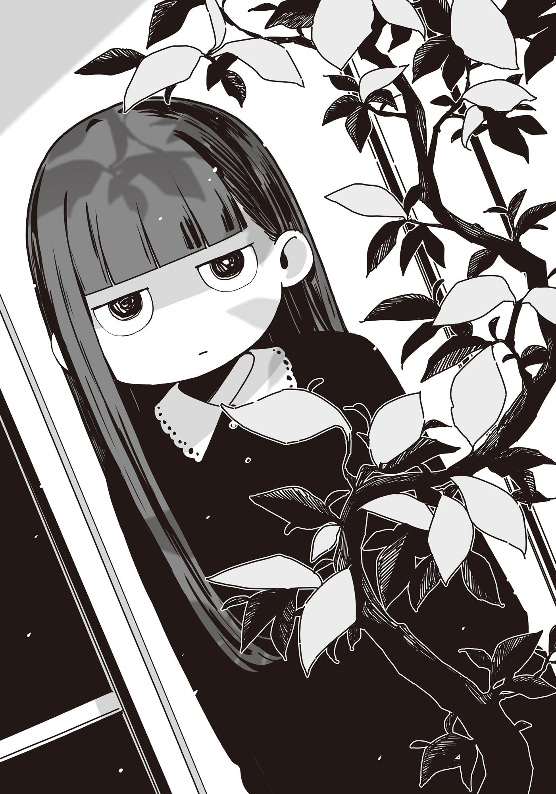

# Ch.175 — เล่ม 9 บทที่ 4-1

Ch.175 — เล่ม 9 บทที่ 4-1

By มนก

Published: 2026-07-31T12:25:23Z

Source: https://www.nekopost.net/novel/14560/175

ที่นี่เป็นร้านขนมปัง แต่มุมร้านกาแฟสไตล์เรโทรก็ได้รับความนิยมไม่แพ้กัน ผมเองก็เคยมาใช้บริการอยู่หลายครั้ง

พอเดินเข้าไปในร้าน รุ่นพี่โฮโคบารุที่มาถึงก่อนแล้วก็ยกมือขึ้นทักทาย

[ ขอโทที่เรียกมานะ ]

[ไม่เป็นไรครับ อยู่บ้านก็อึดอัดพอดีเลย]

[ดึงเธอเข้ามาพัวพันเต็มๆ เลยสินะ]

ผมนั่งลงฝั่งตรงข้ามรุ่นพี่ที่กำลังส่งยิ้มแห้งๆ พลางถือแก้วเลมอนสควอช

การมาเยือนบ้านนุคุมิซึของมิซึชิมะ โคฮารุ ล่วงเลยมาถึงวันที่ 5 แล้ว คาจูก็ใกล้จะถึงขีดจำกัดเต็มทน

เมื่อคืนจู่ๆ คาจูก็มาโผล่อยู่ที่หัวเตียง แล้วบ่นเรื่องความอึดอัดใจให้ฟังซะยืดยาว

ขณะที่ผมกำลังปวดหัว รุ่นพี่ดันกระเป๋าเดินทางมาให้

[แม่ของโคฮารุฝากมาน่ะ มีเสื้อผ้า อุปกรณ์การเรียน แล้วก็ค่าอาหาร ฝากให้คุณพ่อคุณแม่ของเธอด้วยนะ]

[สัมภาระเยอะเอาเรื่องเลยนะครับเนี่ย]

นี่กะจะอยู่ยันเปิดเทอมเลยหรือไง

ขณะที่ผมกำลังแอบสิ้นหวังนิดๆ รุ่นพี่โฮโคบารุก็อธิบายเพิ่ม

[มีชุดยูคาตะอยู่ด้วยน่ะ มีครบตั้งแต่โอบิยันรองเท้าเกี๊ยะเลยนะ]

[จะว่าไปพรุ่งนี้แล้วนี่นา]

ใช่พรุ่งนี้จะมีงานเทศกาลดอกไม้ไฟประจำเมืองโทโยฮาชิ

แถวๆ สถานที่จัดงานคนจะเยอะเบียดเสียดกันมาก ผมเลยตั้งใจว่าจะไม่ไปเฉียดแถวนั้นเด็ดขาด

[เห็นว่าตั้งตารอที่จะไปดูดอกไม้ไฟกับฮิโรโตะพรุ่งนี้น่ะ แม่ของโคฮารุคงจะเกรงใจล่ะมั้ง]

[อ้อー]

...ในสถานการณ์แบบนี้ คงไม่มีทางไปเดตดูดอกไม้ไฟด้วยกันแบบหวานแหววหรอกมั้ง

เมื่อเห็นปฏิกิริยาของผม รุ่นพี่โฮโคบารุก็ทำหน้าเป็นกังวล

[สองคนนั้น ยังไม่ดีกันอีกเหรอ?]

[เฮ้อ ยิ่งกว่านั้น เมื่อวานเหมือนรอยร้าวจะลึกขึ้นกว่าเดิมอีกครับ...]

ผมพยายามเลือกคำพูด แล้วเล่าเรื่องที่เกิดขึ้นในช่วงไม่กี่วันที่ผ่านมาให้ฟัง

แน่นอนว่าไม่ได้เล่าเรื่องเหตุการณ์หน้าโรงแรมเมื่อคืน กับเรื่องเงื่อนไขการคืนดีของโคฮารุซังหรอกนะ

──เงื่อนไขที่ว่า ต่อจากนี้ ซากุไรคุงต้องไม่ไปเจอโฮโคบารุ ฮิบาริ อีก

ข้อเรียกร้องของโคฮารุซังดูเอาแต่ใจ แต่ในมุมหนึ่งมันก็มีเหตุผล

เพราะก้างขวางคอชิ้นโตที่สุดของทั้งสองคน ก็คือคนที่นั่งอยู่ตรงหน้าผมนี่แหละ──

หลังจากฟังผมอธิบายจบ รุ่นพี่โฮโคบารุก็จ้องหน้าผมเขม็ง

[...ฉันมีส่วนเกี่ยวข้องอะไรด้วยหรือเปล่า]

[เอ๊ะ เรื่องนั้นมัน...]

เห็นท่าทีอ้ำอึ้งของผม รุ่นพี่ก็คงจะเดาอะไรได้บ้างล่ะมั้ง

[รุ่นพี่โฮโคบารุก้มหน้าครุ่นคิด พลางดูดน้ำจากหลอด]

[ปู่ย่าของฉันอยู่ที่คอนโดหน้าสถานีน่ะ จากระเบียงบ้านมองเห็นดอกไม้ไฟชัดเลยล่ะ]

[อ้อ ดีจังเลยนะครับ]

จู่ๆ ก็เปลี่ยนเรื่อง ผมเลยได้แต่เออออไปแบบงงๆ

[พรุ่งนี้ครอบครัวฉันกับครอบครัวฮิโรโตะมีนัดกินข้าวด้วยกันที่นั่นเหมือนทุกปี ถ้าจู่ๆ ว่างขึ้นมา ฮิโรโตะก็คงไม่มีทางเลือกนอกจากต้องไปร่วมงานด้วย]

[อา ครับ]

ผมตอบส่งๆ ไปพลางดูดครีมโซดาที่สั่งมา

[พูดอีกอย่างก็คือ ฮิโรโตะว่าง ถ้าเธอชวน เขาก็น่าจะตกลงนะ]

[แล้วจะให้ไปเจอโคฮารุซังเหรอครับ? เมื่อวานเพิ่งทะเลาะกันเพราะเรื่องนี้นะครับ]

[ถ้าจะคืนดีกันล่ะก็ ยิ่งเร็วยิ่งดี ขืนปล่อยเวลาให้ผ่านไป ทั้งสองคนอาจจะห่างเหินกันไปเลยก็ได้นะ]

นั่นก็──อาจจะจริง

เมื่อเห็นผมเงียบ รุ่นพี่ก็พูดต่อ

[ตอนแรกโคฮารุก็หลอกฮิโรโตะให้ไปเที่ยวด้วยกัน เมื่อวานฮิโรโตะก็หลอกโคฮารุออกมาคุยกันใช่ไหมล่ะ? งั้นคราวนี้ก็ตาฉันบ้างล่ะ ฉันเตรียมใจรับบทตัวร้ายไว้แล้วล่ะ]

เธอร่ายยาวรวดเดียวจบ แล้วเสยผมขึ้น

[ว่าแต่ โคฮารุซังนัดไปดูดอกไม้ไฟกับซากุไรคุงไว้แล้วเหรอครับ]

[ยังไม่ได้ตกลงเรื่องสถานที่กับเวลาชัดเจนหรอกนะ คงไม่คิดว่าจะมาติดต่อไม่ได้แบบนี้หรอก]

รุ่นพี่โฮโคบารุเท้าคางข้างหนึ่ง แล้วไขว่ห้าง

[เดี๋ยวฉันจะเป็นคนชวนโคฮารุเอง รับรองว่าเขาต้องตกลงแน่]

──โฮโคบารุ ฮิบาริ เพราะเป็นคนคนนี้แหละ การหลอกถึงจะมีความหมาย

แต่ผมยังเหลือเรื่องกังวลอยู่อีกเรื่อง

[แต่จะยอมมาเหรอครับ เพราะโคฮารุซัง──]

พอรู้สึกตัวว่ากำลังจะหลุดปาก ก็เลยหุบปากฉับ รุ่นพี่ก็ยิ้มมุมปาก

[โคฮารุคงจะคิดแบบนี้แน่ๆ ว่าถ้าปฏิเสธคำชวนของฉัน ฉันกับฮิโรโตะก็จะได้ไปดูดอกไม้ไฟด้วยกันที่บ้านปู่──ใช่ไหมล่ะ]

ด้วยสีหน้าและแรงกดดันนั้น ผมได้แต่พยักหน้าเงียบๆ

เธอรู้ตัวมาตั้งนานแล้ว ว่าโคฮารุซังไม่พอใจความสัมพันธ์ระหว่างเธอกับซากุไรคุง

แต่ถึงอย่างนั้น ก็ไม่ได้พยายามเว้นระยะห่างจากซากุไรคุงเลย นั่นแปลว่า──

[นี่คงเป็นครั้งสุดท้ายแล้วล่ะ ที่พวกเรา 3 คนจะได้ทำอะไรร่วมกัน วันจริงฉันจะไม่ไปปรากฏตัวหรอกนะ ที่เหลือก็ให้เจ้าตัวเขาจัดการกันเอง]

รุ่นพี่โฮโคบารุวางแก้วที่ว่างเปล่าลง แล้วหยิบบิลลุกขึ้นยืน

[อ๊ะ ส่วนของผมเดี๋ยวจ่ายเองครับ]

[ช่างเถอะ ถือว่าเป็นค่าทำขวัญแล้วกัน ขอโทษนะที่เลี้ยงได้แค่นี้]

รุ่นพี่โฮโคบารุเสยผมแทนคำบอกลา แล้วเดินออกจากร้านไป

ผมใช้ช้อนตักไอศกรีมที่เริ่มละลาย พลางนึกทบทวนบทสนทนาเมื่อครู่

...ที่ผ่านมา ผมยอมตามน้ำทำเรื่องวุ่นวายพวกนี้ ก็เพื่อจะช่วยเป็นแม่สื่อพ่อสื่อให้ซากุไรคุงกับโคฮารุซัง

แต่ในที่สุด ผมก็เริ่มมองเห็นรูปร่างของสิ่งที่พวกเขาทั้ง 3 คนกำลังเผชิญหน้าอยู่

สิ่งที่ผมกำลังมองเห็น คือความสัมพันธ์ที่กำลังจะจบลง ไม่ว่าจะออกหัวหรือก้อย ก็ต้องมีคนร้องไห้

และบทบาทที่ผมได้รับมอบหมายก็คือ──เพชฌฆาต ผู้จบความสัมพันธ์นั้น

◇

หลังจากนั้นไม่นาน ผมก็หอบข้าวของพะรุงพะรังย้ายมาที่ร้านกาแฟอีกแห่ง

เป็นร้านริมถนนที่อยู่ทางเหนือของถนนอาเขตโทกิวะ ภายนอกตกแต่งด้วยกระเบื้องดูเก่าแก่แต่ให้บรรยากาศที่สงบเงียบ

[เฮ้อ... เป็นเรื่องเป็นราวขนาดนั้นเลยเหรอคะเนี่ย]

คนที่พยักหน้าอย่างเข้าใจอยู่ที่ฝั่งตรงข้ามของโต๊ะกลม คือเทียร่าซัง

ในเมื่อได้เล่าข้อมูลให้ฟังไปในเดต(?)คาราโอเกะวันก่อนแล้ว ก็ควรจะต้องรายงานความคืบหน้าให้ฟังด้วย พอคิดแบบนั้นก็เลยติดต่อไป แต่ไม่รู้ทำไมถึงกลายมาเป็นการนัดติวหนังสือซะได้

[แล้วงานดอกไม้ไฟพรุ่งนี้ ก็จะเรียกสองคนนั้นมาคืนดีกันสินะคะ]

[ก็ กะว่าจะให้เป็นแบบนั้นแหละ]

เพิ่งทะเลาะกันเมื่อวาน วันนี้จะให้ดีกันเลย──มันจะง่ายขนาดนั้นเชียวเหรอ

ระหว่างที่กำลังกดดินสอกดเล่นอย่างใช้ความคิด เทียร่าซังก็ถามขึ้นด้วยความสงสัย

[ถ้าสมมติว่าซากุไรคุงกับมิซึชิมะซังยอมมาตามแผน แล้วพวกคุณจะดูดอกไม้ไฟด้วยกัน 3 คนเหรอคะ ไม่รู้สึกอึดอัดแย่เหรอคะ?]

ยังคงเป็นผู้หญิงที่พูดจาตรงไปตรงมาเหมือนเดิม

ก็จริงอย่างที่เทียร่าซังพูด ถ้าทุกอย่างราบรื่น ผมก็คงกลายเป็นก้างขวางคอ การต้องไปอยู่ท่ามกลางบรรยากาศอึดอัดคนเดียวมันก็เหมือนนั่งอยู่บนเข็มแหละนะ

[เพราะงั้นแหละ ถ้ามีใครมาอยู่เป็นเพื่อนอีกสักคนก็คงดีนะ]

[เอ๊ะ]

แก้วกาแฟเย็นในมือเทียร่าซังสั่นกึก

[พ-พรุ่งนี้ใช่ไหมคะ นัดกันกี่โมงเหรอคะ?]

[น่าจะรวมตัวกันหกโมงเย็น หน้าศาลเจ้าโยชิดะนะ มีอะไรเหรอ?]

[ป-เปล่าค่ะ... แค่คิดว่ากะทันหันจังเลยน้า]

ก็นะ ถึงเป็นผมก็เถอะ ถ้าไม่ใช่คนว่างจริงๆ มาชวนกันกะทันหันก่อนวันงานแบบนี้ก็คงลำบากใจเหมือนกันแหละ ถ้าไม่ใช่คนว่างจริงๆ อะนะ

[ก-ก็ การออกไปข้างนอกตอนกลางคืนมันก็ไม่ค่อยดีเท่าไหร่ แต่แถวๆ งานคนเยอะ ถึงจะมืดแล้วก็คงปลอดภัยดี]

[อาー นั่นสินะ]

แม้แต่เวลาแบบนี้ก็ยังห่วงเรื่องกฎระเบียบ เป็นประธานนักเรียนนี่ลำบากจังน้า...

ตอนที่ผมกำลังจะเริ่มทำการบ้านต่อ เทียร่าซังก็พูดขึ้นอีก

[ฉันสงสัยมาตั้งแต่เมื่อกี้แล้ว สัมภาระพวกนั้นคืออะไรเหรอคะ?]

[อ้อ ฝากมาจากรุ่นพี่โฮโคบารุน่ะ เป็นของของโคฮารุซัง มีพวกเสื้อผ้ากับชุดยูคาตะ]

[รุ่นพี่มาที่นี่เหรอคะ เห็นบอกว่าจะไปเรียนพิเศษภาคฤดูร้อนที่โรงเรียนกวดวิชาหน้าสถานีนี่นา]

ถึงจะเป็นนักเรียนดีเด่นระดับท็อปของชั้นปี ก็ยังต้องไปกวดวิชาอย่างหนักสินะ

ระหว่างที่ผมกำลังประทับใจกับเรื่องธรรมดาสามัญ เทียร่าซังก็ถามขึ้นอย่างกล้าๆ กลัวๆ

[...นุคุมิซึซัง ชอบชุดยูคาตะไหมคะ?]

ชุดยูคาตะเหรอ? ถ้าถามว่าชอบไหม ผู้ชายส่วนใหญ่ก็คงตอบว่าชอบแหละ

ได้เห็นทั้งต้นคอและข้อเท้าที่ปกติไม่ได้เห็นกันง่ายๆ ก็ถือเป็นคะแนนบวกอย่างหนึ่ง

[อืม ก็ดูเข้ากับหน้าร้อนดีนะ]

พอผมตอบแบบกลางๆ ไป ไม่รู้ทำไมเทียร่าซังถึงพยักหน้ารับอย่างจริงจัง

[มีอะไรเหรอ?]

[ป-เปล่าค่ะ แค่คิดว่าเป็นอย่างนั้นสินะคะ]

เทียร่าซังดูดน้ำจากหลอดด้วยท่าทีเขินอาย

ระหว่างที่ผมกำลังงงกับปฏิกิริยาของเทียร่าซัง หน้าจอสมาร์ทโฟนบนโต๊ะก็สว่างขึ้น

พอเหลือบไปเห็นชื่อ 「ยานามิ」 ที่ขอบจอ ผมก็รีบคว้าสมาร์ทโฟนขึ้นมาทันที

เหมือนพรุ่งนี้จะมางานดอกไม้ไฟได้ไม่มีปัญหาแฮะ

ตอบกลับเร็วซะด้วย หรือว่ายานามิจะว่างมากจริงๆ...?

เพื่อเป็นการรักษาหน้าของยานามิ ผมเลยหยุดจินตนาการไว้แค่นั้น แล้วมองรูปภาพที่แขวนประดับบนผนังร้านอย่างเหม่อลอย

◇

โคฮารุซังคลี่ชุดยูคาตะออกกลางห้องนั่งเล่นบ้านผม แล้วส่งเสียงร้อง [ว้าว]

ชุดยูคาตะสีม่วงอ่อนลายดอกฟูจิลายเรียบๆ แบบที่ผมชอบเลย

โคฮารุซังเอาชุดยูคาตะมาทาบตัว แล้วพยักหน้าหงึกๆ น่าจะเหมาะอยู่นะ...

ระหว่างที่ผมกำลังจินตนาการตอนเธอใส่ชุดนี้ โคฮารุซังก็หันมาหาผม

[นี่ นุคุมิซึคุง เป็นไงบ้าง?]

[อืม ดูดีเลยล่ะ──]

ยังไม่ทันพูดจบ ความทรงจำเมื่อคืนก็แล่นเข้ามาในหัว

หน้าโรงแรมธุรกิจสำหรับผู้ใหญ่ นิ้วมือที่สั่นเทาของโคฮารุซังตอนที่จับมือผม──

[เป็นอะไรไปน่ะ?]

[อ๊ะ เปล่าๆ แค่นึกถึงเรื่องเมื่อวานน่ะ]

คำตอบที่หลุดปากออกไปโดยสัญชาตญาณ ทำให้โคฮารุซังหน้าแดง แล้วเอาชุดยูคาตะขึ้นมาปิดหน้าด้วยความเขินอาย

[...เวลาแบบนี้ ต้องพูดว่าอะไรนะ ให้คิดซะว่าโดนหมาบ้ากัดแล้วลืมๆ มันไปซะดีไหม?]

[ไม่ได้โดนกัดสักหน่อยนี่นา?]

พอรู้สึกถึงสายตาที่จ้องมองมา ผมก็หันไปมองหลังต้นไม้ประดับในห้องนั่งเล่น เห็นคาจูแผ่ออร่าสีดำทะมึนจ้องผมเขม็ง น่ากลัว น่ากลัวเกินไปแล้ว ผมรีบหันกลับมามองทางเดิม

โคฮารุซังกำลังเรียงโอบิ รองเท้าเกี๊ยะ แล้วก็พวกของกระจุกกระจิกที่ผมไม่รู้จักชื่อเต็มไปหมด

[นอกจากชุดยูคาตะแล้ว ยังมีของส่งมาให้อีกตั้งเยอะแยะเลยนะ]

[เปล่าหรอก กว่าจะใส่ยูคาตะได้ต้องใช้ของพวกนี้หมดเลยนะ นี่ไง อย่างอันนี้ต้องใส่ไว้ใต้โอบิน่ะ]

โห ชุดยูคาตะแบบนี้ต่างจากชุดเรียวกังสินะ

ขณะที่กำลังนึกถึงยานามิในชุดยูคาตะ โคฮารุซังก็พึมพำออกมาเบาๆ

[...คุณแม่ ยังคิดว่าฉันจะไปดูดอกไม้ไฟกับฮิโระคุงอยู่เลย]

[งั้นเหรอ ซากุไรคุงติดต่อมาบ้างไหม?]

[ไม่รู้สิ บล็อกไว้เลยไม่รู้น่ะ]

เธอหัวเราะแห้งๆ แล้วเริ่มเก็บของกระจุกกระจิกเข้าที่อย่างทะนุถนอม

[ฮิบาริชวนมาน่ะ ก็เลยกะว่าจะไปกันแค่สองคน]

[อ้อ ก็ดีนี่นา อาจจะช่วยเปลี่ยนบรรยากาศได้บ้าง]

[ขืนปฏิเสธไปเดี๋ยวคุณแม่จะเป็นห่วงเอาน่ะสิ อีกอย่าง ฉันก็ยังสนิทกับฮิบาริอยู่นะ?]

ผมยังไม่ทันได้คิดคำตอบ โคฮารุซังก็ปิดกระเป๋าเดินทางดังป้าบ

[เอาล่ะ ไปเตรียมมื้อเย็นดีกว่า คาจูจัง ไปซื้อของด้วยกันไหม?]

[............]

คาจูยังคงจ้องมองผมจากหลังใบไม้ของต้นไม้ประดับอย่างเงียบๆ

ผมเหล่มองโคฮารุซังที่กำลังเดินยิ้มแย้มเข้าไปหาคาจู พลางเช็กข้อความในสมาร์ทโฟน

หลังจากยานามิที่ว่างจัด ซากุไรคุงก็ส่งข้อความตอบตกลงมาแล้วเหมือนกัน

เอาล่ะ... มาถึงขั้นนี้แล้ว ก็ต้องเดินหน้าต่อไปเท่านั้นแหละ

ผมทิ้งคาจูที่กำลังเปิดศึกกับโคฮารุซังโดยมีต้นไม้ประดับขวางกั้นไว้ แล้วเดินออกจากห้องนั่งเล่นไป

◇
