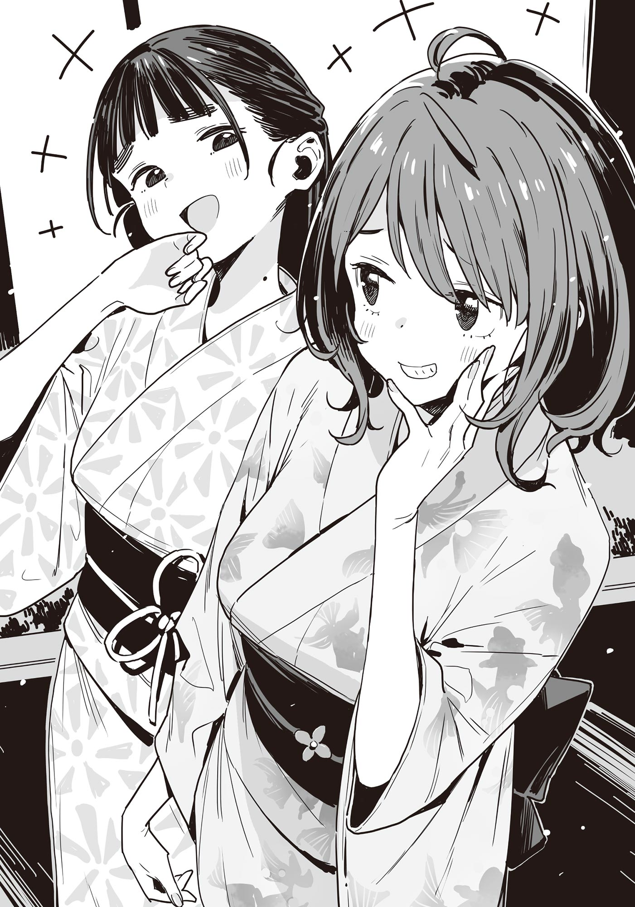

# Ch.176 — เล่ม 9 บทที่ 4-2

Ch.176 — เล่ม 9 บทที่ 4-2

By มนก

Published: 2026-07-31T12:26:38Z

Source: https://www.nekopost.net/novel/14560/176

โดยปกติแล้ว เทศกาลดอกไม้ไฟจะจัดขึ้นในวันที่สองของเทศกาลกิออนเมืองโทโยฮาชิ ถือเป็นงานใหญ่อันดับต้นๆ เทียบเท่ากับเทศกาลโทโยฮาชิในฤดูใบไม้ร่วง และเป็นเทศกาลที่ชาวเมืองรักใคร่ผูกพันมาอย่างยาวนาน

ปีนี้จัดช้ากว่าปกติหนึ่งสัปดาห์เนื่องจากเหตุผลด้านการเตรียมงาน แต่คนกลับคึกคักมากกว่าทุกปี

เวลาหกโมงเย็น บริเวณศาลเจ้าโยชิดะซึ่งเป็นจุดนัดพบ คลาคล่ำไปด้วยผู้คนที่มาจับจองพื้นที่กันอย่างเนืองแน่น

ผมเหลือบมองภาพเหล่านั้น พลางยืนสาปแช่งพระเจ้าอยู่หน้าเสาโทริอิ

[...นุคุมิซึคุง นี่มันหมายความว่ายังไง?]

[...นุคุมิซึซังนี่ เป็นคนไม่ดีเลยนะคะ]

ยานามิเอาเกี๊ยะเตะรองเท้าผม ส่วนเทียร่าซังก็เอาถุงหูรูดฟาดหลังผม

ทำไมกัน ทำไมถึงกลายเป็นแบบนี้ไปได้ล่ะ

ใช่ ผมอัญเชิญยานามิมาเป็นเครื่องสังเวยในยามคับขัน เรื่องนั้นผมยอมรับ

แต่ทำไม แม้แต่เทียร่าซังถึงมาอยู่ที่นี่ได้ล่ะ...?

ผมพยายามนึกย้อนไปถึงบทสนทนาในร้านกาแฟเมื่อวานด้วยความสับสน

...

…………

………………อืม ผมอาจจะผิดเองก็ได้

แต่นี่มันเกิดจากความเข้าใจผิดอันโชคร้ายต่างหาก ผมคงต้องบอกว่าความรับผิดชอบทางศีลธรรมของผมมันเบาบางมาก

ผมเหลือบมองเจ้าของสายตาทิ่มแทงที่แก้มซ้าย เทียร่าซัง นั่นเอง

เทียร่าซังในชุดยูคาตะสีฟ้าอ่อนลายดอกไม้ไฟ ปล่อยผมสยายต่างจากปกติ

เธอตัวสูงและหน้าเล็กกว่าที่คิด พอใส่ยูคาตะแล้วดูเป็นผู้ใหญ่ขึ้นแฮะ...

ระหว่างที่ผมเผลอมองเพลินๆ เทียร่าซังก็ลุกลี้ลุกลนหลบตาไปมา

[ม-มีอะไรเหรอคะ หรือว่ามีตรงไหนแปลกหรือเปล่า]

[อาー เปล่าหรอก แค่คิดว่าดูเหมาะดีน่ะ]

[ง-งั้นเหรอคะ ข-ขอบคุณที่ชมนะคะ...]

ระหว่างที่พวกเรากำลังเขินกันอยู่ แข้งของผมก็โดนเตะโลว์คิกจากยานามิเข้าเต็มๆ

[อะไรเนี่ย?! เตะผมทำไมอะ?]

[ก็ไม่ได้มีอะไรนะ]

ยานามิหันหน้าหนีไปทางอื่น

...หรือว่า นี่จะเป็นสัญญาณว่าผมต้องชมยานามิด้วยงั้นเหรอ

พอมองดูยานามิ ในมือขวาถือเฟรนช์ฟรายส์กับไก่ทอด ส่วนมือซ้ายก็มีปลาย่างเสียบไม้อยู่

ได้ทั้งคาร์โบไฮเดรต ไขมัน โปรตีน ครบถ้วนสารอาหารหลัก 3 หมู่ แถมยังได้เกลือแร่ที่มักจะขาดในช่วงหน้าร้อนแบบจัดเต็ม

อนึ่ง เธอใส่ชุดยูคาตะสีขาวๆ ลายปลาทอง

[เอ่อ วันนี้ก็กินเยอะเก่งเหมือนเดิม──โอ๊ย?! แล้วจะเตะทำไมอีกล่ะ?]

[ไม่ได้มีอะไรสักหน่อーย]

ยานามิเคี้ยวหัวปลาทอดกร้วมๆ เอาให้แคลเซียมเต็มเหนี่ยวไปเลยนะ

โดนไปขนาดนี้ บาปกรรมของผมก็น่าจะถูกชำระล้างไปหมดแล้วล่ะมั้ง

ขณะที่กำลังสลัดความรู้สึกผิดทิ้งไป ซากุไรคุงก็โผล่มาจากฝูงชน

ซากุไรคุงในชุดเสื้อยืดธรรมดาๆ พอเห็นสาวทสึวาบุกิสองคนก็ทำหน้าประหลาดใจ

[รอนานไหม อ้าว บาโซริจังกับเพื่อนก็มาด้วยเหรอ?]

[ค่ะ นุคุมิซึซังเป็นคนชวนน่ะค่ะ]

[ก็นุคุมิซึคุงรบเร้าให้มานี่นา]

นี่ ขอร้องล่ะ ช่วยหยุดสร้างอีเวนต์ย่อยในระหว่างที่กำลังเดินเนื้อเรื่องหลักอยู่ได้ไหมครับ

เพราะเทศกาลดอกไม้ไฟครั้งนี้ เป็นช่วงเวลาชี้ชะตาสำหรับซากุไรคุงกับโคฮารุซังเลยนะ คำพูดแค่ประโยคเดียวก็ตัดสินชะตากรรมของทั้งสองคนได้เลย ช่วยจริงจังกันหน่อยเถอะ

[...ฮิโระคุง?]

เสียงรองเท้าเกี๊ยะดังกระทบพื้นก้องกังวาน ท่ามกลางเสียงจอแจของผู้คน

เมื่อหันไปตามเสียง ก็เห็นโคฮารุซังในชุดยูคาตะยืนอึ้งอยู่

[โคฮารุก็ มาด้วยเหรอ]

ซากุไรคุงเองก็ทำหน้าอึ้งพอกัน

[ฮิบาริเรียกฉันมาน่ะ]

[งั้นเหรอ ฉันมีนัดกับนุคุมิซึคุงน่ะ เอ่อ... งั้นก็]

[อืม... งั้นก็]

ทั้งสองคนหลบตากันอย่างอึดอัด

ซากุไรคุงหันมาส่งสัญญาณให้พวกเรา

[เอาล่ะ มาครบแล้วก็ไปกันเถอะ จะดูตรงไหนดี]

...อ้าว ขืนปล่อยไว้แบบนี้ สองคนนั้นก็จะแยกกันเดินสิ

แย่แล้วสิ ผมไม่ได้คิดแผนรับมือสถานการณ์นี้ไว้ซะด้วย ผมลุกลี้ลุกลนตะโกนไล่หลังโคฮารุซังไป

[เอ่อ รุ่นพี่โฮโคบารุบอกว่าวันนี้มาไม่ได้แล้วนะ!]

[...? นุคุมิซึคุง ทำไมถึงรู้เรื่องนั้นล่ะ?]

โคฮารุซังหันกลับมามองด้วยความสงสัย

ทำไมน่ะเหรอ ก็เพราะเตี๊ยมกับรุ่นพี่โฮโคบารุให้เรียกสองคนนี้ออกมาไงล่ะ

แต่จะให้บอกความจริงก็คงไม่ได้ล่ะนะ...

[คือว่า รุ่นพี่เขาติดต่อมาน่ะ]

[ทำไมถึงติดต่อไปหานุคุมิซึคุงล่ะ? ของฉันไม่เห็นมีเลย]

อืม ผมก็ไม่มีเหมือนกัน โคฮารุซังเริ่มกดโทรศัพท์หา

ขณะที่ผมกำลังไปไม่เป็น ซากุไรคุงก็พูดขึ้นมาแทน

[นุคุมิซึคุง หรือว่า พี่ฮิบะเป็นคนขอให้นายชวนฉันออกมาเหรอ?]

[เอ่อ คือว่าเรื่องนั้น──]

เอาล่ะ วิ่งหนีกันเถอะ วินาทีที่ผมตัดสินใจแบบนั้น ซากุไรคุงก็เดินเข้าไปหาโคฮารุซัง

[...โคฮารุ ดูเหมือนพี่ฮิบะจะไม่มาแล้วล่ะ จะไปเดินดูงานกับพวกเราไหม?]

โคฮารุซังคงจะเข้าใจสถานการณ์แล้ว เธอละสมาร์ทโฟนออกจากหู แล้วพยักหน้าเงียบๆ

ค่อยยังชั่วหน่อย──ก็บ้าแล้ว สภาพแบบนี้จะไปรอดได้ยังไง กลุ่ม 5 คนของพวกเราเริ่มออกเดินด้วยบรรยากาศอึมครึม

...เพราะงั้น ยานามิ เลิกเตะผมสักทีได้แล้ว

◇

เดินไปได้สักพัก การจับคู่ก็เริ่มลงตัว

คนที่เดินนำหน้าคือซากุไรคุงกับโคฮารุซัง

ทั้งคู่ไม่ได้พูดอะไรกันเลย บรรยากาศระหว่างสองคนนั้นหนักอึ้งสุดๆ

และคนที่เดินตามหลังมาก็คือสาวสึวาบุกิในชุดยูคาตะ

บรรยากาศตึงเครียดตอนแรกหายไปเป็นปลิดทิ้ง กลายเป็นว่าทั้งคู่กำลังเมาท์มอยกันอย่างเมามัน

[ชุดยูคาตะสวยจังเลยนะ จะว่าไป คุณย่าฉันก็เคยใส่ชุดแบบนี้เหมือนกันน้าー]

[ขอบคุณค่ะ วิธีผูกโอบิของยานามิซังดูมีสไตล์และสวยดีนะคะ ถ้าเป็นฉันคงทำไม่ได้แน่ๆ ค่ะ]

ทั้งคู่หยุดเดินกะทันหัน แล้วหันมายิ้มให้กัน

[หุหุ ขอบใจจ้ะ บาโซริซังใส่ยูคาตะแล้วดูสวยจังเลยเนอะ ของฉันช่วงอกมันแน่นไปหน่อยน่ะ]

[แหม ไม่เห็นต้องฝืนรัดให้ดูผอมเลยนี่คะ? อวบๆหน่อยก็ดูเหมาะดีออกนะคะ]

ทั้งคู่หัวเราะคิกคักใส่กัน ก่อนจะออกเดินต่อ

อืม... ช่างเป็นพื้นที่อบอุ่นหัวใจราวกับอนิเมะแนว Slice of Life จริงๆ... อยากกลับบ้านจัง

จะว่าไป ผมก็ทำหน้าที่เป็นพ่อสื่อแม่ชักให้ซากุไรคุงแล้วนี่นา หน้าที่ของผมก็น่าจะจบลงแค่นี้แล้วมั้ง ส่วนยานามิกับเทียร่าซังก็ปล่อยให้ไปต่อยกันริมแม่น้ำแบบการ์ตูนโชเน็นเพื่อเคลียร์กันเองก็แล้วกัน

ระหว่างที่กำลังคิดอะไรเรื่อยเปื่อย พวกเราก็เดินมาถึงลานกว้างที่เป็นสนามหญ้า ซึ่งอยู่ลึกสุดของสวนสาธารณะโทโยฮาชิ

บริเวณนี้ไม่มีตึกสูงหรือต้นไม้ใหญ่บดบังทัศนียภาพ เหมาะกับการดูดอกไม้ไฟสุดๆ

พอหาพื้นที่ว่างๆ ปักหลักได้ ผมก็ลอบสังเกตการณ์ซากุไรคุงที่ยืนอยู่ห่างออกไป

ทั้งคู่ไม่ได้พูดคุยอะไรกันเลย ได้แต่เงยหน้ามองฟ้าด้วยระยะห่างที่ดูกระอักกระอ่วน

...ก็นะ ตอนนี้คงต้องปล่อยให้เป็นไปตามยถากรรมล่ะนะ

พอดึงความสนใจกลับมาที่รอบๆ ก็เห็นร้านแผงลอยตั้งเรียงรายรอบลานกว้างเต็มไปหมด

ยานามิที่เพิ่งจะจัดการอาหารรอบแรกไปหมาดๆ กำลังจ้องมองไปไกลๆ ด้วยสายตาดุจพญาเหยี่ยว

[ยานามิซัง ถ้าอยากกินอะไรก็ไปซื้อสิ?]

[นั่นสินะ...]

ยานามิกับเทียร่าซังชำเลืองมองกัน

[ฉันขอตัวไปเติมหน้าก่อนนะคะ ยานามิซังก็ไปด้วยกันไหมคะ ระหว่างทางน่ะค่ะ?]

[งั้นก็เอาสิ นุคุมิซึคุง ฝากเฝ้าที่ด้วยนะ]

[อ่า จะรออยู่แถวนี้แหละ]

ผมโบกมือส่งทั้งสองคน

ภาพที่เห็นตอนนี้ มันเหมือนกับผมเป็นศัตรูของผู้หญิงที่ควงสาวชุดยูคาตะสองคนเลยแฮะ...

ระหว่างที่กำลังคิดเรื่องไร้สาระอยู่นั้น เสียงจุดพลุทดสอบก็ดังกึกก้องขึ้นในท้องฟ้าที่ยังสว่างอยู่ พร้อมกับควันสีเทาที่พวยพุ่งขึ้นมา ดูเหมือนใกล้จะได้เวลาจุดพลุจริงๆ แล้วสินะ

พอถึงเวลาจริงก็แอบตื่นเต้นเหมือนกันแฮะ กล้องสมาร์ทโฟนตั้งค่าแบบนี้จะถ่ายสวยไหมนะ...

ระหว่างที่กำลังตั้งค่ากล้องสมาร์ทโฟน ก็มีกลุ่มคนแต่งตัวจัดจ้านปรากฏขึ้นบนหน้าจอ

เป็นกลุ่มสาวแกลวัยรุ่นในชุดยูคาตะกับจินเบสีสันสดใส

ขณะที่ผมกำลังกวาดสายตามองหาคนรู้จักอย่างไม่รู้ตัว สายลมเย็นยะเยือกก็พัดผ่านต้นคอ

[มาอยู่... ตรงนี้นี่เอง...]

[เฮ้ย?!]

คนที่ย่องเข้ามาด้านหลังคือ รุ่นพี่ชิกิยะ ยูเมโกะ อดีตคณะกรรมการสภานักเรียนโรงเรียนทสึวาบุกิ ปี 3 นั่นเอง

พอผมรีบหันกลับไป ก็เห็นรุ่นพี่ชิกิยะในชุดจินเบสีม่วงยืนโยกเยกไปมา

[รุ่นพี่? ทำไมถึงมาอยู่ที่นี่ล่ะครับ]

[มากับ... เพื่อน...]

เธอตอบแค่นั้นราวกับจะบอกว่าจบการอธิบาย แล้วจ้องผมด้วยดวงตาสีขาวขุ่น

[แล้วนายล่ะ... ?]

[เอ่อ มาเป็นเพื่อนซากุไรคุงน่ะครับ...]

รุ่นพี่ชิกิยะมองตามสายตาผมไป พอเห็นพวกซากุไรคุงเธอก็เอียงคอ

[แฟน... ? สวีต... ?]

[จะว่าไงดีล่ะครับ ก็หน้าร้อนนี่นา]

รู้ตัวว่าตอบแบบกำปั้นทุบดิน แต่ช่วยมองข้ามไปทีเถอะ เพราะตอนนี้รุ่นพี่ชิกิยะในชุดจินเบกำลังทิ้งน้ำหนักตัวพิงไหล่ผมอยู่

แถมตัวยังหอมฟุ้งอีกต่างหาก สำหรับเด็กม.ปลายผู้ชายธรรมดาๆ อย่างผม การจะให้รักษาสีหน้าเรียบเฉยในสถานการณ์แบบนี้มันแทบจะเป็นไปไม่ได้เลย

ระหว่างที่ผมตัวแข็งทื่อกับสัมผัสของนิ้วและเส้นผมที่มาคลอเคลียแถวๆ ต้นคอ รุ่นพี่ชิกิยะก็กระซิบที่ข้างหู

[มา... กับใคร... ?]

[หา?]

ผมรีบหันไปมองรอบๆ ยานามิกับเทียร่าซังยังไม่กลับมาเลย

[เอ่อ คือว่า ในฐานะผู้ช่วยงานเฝ้าระวังน่ะครับ ก็เลยมีคนไร้พิษสงมาด้วยสองคน──]

ผมรีบพูดกลบเกลื่อน แต่รุ่นพี่ชิกิยะกลับชะโงกหน้าเข้ามาจ้องตาผม

[ฉัน... ไม่เห็น... โดนชวนเลย...]

เธอพูดด้วยน้ำเสียงเหมือนกำลังงอน แล้วดึงผมด้านหลังของผมเบาๆ

[ก็รุ่นพี่กำลังเตรียมสอบอยู่นี่ครับ จะให้ชวนมาเที่ยวเล่นง่ายๆ ได้ยังไงล่ะ]

[เรื่องนั้น... ก็เข้าใจอยู่หรอก... แต่ก็... ไม่พอใจอยู่ดี...]

น้ำหนักที่ทิ้งลงมาบนไหล่

ลมหายใจเย็นยะเยือกและปลายนิ้วของรุ่นพี่ชิกิยะ คลอเคลียที่ต้นคอราวกับสายลมแผ่วเบา

ระหว่างที่ปล่อยให้เธอทำตามใจชอบ พลุลูกเล็กๆ ก็แตกกระจายเป็นวงไฟบนท้องฟ้าที่ยังหลงเหลือความสดใสของกลางวันอยู่

ประกายไฟสีขาวค่อยๆ เลือนหายไป ราวกับละลายไปกับแสงอาทิตย์ยามเย็น

ท่ามกลางกลุ่มควัน มีพลุลูกเล็กๆ ถูกจุดขึ้นตามมาติดๆ

──ความตื่นเต้นก่อนที่งานเทศกาลจะเริ่มขึ้น

ไม่รู้ทำไมผมถึงอยากจะถ่ายทอดความรู้สึกนี้ออกไป พอหลุบตาลง ก็เห็นดวงตาสีขาวขุ่นของรุ่นพี่ชิกิยะจ้องมองผมอยู่แล้ว

[สวย... จังเลยนะ]

[อา-ครับ สวย──ครับ]

เสียงดังกึกก้องทำเอาร่างกายสั่นสะเทือน

ในขณะที่เราจ้องตากันโดยไม่ละสายตา จู่ๆ รุ่นพี่ชิกิยะก็ผละตัวออก

[งั้น... กลับไปหา... เพื่อนก่อนนะ...]

[อ-ครับ]

──ขออยู่แบบนี้อีกนิดเถอะครับ

ยังไม่ทันที่คำพูดนั้นจะหลุดออกจากปาก ร่างของรุ่นพี่ชิกิยะก็หายลับไปในฝูงชนแล้ว

เหลือเพียงกลิ่นหอมจางๆ ที่ต้นคอ คอยย้ำเตือนว่าช่วงเวลาเมื่อครู่ไม่ใช่ความฝัน──

[นุคุมิซึซัง รอนานไหมคะ]

เสียงของเทียร่าซังดึงผมกลับสู่โลกความเป็นจริง ในมือเธอถือน้ำแข็งไสรสบลูฮาวายอยู่

[เอ๊ะ? อ้อ เหมือนใกล้จะเริ่มแล้วล่ะ ไปซื้อน้ำแข็งไสมาเหรอ]

[ค่ะ รู้สึกตัวร้อนๆ นิดหน่อยน่ะค่ะ]

พูดจบ เธอก็ตักน้ำแข็งไสเข้าปากหนึ่งคำ

สายตาผมจับจ้องไปที่เหงื่อเม็ดเล็กๆ กับไฝที่ต้นคอของเธอโดยอัตโนมัติ

[มีอะไรเหรอคะ จ้องซะขนาดนั้น]

[เห็นบลูฮาวายแล้วนึกถึงความหลังน่ะ]

ผมรีบแก้ตัว เทียร่าซังก็หัวเราะคิกคัก

[ที่บ้านฉันไม่ค่อยให้กินพวกอาหารกึ่งสำเร็จรูปน่ะค่ะ พอได้มางานเทศกาลแบบนี้ ก็เลยตั้งตารอที่จะได้กินของที่ดูไม่มีประโยชน์ต่อร่างกายพวกนี้น่ะค่ะ รู้สึกเหมือนได้ทำตัวเป็นเด็กไม่ดีเลย]

เธอแลบลิ้นอย่างซุกซน

[นี่ไงคะ ลิ้นเปลี่ยนเป็นสีฟ้าหรือเปล่าคะ?]

[จริงด้วยแฮะ]

เรามองหน้ากันแล้วก็หัวเราะ

เทียร่าซังตักน้ำแข็งไสสีฟ้าใส่ช้อน แล้วยื่นมาตรงหน้าผม

[นี่ค่ะ มาร่วมขบวนการเด็กไม่ดีด้วยกันไหมคะ]

เอ๊ะ มาป้อนให้กินกลางฝูงชนแบบนี้มันจะไม่ดูเป็นเด็กไม่ดีเกินไปหน่อยเหรอ แต่ถ้าไม่รีบกินเดี๋ยวจะละลายหมดนะ อืมๆ

ไม่มีทางเลือกแฮะ ผมอ้าปากเตรียมจะรับ──

งับ! ยานามิพุ่งมาจากไหนไม่รู้ งับช้อนเข้าปากไปเต็มๆ

[อ้าว ยานามิซัง กลับมาแล้วเหรอคะ]

[กลับมาแล้ว อ้าー นี่มัน รสสีฟ้านี่นา]

[บลูฮาวายค่ะ ยานามิซังซื้อของมาเยอะเลยนะคะเนี่ย]

เทียร่าซังดูจะอึ้งๆ กับปริมาณของกินที่ยานามิหอบมาเต็มอ้อมแขน แน่นอนว่าผมเองก็อึ้งเหมือนกัน

[ดูสิ มีนาเมชิเดนกากุด้วยนะ(TL:ข้าวที่ผสมกับใบหัวไชเท้าสับละเอียด) ชีสแท่งชิคุวะทอดกับไข่นกกระทาชิคุวะทอดนี่พลาดไม่ได้เลย แล้วก็มีไส้กรอกมิคาวะกับดังโงะยาคุโมะด้วย──]

ไม่รู้ทำไมยานามิถึงเอาของกินมาวางกองบนแขนผมเต็มไปหมด

[เอ้า นี่มิตาราชิดังโงะ กินสิ]

ยานามิยื่นดังโงะให้ผมที่สองมือไม่ว่างแล้ว

เดี๋ยวก่อนสิ ผมไม่ได้อยากกิน──

[ง่ำ!]

เทียร่าซังงับดังโงะของยานามิเข้าปากเป็นการเอาคืน

ยานามิเบิกตาโพลงด้วยความตกใจ

[บาโซริซัง หรือว่า...]

[ม-มีอะไรเหรอคะ?!]

เทียร่าซังทำตัวไม่ถูก ยานามิก็พุ่งเข้าไปหา

[หิวสินะ! เอาล่ะ กินได้ไม่ต้องเกรงใจเลยนะ ไก่ทอดซูซุฮิโระเนี่ย ถ้ากินคำเดียวล่ะก็ น้ำหวานมันจะซึมซาบไปทั่วปากเลยนะ]

[ ไม่เป็นไรค่ะ 、ใหญ่ขนาดนั้นเข้าปากไม่──อื้อออ!]

ผมมองดูยานามิที่(น่าจะ)ยัดไก่ทอดเข้าปากเทียร่าซังด้วยความหวังดี พลางลอบสังเกตการณ์คู่ซากุไรคุง

ระยะห่างของสองคนนั้น ดูเหมือนจะขยับเข้าใกล้กันมากกว่าเมื่อกี้เล็กน้อย เหมือนจะเริ่มคุยกันบ้างแล้วด้วย

ปล่อยไว้แบบนี้จะดีกันได้ไหมนะ

ถ้าดีกันได้ ซากุไรคุงกับรุ่นพี่โฮโคบารุก็คง──

ตอนนั้นเอง ดอกไม้ไฟดอกใหญ่ก็เบ่งบานขึ้นบนท้องฟ้าที่เริ่มมืดมิด

◇

โฮโคบารุ ฮิบาริ ส่องกระจกบานยาวเพื่อเช็กความเรียบร้อยของโอบิ

[อืม ดูดีเลยล่ะ]

ชมตัวเองเสร็จสรรพ ก็ไปนั่งที่โต๊ะเครื่องแป้งแล้วเริ่มรวบผม

พ่อแม่ไปร่วมงานเลี้ยงอาหารค่ำที่บ้านปู่ย่าตายาย คืนนี้บ้านหลังใหญ่จึงมีฮิบาริอยู่เพียงลำพัง

เสียงจิ้งหรีดเรไรดังแว่วเข้ามาถึงในห้อง

เธอใช้ข้ออ้างเรื่องเตรียมสอบเพื่อหลีกเลี่ยงงานเลี้ยง ช่วงเวลาที่เคยสนุกสนานกับญาติๆ ตอนนี้กลับทำให้รู้สึกหนักใจ

สำหรับฮิบาริ ไร่นาและบ้านคือสถานที่แห่งความทรงจำ แต่เมื่อถูกเรียกแทนด้วยคำว่า ที่ดิน และ สิ่งปลูกสร้าง ความหมายของมันก็เปลี่ยนไป

เธอไม่ได้ตั้งใจจะกล่าวโทษพ่อหรือลุง ที่ความหมายของสิ่งเหล่านั้นเปลี่ยนไปตามกาลเวลา

น้องชายคนสุดท้องในบรรดาพี่น้องสามคนทำตัวทองไม่รู้ร้อน แต่พอถึงเวลาจริงๆ ก็ไม่รู้ว่าจะทำตัวยังไง

[...การมีสิ่งที่ต้องปกป้องเนี่ย มันช่างยากลำบากจริงๆ นะ]

ยังไงซะ มันก็ไม่ใช่เรื่องที่เด็กม.ปลายอย่างเธอต้องมาคิดอยู่แล้ว

เธอรวบผมขึ้นแล้วติดด้วยกิ๊บที่ได้มาจากย่า ก่อนจะเอื้อมมือไปหยิบเครื่องสำอางเป็นสิ่งสุดท้าย

ตอนนั้นเอง กระจกหน้าต่างก็สั่นไหวเล็กน้อย

เมื่อเงี่ยหูฟัง ก็ได้ยินเสียงพลุดังแว่วมาจากที่ไกลๆ

ป่านนี้ สองคนนั้นคงอยู่ด้วยกันสินะ

ตอนประถม พวกเราสามคนเคยไปดูพลุด้วยกันโดยมีผู้ใหญ่พาไป

ตั้งแต่ซากุไรกับโคฮารุเริ่มคบกัน ฮิบาริก็ปลีกตัวออกมา แต่สองคนนั้นน่าจะไปดูด้วยกันทุกปี

หน้าร้อนปีที่ 2 ของม.ปลาย ดอกไม้ไฟปีนี้ ในสายตาของสองคนนั้นจะดูเป็นยังไงนะ

ไม่มีอะไรที่ไม่เปลี่ยนแปลง

คุณปู่ที่เคยยิ้มแย้มแบกตะกร้าใส่กะหล่ำปลี โดยมีฮิบาริกับพี่ชายเกาะหลังอย่างสนุกสนาน ตอนนี้ก็เลิกทำไร่ แล้วไปใช้ชีวิตบั้นปลายอยู่ที่คอนโดหน้าสถานี

ไร่นาและที่ดินบางส่วนที่คุณปู่ถือครองอยู่ กลายเป็นต้นเหตุของความบาดหมางระหว่างพ่อกับลุง

ลุงคือสามีของน้องสาวพ่อ ไม่ได้มีความเกี่ยวพันทางสายเลือด แต่กลับทำตัวเหมือนเป็นลูกชายแท้ๆ แทนคุณอาที่ขี้อาย

เมื่อก่อน เรื่องราวมันคงเรียบง่ายกว่านี้

กลบเกลื่อนความไม่พอใจหรือน้ำตาของใครบางคน แล้วหาที่ที่เหมาะสมให้กับทุกสิ่ง

เมื่อแต่งหน้าบางๆ เสร็จ ฮิบาริก็ถือพัดเดินไปนั่งที่ระเบียงทางเดิน

เธอใช้พัดพัดควันยากันยุงให้กระจายออก พลางเงี่ยหูฟังเสียงพลุที่ร่วงหล่นมาจากฟากฟ้า

เสียงนี้ ซากุไรก็คงได้ยินเหมือนกัน

เสียงที่ได้ยินพร้อมกับโคฮารุเมื่อไม่กี่วินาทีก่อน

และนี่คือดอกไม้ไฟดอกสุดท้าย ที่จะได้ยินในบ้านเกิดแห่งนี้

◇
