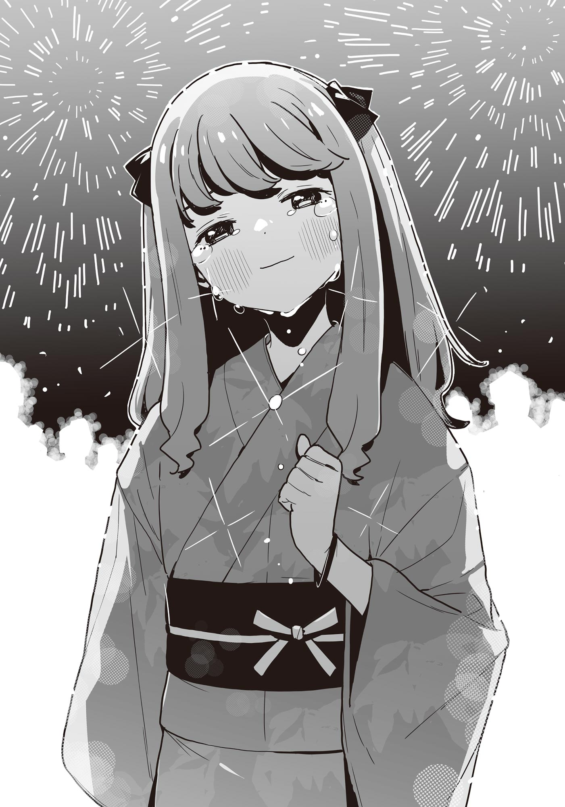

# Ch.177 — เล่ม 9 บทที่ 4-3

Ch.177 — เล่ม 9 บทที่ 4-3

By มนก

Published: 2026-07-31T15:29:56Z

Source: https://www.nekopost.net/novel/14560/177

ฝนกำลังตก

ฝนที่ตกลงมาอย่างต่อเนื่องตั้งแต่เช้า ชะล้างร่องรอยของฤดูร้อนไปจนหมดสิ้นในยามที่ดวงอาทิตย์ตกดิน และเร่งรุดเรียกฤดูใบไม้ร่วงที่เพิ่งจะเผยให้เห็นตัวตนเพียงเล็กน้อยให้มาเยือน

ซากุไร ฮิโรโตะเดินไปตามทางเดินเล็กๆ ที่เฉอะแฉะข้างไร่นา พลางตัวสั่นด้วยความหนาวเหน็บอย่างไม่คาดคิด

เขาเดินต่อไปโดยไม่สนใจว่ารองเท้าคู่ใหม่เอี่ยมจะเปื้อนโคลน

แต่สำหรับฮิโรโตะที่เป็นเด็กประถม รอยเปื้อนบนรองเท้าก็คงไม่ใช่ปัญหาใหญ่อะไรนัก

รองเท้าที่เปื้อนโคลนหยุดลงตรงหน้ากระท่อมหลังหนึ่ง

มันเป็นกระท่อมเก็บเครื่องมือที่ปู่ของเขาเคยใช้ แต่ตอนนี้กลายเป็นฐานทัพลับของโฮโคบารุ ฮิบาริ

เมื่อหุบร่มแล้วค่อยๆ เอื้อมมือไปจับประตู มันก็ค่อยๆ เปิดออก ไม่ได้ล็อกไว้

ภายในกระท่อมที่ปิดหน้าต่างสนิทจมดิ่งอยู่ในความมืดมิด

[...พี่ฮิบะ?]

เขาลองส่งเสียงเรียกด้วยความกล้าๆ กลัวๆ

เมื่อสายตาเริ่มชินกับความมืด ก็มองเห็นว่ามีใครบางคนอยู่ในห้อง

พอพบเงาคนที่กำลังนั่งกอดเข่าอยู่ ฮิโรโตะก็ถอดรองเท้าทิ้งแล้วรีบวิ่งเข้าไปหา

[พี่ฮิบะ มาอยู่ที่นี่เองเหรอ]

[...ฮิโรโตะ]

เสียงตอบรับนั้นแผ่วเบาจนแทบไม่ได้ยิน เป็นเสียงที่เขาไม่เคยได้ยินมาก่อน ขณะที่เจ้าตัวยังคงก้มหน้าอยู่

ฮิโรโตะลังเลอยู่ครู่หนึ่ง ก่อนจะนั่งลงข้างๆ

[คุณป้าบอกว่า พี่หนีออกจากบ้านแล้วก็ยังไม่กลับมาน่ะ]

ไม่มีเสียงตอบรับ

ท่ามกลางกระท่อมที่มืดมิด เสียงฝนตกกระทบหลังคาก็เริ่มดังขึ้น

ฝ่ามือสัมผัสได้ถึงผิวขรุขระของเสื่อทาทามิเก่าๆ ส่วนแผ่นหลังก็รับรู้ได้ถึงความชื้นของสายฝนที่แผ่ซ่านผ่านกำแพงเข้ามา

[มีเรื่องอะไรเหรอ?]

[............อืม]

ผ่านการโต้ตอบอันเงียบงันนี้ ความเจ็บปวดในใจของฮิบาริก็ส่งผ่านมาถึง

เสียงฮิบาริสูดน้ำมูกดัง ซูด ฮิโรโตะจึงตัดสินใจเปิดปากพูด

[ได้ยินมาว่าพี่ฮายาโตะกลับมาแล้วนี่นา]

พี่ชายของฮิบาริเรียนจบม.ปลายแล้วออกจากเมืองโทโยฮาชิไปเมื่อฤดูใบไม้ผลิปีที่แล้ว ดูเหมือนจะมีเรื่องราวมากมายตอนที่เขาจากไป แต่พอได้ยินว่าเพิ่งจะมีคนเห็นเขาเมื่อไม่นานมานี้ ฮิโรโตะก็เพิ่งจะรู้สึกโล่งใจไปเปลาะหนึ่ง

พอได้ยินชื่อพี่ชาย ไหล่ของฮิบาริก็สั่นเทา

[พี่ฮิบะ?]

[...พ่อบอกว่า ไม่ต้องให้พี่กลับมาอีกแล้ว]

น้ำเสียงและแผ่นหลังของฮิบาริสั่นเทา

[บอกว่าไม่ใช่ลูกอีกต่อไปแล้ว ห้ามเหยียบข้ามประตูบ้านนี้อีกเป็นอันขาด!]

ฮิบาริกระแทกกระทั้นคำพูดใส่ความมืด ก่อนจะเริ่มร้องไห้สะอึกสะอื้นราวกับหายใจไม่ทัน

ปล่อยให้ความรู้สึกพรั่งพรูออกมา ราวกับเขื่อนแตก

ฮิโรโตะได้แต่ตกตะลึง และจ้องมองฮิบาริที่ร้องไห้โฮ

สำหรับเขาแล้ว เด็กม.ต้น และโฮโคบารุ ฮิบาริ ดูเป็นผู้ใหญ่กว่าเขามาก

เธอเด็ดเดี่ยวอยู่เสมอ และมองเห็นทิวทัศน์ที่ตัวเขาไม่อาจมองเห็น

เขาคิดแบบนั้นมาตลอด

แต่ไม่ใช่เลย คนที่อยู่ตรงนี้ เป็นเพียงเด็กคนหนึ่งที่เกิดก่อนเขาแค่ไม่กี่เดือนเท่านั้น

ถึงภายนอกจะดูเป็นผู้ใหญ่ แต่ภายในก็คือเด็กคนหนึ่งเหมือนกับเขา

[พี่ฮิบะ──]

ฝ่ามือของฮิโรโตะที่ชะโงกที่ยื่นออกมา สัมผัสเข้ากับน้ำที่ซึมอยู่บนเสื่อทาทามิ

เพราะความมืดทำให้เขาไม่ทันสังเกต แต่ทั้งตัวของฮิบาริเปียกปอนไปด้วยสายฝน

หยดน้ำจากเส้นผมร่วงหล่นลงมากระทบเสื่อทาทามิดัง แหมะ

เมื่อเสียงร้องไห้ของฮิบาริเปลี่ยนเป็นเสียงสะอื้น ฮิโรโตะก็พูดขึ้น

[เดี๋ยวก็เป็นหวัดหรอก ผมมีร่มมาด้วย กลับด้วยกันเถอะ]

[............ไม่อยากกลับ]

เธอพูดพึมพำ ก่อนจะจามออกมา ฮัดชิ้ว เหมือนกับเด็กตัวเล็กๆ

ฮิโรโตะรู้สึกแปลกใจตัวเองที่จู่ๆ ก็เผลอยิ้มออกมา ทั้งที่สถานการณ์มันไม่ได้มีอะไรน่าสนุกเลยสักนิด

[งั้นเดี๋ยวไปเอาผ้าเช็ดตัวกับเสื้อผ้ามาเปลี่ยนให้นะ]

[...ไม่เอา อยู่ตรงนี้แหละ]

พอฮิโรโตะลุกขึ้นยืน ฮิบาริก็คว้าชายกางเกงของเขาเอาไว้

พอได้ยินเสียงจามอีกครั้ง ฮิโรโตะก็ถอนหายใจออกมาอย่างช่วยไม่ได้

หลังจากเช็กให้แน่ใจว่าฮิบาริไม่ได้มองอยู่ เขาก็ค่อยๆ ปลดกระดุมเสื้อเชิ้ตออกทีละเม็ด

[...เปลี่ยนมาใส่ตัวนี้นะ]

เขาวางเสื้อเชิ้ตที่ถอดออกไว้ แล้วหันหลังให้ฮิบาริ

สักพักหนึ่ง ก็มีเสียงฮิบาริลุกขึ้นยืน

หูของฮิโรโตะที่เกร็งตัวไปหมด ได้ยินเสียงถอดเสื้อผ้าที่เปียกฝน

เสียงเดินลากเท้าไปบนเสื่อทาทามิ

ดูเหมือนเธอจะกำลังบิดน้ำออกจากเสื้อผ้าอยู่ตรงลานดินที่มุมกระท่อม

พอเขาก้มหน้าลงเพื่อไม่ให้เผลอไปสนใจ ภาพร่างกายอันผอมบางของตัวเองก็สะท้อนเข้ามาในสายตา

มันทำให้เขาตระหนักได้อย่างหลีกเลี่ยงไม่ได้ ว่าตัวเองก็เป็นแค่เด็ก

[...เปลี่ยนเสร็จแล้ว]

[............อืม]

ฮิโรโตะหันขวับกลับไปเห็นเสื้อผ้าของโฮโคบารุที่ถอดทิ้งไว้ แล้วก็รีบเบือนหน้าหนีทันที

เพราะในกองเสื้อผ้าที่ถอดออกนั้น มีชุดชั้นในของผู้หญิงปะปนอยู่ด้วย

[ยังไงก็หาอะไรมา──]

ยังไม่ทันที่ฮิโรโตะจะพูดจบ แขนของฮิบาริก็โอบรัดตัวเขาจากด้านหลัง

ฮิโรโตะแข็งทื่อ เสียงของฮิบาริที่ราวกับจะอ้อนวอนดังเข้ามาในโสตประสาท

[...อยู่คนเดียวแล้วมันหนาว]

มือของฮิบาริสั่นเทา

ไม่ใช่เพราะความหนาวหรือความเศร้า แต่เป็นความหวาดกลัวต่อสิ่งที่ไม่รู้

ไม่มีวี่แววว่าฝนจะหยุดตก

ฮิโรโตะปล่อยใจไปตามความรู้สึก แล้วค่อยๆ วางมือทาบทับลงไป

◇

วงไฟขนาดใหญ่เป็นพิเศษเบ่งบานขึ้นบนท้องฟ้ายามค่ำคืน

ช้าไปหนึ่งจังหวะ เสียงอันหนักหน่วงก็ดังกึกก้องสั่นสะเทือนมาถึงร่างกาย

[พลุอิจิชาคุดามะนี่มันสุดยอดจริงๆ ด้วยแฮะ...]

พอผมเผลอพึมพำออกมา ยานามิที่กำลังเคี้ยวสายไหมหงุบหงับอยู่ก็เอียงคอสงสัย

[อิจิชาคุดามะ? มีขายตามร้านแผงลอยด้วยเหรอ?]

[เป็นขนาดของลูกพลุค่ะ เพราะเป็นลูกพลุขนาดใหญ่ที่มีเส้นผ่านศูนย์กลางหนึ่งชาคุ เลยถูกเรียกว่าอิจิชาคุดามะค่ะ]

เทียร่าซังคงทนดูไม่ได้ เลยพูดแทรกขึ้นมา

[โหー ไม่ค่อยเข้าใจหรอก แต่คงจะสุดยอดไปเลยสินะ]

ยานามิพูดพลางกัดสายไหมเข้าปาก เมื่อกี้ช่วยเข้าใจหน่อยเถอะ

ตรงกลางลานสนามหญ้า พวกเรากำลังตื่นตาตื่นใจกับความอลังการของพลุที่ถูกจุดขึ้นในระยะประชิด

เมื่อวงไฟขนาดใหญ่เบ่งบานบนท้องฟ้ายามค่ำคืนอีกครั้ง พลุลูกเล็กๆ ก็ทยอยแตกกระจายแต่งแต้มสีสันอยู่รอบๆ

แม้แต่ยานามิกับเทียร่าซังที่ไม่ค่อยจะลงรอยกัน ก็ยังลืมการสู้รบเหน็บแนมกันแล้วจดจ่ออยู่กับดอกไม้ไฟ

ระหว่างซากุไรคุงกับโคฮารุซังที่อยู่อีกฝั่งของฝูงชน บางครั้งก็มีรอยยิ้มปรากฏให้เห็น แผนการของรุ่นพี่โฮโคบารุดูเหมือนจะประสบผลสำเร็จในตอนนี้

ถ้าคืนดีกันได้แบบนี้ การหนีออกจากบ้านของโคฮารุซังก็คงจะจบลงโดยไม่ต้องรอให้ถึงเดือนสิงหาคมสินะ

พอเริ่มชินแล้ว การมีเด็กผู้หญิงน่ารักๆ อยู่ในบ้านมันก็ไม่ได้แย่อะไรล่ะนะ...

ได้กลิ่นหอมๆ ทำให้ในบ้านดูสดใสมีชีวิตชีวาขึ้น แถมยังน่าตื่นเต้นเหมือนในไลท์โนเวลเลยด้วย การถูกกำหนดบทบาทให้เป็นแฟนของเพื่อน ในแง่หนึ่งมันก็ดีตรงที่ไม่ต้องรับผิดชอบอะไรและทำตัวสบายๆ ได้

แต่ถึงจะมีข้อดีมากขนาดนี้ ก็เอาไปแลกกับความสงบสุขในครอบครัวไม่ได้หรอก อาการของคาจูดูกำเริบแปลกๆ ผมเองก็เริ่มรู้สึกได้ถึงอันตรายต่อชีวิตแล้วเหมือนกัน

[เอ้า นุคุมิซึคุง กินนี่ซะสิ]

ยานามิเอาสายไหมมาแปะหน้าผม ราวกับจะทำลายห้วงความคิด มันเหนียวนะ เลิกทำเถอะ

[เดี๋ยวกินเองน่า ไม่ต้องเอามายัดหรอก]

[ไม่ได้กินสายไหมมาตั้งนานแล้วใช่ไหมล่ะ? ตอนเด็กๆ ฉันเคยมีของเล่นที่ใช้ทำสายไหมด้วยนะ]

ยานามิยัดสายไหมที่เหลือเข้าปากด้วยท่าทางเศร้าซึม

[พอทำสายไหมทั้งวัน มอเตอร์ก็มีควันออกมา เลยโดนสั่งห้ามใช้น่ะสิ]

อ้อ เข้าใจละ ยานามิก็เป็นแบบนี้มาตั้งแต่เมื่อก่อนแล้วสินะ

ระหว่างที่ผมกำลังจินตนาการภาพยานามิตัวน้อยสวาปามสายไหม เทียร่าซังก็กระแอมไอขึ้นมาอย่างจงใจ

[พออยู่ในที่คนเยอะๆ แล้วก็รู้สึกระคายคอจังเลยนะคะ]

[หา อ-อืม นั่นสินะ]

เทียร่าซังหยิบลูกอมแก้เจ็บคอออกมาจากถุงหูรูด แล้วยื่นมาจ่อที่ปากผมเฉยเลย

[นี่ค่ะ นุคุมิซึซังก็รับไปด้วยสิคะ]

ทำไมล่ะ? คนที่อยากอมลูกอมแก้เจ็บคอมันเทียร่าซังไม่ใช่เหรอ แล้วทำไมผมต้องอมด้วยล่ะ

ผมตั้งใจจะปฏิเสธ แต่พอเจอสายตาจริงจังแปลกๆ ของเทียร่าซังกดดันเข้า ก็เลยต้องยอมอ้าปากรับมาอมอย่างช่วยไม่ได้

[อ-อืม รสบลูเบอร์รี่สินะ]

[ค่ะ เขาว่ากันว่าบลูเบอร์รี่ดีต่อสายตานะคะ]

ขณะที่กำลังสับสนกับการป้อนแบบ ง่ำ อันเป็นปริศนา ผมก็ลองคิดทบทวนดูถึงท่าทางของเทียร่าซังที่ดูพอใจอย่างน่าประหลาด

...เทียร่าซังเนี่ย ชอบผมอยู่นี่นา

พอได้ลองคิดทบทวนดูอีกครั้ง จู่ๆ ก็มีความคิดหนึ่งแล่นปราดเข้ามาในหัวราวกับถูกกระแสไฟฟ้าช็อต

──หรือว่า กำลังหึงยานามิอยู่เหรอ?

การที่ยานามิพยายามเอาของกินที่เหลือมาป้อน มันก็เป็นเหมือนสัญชาตญาณของสัตว์ป่านั่นแหละ

แต่ถ้ามองผ่านฟิลเตอร์ของเทียร่าซัง มันอาจจะดูเหมือนพวกเรากำลังจู๋จี๋กันอยู่ก็ได้

ความเข้าใจผิดนี้ จะแก้ยังไงดีล่ะ ไม่สิ ถึงจะแก้แล้วจะแก้ไปเพื่ออะไรล่ะ...?

ระหว่างที่ผมกำลังคิดวนเวียนอยู่ในหัว เทียร่าซังที่สังเกตเห็นสายตาของผมก็ส่งยิ้มหวานมาให้

[มีอะไรเหรอคะ นุคุมิซึซัง?]

[อ-เอ่อ เปล่าหรอก...]

ผมรู้สึกเขินนิดหน่อยเลยเงยหน้ามองฟ้า ประกายแสงสีทองระยิบระยับกำลังร่วงหล่นลงมา

ข้างๆผมมียานามิที่เอาแต่เตะรองเท้าผม กับเทียร่าซังที่มีเหงื่อซึมตามลำคอ

...วันนี้ผมมาเป็นเพื่อนพวกซากุไรคุงแค่นั้นเองนี่นา ตอนนี้ก็ขอสนุกกับช่วงเวลานี้ไปก่อนก็แล้วกัน

ผมที่ถูกขนาบข้างด้วยสองสาว นั่งมองดูพลุที่สว่างไสวเพียงชั่วครู่ชั่วยามต่อไปอย่างไม่รู้เบื่อ

◇

โคฮารุมองดูประกายไฟที่ร่วงหล่นลงมา พลางพึมพำขึ้นมาเบาๆ

[...น่าคิดถึงจังเลยเนอะ]

ซากุไรพยักหน้าเงียบๆ

ตั้งแต่จำความได้ เขาก็อยู่กับโคฮารุมาตลอด

สนุกสนานด้วยกัน วิ่งเล่นด้วยกัน

และแน่นอนว่า ฮิบาริเองก็อยู่ด้วย

เรื่องราวทั้งหมดนั้นช่างน่าคิดถึง และห่างไกลเสียจนเอื้อมไม่ถึง

ความทรงจำแรกที่พวกเราสามคนมาดูดอกไม้ไฟด้วยกัน คือตอนที่ยังไม่เข้าโรงเรียนประถมด้วยซ้ำ

ฮิบาริที่น่าจะตื่นเต้นกับพลุมากที่สุด กลับตกใจเสียงดังจนเอาแต่หลบอยู่หลังพ่อของตัวเองไม่ยอมออกมา

เห็นบอกว่าสุดท้ายพวกเราทั้งสามคนก็จับมือกันดูพลุ แต่ความทรงจำลึกๆ ก็หลงเหลืออยู่แค่ในรูปถ่ายที่พ่อแม่ถ่ายไว้เท่านั้น

16 ปีที่เขาใช้ชีวิตมา ทุกอย่างน่าจะเป็นความทรงจำ แต่กลับมีบางส่วนที่ขาดหายไปมากมาย

ซากุไรจมดิ่งลงสู่ห้วงแห่งความหลัง พลางจ้องมองเสี้ยวหน้าของโคฮารุที่อาบแสงดอกไม้ไฟ

โคฮารุเงยหน้ามองท้องฟ้าอันสูงลิ่ว พลางใช้รองเท้าเกี๊ยะเคาะพื้นดัง ตึก ตึก

[ตอนเด็กๆ แถวนี้เคยมีร้านค้ากลางคืนเปิดด้วยน้าー หมู่นี้ไม่ค่อยมีแล้วเนอะ]

[อืม น่าคิดถึงจังเลยนะ เมื่อก่อนเราไปด้วยกันทุกปีเลยนี่นา]

ทั้งสามคน── ซากุไรเกือบจะหลุดปากพูดออกมา แต่ก็กลืนคำนั้นลงคอไป

[จำได้มั้ย? ตอนที่ฮิบาริพลัดหลงจนหลงทางน่ะ]

[มีเรื่องแบบนั้นด้วยนี่นะ หลังจากนั้น เธอก็จับมือผมกับโคฮารุไว้แน่นไม่ยอมปล่อยเลย]

ทั้งสองคนมองเหม่อไปไกล แล้วหัวเราะออกมา

──นั่นสินะ

ฮิบาริในวัยเด็กยังไร้เดียงสาสมวัย หลงทางบ่อยๆ ทำแก้วแตกเป็นประจำ

เป็นเด็กขี้แยผิดคาด และมักจะโดนโคฮารุลูบหัวปลอบอยู่บ่อยๆ

ตั้งแต่เมื่อไหร่ ที่เธอกลายมาเป็น โฮโคบารุ ฮิบาริ ในตอนนี้

ตั้งแต่เมื่อไหร่ ที่เธอถูกคาดหวังให้ต้องเป็น โฮโคบารุ ฮิบาริ

[...ตั้งแต่พวกเราเริ่มคบกัน ก็ไม่ได้ไปไหนมาไหนด้วยกันสามคนอีกเลยเนอะ]

โคฮารุพูดขึ้น ราวกับมองทะลุความคิดของซากุไร

[ถึงวันก่อนฉันจะพูดแบบนั้นไป แต่ตอนนี้ฉันก็ยังชอบฮิบาริอยู่นะ แต่ว่า ฉันรู้อยู่แล้วว่าสักวันหนึ่ง วันที่เราจะอยู่ด้วยกันสามคนตลอดไปไม่ได้จะต้องมาถึง เพราะงั้น]

วันนี้เป็นครั้งแรก ที่โคฮารุจ้องมองซากุไรตรงๆ

[──ไม่ว่าจะต้องใช้วิธีไหน ฉันก็อยากได้ตัวฮิโรคุงมาอยู่ดี]

เวลาเพียงชั่วอึดใจที่สายตาของทั้งสองสอดประสานกัน โคฮารุเป็นฝ่ายยุติมันลง

[แต่ว่า สุดท้ายฉันก็ไม่ได้มาครองล่ะนะ...]

เธอจ้องมองออกไปไกลแสนไกล พลางพึมพำราวกับกำลังบอกตัวเอง

ซากุไรก้าวเท้าเข้าไปหาเสี้ยวหน้าของโคฮารุที่อาบแสงดอกไม้ไฟ

[──ผมคบกับโคฮารุมาตลอดด้วยความตั้งใจของผมเองนะ]

โคฮารุไม่มีปฏิกิริยาตอบรับ แต่ซากุไรก็ไม่สนใจ และพูดต่อไป

[วันนั้น โคฮารุกล้ากระโจนเข้าไปท่ามกลางพวกผู้ใหญ่เพื่อผม]

──แม้แต่ตอนนี้ พอนึกถึงเรื่องนั้นทีไร ขาก็ยังสั่นไม่หาย

วันที่ทุกสิ่งทุกอย่างในชีวิตของเขากำลังพังทลาย และเลือนหายไป

[ต่างจากผมที่ทำอะไรไม่ได้เลย โคฮารุเท่มากๆ เธอช่วยกอบกู้จิตใจของผมเอาไว้]

เขาไม่รู้หรอกว่าเสียงของเขาจะส่งไปถึงโคฮารุได้หรือเปล่า แต่คราวนี้ถึงตาที่เขาจะต้องรวบรวมความกล้าบ้างแล้ว

ซากุไรวางมือลงบนไหล่ทั้งสองข้างของโคฮารุ แล้วจับเธอหันมาหาเขาอย่างดึงดัน

[ขอโทษที่ทำให้กังวลนะ ถึงความมุ่งมั่นของผมอาจจะเทียบไม่ได้กับโคฮารุในวันนั้น แต่ช่วยให้โอกาสอีกสักครั้งได้ไหม]

[ฮิโรโตะ...!]

ในดวงตาของโคฮารุ มีหยาดน้ำตาและใบหน้าอันจริงจังของซากุไรสะท้อนอยู่

โคฮารุขบเม้มริมฝีปากที่สั่นเทา ก่อนจะเอื้อมมือทั้งสองข้างไปหาซากุไร──

◇

ผมเช็กตัวเลขดิจิตอลบนนาฬิกาข้อมือ ก่อนจะเงยหน้ามองท้องฟ้ายามค่ำคืน

เอาล่ะ ใกล้จะถึงช่วงไคลแมกซ์แล้ว ไฮไลท์ของงานเทศกาลดอกไม้ไฟ สตาร์ไมน์กำลังจะเริ่มขึ้นแล้ว

งานเทศกาลดอกไม้ไฟที่โทโยฮาชิมีสถานที่จุดพลุกว้างขวาง เลยได้ดูการจุดพลุต่อเนื่องที่อลังการงานสร้างสุดๆ

[นี่ นุคุมิซึคุง!]

ขณะที่ผมกำลังตื่นเต้น ยานามิกระตุกแขนผม

[อะไรอีกล่ะ? ตอนนี้กำลังถึงช็อตเด็ดเลยนะ]

[ทางนั้นก็กำลังถึงช็อตเด็ดเหมือนกันนั่นแหละ!]

ยานามิจับหน้าผม แล้วบังคับให้หันไปทางพวกซากุไรคุง

ใช่ ทางนั้นก็ถึงช็อตเด็ดแล้วจริงๆ ด้วย

ไปคืนดีกันตั้งแต่เมื่อไหร่เนี่ย ทั้งสองคนกำลังโอบกอดกัน และอยู่ในท่าทางที่เหมือนกำลังจะจูบกันอยู่รอมร่อ

[เดี๋ยวสิ ขืนแอบดูมันก็ไม่ดีน่ะสิ นี่ไง บาโซริซังช่วยพูดอะไรหน่อยสิ]

ผมโยนบทไปให้โดยคาดหวังว่าเธอจะมีมโนธรรม แต่เทียร่าซังกลับพยักหน้าหงึกๆ

[...ลองเข้าไปดูใกล้ๆ กว่านี้อีกนิดไหมคะ]

[เห็นด้วยอย่างยิ่ง]

ทั้งสองคนย่อตัวลงแล้วค่อยๆ คืบคลานเข้าไปใกล้พวกซากุไรคุง เดี๋ยวก่อน ถ้าสองคนนั้นไปผมก็ต้องไปด้วยสิ

ดูดอกไม้ไฟ กับ แอบดูเพื่อนจูบกัน ขณะที่จิตใจกำลังสั่นคลอนกับตัวเลือกสุดเลวร้าย จู่ๆ เสียงดอกไม้ไฟก็เงียบหายไปชั่วขณะ

──ไคลแมกซ์กำลังจะเริ่มแล้วนั่นเอง ผมรีบเรียกสองคนที่ล่วงหน้าไปก่อน

[ทั้งสองคน มาทางนี้]

ใช่แล้ว แค่เลือกทำเลที่มองเห็นทั้งพวกซากุไรคุงกับพลุไปพร้อมๆ กันได้ ก็จะสามารถดูพลุและแอบดูไปในเวลาเดียวกันได้ยังไงล่ะ

แน่นอนว่าผมไม่ได้อยากจะแอบดูหรอกนะ ไม่เลยสักนิด แต่ในเมื่ออุตส่าห์ตามมาดูเรื่องวุ่นๆ ของสองคนนี้จนถึงตอนนี้แล้ว การเฝ้าดูตอนจบของเรื่องราวก็ถือเป็นหน้าที่ของเพื่อนไม่ใช่หรือไง

[นุคุมิซึคุง นายบังอยู่ตรงนั้นฉันก็มองไม่เห็นน่ะสิ]

[ขอโทษนะคะ ช่วยก้มหัวลงหน่อยได้ไหมคะ]

[เดี๋ยวก่อน ขืนโวยวายเดี๋ยวก็โดนจับได้หรอก]

ระหว่างที่พวกเราสามคนกำลังแย่งที่กัน ระยะห่างของซากุไรคุงกับโคฮารุซังก็ยิ่งใกล้ชิดกันมากขึ้น

อึก. วินาทีที่พวกเรากลืนน้ำลายลงคอพร้อมกัน...

ปึ้ก! โคฮารุซังก็เอาหัวโขกใส่ซากุไรคุงอย่างสุดแรงเกิด

◇

วันนั้น แสงอาทิตย์ยามเย็นสาดส่องทะลุแนวรั้วต้นไม้ ผ่านกระจกหน้าต่างเข้ามาในห้องของฮิบาริ

คนที่อยู่ในห้องไม่ใช่โฮโคบารุ ฮิบาริ แต่เป็นซากุไร ฮิโรโตะ

ฮิโรโตะนั่งกอดเข่าคุดคู้อยู่ตรงมุมห้อง ในดวงตามีน้ำตาเอ่อล้น

สำหรับเด็กประถมอย่างเขา สถานการณ์ตอนนี้มันเกินกว่าที่เขาจะทำความเข้าใจได้

พ่อที่จูงมือเขาบุกมาโวยวายถึงบ้านโฮโคบารุ ไม่มีเค้าลางของความอ่อนโยนตามปกติหลงเหลืออยู่เลย

เป็นครั้งที่เท่าไหร่แล้วก็ไม่รู้ ที่ได้ยินเสียงตวาดแว่วมาจากอีกห้องหนึ่ง

ขณะที่ฮิโรโตะซุกใบหน้าลงกับหัวเข่า เสียงที่คุ้นเคยก็ดังขึ้น

[ฮิโระคุง เกิดอะไรขึ้นเหรอ?]

[...โคฮารุ?]

เมื่อค่อยๆ เงยหน้าขึ้น ก็เห็นโคฮารุกำลังทำหน้าเป็นห่วงอยู่ตรงหน้า

ฮิโรโตะประหลาดใจที่ได้เจอเธออย่างไม่คาดคิด แต่ก็รู้สึกโล่งใจไปในตัว

[ก็คืนก่อน ที่ฉันอยู่กับพี่ฮิบะจนดึก เลยโดนพ่อโกรธเอาน่ะ──]

ฮิโรโตะพูดยังไม่ทันจบ ก็หลุบตาต่ำลงอย่างอึดอัดใจ

ท่าทางแบบนั้น ทำให้โคฮารุนึกอะไรบางอย่างขึ้นมาได้

──เมื่อหลายวันก่อน แม่ของฮิบาริโทรมาที่บ้านโคฮารุ

บอกว่าฮิบาริทะเลาะกับพ่อ แล้ววิ่งเตลิดออกจากบ้านไป ยังไม่กลับมาเลย

แต่พอเช้าวันรุ่งขึ้น ก็เห็นฮิบาริไปโรงเรียนตามปกติเหมือนไม่มีอะไรเกิดขึ้น เรื่องนั้นเลยเกือบจะเลือนหายไปจากความทรงจำแล้ว

สรุปก็คือ คืนนั้นฮิบาริกับฮิโรโตะอยู่ด้วยกัน ความรู้สึกเย็นวาบแล่นปราดเข้าสู่หัวใจของโคฮารุ

[...เธอมีเรื่องอะไรกับฮิบาริเหรอ?]

นี่ไม่ใช่คำถาม แต่เป็นการยืนยัน

สัญชาตญาณ ความเป็นผู้หญิง ในตัวโคฮารุ ทำให้เธอเข้าถึงความจริงได้เพียงแค่มองเห็นสีหน้าที่เปลี่ยนไปเล็กน้อยของฮิโรโตะ

[ถ้าไม่อยากพูดก็ไม่เป็นไรนะ ขอโทษที]

โคฮารุนั่งลงข้างๆ ฮิโรโตะ

เสียงตวาดของผู้ชายดังลอดผ่านบานประตูกระดาษฟุซุมะเข้ามาอีกครั้ง

[ทำไมพ่อของฮิโระคุงถึงมาที่นี่ล่ะ?]

ฮิโรโตะสูดน้ำมูกพลางเปิดปากตอบ

[...พ่อโกรธที่หาว่าฉันถูกพี่ฮิบะลากตัวไปไหนมาไหนจนดึกดื่น แล้วก็]

[แล้วก็?]

โคฮารุถามสวนกลับทันควัน

[บอกว่าจะให้ฉัน...ย้ายโรงเรียนน่ะ]

[อึก!]

ฮิบาริพาฮิโรโตะไปไหนมาไหนจนดึก เรื่องแค่นั้นไม่น่าจะถึงขั้นต้องให้ย้ายโรงเรียนนี่นา

โคฮารุไม่มีทางรู้เรื่องราวเบื้องลึกเบื้องหลังของทั้งสองครอบครัวหรอก แต่มีเรื่องเดียวที่เธอมั่นใจ

──ต้องมีอะไรบางอย่างเกิดขึ้นระหว่างฮิบาริกับฮิโรโตะแน่ๆ

โคฮารุพยายามข่มจิตใจที่ว้าวุ่น พลางเอื้อมมือไปสัมผัสมือของฮิโรโตะ

[ไม่เป็นไรนะ ปล่อยให้เป็นหน้าที่ฉันเอง]

ก่อนจะลุกขึ้นยืน ราวกับตัดสินใจอะไรบางอย่างได้แล้ว

โคฮารุประกาศกร้าวต่อหน้าฮิโรโตะที่เงยหน้ามองเธอด้วยสายตาหวาดหวั่น

[ฉันไม่ยอมให้ฮิโรคุงต้องย้ายโรงเรียนหรอก]

◇

จังหวะที่ซากุไรผงะหงายหลังเพราะแรงโขก พลุจำนวนนับไม่ถ้วนก็ระเบิดย้อมท้องฟ้ายามค่ำคืนจนสว่างวาบไปทั่ว

ต่อหน้าพวกนุคุมิซึที่กำลังยืนอึ้ง โคฮารุกระชากคอเสื้อของซากุไรที่กำลังโซเซ ก่อนจะจับโขกหัวเข้าไปอีกดอก โดยมีฉากหลังเป็นดอกไม้ไฟที่บานสะพรั่งเต็มท้องฟ้า

คราวนี้ซากุไรถึงกับทรุดลงไปกอง แต่โคฮารุก็กระชากคอเสื้อดึงตัวเขาขึ้นมา

[ฉันดีใจมากเลยนะรู้ไหม? ทั้งที่นายชอบฮิบาริ แต่นายก็ยังยอมคบกับฉัน แต่ว่านะ──]

โคฮารุตะโกนใส่หน้าด้วยเสียงที่ดังแข่งกับเสียงพลุ

[มันก็ต้องคาดหวังอยู่แล้วสิ! หวังว่าสักวันหนึ่งนายจะหันมาชอบฉันแค่คนเดียวไงเล่า!]

[โคฮารุ ผม──]

โคฮารุพูดแทรกซากุไร และกระแทกกระทั้นคำพูดใส่ต่อไป

[ฉันรักฮิโรคุงมากนะ! รักมากจริงๆ! แต่ว่า──]

โคฮารุผลักซากุไรกระเด็นออกไปสุดแรง แล้วตะโกนลั่น

ราวกับจะระบายความรู้สึกตลอด 16 ปีทั้งหมดที่มีออกมา

[เราเลิกกันเถอะ!]

คำพูดของโคฮารุช่างดูสดใสและปลอดโปร่งจนน่าประหลาด

มันค่อยๆ ละลายหายไปในท้องฟ้ายามค่ำคืน ราวกับดอกไม้ไฟที่ร่วงหล่นลงมา

หยาดน้ำตาที่ไม่อาจกลั้นไว้ได้เอ่อล้นออกมา เป็นประกายวิบวับท่ามกลางแสงสว่างของดอกไม้ไฟ

[...ขอโทษนะ ฮิโรโตะ]

คำพูดสุดท้ายของโคฮารุ เป็นการพยายามฝืนยิ้มออกมาอย่างสุดความสามารถ

ซากุไรรับรู้ถึงสิ่งนั้นได้ เขาจึงทำได้เพียงแค่พยักหน้าตอบรับ

◇
