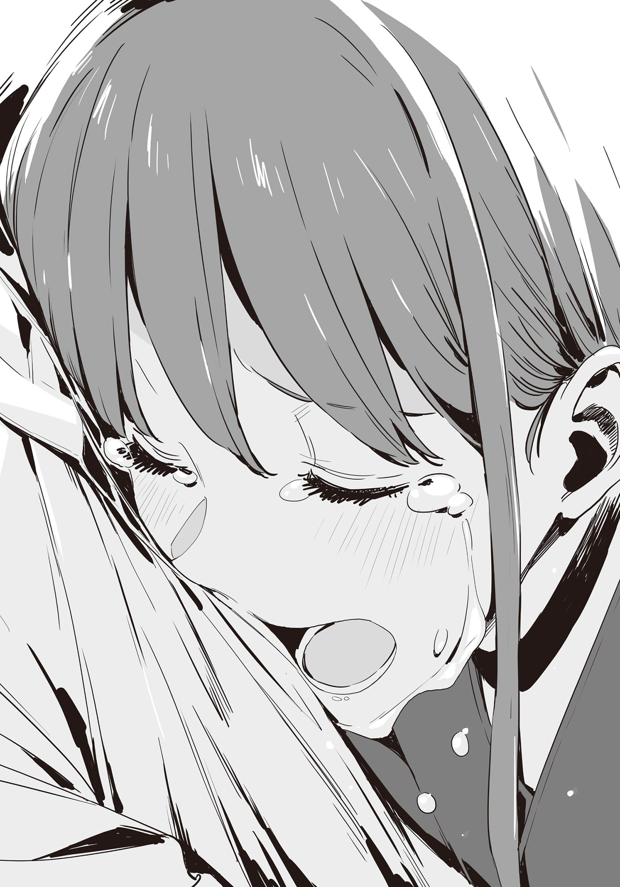

# Ch.178 — เล่ม 9 บทที่ 4-4

Ch.178 — เล่ม 9 บทที่ 4-4

By มนก

Published: 2026-08-01T04:56:29Z

Source: https://www.nekopost.net/novel/14560/178

...ดันเข้ามาอยู่ในสถานการณ์สุดเลวร้ายซะแล้วสิ

ผมยืนแข็งทื่ออยู่กับที่ พลางมองแผ่นหลังของโคฮารุซังที่วิ่งจากไป

การบอกเลิกท่ามกลางสายตาผู้คนนับไม่ถ้วนในฉากไคลแมกซ์ของงานเทศกาลดอกไม้ไฟ ทำเอาคนรอบข้างถึงกับตกตะลึงไปตามๆ กัน

ขณะที่ผมกำลังลังเลเมื่ออยู่ต่อหน้าซากุไรคุงที่ยืนนิ่งอึ้ง ยานามิก็ตบไหล่ผมเบาๆ ปุๆ

[อาー......เดี๋ยวเด็กคนนั้นฉันกับบาโซริซังจะตามไปเอง]

[ส่วนเรื่องซากุไรคุง ขอฝากด้วยได้ไหมคะ?]

ยานามิกับเทียร่าซังทิ้งท้ายไว้แค่นั้น แล้วกลืนหายไปในฝูงชน

จะปล่อยซากุไรคุงที่กำลังตกเป็นเป้าสายตาอยากรู้อยากเห็นของคนรอบข้างไว้แบบนี้ก็คงไม่ได้ล่ะนะ...

[เอ่อ เราย้ายที่กันหน่อยไหม]

พอผมส่งเสียงเรียก ซากุไรคุงก็พยักหน้าหงึกๆ ด้วยสีหน้าเหมือนคนวิญญาณหลุดออกจากร่าง

ตอนที่กำลังจะเดินจากไป เขาก็ก้มหัวให้คนรอบข้างพลางพูดว่า [ขออภัยที่ทำให้วุ่นวายครับ] ช่างเป็นอะไรที่สมกับเป็นซากุไรคุงจริงๆ

รู้ตัวอีกทีช่วงไคลแมกซ์ของดอกไม้ไฟก็จบลงแล้ว เหลือเพียงดอกไม้ไฟที่ถูกจุดขึ้นทีละลูกดังปังปัง ราวกับจะทิ้งทวนความอาลัยอาวรณ์

ผมจูงมือซากุไรคุงเดินออกไปยังทางเดินเล่นที่รายล้อมไปด้วยต้นไม้ทางทิศตะวันตกของสวนสาธารณะ

[เป็นอะไรไหม? ผมมีแค่น้ำตาลก้อนติดตัวมาเองนะ]

ระหว่างที่ผมกำลังควานหาน้ำตาลก้อนสำหรับยานามิ ซากุไรคุงก็คลี่ยิ้มเหนื่อยล้าออกมา

[เรื่องนั้นไม่เป็นไรหรอก เริ่มใจเย็นลงหน่อยแล้วล่ะ]

พูดจบ ซากุไรคุงก็มองไปรอบๆ

[...นุคุมิซึคุงเป็นคนพามาถึงตรงนี้สินะ ขอโทษที เมื่อกี้เหม่อไปหน่อยน่ะ]

[อ่า ไม่ต้องใส่ใจหรอก ส่วนโคฮารุซัง พวกผู้หญิงกำลังตามไปอยู่น่ะ]

[แย่จังเลยนะ อุตส่าห์เป็นงานเทศกาลดอกไม้ไฟทั้งที]

ผมส่ายหน้าไปมา อันที่จริงผมต่างหากที่เป็นคนชวนเขามางานดอกไม้ไฟเพื่อหลอกล่อให้มาติดกับ

...เอ๊ะ? ถ้าอย่างนั้น คนที่ฟาดหมัดปิดฉากจุดแตกหักนี้ก็คือพวกเรางั้นเหรอ?

ขณะที่ผมกำลังตัวสั่นกับความจริงอันน่าสะพรึงกลัว ซากุไรคุงก็ทิ้งตัวลงนั่งบนสนามหญ้าริมทางเดินเล่น

[ไม่ต้องตามโคฮารุซังไปจะดีเหรอ? ถึงจะเลิกกัน ก็ควรจะคุยกันให้รู้เรื่อง...]

[...ไม่ตามไปหรอก]

ซากุไรคุงพูดด้วยน้ำเสียงไร้เรี่ยวแรง ทว่าไร้ซึ่งความลังเล

[โดนพูดใส่ชัดเจนซะขนาดนั้น ก็เถียงอะไรไม่ออกเลย นั่นแหละคือทั้งหมด]

[งั้นเหรอ]

ผมนั่งลงข้างๆ ซากุไรคุง พลางมองดูดอกไม้ไฟที่ส่องประกายสว่างไสวข้ามผ่านอาคารศาลาว่าการเมือง ปีที่แล้วผมก็เคยไปร้านอาหารชั้นบนสุดกับยานามินี่นา...

ดูจากเวลาแล้ว ดอกไม้ไฟคงใกล้จะจบแล้วล่ะ

บนทางเดินเล่นตรงหน้า ผู้ชมที่เริ่มทยอยเดินทางกลับบ้านได้ก่อตัวเป็นกระแสคนไหลเวียน

ทันใดนั้น ดอกไม้ไฟหลายลูกก็เบ่งบานบนท้องฟ้ายามค่ำคืนพร้อมกัน ราวกับเป็นการแสดงอังกอร์

ประกายแสงสีทองกะพริบวิบวับค่อยๆ ละลายหายไปในกลุ่มควัน และนั่นก็เป็นดอกสุดท้าย──ท้องฟ้ากลับคืนสู่ความเงียบสงบอีกครั้ง

[──ผมน่ะ ชอบโคฮารุนะ จากก้นบึ้งของหัวใจเลย]

จู่ๆ ซากุไรคุงก็เอ่ยขึ้นมา

ขณะที่เงยหน้ามองกลุ่มควันที่ค่อยๆ ปลิวไปตามสายลม เขาค่อยๆ ร้อยเรียงคำพูดราวกับกำลังขบคิดให้ลึกซึ้ง

[ความรู้สึกนั้นมันจะเหมือนกับที่โคฮารุมีให้ผม หรือว่าต่างกัน ผมไม่รู้หรอก ในเมื่อไม่รู้ ผมกับโคฮารุก็คงไม่มีอนาคตร่วมกันอีกแล้วล่ะ]

ผมนึกคำพูดที่จะใช้ปลอบใจไม่ออก ได้แต่มองดูท้องฟ้ายามค่ำคืนที่เงียบสงัด

ทั้งๆ ที่อยู่ด้วยกันมากว่า 10 ปี และคบหากันมา

แต่พอเลิกกันปุ๊บ กลับกลายเป็นเหมือนคนแปลกหน้าต่อกัน

──ถ้าหากไม่ได้คบกันล่ะก็

ถ้าหากไม่มีความรู้สึกชอบพอ ก็คงจะได้เป็นเพื่อนสมัยเด็กที่สนิทกันตลอดไปงั้นหรือเปล่านะ

ซากุไรคุงลูบหน้าผากที่แดงเถือก พลางยิ้มเจื่อนๆ

[...ดันให้เห็นมุมที่ดูไม่ได้ซะแล้วสิ]

[อ่า ก็คงดูไม่ได้จริงๆ นั่นแหละ]

ผมแสร้งทำเป็นพูดตอบกลับไปอย่างสบายๆ

ห้ามพูดอะไรไปมากกว่านี้ ผมรู้ดี

รู้ทั้งรู้ แต่ก็น่าเสียดายที่ผมไม่ใช่ผู้ชายที่เข้าใจอะไรได้ดีขนาดนั้น

[──เพราะงั้น จะดูไม่ได้ไปจนถึงที่สุดเลยก็ไม่เป็นไรหรอกมั้ง]

ซากุไรคุงมองผมอย่างตกใจกับคำพูดนั้น

ในเมื่อพูดออกไปแล้วก็ช่วยไม่ได้ ผมเลยหน้าด้านพูดต่อไป

[เดิมทีมันก็เป็นเรื่องราวที่เริ่มต้นมาจากคน 3 คนนี่นา เพราะงั้นจะมาจบลงแค่ซากุไรคุงกับโคฮารุซังตกลงกันเองสองคน มันก็คงไม่ได้หรอกมั้ง ยังเหลือรุ่นพี่โฮโคบารุอยู่อีกคนไม่ใช่เหรอ]

ผมเงยหน้ามองฟ้าเพื่อกลบเกลื่อนความเขิน

ควันที่เคยลอยตลบอบอวลได้เลือนหายไป เผยให้เห็นดวงจันทร์กลมโตที่ปรากฏตัวขึ้น

[จะว่าไงดีล่ะ ไหนๆ ก็ดูไม่ได้แล้ว ไปจัดการให้เรียบร้อยเถอะ]

ความเงียบอันยาวนาน ฝูงชนที่เดินผ่านหน้าไป

นี่ผม พูดอะไรที่ไม่รู้จักอ่านบรรยากาศออกไปหรือเปล่านะ...

พอผมส่งสายตาไปด้วยความกังวล ซากุไรคุงก็ส่งยิ้มอ่อนโยนตามปกติมาให้

[จริงๆ เลยนะ ถ้าฉันเป็นผู้หญิงล่ะก็ คงไม่ปล่อยนายไว้แน่ๆ]

[นั่นถือเป็นเกียรติเลยนะ]

พอพวกเราหัวเราะให้กันเบาๆ ซากุไรคุงก็ค่อยๆ ลุกขึ้นยืน

ทันใดนั้น ก็มีอะไรบางอย่างหล่นออกมาจากกระเป๋ากางเกงของซากุไรคุง

[มีของหล่นน่ะ]

สิ่งที่ผมหยิบขึ้นมาคือสายห้อยยางเก่าๆ เป็นลายตัวละคร SD ของคาราสุยะคุงจากเรื่อง อาเตะนารุโมโนะ

ซากุไรคุงจ้องมองมันนิ่ง ก่อนจะยัดใส่กระเป๋ากางเกงราวกับสลัดความลังเลทิ้งไป

จากนั้นซากุไรคุงก็ทิ้งท้ายกับผมไว้ว่า [ไปก่อนนะ] แล้วกลืนหายไปในฝูงชน

◇

ห้องรับแขกของบ้านโฮโคบารุอบอวลไปด้วยควันบุหรี่

ภายในห้องมีพ่อของโฮโคบารุ ฮิบาริ และพ่อของซากุไร ฮิโรโตะ

ในห้องที่ปูด้วยเสื่อทาทามิ ฮิบาริในชุดเครื่องแบบของโรงเรียนม.ต้นซาซายูรินั่งคุกเข่าท่าเซอิซะอยู่ตรงกลาง โดยมีผู้ชายจากทั้งสองครอบครัวนั่งขนาบข้างและกำลังโต้เถียงกันอยู่

[เดิมที ฮิโรโตะบ้านเรายังเป็นเด็กประถมอยู่เลยนะ ไม่คิดเลยว่าหนูฮิบาริจะทำแบบนั้น]

พ่อของซากุไรพูดด้วยน้ำเสียงรังเกียจ ก่อนจะปรายตามองฮิบาริที่มีใบหน้าซีดเผือด

[หนู...]

ราวกับจะบดขยี้คำพูดอันไร้เรี่ยวแรงของฮิบาริ พ่อของฮิบาริก็เปิดปากขึ้น

[พอได้แล้วน่า ทางเราต่างหากที่ลูกสาวมีมลทิน นึกว่าจะมาขอโทษ ที่ไหนได้กลับมาหาเรื่องกันซะงั้น]

พ่อของฮิบาริบี้บุหรี่ลงกับที่เขี่ยบุหรี่ โดยไม่คิดจะปิดบังความหงุดหงิด

[อีกอย่าง การที่พ่อแม่เข้ามายุ่งเรื่องของเด็กๆ มันดูน่าเกลียดนะ]

[ถึงจะพูดแบบนั้นก็เถอะ ไม่ใช่ว่าพี่เขยเป็นคนสั่งให้หนูฮิบาริไปยั่วยวนฮิโรโตะหรอกนะ]

เพราะเป็นคำพูดที่เกินคาดไปมาก ฮิบาริจึงเงยหน้าขึ้น

[ไม่ใช่นะ──]

[เลิกโกหกได้แล้ว!]

พ่อของฮิบาริใช้กำปั้นทุบเสื่อทาทามิ

[ ดึงตัวฮิโรโตะไปเข้าพวก เพื่อให้บ้านโฮโคบารุฮุบสมบัติของคุณพ่อตาไว้คนเดียวล่ะสิ]

[ล้อเล่นหรือไง ฉันกะจะให้ฮิบาริรับเขยแต่งเข้าบ้านอยู่แล้ว]

[เอ๊ะ]

เขาเมินสายตาของลูกสาวที่กำลังตกตะลึง แล้วจุดบุหรี่มวนต่อไป

[เดิมทีลูกชายคนโตอย่างฉันก็ต้องเป็นคนรักษาบ้านและไร่นาไว้ตามหลักการอยู่แล้ว อีกอย่าง]

เขาพ่นควันออกมาก้อนใหญ่ด้วยสีหน้าดูถูก

[บ้านซากุไรไม่มีอะไรให้รักษาสักหน่อยนี่ ถ้าจะส่งฮิโรโตะมาเป็นเขยแต่งเข้าบ้านล่ะก็ จะลองเก็บไปคิดดูก็ได้]

[พี่เขย แกนี่มัน──]

พ่อของฮิโรโตะหน้าแดงก่ำ เขาเอื้อมมือไปหยิบไฟแช็กเพื่อพยายามทำให้อารมณ์สงบลง

หลังจากจุดไฟแช็กดังกริ๊กๆ จนประกายไฟแลบ ในที่สุดพ่อของซากุไรก็จุดบุหรี่ติด แล้วค่อยๆ สูดควัน

[...แต่เดิมที การที่เด็กม.ต้นมายุ่งกับเด็กประถมมันก็ผิดปกติอยู่แล้ว ฉันจะให้ฮิโรโตะย้ายโรงเรียน]

[อะไรกัน มาลาบอกว่าจะย้ายบ้านงั้นเรอะ]

[จะไปขอให้คุณพ่อตาเตรียมห้องให้ฮิโรโตะที่คอนโดหน้าสถานีน่ะสิ]

พอได้ยินแบบนั้น พ่อของฮิบาริก็เปลี่ยนสีหน้าทันที

[กะจะประจบประแจงพ่อฉันแล้วฮุบสมบัติไปล่ะสิ!]

เขาชี้บุหรี่ไปทางพ่อของฮิโรโตะทั้งที่ขี้เถ้ายังร่วงหล่น

[เดิมที แกที่เป็นแค่เขยแต่งเข้าบ้านไม่มีสิทธิ์มาออกความเห็นหรอกนะ!]

[ฉันไม่ได้แต่งเข้าบ้านโว้ย!]

ท่ามกลางพวกผู้ใหญ่ที่กำลังโต้เถียงกัน ฮิบาริต้องพยายามอย่างหนักเพื่อกลั้นน้ำตาเอาไว้

──เพราะเราเอง ทุกสิ่งทุกอย่างถึงได้พังทลายลง

วันนั้น เพราะความว้าเหว่ เราเลยเรียกร้องหาฮิโรโตะ และฉวยโอกาสจากความรู้สึกของเขา

นี่คือผลกรรม มันคือบทลงโทษที่เราทรยศต่อความเชื่อใจของฮิโรโตะ และทรยศโคฮารุ──

ตอนนั้นเอง ก็มีเสียงวิ่งตึงตังดังมาจากทางเดิน และเสียงของแม่ที่ร้องห้าม

และวินาทีต่อมา ประตูบานเลื่อนฟุซุมะก็ถูกเปิดผางออกอย่างแรง

[ขอรบกวนด้วยค่ะ! มิซึชิมะ โคฮารุ ค่ะ!]

บรรยากาศในห้องแข็งค้างไปถนัดตา เมื่อผู้บุกรุกที่ไม่เข้ากับสถานการณ์ปรากฏตัวขึ้น

[นี่ หนูโคฮารุ! ตอนนี้ทุกคนกำลังคุยธุระกันอยู่นะจ๊ะ...]

โคฮารุสะบัดมือของแม่ฮิบาริที่ยื่นมาจับออก แล้วไปยืนประจันหน้ากับพ่อของฮิโรโตะ

[หนูโคฮารุ ทำไมถึงมาอยู่ที่นี่ล่ะ...]

โคฮารุตะโกนบอกพ่อของฮิโรโตะที่กำลังตกใจด้วยเสียงอันดัง

[คุณลุงคะ! หนูกับฮิโรคุง คบกันอยู่ค่ะ!]

การสารภาพอย่างกะทันหัน ทำให้คราวนี้ทุกคนถึงกับพูดไม่ออก

[วันนั้น หนูเองก็อยู่ด้วยเหมือนกัน แต่ถ้าความแตกเดี๋ยวหนูจะโดนแม่ดุ ก็เลยปิดเงียบไว้ค่ะ]

โคฮารุสูดลมหายใจเข้าลึกๆ ก่อนจะพูดรัวเป็นชุด

[เพราะงั้น ฮิโรคุงกับฮิบาริไม่ได้มีอะไรกันเลยค่ะ ทุกคนก็ช่วยเลิกทำเรื่องแบบนี้สักทีเถอะค่ะ!]

เมื่อพูดจนจบ โคฮารุก็ก้มหัวให้ผู้ใหญ่ทั้งสองคนอย่างเต็มที่

ท่ามกลางความสับสนที่ลอยคลุ้งราวกับควันบุหรี่ แม่ของฮิบาริก็วางมือลงบนไหล่ของโคฮารุ

[หนูโคฮารุจ๊ะ ไปรอที่ห้องนู้นกับคุณป้าดีกว่าเนอะ]

พ่อของฮิบาริเคาะซองบุหรี่ป๊อกๆ แล้วหยิบบุหรี่ที่โผล่ออกมาคาบไว้ในปาก

[นัตสึมิ เธอถอยไปก่อนไป]

ด้วยน้ำเสียงที่ราบเรียบ แม่ของฮิบาริที่ลังเลอยู่ครู่หนึ่งจึงค่อยๆ เดินออกจากห้องไป

พ่อของฮิบาริเปิดปากขึ้น ราวกับกะจังหวะรอให้บานประตูฟุซุมะปิดลง

[หนูโคฮารุ ลุงไม่เห็นเคยได้ยินเรื่องนั้นจากฮิบาริเลยนะ]

[หนูขอร้องให้ฮิบาริปิดเป็นความลับไว้เองแหละค่ะ เพราะกลัวโดนดุ]

ฮิบาริคงยังสับสนอยู่ เธอเบิกตาโพลงจ้องมองโคฮารุ

พ่อของฮิโรโตะใช้นิ้วเคาะเสื่อทาทามิด้วยความหงุดหงิด พลางแกล้งถอนหายใจออกมาดังๆ

[เรื่องไร้สาระแบบนั้น──]

[นี่ ซากุไรซัง ถ้าหนูโคฮารุพูดแบบนั้น มันก็คงจะเป็นแบบนั้นแหละ]

เขาพ่นควันออกมาด้วยท่าทางเหนื่อยหน่าย

[ถึงขนาดทำให้ลูกบ้านอื่นต้องมาพูดขนาดนี้แล้ว ครั้งนี้ถือว่าพวกเราเข้าใจผิดไปเองก็แล้วกัน]

[แต่พี่เขย]

พ่อของฮิบาริบี้บุหรี่ที่แทบจะไม่ได้สูบดับไป ก่อนจะใช้มือยันเข่าลุกขึ้นยืน

[เฮ้ย นัตสึมิ! ซากุไรซังจะกลับแล้ว!]

แม่ของฮิบาริคงจะรออยู่หน้าห้องอยู่แล้ว เธอเลื่อนประตูฟุซุมะเปิดออก

พ่อของฮิบาริไม่สนใจน้องเขยที่ยังคงนั่งอยู่ เขาตบหัวโคฮารุเบาๆ

[เป็นเด็กดีนี่นา เหมาะสมกับฮิโรโตะคุงดีนะ]

พ่อของฮิโรโตะพยายามจะจุดไฟแช็ก แต่ก็มีแค่เสียงกริ๊กๆ โดยไม่มีวี่แววว่าไฟจะติด

ในที่สุดเขาก็คงจะถอดใจ จึงสบถด่าออกมาพลางลุกขึ้นยืน

[เฮ้ย ฮิโรโตะอยู่ไหน! กลับได้แล้ว!]

เขาเดินจ้ำพรวดๆ ออกจากห้องไปโดยไม่มองรอบข้างเลยแม้แต่น้อย

และไม่นานนัก ในห้องก็เหลือเพียงโคฮารุกับฮิบาริแค่สองคน

ฮิบาริยังคงนั่งคุกเข่าท่าเซอิซะ จ้องมองเสื่อทาทามินิ่ง

[............โคฮารุ]

ในที่สุดฮิบาริก้อเอ่ยออกมาแค่นั้น หยดน้ำตาก็ร่วงแหมะลงบนเข่า

และร่วงลงมาอีกหยด สร้างรอยด่างของน้ำตาบนกระโปรงเครื่องแบบหยดแล้วหยดเล่า

[ไม่เป็นไรแล้วนะ คุณลุงพวกนั้นเขาเข้าใจแล้วล่ะ]

โคฮารุคุกเข่าลง แล้วลูบหัวฮิบาริอย่างอ่อนโยน

──ไม่เป็นไรนะ

พอโคฮารุพูดอีกครั้ง น้ำตาก็พรั่งพรูออกจากดวงตาของฮิบาริราวกับทำนบแตก

มันเกินขีดจำกัดมาตั้งนานแล้ว โคฮารุสวมกอดฮิบาริที่กำลังร้องไห้โฮเสียงดัง

[ไม่เป็นไร ไม่เป็นไรนะ]

โคฮารุกอดฮิบาริแน่น พลางพูดซ้ำๆ เพื่อให้เธอสบายใจ

[ไม่เป็นไรนะ ไม่เป็นไรหรอกนะ...]

เธอพูดซ้ำแล้วซ้ำเล่า

ไม่นาน น้ำตาก็ไหลรินออกจากดวงตาของโคฮารุเช่นกัน

โคฮารุเองก็ไม่รู้เหมือนกันว่าตัวเองร้องไห้ทำไม

ราวกับว่าบนโลกนี้เหลือเพียงพวกเธอแค่สองคน ทั้งสองคนเอาแต่ร้องไห้อยู่อย่างนั้นเนิ่นนาน

◇

เสียงพลุที่ดังแว่วมาจากที่ไกลๆ ขาดหายไปตั้งแต่เมื่อไหร่ก็ไม่รู้

โฮโคบารุ ฮิบาริ นั่งโบกพัดอยู่ตรงระเบียงทางเดิน พลางเงี่ยหูฟังเสียงแมลงร้องแทน

ถึงแม้จะไม่มีกิจกรรมของมนุษย์ แต่ยามค่ำคืนก็ครึกครื้นกว่าที่คิด

หากลองเงี่ยหูฟัง ก็จะได้ยินเสียงกบและนกร้องมาจากที่ไหนสักแห่ง

เสียงสวบสาบที่วิ่งตัดพุ่มไม้ไปเมื่อกี้คือหนูนาสินะ

ขณะที่ขยับตัวไขว่ห้างโดยคอยระวังชายชุดยูคาตะ เสียงเครื่องยนต์รถที่ไม่คุ้นหูก็ดังใกล้เข้ามา

แสงไฟหน้ารถหยุดลงที่หน้าบ้าน พอส่งใครบางคนลงเสร็จก็ขับห่างออกไป

พ่อแม่ที่ควรจะค้างคืนที่บ้านคุณปู่ นั่งแท็กซี่กลับมางั้นเหรอ หวังว่าคงไม่ได้ทะเลาะกับคุณอาหรอกนะ...

ขณะที่กำลังรอฟังเรื่องราวทั้งหมด คนที่ปรากฏตัวขึ้นกลับเป็นคนที่ไม่คาดคิด ซากุไร ฮิโรโตะ นั่นเอง

ฮิบาริพยายามซ่อนความตกใจ พลางยกมือข้างหนึ่งขึ้น

[กลับมาแล้วเหรอ เร็วจังนะ]

──โคฮารุไม่ได้มาด้วยเหรอ

เธอส่งสายตามองไปด้านหลังของฮิโรโตะ แต่ดูเหมือนคนที่ลงมาจากรถจะมีแค่เขาคนเดียว

ฮิโรโตะยังคงมีรอยยิ้มเหมือนเช่นเคย ไม่มีท่าทีที่เปลี่ยนไปเลยสักนิด คงจะราบรื่นดีสินะ

การที่อุตส่าห์ถ่อมาถึงที่นี่ ก็คงจะมาเพื่อบ่นอะไรสักอย่างแน่ๆ

[เอาล่ะ ดูท่าฉันควรรีบขอโทษไว้แต่เนิ่นๆ ดีกว่านะ]

ฮิโรโตะไม่ได้ตอบโต้คำพูดทีเล่นทีจริงของฮิบาริ เขาเพียงแต่นั่งลงข้างๆ อย่างเงียบๆ

ก่อนจะเงยหน้ามองฟ้า แล้วเอ่ยขึ้นด้วยน้ำเสียงตามปกติ

[ดึกป่านนี้แล้ว แต่ก็ยังร้อนอยู่นะ]

[อ่า เข้าสู่หน้าร้อนเต็มตัวแล้วล่ะนะ]

ท่าทางที่เป็นปกติเกินไปของฮิโรโตะ ทำให้ฮิบาริรู้สึกผิดสังเกตเล็กน้อย

ฮิบาริรู้ได้ทันที ว่าฮิโรโตะจงใจทำตัวแบบนั้น

[เมื่อก่อน เราเล่นดอกไม้ไฟกันที่สวนนี้บ่อยๆ เนอะ]

[เมื่อก่อนฮิโรโตะกลัวพวกดอกไม้ไฟอันใหญ่ๆ นี่นา]

พอเธอตอบกลับไปเบาๆ ฮิโรโตะก็หัวเราะอย่างสนุกสนาน

[พี่ฮิบะต่างหากที่ขี้กลัวกว่าไม่ใช่เหรอ]

[งั้นเหรอ คดีตอนนั้นมันเกิดช่วงหน้าร้อนตอนป.3 สินะ?]

[เรื่องนั้น พี่ฮายาโตะเป็นคนผิดต่างหากล่ะ]

ทั้งสองคนหัวเราะออกมาอย่างใสซื่อ ราวกับกลับไปเป็นเด็ก

หลังจากนั้นทั้งสองก็ยังคงพูดคุยกันต่อไป

ราวกับกำลังรำลึกถึงวัยเด็กที่ไม่เคยรู้อะไรเลย

ราวกับจะเก็บซ่อนเรื่องราวที่ผ่านมาไว้ในอดีตและความทรงจำ

ฮิบาริเองก็เริ่มเข้าใจสาเหตุของความรู้สึกผิดสังเกตนั้นทีละน้อย

──ฮิโรโตะกำลังจะบอกลาเธอ

ก็แค่ลูกพี่ลูกน้องและเพื่อนสมัยเด็ก การที่ค่อยๆ ห่างเหินกันไปมันเป็นเรื่องธรรมดา

ก็แค่กลายเป็นความสัมพันธ์ที่นานๆ เจอกันทีแล้วทักทายกันว่าไม่ได้เจอกันนานเลยนะ แค่นั้นเอง

เธอรู้มาตั้งนานแล้วว่าสักวันหนึ่งวันนั้นจะต้องมาถึง และมันก็แค่มาถึงในวันนี้เท่านั้นเอง

ฮิบาริพยายามกลั้นน้ำตาที่เอ่อล้น พลางพูดคุยด้วยรอยยิ้ม

...ในที่สุด เรื่องราวในอดีตของทั้งสองก็ไล่ตามมาจนถึงปัจจุบัน

ความเงียบงันทอดตัวลงระหว่างคนทั้งสอง บรรยากาศรอบข้างเงียบสงัดราวกับแม้แต่แมลงก็ผล็อยหลับไปแล้ว

เมื่อฮิบาริตัดสินใจเด็ดขาดแล้วกำลังจะเอ่ยปาก ฮิโรโตะก็เริ่มพูดขึ้นราวกับรอจังหวะนี้อยู่

[──ขอบคุณนะ ผมได้คุยกับโคฮารุจนรู้เรื่องแล้วล่ะ]

[งั้นเหรอ]

ฮิบาริฝืนยิ้มออกมาอย่างสุดความสามารถ

ในฐานะพี่ฮิบะของฮิโรโตะ เธอจะไม่ยอมร้องไห้จนถึงวินาทีสุดท้าย เธอตัดสินใจเช่นนั้น

ทว่า คำพูดที่หลุดออกจากปากฮิโรโตะในประโยคถัดมา กลับเหนือความคาดหมายของฮิบาริ

[ผมโดนโคฮารุหักอกแบบไร้เยื่อใยเลยล่ะ]

[............หา?]

พอทำความเข้าใจความหมายของประโยคนั้นได้ ใบหน้าของฮิบาริก็ซีดเผือด

[เดี๋ยวสิ ถ้าเข้าใจผิดเพราะฉันล่ะก็ ฉันจะรีบไปอธิบายให้โคฮารุ──]

ขณะที่ฮิบาริกำลังจะลุกขึ้น ฮิโรโตะก็คว้ามือเธอไว้

[ไม่ใช่หรอก พวกเราสองคนคุยกันและก็ได้ข้อสรุปมาแล้ว พี่ฮิบะไม่เกี่ยวหรอก]

[แต่ว่า ถ้าฉันไม่ทำเรื่องแบบนี้ล่ะก็]

[ไม่เกี่ยวกันจริงๆ ผมกับโคฮารุก็รู้อยู่แล้ว ว่ามันมีแต่ต้องจบลงแบบนี้ เพราะงั้น]

เขายังคงจับมือฮิบาริไว้ ด้วยรอยยิ้มแบบที่เคยเป็น

[เพราะงั้น──ขอบคุณนะ]

ฮิโรโตะค่อยๆ พูดกับฮิบาริที่กำลังช็อกจนทำอะไรไม่ถูก

[พวกเราจะอยู่ด้วยกันสามคนตลอดไปไม่ได้ นึกว่าตัวเองเข้าใจดีแล้วเชียว แต่กว่าจะมาถึงจุดนี้ได้ก็ใช้เวลาตั้งขนาดนี้แหนะ]

ฮิโรโตะพูดต่อไปแทนฮิบาริที่ยังคงพูดไม่ออก

[พี่ฮิบะ เมื่อก่อนเคยบอกผมใช่มั้ย ว่ามีความฝัน อยากจะทำงานที่เชื่อมโยงโลกใบนี้เข้าด้วยกันน่ะ]

ฮิบาริพยักหน้าหงึกๆ

[อยากจะเข้ามหาลัยที่โตเกียว แล้วตั้งเป้าว่าจะทำงานในบริษัทการค้าสินะ ที่เริ่มเล่นกรีฑาก็เพราะเป็นส่วนหนึ่งของการสร้างความแข็งแกร่งให้ร่างกายใช่ไหมล่ะ]

ความทรงจำมากมายแล่นผ่านเข้ามาในหัว ช่วงเวลาที่เคยนั่งคุยกันในกระท่อมเก่าๆ ที่ตอนนี้ไม่มีอยู่อีกแล้ว

แม้จะเป็นเวลาไม่ถึงครึ่งปี แต่มันก็เป็นความทรงจำที่ไม่อาจหาอะไรมาทดแทนได้สำหรับฮิบาริและฮิโรโตะ

[ผมเองก็มีความฝันเหมือนกัน]

จู่ๆ ฮิโรโตะก็พูดขึ้น พลางเงยหน้ามองฟ้า

[ผมไม่เคยบอกใครมาก่อนเลยนะ ฮิบาริเป็นคนแรกที่ผมยอมเล่าให้ฟัง]

ไม่มีเสียงตอบรับ แต่เขาไม่สนใจและยังคงพูดต่อไป

[ผมเกลียดเมืองนี้ เกลียดทุกสิ่งทุกอย่างที่รายล้อมอยู่ที่นี่]

[...อึก!]

โฮโคบารุเบิกตาโพลงด้วยความตกใจกับคำพูดนั้น

[──แต่ว่า ผมก็รักที่นี่มากพอกันนั่นแหละ]

ลมทิศใต้ที่ก่อนหน้านี้ไม่มีพัดมาเลย กลับพัดทำให้ผมหน้าม้าของฮิโรโตะปลิวไสว

กลิ่นอายทะเลและกลิ่นดินที่ลอยมาตามสายลม ล้วนเป็นความทรงจำอันล้ำค่าของเขาทั้งสิ้น

[เพราะงั้น ถ้าเรียนจบมหาลัยแล้ว ผมอยากจะกลับมาที่โทโยฮาชิ แล้วใช้ชีวิตอยู่ที่ผืนดินแห่งนี้]

[...ใช้ชีวิต อยู่ที่นี่งั้นเหรอ]

ในที่สุดคำพูดก็หลุดออกมาจากปากฮิบาริ

ฮิโรโตะพยักหน้าด้วยสีหน้าไร้ความลังเล

[ถึงจะไม่รู้ว่าผมตัวคนเดียวจะทำอะไรได้บ้าง แต่ก็อยากจะเฝ้ามองสถานที่ที่ผมรักนี้ต่อไปน่ะ]

[แต่ว่า ฉัน──]

คำพูดหลังจากนั้นกลืนหายไปกับสายลม ไม่ได้ถูกเปล่งออกมา

ฮิโรโตะใช้นิ้วปาดน้ำตาของฮิบาริที่ไหลรินออกมาตั้งแต่เมื่อไหร่ก็ไม่รู้

[เพราะงั้น พี่ฮิบะ ช่วยโยนเรื่องของพวกเรา เรื่องของเมืองนี้ ยกให้เป็นหน้าที่ผม แล้วเดินตามความฝันของตัวเองให้เต็มที่เถอะนะ]

ซากุไร ฮิโรโตะ ส่งรอยยิ้มกว้างให้กับโฮโคบารุ ฮิบาริ

รอยยิ้มที่เขาขัดเกลามา เพื่อวันนี้นี่แหละ

[พี่ฮิบะทิ้งมันไว้ที่นี่ให้หมดเลย ทั้งความค้างคาใจ ความรู้สึกผิด แล้วก็ความทรงจำ ผมจะรับมันไว้ทั้งหมดเอง ]

เมื่อเห็นรอยยิ้มนั้น น้ำตาก็ไม่อาจหยุดไหลได้อีกต่อไป

โฮโคบารุ ฮิบาริ ที่ไม่ใช่พี่ฮิบะ เปิดริมฝีปากที่สั่นเทาออก

[...วันนั้น ฉันไม่มีความกล้าพอ]

เธอพยายามกลั้นเสียงสะอื้น พลางพูดด้วยน้ำเสียงที่ตีบตัน

[ฉันไม่กล้าบอกว่าชอบฮิโรโตะ ทั้งกับพ่อ──แล้วก็โคฮารุด้วย]

ฮิบาริใช้สองมือประคองแก้มของฮิโรโตะ ก่อนจะยิ้มออกมาทั้งน้ำตา

[...ในที่สุด ก็พูดออกไปได้สักที]

วินาทีที่พูดจบ ป้อมปราการแห่งความรู้สึกก็พังทลายลง

ฮิบาริซุกหน้าลงกับแผงอกของซากุไร แล้วร้องไห้ออกมาเสียงดัง

โดยไม่สนหน้าตาหรือภาพลักษณ์ใดๆ ร้องไห้ออกมาจากก้นบึ้งของหัวใจ

...เวลาผ่านไปนานแค่ไหนแล้วนะ ขณะที่รับฟังเสียงแมลงที่เริ่มร้องเจื้อยแจ้วอีกครั้ง ฮิบาริก็เริ่มพูดขึ้น

[ฉันเอง ก็ชอบโคฮารุเหมือนกันกับฮิโรโตะนั่นแหละ]

เป็นคนดื้อรั้น ไม่มีความลังเล ซื่อตรงต่อตัวเองเสมอในทุกสถานการณ์

ช่างน่าอิจฉา และเจิดจ้าเสียจนทนไม่ไหว

[ฉันคิดว่าถ้าเป็นโคฮารุล่ะก็ ฉันคงยอมรับได้ แต่เรื่องความรู้สึกน่ะ มันบังคับกันไม่ได้จริงๆ แฮะ]

[...นั่นสินะ]

ฮิโรโตะใช้แขนที่โอบกอดร่างกายฮิบาริ ลูบแผ่นหลังของเธออย่างอ่อนโยน

[...อยากให้พวกเราทั้ง 3 คน ได้วิ่งเล่นด้วยกันตลอดไปจังเลยนะ]

[...อ่า ผมก็เหมือนกัน]

อยากจะซึมซับไออุ่นของกันและกันต่อไปแบบนี้

แต่พวกเขาก็รู้ดี ว่าตัวเองไม่ได้เลือกเส้นทางนั้น

[ผมมาอยู่จนป่านนี้ คุณลุงคงไม่ค่อยชอบใจเท่าไหร่หรอกเนอะ]

ฮิโรโตะวางมือลงบนไหล่ทั้งสองข้างของฮิบาริด้วยความอาลัยอาวรณ์ ก่อนจะพยายามผละตัวออก

แต่ทว่า ฮิบาริกลับไม่ยอมห่างจากฮิโรโตะ

[พี่ฮิบะ?]

[──คืนนี้ พวกเขาไม่กลับมาหรอก]

เขาไม่ใช่ผู้ชายที่ไม่ประสีประสาจนถึงขนาดไม่เข้าใจความหมายของคำพูดนั้น

ฮิโรโตะสัมผัสได้ถึงความร้อนผ่าวของฮิบาริที่หน้าอก เขาหลุบตาลงพลางส่ายหน้าด้วยความสับสน

[แต่ว่าผม]

[ฉันรู้ดี พอถึงฤดูใบไม้ผลิฉันก็จะไปจากที่นี่แล้ว ไม่รู้ว่าจะได้เจอฮิโรโตะอีกเมื่อไหร่ หรือเผลอๆ อาจจะไม่ได้เจอกันอีกเลยก็ได้]

เธอใช้สองมือขยำคอเสื้อของฮิโรโตะแน่น

[แต่ว่า สักวันหนึ่ง อาจจะมีวันที่ฉันสามารถยิ้มแล้วกลับมาที่นี่ก็ได้ เพราะงั้น]

เธอรวบรวมความกล้าเฮือกสุดท้าย แล้วปลดปล่อยคำพูดออกมา

[จนกว่าจะถึงตอนนั้น ช่วยเก็บเอาไว้ได้ไหม──ความรู้สึกของฉันน่ะ]

แม้จะรับรู้ถึงความกล้าและความรู้สึกของฮิบาริอย่างเจ็บปวด

แต่ฮิโรโตะก็ยังคงเอ่ยปากออกไปด้วยความลังเล

[พี่ฮิบะ──]

[ขอร้องล่ะ จนกว่าจะถึงพรุ่งนี้เช้า──อย่าเรียกฉันว่าพี่ฮิบะเลยนะ]

เรี่ยวแรงจากมือที่วางบนไหล่ของฮิบาริค่อยๆ คลายลง

มีคำพูดที่ตั้งใจจะเก็บซ่อนไว้ก้นบึ้งของหัวใจตลอดไป ตั้งใจจะนำติดตัวไปลงหลุมด้วยเพียงลำพัง

แต่วินาทีต่อมา มันก็กลายเป็นความลับที่มีเพียงเขาสองคนเท่านั้นที่รู้

──ผมชอบเธอมาตลอดเลยนะ ฮิบาริ

◇

ผมเปิดประตูรั้วบ้าน พลางเงยหน้ามองท้องฟ้ายามค่ำคืนที่เงียบสงัด

ความเหงาหลังงานเทศกาลจบลง เป็นสิ่งที่ผมรับมือไม่ค่อยเก่งมาตั้งแต่ไหนแต่ไรแล้ว แต่วันนี้ผมกลับรู้สึกโล่งใจซะงั้น

...ซากุไรคุงยังไม่ได้ติดต่อมา แต่คงจะปล่อยเขาไว้เงียบๆ ดีกว่าล่ะนะ วันแบบนี้ซากุไรคุงเองก็คงอยากจะจมอยู่กับความเศร้าคนเดียวแน่ๆ

พอผมเปิดประตูบ้าน คาจูก็วิ่งตึงตังเข้ามาหา

[ยินดีต้อนรับกลับค่ะ ท่านพี่]

ไม่รู้ทำไมเธอถึงอารมณ์ดีเป็นพิเศษ ผมนึกสงสัยพลางถอดรองเท้า

[กลับมาแล้ว โคฮารุซังกลับมาหรือยัง?]

[ถ้าเป็นมิซึชิมะซังล่ะก็ เมื่อกี้เพิ่งเก็บข้าวของกลับบ้านไปเองค่ะ]

[เอ๊ะ]

มือที่กำลังจัดรองเท้าชะงักไป นั่นสินะ ในเมื่อมาค้างบ้านผมเพื่อประชดซากุไรคุง พอเลิกกันแล้วก็คงไม่มีความจำเป็นต้องอยู่ที่นี่ต่อแล้วล่ะ

ผมรู้สึกเหงาขึ้นมานิดหน่อย พลางลูบหัวคาจูที่ยืนรอให้ลูบเบาๆ แล้วเดินเข้าบ้านไป

[แล้วก็มีข้อความฝากมาจากโคฮารุซังด้วยค่ะ บอกท่านพี่ว่า ขอโทษนะ คะ]

ขอโทษงั้นเหรอ เป็นเพราะเรื่องวุ่นวายที่สร้างมาตลอดจนถึงตอนนี้ หรือเป็นเพราะไม่สามารถกลับไปคืนดีกับซากุไรคุงได้กันแน่นะ──

ระหว่างที่คิดอะไรแบบนั้นแล้วตั้งใจจะเดินกลับห้อง คาจูก็จ้องเขม็งมาที่ต้นคอของผม

[คาจู มีอะไรเหรอ?]

[...ท่านพี่คะ มีอะไรติดอยู่ตรงคอด้วยล่ะค่ะ]

อะไรเนี่ย พอเอามือถูๆ ดู ก็มีสีชมพูผสมกากเพชรติดปลายนิ้วมา

สีแบบนี้ คุ้นๆ เหมือนเคยเห็นที่ไหนเลยแฮะ ตอนนั้นเอง กลิ่นน้ำหอมก็โชยเตะจมูกขึ้นมาอย่างกะทันหัน

หรือว่ารอยนี่ ตอนที่โดนชิกิยะซังเข้ามา──

[รอยลิปสติก... ?]

[เฟอะ?! ท่านพี่คะ นี่มันหมายความว่ายังไงคะ?!]

ผมส่ายหน้าอย่างเอาเป็นเอาตาย พลางหลบหลีกคาจูที่พุ่งกระโจนเข้ามา

[ไม่ๆๆ ไม่ใช่นะ พอดีพี่เหงื่อออกเยอะ เดี๋ยวขอไปอาบน้ำก่อนล่ะ]

[งั้นคาจูจะเข้าไปอาบด้วยค่ะ!]

[ไม่ได้นะ! นี่ อย่ามาถอดเสื้อผ้าตรงนี้สิ]

[แต่ว่าๆ! คาจูต้องตรวจสอบดูให้แน่ใจว่าร่างกายของท่านพี่ไม่มีร่องรอยอะไรผิดปกติ──]

แย่แล้ว สวิตช์น้องสาวหวงท่านพี่ของคาจูถูกเปิดซะแล้ว

ผมอุ้มตัวคาจูไปส่งให้แม่ แล้วรีบชิ่งเข้าห้องน้ำไปทันที

[ฟู่... เกือบไปแล้วไหมล่ะ]

พอลงไปแช่ในอ่างอาบน้ำ ผมก็พ่นลมหายใจยาวออกมา

เสียงของแม่ที่กำลังห้ามคาจูดังแว่วมาจากทางห้องรับแขก จากประสบการณ์ที่ผ่านมา คงจะยื้อไว้ได้สัก 15 นาทีล่ะมั้ง รีบถูสบู่แล้วขึ้นจากอ่างดีกว่า...

ผมรีบถูสบู่ทำความสะอาดร่างกายตรงที่อาบน้ำ แล้วเอื้อมมือไปหยิบขวดที่เรียงรายอยู่

สายตาก็ไปสะดุดเข้ากับแชมพูของยากิชิโอะที่วางอยู่ริมสุด

...เอาเรื่องนี้ไปบอกให้เธอเอากลับบ้านไปน่าจะดีกว่าล่ะมั้ง ผมกับยากิชิโอะไม่ได้เป็นอะไรกันสักหน่อย สำหรับความสัมพันธ์แบบเพื่อนที่ควรจะรักษาระยะห่างไว้ การทิ้งแชมพูไว้แบบนี้มันชวนให้คิดลึกเกินไป

ผมหยิบแชมพูขึ้นมา พลางคิดชั่วครู่

จะว่าไปเธอก็บอกว่าให้ใช้ได้นี่นา ก่อนจะคืนก็ขอลองใช้สักครั้งนึงก็แล้วกัน...

พอกดแชมพูใส่มือ กลิ่นหอมสดชื่นของซิตรัสก็ลอยฟุ้งไปทั่วบริเวณ

เพื่อนงั้นเหรอ หรือว่าคนรัก

สถานะระหว่างชายหญิง มันมีความหมายมากแค่ไหนกันนะ

ผมใช้ปลายนิ้วที่เปื้อนลิปสติกขยี้เส้นผมของตัวเอง ราวกับจะชะล้างคำถามที่ไม่มีคำตอบนั้นทิ้งไป
