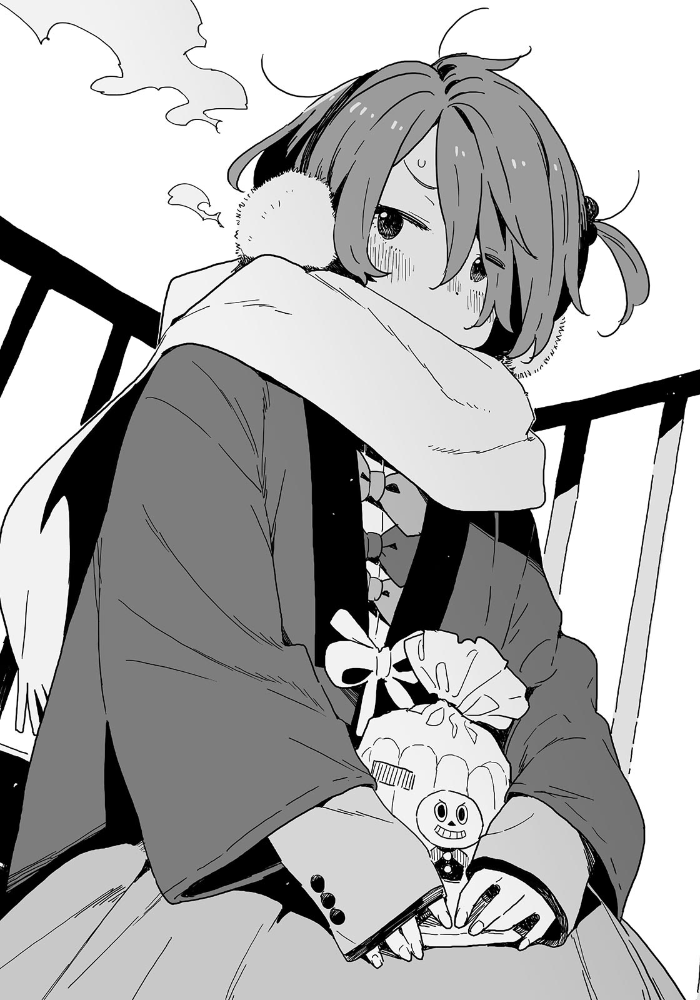

# Ch.17 — เล่ม 4 บทที่ 3-2

Ch.17 — เล่ม 4 บทที่ 3-2

By Monica

Published: 2024-12-06T15:32:02Z

Source: https://www.nekopost.net/novel/14560/17

ช่วงพักเที่ยง ผมอยู่ที่ทางเดินของตึกเรียนเก่าพร้อมขนมปังแกงกะหรี่ในมือ

วันนี้เป็นวันพุธ หนึ่งวันก่อนวันคริสต์มาสอีฟ

ผ่านมาสองวันแล้วตั้งแต่เรื่องๆนั้น แต่ผมยังไม่ได้ชวนชิกิยะซังเลย

...ขอพูดก่อนเลยว่าผมพยายามเต็มที่แล้วจริง ๆ ถึงจะยังไม่ได้ทำอะไร แต่ก็พยายามเต็มที่แล้ว

เรื่องพวกนี้มันขึ้นอยู่กับจังหวะล้วน ๆ แน่นอนว่าไม่ใช่เพราะผมปอดแหกหรอก หลักฐานก็คือเมื่อคืนนี้ผมฝึกซ้อมกับคาจูไปนับครั้งไม่ถ้วน

ผมเปิดประตูไปยังบันไดหนีไฟหลังจากที่พยายามหาข้อแก้ตัวให้ตัวเอง ลมหนาวพัดเข้ามาปะทะผม

นานแล้วที่ไม่ได้มาที่นี่ ในช่วงปลายเดือนธันวาคมมักจะหนาวมาก-

[ น-นุคุมิซึ มาแล้วเหรอ]

ผมเงยหน้าขึ้นหลังจากได้ยินเสียงนั้น โคมาริกำลังนั่งอยู่บนบันได

[ โคมาริ เธอมาทำอะไรที่นี่ในที่หนาว ๆ แบบนี้...]

ผมสะดุ้งก่อนจะพูดจบเมื่อเห็นลักษณะของเธอ

เธอสวมที่ปิดหูขนฟูและผ้าพันคอที่คอ มีเสื้อคลุมผ้าฝ้ายและผ้าห่มคลุมตัวอยู่ เธอเตรียมเบาะรองนั่งเพื่อหลีกเลี่ยงพื้นเย็นๆด้วย

[ เธอเตรียมตัวพร้อมขนาดนี้เลยเหรอ? เอาทั้งหมดนี่มาคนเดียว? ]

โคมาริยิ้มและชี้ไปที่ผนัง

[ ฉ-ฉันเอามาทีละนิดทีละหน่อย ฉันติดตะขอไว้ที่ประตูของห้องที่ซ่อมอยู่แล้วก็แขวนกระเป๋าไว้ตรงนั้น ]

เด็กสาวคนนี้กำลังเพลิดเพลินกับชีวิตที่แสนสุขที่บันไดหนีไฟ

[ น-นุคุมิซึ นานแล้วสินะที่นายไม่มาที่นี่ ]

พูดจบโคมาริก็เริ่มเคี้ยวขนมปังของเธอ

เธอกำลังกินขนมปังแท่งซึ่งเป็นราชาของอาหารประจำชาติ คงเป็นของที่เหลือจากเด็ก ๆ ที่บ้านของเธอ

แต่ผมมาที่นี่วันนี้เพราะอยากอยู่คนเดียว ดูเหมือนว่าจะผมจะมาผิดที่ไปหน่อย

ผมสงสัยว่าควรจะไปอีกชั้นดีมั้ยโคมาริก็เรียกผมอีกครั้ง

[ ร-เรื่องที่นายจะทำพรุ่งนี้ ราบรื่นดีมั้ย? ]

เรื่องที่ผมจะทำพรุ่งนี้- ก็คือผมต้องชวนชิกิยะซัง

ผมเงียบไป โคมาริดูเหมือนจะทนไม่ไหวแล้วและส่ายหัว

[ นายจะไม่ส่งข้อความไปหาเธอหรืออะไรสักอย่างเลยเหรอ? ]

[ ก็คิดจะทำแบบนั้นอยู่ แต่การพยายามชวนสาวออกไปเที่ยวข้างนอกในวันคริสต์มาสอีฟมีโอกาสถูกปฏิเสธสูงมาก เลยนะ ]

[ จ-จริงด้วย นุคุมิซึเป็นคนชวนซะด้วยสิ ]

ครึ่งหลังนั่นไม่จำเป็นเลย

[ หมายถึงว่า ถ้าส่งข้อความไปหาเธอใน Line หรืออะไรสักอย่าง เธออาจจะไม่ตอบกลับมา แล้วถ้าเธอทำหน้าแบบว่า ‘ฉันปฏิเสธไปแล้ว นายไม่เข้าใจตรงไหน’ ตอนที่ไปถามเธอต่อหน้า คงใจได้สลายแน่ๆ ]

[ ก-กังวลเรื่องนั้นหลังจากที่เธอชวนเธอแล้วเถอะ ]

เธอพูดถูก แต่ผู้ชายเป็นพวกที่อ่อนไหวนะรู้มั้ย ?

[ ไม่ต้องกังวลหรอก วันนี้หลังเลิกเรียนยังมีเวลา ตัวผมในอนาคตต้องทำได้แน่ ]

[ อ-อนาคตนี่มันใกล้เข้ามาแล้วนะ...? ]

คิดไปก็ไม่มีประโยชน์ ผมพิงราวบันไดและเคี้ยวขนมปังแกงกะหรี่ ส่วนโคมารินั้นสายตาดูลอยไปลอยมา เธอดูมีท่าทีแปลก ๆ

[ เป็นอะไรไป โคมาริ? กำลังรอใครอยู่หรือเปล่า? ]

[ ม-ไม่ใช่ เอ่อ นี่... ]

จู่ ๆ โคมาริก็ยื่นกล่องเล็ก ๆ มาให้ผม

ผมจำกระดาษห่อนี้ได้ มันเป็นอันเดียวกับที่โคมาริทำหล่นไว้ตอนที่ผมกินเครปกับเทียร่าซัง

[ เอ๊ะ ให้ผมเหรอ? ]

โคมาริไม่มองมาที่ผม เธอพยักหน้าเงียบ ๆ

ของขวัญที่จู่ ๆ ก็ให้มานี่หมายความว่ายังไงน่ะ?

หลังจากที่ผมเปิดกล่องอย่างระมัดระวัง ผมก็เห็นที่คั่นหนังสืออยู่ข้างใน

มันเป็นแผ่นโลหะบาง ๆ ที่มีสัญลักษณ์ญี่ปุ่นเว้าอยู่ข้างใน พูดตามตรง มันทำออกมาได้ดีและสวยงามมาก

[ นี่เราจะแลกของขวัญคริสต์มาสกันเหรอ? แต่ผมไม่ได้เตรียมอะไรมาเลยนะ ]

[ ม-ไม่ใช่... อ-อันนี้ฉันให้ น-นุคุมิซึ โดยเฉพาะ ]

[ เอ๊ะ งั้น นี่เป็นของขวัญวันเกิดเหรอ? ]

ผมไม่คิดว่าโคมาริจะเตรียมของขวัญแบบนี้ให้ผม

ขณะที่กำลังดูที่คั่นหนังสืออยู่นั้น ผมนึกถึงความรู้สึกตอนที่แมวจรจัดที่ผมเก็บมายอมให้ผมให้อาหารมันเป็นครั้งแรก

[ นี่มันทำออกมาได้ดีมากเลยนะ แพงหรือเปล่าเนี่ย? ]

[ ม-ไม่แพงขนาดนั้น... ]

[ ลายที่สลักเป็นแม่น้ำกับใบไม้สีแดง แล้วก็...นี่คือลูกบอลเทมาริใช่มั้ย?

[ ...ยะ-หยุดพูดได้แล้ว ]

ทำไมเธอถึงโกรธผมล่ะ?

[ ผมพูดอะไรที่ไม่ควรพูดหรือเปล่า? ]

[ ส-ส่วนนี้แหละ...ที่ฉันไม่ชอบนะ….ในตัวนาย! ]

โคมาริคลุมหัวด้วยผ้าห่มแล้วซ่อนตัวอยู่ข้างใน จากนั้นก็เริ่มเคี้ยวขนมปังต่อ

อ่า...ไม่เข้าใจเลย ผมไปเหยียบโดนระเบิดอะไรหรือเปล่า?

ถึงอย่างนั้น โคมาริก็ยังให้ของขวัญกับผม คิดๆดูแล้วเราก็ผ่านอะไรมาด้วยกันมากมายเลย

ผมมองขึ้นไปบนท้องฟ้าผ่านที่คั่นหนังสือ

ท้องฟ้าในฤดูหนาวนั้นสดใสและไร้เมฆปกคลุม รายงานสภาพอากาศบอกว่าจะมีแดดในวันพรุ่งนี้ด้วย

── ต้องลงมือทำแล้ว แผนจะเริ่มหลังเลิกเรียน

ผมกัดขนมปังแกงกะหรี่เพื่อให้กำลังใจตัวเอง

◇

ในที่สุดก็เลิกเรียนแล้ว ผมยืนอยู่ในทางเดินนอกห้องสภานักเรียน ผมตบแก้มตัวเองเพื่อให้กำลังใจ

[ เอาล่ะ ไปละนะ ]

ผมทำได้ ก็แค่ชวนชิกิยะซังไปเดทในวันคริสต์มาสอีฟ

เดท...ในวันคริสต์มาสอีฟ…

หรือส่งข้อความใน Line แทนดีมั้ย? แต่ผมจะทำอะไรไม่ได้เลยก่อนที่เธอจะตอบ ถ้าเธอไม่ตอบกลับมาก็คงไม่มีโอกาสทำขั้นต่อไป-

[ ...เซนเซเหงาจังเลย ]

ทันใดนั้น มีมือคู่หนึ่งมาปิดตาผมจากข้างหลัง

ผมสลัดมือเธอออกและรีบถอยออกมา

[ อุวะ ทำอะไรน่ะ โคนุกิเซนเซ? ]

[ เธอไม่ยอมมาห้องพยาบาลทั้งที่สัญญากับฉันไว้ ]

[ ขอโทษจริง ๆ ครับ ช่วงนี้ยุ่งมากเลย ]

จริง ๆ ผมลืมไปหมดแล้ว แต่ไม่ได้โกหก ผมยุ่งมากจริง ๆ

โคนุกิเซนเซเดินเข้ามาใกล้ ผมถอยหลังไปทีละก้าว

[ ทิ้งฉันหลังจากที่ฉันไม่เป็นประโยชน์แล้วงั้นเหรอ? ฉันจำไม่ได้ว่าสอนเธอแบบนั้นนะ ]

ผมไม่คิดว่าเธอเคยสอนอะไรเลยนะ แต่ควรตอบให้สุภาพหน่อยละกัน

ผมรักษาระยะห่างและแสดงยิ้มมาตรฐานแบบธุรกิจให้เซนเซ

[ เซนเซเป็นที่ปรึกษาของพวกเราอยู่แล้ว จะมาห้องชมรมเมื่อไหร่ก็ได้เลยนะครับ ]

[ แต่ก็อาจมีคนเจ็บในกิจกรรมชมรมหลังเลิกเรียนได้นะ ถ้าฉันไม่อยู่ในห้องพยาบาล ฉันก็โดนดุได้นะ ]

เธอดูไม่ค่อยจะเชื่อเท่าไหร่

[ งั้นตอนนี้เซนเซแน่ใจแล้วเหรอว่าจะไม่อยู่ห้องพยาบาล? ]

[ ฉันมาที่นี่เพื่อประชุมเตรียมงานประชุมครูพรุ่งนี้...นุคุมิซึคุง ทำไมเธอถึงชอบหลบหน้าเวลาฉันเข้าใกล้ล่ะ? ]

[ เพราะเซนเซเข้ามาใกล้ผมเองนี่ครับ ครั้งหน้าผมคุยกับเซนเซเองเลย ไม่ต้องห่วงนะครับ ]

นี่แหละที่คิดไว้ ผมอยากให้เธอจากไปด้วยคำตอบกลาง ๆ แบบนี้

[ โคนุกิเซนเซ อยู่นี่นี่เอง ]

เสียงมุ่งมั่นดังขึ้นก้องในทางเดิน

เจ้าของเสียงคือประธานสภานักเรียน โฮโคบะรุ ฮิบาริ เธอเดินเข้าหาโคนุกิเซนเซ ผมยาวของเธอส่ายไปมา

[ อ้าว โฮโคบะรุซัง มีอะไรหรือเปล่า? ]

[ ฉันเอาแบบสำรวจที่ขอมาส่งแล้วค่ะ สถิติก็เสร็จแล้วด้วย ]

[ อาระ ขอบคุณมากนะ คราวหน้าที่เธอไปห้องพยาบาลสิฉันจะขอบคุณเธออย่างดีเลย ]

[ นี่เป็นแค่หน้าที่ของสภานักเรียนค่ะ ไม่ต้องห่วงเรื่องนี้เลย ]

ทำไมรู้สึกว่าประธานแอบหลบหน้าโคนุกิเซนเซเหมือนกัน?

ด้วยโอกาสนี้ ผมวางแผนจะหนีทันที สุดท้ายเซนเซก็หันกลับมาหาผมอย่างรวดเร็ว

[ ...เธอจะไปไหนทิ้งเซนเซไว้ข้างหลังเหรอ? ]

[ ผมมีเรื่องสำคัญต้องทำ เซนเซก็ต้องเข้ารประชุมด้วยไม่ใช่เหรอครับ? ]

[ สายหน่อยก็ไม่เป็นไร มาคุยเรื่องความรักกับเซนเซต่อดีกว่า เอ๊ะ? ]

เราเคยคุยเรื่องความรักกันเมื่อไหร่กัน?

มันรู้สึกอึดอัดแปลก ๆ แล้วประธานก็เดินมาข้างผม

[ เซนเซ ขอโทษค่ะ ฉันต้องคุยกับเขาเรื่องกิจกรรมชมรมวรรณกรรม ขอพาตัวเขาไปนะคะ? ]

ผมไม่เคยได้ยินเรื่องนี้มาก่อนเลย

ผมงงเป็นไก่ตาแตก ส่วนโคนุกิเซนเซ เธอก็เกาหัวด้วยความเสียดาย

[ อาระ...น่าเสียดายจัง นุคุมิซึคุง อย่าเหลิงมากไปล่ะ ]

คำแนะนำของเธอช่างงงจริง ๆ ผมก็พยักหน้าตามไปก่อน หลังจากนั้นประธานก็เอามือมาแตะไหล่ของผม

[ นุคุมิซึคุง เซนเซอนุญาตแล้ว ไปกันเถอะ ]

[ เอ่อ คือ… ]

ประธานไม่สนใจปฏิกิริยาของผมและเดินไปทางอาคารใหม่

หลังจากสักพัก เธอก็หันมามองข้างหลัง

[ คนคนนั้นน่าปวดหัวจริง ๆ ถึงเธอจะใส่ใจนักเรียน แต่บางทีก็เกินไปหน่อย ]

เห็นรอยยิ้มขมขื่นของเพรซแล้ว ผมก็รู้ว่าเธอกำลังช่วยผมอยู่

[ ขอโทษนะครับ ไม่ได้ตั้งใจให้ประธานต้องมาวุ่นกับปัญหาของผมเลย ]

[ ไม่เป็นไร นี่เป็นหน้าที่ของประธานน่ะ ]

แต่ถึงอย่างนั้น ทำไมผู้หญิงคนนี้ยังคงกอดไหล่ผมอยู่นะ? แต่ถ้าพูดออกไป เธออาจจะคิดว่าผมรำคาญเธอ...

[ เอ่อ ผมอยากจะคุยกับชิกิยะซังครับ ]

[ ชิกิยะอยู่ที่สนาม เธอกำลังทำรายการอุปกรณ์ในห้องเก็บพละอยู่ เดี๋ยวฉันพาไปนะ โอเคมั้ย? ]

เอ๋ เข้าใจละ งั้นเธอจะตามผมไปถึงชั้นวางรองเท้าเลยเหรอ?

ผมไม่รู้ว่าประธานสังเกตเห็นอาการของผมหรือเปล่า แต่ริมฝีปากของเธอก็ยกขึ้นเป็นรอยยิ้ม

[ อีกอย่าง ฉันจริงจังนะที่บอกว่าฉันอยากคุยกับนาย ช่วงนี้อยู่กับชิกิยะบ่อยมากเลยนี่นา สนิทกันหรือเปล่า? ]

[ เอ่อ ไม่หรอก ไม่ได้สนิทขนาดนั้น ]

พูดไม่ได้เลยว่าที่ผมอยู่กับเธอ เพราะอยากเอาโดจินชิที่มีประธานอยู่ในนั้นคืนมา

ผมครุ่นคิดเรื่องนี้อยู่ ส่วนประธานก็มองมาที่ผมแล้วหัวเราะ

[ ไม่ต้องปิดบังแล้วล่ะ ฉันรู้ทุกอย่างอยู่แล้ว ]

[ เอ๋? ประธานรู้แล้วเหรอ!? ]

จริงดิ? คนคนนี้ยังดูไม่สะทกสะท้านกับโดจินชิสลับเพศที่มีชื่อเธออยู่เลย

ผมตกใจมาก ประธานกอดไหล่ผมแน่นด้วยความตื่นเต้น

[ ฉันไม่ได้ตาบอดหรอกนะ หมายถึง...หนุ่มน้อย เธอตกหลุมรักแล้วใช่มั้ย? ]

[ ไม่ครับ ]

ประธานตาบอดแน่ ๆ

[ จะกังวลอะไรล่ะ? ความคลั่งรักเป็นเรื่องปกติของวัยรุ่นอยู่แล้ว ต่อให้ความรักนั้นจะไม่สมหวังก็ตาม ]

เธอยังสมมติว่าผมต้องโดนปฏิเสธแน่นอนอีกด้วย

มันจะยุ่งยากถ้าผมปฏิเสธตรงนี้ เลยเลือกที่จะเงียบไว้ แล้วทันใดนั้นประธานก็พูดขึ้นด้วยน้ำเสียงเคร่งขรึม

[ ดูเหมือนว่าเธอก็รู้จักรองประธาน เทียร่าคุง ด้วยสินะ ]

[ อ่า คงงั้นมั้ง ]

[ ช่วงนี้เธอดูเหมือนจะปิดบังอะไรบางอย่างจากฉันอยู่ นายรู้เรื่องอะไรบ้างมั้ย? ]

[ อะไรน่ะ? ทำไมถึงมาถามผมล่ะ? ]

[ หืม แล้วเธอคิดว่ายังไง? ]

ประธานกางแขนออกและยืนขวางทางผมไว้

[ ความรักคืออิสรภาพของมนุษย์ ตราบใดที่ไม่หลงทางผิดไปศีลธรรม แต่ถ้าตัดสินใจจะเดินออกนอกทางล่ะก็ คนเหล่านั้นก็ไม่มีสิทธิ์ในความรักอีกต่อไป เธอไม่เห็นด้วยเหรอ? ]

[ เอ่อ...หมายความว่ายังไงครับ? ]

[ มีที่เงียบ ๆ บางที่ในโรงเรียนนี้ มีคนเห็นเทียร่าคุงกับเด็กผู้ชายเข้าไปในที่แบบนั้นเมื่อไม่นานมานี้ ]

นั่นคือผมเอง

ผมซ่อนความรู้สึกตื่นเต้นไว้ไม่อยู่ ประธานเข้ามาใกล้ผม

[ ฉันคิดว่าเธอแปลกไปช่วงนี้ เธอเอาแต่พูดคำแปลก ๆ อย่าง ‘ล้ำค่า’ ‘สายรับ’ และ ‘คนรักในอุดมคติ’ แล้ววันหนึ่งเธอยังจ้องฉันด้วยสายตาแข็งกร้าวพร้อมกับถือเนกไทในมืออีกด้วย ]

เข้าใจล่ะ เทียร่าซังกำลังจะถึงจุดจบแล้ว

[ เอ่อ ช่วงนี้เธอมาปรึกษาผมอยู่บ่อย ๆ ครับ ]

[ งั้นเหรอ...เป็นเรื่องความรักหรือเปล่า? ]

[ เอ่อ ใกล้เคียงครับ เพราะงั้นอย่าถามอะไรเพิ่มเติมเลยนะครับ ]

[ เข้าใจแล้ว ปัญหาแบบนี้ปล่อยให้มองไม่เห็นดีกว่า ]

ประธานตบไหล่ผมเหมือนว่าเธอเข้าใจทุกอย่าง ผมไม่คิดว่าเธอรู้เรื่องอะไรเลยนะ

[ ฮิบะเน่ ไปตรวจสอบชมรมออร์เคสตร้าหรือยัง? ใกล้เวลาแล้วนะรู้มั้ย ? ]

ผู้ช่วยชีวิตที่เพิ่งปรากฏตัวคือซากุไรคุง เหรัญญิกของสภานักเรียน

[ ฮิโรโตะ เห็นมั้ยว่าฉันกำลังไปอยู่? ]

ประธานยิ้มแบบเก๋ไก๋ แต่ซากุไรคุงถอนหายใจออกมาอย่างเหนื่อยล้า

[ ห้องดนตรีอยู่คนละทางเลยนะครับ นี่ครับ ไปเร็ว ]

ซากุไรคุงจับมือประธานแล้วลากไป เขาพยักหน้าขอบคุณผมก่อนจะจากไป

ดูเหมือนว่าเขาก็มีช่วงเวลาที่ยากลำบากเหมือนกัน ถ้าเป็นแบบนั้นจะช่วยผมดูแลพวกเด็กในชมรมวรรณกรรมบ้างดีมั้ยล่ะ...?

ผมรีบวิ่งไปยังชั้นวางรองเท้าในพลางคิดเรื่องนี้ไปด้วย

◇

ที่นี่คือห้องเก็บอุปกรณ์พละที่อยู่ริมสนาม

ประตูเปิดอยู่ ไม่มีใครอยู่แถวนี้

เสียงโลหะกระทบกันดังมาจากที่ไกลๆ ผมค่อยๆ เดินเข้าไปใกล้ห้องเก็บของ

ผมไม่เคยมาที่นี่อีกเลยตั้งแต่ถูกขังอยู่กับยากิชิโอะในเดือนกรกฎาคม

...อีกอย่าง ตอนนั้นผมไม่ได้มองเธอเลย แค่คิดว่าบางทีอาจจะแอบดูนิดหน่อย

ผมแอบมองเข้าไปข้างใน เด็กผู้หญิงคนหนึ่งยืนหันหลังให้ผม

ผมสีขาว ขาเรียวยาวโผล่พ้นกระโปรงสั้นๆของเธอ แค่เห็นก็รู้สึกหนาวแล้ว

นั่นคงเป็นชิกิยะซังแน่ ๆ

นี่เป็นโอกาสที่ดีที่จะได้คุยกับเธอโดยไม่มีใครเห็น ผมตัดสินใจแล้วและเดินเข้าไปในห้องเก็บพละ

[ รุ่นพี่ พอมีเวลาสักครู่มั้ยครับ? ]

เสียงของผมดังก้องในห้องเก็บพละที่คับแคบอย่างไม่คาดคิด

ชิกิยะซังยังคงยืนนิ่งอยู่ เธอค่อย ๆ หันคอมาทางผมและมองด้วยสายตาที่น่ากลัว

[ นุคุมิซึคุง...มีอะไรเหรอ...? ]

เธอรีบปิดสมุดบันทึกของเธอ ร่างของเธอเซเล็กน้อยขณะเดินเข้ามาใกล้ผม

ทำให้ดีที่สุด นุคุมิซึ มาไกลขนาดนี้แล้ว แค่กล้าที่จะพูดออกไปก็พอ

[ เอ่อ...แค่อยากจะถามว่าเธอเป็นหวัดหลังจากกลับวันนั้นหรือเปล่า? ]

ใช่ ผมกลัวจนพูดได้แค่นี้ แล้วจะเอาไงต่อดีล่ะ?

ผมไม่เคยเรียนรู้จากความผิดพลาดเลย ชิกิยะซังพยักหน้า

[ ไม่...ฉันไม่เป็นไร...ขอบคุณนะ... ]

[ ดีแล้ว ]

มันก็ดีอยู่ แต่ก็ไม่ดีเช่นกัน

ผมเอานิ้วมือมาหมุนเล่น ชิกิยะซังจ้องมาที่ผม

[ นายมา...ถึงนี่...เพื่อบอกแค่นี้...เหรอ...? ]

[ ไม่ ไม่ใช่แบบนั้น... ]

เฮ้อ เอาเป็นว่ารีบจบเรื่องนี้ดีกว่า

ผมก้าวไปข้างหน้าและมองเข้าไปในดวงตาสีขาวของชิกิยะซัง

[ เอ่อ! พรุ่งนี้ตอนเย็นเธอว่างหรือเปล่า? ]

[ ...ไม่ค่อยมีอะไรนะ ]

ผมก้าวเข้าไปอีกก้าว

ร่างของชิกิยะซังเซเหมือนถูกผลัก

[ ถ้าว่างล่ะก็ ไปดูการแสดงไฟคริสต์มาสที่สถานีกับผมได้มั้ย? ]

ใช่ ผมพูดออกไปแล้ว!

ตอนนี้ทั้งตัวผมถูกห่อหุ้มด้วยความรู้สึกเป็นอิสระ ดูเหมือนจะมีเสียงเชียร์จากด้านหลังด้วย

ผมไม่โทษพวกเขาหรอก ผมทำเต็มที่แล้ว เชียร์สักหน่อยก็สมควรอยู่-

[ ...เอ๊ะ? ]

ผมหันกลับไปด้วยท่าทางสั่นเทา กลุ่มคนมารวมตัวกันที่หน้าห้องเก็บของตั้งแต่เมื่อไหร่ก็ไม่รู้

อะไร!? พวกเขามาตั้งแต่เมื่อไหร่?

ผมอยู่ในสภาพที่น่าอนาถ ในช่วงเวลานั้นเอง ชิกิยะซังวางมือบนไหล่ผมจากด้านหลัง

[ อืม...ตกลง... ]

หลังจากกระซิบข้างๆหูผม ชิกิยะซังก็เซออกจากห้องเก็บพละไป

พวกนักกีฬาที่อยู่หน้าประตูรีบเปิดทางให้เธอทันที

แล้วในกลุ่มนั้น ผมเห็นเด็กผู้หญิงคนเดียวที่ใส่ชุดนักเรียน—ยากิชิโอะ

◇

สถานีที่ใกล้ที่สุดกับที่นี่คือไอจิไดกาคุมาเอะ

ผมขึ้นรถไฟที่กำลังเคลื่อนเข้าสู่ชานชาลาและนั่งลงบนที่นั่งว่าง

...เดทในคืนคริสต์มาสอีฟ ไม่คิดเลยว่ามันจะได้ผล

พูดตามตรง เป้าหมายของผมก็แค่พาเธอออกมา ดังนั้นในความเป็นจริงแล้ว นี่ไม่ใช่เดท

แต่ชิกิยะซังไม่รู้เรื่องนี้ นั่นเป็นเหตุผลที่-

เด็กผู้หญิงผมสั้นกระโดดขึ้นรถไฟทันทีที่ประตูกำลังจะปิด เธอคือยากิชิโอะ

ย้อนกลับไป ตอนที่ชิกิยะซังเพิ่งออกจากห้องเก็บของ-

ผมและยากิชิโอะมองตากันเงียบๆ จากนั้นเพื่อนของเธอก็พาเธอออกไป

ถึงแม้ว่าผมจะไม่ได้ทำอะไร แต่มันก็รู้สึก...อึดอัดมาก

ยากิชิโอะนั่งลงข้างผม เธอดูเหมือนจะรู้ว่าผมอยู่บนรถไฟนี้มาก่อนแล้ว

มีที่นั่งว่างหนึ่งที่ระหว่างเรา

[ ยากิชิโอะ เธอเรียนซ่อมเสร็จแล้วเหรอ? ]

[ ใช่ ฉันจะกลับมาทำกิจกรรมชมรมได้อีกครั้งพรุ่งนี้ นั่นแหละที่ฉันไปทักทายชมรมวิ่งก่อนหน้านี้ ]

นั่นเป็นเหตุผลที่เธอใส่ชุดนักเรียน

การสนทนาหยุดไปสักพัก ยากิชิโอะจู่ๆ ก็ทำหน้าตาขี้เล่น

[ เห ไม่เคยรู้เรื่องนี้มาก่อนเลยนะ นุคคุง แบบนี้นี่เอง- ]

[ เอ๊ะ เธอพูดถึงอะไรเหรอ? ]

ยากิชิโอะยื่นมือออกมาและตบไหล่ผม มันเจ็บ

[ ฉันหมายถึงนายกับรุ่นพี่ชิกิยะน่ะ เราไม่ได้เป็นคนแปลกหน้านะ ถ้านายบอกฉันก่อนฉันคงช่วยได้แล้ว ]

อ่า เธอเข้าใจผิดแล้ว

[ ไม่ใช่อย่างที่เธอคิดนะ ผมชวนรุ่นพี่ไปก็จริง แต่ไม่ใช่เดท ]

[ ใช้เวลาคริสต์มาสอีฟด้วยกันก็ถือเป็นเดทแล้ว! ถึงรุ่นพี่ชิกิยะจะน่ากลัวไปหน่อย แต่เธอก็เป็นสาวสวยจริงๆแหละ พรุ่งนี้นายต้องทำให้เธอประทับใจนะ! ]

[ ขอโทษที ยังไม่ได้บอกยากิชิโอะใช่มั้ย? ผมกับรุ่นพี่ทามากิคุยกันแล้ว ผมมีหน้าที่เรียกรุ่นพี่ชิกิยะออกมา ]

[ นายกับอดีตประธาน? ]

ผมเล่าทุกอย่างเกี่ยวกับแผนของเราให้เธอฟัง ยากิชิโอะพยักหน้าด้วยความชื่นชม

[ ...เข้าใจแล้ว เป้าหมายคือให้คนคนนั้นฟื้นฟูความสัมพันธ์กับรุ่นพี่สึกิโนะคิใช่มั้ย? ]

[ ไม่รู้ว่าพวกเขาจะทำได้มั้ย แต่พวกเขาเคยสนิทกันมาก นั่นเป็นเหตุผลที่อยากให้พวกเขาได้คุยกันดีๆ สักครั้ง ]

[ ฮะ เข้าใจแล้ว ฉันไม่รู้เรื่องเลยจริงๆ ]

ยากิชิโอะมองขึ้นไปบนท้องฟ้า เธอดูเศร้าเล็กน้อย เธอพูดซ้ำอีกครั้ง

[ —ฉันไม่รู้เรื่องเลยจริงๆ ]

ยากิชิโอะถูกกันออกจากเรื่องนี้ ถึงแม้ว่าผมจะไม่ได้ตั้งใจ ผมก็อดเป็นห่วงเธอไม่ได้

ยากิชิโอะเป็นเอสของชมรมวิ่ง ในเวลาเดียวกันเธอก็เป็นส่วนหนึ่งของชมรมวรรณกรรม

อย่างไรก็ตาม นั่นแค่บ่งบอกถึงตัวตนของยากิชิโอะ มันไม่ได้หมายถึงความรู้สึกของเธอเอง

ผมน่าจะสังเกตเห็นตั้งแต่แรก

[ ...ขอโทษนะ ]

[ ทำไมต้องขอโทษล่ะ ]

แทนที่จะเป็นแบบนั้น เธอให้รอยยิ้มเศร้าๆ กับผม

[ ดูสิ เพราะผมคิดว่าเธอยุ่งกับการเรียนซ่อม ชมรมกรีฑาก็เข้มงวดกับเธอใช่มั้ย? ]

[ อืม เธอพูดถูก ที่ชมรมวิ่งมีอะไรหลายอย่างเลย ]

ยากิชิโอะถอนหายใจช้าๆ รอยยิ้มที่ไม่สามารถอธิบายได้ปรากฏบนใบหน้าของเธอ

[ ...มีอะไรไม่ดีเกิดขึ้นหรือเปล่า? ]

[ ไม่หรอก แต่อาจารย์ที่ปรึกษากับกัปตันคาดหวังในตัวฉันไว้เยอะ ]

[ เธอได้เหรียญจากการแข่งขันระดับจังหวัดใช่มั้ย? ]

[ ใช่ ที่ 3 ในการวิ่ง 100 เมตร ฉันเร็วที่สุดในชมรมกรีฑาฉันคิดว่ารวมทุกระยะทางแล้วด้วย ]

[ สำหรับนักเรียนปีหนึ่งแล้วนี่มันเก่งมากนะ คนที่รู้จักเธอก็ย่อมคาดหวังในตัวเธอเป็นเรื่องปกติ ]

[ แต่ฉันยังไม่เก่งพอสำหรับการแข่งขันระดับชาติน่ะสิ ฉันรู้ว่าฉันยังต้องพยายามอีกนิดจะได้ไปแข่งให้ได้ ]

ร่างของเธอเอนมาทางผมเล็กน้อยขณะที่เธอพูดต่อเบาๆ

[ ถึงฉันจะไม่สามารถตอบสนองความคาดหวังนั้นได้ ฉันก็ได้รับการปฏิบัติเป็นพิเศษ มันทำให้ฉันรู้สึกไม่สบายใจนิดหน่อย ]

บางครั้งเธอก็แสดงสีหน้าที่เย็นชาและโตเป็นผู้ใหญ่ขึ้นเล็กน้อย

ผมหันหน้าหนีจากเธอและมองออกไปนอกหน้าต่าง

[ ผมรู้ว่ายากิชิโอะพยายามมากแค่ไหน เธอมาผ่อนคลายที่ชมรมวรรณกรรมเมื่อไหร่ก็ได้ที่ต้องการนะ ]

[ แต่ฉันเขียนนิยายไม่ได้นี่? แม้แต่ยานะจังก็ยังเขียนได้เลย ]

[ ใช่ เธอเพิ่งเขียนจบไปด้วย ]

นิยายที่ยานามิส่งในครั้งนี้ก็ยังเกี่ยวกับการชื่นชมอาหารในร้านสะดวกซื้อ ดูเหมือนจะมีพัฒนาการใหม่ๆ ด้วย แต่ก็เกี่ยวกับอาหารแน่นอน

[ เมื่อเปรียบเทียบกับนาย ฉันมาชมรมทุกวันไม่ได้ ฉันมักจะสงสัยว่าฉันทำหน้าที่ของฉันในชมรมได้ดีพอหรือเปล่า ]

เสียงประกาศการมาถึงของสถานีดังขึ้น รถไฟเริ่มชะลอตัวลง

ยากิชิโอะเหยียดตัวขึ้นและยืนขึ้น

[ ฉันคงต้องตัดสินใจตอนเป็นนักเรียนปีสองแล้ว ]

...ตัดสินใจ?

[ ยากิชิโอะ ยังไม่ถึงสถานีของเธอนี่ ]

[ ฉันอยากวิ่งน่ะ เอาล่ะ นุคคุง ทำให้ดีที่สุดนะ ]

[ ทำให้ดีที่สุดเรื่องอะไร? ]

รถไฟหยุดวิ่ง ยากิชิโอะเดินไปทางประตูที่กำลังเปิดและโยนอะไรบางอย่างมาทางผม

แขนขาของผมสะบัดไปมาในขณะที่พยายามจับ มันคือโปรตีนบาร์

มีข้อความว่า "HAPPY バースデー" เขียนด้วยปากกาเมจิกบนนั้น

/* バースデー อ่านว่า Basude(บาซุเดะ) หรือก็คือ Birthday */

เธอคงไม่รู้วิธีสะกดคำว่า Birthday…

[ ไม่ใช่ว่าคริสต์มาสจะเกิดขึ้นทุกวันนะ ทำให้เต็มที่เลยล่ะ ]

ยากิชิโอะชี้มาทางผมอย่างแน่วแน่ จากนั้นเธอก็ลงจากรถไฟอย่างรวดเร็ว

พรุ่งนี้เราไม่ได้ทำอะไรที่เกี่ยวข้องกับเรื่องนั้นเลย เด็กคนนี้เข้าใจหรือเปล่า...?

ผมมองดูยากิชิโอะที่หายไปจากชานชาลา พลางนึกถึงชิกิยะซังในห้องเก็บของ

มือของเธอนุ่มมากตอนที่เธอแตะไหล่ผม ลมหายใจเย็นๆ จากริมฝีปากของเธอที่ทำให้หูของผมรู้สึกจั๊กจี้-

รถไฟเริ่มวิ่งอีกครั้ง ผมนั่งลงและหลับตาแน่น

ผมพยายามจะล้างสมองของตัวเองให้ว่างเปล่า อย่างไรก็ตาม ความรู้สึกของโปรตีนบาร์ในมือก็ฉุดผมกลับสู่ความเป็นจริง

ว่าแต่ว่า ยากิชิโอะ ใครบอกเธอเกี่ยวกับวันเกิดของผมกัน ?

โคมาริก็รู้เหมือนกัน ยานามิพูดถึงผมในห้องชมรมหรือเปล่า?

ผมยอมแพ้ในการล้างสมองของตัวเองจากความคิดที่วุ่นวายเหล่านั้นและจมลึกลงไปในเก้าอี้อีกครั้ง

◇

รายงานชมรมวรรณกรรม - ฉบับฤดูหนาว

<การดวลเพิ่งจะเริ่มต้น?> โดย ยานามิ อันนะ

ฉันอยู่ที่7-11เว่นระหว่างทางไปโรงเรียนในช่วงเช้าตรู่

ลำโพงในร้านกำลังเล่นเพลงคริสต์มาส

การตกแต่งในร้านก็เต็มไปด้วยบรรยากาศคริสต์มาสแล้ว อย่างไรก็ตาม ทุกคนยุ่งมากในตอนเช้า จนไม่มีเวลาจะสนใจกับเรื่องเล็กๆ น้อยๆ แบบนี้

ตามปกติ ฉันนั่งอยู่คนเดียวในฟู้ดคอร์ท แต่คราวนี้มีคนเรียกชื่อฉัน

[ เฮ้ อาโกะซัง วันนี้ดูชิลจังนะ ]

คนที่พยายามคุยกับฉันคือ XX-คุง เพื่อนร่วมชั้นเดียวกัน

เราก็ไม่ได้สนิทกันขนาดนั้น

[ ฉันแค่กินข้าวเช้าน่ะ นายช่วยหยุดรบกวนฉันได้มั้ย ? ]

อาหารเช้าของฉันคือซาลาเปาหมู

ไส้เนื้อที่อัดแน่นและแป้งนุ่มๆ มันสุดยอดมาก ฉันต้องกินมัน 5 ครั้งต่อสัปดาห์ในช่วงฤดูหนาว

XX-คุงดูเหมือนจะไม่รู้ว่าจะพูดอะไรต่อ เขามองมาทางฉันแล้วพูดว่า "อ้อ เข้าใจละ" ทำเป็นอวดฉลาด

นอกหน้าต่าง OO-คุงกำลังรอสัญญาณไฟจราจรที่ทางม้าลาย มีผู้หญิงยืนอยู่ข้างๆ เขา

นั่นคือ เจโกะจัง

เธอเป็นผู้หญิงที่ไปไหนมาไหนกับเขาบ่อยๆ ช่วงนี้ ฉันเห็นพวกเขาคุยกันอย่างสนุกสนาน

ไปโรงเรียนกับผู้ชายกลางที่สาธารณะแบบนี้ ฉันคิดว่ามันค่อนข้างไม่เหมาะสม

XX-คุงวางแก้วลงตรงหน้าฉันตอนที่ฉันกำลังนั่งกินซาลาเปาเงียบๆ

มันคือกาแฟลาเต้ร้อน ขนาดใหญ่ด้วย

ฉันจ้องเขาเพราะมันบังสายตาฉัน ส่วน XX-คุง นั่งลงห่างจากฉันสองที่นั่ง

[ นี่ เธอชอบกาแฟใช่มั้ย? ]

XX-คุงไม่ได้พูดเสียงดัง

มาคิดๆดูแล้ว วันนี้คือวันที่ 24 ธันวาคม นี่เป็นของขวัญคริสต์มาสหรือเปล่า?

ถึงแม้ว่าฉันจะไม่ค่อยชอบมัน แต่ฉันก็ไม่ใช่ผู้หญิงที่จะเหยียบย่ำความมีน้ำใจของคนอื่น

ซาลาเปาหมูทำให้ปากฉันแห้งหมดแล้ว การได้ดื่มกาแฟร้อนๆ สักแก้วทำให้ร่างกายฉันรู้สึกผ่อนคลาย

กาแฟมีรสเข้ม แต่ก็มีความสดชื่นจากนมที่ผสมอยู่ด้วย นี่มันอร่อยทุกครั้งที่ฉันได้ลองเลย

[ XX-คุง นายใส่น้ำตาลในนี้หรือเปล่า? ]

[ ใส่สิ อาโกะซังชอบสองซองน้ำตาลใช่มั้ย? ]

ช่วยไม่ได้ ฉันถอนหายใจเบาๆ ในใจ

แก้วขนาดใหญ่ต้องใส่น้ำตาลสามซองต่างหาก

แต่ยังไงก็เถอะ ผู้หญิงที่เป็นผู้ใหญ่ไม่ควรแสดงอารมณ์ออกมาได้ง่ายๆ

สัญญาณไฟเปลี่ยนเป็นสีเขียว เขาและเจโกะจังหัวเราะและเดินข้ามทางม้าลายไป

เมื่อเห็นแบบนั้น ฉันรู้สึกว่าลาเต้ของฉันมีรสขมเพิ่มขึ้นนิดหน่อย

---
