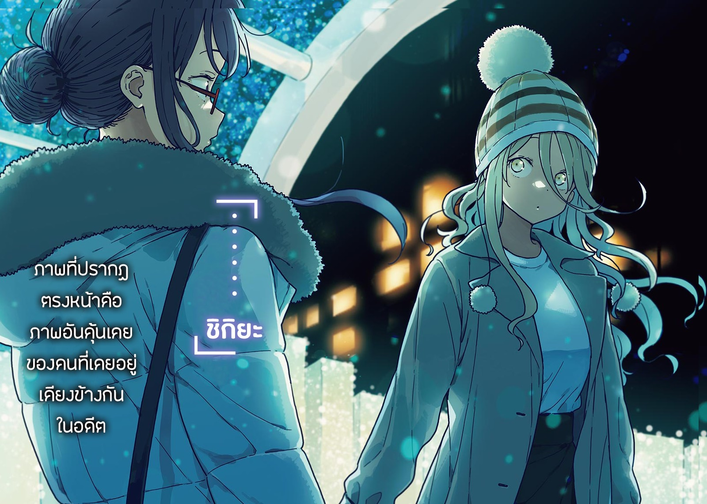

# Ch.18 — เล่ม 4 บทที่ 3-3

Ch.18 — เล่ม 4 บทที่ 3-3

By Monica

Published: 2024-12-06T15:34:58Z

Source: https://www.nekopost.net/novel/14560/18

เล่ม 4 บทที่ 3-3

24 ธันวาคม ช่วงเย็นวันคริสต์มาสอีฟ

สถานีโทโยฮาชิ สะพานลอยขนาดใหญ่เชื่อมต่อกับสถานีรถไฟฟ้าและสถานีรถราง

มีการแสดงไฟที่อยู่ทางด้านขวาของประตูทางออกตะวันออกของสถานี พื้นที่ตรงกลางเป็นวงกลมกว้างขวาง

ผมเฝ้าดูสถานการณ์จากไกล ๆ ตรงทางออกของสถานีรถราง

— เหลืออีก 15 นาทีก่อนถึงเวลานัดหมาย 6 โมงเย็น

ท้องฟ้ากำลังเริ่มมืด มีแสงสลัว ๆ สีขาวปรากฏจากไฟถนน

จุดที่แสงนีออนสว่างไสวอยู่ที่มุมแสดงไฟ ถึงแม้จะอยู่ห่างจากที่นั่น แต่ก็รู้สึกเหมือนถูกดึงดูดด้วยบรรยากาศในฝัน

[ โย่ ขอบคุณที่รอนะ ]

รุ่นพี่ทามากิ มาถึงพร้อมกับสีหน้าที่ดูประหม่าเล็กน้อย

เขาสวมเสื้อโค้ทที่ดูเป็นผู้ใหญ่นิดหน่อย

[ อ๊ะ ขอบคุณครับ ]

มันรู้สึกแปลก ๆ นิดหน่อยที่ต้องคุยนอกโรงเรียน...

รุ่นพี่ทามากิ ยื่นมือออกมาและหยิบอะไรบางอย่างออกจากผมของผม

[ นี่อะไรเนี่ย? กระดาษโปรย? ]

[ น้องสาวของผม คาจูเป็นคนทำ เธอเล่นตลกใส่ผมตอนกำลังจะออกจากบ้าน ]

[ ถ้าแค่ตอนออกจากบ้าน ทำไมถึงเป็นแบบนั้นได้ล่ะ ? ]

ผมเองก็ไม่รู้เหมือนกัน

[ เธอคิดว่าผมจะไปเดทวันคริสต์มาส ก็เลยจัดงานอำลาครั้งใหญ่ ผมต้องดึงแบนเนอร์อำลาออกจากระเบียงด้วยซ้ำ ]

[ ...ดูเหมือนว่านายจะลำบากไม่เบาเลยนะ ]

คงไม่ลำบากเท่ารุ่นพี่หรอก?

ถูกน้องสาวกวนหรือแฟนสาวกวนอันไหนมันดีกว่ากันนะ?

ไม่สิ ก่อนอื่น ถ้ามีแฟนแล้วก็คงถือว่าชนะเกมชีวิตไปแล้ว...

[ วันนี้เราจะทำจริง ๆ ใช่มั้ย? คริสต์มาสมีแค่ปีละครั้งนะ ]

[ ก็... ฉันตัดสินใจแล้วว่าจะขอโทษเธออย่างสุดซึ้งตอนมื้อเย็น ]

ผมจะพูดแบบติดตลกนิดหน่อย แต่รุ่นพี่กลับสวนมาด้วยคำพูดโชว์เท่ออกมา

ผมด้อยกว่าคนมีแฟนจริงๆนั้นแหละ ผมถอนหายใจอย่างสิ้นหวังเล็กน้อย ใบหน้าของรุ่นพี่ก็ดูวิตกกังวลขึ้นมา

[ ...ฉันคิดว่าโคโตะมาถึงแล้ว ]

ผมมองตามสายตาของเขา มีคนที่ดูเหมือนรุ่นพี่ยืนอยู่ที่สะพานไกล ๆ

เอ๋ เธอน่าจะเป็นผู้หญิงที่ยืนอยู่ข้าง ๆ ไม่ใช่เหรอ? ผมแยกไม่ออกเลยเมื่อเธอไม่ใส่เครื่องแบบ...

[ อย่าเข้าไปใกล้มากนะ ถ้าเธอเห็นเราล่ะก็แย่แน่ ]

นั่นสินะ ผมคงรับไม่ได้ถ้าผลลัพธ์จะเป็นแบบนั้นหลังจากมาขนาดนี้แล้ว

ผมซ่อนตัวอยู่หลังรุ่นพี่ และแอบมองรุ่นพี่สึกิโนะคิ

[ ชิกิยะซังยังไม่มา อย่าบอกนะว่าเธอจะเดินผ่านเราที่นี่? ]

[ ผมเพิ่งส่งข้อความไป เธอดูเหมือนจะนั่งแท็กซี่มา ไม่คิดว่าเธอจะเดินผ่านเราได้ ]

ข้อความเดียวที่อยู่ในแชทคือ <ฉันกำลังไป> เธอดูเท่มากถึงจะแต่งตัวเหมือนสาวแกลก็เถอะ

[ ก็ดี อย่างน้อยฉันก็ไม่ต้องเห็นเธอ- ]

บางทีเขาอาจจะยังเป็นห่วงอยู่ รุ่นพี่ทามากิ มองไปรอบ ๆ

ผมพูดขึ้นมาตรงด้านหลังของเขา

[ ...ถึงเวลาที่ต้องบอกผมหรือยัง? ]

[ บอกอะไรล่ะ- ]

รุ่นพี่ ลังเลที่จะพูด ผมเลยเข้าใจในที่สุด

[ ไม่นานมานี้ ผมคิดว่ามีอะไรเกิดขึ้นระหว่างสองคนนั้น ]

ผมแน่ใจเกือบทั้งหมด ผมจ้องรุ่นพี่ ในขณะที่เขาพยายามเบือนสายตา

[ ไม่ใช่เพราะสองคนนั้น แต่เป็นความขัดแย้งระหว่างสามคน ใช่มั้ย? ]

รุ่นพี่ มองไปรอบ ๆ อีกครั้ง เขาหันไปที่อื่นแล้วพูดขึ้นมา

[ ...มันเกิดขึ้นตอนที่ฉันกับโคโตะยังเป็นนักเรียนปีสอง เทศกาลซึวะบุกิ เพิ่งจบ โคโตะยังอยู่ในสภานักเรียน เป็นเพื่อนสนิทของชิกิยะซัง ]

เขาหลีกเลี่ยงไม่ให้ถูกกลืนไปกับฝูงชนในขณะที่พูดติดขัดต่อไป

[ ความสัมพันธ์นั้น...มันต่างจากความสัมพันธ์ของโคโตะกับโคมาริจัง เหมือนกับว่าฉันเข้าไปยุ่งไม่ได้เลย ]

แม้แต่รุ่นพี่ทามากิก็ไม่สามารถก้าวเข้าสู่ความสัมพันธ์อันใกล้ชิดของสองคนนั้นได้

อะไรแบบนั้นคงไม่มีวันเกิดขึ้นในวันนี้ ไม่รู้เลยว่ามันเคยมีช่วงเวลานั้นมาก่อน

[ วันหนึ่งฉันอยู่ในห้องชมรมคนเดียวหลังเลิกเรียน เด็กคนนั้นก็มาหาฉัน ซึ่งเธอไม่เคยทำแบบนี้มาก่อน จากนั้น... ]

น้ำเสียงของเขาทุ้มขึ้น สีหน้าของรุ่นพี่ไม่ได้ดูโกรธหรือเศร้า แต่กลับเป็นความสับสน

[ เกิดอะไรขึ้นหลังจากนั้นครับ? ]

เขาพยักหน้าเงียบ ๆ และพูดช้า ๆ

[ ชิกิยะซัง...ผลักฉันลง ]

[ หา? ]

เดี๋ยวนะ นี่พูดอะไรเนี่ย?

[ ไม่ใช่เธอแค่ล้มไปหรือเปล่า!? ไม่สิ พวกนายสองคนทำอะไรกันอยู่? รุ่นพี่ กับรุ่นพี่ชิกิยะ เป็นแบบนั้นเหรอ? ]

[ เดี๋ยวก่อน พวกเราไม่ได้ทำอะไร! เราไม่ได้ทำ- ฉันควรบอกว่าโคโตะเข้ามาในจังหวะสำคัญพอดี ]

[ นั่นไม่ใช่สถานการณ์ที่แย่ที่สุดเหรอ? ]

[ ...ใช่ ]

จริงเหรอ? ไม่แปลกเลยที่สองคนนี้จะมีความสัมพันธ์ที่บิดเบี้ยวแบบนี้

ผมเอนตัวพิงราวสะพานและถอนหายใจ

...แต่เดี๋ยวก่อน

[ หลังจากเกิดเรื่องอะไรแบบนั้น ทั้งสองคนจะเผชิญหน้ากันได้หรือเปล่า? ในสายตาของรุ่นพี่สึกิโนะคินั่นมันเหมือนเจอชู้ของแฟนตัวเองตอนเดทเลย_ไม่ใช่เหรอ? ]

ผมไม่รู้ว่ารุ่นพี่คิดอะไรอยู่ เขาหลับตาแล้วขมวดคิ้วแน่น

[ -ฉันไม่คิดว่าเด็กคนนั้นมีความรู้สึกอะไรกับฉัน ]

ผมไม่เข้าใจหรอก เพราะไม่มีใครมีความรู้สึกอะไรกับผม

หลังจากที่เขาลืมตาขึ้น รุ่นพี่จ้องไปที่สะพานที่ประดับด้วยแสงไฟ

[ ฉันกับโคโตะตั้งใจเลี่ยงพูดถึงเรื่องนี้ แต่เราก็ยังแกล้งทำเป็นว่าไม่มีอะไรเกิดขึ้นไม่ได้ ]

...ตอนนี้ผมก็รู้เรื่องราวในอดีตของสามคนนี้แล้ว

แต่ว่าความหมายของสิ่งที่เกิดขึ้น- ยังไม่ชัดเจนเลย

[ นุคุมิซึ ชิกิยะซังมาถึงแล้ว ]

รุ่นพี่มองผู้หญิงที่มีรูปร่างเหมือนผีเสื้อแสนสวย

โค้ทสีน้ำตาลห่อหุ้มร่างกายเธอไว้ มีหมวกถักปกคลุมอยู่บนหัวบรรยากาศแบบนี้ไม่ผิดแน่ นั่นคือชิกิยะซัง

ผมหยิบโทรศัพท์ออกมา

คำตอบที่รอเราอยู่ข้างหน้ายังไม่แน่นอน

อย่างไรก็ตาม ถ้ารุ่นพี่ทามากิ ตัดสินใจจะเผชิญหน้าแล้ว ผมก็แค่ต้องทำตามคำสัญญาที่ให้ไว้กับเทียร่าซัง

◇

17:54 น. วันที่ 24 ธันวาคม

บริเวณวงแหวน สะพานทางออกด้านตะวันออก สถานีโทโยฮาชิ

ไฟประดับกระจายไปทั่วสะพานพันกันเหมือนเถาวัลย์ โดยมีตำแหน่งของโคโตะอยู่ตรงกลาง ทำให้รูปร่างทั้งหมดของไฟประดับดูเหมือนรูปหัวใจ เป็นจุดถ่ายภาพที่ยอดเยี่ยม

กลุ่มเด็กนักเรียนหญิงกำลังถ่ายรูปด้วยความตื่นเต้น

พี่น้องคู่หนึ่งโพสท่าถ่ายภาพ แม่ของพวกเขากดชัตเตอร์

สายตาของโคโตะลอยไปทั่วฝูงชน ปล่อยให้ตัวเองอาบแสงสีฟ้าและสีขาวอันอ่อนโยน

คริสต์มาสปีที่แล้วดูเหมือนเพิ่งผ่านมาแค่เมื่อวานนี้

ตอนนั้นเธอเป็นเพียงเพื่อนสมัยเด็กของชินทาโร่

เธอตั้งตารองานแสดงไฟนั้นด้วยหัวใจที่เต็มไปด้วยความคาดหวัง แต่สุดท้ายเธอต้องกลับบ้านด้วยความผิดหวัง

แต่ในตอนนี้ เธอสามารถมองย้อนกลับไปในเหตุการณ์นั้นด้วยความรู้สึกเหมือนมันเป็นเรื่องตลก เธอก้มหน้าลงและพยายามซ่อนรอยยิ้ม เงารูปเกล็ดหิมะเต้นรำอยู่รอบขาเธอ

เธอมักจะตั้งตารอฉากโรแมนติกที่เคยเห็นในที่ต่าง ๆ

อย่างไรก็ตาม เธอไม่สามารถเพลิดเพลินไปกับมันอย่างเต็มที่ เพราะความเขินอายในใจ

[ ...อย่างน้อยปีนี้ฉันก็ทำได้ ]

นี่คือคริสต์มาสครั้งสุดท้ายในช่วงมัธยมปลาย

ปีถัดไปยังไม่แน่นอน แต่อนาคตของพวกเขานั้นเปลี่ยนแปลงไปอย่างสิ้นเชิงแล้ว

เธอต้องการอยู่กับเขาตลอดไป

คำพูดเช่นนั้นดูเหมือนจะว่างเปล่าและเลือนลาง

เธอสามารถบอกได้แม้ว่าเธอจะยังเด็กแค่ไหนก็ตาม

ความคิดของเธอถูกขัดจังหวะด้วยเสียงแจ้งเตือนโทรศัพท์

คนที่เธอกำลังรออยู่ส่งข้อความมาหาเธอ

<ขอโทษที ฉันจะมาสายหน่อย รออยู่ตรงนั้นก่อนนะ>

...เกิดอะไรขึ้นกับชินทาโร่?

ความรู้สึกกังวลแปลก ๆ กำลังเอ่อล้นในร่างกายของเธอ

— อยู่ตรงนั้น

โดยปกติแล้วเขาควรจะขอให้เธอรอในที่ที่อุ่นกว่านี้

หมายความว่าอะไร- เขากำลังเตรียมเซอร์ไพรส์อยู่หรือเปล่า?

ถึงแม้ว่าเขาจะดูไม่ใช่คนแบบนั้น แต่บางครั้งเขาก็ทำตามสัญชาตญาณของตัวเอง

...อย่างไรก็ตาม วันนี้เธออยากได้บางสิ่งที่ธรรมดามากกว่านี้

คู่รักธรรมดา ๆ ที่ใช้เวลาคริสต์มาสด้วยกัน-

เธอต้องการจดจำ "ความธรรมดา" ของวันนี้ไว้ในใจ-

โคโตะก้มหน้าลง รอยยิ้มปรากฏขึ้นบนใบหน้าของเธอ

เธอเปลี่ยนไปแล้ว เธออดไม่ได้ที่จะคิดเช่นนั้น

เธอเคยปรารถนาที่จะเป็นคนพิเศษสำหรับเด็กผู้ชายที่เธอรัก เธออยากให้พวกเขาเป็นคู่รักที่แตกต่างจากทุกคน

แต่ตอนนี้เธอไม่ต้องการสิ่งนั้นแล้ว ขอแค่ทั้งสองคนอยู่ด้วยกัน นั่นคือสิ่งที่เธอต้องการ

— โคโตะคิดถึงสิ่งเหล่านี้ จากนั้น รองเท้าบูทสีน้ำตาลคู่หนึ่งก็เข้ามาในสายตาของเธอ

ภาพนั้นไม่มีอะไรพิเศษ แต่กลับทำให้เธอรู้สึกเย็นยะเยือกไปทั้งตัว

จังหวะการเดินนั้นดูคุ้นเคย มันทำให้เธอนึกถึงความทรงจำที่ห่างไกลออกไป

โคโตะเงยหน้าขึ้นทันทีราวกับมีบางสิ่งมากระตุ้นเธอ

[ .…..ชิกิยะ ]

ภาพที่ปรากฏตรงหน้าคือภาพอันคุ้นเคยของคนที่เคยอยู่เคียงข้างกันในอดีต

เธอสวมหมวกถัก ดวงตาสีขาวของเธอดูเหมือนจะมองไปที่โคโตะ

ขาของเธอเปลือยเปล่าอยู่ใต้กระโปรงสั้นที่อยู่ใต้เสื้อโค้ท มันดูหนาวมากเพียงแค่มองเธอเท่านั้น

[ ทำไมเธอถึงอยู่ที่นี่? ]

[ ฉันก็....กำลังรอใครบางคน...เหมือนกัน... ]

โคโตะรู้สึกสับสน แรงในคำพูดของเธอแตกกระจายไปในท้องฟ้ายามค่ำคืน

[ เธอไปที่อื่นได้มั้ย? ฉันไปไหนไม่ได้ ]

[ ฉันก็...เหมือนกัน ]

เธอก้าวไปข้างหน้า ร่างของเธอโอนเอน

[ เขาขอให้ฉัน...อย่าไปไหน...และรอเขา... ]

ความหมายในประโยคของชิกิยะซังค่อย ๆ ซึมเข้าสู่หัวของโคโตะ มันไม่ได้ใช้เวลานานนัก

— มีคนหลอกเธอ

พูดอีกอย่างก็คือ นี่เป็นเรื่องล้อเล่นที่ตั้งใจให้เธอมาพบกับชิกิยะที่นี่

โคโตะแสดงออกอย่างสงบและพยายามไม่แสดงอาการประหม่า เธอถามออกไป

[ ชิกิยะ เธอกำลังจะเจอใคร? อย่าบอกนะว่า- ]

[ นุคุมิซึคุง...จากชมรมวรรณกรรม... ]

ชิกิยะเอียงคอเล็กน้อยแลดูพึงพอใจ

[ เขา...ชวนฉันออกมา ]

รุ่นน้องคนนั้นก็มีส่วนในเรื่องนี้จริง ๆ

โคโตะเอามือลูบหน้าผากแล้วส่ายหัว

[ นุคุมิซึคุงเป็นที่คนเก่งทีเดียว ถึงจะดูซื่อๆและน่ารัก แต่เขาก็หลอกเธอได้นะ ]

[ หมายความว่า...ยังไง? ]

[ ลองคิดดูสิ พวกเราตกหลุมพรางของพวกเขา ]

ชิกิยะไม่อยากจะเชื่อ ขณะที่เธอมองโคโตะโบกมือ

[ นุคุมิซึคุง...จะไม่มาเหรอ? ]

[ คงงั้น ]

โคโตะคิดที่จะเดินหนีไปจากที่นั่น

เธอไม่ชอบที่จะอยู่ตรงนี้และทำตามแผนของคนอื่น แต่การหนีก็ไม่ใช่ทางเลือกที่น่าสนใจเช่นกัน

ชิกิยะยังคงยืนอยู่ข้าง ๆ เธออย่างเหม่อลอย โคโตะจึงยอมแพ้ที่จะพยายามฝืน

เธอเดินเข้าไปใกล้ชิกิยะและมองดูแสงไฟบนสะพาน

[ ...ชิกิยะ เธอกำลังคบกับนุคุมิซึคุงอยู่เหรอ? ]

[ ไม่...พวกเรา...เป็นเพื่อนกัน...ใช่รึเปล่า? ]

[ แล้วฉันจะรู้ได้ไง? ]

เธอเคยคิดว่าพวกเธอจะไม่มีบทสนทนาร่วมกันอีกต่อไป

เธอเคยคิดว่าไม่มีอะไรเหลือให้พูดระหว่างพวกเธอแล้ว

แต่การที่ชิกิยะยังคงยืนอยู่ข้าง ๆ กลับไม่ทำให้รู้สึกแปลก

อย่างไรก็ตาม เธอไม่สามารถหลีกเลี่ยงคำถามอย่างหนึ่งได้

[ เธอยังจำสิ่งที่เธอทำในห้องชมรมวรรณกรรมเมื่อเดือนพฤศจิกาที่ผ่านมาได้มั้ย? ]

[ ...จำได้ ]

ในตอนนั้น โคโตะพยายามอย่างดีที่สุดที่จะจัดเวลางานสภานักเรียนและเวลาของชมรมวรรณกรรมให้อยู่ในช่วงเวลาที่แตกต่างกัน

ชิกิยะและชินทาโร่ไม่ควรจะมีโอกาสได้เจอกัน

นั่นคือเหตุผลที่โคโตะรู้สึกเหมือนกำลังดูฉากนั้นผ่านหน้าจอแทนที่จะเป็นความจริงเมื่อเธอเปิดประตูห้องชมรม

บางทีอาจเป็นเพราะเธอพยายามปกป้องหัวใจไม่ให้เจ็บปวดหรือเป็นเพราะมันเป็นสิ่งที่เธอไม่อาจเข้าใจได้

โคโตะสูดลมหายใจลึกๆและถามคำถามที่เธอเก็บไว้มานาน

[ เธอ- รักชินทาโร่เหรอ? ]

คำถามนั้นง่ายมาก น่าแปลกใจที่ชิกิยะเพียงแค่เอียงคอ

[ ...ฉันไม่รู้ ]

[ หมายความว่ายังไงที่เธอไม่รู้? เธอยังไม่รู้ว่ารักเขาหรือเกลียดเขาหลังจากทำอะไรแบบนั้น- ]

[ ขอโทษ...แต่...ฉันไม่เข้าใจจริง ๆ... ]

ชิกิยะทำท่าเหมือนเด็กที่กำลังเศร้า ความเจ็บปวดเล็ก ๆ ปรากฏขึ้นในใจของโคโตะ

[ ฉันนี่แหละที่ไม่เข้าใจ ชิกิยะ เธอไม่ใช่ผู้หญิงที่ชอบเล่นไปทั่วกับผู้ชายใช่มั้ย? ]

[ ใช่... ]

[ แล้วทำไมถึงทำแบบนั้นล่ะ? ]

[ เพราะว่าโคโตะซัง...ชอบ...ทามากิซัง ]

คำตอบนั้นมาช้าไปหนึ่งปี แต่กลับเป็นคำตอบที่ไม่คาดคิด โคโตะอดไม่ได้ที่จะถาม

[ หมายความว่าเธออยากได้ของที่คนอื่นมีอยู่เหรอ? เธอหมายถึงแบบนั้นเหรอ? ]

ชิกิยะส่ายหัวเบา ๆ แต่ดูเหมือนเธอจะมั่นใจ

[ ฉันอยากเป็น...เหมือนโคโตะซัง ]

[ เอ๋? เหมือนฉันเหรอ? ]

คำตอบที่ไม่คาดคิดสร้างคำถามใหม่ให้กับโคโตะอีกครั้ง

[ แต่...มีหลายอย่างที่...ฉันไม่เข้าใจเลย...โคโตะซัง ]

ชิกิยะโซเซเล็กน้อย

[ ฉันเลยสงสัยว่า...ฉันจะเข้าใจมั้ย...ถ้าฉันตกหลุมรัก...คนที่โคโตะซังชอบ ]

หลังจากนั้น ชิกิยะก็หยุดเคลื่อนไหวเหมือนกับเครื่องที่ถูกปิด

คำพูดของเธอสะท้อนอยู่ในหัวของโคโตะ

เธอครุ่นคิดถึงคำพูดนั้นซ้ำแล้วซ้ำเล่า โคโตะหยุดยื่นมือออกไปเมื่อรู้สึกได้ว่าปลายนิ้วของเธอกำลังจะสัมผัสความรู้สึกของเด็กสาวคนนั้น

ความชาในปลายนิ้วบอกเธอว่าเธอไม่สามารถทำต่อได้

[ ...ถึงอย่างนั้น เธอคิดว่าสิ่งที่ทำไปมันแก้ปัญหาได้เหรอ? สิ่งที่สำคัญที่สุดคือ ถ้าชินทาโร่มีความรู้สึกกับเธอ เธอจะทำยังไง? ]

[ คนที่โคโตะซังรัก...ฉันคิดว่า...ฉันคงไม่เกลียดเขา ]

เธอพึมพำ ด้านข้างของเธอภายใต้แสงไฟระยิบระยับดูงดงามจนโคโตะเองยังถูกดึงดูด

หากชิกิยะรักชินทาโร่จริง ๆ-

ความกังวลที่เป็นไปไม่ได้เหล่านั้นท่วมท้นในอกของเธอ

[ ทำไมเธอถึงอยากเป็นเหมือนฉัน? เธอสวยกว่า น่ารักกว่า ฉลาดกว่า แถมยังมีเพื่อนมากมายด้วย ]

[ ฉันไม่รู้…..วิธียิ้ม….ด้วยซ้ำ ]

ชิกิยะพูดเหมือนบีบประโยคนั้นออกมาจากอก

[ ความสุข...ความตื่นเต้น...ความเศร้า...แม้ว่าฉันจะรู้สึกได้...แต่ฉันไม่เคยแน่ใจเลย... ]

ชิกิยะหายใจเข้าลึกก่อนจะพูดต่อ

[ โคโตะซัง...แสดงความรู้สึกของเธอ...ได้ตรงๆ...เธอมีเสน่ห์มาก ]

เธอถอนหายใจแล้วสูดหายใจลึกอีกครั้ง ลึกกว่าครั้งก่อน

[ นั่นคือเหตุผล...ที่ฉันอยาก...เป็นเหมือนโคโตะซัง ]

อารมณ์ในประโยคนี้ไม่ได้รุนแรงมากนัก

หากมีอะไร มันแทบจะหายไปกับสายลมหนาวของฤดูหนาว

เป็นความรู้สึกที่คลุมเครือจากการไม่สามารถแสดงความแน่วแน่ออกมาได้

แต่ชิกิยะก็พยายามสุดกำลังที่จะส่งคำพูดเหล่านี้ให้กับโคโตะเพียงคนเดียว

โคโตะมอบรอยยิ้มอันอบอุ่นให้เธอ

[ ฉันไม่เข้าใจทุกอย่างที่เธอพูดหรอก แต่ฉันก็ยิ้มได้แม้ว่าฉันจะไม่รู้สึกมีความสุขเลยก็ตาม ]

เธอพูดพร้อมกับแสดงรอยยิ้มขี้เล่นตามแบบฉบับของเธอ

[ มีช่วงเวลาที่ฉันยิ้มไปตามบรรยากาศ บางครั้งฉันหัวเราะเพียงเพราะคนอื่นกำลังหัวเราะ สำหรับฉันที่จะมีความสุข มันไม่ได้ต้องการอะไรมากเลย ]

[ จริงเหรอ...? ]

[ ก็ใช่น่ะสิ สุดท้ายแล้ว ฉันก็ไม่รู้ด้วยซ้ำว่า ฉันมีความสุขเพราะฉันกำลังหัวเราะ หรือว่า ฉันหัวเราะเพราะฉันกำลังมีความสุข ]

เธอยื่นมือออกมาแล้วเล่นกับลูกบอลขนบนหมวกของชิกิยะด้วยปลายนิ้วของเธอ

ชิกิยะมองเธอด้วยความกังวล

[ เธอ...ไม่เกลียดฉัน...เหรอ? เพราะเธอไม่รู้เลย...ว่าฉันคิดอะไรอยู่ ]

[ ถึงเธอจะดูเหมือนไม่แสดงอารมณ์ แต่ฉันก็บอกได้ว่าเมื่อไหร่ที่เธอมีความสุขหรือเมื่อไหร่ที่เธอรู้สึกตื่นเต้นนะ รู้มั้ย? ]

คราวนี้ โคโตะหัวเราะจากใจจริง

[ ฉันจะไม่เกลียดเธอหรอกนะ โอเคมั้ย? แค่เป็นตัวเองก็พอแล้ว ชิกิยะ ]

นี่คือความคิดที่จริงใจที่สุดของเธอ ไม่มีอะไรแฝง

[ อืม...ขอบคุณ... ]

หลังจากพยักหน้าเบา ๆ ปลายนิ้วของชิกิยะก็ลูบเส้นผมของโคโตะ

มันเหมือนกับว่าเธออยากจะถูกเอาใจ โคโตะพึมพำ

[ ขอโทษนะ ชิกิยะ ฉันไม่เข้าใจเธอเลยทั้ง ๆ ที่ใช้เวลากับเธอมานาน ฉันเป็นคนที่ไม่รู้สึกอะไรเลยและทำให้เธอต้องเจ็บปวดมาก-]

ปลายนิ้วของชิกิยะสัมผัสริมฝีปากของโคโตะ ราวกับว่าเธอไม่อยากให้พูดอะไรต่อไปอีก

[ โคโตะซัง...ยิ้มหน่อยได้มั้ย...? ]

โคโตะแสดงรอยยิ้มที่ดูงุนงงเล็กน้อย ส่วนชิกิยะก็ลูบริมฝีปากของเธออย่างระมัดระวัง

จากนั้นเหมือนกับว่าเธออยากจะเลียนแบบ โคโตะ ชิกิยะพยายามที่จะยิ้มด้วยริมฝีปากของเธอ

[ อยู่กับโคโตะซัง...ทำให้ฉัน...มีความสุขมาก ]

ชิกิยะถอยห่างออกไป ก้าวที่โซเซของเธอเหมือนกับการเริ่มต้นการเต้นรำในขณะที่เธอเดินไปยังศูนย์กลางของลาน

โคโตะเดินตามไป ชิกิยะงอนิ้วมือของเธอในมือซ้ายแล้วยื่นออกไปหาโคโตะ

[ มาทำรูปหัวใจด้วยมือกัน...นะ? ]

[ เหมือนพวกคู่รักเลย... ]

โคโตะยิ้มเฝื่อน เธอยื่นมือออกไปแล้วทำรูปหัวใจ

[ เอาล่ะ แบบนี้โอเคมั้ย? ]

ชิกิยะแสดงรอยยิ้มที่เธอเพิ่งเรียนรู้ขึ้นมาอีกครั้ง

[ ถ้าเรา...มองผ่านหัวใจนี้...ด้วยกัน...เธอจะสอบผ่าน ]

[ เธอโกหกใช่มั้ย? ]

[ ก็ใช่...ที่จริงแล้ว...เราจะตกหลุมรักกันได้ ]

[ ในเมื่อเราทำหัวใจด้วยกัน ไม่ใช่ว่าเราตกหลุมรักกันอยู่แล้วเหรอ? ]

ช่วยไม่ได้ จะกลับตัวไม่ได้แล้ว โคโตะยื่นหน้าเข้าใกล้ชิกิยะ ดวงตาของเธอเหลือบไปที่หัวใจที่พวกเธอทำขึ้น

[ แบบนี้โอเคมั้ย? ชิกิยะ หน้าเธอเย็นนะ ]

ทันทีที่เธอหันไปหาเธอ-

ชิกิยะสัมผัสริมฝีปากของโคโตะด้วยริมฝีปากของเธอ

โคโตะชะงักเพราะความตกใจ จากนั้นเธอก็ตระหนักได้ว่าเธอกำลังจะถูกกลืนด้วยริมฝีปากของอีกฝ่าย เธอกระโดดหนีอย่างรวดเร็ว

[ หา!? อะ- เธอทำอะไรเนี่ย!? เอ๊ะ เดี๋ยวก่อน เธอจริงจังเหรอ!? ]

ชิกิยะซังวางนิ้วของเธอบนริมฝีปากและพึมพำ

[ รู้สึก...นุ่มมาก ]

[ ไม่สำคัญเลย! ]

โคโตะนั่งยอง ๆ ลงไป เธอเอามือกุมศีรษะของตัวเอง

[ เฮ้อ เธอ...ฉันแค่จะทำเป็นว่ามันไม่เคยเกิดขึ้น แล้วเธอก็ทิ้งมันไปหมดแล้วมาโจมตีอีก ]

ชิกิยะยังคงทำหน้านิ่ง ๆ เธอวางมือเบา ๆ บนไหล่ของโคโตะ

[ ไม่ต้องกังวลไปหรอก...ฉันจะเป็นรุกเองก็ได้ถ้าเป็นโคโตะซัง... ]

[ ไม่จำเป็นต้องทำก็ได้ โอเคมั้ย? ว่าแต่ ทำไมเธอถึงได้เป็นรุกล่ะ? ]

[ แล้วโคโตะซัง...เป็นรับเหรอ? ]

[ ก็ฉันมีแฟนแล้ว- เอ๊ะ พวกเราคุยเรื่องอะไรกันอยู่เนี่ย? ]

...พอแล้ว รู้สึกโง่เลยพออคิดถึงมัน

โคโตะครางแล้วลุกขึ้นยืน เธอมองดูแสงนีออนที่ระยิบระยับ

มันก็แค่ไฟ LED ธรรมดา ๆ

มันก็แค่แสงโรแมนติกที่จะแค่ทำให้ใครสักคนเผยความรู้สึกจริงๆออกมา

[ ยิ่งฉันคิดถึงเรื่องนี้มากเท่าไหร่ ฉันยิ่งหงุดหงิด ชิกิยะ เธอยังไม่ได้กินข้าวเย็นใช่มั้ย? เราไปกินอะไรกัน? ]

[ แต่...เธอรอทามากิซังอยู่นะ... ]

[ เขาอยู่กับนุคุมิซึคุงแน่นอน อะ นุคุมิซึคุงชวนเธอออกมาใช่มั้ย? พวกเธอไม่ได้คบกันจริง ๆ เหรอ? ]

ชิกิยะเอียงคอ

[ ไม่ได้คบกัน...มีอะไรเหรอ? ]

[ ดูสิ วันนี้เป็นวันคริสต์มาสอีฟนะ เธอตอบรับคำชวน ฉันก็เลยคิดว่าเธออาจจะชอบเขา ]

[ ไม่... ]

เธอส่ายหัว ดวงตาสีขาวของเธอหันมองท้องฟ้า

[ แต่...ฉันคิดว่า...เขาน่ารักนิดหน่อย ]

ควรตีความว่ายังไงดี? โคโตะครุ่นคิดอยู่ครู่หนึ่ง แต่เธอตัดสินใจปล่อยวาง

มันเป็นสิ่งที่ไม่ควรไปแตะต้องตอนนี้

โคโตะหยิบโทรศัพท์ของเธอออกมา เธอเริ่มกดโทรศัพท์หลังจากเหลือบมองหน้าจอ

หลังจากสัญญาณรอสองครั้ง อีกฝ่ายก็รับสาย เธอพูดขึ้นทันที

[ ชินทาโร่ ได้ยินมั้ย? ฉันจะไปกินข้าวเย็นกับชิกิยะ พอถึงเวลาแล้วฉันจะไปหานาย ]

หลังจากนั้น เธอก็วางสายอย่างเงียบ ๆ และยื่นมือไปทางชิกิยะ

[ นี่ไง วันนี้ฉันจะตามใจเธอเอง โอเคมั้ย? ]

[ โคโตะซัง...แน่ใจเหรอ...? ]

[ อืม ชิกิยะ เธออยากกินอะไรเหรอ? ]

[ ฉัน...อยากกินปลา... ]

ชิกิยะทำท่าเหมือนเด็กขี้อายขณะที่เธอเอื้อมมือออกมาอย่างลังเล

[ ฝากไว้ที่ฉันสิ ฉันจะให้เธอลองกินปลาคินเมไดที่ดีที่สุดที่เคยมีเลย ]

โคโตะจับมือเธอแน่น

เธอแสดงรอยยิ้มแบบเดียวกับเมื่อปีที่แล้ว แต่คราวนี้มันดูเป็นผู้ใหญ่มากขึ้น

---
