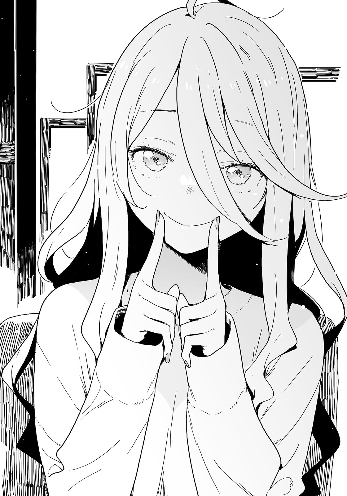

# Ch.19 — เล่ม 4 บทที่ 3-4

Ch.19 — เล่ม 4 บทที่ 3-4

By Monica

Published: 2024-12-06T15:36:53Z

Source: https://www.nekopost.net/novel/14560/19

เล่ม 4 บทที่ 3-4

ร้านคาเฟ่ใกล้สถานี

กล่องดนตรีกำลังเล่นเพลงคริสต์มาสเบา ๆ

ภายใต้แสงเทียนสลัว ๆ ผมกับรุ่นพี่ทามากินั่งมองหน้ากันข้ามโต๊ะอาหาร

[ ขอโทษที่ต้องให้จ่ายแทนผมนะครับ ]

[ ไม่ต้องห่วงหรอก ฉันไม่ชอบกินข้าวคนเดียวน่ะ ]

รุ่นพี่ทามากิยิ้มอย่างอ่อนโยน

อาหารค่ำวันคริสต์มาสของรุ่นพี่ถูกยกเลิกกะทันหัน ในขณะที่ผมยินดีที่เขาชวนผมมาอยู่ที่นี่ แต่เรากลับถูกรายล้อมไปด้วยคู่รัก การปรากฏตัวของพวกเราดูไม่เหมาะกับสถานการณ์เลย

[ ฉันจองที่นี่ล่วงหน้าแล้วด้วยนะ ฉันทำงานหนักเพื่อเตรียมตัวสอบ พร้อมกับรอวันนี้... ]

รุ่นพี่เอนตัวลงไปบนโต๊ะทันที

[ มันเกิดขึ้นได้ไงเนี่ย? ]

ผมคิดว่านี่คงเป็นชะตากรรมแบบหนึ่ง

แต่ผมเป็นคนที่ดึงรุ่นพี่เข้ามา เพราะงั้นผมก็ต้องรับผิดชอบด้วย

[ อย่าเศร้าไปเลยครับ ดูเหมือนว่ารุ่นพี่ชิกิยะกับรุ่นพี่สึกิโนะคิจะคืนดีกันแล้ว เธอก็ไม่ได้โกรธรุ่นพี่ด้วย ]

[ จริงเหรอ? ฉันคิดว่าเธอโกรธมากเลยนะ ]

[ เธอแค่อายเท่านั้นแหละ เครื่องดื่มมาแล้ว เงยหน้าขึ้นหน่อยสิ ]

พนักงานเสิร์ฟเดินมาที่โต๊ะพร้อมกับเครื่องดื่ม

[ เครื่องดื่มพิเศษสำหรับวันคริสต์มาสAranciata Rossaค่ะ ]

เสียงตุ๊บของแก้วใบใหญ่ถูกวางลงตรงกลางโต๊ะ

มีน้ำสีแดงในแก้วพร้อมกับหลอดสองอันที่ขดเป็นเกลียวพันกัน

— นี่พวกเราต้องดื่มด้วยกันเหรอ ?

[ รุ่นพี่ ผมคิดว่าบางอย่างแย่ ๆ ถูกเสิร์ฟมาแล้วล่ะ ]

[ ...ก็มันเป็นคริสต์มาสนิ ]

รุ่นพี่เอนตัวไปข้างหน้าเล็กน้อยแล้วใส่หลอดเข้าไปในปาก

[ อร่อยดีนะ อยากลองบ้างมั้ย? ]

[ อืม ก็ได้ ]

มันขมนิดหน่อย แต่ก็อร่อย

เราผลัดกันดื่ม แล้วอดีตประธานก็ดูเหมือนจะนึกอะไรขึ้นมาได้

[ นุคุมิซึ ลองดื่มพร้อมกับฉันสิ ]

[ เอ่อ ไม่ดีกว่า ]

[ ฉันก็ไม่ค่อยอยากทำเหมือนกัน นี่ ลองดูหน่อยสิ ]

ถ้าไม่อยากทำแล้วจะลองทำเพื่อ...?

ไม่มีทางอื่นแล้ว ผมทำตามที่เขาบอก สุดท้ายแล้วรอยพิมพ์รูปหัวใจก็ปรากฏขึ้นมา

[ โอ๊ะ! น้ำผลไม้ทำให้หลอดเป็นรูปหัวใจถ้าเราดื่มพร้อมกันงั้นเหรอ? ]

[ ก็ใช่ ถ้ามองจากด้านบนก็จะเห็น ]

พวกเขาพยายามทำหลอดเหมือนกันนะ ในขณะที่พวกเรากำลังคุยกันเรื่องการออกแบบ พนักงานเสิร์ฟก็เสิร์ฟจานต่อไป

[ ขอบคุณที่รอค่ะ นี่ออร์เดิร์ฟพิเศษสำหรับวันคริสต์มาส ]

จานสี่เหลี่ยมถูกวางไว้ข้างหน้าเรา

มีฟองขาว ๆ คล้ายเกล็ดหิมะและออร์เดิร์ฟหลากสีสัน

[ เรากินฟองพวกนี้ได้เหรอ? ]

[ มันเรียกว่ามูสใช่มั้ย ? เราต้องทามันลงบนซานต้าแล้วกิน ]

[ หมายความว่าเจ้าตัวประหลาดที่ดูเหมือนสัตว์อัญเชิญตัวนี้คือซานตาคลอสเหรอ? ]

สุดท้ายมันก็ค่อนข้างน่าสนใจเลยทีเดียว

หลังจากกินไก่ที่เป็นจานหลักเสร็จ รุ่นทามากิก็กลับมามีแรงอีกครั้ง

[ -จริงเหรอ? อายูจังสารภาพในตอนล่าสุดเลยเหรอ? ]

รุ่นพี่เอนตัวมาข้างหน้าอย่างตื่นเต้น ผมพยักหน้าอย่างจริงจัง

[ อ่าฮะ สัปดาห์หน้าต้องมีเรื่องแย่ ๆ เกิดขึ้นแน่ สารภาพในจังหวะสำคัญแบบนี้คือการปักธงตัวเองแล้ว ]

[ อุหวาา ฉันอยากดูตอนต่อไปเลย หวังว่าจะไม่โดนสปอยก่อนสอบเสร็จนะ ]

รุ่นพี่ทามากิหัวเราะขณะที่เขาเช็ดปากด้วยผ้าเช็ดหน้า

[ รุ่นพี่งดมังงะกับอนิเมะจริงจังเลยสินะครับ ]

[ ใช่ ฉันมีสอบอีกทีหลังปีใหม่ ต้องเร่งทำการบ้านหลังจากย้ายไปสายวิทย์แล้ว ]

[ ถูกรุ่นพี่ตัดสินใจแล้วหรือยังว่าจะเรียนคณะอะไร? ]

[ ยังไม่ได้บอกนายเหรอ? คณะเกษตร ฉันวางแผนว่าจะไปเรียนรู้พวกการหมักเหล้าน่ะ ]

หมักเหล้า...อย่างมิโสะกับสาเกน่ะเหรอ? คิดว่าน่าจะเป็นสาเก

[ ถ้าฉันจำไม่ผิด ครอบครัวของรุ่นพี่สึกิโนะคิทำธุรกิจร้านขายเหล้าใช่มั้ย? ]

[ ไม่ใช่ร้านขายเหล้า เธอเป็นลูกสาวคนเดียวของโรงหมักเหล้าต่างหาก ]

อ้อ เข้าใจแล้ว นั่นเป็นเหตุผลที่เขาเลือกเรียนแบบนั้น หรือก็คือ-

[ เอ๋ ไปถึงขั้นนั้นแล้วเหรอ? ]

[ ก็ไม่ได้ขนาดนั้นมั้ย? แค่อยากช่วยแบ่งเบาภาระเธอในอนาคตนิดหน่อย ]

รุ่นพี่ดื่มเครื่องดื่มรวดเดียวราวกับอยากปกปิดความเขิน

...พูดถึงอนาคตหลังจากเรียนจบ-

ผมวางแผนจะออกจากบ้านหลังจากเข้ามหาวิทยาลัย แต่ผมไม่สามารถจินตนาการถึงการทิ้งทุกอย่างไว้ข้างหลังได้เลย เอาเถอะ ผมนึกถึงตอนกินข้าวเย็นคนเดียวออกอยู่

[ ...ขอให้ทุกอย่างผ่านไปด้วยดีนะ ]

[ เชื่อฉันเถอะ แค่เตรียมตัวรอรับชัยชนะของฉันก็พอ ]

รุ่นพี่ชูนิ้วโป้งขึ้นอย่างภาคภูมิ ส่วนผมแสดงท่าทีดูหมิ่นอย่างตั้งใจ

[ ลืมเรื่องสอบไปเถอะ รู้สึกว่ารุ่นพี่มีปัญหาเรื่องผู้หญิงมากกว่า รุ่นพี่บอกเองว่าไม่ได้เป็นที่นิยม

ของสาวๆขนาดนั้น ตอนนี้ผมรู้แล้วว่ามันไม่จริงเลย ]

[ ชิกิยะซังไม่นับนะ แล้วฉันคิดว่านุคุมิซึก็เหมือนกัน นายก็เป็นที่นิยมอยู่ใช่มั้ยล่ะ ? ]

[ นิยมตรงไหนครับ ? ผู้หญิงไม่ชอบผมเลยสักคน ]

นี่เป็นการตอบโต้ที่เป็นธรรมชาติที่สุด แต่รุ่นพี่ไม่สนใจ

[ นุคุมิซึ นายแค่อยู่ในช่วงที่ได้รับความนิยมไม่ได้หมายความว่าผู้หญิงจะต้องชอบนายสักหน่อย ]

เอ่อ ไม่จริงใช่มั้ย ? นั่นทำลายคำจำกัดความของ "เป็นที่นิยม" เลยนะ

รุ่นพี่พูดต่อด้วยสีหน้าจริงจัง

[ นักเรียนปีหนึ่งในชมรมวรรณกรรมทุกคนเป็นผู้หญิงยกเว้นนายใช่มั้ยล่ะ? ]

[ อะ ใช่ ]

[ นายจะถูกล้อมรอบด้วยผู้ชายถ้าทุกคนในชมรมเป็นผู้ชาย ถึงนายจะไปอยู่ในสภานักเรียน มันก็เหมือนกันนั้นแหละ ? ]

เขาพูดถูก ผมพยักหน้าอย่างจริงใจ

[ พูดอีกอย่างก็คือ แก่นของการเป็นที่นิยมคือนายมีปฏิสัมพันธ์กับผู้หญิงจากความบังเอิญต่าง ๆ ฉันเคยได้ยินว่ามีช่วงเวลาที่ได้รับความนิยมแบบนี้แค่สามครั้งในชีวิต ยังไงก็เถอะ ถ้านายยังซื่อบื้อแบบนี้ มันจะเหมือนกับว่าไม่มีอะไรเกิดขึ้นเลย ]

[ เดี๋ยวก่อนนะ งั้นหมายความว่าผมเหลือช่วงแบบนี้อีกสองครั้งในชีวิตเหรอ? ]

[ ถ้านี่เป็นครั้งแรกของนายอะนะ มีครั้งไหนก่อนหน้านี้มั้ยที่นายเคยใช้เวลากับผู้หญิง? ]

แม้แต่เพื่อนยังไม่มี ไม่ต้องพูดถึงผู้หญิงเลย

ผมอยากจะหัวเราะเยาะตัวเอง แต่ความทรงจำเก่าๆก็ผุดขึ้นมาในหัวผม

[ ...นึกออกแล้ว ตอนอยู่ในอนุบาล เคยเล่นจำลองบ้านกับเด็กผู้หญิง ]

เป็นผู้ชายนี่มันยากจริง ๆ

[ นั่นคือครั้งแรกของนายเหรอ มีช่วงอื่นอีกมั้ย ? ]

[ อืม...เพื่อนของน้องสาวมักจะมาเล่นที่บ้านตอนผมอยู่มัธยมต้น ก็เลยใช้เวลาร่วมกับเธออยู่บ้าง ]

[ นุคุมิซึ ชีวิตของนายมันเป็นรอมคอมรึเปล่า...? ]

ทำไมรุ่นพี่ถึงดูหงุดหงิดนิดหน่อย ?

[ มันไม่ได้ดีเลยนะ เด็กผู้หญิงคนนั้นชอบหนีเรียน น้องสาวผมเป็นเพื่อนคนเดียวของเธอ ถึงน้องสาวผมไม่อยู่บ้านเธอก็ยังมาหา ผมไม่มีอะไรจะทำ นอกจากเล่นเกมกับเธอ เราทั้งคู่แทบไม่พูดคุยกันเลย ]

หลังจากคิดอยู่พักหนึ่ง รุ่นพี่ก็พยักหน้าอย่างแรง

[ นี่ก็นับว่าเป็นครั้งที่สอง นั่นหมายความว่าตอนนี้คือช่วงสุดท้ายของการเป็นที่นิยมในชีวิตของนาย ]

จริงเหรอ? งั้นผมก็คงจะต้องอยู่อย่างโดดเดี่ยวไปตลอดชีวิตแล้วสินะ

จานบนโต๊ะถูกเก็บไปในขณะที่ผมคิดถึงชีวิตหลังเกษียณ เหลือเพียงของหวานที่ยังไม่ได้เสิร์ฟ

รุ่นพี่ทามากิหยิบโทรศัพท์ออกมาอย่างเร่งรีบขณะที่เรากำลังเลือกเครื่องดื่มหลังอาหาร

[ ขอโทษนะ ฉันต้องรับสาย ]

เขาออกจากร้านหลังจากพูดแบบนั้น รู้ได้เลยว่าต้องเป็นรุ่นพี่สึกิโนะคิแน่ ๆ จากท่าทางร้อนรนของเขา

นอกหน้าต่าง รุ่นพี่ยังคงขอโทษอยู่ในโทรศัพท์ ขอโทษอย่างกับคนบ้าเลย

ทำไมคนเราต้องโค้งคำนับตอนที่ขอโทษผ่านโทรศัพท์ด้วยนะ...?

เขาตบมือเบา ๆ มาทางผมหลังจากกลับมา

[ ขอโทษนะ! ฉันต้องไปแล้ว ]

[ รุ่นพี่สึกิโนะคิยกโทษให้หรือยัง? ]

รุ่นพี่ทามากิสวมแจ็กเก็ตแล้วยิ้มฝืนๆ

[ ขึ้นอยู่กับการแสดงครั้งต่อไปของฉันด้วย ไม่ต้องรีบนะ นุคุมิซึ ]

รุ่นพี่ทามากิจ่ายเงินที่แคชเชียร์แล้วรีบวิ่งออกไป

ผมนึกถึงเทียร่าซังหลังจากที่เขาออกไปแล้ว

ข้อตกลงของเธอคือหาทางแก้ไขความสัมพันธ์ของรุ่นพี่สึกิโนะคิกับชิกิยะซังก่อนวันพรุ่งนี้

คิดว่าผมทำสำเร็จแล้วนะ แต่เธอต่างหากที่เป็นคนตัดสินใจ ผมคิดว่าเธอเป็นเด็กผู้หญิงที่ดูแปลกๆ อธิบายให้เธอฟังน่าจะยุ่งยาก...

ระหว่างนั้น พนักงานเสิร์ฟก็เข้ามาข้าง ๆ โต๊ะแล้วส่งยิ้มมา

[ คุณลูกค้า ถ้าเลือกเครื่องดื่มเสร็จแล้ว ขออนุญาติเสิร์ฟของหวานเลยนะคะ ? ]

[ หืม? อ่า แน่นอน ]

ความรู้สึกเย็นๆวูบแล่นผ่านคอของผมทันทีเมื่อผมหยิบเมนูเครื่องดื่มขึ้นมา

[ ฉันขอ...ชาพีช ]

ผมตัวสั่นหลังจากได้ยินเสียงกระซิบนั้นที่ข้างหู ต้องเป็นชิกิยะซังแน่นอน

[ รุ่นพี่ รู้ได้ยังไงว่าผมอยู่ที่นี่? ]

[ ฉันถาม...โคโตะซัง... ]

เธอถอดหมวกไหมพรมออกขณะนั่งลงที่ที่นั่งของรุ่นพี่ทามากิ

พนักงานเสิร์ฟไม่สะทกสะท้านกับการเปลี่ยนตัวที่ไม่คาดคิดนี้ เขายังคงส่งยิ้มอย่างเพอร์เฟคท์ให้เรา

[ สำหรับเครื่องดื่มเอาเป็นชาพีชใช่มั้ยคะ? ]

[ อ่า ใช่ครับ ขอสองที่ครับ ]

จากนั้น พนักงานเสิร์ฟก็หายเข้าไปในครัว ชิกิยะซังนั่งนิ่ง

มันค่อนข้างอึดอัด...

ผมกำลังจะพูดขึ้น ชิกิยะซังรีบพูดก่อนผมพร้อมกับพึมพำเบา ๆ

[ นายผิดสัญญา….ของเรา ]

[ เอ่อ ผมไม่ได้ตั้งใจจะ- ]

ความจริงแล้วเป้าหมายของผมแค่พาชิกิยะซังออกมา คำเชิญทั้งหมดนั่นคือคำหลอกลวง ใช่เลย ผมมันแย่ที่สุด

[ เอ่อ ขอโทษ ไม่รู้จะขอโทษยังไงดี ]

[ แต่...ฉันให้อภัยนาย….. ]

ชิกิยะซังลังเลอยู่ครู่หนึ่ง แล้วเธอก็ยกริมฝีปากขึ้นด้วยนิ้วชี้ทั้งสองข้าง

[ เอ่อ แบบนี้คือ... ]

[ ฉัน...พยายามยิ้ม... ]

[ ...อ่า ]

ผมไม่รู้จะตอบสนองยังไงดี ชิกิยะซังเอาหมวกคลุมหน้าของเธอไว้

[ ไม่นับ…แล้วกัน….. ]

[ ไม่ๆ อันนั้นแหละดีแล้ว! นี่ไง ขนมอร่อย ๆ มาเสิร์ฟแล้วนะ ]

ผมพยายามเพิ่มพลังบวกให้บรรยากาศและแนะนำขนมให้ชิกิยะซัง

บุชเดอโนเอลเป็นเค้กโรลแบบดั้งเดิมสำหรับคริสต์มาส

ชิกิยะซังสูดลมหายใจเล็กน้อย เธอถือถ้วยชาในมือ

[ ...น่าอาย…จัง ]

เป็นเพราะผมสินะ?

หลังจากเธอคืนสติมาได้ เธอก็กินขนมและพึมพำว่า

[ ยิ้มเนี่ย...ยากจัง... ]

ใบหน้าของชิกิยะซังบิดเบี้ยวเล็กน้อยจากไอน้ำของชา

ผมไม่เคยคิดเลยว่าการยิ้มมันยากหรือเปล่า

[ แต่ว่ารุ่นพี่ก็ยิ้มตลอดเวลาไม่ใช่เหรอ? ]

[ ฉัน...ยิ้มเหรอ...? ]

ชิกิยะซังรีบเอนตัวมาข้างหน้า

เธออยู่ใกล้กว่าที่ผมคิด นี่น่ากลัวนิดหน่อยแหะ

[ เอ่อ ลองคิดดูนะ ถึงเธอจะไม่ได้ส่งเสียงออกมา แต่บรรยากาศโดยรวมของเธอก็ดูมีความสุขดี ]

[ บรรยากาศ...? ]

อา ทำไมเธอดูหมดแรงขึ้นมาทันทีเลยล่ะ ?

[ เอ่อ นี่ตัวอย่างนะ คนเรามักจะบอกว่าพวกน้องหมาจะแสดงอารมณ์ผ่านหางของมันใช่มั้ย? แต่ถ้าเธอสังเกตดี ๆ ก็จะเข้าใจอารมณ์ของมันจากท่าทาง การเคลื่อนไหว และดวงตาของมันได้… ]

ถึงผมจะคิดว่าคำอธิบายนี้มันดูประหลาด ๆ แต่ชิกิยะซังก็พยักหน้าอย่างพอใจ

[ ใช่...น้องหมา...ฉันชอบ... ]

ผมก็ชอบเหมือนกัน

ผมรู้สึกโล่งใจเล็กน้อยก่อนจะกินขนมต่อ ชิกิยะซังจ้องมาที่ผม เหมือนกับว่าเธออยากจะพูดอะไรบางอย่าง

[ มีอะไรติดอยู่บนหน้าผมเหรอ? ]

[ เรื่องโดจินชิ...โอเคมั้ย? ]

[ จะไปคุยกับเทียร่าซังพรุ่งนี้ ผมทำตามสัญญากับเธอแล้ว- ]

[ สัญญา...? ]

อ่า ยังไม่ได้บอกชิกิยะซังเรื่องนี้สินะ?

หลังจากบอกเธอเกี่ยวกับสัญญาที่ผมมีกับเทียร่าซังไป ชิกิยะซังก็พึมพำเบา ๆ ดูเหมือนว่าเธอจะพอใจ

[ เทียร่าจัง...เป็นเด็กดื้อจริงๆ... ]

[ ผมว่าพวกเธอสองคนก็คงจะคล้าย ๆ กันนั่นแหละ ]

[ งั้นฉันก็เป็น...เด็กดื้อเหมือนกัน... ]

ชิกิยะซังวางถ้วยชาของเธอลงเงียบ ๆ

—สึกิโนะคิ โคโตะ กับ ชิกิยะ ยูเมโกะ

ไม่ว่าจะเป็นรอยร้าวที่เคยมีอยู่ระหว่างพวกเธอ หรือความรู้สึกที่ได้รับการยืนยันอีกครั้งภายใต้แสงสีนั้น-

ผมไม่มีทางรู้ว่ามันเป็นยังไง บางทีแม้แต่พวกเธอเองก็อาจจะไม่เข้าใจ

แต่ความสัมพันธ์ของมนุษย์ก็เป็นแบบนั้นไม่ใช่เหรอ?

ชิกิยะซังกับรุ่นพี่สึกิโนะคิได้แก้ไขความสัมพันธ์ของพวกเธอแล้ว เทียร่าซังก็จะมีเรื่องให้กังวลน้อยลงอีกเรื่องหนึ่ง

ทั้งหมดนี้เพียงพอแล้วสำหรับบทส่งท้ายในวัย 15 ปีของผม

ผมรู้สึกตัวอีกทีชิกิยะซังก็กินขนมหมดแล้ว เอาจริงๆ ผมไม่รู้ว่าด้วยซ้ำว่าปากของเธอขยับเมื่อไหร่

ผมแกล้งทำเป็นจิบชาในขณะที่แอบสังเกตชิกิยะซัง

วันนี้เธอแต่งหน้าเบากว่าปกติ ถ้ามีคนบอกว่าเธอไม่ได้แต่งหน้าผมก็เชื่อได้นะ ยกเว้นดวงตาสีขาวสวย ๆ ของเธอ

ไม่นานมานี้ ยานามิพูดว่า "อย่าเชื่อพวกผู้หญิงที่บอกว่าพวกเธอไม่ได้แต่งหน้าเลย" บางทีเธออาจจะรู้สึกอิจฉาเหมือนกัน

เพราะงั้นผู้หญิงถึงน่ากลัวไง

...แต่ว่า ผู้หญิงคนนี้ขนตายาวจริง ๆ ใบหน้าก็สวยต่างจากยานามิ เธอให้ความรู้สึกเหมือนผู้หญิงโตเต็มวัยที่มีเสน่ห์อันเย้ายวน

ผมเริ่มเบลอจากการมองเธอ ชิกิยะซังเอียงคอและจ้องมาที่ผม

[ มีอะไร...เหรอ? ]

[ ไม่มีอะไร แค่สงสัยว่าเธอคุยอะไรกับรุ่นพี่สึกิโนะคิน่ะ ]

ชิกิยะซังค่อย ๆ เอานิ้วแตะริมฝีปากของเธอ

[ เรื่องที่คุย……เป็นความลับ ]

เธอพูดด้วยเสียงกระซิบเบาๆ ขาของเธอที่ไขว้กันก็เปลี่ยนตำแหน่ง

เอ่อ บรรยากาศแบบนี้คืออะไร?

[ เกิดอะไรขึ้นรึเปล่า? ]

ชิกิยะซังไม่ตอบ แต่ร่างกายของเธอสั่นอย่างพึงพอใจ

...เกิดอะไรขึ้นกันแน่ ?

ผมภาวนาให้รุ่นพี่ทามากิประสบความสำเร็จในคืนนี้ขณะที่ผมดื่มชาที่เหลือจนหมด

— กล่องดนตรียังคงบรรเลงเพลงที่แสนสงบ

ภายในร้านอาหารที่มีแสงสลัวชิกิยะซังสั่นไปมาเบาๆภายใต้แสงเทียน

ไม่มีบทสนทนาใดๆ ถ้วยชาก็หมดแล้ว

การอยู่คนเดียวกับผู้หญิงที่อายุมากกว่าทำให้ผมหมดความกล้าที่จะใช้ประโยชน์จากความเงียบนี้

พูดตามตรง มันน่าเบื่อจริง ๆ ผมไม่รู้ว่าควรพูดอะไร

แต่ผมก็ลุกไปไหนไม่ได้ถ้าไม่มีเหตุผล

แต่ด้วยเหตุผลบางอย่าง ผมไม่ได้เกลียดช่วงเวลาที่น่าอึดอัดที่ผมใช้ร่วมกับชิกิยะซัง

ชิกิยะซังดื่มชาเงียบ ๆ ตามปกติ ดวงตาสีขาวของเธอดูเหมือนจะจ้องมองอะไรบางอย่าง

ผมยินดีที่จะรอจนกว่าเธอจะมองมาที่ผม

ชิกิยะซังมองมาที่ผม เธอเอียงคอเบา ๆ

ผมยิ้มแห้ง ๆ อย่างไม่เป็นธรรมชาติและเอียงคอตามเธอ

อึดอัดและไม่สบายใจ

แต่ผมไม่อยากให้เวลาช่วงนี้ผ่านไปเลย

ผมผ่อนคลายตัวเองเพื่อพยายามหาคำตอบให้กับความสับสนนี้

— ถ้าผมต้องตั้งชื่อความรู้สึกนี้ สงสัยจังว่าคำไหนจะเหมาะสมที่สุด?

---
