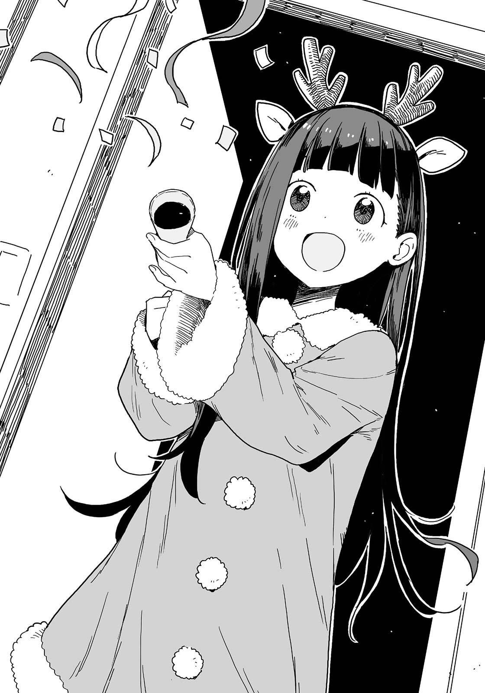

# Ch.20 — เล่ม 4 บทที่ 4-1

Ch.20 — เล่ม 4 บทที่ 4-1

By Monica

Published: 2024-12-06T15:38:15Z

Source: https://www.nekopost.net/novel/14560/20

เล่ม 4 บทที่ 4-1

ตอนเช้า วันที่ 25 ธันวาคม แสงแดดและอากาศเย็นๆ ส่องผ่านเข้ามาในห้องผ่านช่องผ้าม่าน

ผมห่มผ้าหนาๆคลุมตัวให้แน่นขึ้น พลางหลับตาเพลินอยู่ในความอบอุ่นของผ้าห่ม

วันนี้เป็นวันเกิดของผม เป็นวันคริสต์มาส และเป็นวันพิธีปิดภาคเรียน เป็นวันที่วุ่นวายจริงๆ

นาฬิกาปลุกยังไม่ดัง ผมยังคงซุกตัวอยู่ในผ้าห่ม-

[ ท่านพี่! สุขสันต์วันเกิดนะคะ! ]

เสียงพลุปาร์ตี้ดังขึ้นในห้องพร้อมเสียงทักทายอย่างร่าเริงของคาจู

นี่สินะที่เธอวางแผนไว้ปีนี้ ผมถูตาและลุกขึ้นนั่ง

[ ...อรุณสวัสดิ์ คาจู ดูกระปรี้กระเปร่าแต่เช้าเลยนะ ]

[ แน่นอนค่ะ วันนี้เป็นวันที่น่ายินดี ท่านพี่ลุกขึ้นมาเถอะค่ะ ]

คาจูหมุนตัวหนึ่งรอบในชุดสีแดง กระโปรงที่ปลายชุดสะบัดเบาๆ

[ เอ๊ะ ชุดอะไรน่ะ? ]

[ ก็วันนี้เป็นวันคริสต์มาสไงคะ หนูเลยแต่งตัวเป็นซานตี้ ท่านพี่คิดว่าไงคะ? ]

ชุดของคาจูเป็นชุดคริสต์มาส พร้อมที่คาดผมรูปเขากวางเรนเดียร์

[ น่ารักมาก แต่คาจู บ้านเราห้ามฉลองคริสต์มาสไม่ใช่เหรอ? ]

[ ใช่ค่ะ ท่านพี่พูดถูก คาจูก็สับสนทุกปีนั่นแหละค่ะ ]

คาจูเดินมาคุกเข่าลงข้างเตียง

[ ทั้งที่วันนี้เป็นวันเกิดท่านพี่ แต่คนอื่นกลับชอบวันคริสต์มาสมากกว่าซะงั้น คาจูต้องเผชิญหน้ากับโลกที่เป็นแบบนี้มาตลอด หรือก็คือ นี่เป็นการต่อสู้ระหว่างคริสต์มาสกับท่านพี่ค่ะ ]

คู่ต่อสู้ของผมแข็งแกร่งเกินไปหน่อยไหมเนี่ย?

[ แต่คาจูคิดออกแล้วล่ะค่ะ บางทีคนทั้งโลกอาจจะฉลองให้ท่านพี่ก็ได้ใช่มั้ยคะ? พวกไฟตกแต่งนั่นอาจจะเพื่อท่านพี่ก็ได้… คาจูคิดมาทั้งคืนแล้ว และสุดท้ายก็ตกลงใจยอมรับคริสต์มาสได้ค่ะ ]

[ ก็ดี งั้นไปนอนได้แล้ว ]

เอ๊ะ เธอเพิ่งบอกว่ายอมรับคริสต์มาสวันนี้เองนี่-

[ ไปซื้อชุดคริสต์มาสนี้มาตอนไหนเหรอ? ]

[ ไม่รู้เหมือนกันว่าทำไมมันถึงอยู่ใต้ตู้เสื้อผ้าของแม่ค่ะ- ]

[ พอแล้ว หยุดแค่นั้นแหละ จะทำเป็นไม่ได้ยินแล้วกัน ]

ข้อมูลมันหนักเกินไปสำหรับช่วงเช้าวันนี้

[ ปิดเทอมฤดูหนาวของคาจูเริ่มวันนี้พอดี คาจูเลยต้องทำอาหารเย็นมื้อใหญ่ให้ดีที่สุด คาจูจะทำไก่ย่างมิคาวะทั้งตัวให้เลยค่ะ ท่านพี่คอยดูได้เลย! ]

[ โอ๊ะ คงอร่อยแน่เลย ]

[ แน่นอนค่ะ! วันนี้ถือเป็นการเริ่มต้นใหม่ของท่านพี่ ถึงจะดูเกินคาดไปบ้าง แต่คาจูจะพยายามสนับสนุนท่านพี่ให้เต็มที่นะคะ! ]

[ เริ่มต้น…? มันวันเกิดพี่ก็จริง แต่ไม่คิดว่าคาจูจะโอเวอร์ขนาดนี้นะ ]

คาจูพนมมือที่หน้าอก

[ คาจูประหลาดใจกับสิ่งที่เกิดขึ้นเมื่อวานค่ะ แต่คาจูจะสนับสนุนการตัดสินใจของท่านพี่แน่นอน! ]

…เธอพูดถึงเรื่องอะไรกัน? เมื่อวานผมก็แค่กลับบ้าน อาบน้ำ แล้วก็นอนตามปกตินี่นา

[ เมื่อวานคาจูแอบตามพี่มาเหรอ? ]

ผมพูดล้อเล่นไปครึ่งหนึ่ง คาจูกลับพยักหน้า

[ ใช่ค่ะ คาจูอยากรู้ว่าท่านพี่ไปเจอใครมา ]

[ เอ๊ะ! นี่เธอเห็นเหรอเนี่ย!? ]

[ เธอคนนั้นอยู่โรงเรียนสึวะบุกิใช่มั้ยคะ? คาจูเคยเห็นเธอช่วงทริปฤดูร้อน! ]

— ทริปฤดูร้อนของชมรมวรรณกรรม ตอนนั้นคาจูก็เข้าร่วมโครงการแลกเปลี่ยนนักเรียนเมืองโทโยฮาชิในช่วงเวลาเดียวกัน

ถึงแม้ว่าอะไรๆ ระหว่างผมกับชิกิยะซังจะไม่ได้เป็นแบบนั้น แต่ก็รู้สึกอายนิดๆ ที่มีคนในบ้านมาเห็น…

[ คาจู พี่ว่าเธอเข้าใจผิด…พี่ไม่ได้คบกับคนนั้นนะ ]

[ รู้อยู่แล้วค่ะ! เธอคนนั้นคงเป็นแค่ผู้สมัครตำแหน่งแฟนสาวของท่านพี่ใช่มั้ยล่ะคะ!? ]

คาจูยิ้มกว้างแก้มแดงขึ้นมา

[ ถึงจะมีอุปสรรคบ้าง คาจูก็จะอยู่ข้างท่านพี่เสมอนะคะ? ]

[ คนนั้นเป็นรุ่นพี่ในโรงเรียนของพี่นะ เราไม่ได้มีความสัมพันธ์แบบนั้น หยุดปีนขึ้นมาบนเตียงพี่ได้แล้ว ]

[ ได้ค่ะ ค่อยๆ พัฒนาความสัมพันธ์กันไปนะคะ! คราวนี้คาจูจะคอยเฝ้าดูแบบเงียบๆ! ]

ขอบคุณมากนะ คาจูหาวแล้วถูตาง่วงๆ

[ คาจู เมื่อคืนเธอพักผ่อนไม่พอใช่มั้ย? ไม่ต้องทำอาหารเย็นหรอก ไปนอนได้แล้ว ]

[ แต่คาจูต้องอบเค้กสามชั้น ถ้าไม่เริ่มตั้งแต่ตอนนี้ก็จะไม่ทัน แล้วก็ไก่จะสดกว่าถ้าฆ่าตอนเช้านี่แหละค่ะ! ]

เอ๊ะ เธอกำลังจะฆ่าไก่ตอนนี้เลยเหรอ? ไม่น่าจะใช่….ใช่มั้ย?

[ แค่เค้กธรรมดา ชั้นเดียวก็พอแล้ว! ]

[ แต่ว่า แต่ว่า ท่านพี่ แบบนั้นจะไม่เหงาไปหน่อยเหรอคะ? คาจูยังอยากฆ่าแล้วอบไก่ทั้งตัวนะ… ]

[ งั้นพี่อยากได้แค่ข้าวปั้นรสเค็ม เต้าหู้ กับสลัดผัก ]

วันนี้ผมจะลองเป็นมังสวิรัติดูสักวัน คาจูทำหน้าบึ้งเล็กน้อย

[ ...ขอมือหน่อยได้มั้ยคะ? ]

เธอกระซิบเบาๆ

[ อะไรนะ? ]

[ คาจูจะไปนอน ถ้าท่านพี่เป็นหมอนแขนให้ ]

ตั้งแต่คาจูเข้าโรงเรียนมัธยมต้น บ้านเราห้ามนอนด้วยกัน …แต่ครั้งนี้คงปฏิเสธไม่ได้ ผมนั่งพิงเตียงและยื่นแขนออกไป

[ จะอยู่แค่จนกว่าเธอจะหลับนะ ]

[ ได้ค่ะ ท่านพี่ ! ]

คาจูล้มตัวลงนอนข้างๆ ทันที

[ เฮะ เฮะ คาจูไม่ได้นอนกับท่านพี่มานานแล้วใช่มั้ยคะ ? ]

[ ก็สองปีแล้ว ตั้งแต่เธอเข้ามัธยมต้นเลยมั้ง? ]

[ ...อืม ]

ทำไมเสียงเธอดูแปลกๆ? อย่าบอกนะว่าเธอแอบเข้ามานอนตอนที่ผมไม่รู้

ผมอยากจะถามเธอเพิ่ม แต่คาจูหลับไปแล้ว

เมื่อคืนเธอคงนอนน้อยสินะ ไม่แปลกเลยที่เธอจะหลับเร็วขนาดนี้

อ๊ะ ถ้าตั้งนาฬิกาปลุกคาจูจะลำบากเอา ผมยื่นมืออีกข้างไปปิดนาฬิกาปลุก ตอนนี้ก็แค่ระวังไม่ให้ตัวเองเผลอหลับไปอีก

แต่พอมีคาจูนอนอยู่บนแขนผมก็คงหลับไม่ได้หรอก งั้นแค่พักตาสักหน่อยแล้วกัน เมื่อวานผมเองก็เจออะไรมาเยอะเหมือนกัน

แต่ผ้าห่ม...อุ่นจัง บางที…อาจจะเป็นเพราะคาจูนอนอยู่ข้างๆ ก็ได้…?

ผมคง...นอนได้อีกสักนิดแหละ…? ตั้ง...นาฬิกาปลุกไว้แล้ว...รึเปล่า…?"

สุดท้ายผมก็พลาดรางวัลนักเรียนดีเด่นด้านไม่ขาด ลา มาสาย เพราะไปสายในวันสุดท้ายของเทอมสอง

---
