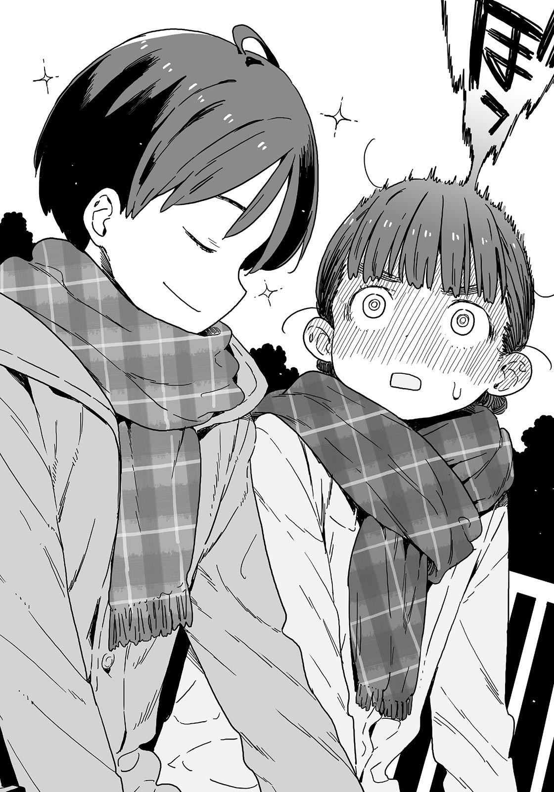

# Ch.22 — เล่ม4 บทที่ 4-3

Ch.22 — เล่ม4 บทที่ 4-3

By Monica

Published: 2024-12-06T15:43:51Z

Source: https://www.nekopost.net/novel/14560/22

เล่ม4 บทที่ 4-3

สวนสาธารณะมุไคยะมะโออิเกะ อยู่ใกล้กับใจกลางเมืองโทโยฮาชิ ใช้เวลาประมาณ 15 นาทีโดยจักรยานจากโรงเรียนมัธยมซึวะบุกิ

พอบอกว่ามีพื้นที่เท่ากับนาโกย่าโดมสามแห่งคนก็จะเข้าใจว่ามันใหญ่ขนาดไหน

บริเวณรอบ ๆ มีทางเดินและสวนสาธารณะ เป็นสถานที่ท่องเที่ยวยอดนิยมในฤดูซากุระด้วย อย่างไรก็ตาม มันดูร้างเล็กน้อยในวันธรรมดาช่วงฤดูหนาว

ผมจอดจักรยานไว้ในลานจอดใกล้กับหอวัฒนธรรม แล้วเดินเลียบไปตามทางเดินจนมาถึงข้างสระน้ำ สะพานยาวข้ามสระแบ่งสระออกเป็นสองส่วน สะพานดูเหมือนจะยาวกว่า 100 เมตร

พวกเรานัดกันที่สะพาน แล้วทำไมเธอถึงเลือกจุดนี้นะ?

ถึงมันจะเป็นเรื่องโดจินBLจากชีวิตจริง แต่เราจะให้ในห้องชมรมหรือหลังอาคารเรียนก็ได้ แต่เรากำลังพูดถึงเทียร่าซังอยู่ ผมไม่คิดว่าเธอจะข่มขู่ผมได้...ใช่มั้ย?

เมื่อเดินผ่านทางเดิน ผมเห็นสระน้ำขนาดใหญ่ที่ขยายกว้างออกไป

เสาสะพานมีป้ายเขียนว่า “สะพานโออิเคะ” จุดสิ้นสุดของสะพานที่ฝั่งตรงข้ามดูจะกว้างกว่า

เมื่อสังเกตดีๆ มีม้านั่งที่นั่น ผมคิดว่ามีใครบางคนนั่งอยู่

ลมเย็น ๆ จากทางตะวันตกพัดผ่านผิวน้ำจนผมอดไม่ได้ที่จะสั่นเล็กน้อย

นึกไม่ออกเลยว่าจะมีใครนอกจากเทียร่าซังที่ยอมทนกับอากาศหนาวขนาดนี้ ผมสูดหายใจลึกๆแล้วก้าวขึ้นไปบนสะพาน

เมื่อมองจากระยะไกล เธอดูเหมือนจะสวมโค้ทและผ้าพันคอทับชุดนักเรียนของเธอ

เธอเหมือนจะสังเกตเห็นผมแล้ว เด็กสาวลุกขึ้นยืนและนั่งลงอย่างกังวล

เมื่อภาพของเธอเข้าใกล้ขึ้นเรื่อย ๆ แม้แต่ผมก็เริ่มรู้สึกตื่นเต้นขึ้นมา

วันนี้เป็นวันคริสต์มาส การเชิญใครสักคนไปยังที่เงียบ ๆ มันเหมือนเป็นจุดเริ่มต้นของเรื่องราวเลิฟคอเมดี้จริง ๆ

ผมมาถึงแล้ว เทียร่าเหมือนจะรอไม่ไหว เธอก้มหัวลง

[ ขอบคุณที่มานะ ]

[ ไม่เป็นไรหรอก แต่ว่าทำไมถึงเลือกที่นี่ล่ะ? ]

ผมถามอย่างไปอย่างเรียบๆ ทั้งที่ความรู้สึกไม่เป็นเหมือนกับที่พูด เทียร่าซังมองไปรอบๆ อย่างสุขุม

[ ไม่มีใครอยู่ที่นี่ เราไม่ต้องกังวลว่าจะมีคนแอบฟัง มีที่ไหนที่จะคุยเรื่องที่เราไม่อยากให้คนอื่นรู้ได้ดีไปกว่าที่นี่อีก? ]

สถานที่นี้ให้มุมมองรอบทิศทางของสะพานโออิเคะ อันที่จริง ไม่มีทางที่คนอื่นจะรู้ว่าพวกเราคุยอะไรกันได้ เพราะระยะทางมันไกลขนาดนี้ มันใหญ่กว่านาโกย่าโดมสามเท่าเลยนะ

[ เข้าใจแล้ว แต่ทำไมเราไม่ไปห้องคาราโอเกะหรือที่อื่นล่ะ? ]

[ แล้วใครกันที่พาผู้หญิงอีกคนมาครั้งที่แล้ว? ]

[ ยากิชิโอะก็แค่- โอเค ผมผิดเอง ]

...นั่นแหละเทียร่าซังในแบบปกติของเธอ เธอเงยหน้าขึ้นแล้วจ้องผม

[ นุคุมิซึซัง เรื่องที่เกิดในโรงยิมล่ะ? ]

[ เอ่อ โรงยิม…? ]

อย่าบอกนะว่าเธอได้ยินที่ผมคุยกับโคนุกิซังเซนเซ

[ เรื่องของรุ่นพี่ชิกิยะไง! ทำไมพวกนายถึงคุยเรื่องเดทกันล่ะ!? ]

[ ไม่รู้เหมือนกัน แถม…..อีกฝ่ายก็เป็นชิกิยะซังด้วย]

[ อืม… ก็จริงนะ ]

นั่นคือสิ่งที่ผมคิดไว้สุดท้ายแล้วเธอก็เชื่อผม เธอคนนี้เชื่อคนง่ายจริง ๆ

[ ยังไงก็เถอะ เธอคิดว่าผมทำสัญญาได้แล้วเลยเรียกออกมาที่นี่ใช่มั้ย ? ]

[ ใช่ พูดตรงๆ ฉันไม่ได้คาดหวังผลลัพธ์อะไรเลย ]

เธอคนนี้ก็ไม่มีมารยาทเหมือนเดิมเลย

[ ในฐานะรุ่นน้องของสึกิโนะคิซัง ฉันแค่อยากจะเผชิญกับปัญหานี้ร่วมกับเธอ เพราะงั้น ฉันไม่ได้หวังว่าพวกเขาจะคืนดีกันจริง ๆ หรอก ฉันนับถือนายมากนะ… ]

เทียร่าซังดูเขินๆ เธอก้มหน้าลง

[ ...เกิดอะไรขึ้นล่ะ? ]

[ ฉันรู้สึกว่ารุ่นพี่ชิกิยะเริ่มเข้าหาฉันมากขึ้น เมื่อคืนไม่ได้มีอะไรแปลก ๆ เกิดขึ้นใช่มั้ย? ]

[ ถ้าเทียร่าซังกังวลเรื่องแบบนั้น ก็ไม่ต้องห่วงนะ ]

[ นายคิดว่าฉันกังวลเรื่องอะไร? แล้วก็อย่าเรียกฉันด้วยชื่อจริงนะ ]

เทียร่าซังหยิบถุงกระดาษออกมาอย่างไม่พอใจ

[ เอ่อ นี่คือ…? ]

[ บอกแล้วไงว่าจะคืนหนังสือให้ ฉันเป็นคนรักษาคำพูดนะ ]

มีบางอย่างนอกเหนือจากหนังสือในถุงนี้หรือเปล่านะ?

ผมรับถุงมาด้วยความสงสัย ข้างในนั้นมีกล่องกระดาษสีแดงผูกด้วยริบบิ้น

[ เหมือนจะมีอย่างอื่นนอกจากโดจินชิด้วยนะ ]

[ ...นั่นสำหรับนาย ]

เทียร่าซังเบือนหน้าหนีและพูดพึมพำบางอย่าง

— ทำไม?

ผมกลืนคำถามนั้นกลับไป นึกถึง “เทคนิคการรับของขวัญ” ที่คาจูสอนผมเมื่อวานก่อนจะออกจากบ้าน ไม่คิดเลยว่ามันจะมีประโยชน์เร็วขนาดนี้

ขอคิดหน่อย สิ่งแรกที่ต้องทำคือ…

[ ว้าว ดีใจมากเลย รับของนี่ไว้ได้จริงๆเหรอ? ]

— แสดงความประหลาดใจและความสุข นี่สำคัญสุดๆ เลย

[ ชะ-ใช่ แต่ไม่ต้องดีใจขนาดนั้นหรอก แค่ของที่นักเรียนมัธยมปลายพอจะหามาได้เอง ]

[ อย่าพูดแบบนั้นสิ ผมตื่นเต้นจริงๆ นะ ขอเปิดดูได้มั้ย? ]

[ ด-ได้ตามใจเลย ]

— แสดงความดีใจซ้ำๆ และแสดงความตั้งใจจะเปิดดู

เปิดห่ออย่างระมัดระวังหลังจากนั้น สิ่งที่สำคัญที่สุดคือต้องระวังในจุดนี้

ตามที่คาจูบอกไว้ มีแต่เด็กประถมเท่านั้นที่จะแกะห่อแบบไม่ใส่ใจ

[ ...เอ่อ แล้วต้องทำอะไรต่อนะ? ]

ผมเผลอพูดออกมาด้วยความลังเล เทียร่าซังดูผมด้วยความตกใจ

[ อะไร? หมายความว่าไง? ]

[ อ่า เปล่า ไม่มีอะไร... โอ๊ะ ]

ในนั้นมีผ้าพันคอสีเขียว

[ เอ๋ นี่เธอให้จริงๆ เหรอ? สุดยอดไปเลย ]

หูของเทียร่าซังแดงขึ้นทันทีหลังได้ยินคำชมที่ไม่คาดคิด เธอก้มหัวลงแล้วพึมพำเบาๆ

[ น-นั่นแหละ ถึงบอกไงว่านี่แค่ของขวัญขอบคุณ ฉันอ้างอิงจากค่าจ้างขั้นต่ำของจังหวัดไอจิแล้วคำนวณตามความพยายามของนาย แล้วนี่คือผลลัพธ์ที่ได้ ! ]

ดูเหมือนมีสัญญาจ้างงานระหว่างผมกับเทียร่าซังเลยแหะ

[ ไม่เยอะไปหน่อยเหรอ? ]

[ อืม ก็นะ... ค่าของงานนี้วัดด้วยเงินไม่ได้อย่างเดียวหรอก นั่นแหละ เลิกใส่ใจรายละเอียดทีเถอะ! ]

ดูเหมือนเธอจะคิดว่าผมเป็นหนุ่มเจ้าชู้ในออฟฟิศแล้วทั้งที่ผมยังไม่ทันรู้ตัวเลย

[ เข้าใจแล้ว งั้นขอรับไว้ด้วยความขอบคุณแล้วกัน ]

ตามคำแนะนำของคาจู สิ่งที่ต้องทำเมื่อได้รับของใช้ส่วนตัวคือ-

ผมใส่ผ้าพันคอแล้วส่งยิ้มให้เทียร่าซัง

[ อุ่นจัง ขอบคุณนะ ]

[ หา!? อะ ก็ใช่ มันทำจากขนสัตว์น่ะ ! ]

คำพูดของเทียร่าซังดูสะดุดไปหมด

ถึงผมจะทำตามบทเรียนแล้ว แต่เผลอทำพลาดตรงไหนไปหรือเปล่า...?

ผมสังเกตเทียร่าซังอย่างไม่สบายใจ เธอก็มีผ้าพันคอสีแดงพันอยู่ที่คอเหมือนกัน-

[ ว่าแต่ ผ้าพันคอนี่เหมือนกับของบาโซริซังยกเว้นแค่สีใช่มั้ย ? ]

[ ก-ก็แค่บังเอิญเท่านั้นแหละ ! ผ้าพันคอนี่เป็นแบบเดียวที่APITA มีขายน่ะ ! ]

[ ไม่ได้ว่าอะไรหรอก ผมชอบสีเขียวมากเลย ]

[ อ๋อ งั้น…ก็ดีแล้วล่ะ ]

เทียร่าซังดูเหมือนจะรวบรวมสติได้แล้ว นี่คือด่านสุดท้าย

ถ้าจำไม่ผิด ประโยคน่าจะเป็นแบบนี้-

[ ขอบคุณมาก จะรักษาไว้อย่างดีเลย ผมจะนึกถึงเทียร่าซังทุกครั้งที่เห็นมันด้วย ]

...ดีมาก นี่คือเทคนิคการรับของขวัญทั้งหมดของคาจู

ผมคลายไหล่ลง ส่วนเทียร่าซัง ใบหน้าของเธอแดงซ่านจนเหมือนมีไอน้ำออกมาจากหัว เธอตัวสั่นทั้งร่าง

[ เฮ้ เธอโอเคมั้ย? ]

[ ...อย่าหลงตัวเองนักเลย ]

เทียร่าซังก้มหัวลงและพึมพำ

[ อะไรนะ? ]

[ อ-อย่ามาหลงตัวเองนะ ! ]

เทียร่าซังจ้องผมน้ำตาคลอแล้วใช้นิ้วจิ้มที่อกของผม

[ ฟังนะ! นี่แค่ของขวัญขอบคุณเเท่านั้นเอง! แค่บังเอิญที่ห่อนี้ดูแปลกๆเพราะเป็นวันคริสต์มาส! ]

อะไรน่ะ ? ทำไมเธอถึงโกรธขนาดนี้?

หรือจริง ๆ แล้ว เทคนิคของคาจูนี่ดูเหมือนจะเกินตัวผมไปหน่อย ? น่าจะลองกับโคมาริก่อน....

[ โอเค เข้าใจแล้ว ใจเย็นก่อนนะ ]

[ ไม่! ยังไม่ได้! ไหน ๆ ก็มีโอกาสแล้ว เรามาคุยเรื่องการแก้ไขสิ่งไม่เหมาะสมในชมรมวรรณกรรมกันเถอะ... ]

เดี๋ยว ยังไม่จบอีกเหรอ?

แรงของเธอทำให้ผมถอยไปจนชิดราวสะพาน มีเสียงเพลงที่ร่าเริงดังใกล้ ๆ หู

[ เอ่อ มีสายเข้า ขอรับได้มั้ย? ]

ไม่รู้ว่าใคร แต่เธอคือผู้ช่วยชีวิตผม ผมหันหลังให้เทียร่าซังแล้วหยิบโทรศัพท์ออกมา

ชื่อของผู้ช่วยที่แสดงอยู่บนหน้าจอคือ - ยานามิ อันนะ

...คงไม่รอดแล้วสินะ

ยานามิเองควรจะอยู่ที่งานปาร์ตี้คริสต์มาสตอนนี้ จริง ๆแล้วผมรู้สึกไม่ดีมาก ๆ เลย

ไม่มีทางเลือกอื่นนอกจากกดรับสาย เสียงเพลงคาราโอเกะและเสียงหัวเราะของผู้คนดังมาจากอีกฝั่งหนึ่ง

[ ฮัลโหล? ]

ไม่มีคำตอบ เสียงเชียร์ดังขึ้นเหมือนเพลงแบคกราวนด์

ดูเหมือนว่าจะวางสายได้ ผมจะลองกดปุ่มวางสายดู

<...ช่วยด้วย >

มีคนพึมพำ เสียงทุ้มของยานามิดังแทรกอยู่ในเสียงรบกวน

[ หา? เฮ้ ยานามิซัง? ]

ตื๊ด ตื๊ด ตื๊ด ตื๊ด ...เอ๋ เธอวางสายใส่ผมแล้ว หรือว่าเธอไม่รอดแล้ว?

ผมหันกลับไปหาเทียร่าซังอีกครั้งพร้อมกับภาวนาให้ยานามิปลอดภัย

[ เอ่อ เกิดอะไรขึ้นหรือเปล่า? ]

[ ก็ไม่ใช่เรื่องใหญ่- ]

เสียง “ติ๊ง” รัว ๆ ดังจากโทรศัพท์ของผมเหมือนจะขัดจังหวะ

พอมองคร่าว ๆ มีข้อความส่งเข้ามาเรื่อย ๆ บนหน้าจอแจ้งเตือน

ผู้ส่งคือ ยานามิ เธอยังไม่ตาย

<ไม่มางานปาร์ตี้คริสต์มาสเหรอ?>

<สนุกมากเลยนะ>

<แค่คิดว่าตกหลุมพรางของฉันสักครั้งนึงก็พอ>

<มาสิ>

เธอหลอกผมอยู่ ไม่มีอะไรดีๆเกิดขึ้นแน่ๆ

ผมปิดใจไปแล้ว แต่ก็ยังมีข้อความโจมตีมาอีก

<อยู่ไหน?>

<รีบมาสิ>

<เร็วเข้ามาให้ฉันหลอกนายหน่อย>

เห็นมั้ย? เธอจะหลอกผม แต่ถ้าผมไม่ไปตอนนี้เรื่องจะแย่ลงไปอีก...

[ ขอโทษนะ บาโซริซัง เขาเรียกให้ไปประชุมชมรม ผมต้องไปแล้ว ]

[ เอ๋ เข้าใจแล้ว ขอโทษที่จู่ ๆ ก็ชวนออกมา ]

เทียร่าซังดูเสียแรงไปเลย ผมส่ายหน้า

[ ผมต่างหากที่ต้องขอโทษ ขอบคุณสำหรับผ้าพันคอนะ! ]

ผมแกล้งมองนาฬิกาและรีบออกจากที่นั่นทันที

◇

แม้ว่าจะเกิดอะไรขึ้นหลายอย่าง ผมก็กลับมาอย่างปลอดภัยพร้อมกับโดจินชิ ตอนนี้ผมสามารถพักผ่อนวันหยุดฤดูหนาวได้แล้ว

ผมกลับมาที่ทางเดินแล้วมองไปรอบ ๆ เพื่อให้แน่ใจว่าไม่มีใครอยู่ ก่อนจะเปิดดูถุงกระดาษ

มันเป็นโฟโต้ก็อปปี้ที่ทำด้วยตัวเอง มีโพสต์อิทจำนวนมากแปะอยู่ ดูเหมือนจะปิดผนึกวิญญาณชั่วร้ายไว้ แต่ยังไง นี่คือโดจินชิ BL ที่อิงจากคนจริงของสึกิโนะคิรุ่นพี่ ผมพบว่าโพสต์อิทเหล่านี้เต็มไปด้วยคำแนะนำอย่างละเอียด...ทำไมเธอถึงเก็บสิ่งนี้ไว้ที่นี่ล่ะ?

ผมเปิดไปที่หน้าหนึ่งแบบสุ่ม ภาพประกอบมีคุณภาพสูงมาก

ผมอยู่ด้านบน เพราะงั้นนี่คงจะเป็นผมใช่มั้ย? …ฮ่าฮ่า...สุดยอด...

โอ๊ะ ไม่ดีแล้ว ผมไม่มีเวลาจะอ่านทุกอย่าง ต้องรายงานเรื่องนี้ให้รุ่นพี่สึกิะโนคิใน Line โดยเร็วที่สุด

คาจูน่าจะเตรียมการวันเกิดของผมอยู่ที่บ้าน ผมต้องกลับหลังจากไปปลอบยานามิ

จำได้ว่าช่วงเวลาเดียวกันนี้เมื่อปีที่แล้ว ผมต้องเตรียมสอบและคาจูช่วยทำลิสต์คำถามที่เธอทำนายไว้ว่าจะออกสอบ เราทำข้อสอบไปด้วยกัน ในที่สุดผมก็รักษาเกียรติในฐานะพี่ชายไว้ได้เล็กน้อย ความทรงจำนั้นยังคงสดใหม่สำหรับผม

โทรศัพท์ของผมดังขึ้นขณะที่กำลังจะโทรหาคาจู

หน้าจอแสดง "สึกิโนะคิ โคโตะ " เธอนี่เร็วจริง ๆ ผมสงสัยว่าเธอจริงจังกับการเตรียมสอบแค่ไหนกัน

[ ฮัลโหล มีอะไรเหรอ? ]

< ยังจะถามอีกเหรอ? เมื่อวานนี้นายทำได้ดีมากเลยนี่ >

นั่นคือสิ่งแรกที่เธอพูด ผมยกโทรศัพท์ออกจากหน้าแล้วหัวเราะ

[ ใช่ ผมทำแบบนั้นจริง ๆ งั้น วางสายได้หรือยัง? ]

< ล้อเล่นน่ะ ขอบคุณมาก >

เราหัวเราะเบา ๆ แล้วผมก็เริ่มอธิบาย

[ ขอโทษนะครับ ผมรู้ว่าผมเข้าไปยุ่งกับเรื่องของพวกเธอสองคนจริง ๆ แต่มันจำเป็นต้องทำเพราะมันเกี่ยวข้องกับสมาชิกสภานักเรียน ]

< นายพูดถูก ถึงฉันจะมีหลายอย่างที่อยากจะขอโทษ แต่ฉันจะไม่ถามเรื่องที่นัดกับชินทาโร่ของนายหรอก เรามาทำให้มันจบแค่นี้ดีกว่า ฮืม? >

[ เมื่อวานนี้รุ่นพี่ทามากิเสียใจมาก ปลอบใจเขาหลังจากนี้ด้วยนะครับ ]

< อ่า การปลอบใจของฉันเสร็จเรียบร้อยแล้ว เพราะคืนฤดูหนาวมันยาวนานน่ะสิ >

[ ผมคิดค่าโทรเพิ่มสำหรับเรื่องแบบนั้นได้มั้ย? ]

ดูเหมือนว่าทุกอย่างจะเรียบร้อยระหว่างพวกเขา

ผมเดินผ่านผู้หญิงคนหนึ่งที่พาสุนัขออกมาเดินเล่นแล้วเงียบไปชั่วครู่

รุ่นพี่เองก็เงียบ จากนั้นเธอก็พูดขึ้นด้วยท่าทางสงบ

< …นุคุมิซึคุง ขอบคุณมากนะ ฉันได้บทเรียนแล้วจริง ๆ >

[ ก็ใช่ หวังว่ารุ่นพี่จะได้บทเรียนจริงๆนะครับ ]

< ไม่ต้องห่วง ฉันได้บทเรียนแล้วจริง ๆ นั่นทำให้ฉันแก้นิยายเล็กน้อยแล้วสร้างตัวละครใหม่เป็นชิกิยะ ฉันจะส่งให้นายดูทีหลัง >

[ …รุ่นพี่ ยังไม่ได้เรียนรู้อะไรเลยใช่มั้ยครับ? ]

ผมพลาดไป คนคนนี้ก็คือ - สึกิโนะคิ โคโตะ

ผมถอนหายใจแล้วพยายามจะวางสาย รุ่นพี่ยังคงพูดต่ออย่างร้อนรน

< เดี๋ยวก่อน ฉันเรียนรู้แล้วจริงๆ ฉันจะใช้เวอร์ชั่นดิจิทัลพร้อมรหัสผ่านแทนกระดาษเพื่อป้องกันการแพร่กระจายออกไป นอกจากนี้ รหัสผ่านคือ 4 หลักสุดท้ายของเอกสาร >

[ เข้าใจแล้ว ขอร้องเตรียมตัวสอบด้วยเถอะ ถ้าแฟนรุ่นพี่สอบติดมหาลัยแค่คนเดียว เขาจะรู้สึกว่าตัวเองได้รับความนิยมจากสาว ๆ นะรู้มั้ย? ]

< ...ฉันจะทำให้ดีที่สุด >

ดีใจที่เธอเข้าใจ ผมยืดตัวหลังจากวางสาย

โอเค ไปดูยานามิต่อกันเถอะ

เผชิญกับอันตรายด้วยความมุ่งมั่น - นี่แหละคือสัญลักษณ์ของลูกผู้ชาย

---
