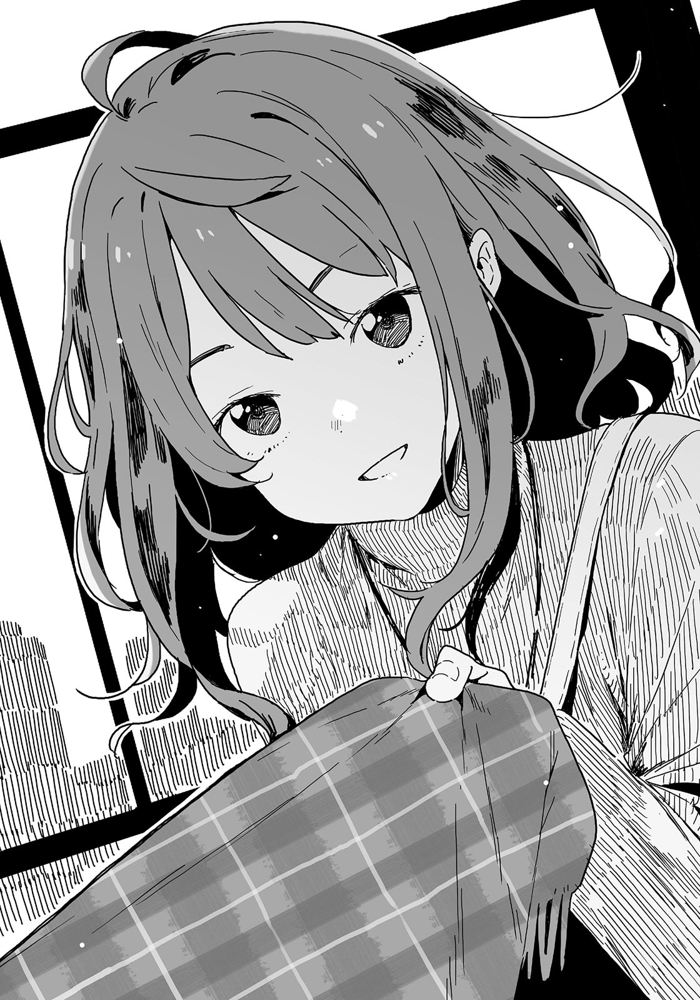

# Ch.23 — เล่ม 4 บทที่ 4-4 - บทส่งท้าย

Ch.23 — เล่ม 4 บทที่ 4-4 - บทส่งท้าย

By Monica

Published: 2024-12-06T15:51:14Z

Source: https://www.nekopost.net/novel/14560/23

บทส่งท้าย : ความลับที่ซ่อนอยู่

ผ่านมาสองวันแล้วตั้งแต่วันหยุดฤดูหนาวเริ่มขึ้น

บรรยากาศคริสต์มาสก็จางหายไปแล้ว บนท้องถนนก็ไม่หยุดพักและเริ่มเตรียมตัวสำหรับปีใหม่

ผมออกจากลิฟต์ แสงแดดที่ส่องเข้ามาจากหน้าต่างขนาดใหญ่ทำให้ผมหรี่ตาลง

ชั้นบนสุดของอาคารเทศบาลเมืองโทโยฮาชิฝั่งตะวันออก สถานที่นี้ถูกออกแบบให้เป็นดาดฟ้าชมวิว ทุกคนสามารถเข้ามาได้อย่างอิสระ

เหตุผลที่ผมมาที่นี่ - ก็เพราะยานามิเรียกผมมาน่ะสิ

สถานที่จัดปาร์ตี้คริสต์มาสหลังพิธีปิดเรียนที่ร้านคาราโอเกะแห่งนั้น

ผมเปิดประตูห้องในขณะที่ยังรู้สึกหนาวสั่น มันเป็นจังหวะพอดีกับที่เพลงก่อนหน้าจบลง ทุกคนในห้องหันมามองที่ผม ผมกำลังจะปิดประตูหนี แต่ยานามิก็จับผมไว้

ลืมพวกคนปกติในห้องเราไปก่อน ทำไมพวกเอ็กซ์โทรเวิร์ตจากห้องอื่น ๆ ถึงมาเชียร์ด้วยก็ไม่รู้ ผมถูกโยนลงไปในกองไฟโดยไม่ทันตั้งตัว

ผมจำได้แค่จำนวนฟองในโคล่าของผมเท่านั้น ส่วนยานามิก็นั่งกินมันฝรั่งทอดข้าง ๆ ด้วยท่าทางไร้อารมณ์

จากนั้นผมก็ลืมเรื่องทั้งหมด

...ทำไมยานามิถึงเรียกผมออกมาหลังจากที่เพิ่งผ่านช่วงคริสต์มาสอันแสนเลวร้ายไป?

เดาว่ามันเกี่ยวกับโปสเตอร์เมทาบอลิกซินโดรม(โรคอ้วนลงพุง)ที่ทางเข้าล็อบบี้แน่ ๆ รู้สึกว่าเมื่อเร็วๆนี้ยานามิดูอวบขึ้นนิดหน่อย-

จากนั้น ผมก็หยุดก้าวไปยังหน้าต่างกระจก

หน้าต่างบานใหญ่ทำให้ผมเห็นท้องฟ้าสดใสได้อย่างชัดเจน

มีเด็กสาวคนหนึ่งที่ใส่เสื้อโค้ทกำลังเดินโยกเยกราวกับเธอกำลังเต้นไปตามจังหวะ

ถึงแม้ว่าผมจะไม่ได้ยินเสียงจากระยะไกลขนาดนี้ แต่เธอน่าจะฮัมเพลงอยู่แน่ ๆ

— น่ารักจัง

แต่ผมก็เสียใจอย่างสุดซึ้งหลังจากคิดอย่างนั้นไป

ปลายเสื้อโค้ทของเธอพลิ้วไหว เธอหันมาทางผม เป็นยานามินี่เอง

...พลาดไปแล้วเพราะเสื้อโค้ทของเธอต่างจากที่เธอใส่ตอนอยู่ในห้องคาราโอเกะ ที่ชมไปนั่นถือว่าไม่จริงแล้วกัน

ผมพยายามปลอบใจตัวเองและพูดขึ้น

[ ขอโทษที่ให้รอนะ ยานามิซัง ]

[ อา นุคุมิซึคุง ขอบคุณที่มานะ ]

พูดเสร็จ เธอก็หันกลับไป ใบหน้าของเธอที่มีรอยยิ้มอยู่ดูหมดหนทางอย่างไม่คาดคิด

เธอดูไม่ค่อยสบายเท่าไร เกิดอะไรขึ้นหรือเปล่า? หรือว่าตับของเธอจะมีปัญหานะ?

[ ยานามิซัง ทำไมรู้สึกว่าเธอไม่ค่อยสบายเลยล่ะ? ]

[ ฉันยังไม่หายจากผลกระทบของงานปาร์ตี้คริสต์มาสเลย… ]

ยานามิถอนหายใจแล้วไหล่ตก

[ เอ๊ะ แต่เธอเพิ่ง- ]

[ เข้าใจใช่มั้ย? ฉันนอนไม่ค่อยหลับเมื่อวานนี้แถมยังกลิ้งตกหมอนอีก ถ้าฉันเอาแต่นอนขี้เกียจอยู่แบบนั้น ฉันก็เจ็บคออีกอยู่ดี ]

ยานามิยกมือกดที่คอ เกิดเสียงกระดูกดังกร๊อบ ๆ ขึ้น

อ่า...คืนคำชมที่ผมพูดไปโดยไม่คิดมาเถอะ

คิด ๆ ดูแล้ว มันก็ยากที่จะโทษเธอ ปาร์ตี้คริสต์มาสนั่นเป็นฝันร้ายจริง ๆ

โชคดีที่ผมลบความทรงจำนั้นด้วยการอยู่ดึกและดู < สารคดี อายุ15ปี ของท่านพี่ > กับคาจู ผมเพิ่งจะหายจากฝันร้ายนั้นไปเอง

[ ว่าแต่ตอนที่มาถึง ก็เห็นยานามิซังถอนหายใจเหมือนจะเศร้าๆอยู่เกิดอะไรขึ้นหรือเปล่า? หรือว่าฮิเมมิยะซังกับฮาคามาดะประกาศแต่งงานกันแล้ว? ]

[ ทำไมนุคุมิซึคุงถึงต้องใส่เกลือลงในแผลฉันตั้งแต่เจอฉันด้วย… ]

ตายเร็วจะได้เจอนิพพานเร็วนะสาวน้อย

ยานามิขมวดคิ้วและหดไหล่ของเธอ

[ เป็นไปไม่ได้หรอก สองคนนั้นก็ยังเหมือนเดิม ถึงพวกเขาจะใจร้ายแต่ฉันก็เริ่มชินแล้ว ]

[ งั้นก็ไม่จำเป็นต้องเรียกผมมาก็ได้นี่? เธอยังมีเพื่อนอยู่ไม่ใช่เหรอ? ]

ใบหน้าของยานามิกลับมาเศร้าหมองอีกครั้ง เธอจ้องผมแล้วพูดขึ้น

[ ..นุคุมิซึคุง ช่วงนี้นายไปไหนมาไหนกับรุ่นพี่ชิกิยะบ่อยๆ ใช่มั้ย? ฉันเห็นนายทำเหมือนจีบสองคนนั้นในสภานักเรียนหลังพิธีปิดเทอมด้วย ]

ไม่ได้จีบนะ ถ้าแค่นั้นนับว่าเป็นจีบ ผมคงไม่มีวันรักใครไปทั้งชีวิตแล้ว

[ เธอก็รู้ว่าทำไมผมถึงไปอยู่กับพวกเขาใช่มั้ย ? ]

[ แต่คนอื่นไม่รู้น่ะสิ รู้มั้ยว่ามีข่าวลือแปลกๆ เกี่ยวกับฉันเพราะเรื่องนี้ด้วย ]

ข่าวลือ? เกี่ยวอะไรกับสภานักเรียนและยานามิ…?

[ ...ข่าวลืออะไร? ]

ยานามิส่ายหน้าช้าๆ แล้วค่อยๆ พูดออกมา

[ มีคนบอกว่าฉันโดนปฏิเสธ…โดยนุคุมิซึคุงน่ะ ]

…ห้ะ? ผมปฏิเสธยานามิ?

ผมถึงกับพูดไม่ออก ยานามิทำหน้าบึ้งและจ้องผม

[ ไม่แปลกไปหน่อยเหรอ!? ถ้ามีอะไรเกิดขึ้นจริง ฉันควรเป็นฝ่ายปฏิเสธนายสิ !? ]

[ เอ่อ…ผมไม่ได้โดนปฏิเสธนะ แล้วก็จำไว้ด้วยว่าอย่าปฏิเสธข่าวลือแบบแรงๆเลย ]

ยานามิไม่ฟังที่ผมตอบอย่างใจเย็นและเดินเข้ามาใกล้ผม

[ ก็เพราะนุคุมิซึคุงไปทำตัวสนิทกับพวกสภานักเรียนนั่นแหละ!? เหตุการณ์ในยิมนั่นมันเหมือนอยู่ในนรกสำหรับฉันเลยนะ! ]

ตอนนี้ผมเองก็เหมือนอยู่ในนรกเหมือนกัน ยานามิกดผมติดกับหน้าต่างกระจกบนดาดฟ้า

ยานามิยกมือขึ้นมา เธอจ้องเหมือนจะจิ้มหน้าผม

[ ...สารภาพรักกับฉันสิ นุคุมิซึคุง ]

[ หา? ]

ผมถูกกดติดผนังเหมือนฉากคาเบะด้ง ยานามิเข้ามาใกล้จนหน้าของเราเกือบจะชนกัน

[ แล้วฉันจะปฏิเสธนุคุมิซึคุงเอง! แค่นี้ก็จบแล้วใช่มั้ย? ]

ไม่น่าจะแก้ปัญหาได้หรอกนะ…

[ ใจเย็นก่อน ยานามิซัง ผมไม่ได้ทำอะไรกับคนในสภานักเรียนเลย ถ้าเธอทำตัวปกติ ข่าวลือนั่นคนก็จะลืมไปเอง ]

[ งั้นเรื่องที่ฉันต้องเจอมาล่ะ? นุคุมิซึคุง ช่วยใส่ใจฉันบ้างได้มั้ย!? ]

แล้วเธอจะใส่ใจผมบ้างได้มั้ย?

ผมหยิบขนมจากกระเป๋าออกมาเพื่อเอาใจยานามิ

[ ใจเย็นก่อน ยานามิซัง นี่ มินิโยคังของสุกิโมโตยะ เธอชอบใช่มั้ย? ]

[ ...รสมัทฉะเหรอ ]

เธอไม่ชอบสินะ

ยานามิฉีกซองออกแล้วกัดเข้าไป

[ อืม แต่คิดว่ามัทฉะก็อร่อยดีนะ คราวหน้าขอโยคังของโทรายะ นะ ]

ระดับน้ำตาลในเลือดน่าจะช่วยเพิ่มพลังงานให้ เธออารมณ์เธอดีขึ้นบ้างแล้ว

ผมเลยเปลี่ยนเรื่องคุยเมื่อเห็นอารมณ์ยานามิเย็นลง

[ เธอมาตรวจสุขภาพไม่ใช่เหรอ? ไปที่เคาน์เตอร์เลยสิ ]

[ หา? พูดเรื่องอะไรเนี่ย? ของจริงมันอยู่นี่ต่างหาก ]

ยานามิหยิบตั๋วสองใบออกมาจากกระเป๋า

นั่นมัน—บัตรอาหารฟรีจากรุ่นพี่สึกิโนะคิ

ร้านอยู่ที่ชั้น 13 ของที่นี่

[ นุคุมิซึคุง วันเกิดนายผ่านมาแล้วใช่มั้ย? ฉันก็เลยอยากเลี้ยงข้าวนายสักหน่อย ]

แต่ตั๋วนี้มันเป็นรางวัลจากการทำภารกิจนี่…

ผมรู้สึกไม่พอใจเล็กน้อย ยานามิหยิบกล่องยาวบางออกมา

[ งั้น นี่คือเซอร์ไพรส์ที่ฉันเตรียมให้นาย ]

...เซอร์ไพรส์? ผมเปิดกล่องออกดู ข้างในมีปากกาลูกลื่นสีน้ำเงิน

[ เธอจะให้จริงๆ เหรอ? ดูแพงจัง ]

ยานามิม้วนปลายผมตัวเองเล็กน้อยแล้วมองออกไปนอกหน้าต่างก่อนจะพูด

[ นุคุมิซึคุง ปากกาที่นายใช้อยู่สภาพมันยับเยินมากเลยใช่มั้ยล่ะ? ฉันเลือกอันนี้มาเพราะมันสลักชื่อได้ เลยให้ไม่ทันวันเกิด ]

เข้าใจแล้ว แถมปากกาที่ผมใช้ก็ไม่น่ายับเยินขนาดนั้นหรอก

ยานามิเงยหน้าขึ้นแล้วมองผมด้วยความกังวล

[ ...ไม่ชอบเหรอ? ]

[ เปล่าๆ มันเจ๋งดี กำลังมองๆดูอยู่ ชื่อผมอยู่บนนี้ใช่มั้ย? ]

ผมหยิบปากกาออกจากกล่อง ดูเหมือนนี่จะเป็นครั้งแรกที่ยานามิได้เห็นสินค้านี้เหมือนกัน ผมเลยมองลงไปที่ฝ่ามือ

ขอดูหน่อยนะ ตรงปลายปากกามีตัวอักษรภาษาอังกฤษสีทอง—

ลายมือศิลป์สวยงามที่เขียนชื่อไว้ว่า— Anna Yanami

…หา? ทำไมถึงเป็นชื่อยานามิ?

[ หา!? พลาดล่ะ! ]

ยานามิคว้าปากกาคืนไปจากผมอย่างรวดเร็ว

[ เดี๋ยวสิ ยานามิซัง ]

[ ขอโทษนะ ทำเป็นลืมๆ ไปเถอะ! ฉันจะจัดการให้เรียบร้อย แล้วจะซื้อให้ใหม่วันหลัง ]

[ ผมคงรู้สึกแย่น่าดูถ้าเธอต้องซื้อใหม่หลังจากให้มาแล้วน่ะ เอาน้ำยาล้างเล็บมาลบชื่อไร้ประโยชน์นั่นเถอะ ]

[ ...หา? ไร้ประโยชน์? ]

ทำไมเธอถึงดูหงุดหงิดล่ะ?

[ งั้นฉันจะให้คืนหลังจากเปลี่ยนชื่อให้แล้ว! ไปกินข้าวกันเถอะ! ไม่งั้นของกินจะหมดก่อนนะ! ]

ยานามิผลักผมและลากไปทางร้านอาหาร

เอ่อ… สรุปว่าผมยังไม่ได้ปากกา ยานามิคงจะซื้อไว้ให้ตัวเองมากกว่า ไม่งั้นเธอจะเลือกปากกาแบบเดียวกับผมทำไมล่ะ ?

เอาล่ะ ยานามิก็เป็นยานามิเหมือนเดิม ไม่มีอะไรต้องคิดมากหรอก

ผมถอนหายใจครั้งสุดท้ายของปีนี้ จากนั้นก็เห็นยานามิหรี่ตาจ้องมาที่คอของผม

[ ...มีอะไรเหรอ? ]

[ นุคุมิซึคุง นายใส่ผ้าพันคอแบบนี้ไปโรงเรียนด้วยเหรอ? นายได้ใส่ตอนพิธีปิดมั้ย? ]

ยานามิเอียงคอเหมือนใช้ความคิด ผมตอบไปแบบไม่รู้ตัว

[ ใส่ตอนหนาวน่ะ แค่ไม่ได้เอาไปโรงเรียน ]

ยานามิพยักหน้าแบบไร้อารมณ์แล้วเดินผ่านประตูอัตโนมัติของร้านอาหาร

ผมเดินตามเธอเข้าไปโดยยังคงตกใจกับสิ่งที่เพิ่งพูดออกไป

— ผมเพิ่งโกหกยานามิ

มันเป็นแค่เรื่องเล็กน้อย ไม่มีอะไรต้องปิดบังเลย และคงไม่มีอะไรเปลี่ยนไปถ้าพูดความจริงออกไป

แต่ไม่รู้ทำไม ผมแค่อยากทำแบบนั้น

จากนั้นผมก็หยุดเดิน

ยานามิหันกลับมาและจ้องผม

[ เอ๋ มีอะไรหรือเปล่า ยานามิซัง…? ]

ยานามิไม่ตอบ เธอยิ้มเล็กน้อย

เธอยื่นมือมาแล้วจับผ้าพันคอของผม และค่อยๆรัดมันเข้ามาจนรู้สึกแน่นนิดหน่อย

[ นุคุมิซึคุง อย่าเพิ่งนำหน้าฉันไปล่ะ เข้าใจมั้ย? ]

---
