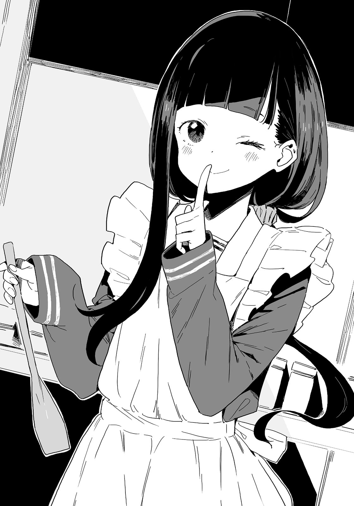

# Ch.24 — เล่ม 5 บทที่ 1-1

Ch.24 — เล่ม 5 บทที่ 1-1

By Monica

Published: 2025-04-22T10:30:09Z

Source: https://www.nekopost.net/novel/14560/24

เล่ม 5 บทที่ 1-1

[ อีกสองวัน… ]

ผมพึมพำกับตัวเองพร้อมกับเหลือบมองปฏิทินบนผนัง มีวันนึงที่จ้องไม่พักคือ…

วันอาทิตย์ถัดไป—14 กุมภาพันธ์ วันวาเลนไทน์

อย่างที่ทุกคนรู้ วันวาเลนไทน์คือวันที่คนในครอบครัวมอบช็อกโกแลตให้กัน ผมไม่ยอมรับข้อโต้แย้งใด ๆ ทั้งนั้น

แต่ว่าปีนี้แตกต่างออกไป…ผมได้ของขวัญวันเกิดจากสาวๆในชมรมวรรณกรรมเมื่อคริสต์มาสที่ผ่านมา

จากแนวโน้มนี้ มีความเป็นไปได้สูงที่ปีนี้ผมจะได้รับช็อกโกแลตตามมารยาท

แต่อย่าเข้าใจผิดนะ ไม่ได้พยายามอวดว่าผมเป็นที่นิยม หรือว่าผมจะได้ช็อกโกแลตจากคนที่ผมรักหรอก ?

ไม่สำคัญหรอกว่าจะอยู่คนเดียวหรือไม่สนใจในความสัมพันธ์โรแมนติก

วันวาเลนไทน์คือวันที่ทุกคนจะรู้สึกกระวนกระวายเล็กน้อย คอยตรวจดูของในลิ้นชักโต๊ะเรียนหรือชั้นวางรองเท้าของตัวเอง

ถึงอย่างนั้น ถ้าคาดหวังมากก็หมายถึงจะผิดหวังมากถ้าเช่นกันไม่ได้รับช็อกโกแลต

ยังไงก็เถอะ ตอนนี้ควรให้ความสำคัญกับการสอบมากกว่า

ผมว่าผมตรียมตัวได้ดีเลยสำหรับการสอบพรุ่งนี้

งั้นอ่านไลท์โนเวลผ่อนคลายหน่อยละกัน

ถ้าจำไม่ผิด < 100 วันที่ผมเพิ่งรู้ว่าที่นี่เป็นโรงเรียนชายล้วน > น่าจะอยู่ที่ห้อง

นี่คือไลท์โนเวลที่ทะเยอทะยานมาก ตัวละครหญิงทั้งหมดเป็นผู้ชายที่แต่งตัวเป็นผู้หญิง แต่ด้วยการสนับสนุนจากแฟนคลับก็ทำให้ซีรีส์นี้ดำเนินต่อไปได้

แล้วก็ นี่เป็นของชมรมวรรณกรรม ไม่ใช่ของส่วนตัวของผม

อันนี้สำคัญมากนะ

[ เอาล่ะ พักสักหน่อยดีกว่า ]

ผมวางหนังสืออ้างอิงลงบนโซฟาและลุกขึ้น ตอนนั้นเองที่กลิ่นหอมหวานจากครัวแผ่ซ่านเข้ามาแตะจมูก

น้องสาวของผม คาจู กำลังฮัมเพลงอยู่ เธอดูเหมือนจะกำลังผสมและคนอะไรบางอย่างอยู่

เส้นผมสีดำของเธอพริ้วไหวเหมือนเส้นไหม ร่างกายเล็กๆ ใบหน้าที่อ่อนช้อยและสมส่วน ทำให้เธอดูสมบูรณ์แบบในชุดผ้ากันเปื้อน แม้ว่าเธอจะเป็นน้องสาวของผมก็ตาม

ผมเดินเข้าไปใกล้คาจูโดยไม่รู้ตัว และมองดูสิ่งที่อยู่ในมือของเธอ

[ คาจู ทำอะไรอยู่น่ะ? ]

มีชามหลากสีอยู่ตรงหน้าคาจู เธอกำลังคนสารสีเขียวอ่อน?

[ คาจูกำลังทดสอบช็อกโกแลตใหม่สำหรับวาเลนไทน์ค่ะ ท่านพี่ ลองชิมดูหน่อยสิคะ ]

เธอตักของในชามขึ้นมาด้วยช้อนและยื่นให้ผม

ผมลองชิมเล็กน้อย ความหวานสดชื่นแผ่ไปทั่วลิ้น และกลิ่นหอมอ่อนๆ ของสีเขียวนั่นลอยเข้าจมูก

[ รสอะไรน่ะ? ]

[ พิสตาชิโอค่ะ ]

[ คาจูบดเป็นเนื้อแล้วผสมลงในไวท์ช็อกโกแลต แต่ว่าพอลองเซ็ตแล้วก็ยังมีปัญหาเรื่องเนื้อสัมผัสอยู่ค่ะ อันนี้ผสมแบล็คเคอร์แรนท์แทน ลองอ้าปากแล้วลองชิมดูค่ะ ]

ผมเปิดปากชิมอย่างตั้งใจ รู้สึกถึงความขมและความเปรี้ยวเล็กน้อยบนลิ้น

[ ทั้งสองแบบน่ะทำดีแล้ว พี่คิดว่าช็อกโกแลตของคาจูอร่อยทุกแบบนะ ]

คาจูกลั้นยิ้มแทบไม่อยู่ แต่จู่ ๆ เธอก็เปลี่ยนเป็นจริงจังและ อะ-แฮ่ม เบาๆ

[ อาระ ท่านพี่จะได้ช็อกโกแลตที่โรงเรียนถึงแม้จะไม่มีคาจูให้ใช่มั้ยคะ? หรือว่า… ]

แก้มของคาจูแดงระเรื่อเล็กน้อย ดวงตาของเธอเป็นประกายด้วยความอยากรู้อยากเห็นที่ไม่อาจระงับได้

[ —ท่านพี่จะให้ช็อกโกแลตใครเหรอคะ? ]

แล้วทำไมต้องให้ด้วย ? คาจูบางครั้งชอบพูดเรื่องให้ชวนสับสน

[ ผมไม่รู้ว่าจะได้ช็อกโกแลตหรือเปล่านะ ช็อกโกแลตตามมารยาทก็เหมือนบัตรอวยพรปีใหม่หรือของขวัญ ขึ้นอยู่กับอารมณ์ วาเลนไทน์ปีนี้ตรงกับวันอาทิตย์ด้วย แต่- ]

ผมหยุดครู่หนึ่งก่อนพูดต่อ

[ แต่…อาจจะมีช็อกโกแลตตามมารยาทเพราะเป็นวันเปิดเรียนก็ได้ แต่พี่ก็ไม่แน่ใจนะ ไม่ใช่ว่าอยากได้ช็อกโกแลตหรอก ก็แค่สถานการณ์ทั่วไป..แค่นั้นเอง ]

คาจูยิ้มเมื่อได้ยินที่ผมพูด

[ ใช่ค่ะ คาจูก็คิดอย่างนั้น คาจูเองก็มีคนที่อยากให้ช็อกโกแลตปีนี้ด้วยนะคะ ]

อ้อ เข้าใจละ คาจูอยากให้ช็อกโกแลต....กับใครนะ…?

[ คาจู เธอหมายถึง- ]

คาจูขัดผมด้วยการจิ้มแก้มตัวเองเบาๆ

[ มีช็อกโกแลตหวานอร่อยติดแก้มคาจูอยู่ ท่านพี่ ช่วยเช็ดให้สะอาดหน่อยสิคะ ]

เธอเพิ่งเอาช็อกโกแลตมาป้ายหน้าตัวเองใช่มั้ย…?

ผมพยายามหากระดาษทิชชู่แต่หาไม่เจอเลย

งั้นใช้ผ้าเช็ดหน้าก็ได้ ผมหยิบผ้าเช็ดหน้าออกมาแล้วเช็ดแก้มของคาจู

[ เรียบร้อยแล้ว สะอาดแล้วล่ะ ]

[ …..ไม่ชอบส่วนนี้ของท่านพี่เลยค่ะ ]

ทำไมคาจูดูอารมณ์เสียล่ะ ? ผมไม่เข้าใจว่าทำไม แต่นี่คงเป็นช่วงวัยรุ่นสินะ?

[ ว่าแต่คาจูจะให้ช็อกโกแลตกับใครเหรอ? ]

ทันใดนั้นก็มีเสียงริงโทนที่ไม่คุ้นเคยดังขึ้น

[ โอ๊ะ ! ท่านพี่คะ ช่วยถืออันนี้ให้คาจูสักครู่นะคะ ]

เธอยื่นชามที่อยู่ในอ่างผสมที่มีน้ำร้อนให้ผมโดยไม่รอคำตอบ

[ เอ๊ะ แล้วพี่ควรทำยังไงกับอันนี้ ? ]

[ ค่อยๆ คนไปจนถึง 45 องศาฯ นะคะ! คาจูจะฝากไว้กับท่านพี่แล้วกันค่ะ! ]

คาจูหยิบโทรศัพท์ขึ้นมาและค่อยๆ เดินออกไปจากห้องนั่งเล่น

เอ๊ะ นี่ผมต้องทำแบบนั้นจริง ๆ เหรอ? เอาเถอะ ค่อย ๆ คนไปก่อนก็แล้วกัน…

ผมคนช็อกโกแลตอย่างช้า ๆ และสูดลมหายใจลึก ๆ เพื่อสงบจิตสงบใจ

เธอบอกว่าอยากให้ช็อกโกแลตกับใครสักคน เธอคงไม่อยากให้ผู้ชายหรอกใช่มั้ย ?

ไม่หรอก เป็นไปไม่ได้

อีกอย่างเธอเพิ่งบอกว่าประมาณว่า“ท่านพี่ไม่ต้องการช็อกโกแลตของคาจูหรอก” เมื่อกี้นี้เอง น่ากังวลนิดหน่อยนะ

เธอจะไม่ให้ผมแล้วเหรอ?

แน่นอนว่าผมไม่ได้ตั้งตารอช็อกโกแลตของน้องสาวหรอก จริงๆนะ

ถึงอย่างนั้น คาจูก็ไม่เคยพลาดให้ช็อกโกแลตผมเลยตั้งแต่เธออายุ 1 ขวบ เราคงต้องนั่งจับเข่าคุยกันแล้ว ถ้ามีอะไรเข้าใจผิด

[ ..อ๊ะ ลืมวัดอุณหภูมิ ]

แย่ละ ถ้าคาจูโกรธคงจะไม่ดี ผมรีบใส่เทอร์โมมิเตอร์ลงไป หน้าจอแสดงผลว่า 46 องศาพอดี

ยังอยู่ในช่วงที่พอรับได้ ผมหยิบชามช็อกโกแลตออกจากอ่างผสมและมองไปที่ประตูที่คาจูเพิ่งเดินออกไป

…แล้ควรทำอะไรต่อดี? คาจูยังคุยโทรศัพท์อยู่มั้ย ?

เธอยังไม่กลับมาอีกสักพัก ผมเลยถือชามไปที่ทางเข้าของโถงทางเดิน

[ เฮ้ คาจู...]

ผมเรียกชื่อเธอเบาๆ ก่อนจะแอบมองออกไป จากนั้นก็เห็นคาจูกำลังยืนหันหลังให้ผมอยู่ เธอกำลังกระซิบคุยกับใครบางคนที่หน้าประตู

[ อืม...ใช่ แต่ว่า...อืม ก็จริงนะ แต่แน่ใจแล้วเหรอว่าโอเค? กอนจัง- เอาล่ะ โอเค เธอไม่ว่าอะไรใช่มั้ย? ]

โทรศัพท์ถูกแนบไว้ใกล้ๆ หู เธอพยักหน้าบ่อยๆ ระหว่างพูด

ดูเหมือนกำลังคุยเรื่องจริงจังกันอยู่ แต่ถึงขนาดรอผมเอาช็อกโกแลตไปให้ไม่ไหวเลยหรอ...?

[ เดี๋ยวค่อยคุยรายละเอียดกันอีกทีตอนเจอกันนะ? พูดเรื่องนี้ทางโทรศัพท์มันไม่ดีเท่าไหร่หรอก ]

โอ๊ะ คุยกันเสร็จแล้ว ผมถอนหายใจด้วยความโล่งอกก่อนจะเดินออกไปที่ทางเดิน

[ โอเค เข้าใจแล้ว ฉันว่างวันที่ 14 ไว้เจอกันที่โรงเรียนคราวหน้านะ- ทาจิบานะคุง ]

...เอ๊ะ? ประโยคนั้นทำให้ผมรู้สึกเหมือนถูกโยนลงในตู้แช่แข็งเลย

คาจูเก็บโทรศัพท์เข้ากระเป๋าผ้ากันเปื้อน เธอหันกลับมาด้วยท่าหมุนตัว

[ เอ๊ะ ท่านพี่ มาตั้งแต่เมื่อไหร่คะ ]

[ อะ เปล่า เพิ่งมาถึงน่ะ ช็อกโกแลตอุณหภูมิ 45 องศา… ]

ผมโกหกไป พร้อมกับยื่นชามให้ คาจูรีบพุ่งเข้ามาพร้อมรอยยิ้ม

[ ขอบคุณค่ะ ขอโทษนะคะ คุยนานไปหน่อย ]

คาจูกลับเข้าไปในครัวด้วยท่าทางร่าเริง แล้ววางชามลงในน้ำแข็ง

[ ต้องลดอุณหภูมิแบบนี้ค่ะ ...เป็นอะไรหรอคะ ท่านพี่ ? ]

ดูเหมือนว่าผมกำลังจ้องคาจูโดยไม่รู้ตัวอยู่ ผมรีบหันไปทางอื่น

[ ไม่มีอะไรหรอก เอ่อ...เมื่อกี้คุยกับใครอยู่เหรอ? ]

[ เพื่อนที่โรงเรียนค่ะ คุยกันเรื่องเกี่ยวกับโรงเรียนนั้นแหละค่ะ ]

อืม...เพื่อนของเธอ ดูเหมือนจะเป็นผู้ชายจากวิธีที่เธอเรียก แถมเนื้อหาการสนทนาดูเหมือนจะเกี่ยวกับ...ทำตัวให้ว่างวันที่ 14 ด้วย

ผมมองดูคาจูที่ฮัมเพลงไปพลางคนช็อกโกแลต เหงื่อเย็นๆ ไหลลงมาตามหลังของผม

ความพยายามในการทดลองทำช็อกโกแลตนี่-และคำสัญญาวันที่ 14 กับเพื่อนผู้ชายคนนั้น-

นี่มัน...หรือว่าจะเป็น...?

[ นี่ คาจู เธอวางแผนจะให้ช็อกโกแลตกับใครเหรอ? ]

ผมถามออกไปอย่างไม่ใส่ใจ คาจูหยุดมือจากที่ทำทันที

[ ...แล้วท่านพี่คิดว่าใครคะ ? ]

เสียงของคาจูนิ่งผิดปกติ

ผมกลืนน้ำลายลงคอ

[ อ่า...ให้เพื่อนผู้หญิงใช่มั้ย? ]

ผมพูดแบบตรงกันข้ามโดยไม่ได้คิดอะไรมาก แต่คาจูกลับแสดงรอยยิ้มที่ดูเขินๆ ให้ผมเห็น

[ ความลับค่ะ ]

---

ps. เอาจากเพจมาลงนั่นแหละ  แค่ผมแปลเล่ม 5 ก่อน ค่อยไป 4 แล้วก็เรียง 6-7( ทำทำไม ? ) เพราะงั้นบางคำมันอาจจะแปลกๆแต่พอขึ้น 6 + ก็ปกติและ 🫠
