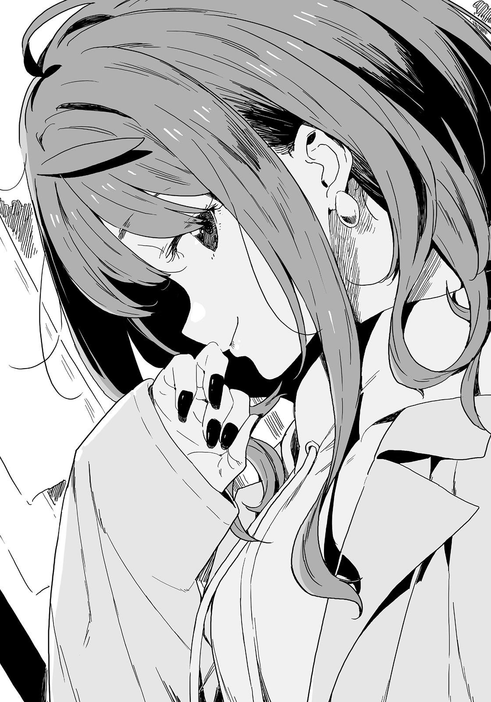

# Ch.26 — เล่ม 5 บทที่ 1-3

Ch.26 — เล่ม 5 บทที่ 1-3

By Monica

Published: 2025-04-22T10:31:03Z

Source: https://www.nekopost.net/novel/14560/26

เล่ม 5 บทที่ 1-3

การสอบปลายภาคอันยาวนานก็สิ้นสุดลงในที่สุด เช้าวันเสาร์มาถึง

คาจูยืนหน้ากระจกที่ทางเข้าแล้วหมุนตัวเบาๆ กำลังจัดคอเสื้อโค้ทให้เรียบร้อย

คาจูสวมโค้ทสีน้ำตาลอ่อนที่มีขนปุกปุยสีขาวขลิบอยู่ที่ขอบ และรองเท้าบู๊ตสั้น บนหัวของเธอยังมีเครื่องประดับดอกไม้อีกด้วย

สำหรับการนัดติวหนังสือกับเพื่อนๆ แล้ว เธอดูเหมือนจะใส่ใจกับการแต่งตัวมากเกินไป

เธอสังเกตเห็นว่าผมกำลังจ้องมองอยู่ คาจูยิ้มให้ผม

[ ท่านพี่ อาหารกลางวันอยู่ในตู้เย็นนะคะ อย่าลืมอุ่นแล้วกินด้วยนะคะ ]

[ อืม เข้าใจแล้ว ระวังตอนขึ้นรถไฟด้วยนะ ]

ผมหยุดชั่วครู่ แล้วก็ตระหนักได้ว่าเธอกำลังรอให้ผมลูบหัว

ผมจึงเริ่มลูบหัวคาจู

[ เอเฮะเฮะ งั้นหนูไปก่อนนะ เจอกันค่ะ ]

หลังจากที่คาจูโบกมือลาแล้วเดินจากไป ผมก็ตรวจดูนาฬิกา

ตอนนี้เป็นเวลา 10 โมงตรง ผมหยิบโทรศัพท์ขึ้นมาแล้วกดโทรออก

...เสียงรอสายดังเพียงสองครั้ง คนที่อยู่ปลายสายก็รับโทรศัพท์ ราวกับว่าเธอกำลังรอผมอยู่

[ สถานการณ์เป็นยังไงบ้าง นุคุมิซึคุง? ]

เสียงของยานามิดังผ่านสายมา น้ำเสียงเธอจริงจังกว่าปกติจนทำให้ผมรู้สึกประหม่าไปด้วย

[ อ่า คาจูทำตามแผนแล้วก็ออกไป เธอแต่งตัวสวยแต่ก็ทำตัวตามปกติ บางทีเธออาจจะไปติวหนังสือจริงๆ ไม่ใช่ไปเดทก็ได้นะ? ]

[ กระเป๋าของน้องสาวเธอหน้าตาเป็นยังไง? ]

ยานามิถาม

[ กระเป๋าถือใบเล็ก ]

[ นั่นไม่ใช่กระเป๋าสำหรับไปติวหนังสือใช่มั้ย แล้วอุปกรณ์การเรียนกับหนังสือของเธอไปอยู่ไหนล่ะ? ]

...ไม่อยากเชื่อเลยว่ายานามิจะสังเกตได้เฉียบคมขนาดนี้ ผมพยายามหนีจากความจริงอย่างเต็มที่

[ อาจจะใช่ แต่ก็เป็นไปได้ว่าเธอแค่ออกไปเที่ยวกับเพื่อนก็ได้ ]

ยานามิไม่สนใจการดิ้นรนอย่างสิ้นหวังของผม

[ อาจจะ แต่เป้าหมายของเราคือต้องยืนยันให้แน่ใจใช่มั้ย? เตรียมตัวได้แล้ว ]

[ ต้องไปด้วยกันจริงๆ เหรอ? แล้วทำไมถึงไปคนเดียวไม่ได้ล่ะ? ]

[ แล้วถ้านายบังเอิญเจอน้องสาวของนาย นายจะพูดอะไรล่ะ? ]

[ เอ่อ... ]

ผมพูดไม่ออก ยานามิโจมตีอีกครั้งด้วยเสียงที่ร่าเริงของเธอ

[ เอาล่ะ นุคุมิซุคุง เรามาแข่งกันเถอะ ตกลงมั้ย? ]

✧

ผมดูนาฬิกา ตอนนี้เพิ่งจะเลย11โมงมานิดๆ

ผมเป็นคนแรกที่ออกจากสถานีโทโยคาวะร่างกายของผมสั่นจากลมหนาว

ลมตะวันตกของเขตฮิกาชิมิคาวะนั้นแรงและแห้งในช่วงฤดูหนาว

[ ...ถ้ามีผ้าพันคอสักผืนก็คงดี ]

ผมพึมพำออกมาโดยไม่ตั้งใจส่วนผ้าพันคอที่ได้จากเทียร่าซังในวันคริสต์มาส

เหตุผลที่ไม่ได้ใส่มาก็เพราะรู้สึกอายนิดหน่อย-

[ หนาวจัง! นุคุมิซึคุง ทำไมนายเดินนำหน้ามาก่อนล่ะ? ]

ยานามิห่อเสื้อโค้ทของเธอแน่นขณะเดินลงบันไดสถานี เธอเดินมาข้างๆผมแล้วเอาศอกกระแทกเบาๆ

[ ก็เพราะเธอกำลังดูแผนที่อยู่หน้าประตู เลยไม่อยากไปรบกวนเธอน่ะ ]

[ เราไม่ได้มาด้วยกันเหรอ? ควรจะดูแผนที่ด้วยกันไม่ใช่หรือไง? นายไม่หนาวหรอ? ]

ยานามิตบหลังผมเบาๆ

อา ให้ตายสิ ผมควรจะมาคนเดียวน่าจะดีกว่า...

[ โทษที พอดีหนาวจนเกือบจะเป็นน้ำแข็งแล้ว รีบไปกันเถอะ ดูนั่นสิ เราต้องไปที่นั่นกัน... ]

ผมจบบทสนทนาด้วยความครึ่งๆ กลางๆ แล้วชี้ไปอีกฝั่งของรูปปั้นจิ้งจอกสำริด ตรงนั้นมีโทริอิที่เขียนว่า “โทโยคาวะอินาริ มนเซนโจ” นั่นคือทางเข้าสู่ถนนช็อปปิ้ง

ยานามิชี้มาที่ผมแล้วพูดขึ้นอย่างจริงจัง ตอนกำลังจะเดินผ่านโทริอิ

[ นุคุมิซึคุง นายพร้อมหรือยัง? การแข่งขันได้เริ่มขึ้นแล้วนะ รู้มั้ย? ]

[ อ่า ถ้าคาจูเดทจริงๆยานามิซังก็ชนะ ถ้าเธอไม่ได้ไปผมก็ชนะ ]

เรากลับเข้าไปในถนนอีกครั้ง มีนักท่องเที่ยวมากมายเพราะเป็นวันหยุดสุดสัปดาห์

สายตาของผมเผลอมองตามคู่รักต่างๆไป ผมต้องสะบัดตัวเองออกจากความคิดนั้นแล้วแอบยิ้มขื่นๆ

…คงคิดมากไปเอง ไม่มีทางที่คาจู ผู้รักพี่ชายขนาดนี้ จะไปเดทกับผู้ชายคนไหนหรอก

ขอโทษนะ ยานามิ การแข่งขันครั้งนี้ ผมชนะไปแล้ว

ผมพึมพำปลอบใจตัวเองขณะที่เราเดินไป ยานามิพูดขึ้นมากะทันหัน

[ เฮ้ๆ นุคุมิซึคุง ทำไมร้านหนังสือนั้นถึงมีหน้ากากเยอะขนาดนั้นอะ? ]

ผมเกือบจะหันไปดูแล้ว แต่ยานามิดึงแขนผมอีกครั้ง คราวนี้มีอะไรอีกล่ะ?

[ ลืมเรื่องนั้นไปก่อนเถอะ ดูนี่สิ ป้ายร้านขายยาน่ารักขนาดนี้! ถ่ายรูปให้ฉันหน่อยสิ! ]

ทำไมวันนี้เธอดูตื่นเต้นจัง? พูดตามตรง รู้สึกรำคาญนิดหน่อย…

ยานามิโพสท่า ผมเลยต้องถ่ายรูปให้เธอ

[ โอเคมั้ย? ]

ภาพที่ได้เป็นป้ายร้านขายยาก็ชัดเจน ครอบคลุมครึ่งหนึ่งของยานามิพอดี

[ เยี่ยมเลย เดี๋ยวฉันจะส่งให้นายทีหลัง ไปกันเถอะ ]

ฝูงชนเริ่มหนาแน่นขึ้น เมื่อเราเข้าใกล้จุดสิ้นสุดของถนน ไม่มีทางที่เราจะเห็นคาจูได้ถึงแม้ว่าเธอจะอยู่ที่นี่ก็ตาม

ผมขอถอนคำพูด ถึงคิดว่ามันเป็นไปไม่ได้ แต่มันก็ทำให้รู้สึกประหม่าเล็กน้อย...

[ นี่ ยานามิซัง ถ้าเราเดินไปอีกหน่อย-]

ผมหันกลับมา ยานามิหายไปแล้ว เอ๋ เธอหายไปไหน?

ผมเริ่มมองหาทุกทิศ แล้วจู่ๆ ยานามิก็วิ่งมาหาผมพร้อมกับเซมเบ้สองชิ้นในมือ

[ นี่ นี่ของนุคุมิซุคุง อันนี้เพิ่งปิ้งเสร็จใหม่ๆ เลยนะ ]

ผมรับมันมาโดยไม่ทันคิด แต่นี่มันเซมเบ้ชิ้นใหญ่ มันใหญ่เกือบเท่ากับหน้าของคาจูเลย

[ ซื้อเผื่อผมทำไม? ]

[ เราตกลงกันไว้ว่าจะเดินกินไปด้วยไม่ใช่เหรอ? กินให้หมดนะ ไม่งั้นเราจะไม่ได้ไปดูร้านถัดไป ]

เข้าใจละ ถ้าเป็นไปได้ อยากให้เธอผมถามก่อนนะว่าจะเอาเท่าไหร่

ยานามิกัดเซมเบ้เข้าปาก เธอกำลังจะกินหมดแล้ว

[ พูดถึงเรื่องนี้ ทำไมเธอไม่ชวนโคมาริแล้วก็ยากิชิโอะมาด้วยล่ะ? ]

[ อะไร ? นายไม่ชอบเที่ยวกับฉันคนเดียวหรือไง? ]

ยานามิกินเซมเบ้หมดแล้วมองผมด้วยสายตาที่รุนแรง เธอนี่อ่อนไหวจัง

[ เพิ่งจะสอบจบไปเมื่อวานนี้ ฉันคิดจะชวนทุกคนมาฉลองน่ะ ]

[ พวกเราสี่คนจะเด่นมากใช่มั้ยล่ะ ? ถ้าน้องสาวนายเห็น เธอคงหนีไปแล้วล่ะ ]

ยานามิเล่นกับปลายผมของเธออย่างเขินๆ แล้วพูดต่อ

[ แล้วก็….ฉันรอที่จะมาเที่ยววันนี้มากเลยนะ รู้มั้ย? ]

[ เอ๋ นั่นคือ- ]

ยานามิตั้งตารอที่จะมาเที่ยวกับผม? …หมายความว่ายังไง?

ผมประหลาดใจ ยานามิพยักหน้าเบาๆ

[ อื้ม จริงๆ แล้ว ที่โตเกียวก็มีสาขาของโทโยคาวะอินาริ อยู่ที่อาคาซากะน่ะ มันเป็นที่ที่ดีสำหรับการ ‘ตัดขาด’ เลยล่ะ ]

เดี๋ยว ผมได้ยินอะไรไม่ดีหรือเปล่า?

[ เดี๋ยว นี่เธอพูดถึงเรื่องอะไรอยู่? ตัดขาด? ]

[ ก็... เป็นเรื่องเกี่ยวกับการให้พร สถานที่นี้เป็นเหมือนสำนักงานใหญ่ของมันเลย รู้สึกว่าอิทธิพลของมันคงจะรุนแรงมากด้วยนะ ]

วัดก็มีกลไกแบบนี้ด้วยเหรอ?

[ เอ่อ ขอถามเผื่อไว้นะ เธอมีใครที่อยากจะตัดความสัมพันธ์ออกไปหรือเปล่า? ไม่ต้องตอบก็ได้นะถ้าไม่อยากบอก ]

[ ...ใครจะรู้ล่ะ? ]

ยานามิยิ้มแล้วเดินไปที่ร้านสร้างสรรค์อินาริซูชิเธอดูน่ากลัวขึ้นมาเลย

รู้สึกกลัวนิดหน่อยเลยตัดสินใจมองดูผู้คนที่เดินผ่านไปมาตามถนนแทน

ที่นี่ไม่ได้มีแค่ผู้สูงอายุหรือครอบครัวที่มีเด็กเท่านั้น ยังมีคู่รักหนุ่มสาวเดินอยู่ด้วย

...คาจูอารมณ์ดีมากตั้งแต่เช้า เธอถึงกับขอให้แม่ทาเล็บให้

แม้ว่าเธอจะไม่ได้แต่งหน้า แต่เธอก็ใช้เวลามากในการแต่งตัว แม้แต่ผมยังสังเกตได้ว่า-

[ หา? ยานามิซัง? ]

เธอหายไปอีกแล้ว ผมไม่ทันสังเกตเลย คราวนี้ไปไหนอีก?

ช่วยไม่ได้ ผมเลยตัดสินใจกินเซมเบ้ชิ้นนี้แล้วรอเธอ

นี่เป็นครั้งแรกที่ผมได้กินเซมเบ้ที่เพิ่งย่างเสร็จใหม่ๆ มันร้อนและกลิ่นก็หอมมาก เกินกว่าที่คาดไว้

...แต่มันใหญ่จริงๆนะ ยานามิกินเหมือนมันเป็นกระดาษ แต่สำหรับผมมันกินยากมาก

พอผมกินเสร็จ ยานามิก็กลับมาพร้อมกับของเต็มมือไปหมด

เธอยังมีลูกชิ้นปลาบนไม้เสียบคาบอยู่ในปาก เหมือนกับหมาจรจัดจากอนิเมะเก่าๆ เลย

ผมไม่เข้าใจว่าเธอกำลังพูดอะไรอยู่ แต่เธอยื่นคางมาข้างหน้าเรื่อยๆ เดาว่าเธอต้องการให้ผมหยิบไม้เสียบออกจากปากของเธอ

ผมก็ทำตามคำสั่งของเธออย่างไม่เต็มใจ ยานามิถอนหายใจอย่างโล่งอก

[ เฮ้อ ลำบากจริงๆ ฉันซื้อมาฝากนุคุมิซึคุงด้วย เพราะเห็นนายเหม่อๆอยู่ ]

ม่ได้ขอให้เธอซื้อมาสักหน่อย

[ เธอซื้อมาเยอะเลยนะ จะกินหมดตอนนี้เลยเหรอ? ]

[ ใช่ ฉันบอกแล้วไม่ใช่เหรอว่าจะเดินไปกินไป? ]

เธอจะเดินไปไหนกันแน่นะ?

[ ของเยอะมากเลยนะ วาราบิโมจิ อินาริซูชิย่าง ลูกชิ้นอินาริ แล้วก็...นี่ เบอร์เกอร์คิทสึเนะ ]

[ เบอร์เกอร์คิทสึเนะ? ]

ผมดูใกล้ๆ มันเป็นเบอร์เกอร์ที่มีแผ่นเนื้อทั่วไป แต่ขนมปังทำจากเต้าหู้ทอดประกบของทอดด้วยของทอด ดูเหมือนเมนูที่ออกแบบมาเพื่อยานามิโดยเฉพาะ เหมือนข้าวปั้นห่อเนื้อ...

[ เรายังมีนี่อีกนะ ข้างในมีอินาริซูชิแบบสร้างสรรค์อีก 10 ชิ้น ฉันอยากแบ่งให้นายครึ่งหนึ่ง ]

เอ่อ อันนี้สินะ? ผมหยิบกล่องออกมาจากกองอาหาร

[ มีแค่ 5 ชิ้นเอง]

[ ใช่ มันอร่อยมากเลยล่ะ ]

เธอแบ่งครึ่งไว้แล้วนี่นา

[ นี่ นุคุมิซึคุง ไม่ต้องเกรงใจหรอก นายกินลูกชิ้นปลาด้วยได้นะ ]

เอ๋ เธอจะให้ผมกินเหรอ? อันที่เธอเพิ่งกัดไปน่ะ?

[ ไม่ดีกว่า นี่ เอาคืนไปเถอะ ยานามิซัง ]

ผมยื่นไม้เสียบลูกชิ้นปลาไปที่ริมฝีปากของยานามิ

[ อ้าปากกัดแนวขวางนะ โอเค สูงขึ้นอีกนิด...ได้แล้ว หยุดเลย ]

ยานามิกัดลูกชิ้นปลาเหมือนกับกำลังกินข้าวโพด

คิดว่าสมัยประถม ผมเคยเห็นไก่กินแบบนั้นมาก่อน ดูตลกดี...

แต่ทำแบบนี้บนถนน คนคงคิดว่าเธอบ้าแน่ๆ ผมรู้สึกว่าทุกคนกำลังมองพวกเราอยู่

[ ยานามิซัง เราควรรีบไปกันได้แล้วนะ ตอนที่เธอกินเสร็จแล้ว ]

[ อืม งั้นมากินให้หมดกันเถอะ นี่ นายก็พยายามให้เต็มที่ด้วยนะ นุคุมิซึคุง ]

ยังมีเศษลูกชิ้นปลาติดที่ริมฝีปากของยานามิอยู่ รอยยิ้มของเธอดูมีเสน่ห์มาก

...อ่า ผมต้องกินด้วยเหรอ?

✧

เราเดินอยู่บนเส้นทางหินไปที่ทางหลัก

ยานามิแหงนหน้ามองเสาโทริอิหินยักษ์ขณะเดินผ่านไปใต้เสา

[ โหว ใหญ่มาก ไม่แปลกใจเลยว่าทำไมที่นี่ถึงเป็นหนึ่งในศาลเจ้าที่ดีที่สุดในมิคาวะ ]

[ ยานามิซัง โทโยคาวะ อินาริ เป็นวัดนะ ]

[ ...จริงเหรอ? ]

[ ใช่แล้ว ]

เธอไม่รู้เรื่องนี้เหรอ? ทั้งๆ ที่เธอรู้เยอะเกี่ยวกับเรื่องตัดความสัมพันธ์เนี่ยนะ?

[ งั้นฉันไม่ต้องใส่เงินถวายใช่ไหม?]

[ ไม่ เธอต้องใส่สิ ]

ทำไมถึงคิดอย่างนั้นล่ะ?

การสนทนาที่น่าเบื่อของเราดำเนินไปขณะที่เราใส่เงินลงในกล่องถวายของวัด เราตบมือและอธิษฐาน

< ขอให้ครอบครัวปลอดภัย >

นี่เป็นคำขอของผมเสมอมา ตั้งแต่จำความได้

ผมเผลอหันไปมองข้างๆ ยานามิกำลังพึมพำอะไรบางอย่างขณะที่ดวงตาปิดลง

เธออธิษฐานดูจริงจังมากๆ สงสัยจังว่าเธอขอพรอะไร...แต่ก็ไม่ได้อยากรู้จริงๆ เท่าไหร่...

ยานามิอธิษฐานเสร็จในที่สุด เธอลืมตาขึ้นด้วยความพอใจ

[ ยานามิซัง เธอขอพรอะไรเหรอ? ถ้าไม่อยากบอกเธอไม่ต้องตอบก็ได้ ]

[ ...ใครจะรู้ล่ะ? ]

เธอเอียงหัวแล้วหันกลับไป ...โอเค จบเรื่องนี้แล้ว

ผมหรี่ตามองบริเวณพื้นที่กว้างจากบันไดวัดหลัก ไม่เห็นใครที่ดูเหมือนคาจูเลย

[ มีอะไรหรือเปล่า นุคุมิซึคุง? อยู่ดีๆ ก็ดูน่าสงสัย ]

[ เป้าหมายของเราคือตรวจสอบว่าคาจูกำลังเดทอยู่ที่นี่หรือเปล่า ตอนนี้ไม่ใช่เวลามาคุยกันนะ ]

ยานามิมองผมด้วยความสนใจ

[ โอ๊ะ? ไม่ใช่นายบอกว่าเป็นไปไม่ได้ที่น้องสาวเธอจะเดทหรอกเหรอ? เริ่มกังวลแล้วหรือไง? ]

[ ถ้าเธอเดทจริง ก็ต้องเห็นด้วยตาตัวเอง คาจุยังเด็กเกินไปที่จะมาเดท ]

ยานามิยักไหล่อย่างจนปัญญา

[ รู้มั้ข? การเดทไม่ใช่สิ่งที่เธอควรกังวลมากขนาดนั้นหรอกนะ นุคุมิซึคุง ฉันคิดว่าเธอไม่เข้าใจเรื่องนี้เลย ]

นี่มาจากคนที่ไม่เคยมีแฟนเลยนะ

[ งั้นการเดทคืออะไรล่ะ? ]

[ ง่ายๆ ผู้ชายกับผู้หญิงใช้เวลาอยู่ด้วยกัน ดูอะไรด้วยกัน และคอยดูความคิดความรู้สึกของกันและกัน นั่นแหละคือการเดท ]

ยานามิเดินลงบันไดด้วยก้าวเบาๆ ผมเดินตามเธอ

[ จะรู้ได้แค่จากการไปข้างนอกด้วยกันเหรอ...? ]

[ รู้สิ นุคุมิซึคุง แค่จากจังหวะและความเร็วในการเดินก็สามารถรับรู้ได้ว่าคนนั้นเป็นคนที่ใช่หรือเปล่าเลยนะ ]

จู่ๆ ยานามิก็หยุดที่บันได ผมต้องรีบหลบหลังเธอ

[ เอ่อ งั้นคือผู้ชายควรเดินข้างที่ติดถนนสินะ? ]

[ มันไม่ใช่เรื่องนั้นหรอกนะ แต่มันสำคัญที่ต้องใส่ใจซึ่งกันและกันตลอดเวลา ]

ไม่รู้ทำไม ยานามิถึงมองผมด้วยสายตาตำหนิ

[ อ๊ะ แต่ผู้หญิงอย่างคาวาซากิซังชอบคนที่ค่อนข้างข่มหน่อยๆน่ะ พวกเธอไม่ชอบคนที่เดินตามจังหวะเดียวกันกับพวกเธอ เพราะงั้นแต่ละคนก็ชอบไม่เหมือนกัน ]

คาวาซากิซังเป็นใครนะ? ผมไม่รู้จักเธอ เธอชอบคนที่ข่มหน่อยๆ เหรอ?

ผมคิดถึงคาวาซากิซังที่ไม่คุ้นเคยขณะที่เดินไป ทันใดนั้นยานามิก็ดึงมือผมแรงๆ

[ ดูสิ นั่นคือเรโกซึกะ! ไปดูกันเถอะ! ]

เรโกซึกะ...คิดว่ามันเป็นเนินที่มีรูปปั้นจิ้งจอกหลายตัว

[ ก็ได้ แต่ไม่ต้องดึงแรงขนาดนั้นสิ ]

ยานามิเร่งผม เราเดินตามทางเล็กๆ ไปยังเนินนั่น

ไม่แน่ใจว่าเป็นเรื่องบังเอิญหรือเปล่า แต่ไม่มีนักท่องเที่ยวอยู่แถวนี้เลย

มีธงนับไม่ถ้วนโบกสะบัดตามทาง รู้สึกเหมือนถูกพาไปยังโลกอีกใบ

...จู่ๆ ผมแอบมองด้านข้างของยานามิขณะที่เราเดินไปด้วยกัน

อันนะ ยานามิ ผมมักจะลืมเพราะเธอเป็นแบบนี้เสมอ แต่เธอเป็นผู้หญิงที่น่ารักและได้รับความนิยม

ผมรู้ว่าเธอเข้าชมรมวรรณกรรมเพื่อหนีจากความจริงหลังจากโดนปฏิเสธจากเพื่อนสมัยเด็ก โซสุเกะ ฮาคามาดะ

แต่ระยะหลังเธอเริ่มสนิทกับฮาคามาดะและฮิเมมิยะซัง ชมรมวรรณกรรมที่เคยเป็นที่หลบภัยก็ได้ทำหน้าที่ของมันไปแล้ว

แล้วทำไมยานามิยังคงอยู่ในชมรมที่ไม่สำคัญแบบนี้ อีกทั้งยังยอมเสียสละวันหยุดอันมีค่าของเธอเพราะคาจู...

…จู่ ๆ ผมก็เหลือบมองด้านข้างของยานามิระหว่างที่เราเดินด้วยกัน

[ อืม นุคุมิซุคุง เป็นอะไรรึเปล่า? ]

[ หา? ]

เธอเรียกผม ที่เพิ่งจะรู้ตัวว่าผมจ้องยานามิอยู่

ยานามิเข้ามาใกล้ๆผม

[ ฉันรู้ว่าเธอหลงเสน่ห์ฉันแหละ แต่จ้องมากไปรึเปล่า? ]

[ หา? ไม่ๆ แค่ดูด้านข้างของเธอนิดหน่อย— ]

เอ๊ะ ผมพูดอะไรไปเนี่ย ?

รอยยิ้มเจ้าเล่ห์ปรากฏขึ้นบนใบหน้าของยานามิ

[ ...โอ๊ะๆ นี่มองด้านข้างฉันอยู่หรอกเหรอเนี่ย? ]

[ เอ่อ เปล่า แค่— ]

[ มุมนี้โอเคมั้ย? หรือจะให้ฉันมัดผมดี? คิดว่าไง? ]

ยานามิให้โอกาสผมได้ดูมุมด้านข้างของเธอ

แย่ล่ะ นี่มันความผิดพลาดครั้งใหญ่ที่สุดในชีวิตมัธยมของผมแล้ว

อย่าเข้าใจผิดนะ

ไม่ใช่อย่างที่พวกนายคิด แค่แอบมองเหมือนตอนที่ดูคลิปแมวเอง

ไม่ได้สนใจยั่ยนั่นขนาดนั้นนะ ยิ่งไปกว่านั้น ผมชอบหมามากกว่า— อ๊าก

พอแล้วยานามิ หยุดตีไหล่ผมสักเถอะ !

แล้วผมก็วิ่งหนีเธอไปจนสุดทางเดิน

✧

เรโกซึกะ ศาลเจ้าแห่งนี้ตั้งอยู่ลึกเข้าไปในวงล้อมของรูปปั้นจิ้งจอกนับพัน รูปปั้นหินเหล่านี้ถูกถวายโดยผู้ที่ได้พรสมหวัง

นี่เป็นทิวทัศน์ที่งดงามจนหายใจไม่ออก ยานามิกับผมอ้าปากค้างขณะที่เรายืนอยู่เคียงข้างกัน

[ อุวะ มีเยอะมากเลย แยกกันนับดีกว่า นายเริ่มจากฝั่งซ้ายนะ นุคุมิซึคุง ]

[ เอ๊ะ ไม่จำเป็นต้องนับทั้งหมดใช่ไหม? ]

[ อ๊ะ! จิ้งจอกตัวนั้นดูเหมือนนุคุมิซึคุงเลย ใช่มั้ยน่ะ? ดูสิ ตัวที่ 25 จากตรงนั้นน่ะ ]

[  ถึงจะพูดแบบนั้น แต่ผมก็ไม่ได้นับหรอกนะ ]

เฮ้อ ช่างไร้เดียงสาเหลือเกินที่คิดว่าคำพูดของเธอจะมีผลกับผมได้ เธอคิดผิดแล้ว ทั้งหมดนี่มันก็เป็นรูปปั้นจิ้งจอกทั้งนั้น จะเริ่มนับจากตรงไหนนี่ยากเลย

จิ้งจอกตัวนั้นดูเหมือนผมจริงเหรอ? ตัวข้างๆ ก็ดูผอมเพรียวและเท่เหมือนกัน

ผมถามยานามิอย่างเงียบๆ

[ ...งั้นเราจะเริ่มนับตัวที่ 25 จากตรงไหนล่ะ? ]

✧

ผมทิ้งตัวลงบนม้านั่งในร้านมันจูหลังจากกลับมาที่ถนนช้อปปิ้ง

ผมต้องหยุดยานามิไม่ให้ตั้งชื่อรูปปั้นจิ้งจอกและเฝ้าดูเธอให้อาหารปลาคาร์ปเหนื่อยมากๆ

[ นุคุมิซึคุง ฉันจะไม่กินอาหารปลาไมว่ายังไงก็แล้วแต่ โอเค๊? ]

ยานามิยื่นห่อขนมที่เขียนว่า “เพิร์ลมันจู” ให้ผมก่อนจะนั่งลงข้างๆ

ยัยคนนี้ซื้อของมาให้ผมโดยไม่ถามก่อนอีกแล้ว….

[ งั้นทำไมเธอถึงค้นหา ‘อาหารปลาคาร์ป’ กับ ‘กินได้หรือเปล่า’ บนโทรศัพท์ล่ะ? ]

[ มันดูน่ากินตอนที่ปลาคาร์ปกินน่ะสิ ฉันเลยสงสัยว่ารสชาติจะเป็นยังไง นุคุมิซึคุงก็อยากรู้อยู่ใช่มั้ย? ]

ผมไม่ได้อยากรู้ อย่าถามผมเลย

[ แล้วอีกอย่างนะ ยานามิซัง เธอยังจะกินอีกเหรอ? ไม่ใช่เธอกินเยอะแล้วก่อนที่เราจะไปวัดเหรอ? ]

[ ตอนนั้นเราเดินไปกินไป ตอนนี้เรานั่ง มันต่างกันนะ ]

เอ่อ ก็จริง มันจูก้อนเดียวสำหรับยานามิถือว่าไม่มาก เธอแสดงให้เห็นว่าการ “เดินไปกินไป” เป็นยังไง แม้แต่นักท่องเที่ยวต่างชาติก็อยากจะปรบมือให้เธอ

ผมมองออกไปข้างนอกอย่างเลื่อนลอย หน้าร้านอยู่ติดกับถนน นักท่องเที่ยวมากมายเดินผ่านไปมา

มองหาคาจูในฝูงชนก่อนจะค่อยๆ ละสายตาไป ผมแค่ปล่อยให้สายตาตามทิศทางของผู้คน

...ผทกำลังคิดอะไรอยู่นะ?

ผมมาถึงที่นี่เพียงเพราะข่าวที่ไม่น่าเชื่อแบบนั้น ไม่มีทางหาคาจูเจอด้วยวิธีนี้แน่ แม้ว่าเธอจะอยู่ที่นี่ก็ตาม

[ ...ใช่ คาจูไม่ได้อยู่ที่นี่ ]

ผมพูดขึ้นมาอย่างสงบ

[ ใช่ น้องสาวเธอไม่ได้อยู่ที่นี่ ]

ยานามิพูดเช่นนั้นเหมือนกับจะยืนยันคำพูดของผม

เพิ่งสังเกตได้จากน้ำเสียงของเธอ ผมตระหนักว่ายานามิมาที่นี่เพราะผมในวันนี้

การยอมรับบางสิ่งบางอย่างและปล่อยให้มันค่อยๆฝังลึกในใจไม่ใช่เรื่องง่าย

ไม่ใช่แค่จิตใจที่ต้องเข้าใจเท่านั้น แต่หัวใจก็ต้องใช้เวลาในการซึมซับเช่นกัน มันต้องใช้เวลา

เพราะงั้นยานามิไม่ได้แค่เป็นห่วงผมอย่างเดียว เธออุตส่าห์มาที่นี่เพื่อมาอยู่เคียงข้างผมใช่มั้ย?

ยานามิกลืนมันจูลงไปแล้วพูดขึ้นอย่างใจเย็น

[ มันใช้เวลานานกว่าจะชินกับความรู้สึกที่เราไม่ใช่คนสำคัญที่สุดในหัวใจของคนๆนั้นอีกแล้ว ]

รอยยิ้มของยานามิแฝงไปด้วยความสับสนและความเหงา

[ นี่คือชีวิตสินะ...? ]

[ ใช่ คนที่สำคัญที่สุดในหัวใจของคนๆนั้นเปลี่ยนไปแล้ว แต่คนที่สำคัญที่สุดสำหรับเธอมันยังเปลี่ยนไม่ได้ในทันที ]

อาจจะหลงตัวเองไปหน่อย แต่ผมคิดเสมอว่าผมคือคนที่สำคัญที่สุดสำหรับคาจู

สักวันหนึ่ง คาจูจะมีคนที่สำคัญที่สุดอีกคนหนึ่งในใจเธอ

ผมคิดว่าผทเข้าใจ แต่ยังไม่พร้อมที่จะยอมรับว่าวันนั้นมาถึงแล้ว

เรื่องเดียวกันนี้ก็เกิดขึ้นกับยานามิ เธอคงรู้สึกแบบเดียวกันหลังจากที่ฮาคามาดะกับฮิเมมิยะซังเริ่มคบกัน

ไม่ เดี๋ยวก่อน คิดๆ ดูแล้ว ยานามิเป็นคนที่สำคัญที่สุดสำหรับฮาคามาดะจริงๆ เหรอ...? บางทีอาจจะไม่...แต่ผลลัพธ์ก็คงเหมือนกันใช่มั้ร...?

ในขณะที่ผทกำลังคิดถึงเรื่องเหล่านี้-

[-เฮ้ เธอจะไม่กินนั่นเหรอ? ]

ยานามิมองมันจูของผม เธอกลับมาพูดด้วยน้ำเสียงสดใสตามปกติและถามผม

[ ฉันเพิ่งกินเซมเบ้ไป ยังไม่หิว ]

ยานามิมองผมเหมือนจะไม่เชื่อ

[ เซมเบ้มันบางมากนะ มันไม่นับเป็นอาหารหรอก ? สาหร่ายก็แคลอรีต่ำมาก จากมุมมองของฉัน มันแทบจะเป็นศูนย์ ]

ทฤษฎียานามินี่ถูกต้องจริงหรอ? ต้องมีอะไรผิดพลาดอยู่แน่ๆ

ผมยื่นมันจูให้ยานามิอย่างเงียบๆ เธอยิ้มและรับไป

[ นายผอมเกินไปนะ นุคุมิซึคุง นายควรกินเยอะๆ หน่อย ว่าแต่ น้ำหนักนายเท่าไหร่? ]

น้ำหนัก? ผมไม่เคยสนใจเรื่องนี้เลย

[ คิดว่า...ครั้งสุดท้ายที่ชั่งได้ 52 … ]

[ เอ๊ะ ]

ยานามิพูดแค่ว่า “เอ๊ะ”

เธอหยุดแกะห่อและนั่งเงียบอยู่ตรงนั้น

อะไรนะ? ผมพูดอะไรแปลกๆ ไปรึเปล่า...?

[ เป็นอะไรหรือเปล่า ยานามิซัง? น้ำหนักผมมีปัญหาอะไรเหรอ-]

[ ไม่มีอะไร! เอารูปที่นายเพิ่งถ่ายมาให้ฉันดูเดี๋ยวนี้เลย! ]

เอ๊ะ...ทำไมจู่ๆ เธอถึงโกรธขึ้นมาล่ะ?

รูปที่ผมเพิ่งถ่ายเหรอ หมายถึงป้ายโฆษณายาของร้านขายยาน่ะสิ

ผมหยิบโทรศัพท์ออกมาแล้วเปิดอัลบั้ม ไม่มีรูปที่ถ่ายหลังจากนั้น เพราะงั้นแค่ส่งรูปสุดท้ายก็พอ-

[ ...หืม? ]

มีรูปที่ผใไม่คุ้นอยู่ในอัลบั้ม

[ หืม? เกิดอะไรขึ้น นุคุมิซึคุง? ]

ยานามิเข้ามาใกล้ๆแล้วมองที่โทรศัพท์ของผม เธอเอียงหัวเหมือนจะไม่เชื่อสิ่งที่อยู่ตรงหน้า

[...นุคุมิซึคุง นายถ่ายรูปนี้ตอนไหน? ]

ผมไม่โทษที่ยานามิไม่เชื่อ

มันเป็นรูปที่ยานามิกับผมเดินอยู่บนถนนพร้อมกับเซมเบ้ในมือ อีกสองรูปคือเรากำลังกินเบอร์เกอร์ ผมกำลังป้อนเค้กปลาให้ยานามิ- และอีกหนึ่งรูปคือเธอป้อนอาหารปลาคาร์ป

[ ผมอยู่ในรูปด้วย เพราะงั้นผมไม่ได้เป็นคนถ่าย ]

[ แล้วทำไมรูปพวกนี้ถึงมาอยู่ในโทรศัพท์นุคุมิซึคุงล่ะ? ]

ผมรู้ว่าใคร- หรือควรจะบอกว่า…มีแค่คนเดียวที่สามารถทำแบบนี้ได้

คนที่แชร์แอปและโฟลเดอร์ในโทรศัพท์ของผม แถมยังรู้ว่าผมกำลังมาที่นี่ด้วย

แล้วยังมีการอัปโหลดรูปอีก เมื่อเรากำลังมองดูหน้าจอ

[ ฮะ!? ]

ผมรีบลุกขึ้นยืน รูปถ่ายแสดงให้เห็นเด็กชายและเด็กหญิงคู่หนึ่งนั่งอยู่บนม้านั่งภายในร้าน

มันคือยานามิกับผมเมื่อสักครู่นี้เอง

✧

ตอนนี้ก็เย็นแล้ว ผมจุ่มตัวลงในอ่างอาบน้ำที่บ้านและถอนหายใจ

[ วันนี้เหนื่อยจริงๆ…]

ผมมองหยดน้ำที่หยดลงจากเพดาน ขณะนึกถึงเหตุการณ์ที่เกิดขึ้นในวันนี้

ยานามิกับผมรีบวิ่งออกจากร้านหลังจากได้รับรูปถ่ายแอบถ่าย แต่ไม่เจอคาจูเลย

คาจูต้องอยู่ที่นั่นแน่ ๆ พูดอีกอย่างก็คือ การไปศาลเจ้าโทโยกาวะอินาริกับทาจิบานะคุง ♡ ในปฏิทินไม่ใช่เรื่องที่ผมจินตนาการไปเอง

[ ก็ถือว่าเสมอกันใช่มั้ย? ]

ท้ายที่สุดแล้ว ผมก็ไม่รู้ด้วยซ้ำว่ามันจะนับเป็นเดทได้ไหม

เราจ่ายเงินของเราเอง เพราะถ้าถือว่าเสมอกัน ก็ดูสมเหตุสมผล...

..............

...หืม? สมเหตุสมผลมั้ย? ผมทำตามที่ยานามิพูด แต่ไม่แน่ว่าเธอหลอกผมหรือเปล่า...?

ผมเริ่มสงสัยขึ้นมา แล้วทันใดนั้น เงาสีดำก็ปรากฏขึ้นที่กระจกของประตู

[ คาจูเหรอ? ]

ผทลุกขึ้นจากอ่างโดยไม่รู้ตัว

[ ท่านพี่ น้ำอุ่นดีไหมคะ? ]

เสียงสดใสที่คุ้นเคยของคาจุสะท้อนมา

ผมจุ่มตัวลงในอ่างอีกครั้ง

[ อา กำลังดีเลย มีอะไรเหรอ? ]

[ แชมพูหมดแล้วค่ะ เลยหยิบขวดใหม่มาให้ ขอโทษนะคะ ]

แอ๊ด...

ประตูค่อยๆ เปิดออกช้าๆ

คาจุยื่นมือเล็ก ๆ เข้ามาและวางขวดแชมพูไว้บนพื้นห้องน้ำ

มือของเธอหดกลับไปทันที แต่ประตูกลับเปิดแง้มไว้นิดหน่อย

[ ขอบใจนะ คาจู พี่กำลังจะอาบเสร็จแล้ว เธอกลับไปได้เลย ]

ไม่มีเสียงตอบกลับ

คาจุยืนอยู่ตรงอีกด้านของกระจกฝ้าของประตู

ความเงียบเริ่มกดดัน ผมกำลังจะพูดบางอย่าง แต่คาจูกลับถามผมด้วยน้ำเสียงปกติ

[ วันนี้ท่านพี่ไปไหนมาคะ? ]

เอ๊ะ? ทำไมเธอถึงถามล่ะ? คาจูไม่ใช่คนที่ถ่ายรูปเหรอ?

ยังไงก็เถอะ ไม่มีทางที่คาจูจะไม่เกี่ยวข้องแน่ๆ ใช่มั้ย...?

ผมลังเลก่อนจะพูดออกไป

[ เอ่อ พี่ไปข้างนอกกับเพื่อนน่ะ ทำไมเธอถึงถามล่ะ? ]

[ เพราะมื้อกลางวันในตู้เย็นยังไม่ได้กินเลยค่ะ เลนคิดว่าเป็นอะไรไป ]

…ผมลืมเรื่องนั้นไปสนิทเลย

ด้วยเหตุผลบางอย่าง ยานามิเอาแต่ยัดอาหารสารพัดให้ผมระหว่างทางกลับบ้าน นั่นแหละทำให้ผมไม่หิวเลย…

[ พี่ไปกินข้างนอกมา แล้วคาจูล่ะ วันนี้ไปไหนมา? ]

ผมถามแบบไม่คิดอะไร หลังจากเงียบไปครู่หนึ่ง คาจุตอบด้วยน้ำเสียงปกติ

[ -ไปอ่านหนังสือกับเพื่อนค่ะ ]

คราวนี้เป็นผมที่เงียบไป

ผมยาวๆของคาจุสั่นไหวอยู่ด้านหลังของกระจกฝ้า

[ มื้อเย็นเป็นอินาริซูชิที่ท่านพี่ชอบนะคะ ท่านพี่ดูเหนื่อยๆ หนูเลยทำให้หวานขึ้น ]

แอ๊ด...

เสียงประตูดังขึ้นก่อนจะปิดลง

[ พักผ่อนตามสบายนะคะ ท่านพี่ ]

---
