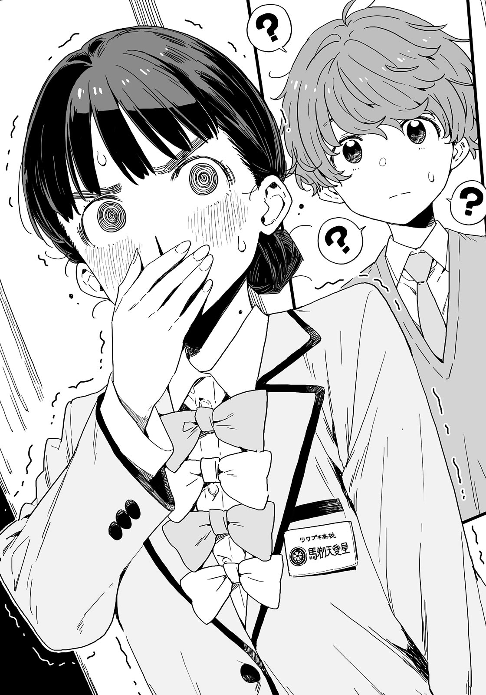

# Ch.27 — เล่ม 5 บทที่ 1-4 บทคั่น

Ch.27 — เล่ม 5 บทที่ 1-4 บทคั่น

By Monica

Published: 2025-05-20T07:35:34Z

Source: https://www.nekopost.net/novel/14560/27

เล่ม 5 บทคั่น - 1

หลังเลิกเรียน ที่ห้องสภานักเรียน

รองประธาน  เทียร่า บาโซริ เปิดประตูด้วยความแรง

[ ฟังฉันหน่อยสิ ประธาน! ]

เทียร่าวิ่งตรงไปที่โต๊ะของประธานและทุบมือลงบนโต๊ะเสียงดัง

ประธานสภานักเรียนโรงเรียนสึวะบุกิ โฮโคบารุ ฮิบาริ เงยหน้าขึ้นจากโต๊ะก่อนจะเอียงคออย่างสงบนิ่ง

[ มีอะไรเหรอ? เธอดูตกใจมากเลยนะ ]

เทียร่าก้าวเข้ามาใกล้ประธาน ใบหน้าของเธอนั้นแดงก่ำเหมือนมะเขือเทศ

[ รุ่นพี่ชิกิยะปลดบราของฉันอีกแล้วค่ะ! ต่อหน้าผู้ชายด้วย! ]

โฮโคบารุยิ้มแห้ง ๆ ขณะปิดหนังสืออ้างอิง

นี่เป็นครั้งที่สามในปีนี้ที่เธอได้ยินคำบ่นแบบนี้

เงาดำปรากฏขึ้นข้างหลังเทียร่าทันทีที่เธอกำลังจะพูดอะไรบางอย่าง

มันคือเลขาสภานักเรียน ชิกิยะ ยูเมโกะ เธอโอบแขนไปรอบ ๆ เทียร่าและเอนตัวพิงเบา ๆ

[ ขนาด…ไม่ดี... ]

[ ขนาดน่ะโอเคแล้ว! มันจะพอดีในเร็ว ๆ นี้แหละ! ]

[ แต่…รูปร่าง...จะเปลี่ยน...ใช่มั้ย? ]

[ ไม่เปลี่ยนหรอก! ถึงฉันจะไม่เข้าใจว่าเธอกำลังพูดเรื่องอะไรอยู่ก็เถอะ! ]

โฮโคบารุมองการโต้ตอบของทั้งสองคนด้วยรอยยิ้ม เธอโบกมือโดยไม่พยายามปิดบังความขบขัน

[ เธอไม่เปลี่ยนไปเลยนะ ชิกิยะ แต่การทำแบบนี้ต่อหน้าคนอื่นมันไม่ดีนะรู้มั้ย? ]

[ อ่า...ครั้งหน้า...ฉันจะหาที่ว่างๆ...ทำ ]

[ รู้ไว้ก็ดี ]

รุ่นพี่ทั้งสองพยักหน้า เทียร่าทนไม่ไหวแล้วจึงตะโกนออกมา

[ มันดีตรงไหน !? เธอไม่ควรถอดมันออกตั้งแต่แรกแล้ว! ประธานก็พูดอะไรบ้างสิ! ]

[ แต่พูดไปก็ไม่มีประโยชน์ใช่มั้ยล่ะ? ]

โฮโคบารุยิ้มอย่างขมขื่นและขมวดคิ้ว

[ ...อะไรกัน? ชี้ให้เห็นปัญหามันผิดตรงไหน? ]

[ ไม่ต้องปิดบังหรอก บาโซริคุงกับชิกิยะเป็นแบบนั้นใช่มั้ย? ]

[ พวกเราไม่ได้เป็นแบบนั้นนะ! ]

[ ความรักมีหลากหลายแบบนะ ฉันจะพยายามทำลายอคติของฉันเอง ถ้ามีอะไรก็พูดกับฉันได้เสมอนะถ้าพวกเธอ- ]

[ ฉันบอกว่าเราไม่ได้เป็นแบบนั้นไง! ]

เทียร่าปฏิเสธอย่างจริงจัง ชิกิยะส่ายหน้าอย่างช้า ๆ

[ เธอรู้แล้ว...ช่วยไม่ได้… ]

[ ไม่มีใครรู้ทั้งนั้นแหละ ! ไม่สิ เราไม่ได้เป็นแบบนั้นตั้งแต่แรกเลย! ควรจะพูดว่ามันตรงกันข้าม–อ้าา! เกิดอะไรขึ้นกันเนี่ย!? ]

เทียร่าเริ่มว้าวุ่นขึ้นเรื่อย ๆ แล้วเธอก็ได้ยินเสียงนุ่มนวลขึ้นมา

[ เอาล่ะ ผมเตรียมชาให้ทุกคนแล้ว พักกันหน่อยเถอะ ]

คนที่ดูอยู่เงียบ ๆ คือเหรัญญิกปีหนึ่งของสภานักเรียน ซากุไร ฮิโรโตะ

เขาเป็นสมาชิกผู้ชายเพียงคนเดียว และเขากำลังถือกาน้ำชาอยู่ในมือ

ซากุไรคุงวางถ้วยชาลงที่เก้าอี้ของชิกิยะและรินชาร้อนใส่ถ้วย

[ ชาพีช...ฉันชอบ ]

ชิกิยะเดินมาที่เก้าอี้ของเธออย่างงงงวย

[ บาโซริจังก็มาพักเถอะ นี่ นั่งลงแล้วดื่มชาสิ ]

[ ก็ได้ ฉันก็เหนื่อยแล้ว…]

เทียร่าเอามือวางไว้บนหน้าผากก่อนจะทิ้งตัวลงนั่งบนเก้าอี้

หลังจากตรวจสอบเสร็จแล้ว ซากุไรคุงก็แจกจานเล็ก ๆ ให้กับทุกคน

[ มีช็อกโกแลตเป็นของว่างด้วยนะ กินได้ตามสบายเลยนะ โฮมเมดด้วยนะรู้มั้ย? ]

[ โอ๊ะ ? ทำเองเหรอ หรือใครให้เธอมา? ]

โฮโคบารุมองช็อกโกแลตด้วยความสงสัย

ซากุราไรคุงรินชาใส่ถ้วยของประธานพร้อมยิ้มอย่างอบอุ่น

[ ทุกคนรู้จักนุคุมิซึคุงจากชมรมวรรณกรรมใช่มั้ย? เขาเป็นคนให้ผมมา ]

[ หา!? ]

เพล้ง ! เทียร่าทำถ้วยหล่นลงพื้น

[ บาโซริจัง โอเคมั้ย ? ]

ซากุไรคุงรีบวิ่งไปหาเธอ

เทียร่าลุกขึ้นยืนทันทีและไม่สนใจผ้าเช็ดหน้าที่เขายื่นให้ เธอคว้าข้อมือซากุไรคุงไว้แน่น

[ ซากุไรคุง!? นายได้ช็อกโกแลตจากนุคุมิซึซังเหรอ!? ]

[ ช-ใช่ ผมให้ข้อมูลเขาเกี่ยวกับวันเปิดเรียนปีที่แล้ว เขาเลยให้ช็อกโกแลตเป็นการขอบคุณ ]

[ คนนั้น…ไม่พอใจกับประธาน….แล้วตอนนี้เขาอยากจะลากซากุไรคุงลงไปด้วยเหรอ…? ]

เทียร่าจับแขนซากุราไรคุงแน่น เธอบ่นพึมพำ

[ ...นั่นมันอะไรนะ? ]

[ ซากุไรคุง! บอกฉันเกี่ยวกับตอนที่เธอได้ช็อกโกแลตเพิ่มหน่อยสิ- ]

เทียร่ายกมือขึ้นปิดจมูกของตัวเองทันที

[ หา? มีอะไรเหรอ บาโซริจัง? ]

เทียร่าเงยหน้าขึ้นและมองเพดานก่อนจะส่ายหัวเบา ๆ

[ ไม่มีอะไรหรอก ฉันแค่ตื่นเต้นไปหน่อย…เลือดกำเดาไหล ]

[...ทำไมล่ะ? ]

ซากุไรคุงงงมาก ชิกิยะโผล่มาจากไหนไม่รู้และวางมือลงบนไหล่ของเทียร่า

[ ...เธอต้องพัก...ในที่เงียบ ๆ… ]

[ อ่า ก็ได้ ขอโทษนะ พักบนโซฟามุมห้องก็แล้วกัน–เดี๋ยวนะ ทำไมเธอพาฉันออกจากห้องล่ะ? รุ่นพี่ชิกิยะคะ ? เราจะไปไหนเนี่ย!? ]

[ ไม่เป็นไร...ฉันจะไม่ทำอะไร...จริง ๆ… ]

[ แล้วทำไมถึงพาฉันออกไปถ้าเธอจะไม่ทำอะไร- ]

ปัง ! ประตูห้องสภานักเรียนปิดลง

ซากุไรคุงมองพวกเธอเดินจากไปก่อนถอนหายใจลึก ๆ

[ ช่วยไม่ได้จริง ๆ พี่ฮิบะ มาดื่มชากันเถอะ ]

เขาหันกลับไป โฮโคบารุกำลังยืนอยู่อย่างเคอะเขินกับหูถ้วยในมือ

อีกครั้งแล้วที่ในมือเธอมีแค่หูถ้วย แต่กาน้ำชาแตกและชากระจายอยู่บนพื้น

[ หูกาน้ำชามันหักตอนที่ฉันกำลังจะรินชาให้ฮิโรโตะ ฉันไม่ได้ทำอะไรเลย ]

[ โอเคมั้ยน่ะ ? ไม่เป็นไรหรอก ผมจัดการเอง นั่งลงก่อนเถอะ ]

ซากุไรคุงกดท้องเบา ๆ ขณะย่อตัวลงและเก็บเศษกาน้ำชา

สภานักเรียนโรงเรียนสึวะบุกิ ถึงจะเป็นกลุ่มคนที่ยอดเยี่ยม แต่ก็ยังไม่มีใครรู้ว่าคนที่4ที่แบกสภานักเรียนอยู่จริงๆนั้นคือใคร

---

ก็ว่าหายไปไหน ลืมกด active 🥺
